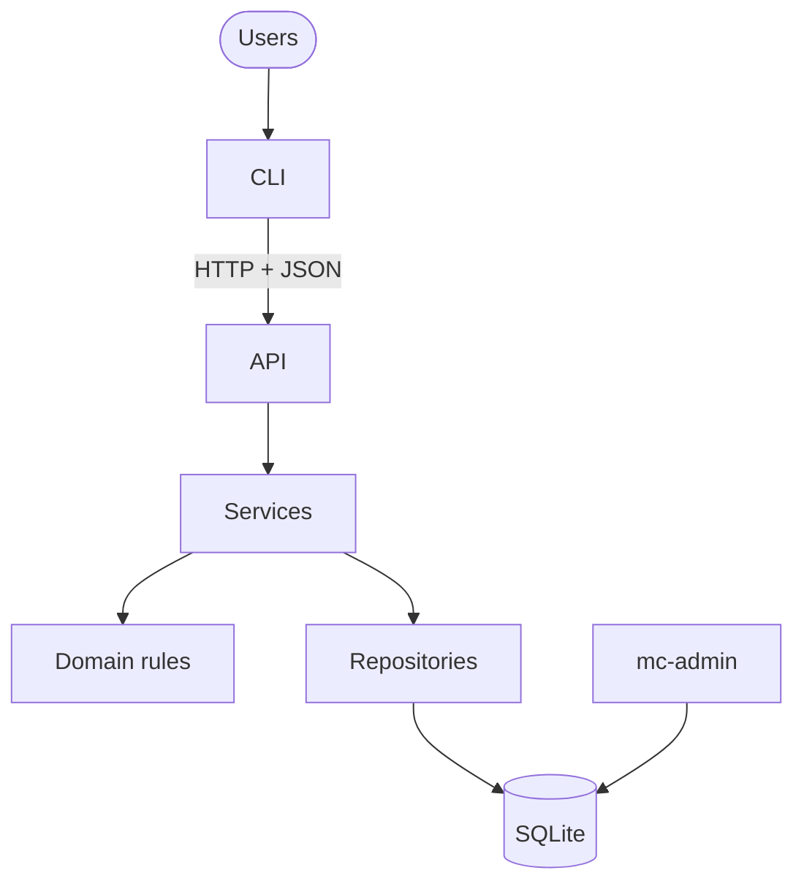
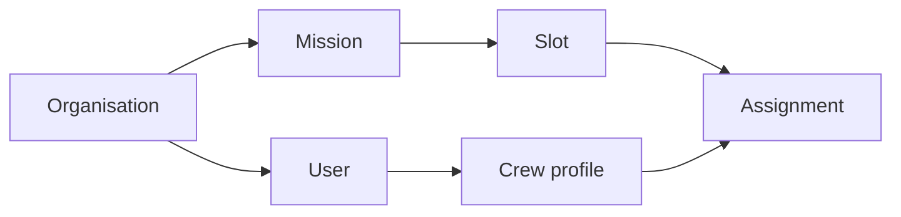
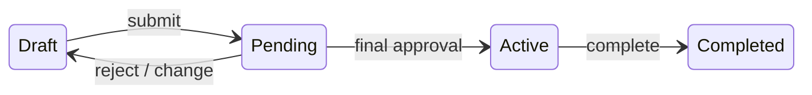
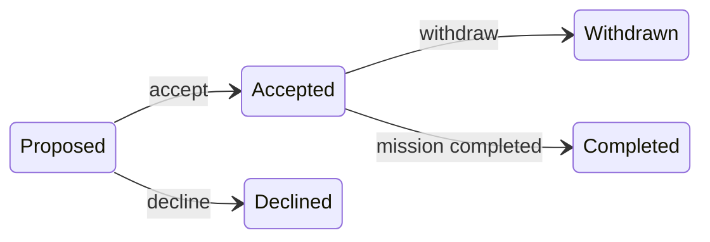
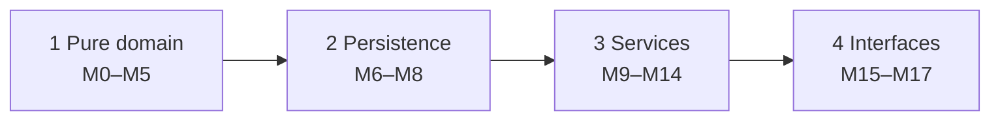

# Mission Control — Technical Design (v1)

> **Status:** Agreed · **Implements:** [`prd.md`](prd.md) · **Audience:** the engineering team and the coding agents implementing v1
>
> The PRD defines *what* the system does. This document defines *how* we build it, *why* we chose this approach, and *in what order* we deliver it. IDs such as P3, M7 or AC-15 refer to the PRD.

**Contents**
1. [Summary](#1-summary)
2. [Architecture](#2-architecture)
3. [Data model](#3-data-model)
4. [Security and tenancy](#4-security-and-tenancy)
5. [Lifecycle](#5-lifecycle)
6. [Matching](#6-matching)
7. [API](#7-api)
8. [CLI](#8-cli)
9. [Delivery plan](#9-delivery-plan)
10. [Guidelines for implementing agents](#10-guidelines-for-implementing-agents)
11. [Setup and testing](#11-setup-and-testing)
- [Appendix A: Schema SQL](#appendix-a-schema-sql)
- [Appendix B: Trade-offs and considerations](#appendix-b-trade-offs-and-considerations)

---

## 1. Summary

**What we're building.** A multi-tenant API and CLI for planning space missions:
- organisations manage crew and their skills;
- Leads define missions and get crew suggestions from a deterministic matcher;
- Directors approve missions before they go active.

**Design principles**

1. **Business rules live in one place.** All rules are pure functions in `domain/`, so they're easy to test and shared by every entry point.
2. **Tenant isolation in depth.** Identity, queries, database constraints and tests each block cross-tenant access independently.
3. **The CLI is just a client.** It uses the same API as any other client, so the API is the only place behaviour is enforced.
4. **Simple to run, simple to reason about.** One process, one SQLite file, no background jobs.
5. **Test-first.** Every module begins with failing tests derived from PRD acceptance criteria.

**Non-goals for v1:** web UI, horizontal scaling, notifications, background scheduling, SSO, migrations tooling. See [Appendix B](#appendix-b-trade-offs-and-considerations) for the trade-offs and what we'd change at scale.

---

## 2. Architecture

**Stack:** Python 3.12 · FastAPI + Pydantic v2 · SQLite through stdlib `sqlite3` · argon2-cffi · Typer + httpx2 · uv, pytest, ruff

**Dependency policy:** don't use `httpx` anywhere, including tests. Use `httpx2`, which Starlette's `TestClient` now expects.

Why SQLite, hand-written SQL, and a CLI that goes through the API: [TR-1](#tr-1), [TR-2](#tr-2), [TR-4](#tr-4).



| Layer | Folder | Responsibility | May depend on |
|---|---|---|---|
| CLI | `cli/` | Commands, output, prompts | API over HTTP only |
| API | `api/` | Validate input, resolve `Actor`, call a service, map errors | services |
| Services | `services/` | One use case = one transaction + audit | domain, infra |
| Domain | `domain/` | Every business rule, pure (no I/O) | nothing |
| Infra | `infra/` | Connections, schema, scoped repositories, security | domain types |

**How a request flows** (example: `mc missions submit 12`)

1. The CLI sends `POST /api/v1/missions/12/submit` with the bearer token.
2. The API resolves the token to an `Actor` (user, organisation, role) and calls `services.missions.submit(actor, 12)`.
3. The service opens `BEGIN IMMEDIATE` and loads the mission through `Repos(conn, actor.org_id)`.
4. `domain.lifecycle.check_submit(...)` returns a list of problems. If the list is empty, the service writes the new status and an audit event, then commits.
5. The API returns `200` with the mission, or `409` with every problem. The CLI prints one bullet per problem and exits with code `1`.

<details><summary>Folder layout</summary>

```
src/mission_control/
  domain/    dates  enums  errors  eligibility  matching  lifecycle  approvals  permissions  passwords  records
  infra/     db  schema.sql  security  repositories/
  services/  auth  admin  crew  missions  assignments  approvals  matching  audit  inbox
  api/       app  deps  errors  schemas/  routers/
  cli/       main  client  config  render  resolve  commands/
  seed/      data  loader
  admin_cli.py        # mc-admin: init-db, seed, create-org
tests/  unit/  integration/  api/  cli/  builders.py  conftest.py
```
</details>

---

## 3. Data model

The core entities are below. Skills, unavailability, approvals, tokens and the audit log hang off these. All 13 tables are in [Appendix A](#appendix-a-schema-sql).



**Tenant safety.** Every tenant table has `org_id` and `UNIQUE (org_id, id)`. Every reference between tenant rows includes `org_id`, so the database itself rejects links across organisations. Why a shared database: [TR-3](#tr-3).

| Enforced by the database | Enforced by services |
|---|---|
| Value ranges and valid dates | Eligibility and overlaps |
| Cross-organisation links rejected | Open places |
| One open assignment per person per mission | State transitions |
| A slot belongs to its mission | Permissions and the owner's role |
| Reasons for withdrawals and rejections | At least one requirement per slot |
| Append-only audit log; used skills can't be deleted | |

**Modelling choices**
- **Approval rounds.** Submit sets `round += 1` and saves N in `approvals_required`. Only approvals in the current round count, and none are ever deleted ([TR-9](#tr-9)).
- **Soft-deleted slots.** `removed_at` keeps the history of past assignments.
- **Nothing derived is stored.** Workload, eligibility, open places and the roster are computed when needed ([TR-7](#tr-7)).
- **Integer IDs** keep CLI commands short ([TR-12](#tr-12)).
- **History survives renames.** Audit `data` keeps the names that applied at the time.
- **"On a mission"** means holding an open or completed assignment. Any other status gives summary access only (V2).

---

## 4. Security and tenancy

### Authentication

| | |
|---|---|
| Token | 32 random bytes. Only the SHA-256 hash is stored. 12-hour expiry. |
| Every request | Token → valid? → user active? → `Actor(user_id, org_id, role, crew_profile_id)`. Nothing is cached, so role changes apply immediately. |
| Revocation | Logout revokes that token. Deactivation or a password change revokes every token. Opaque tokens make this immediate ([TR-5](#tr-5)). |
| Passwords | Argon2id. At least 15 characters. No character-type rules. |

### Permissions

Each **role** sets the baseline:

| Role | Can | Can't |
|---|---|---|
| **Director** | Run the organisation: users, roles, skills, approval setting. See everything. Approve, transfer, complete and cancel missions. | Edit mission details, since that's the owner's job |
| **Lead** | Create and run their own missions. Rate other people's skills. See all crew and missions. | Approve anything. Touch missions they don't own. |
| **Crew** | Manage their own profile and availability. Respond to their own assignments. | See other crew, or missions they aren't on |

On top of the role, **relationship rules** make the decisions that matter:

| Rule | Effect | PRD |
|---|---|---|
| **Owner only** | Only the mission's owner edits it, proposes crew, applies the matcher or submits | M3 |
| **Not yourself** | Nobody sets their own skill levels | P3 |
| **Eligible approver** | A Director can't approve a mission they created or are on | A2 |
| **Self only** | Only you edit your details and availability. Only you, and Directors, see your unavailability reasons. | P4, §5.7 |
| **Visibility** | Crew only see missions they're on. Former assignees see a summary. | V2 |

**Enforcement.** `domain/permissions.authorize(actor, action, ctx)` is the single entry point. The complete action × role table is the parametrized test for this module, and that test is the source of truth.

| Status | When |
|---|---|
| **401** | Authentication failed |
| **404** | Missing, another organisation's, or not visible. All three look identical ([TR-10](#tr-10)). |
| **403** | Visible, but you're not allowed to do this |

### Tenant isolation

1. **Identity.** `org_id` comes only from the token, never from the request.
2. **Repositories.** `Repos(conn, org_id)` scopes every query. Another organisation's ID behaves as missing.
3. **Database.** Composite `(org_id, id)` foreign keys.
4. **Tests.**
   - An SQL lint checks every query mentions `org_id`.
   - A route inventory makes sure no endpoint is left out of the isolation tests.
   - A cross-organisation sweep compares database snapshots before and after.

---

## 5. Lifecycle

### Mission



Any state before Completed can also be **cancelled**.

| Action | Who | Must be true | Effect |
|---|---|---|---|
| submit | owner | Slots full, all accepted, roster eligible, eligible approvers ≥ N | `round += 1`, N saved |
| approve | eligible Director | Hasn't decided this round. Roster eligible. | Active once N is reached. **If a check fails, nothing is written.** |
| reject | eligible Director | Reason given | → Draft |
| transfer | Director | New owner is an active Lead | Pending → Draft. Active stays Active. |
| complete | owner or Director | Mission is Active | Accepted assignments → completed |
| cancel | owner or Director | Reason given | Open assignments → cancelled |

### Assignment



The owner can also **remove** an open assignment. Cancelling the mission **cancels** every open assignment.

| Action | Who | Mission must be | Notes |
|---|---|---|---|
| propose | owner | Draft or Pending* | Person eligible, place open, not already on this mission |
| accept | crew member | Draft | Still eligible. An overlap names the conflicting mission. |
| decline | crew member | Draft | Reason optional |
| withdraw | crew member | Draft or Pending* | Reason required |
| remove | owner | Draft or Pending* | |

\* Sends a Pending mission back to Draft.

### Cross-cutting rules

| Rule | How it's implemented |
|---|---|
| **Back to Draft** | Every mutating service calls `touch_for_change()` first. Draft → no change. Pending → Draft. Active → `mission_frozen`. Final → `mission_final`. |
| **Edits can't break assignments (M7)** | `invalidated_by()` checks slot removal, headcount, requirements and dates → `invalidates_assignments` |
| **Skill changes (P3)** | Allowed. Refused only if they'd break an **Active** assignment → `invalidates_active_assignment` |
| **Audit** | Written in the same transaction as the change. Refused actions write nothing. |
| **Transactions** | One connection per request. `foreign_keys=ON`. `busy_timeout=5000`. `BEGIN IMMEDIATE` *before* checks. Roll back on error. Lock timeout → 503 `busy`. ([TR-11](#tr-11)) |

---

## 6. Matching

The matcher suggests crew for a Draft mission's open places. It's a pure function: same inputs, same output. It's greedy rather than optimal, which keeps it explainable ([TR-6](#tr-6)).

**How it works**

1. **Filter.** For each slot, keep candidates who are eligible: active, skills meet the requirements, available, and no overlapping accepted assignment.
2. **Pick a slot.** Take the open slot with the fewest candidates, so scarce skills are protected.
3. **Pick a person.** Take the lowest workload, then the highest proficiency, then the lowest ID.
4. **Place** that person and remove them from every other slot's candidates.
5. **Repeat** until all places are filled or marked **unfilled**.

**Inputs** (`domain/records.py`). They carry names as well as IDs, so every refusal can name the person, skill and mission involved:

| Record | Fields |
|---|---|
| `Requirement` | `skill_id`, `skill_name`, `min_level` |
| `SlotSpec` | `id`, `position`, `name`, `open_places`, `requirements: tuple[Requirement, ...]` |
| `Commitment` | `mission_id`, `mission_name`, `window`: an accepted assignment on another non-final mission |
| `CandidateFacts` | `crew_profile_id`, `name`, `active`, `skills: {skill_id: level}`, `unavailable: tuple[DateRange, ...]`, `accepted_elsewhere: tuple[Commitment, ...]`, `workload` |
| `RosterEntry` | `assignment_id`, `slot: SlotSpec`, `crew: CandidateFacts`, `status`: an open assignment on the mission being edited or submitted (`crew.accepted_elsewhere` excludes this mission) |
| `AssignmentFact` | `mission_id`, `mission_status`, `assignment_status`, `window`: one of a person's assignments, used to compute workload |
| `ActiveAssignment` | `mission_id`, `mission_name`, `slot_name`, `requirements`: an accepted assignment on an Active mission, used to check skill changes |

```python
def suggest_roster(slots: list[SlotSpec], candidates: list[CandidateFacts],
                   window: DateRange) -> Suggestion:
    by_id = {c.crew_profile_id: c for c in candidates}
    eligible = {s.id: {c.crew_profile_id for c in candidates if is_eligible(c, s, window)}
                for s in slots}
    remaining = {s.id: s.open_places for s in slots}
    placements, unfilled = [], []

    while open_slots := [s for s in slots if remaining[s.id] > 0]:
        # Most-constrained slot first; ties by listed position, then id.
        slot = min(open_slots, key=lambda s: (len(eligible[s.id]), s.position, s.id))

        if not eligible[slot.id]:
            unfilled.append(Unfilled(slot.id, remaining[slot.id]))
            remaining[slot.id] = 0
            continue

        # Lowest workload, then highest proficiency, then stable id.
        person = min((by_id[i] for i in eligible[slot.id]),
                     key=lambda c: (c.workload, -proficiency(c, slot), c.crew_profile_id))

        placements.append(Placement(slot.id, person.crew_profile_id))
        remaining[slot.id] -= 1
        for ids in eligible.values():
            ids.discard(person.crew_profile_id)

    return Suggestion(placements, unfilled)


def proficiency(c: CandidateFacts, slot: SlotSpec) -> int:
    return sum(c.skills.get(r.skill_id, 0) for r in slot.requirements)
```

**Workload** = total mission-days of accepted assignments on missions that aren't completed, leaving out the mission being matched.

| | Preview | Apply |
|---|---|---|
| Who | Owner or Director | Owner only |
| Writes | Nothing | Proposals, created through the normal `propose` path |
| Data | Loaded with one query per fact type | Recomputed inside the write transaction, so it's never stale |

---

## 7. API

**Conventions**
- REST and JSON, under `/api/v1`.
- Authentication with the header `Authorization: Bearer <token>`.
- Lifecycle changes are explicit `POST` commands, for example `/submit`. They are never `PATCH status`, because each one has its own guards and audit event ([TR-8](#tr-8)).
- List endpoints return only what the caller is allowed to see.

#### Auth and me
| Method | Path | Purpose |
|---|---|---|
| POST | `/auth/login` | Exchange email and password for a token |
| POST | `/auth/logout` | Revoke the current token |
| GET | `/me` | Current user, role and crew profile |
| POST | `/me/password` | Change password (revokes all sessions) |
| GET | `/me/inbox` | Things waiting on me |

#### Organisation, users and skills (Directors)
| Method | Path | Purpose |
|---|---|---|
| GET · PATCH | `/org` | View settings, or set the required approvals |
| GET · POST | `/users` | List users, or create one with an initial password |
| PATCH | `/users/{id}` | Change role or deactivate |
| POST | `/users/{id}/crew-profile` | Give a user a crew profile |
| GET · POST | `/skills` | List skills (Leads too), or add one |
| PATCH · DELETE | `/skills/{id}` | Rename, or delete if unused |

#### Crew
| Method | Path | Purpose |
|---|---|---|
| GET | `/crew` · `/crew/{id}` | List or view profiles |
| PATCH | `/crew/{id}` | Edit own display name and bio |
| PUT · DELETE | `/crew/{id}/skills/{skill_id}` | Set or remove a skill level |
| GET · POST | `/crew/{id}/unavailability` | List or add own unavailability |
| DELETE | `/crew/{id}/unavailability/{uid}` | Remove own unavailability |
| GET | `/crew/{id}/assignments` | Assignment history (summaries) |

#### Missions
| Method | Path | Purpose |
|---|---|---|
| GET · POST | `/missions` | List visible missions, or create one with slots |
| GET · PATCH | `/missions/{id}` | View, or edit name and dates |
| POST | `/missions/{id}/slots` | Add a slot |
| PATCH · DELETE | `/missions/{id}/slots/{sid}` | Edit or remove a slot |
| GET | `/missions/{id}/history` | Audit trail |
| POST | `/missions/{id}/submit` · `approve` · `reject` · `complete` · `cancel` | Lifecycle commands |
| POST | `/missions/{id}/owner` | Transfer ownership |
| GET | `/missions/{id}/match` | Preview suggested roster |
| POST | `/missions/{id}/match/apply` | Create proposals from the suggestion |

#### Assignments
| Method | Path | Purpose |
|---|---|---|
| POST | `/missions/{id}/assignments` | Propose a crew member for a slot |
| GET | `/assignments` | My assignments |
| POST | `/assignments/{id}/accept` · `decline` · `withdraw` · `remove` | Respond or remove |

#### Errors

Every error has the same shape, for every status code (401, 403, 404, 409, 422, 503). `problems` is always present and always has at least one entry, so clients only ever handle one format. A rule or state conflict (409) lists **every** problem at once. A permission refusal (403) lists its single reason, because only one applies and the actor can't fix it themselves. Each problem names the record involved:

```json
{
  "error": {
    "code": "rule_violation",
    "message": "Mission can't be submitted",
    "problems": [
      { "code": "slot_unfilled", "message": "Commander: 1 of 1 place unfilled", "refs": { "slot_id": 12 } }
    ]
  }
}
```

| HTTP | Meaning | Codes |
|---|---|---|
| 401 | Not authenticated | `invalid_credentials` `unauthenticated` |
| 403 | Not allowed | `role_forbidden` `not_owner` `approver_is_creator` `approver_is_rostered` `self_skill_edit` `wrong_current_password` |
| 404 | Not found or not visible | `not_found` |
| 409 | Conflicts with state or a rule | **State:** `mission_frozen` `mission_final` `invalid_transition` `already_decided`<br>**Rules:** `rule_violation` `overlap` `unavailable` `insufficient_approvers` `invalidates_assignments` `invalidates_active_assignment`<br>**Admin:** `has_open_assignments` `owns_open_missions` `last_director` `skill_in_use` |
| 422 | Invalid input | `validation_error` `password_too_short` |
| 503 | Database busy, retry | `busy` |

**Problem codes.** These appear inside `problems` and explain each refusal. Adding one means updating this table in the same change.

| Code | Raised when | Typical `refs` |
|---|---|---|
| `inactive` | The person is deactivated | `crew_profile_id`, `slot_id` |
| `skill_below_minimum` | A required skill is missing or below the minimum | `crew_profile_id`, `slot_id`, `skill_id` |
| `unavailable` | Unavailability overlaps the mission's dates | `crew_profile_id`, `slot_id` |
| `overlap` | An accepted assignment on another mission overlaps (the message names that mission) | `crew_profile_id`, `mission_id`, `mission_name` |
| `slot_has_open_assignments` | Removing a slot that still has crew | `assignment_id`, `crew_profile_id`, `slot_id` |
| `headcount_below_open_assignments` | Lowering headcount below the assigned crew (the message names them) | `slot_id`, `crew_profile_ids` |
| `invalidates_active_assignment` | A skill change would break an assignment on an Active mission | `mission_id`, `skill_id` |
| `slot_unfilled` | Submitting with empty places | `slot_id` |
| `proposal_unanswered` | Submitting while a proposal is still waiting for a reply (the message names the person and slot) | `assignment_id`, `slot_id`, `crew_profile_id` |

---

## 8. CLI

| Concern | Behaviour |
|---|---|
| Client | An `httpx2` wrapper passed into commands, so tests use `TestClient` and need no server |
| Auth | Token stored in `~/.config/mission-control/credentials.json` (mode 0600). Cleared on logout, password change or 401. |
| References | Missions and assignments by ID. People by email. Skills by name. Slots by name or position. |
| Passwords | Hidden prompt only, never a flag. Asked twice when setting one. |
| Output | Plain tables. No meaning carried by colour alone. `--json` for scripts. |
| Errors | The message, then one bullet per problem, then a hint for known codes |
| Exit codes | `0` OK · `1` refused · `2` usage · `3` authentication · `4` unreachable or busy |
| Confirmations | Changing a Pending mission, or cancelling, asks first. `--yes` skips the prompt. |

```bash
# Everyone
mc login | logout | whoami | password | inbox
mc me show | update | unavailable add|list|remove
mc assignments list [--pending] | accept ID | decline ID | withdraw ID --reason R

# Leads
mc missions create --name N --start D --end D --slot "Commander:1:Piloting>=4,Leadership>=3"
mc missions edit | slot add|edit|remove | match ID [--apply]
mc missions propose ID --slot S --crew EMAIL | remove-crew ID ASSIGNMENT | submit ID
mc crew list | show | history | set-skill EMAIL SKILL LEVEL | unset-skill EMAIL SKILL

# Directors
mc missions approve ID | reject ID --reason R | transfer ID --owner EMAIL
mc missions complete ID | cancel ID --reason R | list | show | history
mc users list | add | set-role | deactivate | enable-crew
mc skills list | add | rename | remove          mc org show | set-approvals N
```

---

## 9. Delivery plan

We deliver in four phases. Each phase ends in something that can be demonstrated and tested.



| Phase | Milestone (what you can show) |
|---|---|
| 1. Pure domain | Matcher reproduces S2 and S3; lifecycle and permission tables pass, with no database involved |
| 2. Persistence | Seeded database matches PRD §9; tenant-scoped queries; login works |
| 3. Services | Every scenario passes at the service level (S1, S3b–S8) |
| 4. Interfaces | Full golden path (S1) through the real CLI; isolation sweep passes; README smoke test passes |

| # | Module | Write these tests first |
|---|---|---|
| **Phase 1** | | |
| M0 | Skeleton | `/health` returns 200 |
| M1 | dates | Boundary-day overlap (AC-17) · mission-days · end ≥ start |
| M2 | eligibility, passwords | Each ineligibility reason · workload (AC-20) · M7 and P3 checks · 14 characters rejected, 15 accepted |
| M3 | matching | S2, S3 · each tie-break · most-constrained first · unfilled · determinism |
| M4 | lifecycle, approvals | All submit problems at once (AC-2) · quorum uses saved N · approver rules (AC-8, 11, 12) · failed approval writes nothing |
| M5 | permissions | Full action × role table |
| **Phase 2** | | |
| M6 | schema | Pragmas · rollback · constraints · composite foreign keys |
| M7 | repos, seed | Seed matches PRD §9 · scoped `get` · V2 visibility · SQL lint |
| M8 | auth | Login · inactive user · expiry · every revocation path · role read fresh |
| **Phase 3** | | |
| SF | service foundation | Service context (actor + `Repos` + transaction + audit) · `RuleViolation` carrying problems · refused view becomes not-found · fact loaders building `CandidateFacts` / `RosterEntry` / `AssignmentFact` / `ActiveAssignment` from the database · the repository writes Wave 1 needs |
| M9 | admin | P1, P7–P10 · last Director (AC-25, 26) |
| M10 | crew | Self-only edits (AC-16) · skill rules (AC-23) · reasons hidden (AC-24) |
| M11 | missions | M7 · back to Draft (AC-4) · Active freeze · transfer (AC-7) |
| M12 | assignments | Propose (AC-14) · overlap on accept (AC-15) · withdraw (S5) · cascades |
| M13 | approvals | S1, S6, S7, S8 · audit trail (AC-1) |
| M14 | matching service | Preview writes nothing (AC-22) · apply · isolation (AC-31) · S3b |
| **Phase 4** | | |
| M15 | API | Error mapping: **every** error body has a non-empty `problems` list, 403/404/401/422/503 included · permissions over HTTP · isolation sweep (S9) · scenarios |
| M16 | CLI | Reference resolution · `--slot` parser · prompts · exit codes · S1, S4 |
| M17 | README | Smoke-test the README commands |

**Waves.** Independent modules may be built at the same time, each in its own git worktree ([§10](#working-in-waves-worktrees)), and then reviewed and committed one at a time. Phase 3 runs as:

```
SF service foundation (on main)
  → Wave 1: M9 admin ∥ M10 crew ∥ M11 missions
  → M12 assignments
  → Wave 3: M13 approvals ∥ M14 matching service
```

SF comes first so the waves share one service context and one set of fact loaders instead of each writing their own. Earlier pairs that were independent: M3 ∥ M4, M5 ∥ M6.

**Definition of done (every module)**
- [ ] Tests were written first, and each test name includes the PRD ID it covers.
- [ ] `uv run pytest` and `uv run ruff check` both pass on the whole repo.
- [ ] No layer-boundary violations ([§10](#10-guidelines-for-implementing-agents)).
- [ ] Any new endpoint is added to the isolation sweep.
- [ ] The module was verified by actually running it, and the output was shown, not just the test results.
- [ ] A read-only review of the diff was done and its findings reported.
- [ ] A commit was **proposed**, and made only after the user approved it.

---

## 10. Guidelines for implementing agents

### Source of truth
1. The **PRD** decides behaviour. **This document** decides structure. Code follows both.
2. **Don't invent behaviour.** If the PRD is silent or contradicts this document, stop and ask. Don't guess, and don't "improve" the rule.
3. Work on **one module at a time**, in the order in [§9](#9-delivery-plan). Start a module only when the user has approved it, and never before its dependencies are done.

### The loop for each module
1. Read the module's row in §9 and every PRD ID it references.
2. Write failing tests. Name them after the rule, for example `test_ac15_accept_overlap_names_conflicting_mission`.
3. Write the smallest implementation that makes them pass.
4. Refactor, then run the **full** suite and `ruff`.
5. Verify the behaviour by running it for real (a REPL call, a request, or a CLI command), and show the output.
6. Do a read-only review of the diff, and report findings without editing anything.
7. Propose a commit message, such as `feat(m12): assignment propose/accept/withdraw`. **Don't commit, and don't start the next module, until the user approves.**

### Working in waves (worktrees)
- **Approval:** a wave starts only when the user approves every module in it. The modules must not depend on each other.
- **Isolation:** each module gets its own worktree and branch, `.worktrees/<module>` on branch `<module>` (e.g. `m9-admin`), created from the current `main`. The agent works only inside it and runs `uv sync` and the tests there.
- **Agents don't commit.** Each leaves its changes uncommitted and reports the usual package: tests first, real run, read-only review.
- **Review is one branch at a time.** The user reviews only that module's diff against `main`.
- **Merge:** after approval, the lead commits on the branch, rebases it onto `main` if `main` has moved (re-running its tests), fast-forwards `main`, and runs the full suite on `main` before the next review.
- **Ports:** a real run that starts a server uses port `8000 + module number` (e.g. M11 uses 8011).
- **Clean-up:** remove the worktree and branch once merged.

### Architecture rules (never break these)
- `domain/` imports nothing from `infra/`, `services/`, `api/` or `sqlite3`.
- All SQL lives in `infra/repositories/`, and every query filters on `org_id`.
- `org_id` comes only from the `Actor`. Never read it from request input.
- Every mutating service calls `touch_for_change()` first, and writes an audit event in the same transaction.
- Writes open `BEGIN IMMEDIATE` **before** running checks.
- Errors use the codes in [§7](#7-api). Adding a code means updating that table in the same change.

### Coding conventions
- Type hints everywhere. Frozen dataclasses for domain records. No module-level mutable state.
- `date` objects in the domain, ISO strings only at the database and API edges. Timestamps are UTC.
- Use PRD vocabulary in names: `open_places`, `eligible_approver`, `workload`.
- Keep routers thin: validate, call one service, return.

### Testing conventions
- Use the `seeded_db` fixture for PRD scenarios, and `tests/builders.py` for edge cases.
- Every test gets its own database. No network calls. No reliance on the current date: pass dates in.
- Never weaken or delete a test to make it pass. If a test looks wrong, raise it.

### Stop and ask before
- adding a dependency;
- changing the schema (and if you do, update [Appendix A](#appendix-a-schema-sql) as well);
- adding an endpoint, error code or CLI command that isn't in this document;
- any case where the PRD looks ambiguous or a PRD scenario's expected outcome seems wrong.

---

## 11. Setup and testing

```bash
uv sync
uv run mc-admin seed --reset      # load PRD §9 data
uv run mc-server                  # API on 127.0.0.1:8000
uv run mc login --email lee@aurora.example
uv run pytest
```

Settings: `MC_DATABASE_PATH` · `MC_TOKEN_TTL_HOURS=12` · `MC_DB_BUSY_TIMEOUT_MS=5000`

| Level | Database | Covers |
|---|---|---|
| Unit | none | Domain rules, matcher, lifecycle, permission table |
| Integration | temporary file | Services, rollback, constraints, audit, SQL lint |
| API | temporary file | Error codes, auth, permissions, isolation sweep, scenarios S1 and S3b–S9 |
| CLI | temporary file | S1 and S4 end to end, `--json`, errors, exit codes, prompts |

- **Shared seed.** `seed/data.py` drives both the demo and the tests, so they can't drift apart.
- **Isolated databases.** Every test gets a fresh SQLite file under `tmp_path`.
- **Fixtures.** `seeded_db` for scenarios; `tests/builders.py` for focused edge cases.

---

## Appendix A: Schema SQL

The SQL becomes `infra/schema.sql`.

**Conventions**
- Tables are `STRICT`, which needs SQLite 3.37 or later. `init_db` checks `sqlite3.sqlite_version` and refuses to start on anything older.
- Every tenant-owned table has `org_id NOT NULL` and `UNIQUE (org_id, id)`. That unique pair is the target for every reference from another tenant table, so a row can never point into another organisation.
- Dates are stored as `TEXT` in `YYYY-MM-DD` form. `date(x) IS x` rejects badly formed dates. Plain `=` wouldn't work here: it returns NULL on bad input, and a NULL check passes.
- Timestamps are UTC ISO `TEXT`, with the default `strftime('%Y-%m-%dT%H:%M:%fZ','now')`. Below this is written as `<now>`.
- All foreign keys are `ON DELETE RESTRICT` (SQLite's default). The only exception is `slot_requirements`, which cascades from its slot. Domain rows are never hard-deleted except unused skills (P1) and replaced slot requirements.

### Organisations, users and sessions

```sql
PRAGMA user_version = 1;

CREATE TABLE organisations (
  id                 INTEGER PRIMARY KEY,
  name               TEXT    NOT NULL,
  slug               TEXT    NOT NULL UNIQUE,
  required_approvals INTEGER NOT NULL DEFAULT 1 CHECK (required_approvals >= 1),   -- A1
  created_at         TEXT    NOT NULL DEFAULT (<now>)
) STRICT;

CREATE TABLE users (
  id            INTEGER PRIMARY KEY,
  org_id        INTEGER NOT NULL REFERENCES organisations(id),
  email         TEXT    NOT NULL UNIQUE COLLATE NOCASE,        -- login is by email only
  name          TEXT    NOT NULL CHECK (length(trim(name)) > 0),
  role          TEXT    NOT NULL CHECK (role IN ('director','lead','crew')),
  password_hash TEXT    NOT NULL,                               -- Argon2id encoded hash
  is_active     INTEGER NOT NULL DEFAULT 1 CHECK (is_active IN (0,1)),
  created_at    TEXT    NOT NULL DEFAULT (<now>),
  updated_at    TEXT    NOT NULL DEFAULT (<now>),
  UNIQUE (org_id, id)
) STRICT;
CREATE INDEX users_org_role ON users(org_id, role, is_active);

CREATE TABLE auth_tokens (                                      -- not tenant-owned; reached only via token hash
  id         INTEGER PRIMARY KEY,
  user_id    INTEGER NOT NULL REFERENCES users(id),
  token_hash TEXT    NOT NULL UNIQUE,                           -- SHA-256 hex; raw token never stored
  created_at TEXT    NOT NULL DEFAULT (<now>),
  expires_at TEXT    NOT NULL,
  revoked_at TEXT
) STRICT;
CREATE INDEX auth_tokens_user ON auth_tokens(user_id) WHERE revoked_at IS NULL;
```

### Crew, skills and availability

```sql
CREATE TABLE crew_profiles (
  id           INTEGER PRIMARY KEY,                             -- stable identifier for matcher ties
  org_id       INTEGER NOT NULL,
  user_id      INTEGER NOT NULL UNIQUE,                         -- at most one profile per user (P9)
  display_name TEXT    NOT NULL CHECK (length(trim(display_name)) > 0),   -- P4
  bio          TEXT,
  created_at   TEXT    NOT NULL DEFAULT (<now>),
  updated_at   TEXT    NOT NULL DEFAULT (<now>),
  UNIQUE (org_id, id),
  FOREIGN KEY (org_id, user_id) REFERENCES users(org_id, id)
) STRICT;

CREATE TABLE skills (
  id         INTEGER PRIMARY KEY,                               -- stable across renames (P1)
  org_id     INTEGER NOT NULL REFERENCES organisations(id),
  name       TEXT    NOT NULL CHECK (length(trim(name)) > 0),
  category   TEXT,
  created_at TEXT    NOT NULL DEFAULT (<now>),
  UNIQUE (org_id, id),
  UNIQUE (org_id, name COLLATE NOCASE)
) STRICT;

CREATE TABLE crew_skills (
  org_id          INTEGER NOT NULL,
  crew_profile_id INTEGER NOT NULL,
  skill_id        INTEGER NOT NULL,
  level           INTEGER NOT NULL CHECK (level BETWEEN 1 AND 5),   -- P2
  updated_by_id   INTEGER NOT NULL,
  updated_at      TEXT    NOT NULL DEFAULT (<now>),
  PRIMARY KEY (crew_profile_id, skill_id),
  FOREIGN KEY (org_id, crew_profile_id) REFERENCES crew_profiles(org_id, id),
  FOREIGN KEY (org_id, skill_id)        REFERENCES skills(org_id, id),   -- RESTRICT blocks deleting used skills
  FOREIGN KEY (org_id, updated_by_id)   REFERENCES users(org_id, id)
) STRICT;
CREATE INDEX crew_skills_skill ON crew_skills(skill_id);

CREATE TABLE unavailability (
  id              INTEGER PRIMARY KEY,
  org_id          INTEGER NOT NULL,
  crew_profile_id INTEGER NOT NULL,
  start_date      TEXT    NOT NULL CHECK (date(start_date) IS start_date),
  end_date        TEXT    NOT NULL CHECK (date(end_date) IS end_date),
  reason          TEXT    NOT NULL CHECK (length(trim(reason)) > 0),   -- P5
  created_at      TEXT    NOT NULL DEFAULT (<now>),
  CHECK (end_date >= start_date),                                         -- M2
  UNIQUE (org_id, id),
  FOREIGN KEY (org_id, crew_profile_id) REFERENCES crew_profiles(org_id, id)
) STRICT;
CREATE INDEX unavailability_profile ON unavailability(crew_profile_id, start_date);
```

### Missions, slots and requirements

```sql
CREATE TABLE missions (
  id                 INTEGER PRIMARY KEY,
  org_id             INTEGER NOT NULL,
  name               TEXT    NOT NULL CHECK (length(trim(name)) > 0),
  start_date         TEXT    NOT NULL CHECK (date(start_date) IS start_date),
  end_date           TEXT    NOT NULL CHECK (date(end_date) IS end_date),
  status             TEXT    NOT NULL DEFAULT 'draft'
                     CHECK (status IN ('draft','pending_approval','active','completed','cancelled')),
  owner_id           INTEGER NOT NULL,                          -- must be an active Lead: enforced in services (M1)
  created_by_id      INTEGER NOT NULL,                          -- kept separately for approver eligibility (A2)
  approval_round     INTEGER NOT NULL DEFAULT 0 CHECK (approval_round >= 0),
  approvals_required INTEGER CHECK (approvals_required >= 1),  -- N copied at submit (A1)
  created_at         TEXT    NOT NULL DEFAULT (<now>),
  updated_at         TEXT    NOT NULL DEFAULT (<now>),
  CHECK (end_date >= start_date),
  CHECK (status IN ('draft','cancelled') OR approvals_required IS NOT NULL),
  UNIQUE (org_id, id),
  FOREIGN KEY (org_id, owner_id)      REFERENCES users(org_id, id),
  FOREIGN KEY (org_id, created_by_id) REFERENCES users(org_id, id)
) STRICT;
CREATE INDEX missions_org_status ON missions(org_id, status);
CREATE INDEX missions_owner      ON missions(owner_id, status);

CREATE TABLE slots (
  id         INTEGER PRIMARY KEY,
  org_id     INTEGER NOT NULL,
  mission_id INTEGER NOT NULL,
  name       TEXT    NOT NULL CHECK (length(trim(name)) > 0),
  headcount  INTEGER NOT NULL CHECK (headcount >= 1),           -- M2
  position   INTEGER NOT NULL CHECK (position >= 1),            -- matcher tie-break: listed order
  removed_at TEXT,                                               -- soft delete keeps past assignments' history
  UNIQUE (org_id, id),
  UNIQUE (org_id, mission_id, id),                               -- lets assignments prove slot ∈ mission
  FOREIGN KEY (org_id, mission_id) REFERENCES missions(org_id, id)
) STRICT;
CREATE UNIQUE INDEX slots_live_position ON slots(mission_id, position) WHERE removed_at IS NULL;

CREATE TABLE slot_requirements (
  org_id    INTEGER NOT NULL,
  slot_id   INTEGER NOT NULL,
  skill_id  INTEGER NOT NULL,
  min_level INTEGER NOT NULL CHECK (min_level BETWEEN 1 AND 5),
  PRIMARY KEY (slot_id, skill_id),
  FOREIGN KEY (org_id, slot_id)  REFERENCES slots(org_id, id) ON DELETE CASCADE,
  FOREIGN KEY (org_id, skill_id) REFERENCES skills(org_id, id)     -- RESTRICT blocks deleting used skills
) STRICT;
CREATE INDEX slot_requirements_skill ON slot_requirements(skill_id);
```

"At least one required skill per slot" (M2) covers more than one row, so the service checks it when a slot is created or edited.

### Assignments, approvals and audit

```sql
CREATE TABLE assignments (
  id              INTEGER PRIMARY KEY,
  org_id          INTEGER NOT NULL,
  mission_id      INTEGER NOT NULL,
  slot_id         INTEGER NOT NULL,
  crew_profile_id INTEGER NOT NULL,
  status          TEXT    NOT NULL DEFAULT 'proposed'
                  CHECK (status IN ('proposed','accepted','declined','withdrawn','removed','completed','cancelled')),
  proposed_by_id  INTEGER NOT NULL,
  reason          TEXT,                                          -- decline (optional) / withdraw (required)
  created_at      TEXT    NOT NULL DEFAULT (<now>),
  updated_at      TEXT    NOT NULL DEFAULT (<now>),
  CHECK (status <> 'withdrawn' OR length(trim(coalesce(reason, ''))) > 0),   -- S3
  UNIQUE (org_id, id),
  FOREIGN KEY (org_id, mission_id)          REFERENCES missions(org_id, id),
  FOREIGN KEY (org_id, mission_id, slot_id) REFERENCES slots(org_id, mission_id, id),
  FOREIGN KEY (org_id, crew_profile_id)     REFERENCES crew_profiles(org_id, id),
  FOREIGN KEY (org_id, proposed_by_id)      REFERENCES users(org_id, id)
) STRICT;
CREATE UNIQUE INDEX assignments_one_open_per_mission                -- S1
  ON assignments(mission_id, crew_profile_id) WHERE status IN ('proposed','accepted');
CREATE INDEX assignments_slot    ON assignments(slot_id, status);
CREATE INDEX assignments_profile ON assignments(crew_profile_id, status);   -- overlap + workload lookups

CREATE TABLE approvals (
  id          INTEGER PRIMARY KEY,
  org_id      INTEGER NOT NULL,
  mission_id  INTEGER NOT NULL,
  round       INTEGER NOT NULL CHECK (round >= 1),
  director_id INTEGER NOT NULL,
  decision    TEXT    NOT NULL CHECK (decision IN ('approve','reject')),
  reason      TEXT,
  created_at  TEXT    NOT NULL DEFAULT (<now>),
  CHECK (decision = 'approve' OR length(trim(coalesce(reason, ''))) > 0),   -- rejection needs a reason
  UNIQUE (mission_id, round, director_id),                       -- A3
  UNIQUE (org_id, id),
  FOREIGN KEY (org_id, mission_id)  REFERENCES missions(org_id, id),
  FOREIGN KEY (org_id, director_id) REFERENCES users(org_id, id)
) STRICT;

CREATE TABLE audit_events (                                      -- append-only (V1)
  id              INTEGER PRIMARY KEY,
  org_id          INTEGER NOT NULL REFERENCES organisations(id),
  actor_id        INTEGER NOT NULL,
  event           TEXT    NOT NULL,                              -- e.g. 'mission.submitted', 'assignment.accepted'
  mission_id      INTEGER,
  assignment_id   INTEGER,
  crew_profile_id INTEGER,
  from_status     TEXT,
  to_status       TEXT,
  reason          TEXT,
  data            TEXT    NOT NULL DEFAULT '{}' CHECK (json_valid(data)),   -- names at the time of the event
  created_at      TEXT    NOT NULL DEFAULT (<now>),
  FOREIGN KEY (org_id, actor_id)        REFERENCES users(org_id, id),
  FOREIGN KEY (org_id, mission_id)      REFERENCES missions(org_id, id),
  FOREIGN KEY (org_id, assignment_id)   REFERENCES assignments(org_id, id),
  FOREIGN KEY (org_id, crew_profile_id) REFERENCES crew_profiles(org_id, id)
) STRICT;
CREATE INDEX audit_events_mission ON audit_events(mission_id, created_at);
CREATE INDEX audit_events_profile ON audit_events(crew_profile_id, created_at);
CREATE TRIGGER audit_events_no_update BEFORE UPDATE ON audit_events
  BEGIN SELECT RAISE(ABORT, 'audit_events is append-only'); END;
CREATE TRIGGER audit_events_no_delete BEFORE DELETE ON audit_events
  BEGIN SELECT RAISE(ABORT, 'audit_events is append-only'); END;
```

Composite foreign keys are only checked when every column in them is non-NULL, so the optional references on `audit_events` work as expected.

---

## Appendix B: Trade-offs and considerations

The main sections reference these decisions by ID, for example [TR-1](#tr-1).

### B.1 Key decisions

| ID | Decision | Alternatives considered | Why we chose it | What it costs / when to revisit |
|---|---|---|---|---|
| <a id="tr-1"></a>TR-1 | **SQLite** | Postgres | No setup; one file; real constraints, partial indexes, foreign keys | One writer at a time. Move to Postgres for multiple instances or high write volume. |
| <a id="tr-2"></a>TR-2 | **Hand-written SQL** (`sqlite3`) | SQLAlchemy ORM | Every query is visible and easy to check for `org_id`; no hidden queries | More boilerplate. Revisit if the schema grows a lot. |
| <a id="tr-3"></a>TR-3 | **Shared database, `org_id` everywhere** | Database per tenant; Postgres row-level security | Simple, and strong enough when combined with composite foreign keys and tests | Relies on discipline, which our lint and sweep tests enforce. RLS is the upgrade path on Postgres. |
| <a id="tr-4"></a>TR-4 | **CLI calls the API** | CLI imports services directly | One place enforces rules; the API is used for real every day | Needs a running server. Tests avoid this with an in-process client. |
| <a id="tr-5"></a>TR-5 | **Opaque tokens in the database** | JWTs | Instant revocation on logout, deactivation or password change | One lookup per request, which is trivial at this scale |
| <a id="tr-6"></a>TR-6 | **Greedy, deterministic matcher** | Optimal assignment (bipartite matching, ILP) | Explainable ("lowest workload won"), predictable, easy to test | Can occasionally leave a place unfilled when a full roster exists. The matcher only advises, so the Lead can fill it manually. |
| <a id="tr-7"></a>TR-7 | **Compute, don't store** (workload, eligibility) | Cached columns | Can never go stale; small data | More reads per request. Add caching only if profiling shows a need. |
| <a id="tr-8"></a>TR-8 | **Command endpoints** (`/submit`) | `PATCH {status}` | Each transition has its own guards, audit event and CLI command | More routes |
| <a id="tr-9"></a>TR-9 | **Approval rounds** | Delete approvals on revert | History is never lost | Every query must filter by the current round |
| <a id="tr-10"></a>TR-10 | **404 for anything not visible** | 403 | Never reveals that another tenant's data exists | Slightly harder to debug. Logs record the real reason. |
| <a id="tr-11"></a>TR-11 | **`BEGIN IMMEDIATE` per write** | Optimistic locking or version columns | No race conditions in check-then-write rules | Writes are serialized, which is fine at this scale |
| <a id="tr-12"></a>TR-12 | **Integer IDs** | UUIDs | Short and easy to type in the CLI | IDs can be guessed, but 404s and scoping make that harmless |

### B.2 Risks

| Risk | Mitigation |
|---|---|
| A new endpoint leaks data across tenants | Scoped repositories, composite foreign keys, a route inventory test that fails CI, and the isolation sweep |
| Rules drift between layers | Rules exist only in `domain/`. The CLI has none. Services call domain functions. |
| The greedy matcher leaves a fixable gap | The gap is reported as unfilled. Manual proposals are still possible. Optimal matching is a documented upgrade. |
| SQLite lock contention | Short transactions, `busy_timeout`, and a clear 503 `busy` that the CLI retries or reports |
| Agents invent behaviour when the PRD is silent | §10 guidelines: stop and ask, and never guess |

### B.3 Scaling path (not in v1)

1. Postgres with row-level security.
2. Several API instances behind a load balancer.
3. A background worker for notifications and date-driven transitions.
4. Optimal matching as an option for large organisations.
