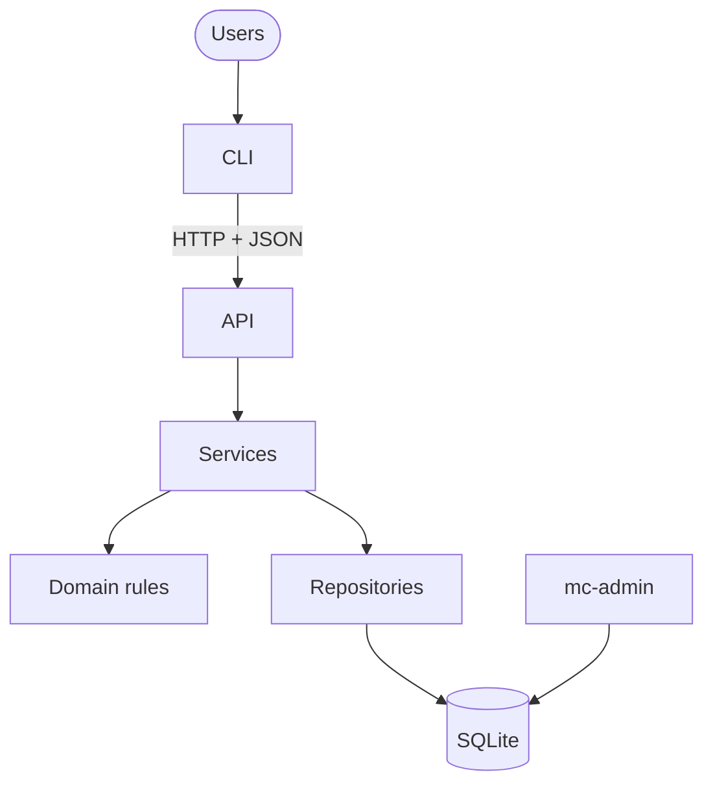
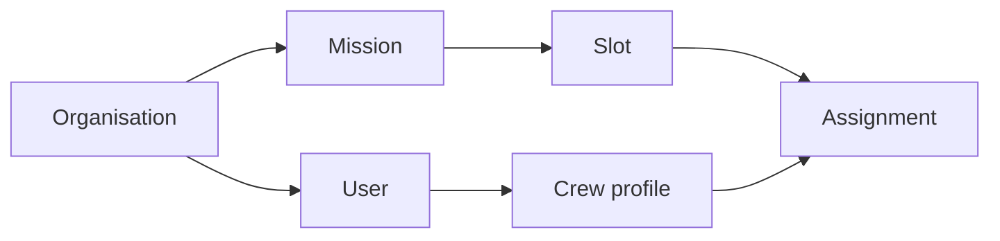
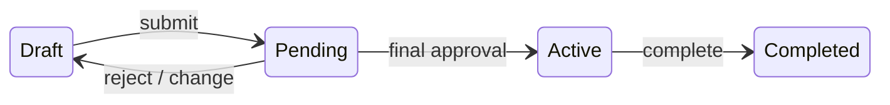
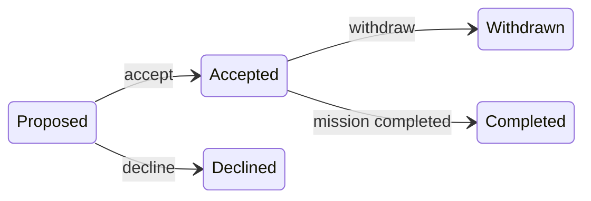
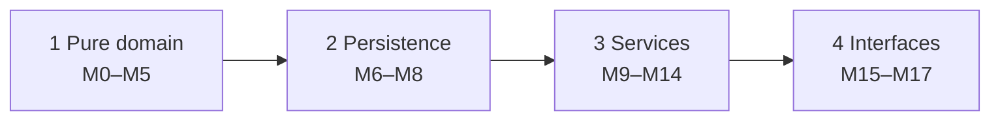

# Subagent (01): Build M9 admin in worktree

Source: `agent-a20b0fb15e85bb41e.jsonl` · 2026-10-12 00:33:26 UTC → 2026-10-12 00:42:40 UTC

Rendered from the raw JSONL without editing message content. Tool results and thinking are collapsed; expand them to read.


---

### 👤 User · 2026-10-12 00:33:26 UTC

You are implementing module **M9 (admin service)** of the Mission Control project, in a dedicated git worktree. Two other agents are building M10 and M11 in parallel in their own worktrees.

**Work ONLY in:** `/Users/pritanbarai/Desktop/JOBS/mutinex_mission_control/.worktrees/m9-admin` (branch `m9-admin`, based on main `b7ecbba`).
- Use absolute paths, or `cd` into that directory for every command.
- NEVER touch the main checkout `/Users/pritanbarai/Desktop/JOBS/mutinex_mission_control` or the other worktrees.
- Do NOT commit, and do NOT run any git command that changes state (no add, commit, stash, rebase, checkout, reset, merge). `git status` and `git diff` are fine.
- Do NOT add dependencies.

**Read first** (inside the worktree):
- `CLAUDE.md`;
- `docs/prd.md` §3, §5.3 (P1–P10), §5.5 (A1), §5.7, §8 (AC-23, AC-25, AC-26);
- `docs/technical-design.md` §2, §4 (Permissions), §5 (cross-cutting rules), §7 (errors and problem codes), §9 (Phase 3 rows and Waves), §10 (guidelines, including "Working in waves");
- `docs/phase-reviews.md` "Carried forward" (Phase 1 and 2).
- Then study the existing code you'll build on:
  - `src/mission_control/services/context.py` (ServiceContext, found, check);
  - `src/mission_control/services/auth.py`;
  - `src/mission_control/domain/` (permissions.py, errors.py, events.py, passwords.py, enums.py);
  - `src/mission_control/infra/security.py`;
  - `src/mission_control/infra/repositories/` (users.py, skills.py, organisations.py, crew.py, missions.py, base.py, facts.py);
  - `tests/builders.py`, `tests/conftest.py`, `tests/integration/conftest.py` (the `seeded_db` fixture).

**FILE OWNERSHIP**
- You may create or edit:
  - `src/mission_control/services/admin.py`;
  - `src/mission_control/infra/repositories/users.py`, `skills.py`, `organisations.py`;
  - new test files for M9 (e.g. `tests/integration/test_admin_service.py`).
- Shared files you may only APPEND to, in a section with a comment `# M9 admin`:
  - `src/mission_control/domain/events.py` (new Event members you need);
  - `tests/unit/domain/test_events.py` (update its expected set);
  - the error/problem-code tables in `docs/technical-design.md` §7 (only if you introduce a code).
- Everything else is read-only, including `crew.py`, `missions.py`, `facts.py`, `base.py`, `context.py`, `auth.py`, `security.py`, `domain/*` (except events.py as above) and `schema.sql`.
- If you need a change in a file you don't own, STOP that part and describe it in your report instead.

**WHAT TO BUILD** (`services/admin.py`): Director administration as use-case functions taking a `ServiceContext` first, following the design's shape:
1. authorize, with the required permission `Context`;
2. load through `ctx.repos`;
3. check domain rules;
4. inside `with ctx.write():`, write, and audit with `ctx.audit(Event.X, ...)` and names in `data`.

Cover:
- **Organisation settings:** view; set required approvals (N ≥ 1; it only affects future submissions, A1).
- **Users:**
  - list and view;
  - create a user with email, name, role and an initial password. The password goes through `domain.passwords.validate_password` (at least 15 characters), then `security.hash_password`. Hash it OUTSIDE the write transaction, so no Argon2 work happens under the write lock (Phase 2 rule).
  - a new Crew Member automatically gets a crew profile (P9). Optionally create a profile for a Lead or Director on request (`POST /users/{id}/crew-profile`, display name defaulting to the first name).
  - change role:
    - crew profiles survive role changes (P9);
    - changing someone TO crew gives them a profile if missing;
    - demoting a Lead who owns unfinished missions is refused with `owns_open_missions`, naming the missions (P7);
    - demoting or deactivating the last active Director is refused with `last_director` (P8).
  - deactivate:
    - refused while the user has open assignments (`has_open_assignments`, naming the missions);
    - refused while they own unfinished missions (`owns_open_missions`);
    - refused for the last Director;
    - on success, revoke all their sessions by calling `security.revoke_user_tokens` INSIDE the same write transaction, next to the audit write (Phase 2 rule; don't call `auth.revoke_all_sessions`).
  - reactivate, if the PRD allows it (check; if it's silent, ask in your report rather than invent).
- **Skill catalogue (P1):**
  - list: Directors and Leads;
  - add;
  - rename or recategorise (the id stays stable);
  - delete only if unused (`skill_in_use` otherwise).
  - names are unique per org, ignoring case. A duplicate should be a clean refusal, not a raw IntegrityError. Choose an existing code if one fits; otherwise propose one, as below.

Permissions use the actions in `domain/permissions.py` (MANAGE_ORG, MANAGE_SKILLS, LIST_SKILLS). Refusals:
- `Forbidden` (403) for visible resources;
- `NotFound` for missing or other-org ids (use `found()`);
- `RuleViolation` (409) for rule or state conflicts. Use `RuleViolation.of(Problem(code, message, refs))` for single-reason refusals whose code is a top-level 409 code in §7 (`has_open_assignments`, `owns_open_missions`, `last_director`, `skill_in_use`).

Messages must be natural sentences built from explicit phrases (no generated-from-identifier text), and must name the people and missions involved.

**CONVENTIONS** (from the design, CLAUDE.md and phase reviews):
- No PRD IDs in `src/` (fine in tests).
- Every write inside `ctx.write()`.
- Audit with the shared `Event` enum.
- Pass the permission `Context` fields each action requires (authorize raises ValueError otherwise).
- `@contextmanager` functions are annotated `-> Generator[T]`.
- Never use `httpx` (`httpx2` only).
- Frozen dataclasses; type hints.
- New repository SQL must use named binding `org_id = :org` (a guard test enforces this; no `?`).

**NEW CODES:** if you need an error or problem code not in design §7, you may implement it. Append it to the §7 table under a `M9 admin` note, and list it clearly in your report as **needing the user's approval**. Don't add codes casually.

**WORKFLOW**
1. Tests first. Write failing tests named after PRD IDs (e.g. `test_ac26_deactivating_someone_with_open_assignments_is_refused`, `test_p8_last_director_cannot_be_demoted`). Run them and see them fail, then implement. Use `seeded_db` for PRD data, and builders for edge cases.
2. Run the FULL suite and lint in the worktree:
   - `cd .worktrees/m9-admin && uv run pytest -W error -o addopts="" -q`;
   - `uv run ruff check src tests`;
   - `uv run ruff format --check src tests`.
3. **Real verification:** a script against a fresh seeded database (`connect`/`init_db`/`load_seed`, then ServiceContext as Ruth or Lee). Exercise the main paths and refusals, and print the outcomes and messages. If you start a server, use port 8009.
4. **Read-only review** of your own diff (`git -C <worktree> diff main` plus untracked files) against the PRD and design §10. List the findings; don't fix them silently.

**FINAL REPORT** (this is all the lead sees):
- files created or changed;
- the use-case functions and what each enforces, with PRD IDs;
- tests added, with before (failing) and after counts;
- full-suite and ruff results;
- the real-run output (trimmed);
- review findings;
- any new codes or events added (codes flagged for approval);
- any changes you needed in files you don't own;
- any PRD gaps you hit.

<details>
<summary>⚙️ System/meta message · 2026-10-12 00:33:26 UTC</summary>

```
<system-reminder>
Your final report is delivered through SubagentHandback: when your work is complete, call SubagentHandback({message: <your full report>}). The call ends your run, so make it your last step. Only a SubagentHandback call reaches your caller as your result; plain text you write at the end is not delivered.
</system-reminder>
```

</details>

**🔧 Bash**

*Check worktree status and layout*

```bash
cd /Users/pritanbarai/Desktop/JOBS/mutinex_mission_control/.worktrees/m9-admin && git status && git log --oneline -3 && cat CLAUDE.md && ls -R src tests | head -100
```

<details>
<summary>↳ Result</summary>

```
On branch m9-admin
nothing to commit, working tree clean
b7ecbba refactor: split repositories into per-area modules
8ccb5c3 feat(sf): service foundation for Phase 3
aafba33 docs: phase review for Phase 2 (M6–M8)
# Mission Control

Multi-tenant mission planning API and CLI. Read these before doing any work. They are the source of truth, so don't copy their content here.

- [`docs/brief.md`](docs/brief.md): the assessment brief
- [`docs/prd.md`](docs/prd.md): **behaviour**. What the system does, its rules, acceptance criteria and seed scenarios.
- [`docs/technical-design.md`](docs/technical-design.md): **structure**. Architecture, schema, API, CLI, the delivery plan (§9) and the implementation guidelines (§10).

If the PRD and the design conflict, or are silent on something, stop and ask. Never invent behaviour.

## Workflow (every module)

1. **One approved module at a time.** Work only on the module from design §9 that I have approved. Don't start anything else.
2. **Tests first.** Write failing tests that reference the PRD IDs, then implement. Run the full suite and lint: `uv run pytest` and `uv run ruff check`.
3. **Real verification.** Exercise the behaviour for real, for example with a REPL call, an HTTP request or a CLI command. Show the actual output. A passing test run alone isn't verification.
4. **Read-only review.** Review the full diff against the PRD and design §10 without editing. Report findings, and fix them only once I agree.
5. **Stop for approval.** Summarise what changed, the test and verification results, and the review findings, and propose a commit message. **Don't commit, and don't start the next module, until I approve.**

## Waves (parallel modules in worktrees)

When I approve a wave of independent modules (design §9), build them in parallel and keep reviews small:

1. **One worktree per module.** Run `git worktree add .worktrees/<module> -b <module> main`, then `uv sync` inside it. Each agent edits only its own worktree and doesn't commit.
2. **Same workflow per module.** Steps 2 to 4 above still apply, inside the worktree.
3. **Review one branch at a time.** Show me only that module's diff against `main` (`git -C .worktrees/<module> diff main`, including new files), with its results.
4. **After I approve that module:**
   - commit on its branch;
   - rebase onto `main` if `main` has moved, and re-run its tests;
   - fast-forward `main`;
   - run the full suite on `main`;
   - remove the worktree and branch.

   Only then present the next branch.

Never push, add dependencies, change the schema, or add endpoints, error codes or CLI commands outside the design without asking first.
src:
mission_control

src/mission_control:
__init__.py
__pycache__
api
domain
infra
seed
services

src/mission_control/__pycache__:
__init__.cpython-312.pyc

src/mission_control/api:
__init__.py
__pycache__
app.py

src/mission_control/api/__pycache__:
__init__.cpython-312.pyc
app.cpython-312.pyc

src/mission_control/domain:
__init__.py
__pycache__
approvals.py
dates.py
eligibility.py
enums.py
errors.py
events.py
lifecycle.py
matching.py
passwords.py
permissions.py
records.py

src/mission_control/domain/__pycache__:
__init__.cpython-312.pyc
approvals.cpython-312.pyc
dates.cpython-312.pyc
eligibility.cpython-312.pyc
enums.cpython-312.pyc
errors.cpython-312.pyc
events.cpython-312.pyc
lifecycle.cpython-312.pyc
matching.cpython-312.pyc
passwords.cpython-312.pyc
permissions.cpython-312.pyc
records.cpython-312.pyc

src/mission_control/infra:
__init__.py
__pycache__
db.py
repositories
schema.sql
security.py

src/mission_control/infra/__pycache__:
__init__.cpython-312.pyc
db.cpython-312.pyc
security.cpython-312.pyc

src/mission_control/infra/repositories:
__init__.py
__pycache__
approvals.py
assignments.py
audit.py
base.py
crew.py
facts.py
missions.py
models.py
organisations.py
skills.py
users.py

src/mission_control/infra/repositories/__pycache__:
__init__.cpython-312.pyc
approvals.cpython-312.pyc
assignments.cpython-312.pyc
audit.cpython-312.pyc
base.cpython-312.pyc
crew.cpython-312.pyc
facts.cpython-312.pyc
missions.cpython-312.pyc
models.cpython-312.pyc
organisations.cpython-312.pyc
skills.cpython-312.pyc
users.cpython-312.pyc

src/mission_control/seed:
__init__.py
__pycache__
data.py
loader.py
```

</details>

**🔧 Bash**

*List services/tests and PRD headings*

```bash
cd /Users/pritanbarai/Desktop/JOBS/mutinex_mission_control/.worktrees/m9-admin && ls src/mission_control/services tests tests/* && wc -l docs/*.md && grep -n '^#' docs/prd.md
```

<details>
<summary>↳ Result</summary>

```
tests/builders.py
tests/conftest.py

src/mission_control/services:
__init__.py
__pycache__
auth.py
context.py

tests:
__pycache__
api
builders.py
conftest.py
integration
unit

tests/__pycache__:
builders.cpython-312.pyc
conftest.cpython-312-pytest-9.1.1.pyc

tests/api:
__pycache__
test_health.py

tests/integration:
__pycache__
conftest.py
test_auth.py
test_db.py
test_facts.py
test_repositories.py
test_repository_sql.py
test_repository_writes.py
test_schema_constraints.py
test_seed.py
test_service_context.py

tests/unit:
domain
      76 docs/brief.md
     104 docs/phase-reviews.md
     338 docs/prd.md
     847 docs/technical-design.md
    1365 total
1:# Mission Control — Product Requirements (v1)
7:## 1. Problem and goals
20:## 2. Requirements from the brief
33:## 3. Users and roles
45:## 4. Main workflows (all available through the CLI)
60:## 5. Business rules
62:### 5.1 Definitions
73:### 5.2 Tenancy and identity
79:### 5.3 People and skills
100:### 5.4 Missions and lifecycle
133:### 5.5 Approval
141:### 5.6 Assignments
155:### 5.7 Visibility and audit
169:## 6. Auto-matching
197:## 7. CLI requirements
204:## 8. Acceptance criteria
257:## 9. Seed data and scenarios
261:### 9.1 Aurora Space Agency (N = 2)
289:### 9.2 Helix Orbital (N = 1)
297:### 9.3 Scenarios
312:## 10. Test plan
325:## 11. Out of scope
```

</details>

**🔧 Bash**

*Read the PRD*

```bash
cd /Users/pritanbarai/Desktop/JOBS/mutinex_mission_control/.worktrees/m9-admin && cat docs/prd.md
```

<details>
<summary>↳ Result</summary>

````
# Mission Control — Product Requirements (v1)

**Status:** Agreed · **Source of truth:** [`brief.md`](brief.md) · **Next:** technical design (frameworks, schema, API and CLI design)

Rules tagged **[B]** come from the brief. Everything untagged is a product decision made while resolving the brief's open questions.

## 1. Problem and goals

Crew assignment is manual and error-prone. Leads cross-reference skills, availability and existing commitments by hand. **[B]** Mission Control is a multi-tenant B2B platform for managing missions and crew, with an auto-matcher that suggests crew. **[B]**

v1 succeeds when:

1. A Lead can take a mission from requirements to an active, confirmed roster entirely through the CLI.
2. Matcher suggestions never break a hard rule and are deterministic.
3. The system enforces the approval rules.
4. No read or write can reach another organisation's data.

**How we'll know:** every acceptance criterion in §8 passes as an automated test against the seed data in §9.

## 2. Requirements from the brief

- R1: Organisations are tenants. All data is scoped to one organisation and never leaks across tenants.
- R2: Three roles: Director, Mission Lead, Crew Member.
- R3: Leads can't approve their own missions.
- R4: Missions have requirements, a timeline, and a lifecycle with approval before going active.
- R5: Crew have skill profiles, availability and assignment history.
- R6: Assignments connect crew to missions, and crew respond to them.
- R7: An auto-matcher suggests crew based on skills, availability and workload.
- R8: Organisations differ in crew size, skill taxonomy and approval process.
- R9: A multi-tenant API, plus a CLI for the main workflows. CLI usability is assessed.
- R10: Runs locally with seed data.

## 3. Users and roles

| Role | Responsibilities |
|---|---|
| **Director** | Manages users, roles, crew profiles, the skill catalogue and the approval setting. Creates missions for a Lead. Approves or rejects missions. Reassigns owners. Sees everything in their organisation. |
| **Mission Lead** | Owns missions. Defines slots, runs the matcher, proposes crew, submits. Maintains other people's skill levels. Reads all missions and crew profiles. |
| **Crew Member** | Manages own personal details and unavailability. Accepts, declines or withdraws from assignments. Sees only their own data and the missions they're on. |

- Each user belongs to exactly one organisation. The organisation is taken from the user's identity, never from the request.
- Each user has exactly one role, which controls permissions.
- Taking part in missions depends on a separate **crew profile**. Every Crew Member has one, and Leads and Directors may have one too.

## 4. Main workflows (all available through the CLI)

1. **Sign in** with email and password, and change your own password. See what needs attention: pending assignments, approvals waiting on me, my missions.
2. **Director admin:** manage users and roles, crew profiles, the skill catalogue, and the number of approvals required.
3. **Lead or Director:** set crew skill levels (1–5).
4. **Crew profile holder:** maintain personal details and unavailability.
5. **Create a mission:** name, dates, and role slots with required skills.
6. **Owning Lead:** run the matcher, review the suggested roster, apply it or propose crew by hand.
7. **Crew:** accept or decline proposals, and withdraw if needed.
8. **Owning Lead:** submit a fully accepted roster for approval.
9. **Eligible Directors:** approve or reject. The final approval activates the mission.
10. **Owning Lead or Director:** complete or cancel a mission.
11. **Director:** reassign a mission's owning Lead.
12. **View history:** mission history and crew assignment history.

## 5. Business rules

### 5.1 Definitions

| Term | Meaning |
|---|---|
| **Open assignment** | An assignment that is Proposed or Accepted. |
| **Open places** | A slot's headcount minus its open assignments. |
| **Mission-days** | The number of days from the start date to the end date, counting both. |
| **Overlap** | Two date ranges overlap if they share at least one calendar day. Dates have no time and no time zone. |
| **Eligible (crew for a slot)** | The person is active, has a crew profile, and has every required skill at or above its minimum level. They have no unavailability overlapping the mission, and no accepted assignment on another non-final mission that overlaps it. |
| **Eligible approver** | An active Director who did not create the mission and is not on its roster. |

### 5.2 Tenancy and identity

- **T1** Every record belongs to one organisation. Every read and write is limited to the caller's organisation. **[B]**
- **T2** Naming a resource from another organisation gives the same response as naming one that doesn't exist ("not found").
- **T3** Organisations are created only through seed data or an operator command. There is no self-service signup.

### 5.3 People and skills

- **P1** Each organisation has its own flat skill catalogue, managed by Directors. Skills with the same name in different organisations are unrelated.
  - Directors can rename a skill. Its identity stays the same.
  - Directors can delete a skill only if no crew skill or slot requirement uses it.
- **P2** Proficiency is an integer from 1 to 5.
- **P3** Leads and Directors set and remove skill levels. **Nobody can change their own levels.**
  - A skill change is allowed even if it makes someone ineligible for an assignment on a Draft or Pending mission. Eligibility is checked again at acceptance, submission and approval.
  - A skill change that would make someone ineligible for their assignment on an Active mission is refused.
- **P4** Crew profile holders manage their own personal details and unavailability. Nobody else edits them. Personal details are a display name and an optional bio.
- **P5** Crew are available by default. Unavailability is a date range with a reason.
- **P6** A crew member can't record unavailability that overlaps one of their accepted assignments.
- **P7** Users are deactivated, never deleted. Deactivated users can't sign in, aren't eligible for matching, and keep their history. Deactivation is refused while the user:
  - has open assignments; or
  - owns non-final missions. The same applies to changing a mission owner's role away from Lead. Their missions must be reassigned first.
- **P8** An organisation must always have at least one active Director.
- **P9** Crew profiles survive role changes and can't be deleted. Changing a user's role to Crew Member gives them a profile if they don't already have one.
- **P10** Directors set a new user's initial password. Users change their own password by entering their current one. There's no email or password-recovery flow.
  - Passwords must be at least 15 characters. Passphrases are welcome, and uppercase letters, numbers and symbols aren't required.
  - Changing a password ends all of that user's sessions, including the one used to change it.

### 5.4 Missions and lifecycle

- **M1** A mission has a name, a date range, one owning Lead and a separately recorded creator.
  - Leads create missions for themselves. Directors create them on behalf of a Lead.
  - Only Mission Leads can own missions.
  - Directors can transfer ownership of a non-final mission to another active Lead in the same organisation. If the mission is Pending, it returns to Draft and its approvals are cleared.
- **M2** A mission has one or more slots. Each slot has a name, a headcount of at least 1, and at least one required skill with a minimum level. Dates may be in the past, but the end date must be on or after the start date. The same rule applies to unavailability.
- **M3** Only the owning Lead can edit a mission, propose or remove crew, apply matcher results, or submit.

```
         submit                N-th approval                complete
 Draft ─────────▶ Pending ───────────────────▶ Active ─────────────▶ Completed
   ▲              Approval
   └── reject (reason) / any change ──┘
 Draft | Pending Approval | Active ──cancel (reason)──▶ Cancelled
```

| Transition | Who | Conditions and effects |
|---|---|---|
| Draft → Pending Approval | Owning Lead | All of these must hold: every slot is full, every assignment is Accepted, every rostered crew member is still eligible, and there are at least N eligible approvers. Otherwise the submission is refused with a list of the problems. |
| Pending → Active | The N-th distinct eligible approver | The roster is checked again at each approval. If the check fails, the approval is refused and the mission stays Pending, unchanged. |
| Pending → Draft | Eligible Director (reject) or system | A rejection needs a reason. Any change to dates, slots, roster or owner, including a crew withdrawal, also sends the mission back to Draft. Approvals are cleared, and remaining accepted assignments stay accepted. |
| Active → Completed | Owning Lead or Director | Accepted assignments become Completed. |
| Any non-final → Cancelled | Owning Lead or any Director | Reason required. Open assignments become Cancelled. |

- **M4** Draft missions can have unfilled places and unanswered proposals.
- **M5** Once a mission is Active, its dates, requirements and roster are frozen. Only completion or cancellation are allowed.
- **M6** Dates never trigger transitions on their own. There is no scheduler.
- **M7** An edit is refused if it would invalidate an open assignment. The response lists the affected crew, and the Lead must remove them first. Crew are never removed automatically. Edits that invalidate an assignment are:
  - removing a slot that has open assignments;
  - lowering a slot's headcount below its open assignments;
  - changing dates or requirements so that an assigned person is no longer eligible.

### 5.5 Approval

- **A1** Each organisation sets the number of approvals required (N ≥ 1). The approvals must come from N distinct eligible approvers.
  - N is fixed for a mission when it's submitted. Later changes to the setting don't affect a round already in progress.
  - An approval already given still counts if that Director is later deactivated or demoted.
- **A2** Leads can't approve anything, which satisfies R3. **[B]** A Director can't approve a mission they created or are rostered on.
- **A3** Each Director approves a round at most once. A single rejection ends the round.

### 5.6 Assignments

```
Proposed ──accept──▶ Accepted ──withdraw (reason)──▶ Withdrawn
   ├──decline──▶ Declined   └──removed by Lead──▶ Removed
   └──retracted by Lead──▶ Removed
Accepted ──mission completed──▶ Completed;  open ──mission cancelled──▶ Cancelled
```

- **S1** The owning Lead can propose only eligible crew. A person can hold at most one open assignment per mission. A slot can't have more open assignments than its headcount. A Lead can propose themselves, but they must be eligible and must accept like anyone else.
- **S2** Crew can accept only while the mission is in Draft and they're still eligible. Accepted assignments block overlapping dates. Proposals don't block anything.
- **S3** Declining takes an optional reason. Withdrawing needs a reason and is allowed only in Draft or Pending Approval.
- **S4** Every assignment needs the crew member's acceptance. Crew can't be placed on a mission directly.

### 5.7 Visibility and audit

| | Crew | Lead | Director |
|---|---|---|---|
| Own profile, skills, availability, assignments | ✓ | ✓ | ✓ |
| Missions they're on, with teammates' names and slots | ✓ | ✓ | ✓ |
| Other crew members' profiles, skills, busy/free dates | ✗ | ✓ | ✓ |
| Other people's *reasons* for unavailability | ✗ | ✗ | ✓ |
| All missions in the organisation | ✗ | read (edit own) | read |
| Users, catalogue management, organisation settings | ✗ | read catalogue | manage |

- **V1** Every state change, approval, rejection and assignment response is recorded with who did it, when, and any reason. Anyone who can see the mission can see this history.
- **V2** Former assignees see a summary of the mission in their own assignment history. They don't get full access to the mission unless their role allows it. Former assignees are people whose assignment was declined, withdrawn, removed or cancelled.

## 6. Auto-matching

The matcher only advises. It suggests crew for a Draft mission's open places and changes nothing. The owner or a Director can preview a suggestion. When the owning Lead applies it, it creates Proposed assignments, which crew still have to accept.

**Candidates.** Active crew profiles in the mission's organisation only. Crew who already have an open assignment on this mission, or who declined or withdrew from it, are left out.

**Workload.** The total mission-days of a crew member's accepted assignments on missions that are not Completed, leaving out the mission being matched.

**Algorithm**

1. **Filter.** For each slot with open places, keep the candidates who are eligible (§5.1).
2. **Pick the most constrained slot.** Choose the slot with the fewest remaining eligible candidates. Ties go to the slot listed first.
3. **Fill one place in that slot.** Rank candidates by:
   1. lowest workload;
   2. then highest proficiency, meaning the sum of their levels across the slot's required skills;
   3. then stable identifier, ascending.
4. **Remove the chosen person** from every other slot's candidates.
5. **Repeat** from step 2 until every place is filled or has no candidates left.

**Output.** A suggested roster with no one in two slots. Places without a candidate are marked **unfilled**. The same inputs always give the same output.

**Why:**
- Filling the most constrained slot first stops a versatile person from being spent on a slot that's easy to fill.
- Ranking by lowest workload spreads missions across crew.
- Proficiency only breaks ties, because everyone left already meets the requirement.

**Known limitation:** this is a greedy heuristic. It can occasionally leave a place unfilled when a complete roster exists. That's acceptable for an advisory tool, and the Lead can still propose by hand.

## 7. CLI requirements

- **C1** Every workflow in §4 can be carried out from the CLI. **[B]**
- **C2** Refusals explain why in domain terms, for example "Gus has an accepted assignment on *Station Reboost* overlapping 1–2 Mar". Where possible they also say what to do next.
- **C3** Output is readable by people by default, with a machine-readable option for scripts and tests.
- **C4** Actions that send a mission back to Draft, or cancel it, warn before running.

## 8. Acceptance criteria

Each criterion starts from a fresh seed. Scenario numbers (S-) refer to §9.3.

**Mission workflow**

- **AC-1** The golden path (S1) ends Completed, and every transition appears in the history with who did it and when.
- **AC-2** Submission is refused while any place is unfilled or any proposal is unanswered. The refusal lists them.
- **AC-3** Approvals before the N-th leave the mission Pending. The N-th approval makes it Active.
- **AC-4** Changing the dates, slots or roster of a Pending mission sends it back to Draft and clears its approvals. So does a crew withdrawal (S5).
- **AC-5** On an Active mission, edits, proposals, removals and withdrawals are refused. Completion and cancellation succeed.
- **AC-6** Cancelling needs a reason. The owning Lead or any Director can cancel, and any other Lead is refused. Open assignments become Cancelled.
- **AC-7** Only the owning Lead can edit, propose, apply or submit. After a Director reassigns the owner, the new owner can and the previous owner can't.

**Approval restrictions**

- **AC-8** The mission's creator can't approve it. In S1, Ruth is refused.
- **AC-9** Leads and Crew can't approve or reject.
- **AC-10** A Director can't approve the same round twice. Rejecting needs a reason and clears earlier approvals (S6).
- **AC-11** A Director rostered on a mission can't approve it.
- **AC-12** Submission is refused when there are fewer than N eligible approvers, not counting the creator or rostered Directors (S7).
- **AC-13** In Helix (N = 1), a single approval makes the mission Active (S8).

**Overlaps and availability**

- **AC-14** Proposing someone who is unavailable, or who has an overlapping accepted assignment, is refused. In S4, both Fay and Gus are refused.
- **AC-15** Overlapping proposals are allowed. Accepting one that overlaps an accepted assignment is refused, and the refusal names the conflicting mission (S4, Chen).
- **AC-16** Recording unavailability that overlaps an accepted assignment is refused.
- **AC-17** Two ranges that share only a boundary day overlap.

**Matching**

- **AC-18** S2 gives exactly the expected roster on every run.
- **AC-19** S3 marks Geologist as unfilled. S3b shows a new accepted assignment changing the suggestion.
- **AC-20** Workload counts only accepted assignments on missions that aren't Completed. Chen's workload is 5, not 35.
- **AC-21** The suggestion never puts one person in two slots. It never includes anyone who is ineligible, from another organisation, or already excluded from this mission.
- **AC-22** Running the matcher changes nothing. Applying it creates Proposed assignments.

**Roles and visibility**

- **AC-23** Ana can't change her own skill levels, but Lee can change hers. Ben can't edit skills, but he can edit his personal details and unavailability.
- **AC-24** Lee sees Fay as busy 5–8 Mar but doesn't see the reason. Ruth sees the reason. Ben can't view Fay's profile, and his mission list shows only missions he's on.
- **AC-25** Leads can't manage users, the catalogue or the approval setting.
- **AC-26** Deactivating someone with open assignments is refused. A deactivated user can't sign in. The last active Director can't be deactivated or demoted.

**Tenant isolation (S9)**

- **AC-27** Requesting another organisation's mission, crew member, user, skill or assignment by ID gives the same response as an ID that doesn't exist.
- **AC-28** Every list contains only the caller's organisation's records.
- **AC-29** Any write that references another organisation's ID fails as "not found", and neither organisation's data changes.
- **AC-30** Approving or rejecting another organisation's mission fails as "not found".
- **AC-31** Helix's Kai (Piloting 5, no commitments) is never suggested for an Aurora mission.

## 9. Seed data and scenarios

The table order of people is their stable-identifier order. All dates are in 2027 unless stated.

### 9.1 Aurora Space Agency (N = 2)

| Person | Role | Crew skills | Commitments (workload) |
|---|---|---|---|
| Ruth Adeyemi | Director | — | — |
| Marco Bianchi | Director | Flight Medicine 4 | Medical Study, accepted (4) |
| Ingrid Holm | Director | — | — |
| Lee Park | Lead | — | — |
| Nora Quinn | Lead | — | — |
| Ana Okafor | Lead | Piloting 5, Leadership 4, Systems Eng 4 | none (0) |
| Ben Ito | Crew | Systems Eng 4, EVA 3 | Deep Space Comms, accepted (20) |
| Chen Wu | Crew | Systems Eng 3 | Telescope (5). Mars Analog Completed, so it doesn't count |
| Dana Reyes | Crew | EVA 4 | Telescope (5) |
| Eli Novak | Crew | EVA 4, Piloting 4, Leadership 2 | Telescope (5) |
| Fay Moreau | Crew | Piloting 4, Leadership 4 | Unavailable 5–8 Mar (Medical) |
| Gus Patel | Crew | Systems Eng 5 | Station Reboost, accepted (6) |
| Hana Sato | Crew | EVA 3, Geology 2 | Telescope (5) |

| Mission | Owner / creator | Dates | State | Slots → crew |
|---|---|---|---|---|
| Lunar Gateway Resupply | Lee / Ruth | 1–10 Mar | Draft | Flight Engineer ×1 (Sys Eng ≥3) · Mission Specialist ×1 (EVA ≥3) · Commander ×1 (Piloting ≥4, Leadership ≥3) — no crew |
| Asteroid Survey | Nora | 5–12 Mar | Draft | Pilot ×1 (Piloting ≥4) · Geologist ×1 (Geology ≥4) — no crew |
| Station Reboost | Nora | 25 Feb – 2 Mar | Draft | Engineer ×2 (Sys Eng ≥3) — Gus accepted, 1 open place |
| Lunar Surface Medical Study | Nora / Ruth | 15–18 Mar | Draft | Flight Surgeon ×1 (Flight Medicine ≥4) — Marco accepted |
| Orbital Telescope Service | Lee | 10–14 Jan | Active | Engineer ×1 — Chen · EVA Specialist ×3 (EVA ≥3) — Dana, Eli, Hana |
| Deep Space Comms Upgrade | Nora | 1–20 Apr | Pending (Marco approved) | Engineer ×1 (Sys Eng ≥3) — Ben |
| Mars Analog Habitat | Lee | 1–30 May 2026 | Completed | Engineer ×1 — Chen |

### 9.2 Helix Orbital (N = 1)

People: Sam Rivera (Director), Priya Nair (Lead), and Crew Kai Tanaka (Piloting 5), Lena Fischer (Payload Integration 4), Omar Haddad (Field Medicine 4) and Tess Moreno (Life Support 3). Helix has its own catalogue, including a separate "Piloting" skill.

| Mission | Owner | Dates | State | Slots → crew |
|---|---|---|---|---|
| Payload Demo 1 | Priya | 1–3 Feb | Draft | Payload Specialist ×1 (Payload Int ≥3) — Lena accepted · Medic ×1 (Field Medicine ≥3) — Omar accepted |

### 9.3 Scenarios

| # | Steps | Expected outcome |
|---|---|---|
| **S1** | Lee matches and applies *Lunar Gateway Resupply* → Ana, Chen and Dana accept → Lee submits → Ruth approves → Marco approves → Ingrid approves → Lee completes | Proposed crew are Ana, Chen and Dana. Ruth is refused as creator. After Marco the mission is Pending (1/2). After Ingrid it's **Active**. Completing makes the assignments Completed. |
| **S2** | Match *Lunar Gateway Resupply* | Eligible crew: Commander {Ana}, because Fay is unavailable and Eli's Leadership is too low. Flight Engineer {Ana, Ben, Chen}, because Gus has an overlap. Specialist {Ben, Dana, Eli, Hana}. **Commander → Ana** (most constrained). **Flight Engineer → Chen** (workload 5 vs Ben's 20). **Specialist → Dana** (four-way workload tie at 5; Hana loses on proficiency; Dana beats Eli on ID). Filling the slots in listed order would have spent Ana on Flight Engineer and left Commander unfilled. |
| **S3** | Match *Asteroid Survey* | Geologist **unfilled** (Hana's Geology is only 2). Pilot → Ana (workload 0 vs Eli's 5; Fay unavailable). |
| **S3b** | S1 up to acceptance, then match *Asteroid Survey* | Ana is blocked by her overlapping accepted assignment, so Pilot → Eli. Geologist still unfilled. |
| **S4** | Lee proposes Gus and Fay for *Gateway*. Nora proposes Chen for *Station Reboost* and Lee proposes Chen for *Gateway*. Chen accepts *Station Reboost*, then *Gateway*. | Gus refused (overlap). Fay refused (unavailable). Both Chen proposals succeed. Chen's second acceptance is refused, naming *Station Reboost*. |
| **S5** | Ben withdraws from *Deep Space Comms* without a reason, then with one. Hana withdraws from *Telescope*. | Ben's first attempt is refused. The second succeeds: the mission returns to Draft and Marco's approval is cleared. Hana is refused because *Telescope* is Active. |
| **S6** | Marco approves *Deep Space Comms* again. Ingrid rejects it without a reason, then with one. | Marco is refused. Ingrid's first attempt is refused. The second sends the mission to Draft and clears approvals. |
| **S7** | Nora submits *Lunar Surface Medical Study* | Refused. Ruth created it and Marco is rostered, which leaves 1 eligible approver (Ingrid) when 2 are needed. |
| **S8** | Priya submits *Payload Demo 1* and Sam approves | **Active** after one approval. |
| **S9** | Each role in each organisation tries to read, list, write and approve the other organisation's resources, and matches an Aurora Piloting slot | Every attempt fails as "not found" and nothing changes. Lists show only the caller's organisation. Kai never appears. |

## 10. Test plan

Every acceptance criterion maps to at least one automated test.

| Level | Covers |
|---|---|
| Unit: matcher (pure function) | Eligibility, workload, most-constrained-first, each tie-break, no person in two slots, unfilled places, determinism. Includes S2, S3 and a small hand-built case per rule. |
| Unit: lifecycle and rules | Every allowed transition and a sample of disallowed ones. Approver eligibility and the N count. Revert-to-Draft clearing approvals. The Active freeze. Overlap at boundary days. |
| API: permissions | A role × action table, checking each role is allowed or refused as expected. |
| API: tenant isolation | Every endpoint, for reads, lists and writes, tried with the other organisation's IDs. A route-inventory test makes any new endpoint fail CI until it's added to this sweep. |
| API: scenarios | S1 and S3b–S8 against a freshly seeded database. |
| CLI end to end | S1 and S4 run through the real CLI, checking machine-readable output and the wording of refusals. |

## 11. Out of scope

- Web UI.
- Self-service organisation signup, users in more than one organisation, SSO.
- Password recovery and email flows. Deleting crew profiles.
- Delivering notifications. The CLI's "needs attention" views replace them.
- Certifications, skill expiry, skill verification, skill hierarchies.
- Recurring availability, scheduling finer than a day, rest periods between missions.
- Conditional or multi-stage approvals.
- Assigning crew without their acceptance, response deadlines.
- Matcher extras: preferred skills, experience scoring, configurable weights, near-miss and exclusion lists, suggestions to relax requirements, LLM matching.
- Date-driven transitions. Roster changes once a mission is Active.
- Equipment and resource constraints. Keep slot requirements extensible so these can be added later.
- Billing, bulk import.
````

</details>

**🔧 Bash**

*List design headings*

```bash
cd /Users/pritanbarai/Desktop/JOBS/mutinex_mission_control/.worktrees/m9-admin && grep -n '^#' docs/technical-design.md
```

**🔧 Bash**

*Read the design document, first half*

```bash
cd /Users/pritanbarai/Desktop/JOBS/mutinex_mission_control/.worktrees/m9-admin && sed -n 1,400p docs/technical-design.md
```

<details>
<summary>↳ Result</summary>

````
# Mission Control — Technical Design (v1)

> **Status:** Agreed · **Implements:** [`prd.md`](prd.md) · **Audience:** the engineering team and the coding agents implementing v1
>
> The PRD defines *what* the system does. This document defines *how* we build it, *why* we chose this approach, and *in what order* we deliver it. IDs such as P3, M7 or AC-15 refer to the PRD.

**Contents**
1. [Summary](#1-summary)
2. [Architecture](#2-architecture)
3. [Data model](#3-data-model)
4. [Security and tenancy](#4-security-and-tenancy)
5. [Lifecycle](#5-lifecycle)
6. [Matching](#6-matching)
7. [API](#7-api)
8. [CLI](#8-cli)
9. [Delivery plan](#9-delivery-plan)
10. [Guidelines for implementing agents](#10-guidelines-for-implementing-agents)
11. [Setup and testing](#11-setup-and-testing)
- [Appendix A: Schema SQL](#appendix-a-schema-sql)
- [Appendix B: Trade-offs and considerations](#appendix-b-trade-offs-and-considerations)

---

## 1. Summary

**What we're building.** A multi-tenant API and CLI for planning space missions:
- organisations manage crew and their skills;
- Leads define missions and get crew suggestions from a deterministic matcher;
- Directors approve missions before they go active.

**Design principles**

1. **Business rules live in one place.** All rules are pure functions in `domain/`, so they're easy to test and shared by every entry point.
2. **Tenant isolation in depth.** Identity, queries, database constraints and tests each block cross-tenant access independently.
3. **The CLI is just a client.** It uses the same API as any other client, so the API is the only place behaviour is enforced.
4. **Simple to run, simple to reason about.** One process, one SQLite file, no background jobs.
5. **Test-first.** Every module begins with failing tests derived from PRD acceptance criteria.

**Non-goals for v1:** web UI, horizontal scaling, notifications, background scheduling, SSO, migrations tooling. See [Appendix B](#appendix-b-trade-offs-and-considerations) for the trade-offs and what we'd change at scale.

---

## 2. Architecture

**Stack:** Python 3.12 · FastAPI + Pydantic v2 · SQLite through stdlib `sqlite3` · argon2-cffi · Typer + httpx2 · uv, pytest, ruff

**Dependency policy:** don't use `httpx` anywhere, including tests. Use `httpx2`, which Starlette's `TestClient` now expects.

Why SQLite, hand-written SQL, and a CLI that goes through the API: [TR-1](#tr-1), [TR-2](#tr-2), [TR-4](#tr-4).



| Layer | Folder | Responsibility | May depend on |
|---|---|---|---|
| CLI | `cli/` | Commands, output, prompts | API over HTTP only |
| API | `api/` | Validate input, resolve `Actor`, call a service, map errors | services |
| Services | `services/` | One use case = one transaction + audit | domain, infra |
| Domain | `domain/` | Every business rule, pure (no I/O) | nothing |
| Infra | `infra/` | Connections, schema, scoped repositories, security | domain types |

**How a request flows** (example: `mc missions submit 12`)

1. The CLI sends `POST /api/v1/missions/12/submit` with the bearer token.
2. The API resolves the token to an `Actor` (user, organisation, role) and calls `services.missions.submit(actor, 12)`.
3. The service opens `BEGIN IMMEDIATE` and loads the mission through `Repos(conn, actor.org_id)`.
4. `domain.lifecycle.check_submit(...)` returns a list of problems. If the list is empty, the service writes the new status and an audit event, then commits.
5. The API returns `200` with the mission, or `409` with every problem. The CLI prints one bullet per problem and exits with code `1`.

<details><summary>Folder layout</summary>

```
src/mission_control/
  domain/    dates  enums  errors  eligibility  matching  lifecycle  approvals  permissions  passwords  records
  infra/     db  schema.sql  security  repositories/
  services/  auth  admin  crew  missions  assignments  approvals  matching  audit  inbox
  api/       app  deps  errors  schemas/  routers/
  cli/       main  client  config  render  resolve  commands/
  seed/      data  loader
  admin_cli.py        # mc-admin: init-db, seed, create-org
tests/  unit/  integration/  api/  cli/  builders.py  conftest.py
```
</details>

---

## 3. Data model

The core entities are below. Skills, unavailability, approvals, tokens and the audit log hang off these. All 13 tables are in [Appendix A](#appendix-a-schema-sql).



**Tenant safety.** Every tenant table has `org_id` and `UNIQUE (org_id, id)`. Every reference between tenant rows includes `org_id`, so the database itself rejects links across organisations. Why a shared database: [TR-3](#tr-3).

| Enforced by the database | Enforced by services |
|---|---|
| Value ranges and valid dates | Eligibility and overlaps |
| Cross-organisation links rejected | Open places |
| One open assignment per person per mission | State transitions |
| A slot belongs to its mission | Permissions and the owner's role |
| Reasons for withdrawals and rejections | At least one requirement per slot |
| Append-only audit log; used skills can't be deleted | |

**Modelling choices**
- **Approval rounds.** Submit sets `round += 1` and saves N in `approvals_required`. Only approvals in the current round count, and none are ever deleted ([TR-9](#tr-9)).
- **Soft-deleted slots.** `removed_at` keeps the history of past assignments.
- **Nothing derived is stored.** Workload, eligibility, open places and the roster are computed when needed ([TR-7](#tr-7)).
- **Integer IDs** keep CLI commands short ([TR-12](#tr-12)).
- **History survives renames.** Audit `data` keeps the names that applied at the time.
- **"On a mission"** means holding an open or completed assignment. Any other status gives summary access only (V2).

---

## 4. Security and tenancy

### Authentication

| | |
|---|---|
| Token | 32 random bytes. Only the SHA-256 hash is stored. 12-hour expiry. |
| Every request | Token → valid? → user active? → `Actor(user_id, org_id, role, crew_profile_id)`. Nothing is cached, so role changes apply immediately. |
| Revocation | Logout revokes that token. Deactivation or a password change revokes every token. Opaque tokens make this immediate ([TR-5](#tr-5)). |
| Passwords | Argon2id. At least 15 characters. No character-type rules. |

### Permissions

Each **role** sets the baseline:

| Role | Can | Can't |
|---|---|---|
| **Director** | Run the organisation: users, roles, skills, approval setting. See everything. Approve, transfer, complete and cancel missions. | Edit mission details, since that's the owner's job |
| **Lead** | Create and run their own missions. Rate other people's skills. See all crew and missions. | Approve anything. Touch missions they don't own. |
| **Crew** | Manage their own profile and availability. Respond to their own assignments. | See other crew, or missions they aren't on |

On top of the role, **relationship rules** make the decisions that matter:

| Rule | Effect | PRD |
|---|---|---|
| **Owner only** | Only the mission's owner edits it, proposes crew, applies the matcher or submits | M3 |
| **Not yourself** | Nobody sets their own skill levels | P3 |
| **Eligible approver** | A Director can't approve a mission they created or are on | A2 |
| **Self only** | Only you edit your details and availability. Only you, and Directors, see your unavailability reasons. | P4, §5.7 |
| **Visibility** | Crew only see missions they're on. Former assignees see a summary. | V2 |

**Enforcement.** `domain/permissions.authorize(actor, action, ctx)` is the single entry point. The complete action × role table is the parametrized test for this module, and that test is the source of truth.

| Status | When |
|---|---|
| **401** | Authentication failed |
| **404** | Missing, another organisation's, or not visible. All three look identical ([TR-10](#tr-10)). |
| **403** | Visible, but you're not allowed to do this |

### Tenant isolation

1. **Identity.** `org_id` comes only from the token, never from the request.
2. **Repositories.** `Repos(conn, org_id)` scopes every query. Another organisation's ID behaves as missing.
3. **Database.** Composite `(org_id, id)` foreign keys.
4. **Tests.**
   - An SQL lint checks every query mentions `org_id`.
   - A route inventory makes sure no endpoint is left out of the isolation tests.
   - A cross-organisation sweep compares database snapshots before and after.

---

## 5. Lifecycle

### Mission



Any state before Completed can also be **cancelled**.

| Action | Who | Must be true | Effect |
|---|---|---|---|
| submit | owner | Slots full, all accepted, roster eligible, eligible approvers ≥ N | `round += 1`, N saved |
| approve | eligible Director | Hasn't decided this round. Roster eligible. | Active once N is reached. **If a check fails, nothing is written.** |
| reject | eligible Director | Reason given | → Draft |
| transfer | Director | New owner is an active Lead | Pending → Draft. Active stays Active. |
| complete | owner or Director | Mission is Active | Accepted assignments → completed |
| cancel | owner or Director | Reason given | Open assignments → cancelled |

### Assignment



The owner can also **remove** an open assignment. Cancelling the mission **cancels** every open assignment.

| Action | Who | Mission must be | Notes |
|---|---|---|---|
| propose | owner | Draft or Pending* | Person eligible, place open, not already on this mission |
| accept | crew member | Draft | Still eligible. An overlap names the conflicting mission. |
| decline | crew member | Draft | Reason optional |
| withdraw | crew member | Draft or Pending* | Reason required |
| remove | owner | Draft or Pending* | |

\* Sends a Pending mission back to Draft.

### Cross-cutting rules

| Rule | How it's implemented |
|---|---|
| **Back to Draft** | Every mutating service calls `touch_for_change()` first. Draft → no change. Pending → Draft. Active → `mission_frozen`. Final → `mission_final`. |
| **Edits can't break assignments (M7)** | `invalidated_by()` checks slot removal, headcount, requirements and dates → `invalidates_assignments` |
| **Skill changes (P3)** | Allowed. Refused only if they'd break an **Active** assignment → `invalidates_active_assignment` |
| **Audit** | Written in the same transaction as the change. Refused actions write nothing. |
| **Transactions** | One connection per request. `foreign_keys=ON`. `busy_timeout=5000`. `BEGIN IMMEDIATE` *before* checks. Roll back on error. Lock timeout → 503 `busy`. ([TR-11](#tr-11)) |

---

## 6. Matching

The matcher suggests crew for a Draft mission's open places. It's a pure function: same inputs, same output. It's greedy rather than optimal, which keeps it explainable ([TR-6](#tr-6)).

**How it works**

1. **Filter.** For each slot, keep candidates who are eligible: active, skills meet the requirements, available, and no overlapping accepted assignment.
2. **Pick a slot.** Take the open slot with the fewest candidates, so scarce skills are protected.
3. **Pick a person.** Take the lowest workload, then the highest proficiency, then the lowest ID.
4. **Place** that person and remove them from every other slot's candidates.
5. **Repeat** until all places are filled or marked **unfilled**.

**Inputs** (`domain/records.py`). They carry names as well as IDs, so every refusal can name the person, skill and mission involved:

| Record | Fields |
|---|---|
| `Requirement` | `skill_id`, `skill_name`, `min_level` |
| `SlotSpec` | `id`, `position`, `name`, `open_places`, `requirements: tuple[Requirement, ...]` |
| `Commitment` | `mission_id`, `mission_name`, `window`: an accepted assignment on another non-final mission |
| `CandidateFacts` | `crew_profile_id`, `name`, `active`, `skills: {skill_id: level}`, `unavailable: tuple[DateRange, ...]`, `accepted_elsewhere: tuple[Commitment, ...]`, `workload` |
| `RosterEntry` | `assignment_id`, `slot: SlotSpec`, `crew: CandidateFacts`, `status`: an open assignment on the mission being edited or submitted (`crew.accepted_elsewhere` excludes this mission) |
| `AssignmentFact` | `mission_id`, `mission_status`, `assignment_status`, `window`: one of a person's assignments, used to compute workload |
| `ActiveAssignment` | `mission_id`, `mission_name`, `slot_name`, `requirements`: an accepted assignment on an Active mission, used to check skill changes |

```python
def suggest_roster(slots: list[SlotSpec], candidates: list[CandidateFacts],
                   window: DateRange) -> Suggestion:
    by_id = {c.crew_profile_id: c for c in candidates}
    eligible = {s.id: {c.crew_profile_id for c in candidates if is_eligible(c, s, window)}
                for s in slots}
    remaining = {s.id: s.open_places for s in slots}
    placements, unfilled = [], []

    while open_slots := [s for s in slots if remaining[s.id] > 0]:
        # Most-constrained slot first; ties by listed position, then id.
        slot = min(open_slots, key=lambda s: (len(eligible[s.id]), s.position, s.id))

        if not eligible[slot.id]:
            unfilled.append(Unfilled(slot.id, remaining[slot.id]))
            remaining[slot.id] = 0
            continue

        # Lowest workload, then highest proficiency, then stable id.
        person = min((by_id[i] for i in eligible[slot.id]),
                     key=lambda c: (c.workload, -proficiency(c, slot), c.crew_profile_id))

        placements.append(Placement(slot.id, person.crew_profile_id))
        remaining[slot.id] -= 1
        for ids in eligible.values():
            ids.discard(person.crew_profile_id)

    return Suggestion(placements, unfilled)


def proficiency(c: CandidateFacts, slot: SlotSpec) -> int:
    return sum(c.skills.get(r.skill_id, 0) for r in slot.requirements)
```

**Workload** = total mission-days of accepted assignments on missions that aren't completed, leaving out the mission being matched.

| | Preview | Apply |
|---|---|---|
| Who | Owner or Director | Owner only |
| Writes | Nothing | Proposals, created through the normal `propose` path |
| Data | Loaded with one query per fact type | Recomputed inside the write transaction, so it's never stale |

---

## 7. API

**Conventions**
- REST and JSON, under `/api/v1`.
- Authentication with the header `Authorization: Bearer <token>`.
- Lifecycle changes are explicit `POST` commands, for example `/submit`. They are never `PATCH status`, because each one has its own guards and audit event ([TR-8](#tr-8)).
- List endpoints return only what the caller is allowed to see.

#### Auth and me
| Method | Path | Purpose |
|---|---|---|
| POST | `/auth/login` | Exchange email and password for a token |
| POST | `/auth/logout` | Revoke the current token |
| GET | `/me` | Current user, role and crew profile |
| POST | `/me/password` | Change password (revokes all sessions) |
| GET | `/me/inbox` | Things waiting on me |

#### Organisation, users and skills (Directors)
| Method | Path | Purpose |
|---|---|---|
| GET · PATCH | `/org` | View settings, or set the required approvals |
| GET · POST | `/users` | List users, or create one with an initial password |
| PATCH | `/users/{id}` | Change role or deactivate |
| POST | `/users/{id}/crew-profile` | Give a user a crew profile |
| GET · POST | `/skills` | List skills (Leads too), or add one |
| PATCH · DELETE | `/skills/{id}` | Rename, or delete if unused |

#### Crew
| Method | Path | Purpose |
|---|---|---|
| GET | `/crew` · `/crew/{id}` | List or view profiles |
| PATCH | `/crew/{id}` | Edit own display name and bio |
| PUT · DELETE | `/crew/{id}/skills/{skill_id}` | Set or remove a skill level |
| GET · POST | `/crew/{id}/unavailability` | List or add own unavailability |
| DELETE | `/crew/{id}/unavailability/{uid}` | Remove own unavailability |
| GET | `/crew/{id}/assignments` | Assignment history (summaries) |

#### Missions
| Method | Path | Purpose |
|---|---|---|
| GET · POST | `/missions` | List visible missions, or create one with slots |
| GET · PATCH | `/missions/{id}` | View, or edit name and dates |
| POST | `/missions/{id}/slots` | Add a slot |
| PATCH · DELETE | `/missions/{id}/slots/{sid}` | Edit or remove a slot |
| GET | `/missions/{id}/history` | Audit trail |
| POST | `/missions/{id}/submit` · `approve` · `reject` · `complete` · `cancel` | Lifecycle commands |
| POST | `/missions/{id}/owner` | Transfer ownership |
| GET | `/missions/{id}/match` | Preview suggested roster |
| POST | `/missions/{id}/match/apply` | Create proposals from the suggestion |

#### Assignments
| Method | Path | Purpose |
|---|---|---|
| POST | `/missions/{id}/assignments` | Propose a crew member for a slot |
| GET | `/assignments` | My assignments |
| POST | `/assignments/{id}/accept` · `decline` · `withdraw` · `remove` | Respond or remove |

#### Errors

Every error has the same shape, for every status code (401, 403, 404, 409, 422, 503). `problems` is always present and always has at least one entry, so clients only ever handle one format. A rule or state conflict (409) lists **every** problem at once. A permission refusal (403) lists its single reason, because only one applies and the actor can't fix it themselves. Each problem names the record involved:

```json
{
  "error": {
    "code": "rule_violation",
    "message": "Mission can't be submitted",
    "problems": [
      { "code": "slot_unfilled", "message": "Commander: 1 of 1 place unfilled", "refs": { "slot_id": 12 } }
    ]
  }
}
```

| HTTP | Meaning | Codes |
|---|---|---|
| 401 | Not authenticated | `invalid_credentials` `unauthenticated` |
| 403 | Not allowed | `role_forbidden` `not_owner` `approver_is_creator` `approver_is_rostered` `self_skill_edit` `wrong_current_password` |
| 404 | Not found or not visible | `not_found` |
| 409 | Conflicts with state or a rule | **State:** `mission_frozen` `mission_final` `invalid_transition` `already_decided`<br>**Rules:** `rule_violation` `overlap` `unavailable` `insufficient_approvers` `invalidates_assignments` `invalidates_active_assignment`<br>**Admin:** `has_open_assignments` `owns_open_missions` `last_director` `skill_in_use` |
| 422 | Invalid input | `validation_error` `password_too_short` |
| 503 | Database busy, retry | `busy` |

**Problem codes.** These appear inside `problems` and explain each refusal. Adding one means updating this table in the same change.

| Code | Raised when | Typical `refs` |
|---|---|---|
| `inactive` | The person is deactivated | `crew_profile_id`, `slot_id` |
| `skill_below_minimum` | A required skill is missing or below the minimum | `crew_profile_id`, `slot_id`, `skill_id` |
| `unavailable` | Unavailability overlaps the mission's dates | `crew_profile_id`, `slot_id` |
| `overlap` | An accepted assignment on another mission overlaps (the message names that mission) | `crew_profile_id`, `mission_id`, `mission_name` |
| `slot_has_open_assignments` | Removing a slot that still has crew | `assignment_id`, `crew_profile_id`, `slot_id` |
| `headcount_below_open_assignments` | Lowering headcount below the assigned crew (the message names them) | `slot_id`, `crew_profile_ids` |
| `invalidates_active_assignment` | A skill change would break an assignment on an Active mission | `mission_id`, `skill_id` |
````

</details>

<details>
<summary>↳ Result</summary>

```
1:# Mission Control — Technical Design (v1)
24:## 1. Summary
43:## 2. Architecture
95:## 3. Data model
130:## 4. Security and tenancy
132:### Authentication
141:### Permissions
169:### Tenant isolation
181:## 5. Lifecycle
183:### Mission
205:### Assignment
228:### Cross-cutting rules
240:## 6. Matching
308:## 7. API
316:#### Auth and me
325:#### Organisation, users and skills (Directors)
335:#### Crew
345:#### Missions
358:#### Assignments
365:#### Errors
406:## 8. CLI
420:# Everyone
425:# Leads
431:# Directors
440:## 9. Delivery plan
504:## 10. Guidelines for implementing agents
506:### Source of truth
511:### The loop for each module
520:### Working in waves (worktrees)
529:### Architecture rules (never break these)
537:### Coding conventions
543:### Testing conventions
548:### Stop and ask before
556:## 11. Setup and testing
581:## Appendix A: Schema SQL
592:### Organisations, users and sessions
630:### Crew, skills and availability
684:### Missions, slots and requirements
738:### Assignments, approvals and audit
811:## Appendix B: Trade-offs and considerations
815:### B.1 Key decisions
832:### B.2 Risks
842:### B.3 Scaling path (not in v1)
```

</details>

**🔧 Bash**

*Read the design document, second half*

```bash
cd /Users/pritanbarai/Desktop/JOBS/mutinex_mission_control/.worktrees/m9-admin && sed -n 400,847p docs/technical-design.md
```

<details>
<summary>↳ Result</summary>

````
| `invalidates_active_assignment` | A skill change would break an assignment on an Active mission | `mission_id`, `skill_id` |
| `slot_unfilled` | Submitting with empty places | `slot_id` |
| `proposal_unanswered` | Submitting while a proposal is still waiting for a reply (the message names the person and slot) | `assignment_id`, `slot_id`, `crew_profile_id` |

---

## 8. CLI

| Concern | Behaviour |
|---|---|
| Client | An `httpx2` wrapper passed into commands, so tests use `TestClient` and need no server |
| Auth | Token stored in `~/.config/mission-control/credentials.json` (mode 0600). Cleared on logout, password change or 401. |
| References | Missions and assignments by ID. People by email. Skills by name. Slots by name or position. |
| Passwords | Hidden prompt only, never a flag. Asked twice when setting one. |
| Output | Plain tables. No meaning carried by colour alone. `--json` for scripts. |
| Errors | The message, then one bullet per problem, then a hint for known codes |
| Exit codes | `0` OK · `1` refused · `2` usage · `3` authentication · `4` unreachable or busy |
| Confirmations | Changing a Pending mission, or cancelling, asks first. `--yes` skips the prompt. |

```bash
# Everyone
mc login | logout | whoami | password | inbox
mc me show | update | unavailable add|list|remove
mc assignments list [--pending] | accept ID | decline ID | withdraw ID --reason R

# Leads
mc missions create --name N --start D --end D --slot "Commander:1:Piloting>=4,Leadership>=3"
mc missions edit | slot add|edit|remove | match ID [--apply]
mc missions propose ID --slot S --crew EMAIL | remove-crew ID ASSIGNMENT | submit ID
mc crew list | show | history | set-skill EMAIL SKILL LEVEL | unset-skill EMAIL SKILL

# Directors
mc missions approve ID | reject ID --reason R | transfer ID --owner EMAIL
mc missions complete ID | cancel ID --reason R | list | show | history
mc users list | add | set-role | deactivate | enable-crew
mc skills list | add | rename | remove          mc org show | set-approvals N
```

---

## 9. Delivery plan

We deliver in four phases. Each phase ends in something that can be demonstrated and tested.



| Phase | Milestone (what you can show) |
|---|---|
| 1. Pure domain | Matcher reproduces S2 and S3; lifecycle and permission tables pass, with no database involved |
| 2. Persistence | Seeded database matches PRD §9; tenant-scoped queries; login works |
| 3. Services | Every scenario passes at the service level (S1, S3b–S8) |
| 4. Interfaces | Full golden path (S1) through the real CLI; isolation sweep passes; README smoke test passes |

| # | Module | Write these tests first |
|---|---|---|
| **Phase 1** | | |
| M0 | Skeleton | `/health` returns 200 |
| M1 | dates | Boundary-day overlap (AC-17) · mission-days · end ≥ start |
| M2 | eligibility, passwords | Each ineligibility reason · workload (AC-20) · M7 and P3 checks · 14 characters rejected, 15 accepted |
| M3 | matching | S2, S3 · each tie-break · most-constrained first · unfilled · determinism |
| M4 | lifecycle, approvals | All submit problems at once (AC-2) · quorum uses saved N · approver rules (AC-8, 11, 12) · failed approval writes nothing |
| M5 | permissions | Full action × role table |
| **Phase 2** | | |
| M6 | schema | Pragmas · rollback · constraints · composite foreign keys |
| M7 | repos, seed | Seed matches PRD §9 · scoped `get` · V2 visibility · SQL lint |
| M8 | auth | Login · inactive user · expiry · every revocation path · role read fresh |
| **Phase 3** | | |
| SF | service foundation | Service context (actor + `Repos` + transaction + audit) · `RuleViolation` carrying problems · refused view becomes not-found · fact loaders building `CandidateFacts` / `RosterEntry` / `AssignmentFact` / `ActiveAssignment` from the database · the repository writes Wave 1 needs |
| M9 | admin | P1, P7–P10 · last Director (AC-25, 26) |
| M10 | crew | Self-only edits (AC-16) · skill rules (AC-23) · reasons hidden (AC-24) |
| M11 | missions | M7 · back to Draft (AC-4) · Active freeze · transfer (AC-7) |
| M12 | assignments | Propose (AC-14) · overlap on accept (AC-15) · withdraw (S5) · cascades |
| M13 | approvals | S1, S6, S7, S8 · audit trail (AC-1) |
| M14 | matching service | Preview writes nothing (AC-22) · apply · isolation (AC-31) · S3b |
| **Phase 4** | | |
| M15 | API | Error mapping: **every** error body has a non-empty `problems` list, 403/404/401/422/503 included · permissions over HTTP · isolation sweep (S9) · scenarios |
| M16 | CLI | Reference resolution · `--slot` parser · prompts · exit codes · S1, S4 |
| M17 | README | Smoke-test the README commands |

**Waves.** Independent modules may be built at the same time, each in its own git worktree ([§10](#working-in-waves-worktrees)), and then reviewed and committed one at a time. Phase 3 runs as:

```
SF service foundation (on main)
  → Wave 1: M9 admin ∥ M10 crew ∥ M11 missions
  → M12 assignments
  → Wave 3: M13 approvals ∥ M14 matching service
```

SF comes first so the waves share one service context and one set of fact loaders instead of each writing their own. Earlier pairs that were independent: M3 ∥ M4, M5 ∥ M6.

**Definition of done (every module)**
- [ ] Tests were written first, and each test name includes the PRD ID it covers.
- [ ] `uv run pytest` and `uv run ruff check` both pass on the whole repo.
- [ ] No layer-boundary violations ([§10](#10-guidelines-for-implementing-agents)).
- [ ] Any new endpoint is added to the isolation sweep.
- [ ] The module was verified by actually running it, and the output was shown, not just the test results.
- [ ] A read-only review of the diff was done and its findings reported.
- [ ] A commit was **proposed**, and made only after the user approved it.

---

## 10. Guidelines for implementing agents

### Source of truth
1. The **PRD** decides behaviour. **This document** decides structure. Code follows both.
2. **Don't invent behaviour.** If the PRD is silent or contradicts this document, stop and ask. Don't guess, and don't "improve" the rule.
3. Work on **one module at a time**, in the order in [§9](#9-delivery-plan). Start a module only when the user has approved it, and never before its dependencies are done.

### The loop for each module
1. Read the module's row in §9 and every PRD ID it references.
2. Write failing tests. Name them after the rule, for example `test_ac15_accept_overlap_names_conflicting_mission`.
3. Write the smallest implementation that makes them pass.
4. Refactor, then run the **full** suite and `ruff`.
5. Verify the behaviour by running it for real (a REPL call, a request, or a CLI command), and show the output.
6. Do a read-only review of the diff, and report findings without editing anything.
7. Propose a commit message, such as `feat(m12): assignment propose/accept/withdraw`. **Don't commit, and don't start the next module, until the user approves.**

### Working in waves (worktrees)
- **Approval:** a wave starts only when the user approves every module in it. The modules must not depend on each other.
- **Isolation:** each module gets its own worktree and branch, `.worktrees/<module>` on branch `<module>` (e.g. `m9-admin`), created from the current `main`. The agent works only inside it and runs `uv sync` and the tests there.
- **Agents don't commit.** Each leaves its changes uncommitted and reports the usual package: tests first, real run, read-only review.
- **Review is one branch at a time.** The user reviews only that module's diff against `main`.
- **Merge:** after approval, the lead commits on the branch, rebases it onto `main` if `main` has moved (re-running its tests), fast-forwards `main`, and runs the full suite on `main` before the next review.
- **Ports:** a real run that starts a server uses port `8000 + module number` (e.g. M11 uses 8011).
- **Clean-up:** remove the worktree and branch once merged.

### Architecture rules (never break these)
- `domain/` imports nothing from `infra/`, `services/`, `api/` or `sqlite3`.
- All SQL lives in `infra/repositories/`, and every query filters on `org_id`.
- `org_id` comes only from the `Actor`. Never read it from request input.
- Every mutating service calls `touch_for_change()` first, and writes an audit event in the same transaction.
- Writes open `BEGIN IMMEDIATE` **before** running checks.
- Errors use the codes in [§7](#7-api). Adding a code means updating that table in the same change.

### Coding conventions
- Type hints everywhere. Frozen dataclasses for domain records. No module-level mutable state.
- `date` objects in the domain, ISO strings only at the database and API edges. Timestamps are UTC.
- Use PRD vocabulary in names: `open_places`, `eligible_approver`, `workload`.
- Keep routers thin: validate, call one service, return.

### Testing conventions
- Use the `seeded_db` fixture for PRD scenarios, and `tests/builders.py` for edge cases.
- Every test gets its own database. No network calls. No reliance on the current date: pass dates in.
- Never weaken or delete a test to make it pass. If a test looks wrong, raise it.

### Stop and ask before
- adding a dependency;
- changing the schema (and if you do, update [Appendix A](#appendix-a-schema-sql) as well);
- adding an endpoint, error code or CLI command that isn't in this document;
- any case where the PRD looks ambiguous or a PRD scenario's expected outcome seems wrong.

---

## 11. Setup and testing

```bash
uv sync
uv run mc-admin seed --reset      # load PRD §9 data
uv run mc-server                  # API on 127.0.0.1:8000
uv run mc login --email lee@aurora.example
uv run pytest
```

Settings: `MC_DATABASE_PATH` · `MC_TOKEN_TTL_HOURS=12` · `MC_DB_BUSY_TIMEOUT_MS=5000`

| Level | Database | Covers |
|---|---|---|
| Unit | none | Domain rules, matcher, lifecycle, permission table |
| Integration | temporary file | Services, rollback, constraints, audit, SQL lint |
| API | temporary file | Error codes, auth, permissions, isolation sweep, scenarios S1 and S3b–S9 |
| CLI | temporary file | S1 and S4 end to end, `--json`, errors, exit codes, prompts |

- **Shared seed.** `seed/data.py` drives both the demo and the tests, so they can't drift apart.
- **Isolated databases.** Every test gets a fresh SQLite file under `tmp_path`.
- **Fixtures.** `seeded_db` for scenarios; `tests/builders.py` for focused edge cases.

---

## Appendix A: Schema SQL

The SQL becomes `infra/schema.sql`.

**Conventions**
- Tables are `STRICT`, which needs SQLite 3.37 or later. `init_db` checks `sqlite3.sqlite_version` and refuses to start on anything older.
- Every tenant-owned table has `org_id NOT NULL` and `UNIQUE (org_id, id)`. That unique pair is the target for every reference from another tenant table, so a row can never point into another organisation.
- Dates are stored as `TEXT` in `YYYY-MM-DD` form. `date(x) IS x` rejects badly formed dates. Plain `=` wouldn't work here: it returns NULL on bad input, and a NULL check passes.
- Timestamps are UTC ISO `TEXT`, with the default `strftime('%Y-%m-%dT%H:%M:%fZ','now')`. Below this is written as `<now>`.
- All foreign keys are `ON DELETE RESTRICT` (SQLite's default). The only exception is `slot_requirements`, which cascades from its slot. Domain rows are never hard-deleted except unused skills (P1) and replaced slot requirements.

### Organisations, users and sessions

```sql
PRAGMA user_version = 1;

CREATE TABLE organisations (
  id                 INTEGER PRIMARY KEY,
  name               TEXT    NOT NULL,
  slug               TEXT    NOT NULL UNIQUE,
  required_approvals INTEGER NOT NULL DEFAULT 1 CHECK (required_approvals >= 1),   -- A1
  created_at         TEXT    NOT NULL DEFAULT (<now>)
) STRICT;

CREATE TABLE users (
  id            INTEGER PRIMARY KEY,
  org_id        INTEGER NOT NULL REFERENCES organisations(id),
  email         TEXT    NOT NULL UNIQUE COLLATE NOCASE,        -- login is by email only
  name          TEXT    NOT NULL CHECK (length(trim(name)) > 0),
  role          TEXT    NOT NULL CHECK (role IN ('director','lead','crew')),
  password_hash TEXT    NOT NULL,                               -- Argon2id encoded hash
  is_active     INTEGER NOT NULL DEFAULT 1 CHECK (is_active IN (0,1)),
  created_at    TEXT    NOT NULL DEFAULT (<now>),
  updated_at    TEXT    NOT NULL DEFAULT (<now>),
  UNIQUE (org_id, id)
) STRICT;
CREATE INDEX users_org_role ON users(org_id, role, is_active);

CREATE TABLE auth_tokens (                                      -- not tenant-owned; reached only via token hash
  id         INTEGER PRIMARY KEY,
  user_id    INTEGER NOT NULL REFERENCES users(id),
  token_hash TEXT    NOT NULL UNIQUE,                           -- SHA-256 hex; raw token never stored
  created_at TEXT    NOT NULL DEFAULT (<now>),
  expires_at TEXT    NOT NULL,
  revoked_at TEXT
) STRICT;
CREATE INDEX auth_tokens_user ON auth_tokens(user_id) WHERE revoked_at IS NULL;
```

### Crew, skills and availability

```sql
CREATE TABLE crew_profiles (
  id           INTEGER PRIMARY KEY,                             -- stable identifier for matcher ties
  org_id       INTEGER NOT NULL,
  user_id      INTEGER NOT NULL UNIQUE,                         -- at most one profile per user (P9)
  display_name TEXT    NOT NULL CHECK (length(trim(display_name)) > 0),   -- P4
  bio          TEXT,
  created_at   TEXT    NOT NULL DEFAULT (<now>),
  updated_at   TEXT    NOT NULL DEFAULT (<now>),
  UNIQUE (org_id, id),
  FOREIGN KEY (org_id, user_id) REFERENCES users(org_id, id)
) STRICT;

CREATE TABLE skills (
  id         INTEGER PRIMARY KEY,                               -- stable across renames (P1)
  org_id     INTEGER NOT NULL REFERENCES organisations(id),
  name       TEXT    NOT NULL CHECK (length(trim(name)) > 0),
  category   TEXT,
  created_at TEXT    NOT NULL DEFAULT (<now>),
  UNIQUE (org_id, id),
  UNIQUE (org_id, name COLLATE NOCASE)
) STRICT;

CREATE TABLE crew_skills (
  org_id          INTEGER NOT NULL,
  crew_profile_id INTEGER NOT NULL,
  skill_id        INTEGER NOT NULL,
  level           INTEGER NOT NULL CHECK (level BETWEEN 1 AND 5),   -- P2
  updated_by_id   INTEGER NOT NULL,
  updated_at      TEXT    NOT NULL DEFAULT (<now>),
  PRIMARY KEY (crew_profile_id, skill_id),
  FOREIGN KEY (org_id, crew_profile_id) REFERENCES crew_profiles(org_id, id),
  FOREIGN KEY (org_id, skill_id)        REFERENCES skills(org_id, id),   -- RESTRICT blocks deleting used skills
  FOREIGN KEY (org_id, updated_by_id)   REFERENCES users(org_id, id)
) STRICT;
CREATE INDEX crew_skills_skill ON crew_skills(skill_id);

CREATE TABLE unavailability (
  id              INTEGER PRIMARY KEY,
  org_id          INTEGER NOT NULL,
  crew_profile_id INTEGER NOT NULL,
  start_date      TEXT    NOT NULL CHECK (date(start_date) IS start_date),
  end_date        TEXT    NOT NULL CHECK (date(end_date) IS end_date),
  reason          TEXT    NOT NULL CHECK (length(trim(reason)) > 0),   -- P5
  created_at      TEXT    NOT NULL DEFAULT (<now>),
  CHECK (end_date >= start_date),                                         -- M2
  UNIQUE (org_id, id),
  FOREIGN KEY (org_id, crew_profile_id) REFERENCES crew_profiles(org_id, id)
) STRICT;
CREATE INDEX unavailability_profile ON unavailability(crew_profile_id, start_date);
```

### Missions, slots and requirements

```sql
CREATE TABLE missions (
  id                 INTEGER PRIMARY KEY,
  org_id             INTEGER NOT NULL,
  name               TEXT    NOT NULL CHECK (length(trim(name)) > 0),
  start_date         TEXT    NOT NULL CHECK (date(start_date) IS start_date),
  end_date           TEXT    NOT NULL CHECK (date(end_date) IS end_date),
  status             TEXT    NOT NULL DEFAULT 'draft'
                     CHECK (status IN ('draft','pending_approval','active','completed','cancelled')),
  owner_id           INTEGER NOT NULL,                          -- must be an active Lead: enforced in services (M1)
  created_by_id      INTEGER NOT NULL,                          -- kept separately for approver eligibility (A2)
  approval_round     INTEGER NOT NULL DEFAULT 0 CHECK (approval_round >= 0),
  approvals_required INTEGER CHECK (approvals_required >= 1),  -- N copied at submit (A1)
  created_at         TEXT    NOT NULL DEFAULT (<now>),
  updated_at         TEXT    NOT NULL DEFAULT (<now>),
  CHECK (end_date >= start_date),
  CHECK (status IN ('draft','cancelled') OR approvals_required IS NOT NULL),
  UNIQUE (org_id, id),
  FOREIGN KEY (org_id, owner_id)      REFERENCES users(org_id, id),
  FOREIGN KEY (org_id, created_by_id) REFERENCES users(org_id, id)
) STRICT;
CREATE INDEX missions_org_status ON missions(org_id, status);
CREATE INDEX missions_owner      ON missions(owner_id, status);

CREATE TABLE slots (
  id         INTEGER PRIMARY KEY,
  org_id     INTEGER NOT NULL,
  mission_id INTEGER NOT NULL,
  name       TEXT    NOT NULL CHECK (length(trim(name)) > 0),
  headcount  INTEGER NOT NULL CHECK (headcount >= 1),           -- M2
  position   INTEGER NOT NULL CHECK (position >= 1),            -- matcher tie-break: listed order
  removed_at TEXT,                                               -- soft delete keeps past assignments' history
  UNIQUE (org_id, id),
  UNIQUE (org_id, mission_id, id),                               -- lets assignments prove slot ∈ mission
  FOREIGN KEY (org_id, mission_id) REFERENCES missions(org_id, id)
) STRICT;
CREATE UNIQUE INDEX slots_live_position ON slots(mission_id, position) WHERE removed_at IS NULL;

CREATE TABLE slot_requirements (
  org_id    INTEGER NOT NULL,
  slot_id   INTEGER NOT NULL,
  skill_id  INTEGER NOT NULL,
  min_level INTEGER NOT NULL CHECK (min_level BETWEEN 1 AND 5),
  PRIMARY KEY (slot_id, skill_id),
  FOREIGN KEY (org_id, slot_id)  REFERENCES slots(org_id, id) ON DELETE CASCADE,
  FOREIGN KEY (org_id, skill_id) REFERENCES skills(org_id, id)     -- RESTRICT blocks deleting used skills
) STRICT;
CREATE INDEX slot_requirements_skill ON slot_requirements(skill_id);
```

"At least one required skill per slot" (M2) covers more than one row, so the service checks it when a slot is created or edited.

### Assignments, approvals and audit

```sql
CREATE TABLE assignments (
  id              INTEGER PRIMARY KEY,
  org_id          INTEGER NOT NULL,
  mission_id      INTEGER NOT NULL,
  slot_id         INTEGER NOT NULL,
  crew_profile_id INTEGER NOT NULL,
  status          TEXT    NOT NULL DEFAULT 'proposed'
                  CHECK (status IN ('proposed','accepted','declined','withdrawn','removed','completed','cancelled')),
  proposed_by_id  INTEGER NOT NULL,
  reason          TEXT,                                          -- decline (optional) / withdraw (required)
  created_at      TEXT    NOT NULL DEFAULT (<now>),
  updated_at      TEXT    NOT NULL DEFAULT (<now>),
  CHECK (status <> 'withdrawn' OR length(trim(coalesce(reason, ''))) > 0),   -- S3
  UNIQUE (org_id, id),
  FOREIGN KEY (org_id, mission_id)          REFERENCES missions(org_id, id),
  FOREIGN KEY (org_id, mission_id, slot_id) REFERENCES slots(org_id, mission_id, id),
  FOREIGN KEY (org_id, crew_profile_id)     REFERENCES crew_profiles(org_id, id),
  FOREIGN KEY (org_id, proposed_by_id)      REFERENCES users(org_id, id)
) STRICT;
CREATE UNIQUE INDEX assignments_one_open_per_mission                -- S1
  ON assignments(mission_id, crew_profile_id) WHERE status IN ('proposed','accepted');
CREATE INDEX assignments_slot    ON assignments(slot_id, status);
CREATE INDEX assignments_profile ON assignments(crew_profile_id, status);   -- overlap + workload lookups

CREATE TABLE approvals (
  id          INTEGER PRIMARY KEY,
  org_id      INTEGER NOT NULL,
  mission_id  INTEGER NOT NULL,
  round       INTEGER NOT NULL CHECK (round >= 1),
  director_id INTEGER NOT NULL,
  decision    TEXT    NOT NULL CHECK (decision IN ('approve','reject')),
  reason      TEXT,
  created_at  TEXT    NOT NULL DEFAULT (<now>),
  CHECK (decision = 'approve' OR length(trim(coalesce(reason, ''))) > 0),   -- rejection needs a reason
  UNIQUE (mission_id, round, director_id),                       -- A3
  UNIQUE (org_id, id),
  FOREIGN KEY (org_id, mission_id)  REFERENCES missions(org_id, id),
  FOREIGN KEY (org_id, director_id) REFERENCES users(org_id, id)
) STRICT;

CREATE TABLE audit_events (                                      -- append-only (V1)
  id              INTEGER PRIMARY KEY,
  org_id          INTEGER NOT NULL REFERENCES organisations(id),
  actor_id        INTEGER NOT NULL,
  event           TEXT    NOT NULL,                              -- e.g. 'mission.submitted', 'assignment.accepted'
  mission_id      INTEGER,
  assignment_id   INTEGER,
  crew_profile_id INTEGER,
  from_status     TEXT,
  to_status       TEXT,
  reason          TEXT,
  data            TEXT    NOT NULL DEFAULT '{}' CHECK (json_valid(data)),   -- names at the time of the event
  created_at      TEXT    NOT NULL DEFAULT (<now>),
  FOREIGN KEY (org_id, actor_id)        REFERENCES users(org_id, id),
  FOREIGN KEY (org_id, mission_id)      REFERENCES missions(org_id, id),
  FOREIGN KEY (org_id, assignment_id)   REFERENCES assignments(org_id, id),
  FOREIGN KEY (org_id, crew_profile_id) REFERENCES crew_profiles(org_id, id)
) STRICT;
CREATE INDEX audit_events_mission ON audit_events(mission_id, created_at);
CREATE INDEX audit_events_profile ON audit_events(crew_profile_id, created_at);
CREATE TRIGGER audit_events_no_update BEFORE UPDATE ON audit_events
  BEGIN SELECT RAISE(ABORT, 'audit_events is append-only'); END;
CREATE TRIGGER audit_events_no_delete BEFORE DELETE ON audit_events
  BEGIN SELECT RAISE(ABORT, 'audit_events is append-only'); END;
```

Composite foreign keys are only checked when every column in them is non-NULL, so the optional references on `audit_events` work as expected.

---

## Appendix B: Trade-offs and considerations

The main sections reference these decisions by ID, for example [TR-1](#tr-1).

### B.1 Key decisions

| ID | Decision | Alternatives considered | Why we chose it | What it costs / when to revisit |
|---|---|---|---|---|
| <a id="tr-1"></a>TR-1 | **SQLite** | Postgres | No setup; one file; real constraints, partial indexes, foreign keys | One writer at a time. Move to Postgres for multiple instances or high write volume. |
| <a id="tr-2"></a>TR-2 | **Hand-written SQL** (`sqlite3`) | SQLAlchemy ORM | Every query is visible and easy to check for `org_id`; no hidden queries | More boilerplate. Revisit if the schema grows a lot. |
| <a id="tr-3"></a>TR-3 | **Shared database, `org_id` everywhere** | Database per tenant; Postgres row-level security | Simple, and strong enough when combined with composite foreign keys and tests | Relies on discipline, which our lint and sweep tests enforce. RLS is the upgrade path on Postgres. |
| <a id="tr-4"></a>TR-4 | **CLI calls the API** | CLI imports services directly | One place enforces rules; the API is used for real every day | Needs a running server. Tests avoid this with an in-process client. |
| <a id="tr-5"></a>TR-5 | **Opaque tokens in the database** | JWTs | Instant revocation on logout, deactivation or password change | One lookup per request, which is trivial at this scale |
| <a id="tr-6"></a>TR-6 | **Greedy, deterministic matcher** | Optimal assignment (bipartite matching, ILP) | Explainable ("lowest workload won"), predictable, easy to test | Can occasionally leave a place unfilled when a full roster exists. The matcher only advises, so the Lead can fill it manually. |
| <a id="tr-7"></a>TR-7 | **Compute, don't store** (workload, eligibility) | Cached columns | Can never go stale; small data | More reads per request. Add caching only if profiling shows a need. |
| <a id="tr-8"></a>TR-8 | **Command endpoints** (`/submit`) | `PATCH {status}` | Each transition has its own guards, audit event and CLI command | More routes |
| <a id="tr-9"></a>TR-9 | **Approval rounds** | Delete approvals on revert | History is never lost | Every query must filter by the current round |
| <a id="tr-10"></a>TR-10 | **404 for anything not visible** | 403 | Never reveals that another tenant's data exists | Slightly harder to debug. Logs record the real reason. |
| <a id="tr-11"></a>TR-11 | **`BEGIN IMMEDIATE` per write** | Optimistic locking or version columns | No race conditions in check-then-write rules | Writes are serialized, which is fine at this scale |
| <a id="tr-12"></a>TR-12 | **Integer IDs** | UUIDs | Short and easy to type in the CLI | IDs can be guessed, but 404s and scoping make that harmless |

### B.2 Risks

| Risk | Mitigation |
|---|---|
| A new endpoint leaks data across tenants | Scoped repositories, composite foreign keys, a route inventory test that fails CI, and the isolation sweep |
| Rules drift between layers | Rules exist only in `domain/`. The CLI has none. Services call domain functions. |
| The greedy matcher leaves a fixable gap | The gap is reported as unfilled. Manual proposals are still possible. Optimal matching is a documented upgrade. |
| SQLite lock contention | Short transactions, `busy_timeout`, and a clear 503 `busy` that the CLI retries or reports |
| Agents invent behaviour when the PRD is silent | §10 guidelines: stop and ask, and never guess |

### B.3 Scaling path (not in v1)

1. Postgres with row-level security.
2. Several API instances behind a load balancer.
3. A background worker for notifications and date-driven transitions.
4. Optimal matching as an option for large organisations.
````

</details>

**🔧 Bash**

*Read phase reviews*

```bash
cd /Users/pritanbarai/Desktop/JOBS/mutinex_mission_control/.worktrees/m9-admin && cat docs/phase-reviews.md
```

**🔧 Bash**

*Read service context and auth service*

```bash
cd /Users/pritanbarai/Desktop/JOBS/mutinex_mission_control/.worktrees/m9-admin && cat src/mission_control/services/context.py src/mission_control/services/auth.py
```

<details>
<summary>↳ Result</summary>

```
# Mission Control: Phase Reviews

How the implementation diverged from the agreed plan (the [PRD](prd.md) and [technical design](technical-design.md) as of `dc0e41d`), and why. A section is added at the end of each phase. The PRD and design themselves are kept current.

---

## Phase 1: Pure domain (M0–M5)

`a70f07d` → `867ece8` · 458 tests · all domain rules, no database

**Headline:** the plan held. No PRD behaviour changed. Every divergence below was approved and written back into the design.

### Where we diverged

| Change | Why |
|---|---|
| **`httpx` replaced by `httpx2`** | Starlette's test client deprecated `httpx`, and the user flagged it as a supply-chain risk |
| **Records carry names**, not just IDs | Refusals must name the person, skill and conflicting mission ("Gus has an accepted assignment on Station Reboost…") |
| **One shared `Action` enum** | Lifecycle and permissions had separate enums with overlapping values, so mixing them up half-worked |
| **Four error codes added**: `invalid_transition`, `proposal_unanswered`, plus a table of problem codes | The design had no code for wrong-state actions or unanswered proposals |
| **Every error has a `problems` list**, for every status | One error shape for clients. Listing several reasons on a 403 wasn't worth the complexity. |
| **Commits need approval** | The user wanted to review every module before it's committed or the next one starts |

### Key decisions

- **Permissions:** we kept our own ~150-line module instead of a library (Casbin, Oso, Cerbos, OpenFGA). The rules are small, we need our own codes and messages anyway, and it avoids adding dependencies.
- **Messages:** written as explicit phrases, never generated from names. PRD IDs appear only in tests.

### Phase-end review

A read-only subagent reviewed M0–M5, and fixes were applied by parallel subagents. Codes and messages were checked byte-for-byte before and after, across 14,740 outcomes.

- **Fixed (High):**
  - forgetting permission context *allowed* the action, so a Lead could edit their own skills; it now fails closed;
  - the back-to-Draft rule was coded twice; it now lives in one `touch_for_change()`.
- **Fixed (Medium/Low):**
  - duplicated approver rule;
  - mutable `refs` and tables;
  - two records for one concept;
  - copied test builders, now in `tests/builders.py`;
  - weak tests.
- **Recorded instead of changed:** multiple 403 reasons, handled by the consistent error body in M15.

### Carried forward

- **M7:** seed crew in PRD §9 order. The ID is the matcher's final tie-break.
- **M10–M15:**
  - a refused *view* returns 404;
  - services always pass the context each action requires;
  - changes go through `touch_for_change()`.
- **M13:** test that an approval still counts after its Director leaves.
- **M15:** consistent error body. Validation errors map to 422.
- **M16:** friendlier date formatting in the CLI.

---

## Phase 2: Persistence (M6–M8)

`09439f4` → review fixes · 656 tests · schema, repositories, seed, auth

**Headline:** the persistence layer matches the design. Every tenant query is scoped, the database itself refuses cross-tenant links, and login is safe against account probing. The phase-end review found no live data leak, but it did find patterns that Phase 3 would have copied, and those are fixed.

### Where we diverged

| Change | Why |
|---|---|
| **Repository queries bind the org by name** (`org_id = :org`); positional `?` is banned by a guard test | With positional binding, a query written `WHERE id = ? AND org_id = ?` would silently return another tenant's rows |
| **Argon2 runs outside the write lock**, then a cheap re-check happens inside it | Each hash takes ~40 ms, and failed logins were blocking every writer. The rule "re-check under the lock" still holds. |
| **Login costs the same for unknown emails** (a dummy hash is verified) | Otherwise response time reveals which accounts exist, even with identical messages |
| **One timestamp format**: `utc_timestamp()`, UTC, 3-digit ms | The original helper dropped time zones and disagreed with the schema's own format |
| **Seed ids fixed**, with crew profile id = user id | Keeps the matcher's final tie-break in PRD table order, and lets tests and the seed share ids |
| **Shared audit event names** (`Event` enum) | Services and the seed must write identical names, or mission history breaks |

### Key decisions

- **Seed assumptions** (PRD §9 is silent): the Telescope and Mars Analog Engineer slots need Systems Engineering ≥ 3, and both missions were approved by Marco and Ingrid.
- **Tests:** they use cheap Argon2 settings, and tests marked `real_argon2` keep the production settings.
- **Phase 3 runs in waves:** each module is built in its own git worktree, then reviewed and committed one at a time. A small **service foundation (SF)** comes first, so modules share one service context and one set of fact loaders.

### Phase-end review

A read-only subagent reviewed M6–M8, and three fix agents with separate file ownership applied every finding. Before-and-after outputs were compared, and they were identical apart from the approved timestamp precision.

- **Fixed (High):**
  - named org binding with a stricter guard;
  - Argon2 moved out of the write lock.
- **Fixed (Medium):**
  - `read_tx` committed on error;
  - a dual-mode session revoke;
  - the time-zone-blind timestamps;
  - two definitions of "on the mission", now one `rostered_user_ids()`;
  - a timing-sensitive lock test;
  - seed duplication.
- **Fixed (Low):** test-only wrappers and tests that passed for the wrong reason.

### Carried forward

- **SF / M9–M14:**
  - use `Event` names, `utc_timestamp()` and `rostered_user_ids()`;
  - mission visibility for crew is a 404 through the repository;
  - deactivation calls `security.revoke_user_tokens` inside its own transaction.
- **M15:** build the dummy hash at startup. Wire the `MC_DATABASE_PATH` and `MC_DB_BUSY_TIMEOUT_MS` settings.
- **M17:** `mc-admin seed` hashes the demo passphrase (`orbital launch window`).
- **Out of scope:** deleting expired session tokens.
```

</details>

<details>
<summary>↳ Result</summary>

```
"""What every use case runs with: who is acting, their organisation's repositories, the time,
one transaction and its audit trail.

A use case follows one shape: load through `ctx.repos`, check with domain rules, then write and
audit inside `with ctx.write():`. Refusals raise `Forbidden`, `NotFound` or `RuleViolation`.
"""

import sqlite3
from collections.abc import Generator, Sequence
from contextlib import contextmanager
from datetime import UTC, datetime

from mission_control.domain.errors import Forbidden, NotFound, Problem, RuleViolation
from mission_control.domain.events import Event
from mission_control.domain.permissions import NO_CONTEXT, Action, Actor, Context, authorize
from mission_control.infra.db import read_tx, write_tx
from mission_control.infra.repositories import Repos


class ServiceContext:
    def __init__(self, conn: sqlite3.Connection, actor: Actor, now: datetime | None = None):
        if now is not None and now.tzinfo is None:
            raise ValueError("now must be timezone-aware")
        self.conn = conn
        self.actor = actor
        self.now = (now or datetime.now(UTC)).astimezone(UTC)
        self.repos = Repos(conn, actor.org_id)

    @contextmanager
    def write(self) -> Generator[Repos]:
        """One write transaction: the lock is taken before any check inside the block, and
        everything, audit included, commits together or not at all."""
        with write_tx(self.conn):
            yield self.repos

    @contextmanager
    def read(self) -> Generator[Repos]:
        """Several reads against one consistent snapshot."""
        with read_tx(self.conn):
            yield self.repos

    def audit(self, event: Event, **fields: object) -> None:
        """Record an event as the acting user. Only inside `write()`, so it commits with the
        change it describes."""
        if not self.conn.in_transaction:
            raise RuntimeError("audit events are written inside ctx.write()")
        self.repos.audit.record(self.actor.user_id, event, **fields)  # type: ignore[arg-type]

    def authorize(self, action: Action, context: Context = NO_CONTEXT) -> None:
        """For a resource the actor can see: refusal is Forbidden (403)."""
        authorize(self.actor, action, context)

    def authorize_view(self, action: Action, context: Context, what: str) -> None:
        """For looking at something: a refusal is reported as NotFound (404), so the response
        never reveals that it exists."""
        try:
            authorize(self.actor, action, context)
        except Forbidden as refused:
            raise NotFound(what) from refused


def found[T](value: T | None, what: str) -> T:
    """The loaded record, or NotFound if the repository returned None."""
    if value is None:
        raise NotFound(what)
    return value


def check(problems: Sequence[Problem], message: str) -> None:
    """Raise every problem at once as a RuleViolation; do nothing if there are none."""
    if problems:
        raise RuleViolation(message, problems)
"""Logging in and out, resolving a request's token to an Actor, and changing passwords."""

import sqlite3
from dataclasses import dataclass
from datetime import UTC, datetime, timedelta

from mission_control.domain.enums import Role
from mission_control.domain.errors import Forbidden, Unauthenticated
from mission_control.domain.events import Event
from mission_control.domain.passwords import validate_password
from mission_control.domain.permissions import Actor
from mission_control.infra import security
from mission_control.infra.db import read_tx, write_tx
from mission_control.infra.repositories import Repos
from mission_control.infra.repositories.models import User

SESSION_LIFETIME = timedelta(hours=12)

_BAD_LOGIN = Unauthenticated("invalid_credentials", "Email or password is incorrect")


@dataclass(frozen=True)
class Session:
    token: str  # shown to the client once; only its hash is stored
    expires_at: datetime
    user: User


def _now(now: datetime | None) -> datetime:
    return now or datetime.now(UTC)


def login(
    conn: sqlite3.Connection,
    email: str,
    password: str,
    *,
    now: datetime | None = None,
    lifetime: timedelta = SESSION_LIFETIME,
) -> Session:
    """Unknown email, wrong password and deactivated user all get the same refusal, so the
    response never reveals which accounts exist."""
    now = _now(now)
    # Argon2 is slow, so it runs before the write lock is taken; the transaction then checks
    # that nothing changed since the verify.
    found = security.find_login(conn, email)
    if found is None:
        security.verify_password(security.dummy_hash(), password)  # same cost as a real check
        raise _BAD_LOGIN
    verified_hash = found["password_hash"]
    if not security.verify_password(verified_hash, password):
        raise _BAD_LOGIN
    if not found["is_active"]:
        raise _BAD_LOGIN
    upgraded_hash = (
        security.hash_password(password) if security.needs_rehash(verified_hash) else None
    )
    token = security.new_token()
    expires = now + lifetime
    with write_tx(conn):
        current = security.login_state(conn, found["id"])
        if current is None or current["password_hash"] != verified_hash:
            raise _BAD_LOGIN
        if not current["is_active"]:
            raise _BAD_LOGIN
        if upgraded_hash is not None:
            security.set_password_hash(conn, found["id"], upgraded_hash)
        security.store_token(conn, found["id"], security.hash_token(token), now, expires)
        user = Repos(conn, found["org_id"]).users.get(found["id"])
    assert user is not None
    return Session(token=token, expires_at=expires, user=user)


def authenticate(
    conn: sqlite3.Connection, token: str | None, *, now: datetime | None = None
) -> Actor:
    """Resolve a bearer token to the current Actor. Nothing is cached: role and active status
    are read on every call, so changes apply to the very next request."""
    if not token:
        raise _session_error()
    with read_tx(conn):
        row = security.find_session(conn, security.hash_token(token), _now(now))
    if row is None:
        raise _session_error()
    return Actor(
        user_id=row["id"],
        org_id=row["org_id"],
        role=Role(row["role"]),
        crew_profile_id=row["crew_profile_id"],
    )


def logout(conn: sqlite3.Connection, token: str, *, now: datetime | None = None) -> None:
    with write_tx(conn):
        security.revoke_token(conn, security.hash_token(token), _now(now))


def revoke_all_sessions(
    conn: sqlite3.Connection, user_id: int, *, now: datetime | None = None
) -> None:
    """End every session of a user, in its own write transaction.

    A service making a larger change (such as deactivating a user) doesn't call this: it calls
    security.revoke_user_tokens inside its own write_tx, next to its audit write."""
    with write_tx(conn):
        security.revoke_user_tokens(conn, user_id, _now(now))


def change_password(
    conn: sqlite3.Connection,
    actor: Actor,
    current_password: str,
    new_password: str,
    *,
    now: datetime | None = None,
) -> None:
    """Needs the current password. Every session ends, including the one used to change it."""
    validate_password(new_password)
    now = _now(now)
    # Argon2 runs before the write lock is taken; the transaction then checks that the stored
    # hash is still the one the current password was verified against.
    verified_hash = security.password_hash_of(conn, actor.user_id)
    if not security.verify_password(verified_hash, current_password):
        raise _wrong_current_password()
    new_hash = security.hash_password(new_password)
    with write_tx(conn):
        if security.password_hash_of(conn, actor.user_id) != verified_hash:
            raise _wrong_current_password()
        security.set_password_hash(conn, actor.user_id, new_hash)
        security.revoke_user_tokens(conn, actor.user_id, now)
        Repos(conn, actor.org_id).audit.record(actor.user_id, Event.USER_PASSWORD_CHANGED)


def _wrong_current_password() -> Forbidden:
    return Forbidden("wrong_current_password", "Your current password is incorrect")


def _session_error() -> Unauthenticated:
    return Unauthenticated(
        "unauthenticated", "Your session has expired or isn't valid; log in again"
    )
```

</details>

**🔧 Bash**

*Read domain modules*

```bash
cd /Users/pritanbarai/Desktop/JOBS/mutinex_mission_control/.worktrees/m9-admin/src/mission_control/domain && cat permissions.py errors.py events.py passwords.py enums.py
```

<details>
<summary>↳ Result</summary>

```
"""Who may do what. `authorize` is the single entry point; it raises Forbidden with a code.

Each action combines a role check with, where needed, a relationship check: owner of the
mission, the person themselves, the mission's creator, or someone on its roster.
"""

from collections.abc import Mapping
from dataclasses import dataclass
from types import MappingProxyType

from mission_control.domain.approvals import conflict_problems
from mission_control.domain.enums import Action, Role
from mission_control.domain.errors import Forbidden


@dataclass(frozen=True)
class Actor:
    user_id: int
    org_id: int
    role: Role
    crew_profile_id: int | None


@dataclass(frozen=True)
class Context:
    """Facts about the target that the relationship rules need. Unused fields stay None.

    None means "not supplied", which differs from an empty roster ("nobody rostered"). An action
    whose rule needs a field refuses to run without it rather than treating it as a mismatch.
    """

    owner_id: int | None = None  # the mission's owning Lead
    created_by_id: int | None = None  # who created the mission
    target_user_id: int | None = None  # whose profile, skills or assignment this is
    rostered_user_ids: frozenset[int] | None = None


D, L, C = Role.DIRECTOR, Role.LEAD, Role.CREW
ALL = frozenset(Role)

# Which roles may attempt each action at all. Relationship rules below narrow this further.
ROLES: Mapping[Action, frozenset[Role]] = MappingProxyType(
    {
        Action.MANAGE_ORG: frozenset({D}),
        Action.MANAGE_SKILLS: frozenset({D}),
        Action.LIST_SKILLS: frozenset({D, L}),
        Action.CHANGE_OWN_PASSWORD: ALL,
        Action.VIEW_CREW: ALL,
        Action.VIEW_ASSIGNMENT_HISTORY: ALL,
        Action.VIEW_UNAVAILABILITY_REASON: ALL,
        Action.EDIT_OWN_PROFILE: ALL,
        Action.SET_SKILL_LEVEL: frozenset({D, L}),
        Action.VIEW_MISSION: ALL,
        Action.CREATE_MISSION: frozenset({D, L}),
        Action.EDIT_MISSION: frozenset({L}),
        Action.PROPOSE_CREW: frozenset({L}),
        Action.REMOVE_CREW: frozenset({L}),
        Action.APPLY_MATCH: frozenset({L}),
        Action.SUBMIT: frozenset({L}),
        Action.PREVIEW_MATCH: frozenset({D, L}),
        Action.COMPLETE: frozenset({D, L}),
        Action.CANCEL: frozenset({D, L}),
        Action.TRANSFER: frozenset({D}),
        Action.APPROVE: frozenset({D}),
        Action.REJECT: frozenset({D}),
        Action.ACCEPT: ALL,
        Action.DECLINE: ALL,
        Action.WITHDRAW: ALL,
    }
)

_OWNER_ONLY = frozenset(
    {
        Action.EDIT_MISSION,
        Action.PROPOSE_CREW,
        Action.REMOVE_CREW,
        Action.APPLY_MATCH,
        Action.SUBMIT,
    }
)
_OWNER_OR_DIRECTOR = frozenset({Action.PREVIEW_MATCH, Action.COMPLETE, Action.CANCEL})
# Crew may only see their own record; Leads and Directors may see anyone's.
_CREW_SELF_ONLY = frozenset({Action.VIEW_CREW, Action.VIEW_ASSIGNMENT_HISTORY})
# Only the person themselves, whatever their role.
_SELF_ONLY = frozenset({Action.EDIT_OWN_PROFILE, Action.ACCEPT, Action.DECLINE, Action.WITHDRAW})

_OWNER = ("owner_id",)
_TARGET = ("target_user_id",)
# The Context fields each relationship rule reads. Leaving one out is a caller bug, not a refusal.
_REQUIRED_CONTEXT: Mapping[Action, tuple[str, ...]] = MappingProxyType(
    {
        Action.EDIT_MISSION: _OWNER,
        Action.PROPOSE_CREW: _OWNER,
        Action.REMOVE_CREW: _OWNER,
        Action.APPLY_MATCH: _OWNER,
        Action.SUBMIT: _OWNER,
        Action.PREVIEW_MATCH: _OWNER,
        Action.COMPLETE: _OWNER,
        Action.CANCEL: _OWNER,
        Action.CREATE_MISSION: _OWNER,
        Action.SET_SKILL_LEVEL: _TARGET,
        Action.EDIT_OWN_PROFILE: _TARGET,
        Action.ACCEPT: _TARGET,
        Action.DECLINE: _TARGET,
        Action.WITHDRAW: _TARGET,
        Action.VIEW_CREW: _TARGET,
        Action.VIEW_ASSIGNMENT_HISTORY: _TARGET,
        Action.VIEW_UNAVAILABILITY_REASON: _TARGET,
        Action.APPROVE: ("created_by_id", "rostered_user_ids"),
        Action.REJECT: ("created_by_id", "rostered_user_ids"),
        Action.VIEW_MISSION: ("rostered_user_ids",),
    }
)


# Messages. Phrases are written out so every refusal reads as a natural sentence.

_ROLE_PLURAL: Mapping[Role, str] = MappingProxyType({D: "Directors", L: "Leads", C: "Crew"})

# Completes "<Role plural> can't ...".
ROLE_PHRASE: Mapping[Action, str] = MappingProxyType(
    {
        Action.MANAGE_ORG: "manage the organisation",
        Action.MANAGE_SKILLS: "manage the skill catalogue",
        Action.LIST_SKILLS: "view the skill catalogue",
        Action.CHANGE_OWN_PASSWORD: "change their password",
        Action.VIEW_CREW: "view crew profiles",
        Action.VIEW_ASSIGNMENT_HISTORY: "view assignment history",
        Action.VIEW_UNAVAILABILITY_REASON: "see unavailability reasons",
        Action.EDIT_OWN_PROFILE: "edit profiles",
        Action.SET_SKILL_LEVEL: "change skill levels",
        Action.VIEW_MISSION: "view missions",
        Action.CREATE_MISSION: "create missions",
        Action.EDIT_MISSION: "edit missions",
        Action.PROPOSE_CREW: "propose crew",
        Action.REMOVE_CREW: "remove crew",
        Action.APPLY_MATCH: "apply matcher suggestions",
        Action.SUBMIT: "submit missions",
        Action.PREVIEW_MATCH: "preview matcher suggestions",
        Action.COMPLETE: "complete missions",
        Action.CANCEL: "cancel missions",
        Action.TRANSFER: "transfer mission ownership",
        Action.APPROVE: "approve missions",
        Action.REJECT: "reject missions",
        Action.ACCEPT: "accept assignments",
        Action.DECLINE: "decline assignments",
        Action.WITHDRAW: "withdraw from assignments",
    }
)

# Completes "Only the mission's owner can ..." / "Only the owner or a Director can ...".
_MISSION_PHRASE: Mapping[Action, str] = MappingProxyType(
    {
        Action.EDIT_MISSION: "edit this mission",
        Action.PROPOSE_CREW: "propose crew for this mission",
        Action.REMOVE_CREW: "remove crew from this mission",
        Action.APPLY_MATCH: "apply matcher suggestions to this mission",
        Action.SUBMIT: "submit this mission",
        Action.PREVIEW_MATCH: "preview matching for this mission",
        Action.COMPLETE: "complete this mission",
        Action.CANCEL: "cancel this mission",
    }
)

_RESPOND_ONLY_TO_OWN = "You can only respond to your own assignments"
_SELF_ONLY_MESSAGE: Mapping[Action, str] = MappingProxyType(
    {
        Action.VIEW_CREW: "Crew can only view their own profile",
        Action.VIEW_ASSIGNMENT_HISTORY: "Crew can only view their own assignment history",
        Action.EDIT_OWN_PROFILE: "You can only edit your own profile and availability",
        Action.ACCEPT: _RESPOND_ONLY_TO_OWN,
        Action.DECLINE: _RESPOND_ONLY_TO_OWN,
        Action.WITHDRAW: _RESPOND_ONLY_TO_OWN,
    }
)


NO_CONTEXT = Context()


def authorize(actor: Actor, action: Action, ctx: Context = NO_CONTEXT) -> None:
    if actor.role not in ROLES[action]:
        raise Forbidden("role_forbidden", f"{_ROLE_PLURAL[actor.role]} can't {ROLE_PHRASE[action]}")

    missing = [name for name in _REQUIRED_CONTEXT.get(action, ()) if getattr(ctx, name) is None]
    if missing:
        raise ValueError(f"{action.value} needs context field(s): {', '.join(missing)}")

    rostered = ctx.rostered_user_ids or frozenset()
    is_self = ctx.target_user_id == actor.user_id
    is_owner = ctx.owner_id == actor.user_id

    if action in _OWNER_ONLY and not is_owner:
        raise Forbidden("not_owner", f"Only the mission's owner can {_MISSION_PHRASE[action]}")

    if action in _OWNER_OR_DIRECTOR and actor.role != D and not is_owner:
        raise Forbidden("not_owner", f"Only the owner or a Director can {_MISSION_PHRASE[action]}")

    if action == Action.CREATE_MISSION and actor.role == L and not is_owner:
        raise Forbidden("not_owner", "Leads can only create missions they own")

    if action in _CREW_SELF_ONLY and actor.role == C and not is_self:
        raise Forbidden("role_forbidden", _SELF_ONLY_MESSAGE[action])

    if action == Action.VIEW_UNAVAILABILITY_REASON and actor.role != D and not is_self:
        raise Forbidden(
            "role_forbidden", "Only Directors can see other people's unavailability reasons"
        )

    if action == Action.VIEW_MISSION and actor.role == C and actor.user_id not in rostered:
        raise Forbidden("role_forbidden", "Crew can only view missions they're on")

    if action in _SELF_ONLY and not is_self:
        raise Forbidden("not_owner", _SELF_ONLY_MESSAGE[action])

    if action == Action.SET_SKILL_LEVEL and is_self:
        raise Forbidden("self_skill_edit", "You can't change your own skill levels")

    if action in (Action.APPROVE, Action.REJECT):
        # Creator and roster rules are shared with the approval module. "Already decided" is a
        # state conflict, not a permission, so it's checked by the service, not here.
        problems = conflict_problems(actor.user_id, ctx.created_by_id, rostered)
        if problems:
            raise Forbidden(problems[0].code, problems[0].message)


def can(actor: Actor, action: Action, ctx: Context = NO_CONTEXT) -> bool:
    try:
        authorize(actor, action, ctx)
    except Forbidden:
        return False
    return True
from collections.abc import Mapping, Sequence
from dataclasses import dataclass, field
from types import MappingProxyType


@dataclass(frozen=True)
class Problem:
    """One reason an action can't go ahead. `refs` names the records involved. It is copied
    into a read-only mapping, so no two problems share it and it can't be changed later."""

    code: str
    message: str
    refs: Mapping[str, int | str | list[int]] = field(default_factory=dict)

    def __post_init__(self) -> None:
        object.__setattr__(self, "refs", MappingProxyType(dict(self.refs)))


class Forbidden(Exception):
    """The actor can see the resource but isn't allowed to do this."""

    def __init__(self, code: str, message: str) -> None:
        super().__init__(message)
        self.code = code
        self.message = message


class Unauthenticated(Exception):
    """No valid identity: bad credentials, or a missing, expired or revoked session."""

    def __init__(self, code: str, message: str) -> None:
        super().__init__(message)
        self.code = code
        self.message = message


class NotFound(Exception):
    """Missing, belonging to another organisation, or not visible to the actor. All three look
    the same, so a response never reveals that something exists."""

    code = "not_found"

    def __init__(self, what: str) -> None:
        self.message = f"{what} not found"
        super().__init__(self.message)


class RuleViolation(Exception):
    """A change conflicts with the rules or the current state. Carries every problem at once."""

    def __init__(self, message: str, problems: Sequence[Problem], code: str = "rule_violation"):
        if not problems:
            raise ValueError("a RuleViolation needs at least one problem")
        super().__init__(message)
        self.code = code
        self.message = message
        self.problems = tuple(problems)

    @classmethod
    def of(cls, problem: Problem) -> "RuleViolation":
        """A refusal with a single reason takes that reason's code and message."""
        return cls(problem.message, [problem], code=problem.code)
"""Audit event names. Every audit event is recorded under one of these names, so a mission's
history reads the same whichever code path wrote it."""

from enum import StrEnum


class Event(StrEnum):
    MISSION_CREATED = "mission.created"
    MISSION_SUBMITTED = "mission.submitted"
    MISSION_APPROVED = "mission.approved"
    MISSION_ACTIVATED = "mission.activated"
    MISSION_COMPLETED = "mission.completed"
    USER_PASSWORD_CHANGED = "user.password_changed"
MIN_PASSWORD_LENGTH = 15


class PasswordTooShort(ValueError):
    pass


def validate_password(password: str) -> None:
    """Length is the only rule: no character-type requirements, so passphrases work."""
    if len(password) < MIN_PASSWORD_LENGTH:
        raise PasswordTooShort(f"password must be at least {MIN_PASSWORD_LENGTH} characters")
from enum import StrEnum


class MissionStatus(StrEnum):
    DRAFT = "draft"
    PENDING_APPROVAL = "pending_approval"
    ACTIVE = "active"
    COMPLETED = "completed"
    CANCELLED = "cancelled"


class AssignmentStatus(StrEnum):
    PROPOSED = "proposed"
    ACCEPTED = "accepted"
    DECLINED = "declined"
    WITHDRAWN = "withdrawn"
    REMOVED = "removed"
    COMPLETED = "completed"
    CANCELLED = "cancelled"


class Role(StrEnum):
    DIRECTOR = "director"
    LEAD = "lead"
    CREW = "crew"


class Action(StrEnum):
    """Everything a user can attempt. The lifecycle and permission modules share this one enum,
    so a mission or assignment action means the same member everywhere."""

    # Mission transitions
    SUBMIT = "submit"
    APPROVE = "approve"
    REJECT = "reject"
    TRANSFER = "transfer"  # hand the mission to another Lead
    COMPLETE = "complete"
    CANCEL = "cancel"
    EDIT_MISSION = "edit_mission"  # any change to dates, slots or requirements
    # Assignment actions
    PROPOSE_CREW = "propose_crew"
    REMOVE_CREW = "remove_crew"
    ACCEPT = "accept"
    DECLINE = "decline"
    WITHDRAW = "withdraw"
    # Administration, profiles and viewing
    MANAGE_ORG = "manage_org"  # settings, users, roles, initial passwords, crew profiles
    MANAGE_SKILLS = "manage_skills"
    LIST_SKILLS = "list_skills"
    CHANGE_OWN_PASSWORD = "change_own_password"
    VIEW_CREW = "view_crew"
    VIEW_ASSIGNMENT_HISTORY = "view_assignment_history"
    VIEW_UNAVAILABILITY_REASON = "view_unavailability_reason"
    EDIT_OWN_PROFILE = "edit_own_profile"  # personal details and unavailability
    SET_SKILL_LEVEL = "set_skill_level"
    VIEW_MISSION = "view_mission"  # includes its history
    CREATE_MISSION = "create_mission"
    APPLY_MATCH = "apply_match"
    PREVIEW_MATCH = "preview_match"
```

</details>

**🔧 Bash**

*Read security, db, repo base and models*

```bash
cd /Users/pritanbarai/Desktop/JOBS/mutinex_mission_control/.worktrees/m9-admin/src/mission_control/infra && cat security.py db.py repositories/__init__.py repositories/base.py repositories/models.py
```

<details>
<summary>↳ Result</summary>

```
"""Password hashing, session tokens, and the only lookups not scoped to an organisation.

Login and token resolution happen before the caller's organisation is known, so these queries
look users up by email or token hash. Everything else goes through tenant-scoped repositories.
"""

import hashlib
import secrets
import sqlite3
from datetime import datetime

from argon2 import PasswordHasher
from argon2.exceptions import InvalidHashError, VerificationError, VerifyMismatchError

from mission_control.infra.db import utc_timestamp

_hasher = PasswordHasher()  # Argon2id with the library's recommended parameters


def hash_password(password: str) -> str:
    return _hasher.hash(password)


def verify_password(password_hash: str, password: str) -> bool:
    try:
        return _hasher.verify(password_hash, password)
    except (VerifyMismatchError, VerificationError, InvalidHashError):
        return False


_dummy_hashes: dict[int, str] = {}


def dummy_hash() -> str:
    """A real Argon2 hash of a random secret, made with the current hasher. Verifying against
    it when an email doesn't exist makes that path cost the same as a real check, so response
    time doesn't reveal which accounts exist."""
    key = id(_hasher)
    if key not in _dummy_hashes:
        _dummy_hashes[key] = _hasher.hash(secrets.token_urlsafe(32))
    return _dummy_hashes[key]


def needs_rehash(password_hash: str) -> bool:
    return _hasher.check_needs_rehash(password_hash)


def new_token() -> str:
    """32 random bytes, URL-safe. Returned to the client once and never stored."""
    return secrets.token_urlsafe(32)


def hash_token(token: str) -> str:
    return hashlib.sha256(token.encode()).hexdigest()


def find_login(conn: sqlite3.Connection, email: str) -> sqlite3.Row | None:
    return conn.execute(
        "SELECT id, org_id, password_hash, is_active FROM users WHERE email = ?", (email,)
    ).fetchone()


def login_state(conn: sqlite3.Connection, user_id: int) -> sqlite3.Row | None:
    return conn.execute(
        "SELECT password_hash, is_active FROM users WHERE id = ?", (user_id,)
    ).fetchone()


def password_hash_of(conn: sqlite3.Connection, user_id: int) -> str:
    return conn.execute("SELECT password_hash FROM users WHERE id = ?", (user_id,)).fetchone()[0]


def set_password_hash(conn: sqlite3.Connection, user_id: int, password_hash: str) -> None:
    conn.execute("UPDATE users SET password_hash = ? WHERE id = ?", (password_hash, user_id))


def store_token(
    conn: sqlite3.Connection, user_id: int, token_hash: str, created: datetime, expires: datetime
) -> None:
    conn.execute(
        "INSERT INTO auth_tokens(user_id, token_hash, created_at, expires_at) VALUES (?, ?, ?, ?)",
        (user_id, token_hash, utc_timestamp(created), utc_timestamp(expires)),
    )


def find_session(conn: sqlite3.Connection, token_hash: str, now: datetime) -> sqlite3.Row | None:
    """The user behind a live session: not revoked, not expired, and still active."""
    return conn.execute(
        """SELECT u.id, u.org_id, u.role, p.id AS crew_profile_id
           FROM auth_tokens t
           JOIN users u ON u.id = t.user_id
           LEFT JOIN crew_profiles p ON p.org_id = u.org_id AND p.user_id = u.id
           WHERE t.token_hash = ? AND t.revoked_at IS NULL AND t.expires_at > ?
             AND u.is_active = 1""",
        (token_hash, utc_timestamp(now)),
    ).fetchone()


def revoke_token(conn: sqlite3.Connection, token_hash: str, now: datetime) -> None:
    conn.execute(
        "UPDATE auth_tokens SET revoked_at = ? WHERE token_hash = ? AND revoked_at IS NULL",
        (utc_timestamp(now), token_hash),
    )


def revoke_user_tokens(conn: sqlite3.Connection, user_id: int, now: datetime) -> None:
    conn.execute(
        "UPDATE auth_tokens SET revoked_at = ? WHERE user_id = ? AND revoked_at IS NULL",
        (utc_timestamp(now), user_id),
    )
"""SQLite connections, schema setup and transactions.

Every connection enforces foreign keys and waits a bounded time for locks. Writes take the
database write lock *before* any checks run, so check-then-write rules can't race.
"""

import sqlite3
from collections.abc import Generator
from contextlib import contextmanager
from datetime import UTC, datetime
from importlib.resources import files
from pathlib import Path

SCHEMA_VERSION = 1
SCHEMA_SQL = files("mission_control.infra").joinpath("schema.sql").read_text()
MIN_SQLITE_VERSION = (3, 37, 0)  # STRICT tables


class UnsupportedSQLite(RuntimeError):
    pass


class DatabaseBusy(Exception):
    """Another writer held the lock for longer than the busy timeout."""


def check_sqlite_version(version: tuple[int, int, int] = sqlite3.sqlite_version_info) -> None:
    if version < MIN_SQLITE_VERSION:
        need = ".".join(map(str, MIN_SQLITE_VERSION))
        have = ".".join(map(str, version))
        raise UnsupportedSQLite(f"SQLite {need} or later is required, found {have}")


def connect(path: str | Path, *, busy_timeout_ms: int = 5000) -> sqlite3.Connection:
    """One connection per request. Python never opens transactions implicitly
    (isolation_level=None); the connection may be used from FastAPI's worker threads, but never
    by two requests at once."""
    conn = sqlite3.connect(path, isolation_level=None, check_same_thread=False)
    conn.row_factory = sqlite3.Row
    conn.execute("PRAGMA foreign_keys = ON")
    conn.execute(f"PRAGMA busy_timeout = {int(busy_timeout_ms)}")
    return conn


def init_db(conn: sqlite3.Connection) -> None:
    """Create the schema on an empty database; do nothing if it's already current."""
    check_sqlite_version()
    version = conn.execute("PRAGMA user_version").fetchone()[0]
    if version == SCHEMA_VERSION:
        return
    if version != 0:
        raise RuntimeError(
            f"database schema version {version} is not supported (expected {SCHEMA_VERSION})"
        )
    conn.executescript(f"BEGIN;\n{SCHEMA_SQL}\nCOMMIT;")
    conn.execute("PRAGMA journal_mode = WAL")


def utc_timestamp(moment: datetime) -> str:
    """A time as stored in the database: UTC with millisecond precision, in the same format the
    schema's defaults write, so stored values compare correctly as text. Naive times are refused,
    because their time zone is unknown."""
    if moment.tzinfo is None or moment.utcoffset() is None:
        raise ValueError("a timestamp needs a time zone")
    utc = moment.astimezone(UTC)
    return f"{utc:%Y-%m-%dT%H:%M:%S}.{utc.microsecond // 1000:03d}Z"


def _is_locked(error: sqlite3.OperationalError) -> bool:
    return "locked" in str(error) or "busy" in str(error)


@contextmanager
def write_tx(conn: sqlite3.Connection) -> Generator[sqlite3.Connection]:
    """Run a block in one write transaction: commit on success, roll back on any error.

    BEGIN IMMEDIATE takes the write lock up front, so the checks inside the block see the same
    data the writes will change. If the lock isn't free within the busy timeout, DatabaseBusy.
    """
    try:
        conn.execute("BEGIN IMMEDIATE")
    except sqlite3.OperationalError as e:
        if _is_locked(e):
            raise DatabaseBusy("the database is busy; try again") from e
        raise
    try:
        yield conn
    except BaseException:
        conn.execute("ROLLBACK")
        raise
    try:
        conn.execute("COMMIT")
    except sqlite3.OperationalError as e:
        conn.execute("ROLLBACK")
        if _is_locked(e):
            raise DatabaseBusy("the database is busy; try again") from e
        raise


@contextmanager
def read_tx(conn: sqlite3.Connection) -> Generator[sqlite3.Connection]:
    """Run several reads against one consistent snapshot. Ends with COMMIT on success and
    ROLLBACK on any error, so nothing written by a failing block is kept and the original error
    always reaches the caller."""
    conn.execute("BEGIN")
    try:
        yield conn
    except BaseException:
        if conn.in_transaction:
            conn.execute("ROLLBACK")
        raise
    if conn.in_transaction:
        conn.execute("COMMIT")
"""Tenant-scoped data access. All SQL lives here, and every statement filters on org_id.

Parameters are bound by name and the caller's org is always `:org`, so a statement reads
`org_id = :org` wherever the filter sits; placeholder order can't bind another tenant's id.

Build one `Repos(conn, org_id)` per request from the authenticated actor's organisation.
Looking up another organisation's id returns None, exactly like a missing id.
"""

import sqlite3

from mission_control.infra.repositories.approvals import ApprovalRepo
from mission_control.infra.repositories.assignments import AssignmentRepo
from mission_control.infra.repositories.audit import AuditRepo
from mission_control.infra.repositories.crew import CrewRepo
from mission_control.infra.repositories.facts import FactsRepo
from mission_control.infra.repositories.missions import MissionRepo
from mission_control.infra.repositories.organisations import OrganisationRepo
from mission_control.infra.repositories.skills import SkillRepo
from mission_control.infra.repositories.users import UserRepo

__all__ = [
    "ApprovalRepo",
    "AssignmentRepo",
    "AuditRepo",
    "CrewRepo",
    "FactsRepo",
    "MissionRepo",
    "OrganisationRepo",
    "Repos",
    "SkillRepo",
    "UserRepo",
]


class Repos:
    """All repositories for one organisation, built from the authenticated actor."""

    def __init__(self, conn: sqlite3.Connection, org_id: int) -> None:
        self.org_id = org_id
        self.organisation = OrganisationRepo(conn, org_id)
        self.users = UserRepo(conn, org_id)
        self.crew = CrewRepo(conn, org_id)
        self.skills = SkillRepo(conn, org_id)
        self.missions = MissionRepo(conn, org_id)
        self.assignments = AssignmentRepo(conn, org_id)
        self.approvals = ApprovalRepo(conn, org_id)
        self.audit = AuditRepo(conn, org_id)
        self.facts = FactsRepo(conn, org_id)
"""Shared plumbing for the tenant-scoped repositories. The caller's org is always bound by
name as `:org`, so a statement reads `org_id = :org` wherever the filter sits."""

import sqlite3
from collections.abc import Iterable
from datetime import date

from mission_control.domain.dates import DateRange
from mission_control.domain.enums import AssignmentStatus, MissionStatus

# A crew member is "on" a mission while they hold an open or completed assignment on it.
ON_MISSION = (AssignmentStatus.PROPOSED, AssignmentStatus.ACCEPTED, AssignmentStatus.COMPLETED)
OPEN = (AssignmentStatus.PROPOSED, AssignmentStatus.ACCEPTED)
FINAL = (MissionStatus.COMPLETED, MissionStatus.CANCELLED)
# The current UTC time in the same format as the schema's column defaults.
NOW = "strftime('%Y-%m-%dT%H:%M:%fZ','now')"


def in_list(prefix: str, values: Iterable[object]) -> tuple[str, dict[str, object]]:
    """Named placeholders for an IN list: (":s0, :s1", {"s0": ..., "s1": ...})."""
    params = {f"{prefix}{i}": v for i, v in enumerate(values)}
    return ", ".join(f":{name}" for name in params), params


def window(row: sqlite3.Row) -> DateRange:
    return DateRange(date.fromisoformat(row["start_date"]), date.fromisoformat(row["end_date"]))


class Scoped:
    def __init__(self, conn: sqlite3.Connection, org_id: int) -> None:
        self._conn = conn
        self._org = org_id

    def _params(self, params: dict[str, object]) -> dict[str, object]:
        if "org" in params:
            raise ValueError("`org` is bound from the repository, not passed in")
        return {"org": self._org, **params}

    def _one(self, sql: str, **params: object) -> sqlite3.Row | None:
        return self._conn.execute(sql, self._params(params)).fetchone()

    def _all(self, sql: str, **params: object) -> list[sqlite3.Row]:
        return self._conn.execute(sql, self._params(params)).fetchall()

    def _exec(self, sql: str, **params: object) -> sqlite3.Cursor:
        return self._conn.execute(sql, self._params(params))
"""What the repositories return. Plain frozen records; no database types leak out."""

from dataclasses import dataclass

from mission_control.domain.dates import DateRange
from mission_control.domain.enums import AssignmentStatus, MissionStatus, Role
from mission_control.domain.records import Requirement


@dataclass(frozen=True)
class Organisation:
    id: int
    name: str
    slug: str
    required_approvals: int


@dataclass(frozen=True)
class User:
    """Never carries the password hash; only the security module reads that."""

    id: int
    org_id: int
    email: str
    name: str
    role: Role
    is_active: bool


@dataclass(frozen=True)
class CrewProfile:
    id: int
    org_id: int
    user_id: int
    display_name: str
    bio: str | None


@dataclass(frozen=True)
class Skill:
    id: int
    org_id: int
    name: str
    category: str | None


@dataclass(frozen=True)
class Unavailability:
    id: int
    crew_profile_id: int
    window: DateRange
    reason: str


@dataclass(frozen=True)
class Mission:
    id: int
    org_id: int
    name: str
    window: DateRange
    status: MissionStatus
    owner_id: int
    created_by_id: int
    approval_round: int
    approvals_required: int | None


@dataclass(frozen=True)
class Slot:
    id: int
    mission_id: int
    name: str
    headcount: int
    position: int
    requirements: tuple[Requirement, ...]


@dataclass(frozen=True)
class Assignment:
    id: int
    mission_id: int
    slot_id: int
    crew_profile_id: int
    status: AssignmentStatus
    reason: str | None


@dataclass(frozen=True)
class Approval:
    id: int
    mission_id: int
    round: int
    director_id: int
    decision: str
    reason: str | None


@dataclass(frozen=True)
class AssignmentSummary:
    """One line of a crew member's history, readable even after they've left the mission."""

    assignment_id: int
    mission_id: int
    mission_name: str
    window: DateRange
    mission_status: MissionStatus
    slot_name: str
    status: AssignmentStatus
    reason: str | None
```

</details>

**🔧 Bash**

*Read users, skills, organisations, crew, audit repos*

```bash
cd /Users/pritanbarai/Desktop/JOBS/mutinex_mission_control/.worktrees/m9-admin/src/mission_control/infra/repositories && cat users.py skills.py organisations.py crew.py audit.py
```

<details>
<summary>↳ Result</summary>

```
"""Users of one organisation. Records never carry the password hash."""

from __future__ import annotations

import sqlite3

from mission_control.domain.enums import Role
from mission_control.infra.repositories.base import NOW, Scoped
from mission_control.infra.repositories.models import User


class UserRepo(Scoped):
    _COLUMNS = "id, org_id, email, name, role, is_active"

    def get(self, user_id: int) -> User | None:
        r = self._one(
            f"SELECT {self._COLUMNS} FROM users WHERE org_id = :org AND id = :id", id=user_id
        )
        return _user(r) if r else None

    def list(self) -> list[User]:
        rows = self._all(f"SELECT {self._COLUMNS} FROM users WHERE org_id = :org ORDER BY id")
        return [_user(r) for r in rows]

    def create(self, email: str, name: str, role: Role, password_hash: str) -> User:
        cur = self._exec(
            "INSERT INTO users(org_id, email, name, role, password_hash)"
            " VALUES (:org, :email, :name, :role, :password_hash)",
            email=email,
            name=name,
            role=role,
            password_hash=password_hash,
        )
        created = self.get(cur.lastrowid)
        assert created is not None
        return created

    def set_role(self, user_id: int, role: Role) -> bool:
        return (
            self._exec(
                f"UPDATE users SET role = :role, updated_at = {NOW}"
                " WHERE org_id = :org AND id = :id",
                role=role,
                id=user_id,
            ).rowcount
            == 1
        )

    def set_active(self, user_id: int, active: bool) -> bool:
        return (
            self._exec(
                f"UPDATE users SET is_active = :active, updated_at = {NOW}"
                " WHERE org_id = :org AND id = :id",
                active=int(active),
                id=user_id,
            ).rowcount
            == 1
        )

    def count_active_directors(self) -> int:
        r = self._one(
            "SELECT count(*) FROM users WHERE org_id = :org AND role = :director AND is_active = 1",
            director=Role.DIRECTOR,
        )
        return r[0]


def _user(r: sqlite3.Row) -> User:
    return User(r["id"], r["org_id"], r["email"], r["name"], Role(r["role"]), bool(r["is_active"]))
"""The organisation's skill catalogue."""

from __future__ import annotations

import sqlite3

from mission_control.infra.repositories.base import Scoped
from mission_control.infra.repositories.models import Skill


class SkillRepo(Scoped):
    def get(self, skill_id: int) -> Skill | None:
        r = self._one("SELECT * FROM skills WHERE org_id = :org AND id = :id", id=skill_id)
        return _skill(r) if r else None

    def by_name(self, name: str) -> Skill | None:
        r = self._one(
            "SELECT * FROM skills WHERE org_id = :org AND name = :name COLLATE NOCASE", name=name
        )
        return _skill(r) if r else None

    def list(self) -> list[Skill]:
        return [
            _skill(r)
            for r in self._all(
                "SELECT * FROM skills WHERE org_id = :org ORDER BY name COLLATE NOCASE"
            )
        ]

    def create(self, name: str, category: str | None = None) -> Skill:
        cur = self._exec(
            "INSERT INTO skills(org_id, name, category) VALUES (:org, :name, :category)",
            name=name,
            category=category,
        )
        created = self.get(cur.lastrowid)
        assert created is not None
        return created

    def update(self, skill_id: int, name: str, category: str | None) -> bool:
        """Rename or recategorise. The id stays the same, so levels and requirements follow."""
        return (
            self._exec(
                "UPDATE skills SET name = :name, category = :category"
                " WHERE org_id = :org AND id = :id",
                name=name,
                category=category,
                id=skill_id,
            ).rowcount
            == 1
        )

    def is_in_use(self, skill_id: int) -> bool:
        r = self._one(
            """SELECT EXISTS (SELECT 1 FROM crew_skills WHERE org_id = :org AND skill_id = :id)
                   OR EXISTS (SELECT 1 FROM slot_requirements WHERE org_id = :org
                              AND skill_id = :id)""",
            id=skill_id,
        )
        return bool(r[0])

    def delete(self, skill_id: int) -> bool:
        return (
            self._exec("DELETE FROM skills WHERE org_id = :org AND id = :id", id=skill_id).rowcount
            == 1
        )


def _skill(r: sqlite3.Row) -> Skill:
    return Skill(r["id"], r["org_id"], r["name"], r["category"])
"""The caller's own organisation and its settings."""

from __future__ import annotations

from mission_control.infra.repositories.base import Scoped
from mission_control.infra.repositories.models import Organisation


class OrganisationRepo(Scoped):
    def get(self) -> Organisation:
        r = self._one("SELECT * FROM organisations WHERE id = :org")
        assert r is not None, "repositories are only built for an existing organisation"
        return Organisation(r["id"], r["name"], r["slug"], r["required_approvals"])

    def set_required_approvals(self, n: int) -> None:
        self._exec("UPDATE organisations SET required_approvals = :n WHERE id = :org", n=n)
"""Crew profiles: details, skills, unavailability and assignment history."""

from __future__ import annotations

import sqlite3

from mission_control.domain.dates import DateRange
from mission_control.domain.enums import AssignmentStatus, MissionStatus
from mission_control.infra.repositories.assignments import assignment_from_row
from mission_control.infra.repositories.base import NOW, OPEN, Scoped, in_list, window
from mission_control.infra.repositories.models import (
    Assignment,
    AssignmentSummary,
    CrewProfile,
    Unavailability,
)


class CrewRepo(Scoped):
    def get(self, crew_profile_id: int) -> CrewProfile | None:
        r = self._one(
            "SELECT * FROM crew_profiles WHERE org_id = :org AND id = :id", id=crew_profile_id
        )
        return _crew(r) if r else None

    def by_user(self, user_id: int) -> CrewProfile | None:
        r = self._one(
            "SELECT * FROM crew_profiles WHERE org_id = :org AND user_id = :user_id",
            user_id=user_id,
        )
        return _crew(r) if r else None

    def list(self) -> list[CrewProfile]:
        return [
            _crew(r)
            for r in self._all("SELECT * FROM crew_profiles WHERE org_id = :org ORDER BY id")
        ]

    def skills(self, crew_profile_id: int) -> dict[int, int]:
        rows = self._all(
            "SELECT skill_id, level FROM crew_skills"
            " WHERE org_id = :org AND crew_profile_id = :crew_profile_id",
            crew_profile_id=crew_profile_id,
        )
        return {r["skill_id"]: r["level"] for r in rows}

    def unavailability(self, crew_profile_id: int) -> list[Unavailability]:
        rows = self._all(
            "SELECT * FROM unavailability"
            " WHERE org_id = :org AND crew_profile_id = :crew_profile_id ORDER BY start_date, id",
            crew_profile_id=crew_profile_id,
        )
        return [Unavailability(r["id"], r["crew_profile_id"], window(r), r["reason"]) for r in rows]

    def create(self, user_id: int, display_name: str, bio: str | None = None) -> CrewProfile:
        cur = self._exec(
            "INSERT INTO crew_profiles(org_id, user_id, display_name, bio)"
            " VALUES (:org, :user_id, :display_name, :bio)",
            user_id=user_id,
            display_name=display_name,
            bio=bio,
        )
        created = self.get(cur.lastrowid)
        assert created is not None
        return created

    def update(self, crew_profile_id: int, display_name: str, bio: str | None) -> bool:
        return (
            self._exec(
                f"UPDATE crew_profiles SET display_name = :display_name, bio = :bio,"
                f" updated_at = {NOW} WHERE org_id = :org AND id = :id",
                display_name=display_name,
                bio=bio,
                id=crew_profile_id,
            ).rowcount
            == 1
        )

    def open_assignments(self, crew_profile_id: int) -> list[Assignment]:
        statuses, params = in_list("s", OPEN)
        rows = self._all(
            f"SELECT * FROM assignments WHERE org_id = :org AND crew_profile_id = :crew_profile_id"
            f" AND status IN ({statuses}) ORDER BY id",
            crew_profile_id=crew_profile_id,
            **params,
        )
        return [assignment_from_row(r) for r in rows]

    def add_unavailability(
        self, crew_profile_id: int, window: DateRange, reason: str
    ) -> Unavailability:
        cur = self._exec(
            "INSERT INTO unavailability(org_id, crew_profile_id, start_date, end_date, reason)"
            " VALUES (:org, :crew_profile_id, :start, :end, :reason)",
            crew_profile_id=crew_profile_id,
            start=window.start.isoformat(),
            end=window.end.isoformat(),
            reason=reason,
        )
        return Unavailability(cur.lastrowid, crew_profile_id, window, reason)

    def remove_unavailability(self, crew_profile_id: int, unavailability_id: int) -> bool:
        return (
            self._exec(
                "DELETE FROM unavailability WHERE org_id = :org AND id = :id"
                " AND crew_profile_id = :crew_profile_id",
                id=unavailability_id,
                crew_profile_id=crew_profile_id,
            ).rowcount
            == 1
        )

    def set_skill(self, crew_profile_id: int, skill_id: int, level: int, updated_by: int) -> None:
        """Set a skill level, adding it or changing it, and record who set it."""
        self._exec(
            f"""INSERT INTO crew_skills(org_id, crew_profile_id, skill_id, level, updated_by_id)
                VALUES (:org, :crew_profile_id, :skill_id, :level, :updated_by)
                ON CONFLICT (crew_profile_id, skill_id) DO UPDATE SET
                level = excluded.level, updated_by_id = excluded.updated_by_id,
                updated_at = {NOW} WHERE crew_skills.org_id = :org""",
            crew_profile_id=crew_profile_id,
            skill_id=skill_id,
            level=level,
            updated_by=updated_by,
        )

    def remove_skill(self, crew_profile_id: int, skill_id: int) -> bool:
        return (
            self._exec(
                "DELETE FROM crew_skills WHERE org_id = :org AND crew_profile_id = :crew_profile_id"
                " AND skill_id = :skill_id",
                crew_profile_id=crew_profile_id,
                skill_id=skill_id,
            ).rowcount
            == 1
        )

    def history(self, crew_profile_id: int) -> list[AssignmentSummary]:
        """Every assignment the person has held, including ones they've left. Newest first."""
        rows = self._all(
            """SELECT a.id, a.mission_id, m.name AS mission_name, m.start_date, m.end_date,
                      m.status AS mission_status, s.name AS slot_name, a.status, a.reason
               FROM assignments a
               JOIN missions m ON m.org_id = a.org_id AND m.id = a.mission_id
               JOIN slots s ON s.org_id = a.org_id AND s.id = a.slot_id
               WHERE a.org_id = :org AND a.crew_profile_id = :crew_profile_id
               ORDER BY m.start_date DESC, a.id DESC""",
            crew_profile_id=crew_profile_id,
        )
        return [
            AssignmentSummary(
                r["id"],
                r["mission_id"],
                r["mission_name"],
                window(r),
                MissionStatus(r["mission_status"]),
                r["slot_name"],
                AssignmentStatus(r["status"]),
                r["reason"],
            )
            for r in rows
        ]


def _crew(r: sqlite3.Row) -> CrewProfile:
    return CrewProfile(r["id"], r["org_id"], r["user_id"], r["display_name"], r["bio"])
"""The append-only audit trail."""

from __future__ import annotations

import json
from collections.abc import Mapping

from mission_control.infra.repositories.base import Scoped


class AuditRepo(Scoped):
    def record(
        self,
        actor_id: int,
        event: str,
        *,
        mission_id: int | None = None,
        assignment_id: int | None = None,
        crew_profile_id: int | None = None,
        from_status: str | None = None,
        to_status: str | None = None,
        reason: str | None = None,
        data: Mapping[str, object] | None = None,
    ) -> None:
        """Append one event. `data` should hold the names involved at the time."""
        self._exec(
            "INSERT INTO audit_events(org_id, actor_id, event, mission_id, assignment_id,"
            " crew_profile_id, from_status, to_status, reason, data)"
            " VALUES (:org, :actor_id, :event, :mission_id, :assignment_id,"
            " :crew_profile_id, :from_status, :to_status, :reason, :data)",
            actor_id=actor_id,
            event=event,
            mission_id=mission_id,
            assignment_id=assignment_id,
            crew_profile_id=crew_profile_id,
            from_status=from_status,
            to_status=to_status,
            reason=reason,
            data=json.dumps(dict(data or {})),
        )
```

</details>

**🔧 Bash**

*Read missions repo and facts outline*

```bash
cd /Users/pritanbarai/Desktop/JOBS/mutinex_mission_control/.worktrees/m9-admin/src/mission_control/infra/repositories && cat missions.py && sed -n 1,80p facts.py && grep -n "def " facts.py assignments.py approvals.py
```

<details>
<summary>↳ Result</summary>

```
"""Missions, their slots and requirements, and who can see them."""

from __future__ import annotations

import sqlite3
from collections.abc import Iterable, Mapping

from mission_control.domain.dates import DateRange
from mission_control.domain.enums import AssignmentStatus, MissionStatus, Role
from mission_control.domain.permissions import Actor
from mission_control.domain.records import Requirement
from mission_control.infra.repositories.assignments import assignment_from_row
from mission_control.infra.repositories.base import (
    FINAL,
    NOW,
    ON_MISSION,
    Scoped,
    in_list,
    window,
)
from mission_control.infra.repositories.models import Assignment, Mission, Slot


class MissionRepo(Scoped):
    """Missions and their parts.

    Mission visibility for crew is decided here: Directors and Leads see every mission in their
    organisation, while crew see only the missions they're on (see `rostered_user_ids`). A
    mission a crew member isn't on is reported as missing, exactly like an unknown id, so callers
    answer 404. Permissions' VIEW_MISSION is the matching rule for services that have already
    loaded the mission.
    """

    def get(self, mission_id: int) -> Mission | None:
        r = self._one("SELECT * FROM missions WHERE org_id = :org AND id = :id", id=mission_id)
        return _mission(r) if r else None

    def list(self) -> list[Mission]:
        return [
            _mission(r)
            for r in self._all("SELECT * FROM missions WHERE org_id = :org ORDER BY start_date, id")
        ]

    def rostered_user_ids(self, mission_id: int) -> frozenset[int]:
        """User ids of the crew on the mission: those holding an open or completed assignment."""
        statuses, params = in_list("s", ON_MISSION)
        rows = self._all(
            f"""SELECT DISTINCT u.id FROM assignments a
                JOIN crew_profiles c ON c.org_id = a.org_id AND c.id = a.crew_profile_id
                JOIN users u ON u.org_id = c.org_id AND u.id = c.user_id
                WHERE a.org_id = :org AND a.mission_id = :mission_id
                AND a.status IN ({statuses})""",
            mission_id=mission_id,
            **params,
        )
        return frozenset(r["id"] for r in rows)

    def list_visible(self, actor: Actor) -> list[Mission]:
        """Directors and Leads see every mission; crew see only the missions they're on."""
        self._check_actor(actor)
        if actor.role != Role.CREW:
            return self.list()
        if actor.crew_profile_id is None:
            return []
        on_mission, params = _crew_on_mission(actor.crew_profile_id)
        rows = self._all(
            f"SELECT * FROM missions m WHERE m.org_id = :org AND {on_mission}"
            " ORDER BY m.start_date, m.id",
            **params,
        )
        return [_mission(r) for r in rows]

    def get_visible(self, actor: Actor, mission_id: int) -> Mission | None:
        """The mission if the actor may see it; None if it's missing or hidden from them."""
        self._check_actor(actor)
        if actor.role != Role.CREW:
            return self.get(mission_id)
        if actor.crew_profile_id is None:
            return None
        on_mission, params = _crew_on_mission(actor.crew_profile_id)
        r = self._one(
            f"SELECT * FROM missions m WHERE m.org_id = :org AND m.id = :id AND {on_mission}",
            id=mission_id,
            **params,
        )
        return _mission(r) if r else None

    def non_final_owned_by(self, user_id: int) -> list[Mission]:
        finals, params = in_list("f", FINAL)
        rows = self._all(
            f"SELECT * FROM missions WHERE org_id = :org AND owner_id = :owner"
            f" AND status NOT IN ({finals}) ORDER BY start_date, id",
            owner=user_id,
            **params,
        )
        return [_mission(r) for r in rows]

    def create(self, name: str, window: DateRange, owner_id: int, created_by_id: int) -> Mission:
        cur = self._exec(
            "INSERT INTO missions(org_id, name, start_date, end_date, owner_id, created_by_id)"
            " VALUES (:org, :name, :start, :end, :owner, :creator)",
            name=name,
            start=window.start.isoformat(),
            end=window.end.isoformat(),
            owner=owner_id,
            creator=created_by_id,
        )
        created = self.get(cur.lastrowid)
        assert created is not None
        return created

    def update(self, mission_id: int, name: str, window: DateRange) -> bool:
        return (
            self._exec(
                f"UPDATE missions SET name = :name, start_date = :start, end_date = :end,"
                f" updated_at = {NOW} WHERE org_id = :org AND id = :id",
                name=name,
                start=window.start.isoformat(),
                end=window.end.isoformat(),
                id=mission_id,
            ).rowcount
            == 1
        )

    def set_status(self, mission_id: int, status: MissionStatus) -> bool:
        return (
            self._exec(
                f"UPDATE missions SET status = :status, updated_at = {NOW}"
                " WHERE org_id = :org AND id = :id",
                status=status,
                id=mission_id,
            ).rowcount
            == 1
        )

    def set_owner(self, mission_id: int, owner_id: int) -> bool:
        return (
            self._exec(
                f"UPDATE missions SET owner_id = :owner, updated_at = {NOW}"
                " WHERE org_id = :org AND id = :id",
                owner=owner_id,
                id=mission_id,
            ).rowcount
            == 1
        )

    def get_slot(self, slot_id: int) -> Slot | None:
        """A live slot by id, with its requirements."""
        r = self._one(
            "SELECT mission_id FROM slots WHERE org_id = :org AND id = :id AND removed_at IS NULL",
            id=slot_id,
        )
        if r is None:
            return None
        return next(s for s in self.slots(r["mission_id"]) if s.id == slot_id)

    def add_slot(
        self, mission_id: int, name: str, headcount: int, requirements: Mapping[int, int]
    ) -> Slot:
        """Append a slot after the last live one, with its {skill_id: min_level}."""
        cur = self._exec(
            """INSERT INTO slots(org_id, mission_id, name, headcount, position)
               VALUES (:org, :mission_id, :name, :headcount,
                       (SELECT coalesce(max(position), 0) + 1 FROM slots
                        WHERE org_id = :org AND mission_id = :mission_id
                        AND removed_at IS NULL))""",
            mission_id=mission_id,
            name=name,
            headcount=headcount,
        )
        self._insert_requirements(cur.lastrowid, requirements)
        created = self.get_slot(cur.lastrowid)
        assert created is not None
        return created

    def update_slot(self, slot_id: int, name: str, headcount: int) -> bool:
        return (
            self._exec(
                "UPDATE slots SET name = :name, headcount = :headcount"
                " WHERE org_id = :org AND id = :id AND removed_at IS NULL",
                name=name,
                headcount=headcount,
                id=slot_id,
            ).rowcount
            == 1
        )

    def replace_requirements(self, slot_id: int, requirements: Mapping[int, int]) -> bool:
        if self.get_slot(slot_id) is None:
            return False
        self._exec(
            "DELETE FROM slot_requirements WHERE org_id = :org AND slot_id = :slot_id",
            slot_id=slot_id,
        )
        self._insert_requirements(slot_id, requirements)
        return True

    def _insert_requirements(self, slot_id: int, requirements: Mapping[int, int]) -> None:
        for skill_id, min_level in requirements.items():
            self._exec(
                "INSERT INTO slot_requirements(org_id, slot_id, skill_id, min_level)"
                " VALUES (:org, :slot_id, :skill_id, :min_level)",
                slot_id=slot_id,
                skill_id=skill_id,
                min_level=min_level,
            )

    def remove_slot(self, slot_id: int) -> bool:
        """Soft delete: the slot disappears but its past assignments keep their history."""
        return (
            self._exec(
                f"UPDATE slots SET removed_at = {NOW}"
                " WHERE org_id = :org AND id = :id AND removed_at IS NULL",
                id=slot_id,
            ).rowcount
            == 1
        )

    def _check_actor(self, actor: Actor) -> None:
        if actor.org_id != self._org:
            raise ValueError(
                f"actor belongs to org {actor.org_id}, but these repositories are for {self._org}"
            )

    def slots(self, mission_id: int) -> list[Slot]:
        """Live slots in listed order, each with its requirements."""
        slot_rows = self._all(
            "SELECT * FROM slots WHERE org_id = :org AND mission_id = :mission_id"
            " AND removed_at IS NULL ORDER BY position",
            mission_id=mission_id,
        )
        req_rows = self._all(
            """SELECT r.slot_id, r.skill_id, k.name, r.min_level FROM slot_requirements r
               JOIN skills k ON k.org_id = r.org_id AND k.id = r.skill_id
               JOIN slots s ON s.org_id = r.org_id AND s.id = r.slot_id
               WHERE r.org_id = :org AND s.mission_id = :mission_id
               ORDER BY r.slot_id, r.skill_id""",
            mission_id=mission_id,
        )
        reqs: dict[int, list[Requirement]] = {}
        for r in req_rows:
            reqs.setdefault(r["slot_id"], []).append(
                Requirement(r["skill_id"], r["name"], r["min_level"])
            )
        return [
            Slot(
                s["id"],
                s["mission_id"],
                s["name"],
                s["headcount"],
                s["position"],
                tuple(reqs.get(s["id"], ())),
            )
            for s in slot_rows
        ]

    def assignments(
        self, mission_id: int, statuses: Iterable[AssignmentStatus] | None = None
    ) -> list[Assignment]:
        wanted = tuple(statuses) if statuses is not None else tuple(AssignmentStatus)
        if not wanted:
            return []
        statuses, params = in_list("s", wanted)
        rows = self._all(
            f"SELECT * FROM assignments WHERE org_id = :org AND mission_id = :mission_id"
            f" AND status IN ({statuses}) ORDER BY id",
            mission_id=mission_id,
            **params,
        )
        return [assignment_from_row(r) for r in rows]


def _crew_on_mission(crew_profile_id: int) -> tuple[str, dict[str, object]]:
    """A condition on mission `m`: the crew member holds an open or completed assignment on it.
    It joins on m.org_id, so the enclosing query's `m.org_id = :org` scopes it too."""
    statuses, params = in_list("s", ON_MISSION)
    clause = (
        "EXISTS (SELECT 1 FROM assignments a WHERE a.org_id = m.org_id"
        " AND a.mission_id = m.id AND a.crew_profile_id = :crew_profile_id"
        f" AND a.status IN ({statuses}))"
    )
    return clause, {"crew_profile_id": crew_profile_id, **params}


def _mission(r: sqlite3.Row) -> Mission:
    return Mission(
        r["id"],
        r["org_id"],
        r["name"],
        window(r),
        MissionStatus(r["status"]),
        r["owner_id"],
        r["created_by_id"],
        r["approval_round"],
        r["approvals_required"],
    )
"""Build the domain's input records from the database: slot specs, candidate facts, rosters,
workload facts and active assignments. Each loader uses one query per kind of fact."""

from __future__ import annotations

from collections.abc import Iterable

from mission_control.domain.eligibility import workload
from mission_control.domain.enums import AssignmentStatus, MissionStatus
from mission_control.domain.records import (
    ActiveAssignment,
    AssignmentFact,
    CandidateFacts,
    Commitment,
    Requirement,
    RosterEntry,
    SlotSpec,
)
from mission_control.infra.repositories.base import FINAL, OPEN, Scoped, in_list, window


class FactsRepo(Scoped):
    def slot_specs(self, mission_id: int) -> list[SlotSpec]:
        """Live slots in listed order. open_places = headcount minus open assignments."""
        open_statuses, open_params = in_list("o", OPEN)
        rows = self._all(
            f"""SELECT s.id, s.position, s.name, s.headcount,
                       (SELECT count(*) FROM assignments a
                        WHERE a.org_id = s.org_id AND a.slot_id = s.id
                        AND a.status IN ({open_statuses})) AS open_count
                FROM slots s WHERE s.org_id = :org AND s.mission_id = :mission_id
                AND s.removed_at IS NULL ORDER BY s.position""",
            mission_id=mission_id,
            **open_params,
        )
        reqs = self._requirements(mission_id)
        return [
            SlotSpec(
                r["id"],
                r["position"],
                r["name"],
                r["headcount"] - r["open_count"],
                tuple(reqs.get(r["id"], ())),
            )
            for r in rows
        ]

    def _requirements(self, mission_id: int) -> dict[int, list[Requirement]]:
        rows = self._all(
            """SELECT r.slot_id, r.skill_id, k.name, r.min_level FROM slot_requirements r
               JOIN skills k ON k.org_id = r.org_id AND k.id = r.skill_id
               JOIN slots s ON s.org_id = r.org_id AND s.id = r.slot_id
               WHERE r.org_id = :org AND s.mission_id = :mission_id
               ORDER BY r.slot_id, r.skill_id""",
            mission_id=mission_id,
        )
        reqs: dict[int, list[Requirement]] = {}
        for r in rows:
            reqs.setdefault(r["slot_id"], []).append(
                Requirement(r["skill_id"], r["name"], r["min_level"])
            )
        return reqs

    def candidates(
        self, excluding_mission_id: int | None, crew_profile_ids: Iterable[int] | None = None
    ) -> list[CandidateFacts]:
        """Facts for every crew profile in the org (or just those listed), as seen from one
        mission: commitments and workload leave that mission out."""
        ids = None if crew_profile_ids is None else tuple(crew_profile_ids)
        if ids == ():
            return []
        id_filter, id_params = "", {}
        if ids is not None:
            placeholders, id_params = in_list("p", ids)
            id_filter = f" AND p.id IN ({placeholders})"

        profiles = self._all(
            f"""SELECT p.id, p.display_name, u.is_active FROM crew_profiles p
                JOIN users u ON u.org_id = p.org_id AND u.id = p.user_id
                WHERE p.org_id = :org{id_filter} ORDER BY p.id""",
facts.py:23:    def slot_specs(self, mission_id: int) -> list[SlotSpec]:
facts.py:48:    def _requirements(self, mission_id: int) -> dict[int, list[Requirement]]:
facts.py:64:    def candidates(
facts.py:117:    def candidate(
facts.py:123:    def _by_profile(self, sql: str, profile_ids: list[int], order: str = "rowid") -> dict:
facts.py:131:    def _accepted(self, profile_ids: list[int]) -> dict:
facts.py:148:    def commitments(self, crew_profile_id: int) -> list[Commitment]:
facts.py:154:    def roster(self, mission_id: int) -> list[RosterEntry]:
facts.py:185:    def assignment_facts(self, crew_profile_id: int) -> list[AssignmentFact]:
facts.py:195:    def active_assignments(self, crew_profile_id: int) -> list[ActiveAssignment]:
facts.py:218:def _fact(r) -> AssignmentFact:
assignments.py:13:    def get(self, assignment_id: int) -> Assignment | None:
assignments.py:20:def assignment_from_row(r: sqlite3.Row) -> Assignment:
approvals.py:12:    def get(self, approval_id: int) -> Approval | None:
approvals.py:16:    def for_round(self, mission_id: int, round_: int) -> list[Approval]:
approvals.py:26:def _approval(r: sqlite3.Row) -> Approval:
```

</details>

**🔧 Bash**

*Search validation handling and events test*

```bash
cd /Users/pritanbarai/Desktop/JOBS/mutinex_mission_control/.worktrees/m9-admin && grep -rn "validation_error\|ValueError\|IntegrityError" src tests --include=*.py | grep -v "^tests/unit/domain/test_dates" | head -40; cat tests/unit/domain/test_events.py
```

<details>
<summary>↳ Result</summary>

```
(eval):1: no matches found: --include=*.py
from mission_control.domain.events import Event


def test_event_names_are_the_stored_audit_strings():
    assert {e.name: e.value for e in Event} == {
        "MISSION_CREATED": "mission.created",
        "MISSION_SUBMITTED": "mission.submitted",
        "MISSION_APPROVED": "mission.approved",
        "MISSION_ACTIVATED": "mission.activated",
        "MISSION_COMPLETED": "mission.completed",
        "USER_PASSWORD_CHANGED": "user.password_changed",
    }
```

</details>

**🔧 Bash**

*Search validation handling*

```bash
cd /Users/pritanbarai/Desktop/JOBS/mutinex_mission_control/.worktrees/m9-admin && grep -rn "validation_error\|ValueError\|IntegrityError" src tests | grep -v pyc | head -40
```

<details>
<summary>↳ Result</summary>

```
src/mission_control/infra/db.py:64:        raise ValueError("a timestamp needs a time zone")
src/mission_control/infra/repositories/missions.py:221:            raise ValueError(
src/mission_control/infra/repositories/base.py:36:            raise ValueError("`org` is bound from the repository, not passed in")
src/mission_control/domain/permissions.py:187:        raise ValueError(f"{action.value} needs context field(s): {', '.join(missing)}")
src/mission_control/domain/dates.py:7:class InvalidDateRange(ValueError):
src/mission_control/domain/errors.py:53:            raise ValueError("a RuleViolation needs at least one problem")
src/mission_control/domain/lifecycle.py:89:        raise ValueError(f"{action!r} is not a mission action; use the assignment functions")
src/mission_control/domain/lifecycle.py:93:    """Why mission `action` isn't allowed from `status`, or None if it is. Raises ValueError
src/mission_control/domain/lifecycle.py:106:        raise ValueError(f"{_MISSION_VERB[action]} is not allowed from {status.value}")
src/mission_control/domain/lifecycle.py:183:        raise ValueError(f"{action!r} is not an assignment action; use the mission functions")
src/mission_control/domain/lifecycle.py:190:    assignment state. Raises ValueError for an action that isn't an assignment action."""
src/mission_control/domain/passwords.py:4:class PasswordTooShort(ValueError):
src/mission_control/services/context.py:23:            raise ValueError("now must be timezone-aware")
tests/unit/domain/test_dates.py:66:    with pytest.raises(ValueError):
tests/unit/domain/test_lifecycle.py:167:    with pytest.raises(ValueError):
tests/unit/domain/test_lifecycle.py:377:    with pytest.raises(ValueError, match="not a mission action"):
tests/unit/domain/test_lifecycle.py:379:    with pytest.raises(ValueError, match="not a mission action"):
tests/unit/domain/test_lifecycle.py:385:    with pytest.raises(ValueError, match="not an assignment action"):
tests/unit/domain/test_lifecycle.py:387:    with pytest.raises(ValueError, match="not an assignment action"):
tests/unit/domain/test_lifecycle.py:389:    with pytest.raises(ValueError, match="not an assignment action"):
tests/unit/domain/test_lifecycle.py:406:    with pytest.raises(ValueError, match="^edit is not allowed from active$"):
tests/unit/domain/test_passwords.py:37:    with pytest.raises(ValueError):
tests/unit/domain/test_errors.py:20:    with pytest.raises(ValueError):
tests/unit/domain/test_permissions.py:222:    with pytest.raises(ValueError, match=missing) as err:
tests/unit/domain/test_permissions.py:225:    with pytest.raises(ValueError):
tests/unit/domain/test_permissions.py:231:    with pytest.raises(ValueError):
tests/unit/domain/test_permissions.py:238:    with pytest.raises(ValueError, match="rostered_user_ids"):
tests/unit/domain/test_permissions.py:240:    with pytest.raises(ValueError, match="created_by_id"):
tests/unit/domain/test_permissions.py:248:    with pytest.raises(ValueError):
tests/integration/test_schema_constraints.py:45:    with pytest.raises(sqlite3.IntegrityError, match=match):
tests/integration/test_schema_constraints.py:141:    with pytest.raises(sqlite3.IntegrityError):
tests/integration/test_schema_constraints.py:345:    with pytest.raises(sqlite3.IntegrityError, match="append-only"):
tests/integration/test_schema_constraints.py:347:    with pytest.raises(sqlite3.IntegrityError, match="append-only"):
tests/integration/test_service_context.py:29:    with pytest.raises(ValueError):
tests/integration/test_repository_writes.py:53:    with pytest.raises(sqlite3.IntegrityError):
tests/integration/test_repository_writes.py:127:    with pytest.raises(sqlite3.IntegrityError):
tests/integration/test_repository_writes.py:129:    with pytest.raises(sqlite3.IntegrityError):
tests/integration/test_repository_writes.py:198:    with pytest.raises(sqlite3.IntegrityError):
tests/integration/test_repository_writes.py:210:    with pytest.raises(sqlite3.IntegrityError):
tests/integration/test_repositories.py:281:    with pytest.raises(ValueError):
```

</details>

**🔧 Bash**

*Read dates, conftests and builders*

```bash
cd /Users/pritanbarai/Desktop/JOBS/mutinex_mission_control/.worktrees/m9-admin && sed -n 1,30p src/mission_control/domain/dates.py; cat tests/integration/conftest.py tests/conftest.py; sed -n 1,80p tests/builders.py; grep -n "def " tests/builders.py
```

<details>
<summary>↳ Result</summary>

```
"""Calendar date ranges. Dates have no time or time zone; both ends are inclusive."""

from dataclasses import dataclass
from datetime import date


class InvalidDateRange(ValueError):
    """The end date is before the start date."""


@dataclass(frozen=True)
class DateRange:
    start: date
    end: date

    def __post_init__(self) -> None:
        if self.end < self.start:
            raise InvalidDateRange(
                f"end date {self.end.isoformat()} is before start date {self.start.isoformat()}"
            )

    def overlaps(self, other: "DateRange") -> bool:
        """True if the ranges share at least one calendar day, including a boundary day."""
        return self.start <= other.end and other.start <= self.end

    @property
    def mission_days(self) -> int:
        """Days from start to end, counting both."""
        return (self.end - self.start).days + 1
import pytest

from mission_control.infra.db import connect, init_db


@pytest.fixture
def db_path(tmp_path):
    return tmp_path / "mission_control.db"


@pytest.fixture
def conn(db_path):
    """A fresh, initialised database file per test."""
    c = connect(db_path)
    init_db(c)
    yield c
    c.close()


@pytest.fixture
def seeded_db(conn):
    """A fresh database loaded with the PRD §9 seed."""
    from mission_control.seed.loader import load_seed

    load_seed(conn, password_hash="test-hash")
    return conn
"""Shared test setup.

- Puts this directory on sys.path so tests can `import builders`.
- Swaps in cheap Argon2 settings for speed. Tests marked `real_argon2` keep the production
  settings, so those stay covered.
"""

import sys
from pathlib import Path

import pytest
from argon2 import PasswordHasher

_TESTS_DIR = str(Path(__file__).resolve().parent)
if _TESTS_DIR not in sys.path:
    sys.path.insert(0, _TESTS_DIR)

_CHEAP_HASHER = PasswordHasher(time_cost=1, memory_cost=8, parallelism=1)


def pytest_configure(config):
    config.addinivalue_line("markers", "real_argon2: use production Argon2 settings")


@pytest.fixture(autouse=True)
def _cheap_argon2(request, monkeypatch):
    if request.node.get_closest_marker("real_argon2") is None:
        from mission_control.infra import security

        monkeypatch.setattr(security, "_hasher", _CHEAP_HASHER)
"""Small builders and PRD §9.1 Aurora seed records for focused domain tests.

Builders only fill in defaults. Records are frozen dataclasses, so the module-level
constants below can be shared between tests. Build variations with the builders or
`dataclasses.replace`, never by mutating a constant.
"""

from collections.abc import Iterable, Mapping
from datetime import date
from types import MappingProxyType

from mission_control.domain.dates import DateRange
from mission_control.domain.enums import AssignmentStatus
from mission_control.domain.records import (
    CandidateFacts,
    Commitment,
    Requirement,
    RosterEntry,
    SlotSpec,
)

# --- Dates --------------------------------------------------------------------------------


def date_range(start: str, end: str) -> DateRange:
    """A DateRange from two ISO dates, both inclusive."""
    return DateRange(date.fromisoformat(start), date.fromisoformat(end))


# --- Aurora skill catalogue (PRD §9.1) ----------------------------------------------------

PILOTING, LEADERSHIP, SYS_ENG, EVA, GEOLOGY, FLIGHT_MEDICINE = 1, 2, 3, 4, 5, 6
SKILL_NAMES: Mapping[int, str] = MappingProxyType(
    {
        PILOTING: "Piloting",
        LEADERSHIP: "Leadership",
        SYS_ENG: "Systems Eng",
        EVA: "EVA",
        GEOLOGY: "Geology",
        FLIGHT_MEDICINE: "Flight Medicine",
    }
)


# --- Record builders ----------------------------------------------------------------------


def req(skill_id: int, min_level: int) -> Requirement:
    return Requirement(skill_id, SKILL_NAMES[skill_id], min_level)


def slot(
    *requirements: Requirement,
    id: int = 10,
    position: int = 1,
    name: str = "Commander",
    open_places: int = 1,
) -> SlotSpec:
    return SlotSpec(
        id=id,
        position=position,
        name=name,
        open_places=open_places,
        requirements=tuple(requirements),
    )


def crew(
    name: str = "Test Crew",
    id: int = 1,
    active: bool = True,
    skills: Mapping[int, int] | None = None,
    unavailable: Iterable[DateRange] = (),
    accepted_elsewhere: Iterable[Commitment] = (),
    workload: int = 0,
) -> CandidateFacts:
    return CandidateFacts(
        crew_profile_id=id,
        name=name,
        active=active,
25:def date_range(start: str, end: str) -> DateRange:
48:def req(skill_id: int, min_level: int) -> Requirement:
52:def slot(
68:def crew(
88:def commitment(mission_id: int, mission_name: str, start: str, end: str) -> Commitment:
92:def roster_entry(
141:def make_org(conn, name="Test Org", slug=None, required_approvals=1) -> int:
149:def make_user(conn, org_id, name="Test User", role="crew", email=None, is_active=True) -> int:
164:def make_crew_profile(conn, org_id, user_id, display_name="Test Crew") -> int:
172:def make_mission(
202:def make_slot(conn, org_id, mission_id, name="Engineer", headcount=1, position=1) -> int:
210:def make_assignment(
```

</details>

**🔧 Bash**

*Read DB builders, SF tests, seed data*

```bash
cd /Users/pritanbarai/Desktop/JOBS/mutinex_mission_control/.worktrees/m9-admin && sed -n 120,260p tests/builders.py; cat tests/integration/test_service_context.py | head -80; cat src/mission_control/seed/data.py | head -120
```

<details>
<summary>↳ Result</summary>

```
# --- Aurora seed missions (PRD §9.1) ------------------------------------------------------

# Lunar Gateway Resupply, 1–10 Mar 2027. Slots listed Flight Engineer first, as in the PRD.
GATEWAY_WINDOW = date_range("2027-03-01", "2027-03-10")
FLIGHT_ENGINEER = slot(req(SYS_ENG, 3), id=21, position=1, name="Flight Engineer")
SPECIALIST = slot(req(EVA, 3), id=22, position=2, name="Mission Specialist")
COMMANDER = slot(req(PILOTING, 4), req(LEADERSHIP, 3), id=23, position=3, name="Commander")
GATEWAY_SLOTS = (FLIGHT_ENGINEER, SPECIALIST, COMMANDER)

# Asteroid Survey, 5–12 Mar 2027.
ASTEROID_WINDOW = date_range("2027-03-05", "2027-03-12")
PILOT = slot(req(PILOTING, 4), id=31, position=1, name="Pilot")
GEOLOGIST = slot(req(GEOLOGY, 4), id=32, position=2, name="Geologist")
ASTEROID_SLOTS = (PILOT, GEOLOGIST)


# --- Database builders (focused fixtures for integration tests) ---------------------------
# Thin INSERT helpers with defaults. Each returns the new row's id.


def make_org(conn, name="Test Org", slug=None, required_approvals=1) -> int:
    cur = conn.execute(
        "INSERT INTO organisations(name, slug, required_approvals) VALUES (?, ?, ?)",
        (name, slug or name.lower().replace(" ", "-"), required_approvals),
    )
    return cur.lastrowid


def make_user(conn, org_id, name="Test User", role="crew", email=None, is_active=True) -> int:
    cur = conn.execute(
        "INSERT INTO users(org_id, email, name, role, password_hash, is_active)"
        " VALUES (?, ?, ?, ?, 'test-hash', ?)",
        (
            org_id,
            email or f"{name.lower().replace(' ', '.')}.{org_id}@test.example",
            name,
            role,
            int(is_active),
        ),
    )
    return cur.lastrowid


def make_crew_profile(conn, org_id, user_id, display_name="Test Crew") -> int:
    cur = conn.execute(
        "INSERT INTO crew_profiles(org_id, user_id, display_name) VALUES (?, ?, ?)",
        (org_id, user_id, display_name),
    )
    return cur.lastrowid


def make_mission(
    conn,
    org_id,
    owner_id,
    created_by_id=None,
    name="Test Mission",
    start="2027-06-01",
    end="2027-06-05",
    status="draft",
    approvals_required=None,
    approval_round=0,
) -> int:
    cur = conn.execute(
        "INSERT INTO missions(org_id, name, start_date, end_date, status, owner_id,"
        " created_by_id, approval_round, approvals_required) VALUES (?, ?, ?, ?, ?, ?, ?, ?, ?)",
        (
            org_id,
            name,
            start,
            end,
            status,
            owner_id,
            created_by_id or owner_id,
            approval_round,
            approvals_required,
        ),
    )
    return cur.lastrowid


def make_slot(conn, org_id, mission_id, name="Engineer", headcount=1, position=1) -> int:
    cur = conn.execute(
        "INSERT INTO slots(org_id, mission_id, name, headcount, position) VALUES (?, ?, ?, ?, ?)",
        (org_id, mission_id, name, headcount, position),
    )
    return cur.lastrowid


def make_assignment(
    conn,
    org_id,
    mission_id,
    slot_id,
    crew_profile_id,
    proposed_by_id,
    status="proposed",
    reason=None,
) -> int:
    cur = conn.execute(
        "INSERT INTO assignments(org_id, mission_id, slot_id, crew_profile_id, proposed_by_id,"
        " status, reason) VALUES (?, ?, ?, ?, ?, ?, ?)",
        (org_id, mission_id, slot_id, crew_profile_id, proposed_by_id, status, reason),
    )
    return cur.lastrowid
"""SF: the service context every use case runs in (design §2, §4)."""

from datetime import UTC, datetime, timedelta, timezone

import pytest

from mission_control.domain.enums import Role
from mission_control.domain.errors import Forbidden, NotFound, Problem, RuleViolation
from mission_control.domain.events import Event
from mission_control.domain.permissions import Action, Actor, Context
from mission_control.services.context import ServiceContext, check, found

NOW = datetime(2027, 1, 5, 9, 0, tzinfo=UTC)
LEE = Actor(user_id=4, org_id=1, role=Role.LEAD, crew_profile_id=None)
BEN = Actor(user_id=7, org_id=1, role=Role.CREW, crew_profile_id=7)


def audit_count(conn):
    return conn.execute("SELECT count(*) FROM audit_events").fetchone()[0]


def test_context_is_scoped_to_the_actors_organisation(seeded_db):
    ctx = ServiceContext(seeded_db, LEE, now=NOW)
    assert ctx.repos.org_id == 1
    assert ctx.repos.missions.get(8) is None  # Helix mission


def test_now_must_be_timezone_aware_and_is_kept_in_utc(seeded_db):
    with pytest.raises(ValueError):
        ServiceContext(seeded_db, LEE, now=datetime(2027, 1, 5, 9, 0))
    ctx = ServiceContext(
        seeded_db, LEE, now=datetime(2027, 1, 5, 19, tzinfo=timezone(timedelta(hours=10)))
    )
    assert ctx.now == NOW


def test_now_defaults_to_the_current_utc_time(seeded_db):
    ctx = ServiceContext(seeded_db, LEE)
    assert ctx.now.tzinfo is not None
    assert abs((datetime.now(UTC) - ctx.now).total_seconds()) < 5


def test_write_commits_the_change_and_its_audit_together(seeded_db):
    ctx = ServiceContext(seeded_db, LEE, now=NOW)
    before = audit_count(seeded_db)
    with ctx.write():
        ctx.audit(Event.MISSION_CREATED, mission_id=1, data={"mission_name": "x"})
    assert audit_count(seeded_db) == before + 1
    actor_id, event = seeded_db.execute(
        "SELECT actor_id, event FROM audit_events ORDER BY id DESC LIMIT 1"
    ).fetchone()
    assert (actor_id, event) == (LEE.user_id, "mission.created")


def test_a_refused_write_leaves_no_audit_behind(seeded_db):
    ctx = ServiceContext(seeded_db, LEE, now=NOW)
    before = audit_count(seeded_db)
    with pytest.raises(RuleViolation):
        with ctx.write():
            ctx.audit(Event.MISSION_CREATED, mission_id=1)
            check([Problem("slot_unfilled", "Commander: 1 place unfilled")], "Can't submit")
    assert audit_count(seeded_db) == before


def test_audit_outside_a_write_transaction_is_a_programming_error(seeded_db):
    with pytest.raises(RuntimeError):
        ServiceContext(seeded_db, LEE, now=NOW).audit(Event.MISSION_CREATED, mission_id=1)


def test_authorize_raises_forbidden_for_a_visible_resource(seeded_db):
    ctx = ServiceContext(seeded_db, LEE, now=NOW)
    with pytest.raises(Forbidden) as err:
        ctx.authorize(Action.MANAGE_ORG)
    assert err.value.code == "role_forbidden"


def test_a_refused_view_is_reported_as_not_found(seeded_db):
    ctx = ServiceContext(seeded_db, BEN, now=NOW)
    with pytest.raises(NotFound) as err:
        ctx.authorize_view(Action.VIEW_CREW, Context(target_user_id=11), "Crew member")
"""Demo data for two organisations. Shared by `mc-admin seed` and the tests.

Ids are fixed and follow the people and mission tables in the PRD, so a crew profile's id
equals its user's id. The matcher's final tie-break is the crew profile id.
"""

from collections.abc import Mapping
from types import MappingProxyType as _ro
from typing import NamedTuple

DEMO_PASSWORD = "orbital launch window"  # every seeded user; at least 15 characters


class Organisation(NamedTuple):
    id: int
    name: str
    slug: str
    required_approvals: int


class User(NamedTuple):
    id: int
    org_id: int
    name: str
    role: str
    has_crew_profile: bool


class Skill(NamedTuple):
    id: int
    org_id: int
    name: str


class Unavailability(NamedTuple):
    crew_id: int
    start: str
    end: str
    reason: str


class Slot(NamedTuple):
    name: str
    headcount: int
    requirements: Mapping[int, int]  # skill id: min level
    crew: tuple[tuple[int, str], ...]  # (crew id, assignment status)


class Mission(NamedTuple):
    id: int
    org_id: int
    name: str
    owner_id: int
    creator_id: int
    start: str
    end: str
    status: str
    approvers: tuple[int, ...]  # director ids, round 1
    slots: tuple[Slot, ...]


ORGANISATIONS = (
    Organisation(1, "Aurora Space Agency", "aurora", 2),
    Organisation(2, "Helix Orbital", "helix", 1),
)

USERS = (
    # id, org, name, role, has crew profile
    User(1, 1, "Ruth Adeyemi", "director", False),
    User(2, 1, "Marco Bianchi", "director", True),
    User(3, 1, "Ingrid Holm", "director", False),
    User(4, 1, "Lee Park", "lead", False),
    User(5, 1, "Nora Quinn", "lead", False),
    User(6, 1, "Ana Okafor", "lead", True),
    User(7, 1, "Ben Ito", "crew", True),
    User(8, 1, "Chen Wu", "crew", True),
    User(9, 1, "Dana Reyes", "crew", True),
    User(10, 1, "Eli Novak", "crew", True),
    User(11, 1, "Fay Moreau", "crew", True),
    User(12, 1, "Gus Patel", "crew", True),
    User(13, 1, "Hana Sato", "crew", True),
    User(14, 2, "Sam Rivera", "director", False),
    User(15, 2, "Priya Nair", "lead", False),
    User(16, 2, "Kai Tanaka", "crew", True),
    User(17, 2, "Lena Fischer", "crew", True),
    User(18, 2, "Omar Haddad", "crew", True),
    User(19, 2, "Tess Moreno", "crew", True),
)

SKILLS = (
    # id, org, name
    Skill(1, 1, "Piloting"),
    Skill(2, 1, "Leadership"),
    Skill(3, 1, "Systems Engineering"),
    Skill(4, 1, "EVA"),
    Skill(5, 1, "Geology"),
    Skill(6, 1, "Flight Medicine"),
    Skill(7, 2, "Piloting"),
    Skill(8, 2, "Payload Integration"),
    Skill(9, 2, "Life Support"),
    Skill(10, 2, "Field Medicine"),
)

CREW_SKILLS = _ro(
    {
        # crew profile (= user) id: {skill id: level}
        2: _ro({6: 4}),
        6: _ro({1: 5, 2: 4, 3: 4}),
        7: _ro({3: 4, 4: 3}),
        8: _ro({3: 3}),
        9: _ro({4: 4}),
        10: _ro({4: 4, 1: 4, 2: 2}),
        11: _ro({1: 4, 2: 4}),
        12: _ro({3: 5}),
        13: _ro({4: 3, 5: 2}),
        16: _ro({7: 5}),
        17: _ro({8: 4}),
        18: _ro({10: 4}),
        19: _ro({9: 3}),
    }
```

</details>

**🔧 Bash**

*Read seed missions, loader emails, SQL guard test*

```bash
cd /Users/pritanbarai/Desktop/JOBS/mutinex_mission_control/.worktrees/m9-admin && sed -n 120,250p src/mission_control/seed/data.py; grep -n "email\|Event\|audit" src/mission_control/seed/loader.py; cat tests/integration/test_repository_sql.py | head -60
```

<details>
<summary>↳ Result</summary>

```
    }
)

UNAVAILABILITY = (Unavailability(11, "2027-03-05", "2027-03-08", "Medical"),)

# Each mission: id, org, name, owner, creator, start, end, status, approvals (director ids,
# round 1), and slots with their requirements and (crew id, assignment status) pairs.
MISSIONS = (
    Mission(
        1,
        1,
        "Lunar Gateway Resupply",
        4,
        1,
        "2027-03-01",
        "2027-03-10",
        "draft",
        (),
        (
            Slot("Flight Engineer", 1, _ro({3: 3}), ()),
            Slot("Mission Specialist", 1, _ro({4: 3}), ()),
            Slot("Commander", 1, _ro({1: 4, 2: 3}), ()),
        ),
    ),
    Mission(
        2,
        1,
        "Asteroid Survey",
        5,
        5,
        "2027-03-05",
        "2027-03-12",
        "draft",
        (),
        (
            Slot("Pilot", 1, _ro({1: 4}), ()),
            Slot("Geologist", 1, _ro({5: 4}), ()),
        ),
    ),
    Mission(
        3,
        1,
        "Station Reboost",
        5,
        5,
        "2027-02-25",
        "2027-03-02",
        "draft",
        (),
        (Slot("Engineer", 2, _ro({3: 3}), ((12, "accepted"),)),),
    ),
    Mission(
        4,
        1,
        "Lunar Surface Medical Study",
        5,
        1,
        "2027-03-15",
        "2027-03-18",
        "draft",
        (),
        (Slot("Flight Surgeon", 1, _ro({6: 4}), ((2, "accepted"),)),),
    ),
    Mission(
        5,
        1,
        "Orbital Telescope Service",
        4,
        4,
        "2027-01-10",
        "2027-01-14",
        "active",
        (2, 3),
        (
            Slot("Engineer", 1, _ro({3: 3}), ((8, "accepted"),)),
            Slot(
                "EVA Specialist",
                3,
                _ro({4: 3}),
                ((9, "accepted"), (10, "accepted"), (13, "accepted")),
            ),
        ),
    ),
    Mission(
        6,
        1,
        "Deep Space Comms Upgrade",
        5,
        5,
        "2027-04-01",
        "2027-04-20",
        "pending_approval",
        (2,),
        (Slot("Engineer", 1, _ro({3: 3}), ((7, "accepted"),)),),
    ),
    Mission(
        7,
        1,
        "Mars Analog Habitat",
        4,
        4,
        "2026-05-01",
        "2026-05-30",
        "completed",
        (2, 3),
        (Slot("Engineer", 1, _ro({3: 3}), ((8, "completed"),)),),
    ),
    Mission(
        8,
        2,
        "Payload Demo 1",
        15,
        15,
        "2027-02-01",
        "2027-02-03",
        "draft",
        (),
        (
            Slot("Payload Specialist", 1, _ro({8: 3}), ((17, "accepted"),)),
            Slot("Medic", 1, _ro({10: 3}), ((18, "accepted"),)),
        ),
    ),
)
3:Missions are written straight into their seeded states, with the approvals and audit events
9:from mission_control.domain.events import Event
33:        email = f"{user.name.split()[0].lower()}@{org.slug}.example"
35:            "INSERT INTO users(id, org_id, email, name, role, password_hash)"
37:            (user.id, org.id, email, user.name, user.role, password_hash),
79:    audit = Repos(conn, org.id).audit
98:    audit.record(
99:        m.creator_id, Event.MISSION_CREATED, mission_id=m.id, to_status="draft", data=seeded
124:        audit.record(
126:            Event.MISSION_SUBMITTED,
138:        audit.record(director_id, Event.MISSION_APPROVED, mission_id=m.id, data=seeded)
140:        audit.record(
142:            Event.MISSION_ACTIVATED,
149:        audit.record(
151:            Event.MISSION_COMPLETED,
"""Guard test (design §4): every SQL statement in infra/repositories filters on the caller's org,
bound by name as `org_id = :org`, and no statement uses positional `?` placeholders."""

import ast
import re
from pathlib import Path

import pytest

REPOS = Path(__file__).resolve().parents[2] / "src/mission_control/infra/repositories"
SQL = re.compile(r"^\s*(SELECT|INSERT|UPDATE|DELETE|WITH)\b", re.I)

# The org filter, written exactly as `org_id = :org`, optionally alias-qualified (`m.org_id`).
ORG_FILTER = re.compile(r"(?<![\w.])(?:\w+\.)?org_id = :org\b")
# The organisations table is the tenant itself: its own id is the caller's org, so a statement
# on it must be scoped by `WHERE id = :org` (reads and the settings update alike).
TENANT_LOOKUP = re.compile(r"\borganisations\b[^;]*\bWHERE id = :org\b")
# An INSERT has no WHERE: it must write the org as its first column, from the named :org value.
ORG_INSERT = re.compile(r"^\s*INSERT INTO \w+\s*\(\s*org_id\s*,[^)]*\)\s*VALUES\s*\(\s*:org\s*,")
POSITIONAL = re.compile(r"\?")


def problems(sql: str) -> list[str]:
    """Why a repository statement is unsafe; empty when it is scoped and bound by name."""
    found = []
    if POSITIONAL.search(sql):
        found.append("positional ? placeholder")
    if not (ORG_FILTER.search(sql) or TENANT_LOOKUP.search(sql) or ORG_INSERT.search(sql)):
        found.append("no `org_id = :org` filter")
    return found


def sql_strings():
    """Every SQL literal in the package. An f-string is read as one statement: its literal
    parts are joined and each interpolation is shown as {...}."""
    for path in sorted(REPOS.glob("*.py")):
        tree = ast.parse(path.read_text())
        inside_fstrings = set()
        for node in ast.walk(tree):
            if isinstance(node, ast.JoinedStr):
                parts = []
                for value in node.values:
                    inside_fstrings.add(id(value))
                    is_text = isinstance(value, ast.Constant)
                    parts.append(value.value if is_text else "{...}")
                text = "".join(parts)
                if SQL.match(text):
                    yield path.name, node.lineno, text
        for node in ast.walk(tree):
            if (
                isinstance(node, ast.Constant)
                and isinstance(node.value, str)
                and id(node) not in inside_fstrings
                and SQL.match(node.value)
            ):
                yield path.name, node.lineno, node.value


def test_repositories_contain_sql():
    found = list(sql_strings())
```

</details>

### 🤖 Claude · 2026-10-12 00:36:14 UTC

Now I have enough context. Let me check the remaining existing tests that touch these repos, so I know what they already cover.

**🔧 Bash**

*List related tests and run baseline suite*

```bash
cd /Users/pritanbarai/Desktop/JOBS/mutinex_mission_control/.worktrees/m9-admin && grep -n "def test" tests/integration/test_repository_writes.py tests/integration/test_auth.py | head -60; uv run pytest -W error -o addopts="" -q 2>&1 | tail -3
```

<details>
<summary>↳ Result</summary>

```
tests/integration/test_repository_writes.py:32:def test_set_required_approvals_changes_only_this_org(aurora, helix):
tests/integration/test_repository_writes.py:38:def test_create_user_in_this_org(seeded_db, aurora):
tests/integration/test_repository_writes.py:52:def test_duplicate_email_anywhere_is_refused_by_the_database(aurora):
tests/integration/test_repository_writes.py:57:def test_role_and_active_changes_are_scoped(aurora, helix):
tests/integration/test_repository_writes.py:66:def test_count_active_directors(aurora, helix):
tests/integration/test_repository_writes.py:73:def test_missions_a_lead_owns_that_are_not_finished(aurora, helix):
tests/integration/test_repository_writes.py:84:def test_create_crew_profile(aurora):
tests/integration/test_repository_writes.py:90:def test_update_crew_profile_details_is_scoped(aurora, helix):
tests/integration/test_repository_writes.py:96:def test_open_assignments_of_a_crew_member(aurora):
tests/integration/test_repository_writes.py:103:def test_add_and_remove_unavailability(aurora, helix):
tests/integration/test_repository_writes.py:113:def test_set_skill_inserts_then_updates_and_records_who(seeded_db, aurora):
tests/integration/test_repository_writes.py:126:def test_set_skill_cannot_use_another_orgs_skill_or_crew(aurora):
tests/integration/test_repository_writes.py:133:def test_remove_skill(aurora, helix):
tests/integration/test_repository_writes.py:143:def test_create_rename_and_categorise_skills(aurora, helix):
tests/integration/test_repository_writes.py:151:def test_skill_in_use_and_delete(aurora, helix):
tests/integration/test_repository_writes.py:163:def test_create_mission_starts_as_draft(aurora):
tests/integration/test_repository_writes.py:177:def test_update_mission_name_and_dates_is_scoped(aurora, helix):
tests/integration/test_repository_writes.py:189:def test_set_status_and_owner(aurora, helix):
tests/integration/test_repository_writes.py:197:def test_owner_from_another_org_is_refused_by_the_database(aurora):
tests/integration/test_repository_writes.py:202:def test_add_slot_goes_to_the_end_with_its_requirements(aurora):
tests/integration/test_repository_writes.py:209:def test_add_slot_to_another_orgs_mission_is_refused(helix):
tests/integration/test_repository_writes.py:214:def test_update_slot_and_replace_requirements(aurora, helix):
tests/integration/test_repository_writes.py:225:def test_remove_slot_hides_it_but_keeps_its_history(seeded_db, aurora):
tests/integration/test_repository_writes.py:239:def test_get_slot_is_scoped(aurora, helix):
tests/integration/test_repository_writes.py:245:def test_updates_stamp_updated_at(seeded_db, aurora):
tests/integration/test_auth.py:34:def test_passwords_are_hashed_with_argon2id_and_verify():
tests/integration/test_auth.py:41:def test_the_same_password_hashes_differently_each_time():
tests/integration/test_auth.py:45:def test_verify_handles_a_malformed_hash_as_a_mismatch():
tests/integration/test_auth.py:52:def test_login_returns_a_token_valid_for_12_hours(db):
tests/integration/test_auth.py:59:def test_login_email_is_case_insensitive(db):
tests/integration/test_auth.py:70:def test_wrong_password_and_unknown_email_get_the_same_refusal(db, email, password):
tests/integration/test_auth.py:77:def test_ac26_deactivated_user_cannot_log_in(db):
tests/integration/test_auth.py:85:def test_only_the_token_hash_is_stored(db):
tests/integration/test_auth.py:92:def test_each_login_creates_a_separate_session(db):
tests/integration/test_auth.py:99:def test_login_upgrades_an_outdated_hash(db, monkeypatch):
tests/integration/test_auth.py:110:def test_a_valid_token_resolves_to_the_actor(db):
tests/integration/test_auth.py:121:def test_actor_without_a_crew_profile_has_none(db):
tests/integration/test_auth.py:127:def test_missing_or_unknown_token_is_unauthenticated(db, token):
tests/integration/test_auth.py:133:def test_token_expires_after_12_hours(db):
tests/integration/test_auth.py:140:def test_token_expiry_works_with_a_non_utc_login_time(db):
tests/integration/test_auth.py:148:def test_role_is_read_fresh_on_every_request(db):
tests/integration/test_auth.py:155:def test_a_deactivated_user_is_refused_even_with_a_live_token(db):
tests/integration/test_auth.py:165:def test_logout_revokes_only_that_session(db):
tests/integration/test_auth.py:173:def test_logout_with_an_unknown_token_is_harmless(db):
tests/integration/test_auth.py:177:def test_revoking_all_sessions_ends_every_session_of_that_user_only(db):
tests/integration/test_auth.py:189:def test_p10_password_change_revokes_every_session_including_the_current_one(db):
tests/integration/test_auth.py:201:def test_p10_wrong_current_password_is_refused_and_nothing_changes(db):
tests/integration/test_auth.py:213:def test_p10_new_password_must_be_at_least_15_characters(db):
tests/integration/test_auth.py:220:def test_password_change_is_audited_without_the_password(db):
tests/integration/test_auth.py:233:def test_unknown_email_still_runs_a_password_verification(db, monkeypatch):
tests/integration/test_auth.py:248:def test_the_dummy_hash_never_matches_a_password(db):
tests/integration/test_auth.py:257:def test_production_hashes_use_the_libraries_recommended_argon2id_settings():
tests/integration/test_auth.py:263:def test_tests_run_with_cheap_but_still_argon2id_hashes():
tests/integration/test_auth.py:298:def test_login_runs_argon2_outside_the_write_transaction(db, monkeypatch, email, password, refused):
tests/integration/test_auth.py:308:def test_login_rehash_runs_argon2_outside_the_write_transaction(db, monkeypatch):
tests/integration/test_auth.py:318:def test_change_password_runs_argon2_outside_the_write_transaction(db, monkeypatch):
tests/integration/test_auth.py:340:def test_login_is_refused_if_the_password_changed_after_it_was_verified(db, monkeypatch):
tests/integration/test_auth.py:349:def test_login_is_refused_if_the_user_was_deactivated_after_the_verify(db, monkeypatch):
tests/integration/test_auth.py:363:def test_change_password_is_refused_if_the_password_changed_after_it_was_verified(db, monkeypatch):
........................................................................ [ 90%]
....................................................................     [100%]
716 passed in 3.01s
```

</details>

**🔧 Bash**

*See argon2-outside-transaction test pattern*

```bash
cd /Users/pritanbarai/Desktop/JOBS/mutinex_mission_control/.worktrees/m9-admin && sed -n 270,340p tests/integration/test_auth.py
```

<details>
<summary>↳ Result</summary>

```
def _record_transaction_state(db, monkeypatch):
    """Wrap the Argon2 calls to record whether a transaction was open at call time."""
    seen = []
    real_verify, real_hash = security.verify_password, security.hash_password

    def verify(password_hash, password):
        seen.append(("verify", db.in_transaction))
        return real_verify(password_hash, password)

    def hash_password(password):
        seen.append(("hash", db.in_transaction))
        return real_hash(password)

    monkeypatch.setattr(security, "verify_password", verify)
    monkeypatch.setattr(security, "hash_password", hash_password)
    return seen


@pytest.mark.parametrize(
    "email, password, refused",
    [
        ("lee@aurora.example", DEMO_PASSWORD, False),
        ("lee@aurora.example", "wrong passphrase entirely", True),
        ("nobody@aurora.example", DEMO_PASSWORD, True),
    ],
)
def test_login_runs_argon2_outside_the_write_transaction(db, monkeypatch, email, password, refused):
    seen = _record_transaction_state(db, monkeypatch)
    if refused:
        with pytest.raises(Unauthenticated):
            login(db, email=email, password=password)
    else:
        login(db, email=email, password=password)
    assert seen == [("verify", False)]


def test_login_rehash_runs_argon2_outside_the_write_transaction(db, monkeypatch):
    old = db.execute("SELECT password_hash FROM users WHERE id = ?", (LEE,)).fetchone()[0]
    monkeypatch.setattr(security, "needs_rehash", lambda h: True)
    seen = _record_transaction_state(db, monkeypatch)
    login(db)
    assert seen == [("verify", False), ("hash", False)]
    new = db.execute("SELECT password_hash FROM users WHERE id = ?", (LEE,)).fetchone()[0]
    assert new != old


def test_change_password_runs_argon2_outside_the_write_transaction(db, monkeypatch):
    actor = auth.authenticate(db, login(db).token, now=NOW)
    seen = _record_transaction_state(db, monkeypatch)
    auth.change_password(db, actor, DEMO_PASSWORD, "a brand new passphrase", now=NOW)
    assert seen == [("verify", False), ("hash", False)]


def _change_hash_during_verify(db, monkeypatch):
    """Simulate another request changing the stored hash between the verify and the write."""
    real_verify = security.verify_password

    def verify(password_hash, password):
        result = real_verify(password_hash, password)
        db.execute(
            "UPDATE users SET password_hash = ? WHERE id = ?",
            (security.hash_password("someone else's new passphrase"), LEE),
        )
        return result

    monkeypatch.setattr(security, "verify_password", verify)


def test_login_is_refused_if_the_password_changed_after_it_was_verified(db, monkeypatch):
```

</details>

### 🤖 Claude · 2026-10-12 00:36:25 UTC

Now the tests, written first.

**🔧 Write**

```json
{
  "file_path": "/Users/pritanbarai/Desktop/JOBS/mutinex_mission_control/.worktrees/m9-admin/tests/integration/test_admin_service.py",
  "content": "\"\"\"M9: Director administration (PRD §3, P1, P7–P10, A1, §5.7; AC-25, AC-26, AC-27–29).\"\"\"\n\nimport json\nfrom datetime import UTC, datetime\n\nimport pytest\nfrom builders import make_assignment, make_crew_profile, make_mission, make_slot, make_user\n\nfrom mission_control.domain.enums import Role\nfrom mission_control.domain.errors import Forbidden, NotFound, RuleViolation, Unauthenticated\nfrom mission_control.domain.passwords import PasswordTooShort\nfrom mission_control.domain.permissions import Actor\nfrom mission_control.infra import security\nfrom mission_control.services import admin, auth\nfrom mission_control.services.context import ServiceContext\n\nNOW = datetime(2027, 1, 5, 9, 0, tzinfo=UTC)\nPASSPHRASE = \"correct horse battery staple\"\n\nRUTH = Actor(user_id=1, org_id=1, role=Role.DIRECTOR, crew_profile_id=None)\nLEE = Actor(user_id=4, org_id=1, role=Role.LEAD, crew_profile_id=None)\nBEN = Actor(user_id=7, org_id=1, role=Role.CREW, crew_profile_id=7)\nSAM = Actor(user_id=14, org_id=2, role=Role.DIRECTOR, crew_profile_id=None)\n\n# Seed ids (PRD §9, crew profile id = user id)\nMARCO, INGRID, NORA, ANA, BEN_ID, CHEN, FAY, HANA = 2, 3, 5, 6, 7, 8, 11, 13\nLEE_ID, KAI, PRIYA = 4, 16, 15\nPILOTING, SYS_ENG, GEOLOGY, HELIX_PILOTING = 1, 3, 5, 7\nGATEWAY, ASTEROID, REBOOST, MEDICAL, TELESCOPE, DEEP_SPACE = 1, 2, 3, 4, 5, 6\n\n\ndef ctx(conn, actor=RUTH):\n    return ServiceContext(conn, actor, now=NOW)\n\n\ndef snapshot(conn):\n    \"\"\"Every row that admin use cases could touch, to prove a refusal changed nothing.\"\"\"\n    tables = [\"organisations\", \"users\", \"crew_profiles\", \"skills\", \"auth_tokens\", \"audit_events\"]\n    return {t: [tuple(r) for r in conn.execute(f\"SELECT * FROM {t} ORDER BY rowid\")] for t in tables}\n\n\ndef audit_events(conn, since_id=0):\n    rows = conn.execute(\n        \"SELECT actor_id, event, crew_profile_id, data FROM audit_events WHERE id > ? ORDER BY id\",\n        (since_id,),\n    ).fetchall()\n    return [(r[0], r[1], r[2], json.loads(r[3])) for r in rows]\n\n\ndef last_audit_id(conn):\n    return conn.execute(\"SELECT coalesce(max(id), 0) FROM audit_events\").fetchone()[0]\n\n\ndef refused(exc_info):\n    \"\"\"(code, message, problem codes) of a raised refusal.\"\"\"\n    e = exc_info.value\n    return e.code, e.message, [p.code for p in getattr(e, \"problems\", ())]\n\n\n# --- Organisation settings (A1) -----------------------------------------------------------\n\n\ndef test_a1_director_views_the_organisation_settings(seeded_db):\n    org = admin.view_organisation(ctx(seeded_db))\n    assert (org.id, org.name, org.required_approvals) == (1, \"Aurora Space Agency\", 2)\n\n\ndef test_a1_director_sets_the_required_approvals_and_it_is_audited(seeded_db):\n    start = last_audit_id(seeded_db)\n    org = admin.set_required_approvals(ctx(seeded_db), 3)\n    assert org.required_approvals == 3\n    assert admin.view_organisation(ctx(seeded_db)).required_approvals == 3\n    assert audit_events(seeded_db, start) == [\n        (1, \"org.required_approvals_changed\", None, {\"from\": 2, \"to\": 3}),\n    ]\n\n\ndef test_a1_changing_the_setting_doesnt_affect_a_round_already_in_progress(seeded_db):\n    admin.set_required_approvals(ctx(seeded_db), 1)\n    pending = ctx(seeded_db).repos.missions.get(DEEP_SPACE)\n    assert pending.approvals_required == 2\n\n\n@pytest.mark.parametrize(\"n\", [0, -1])\ndef test_a1_required_approvals_must_be_at_least_one(seeded_db, n):\n    before = snapshot(seeded_db)\n    with pytest.raises(ValueError):\n        admin.set_required_approvals(ctx(seeded_db), n)\n    assert snapshot(seeded_db) == before\n\n\ndef test_a1_setting_the_same_number_again_writes_nothing(seeded_db):\n    before = snapshot(seeded_db)\n    assert admin.set_required_approvals(ctx(seeded_db), 2).required_approvals == 2\n    assert snapshot(seeded_db) == before\n\n\n# --- Who may administer (AC-25, §5.7) -----------------------------------------------------\n\nADMIN_CALLS = {\n    \"view organisation\": lambda c: admin.view_organisation(c),\n    \"set approvals\": lambda c: admin.set_required_approvals(c, 1),\n    \"list users\": lambda c: admin.list_users(c),\n    \"view user\": lambda c: admin.view_user(c, BEN_ID),\n    \"create user\": lambda c: admin.create_user(c, \"new@aurora.example\", \"New Person\", Role.CREW,\n                                               PASSPHRASE),\n    \"create crew profile\": lambda c: admin.create_crew_profile(c, INGRID),\n    \"change role\": lambda c: admin.change_role(c, FAY, Role.LEAD),\n    \"deactivate\": lambda c: admin.deactivate_user(c, FAY),\n    \"add skill\": lambda c: admin.add_skill(c, \"Robotics\"),\n    \"rename skill\": lambda c: admin.update_skill(c, GEOLOGY, name=\"Planetary Geology\"),\n    \"delete skill\": lambda c: admin.delete_skill(c, GEOLOGY),\n}\n\n\n@pytest.mark.parametrize(\"actor\", [LEE, BEN], ids=[\"lead\", \"crew\"])\n@pytest.mark.parametrize(\"call\", ADMIN_CALLS.values(), ids=ADMIN_CALLS.keys())\ndef test_ac25_leads_and_crew_cant_manage_users_the_catalogue_or_the_approval_setting(\n    seeded_db, actor, call, monkeypatch\n):\n    hashed = []\n    monkeypatch.setattr(security, \"hash_password\", lambda p: hashed.append(p) or \"never\")\n    before = snapshot(seeded_db)\n    with pytest.raises(Forbidden) as err:\n        call(ctx(seeded_db, actor))\n    assert err.value.code == \"role_forbidden\"\n    assert snapshot(seeded_db) == before\n    assert hashed == []  # refused before any Argon2 work\n\n\ndef test_ac25_the_refusal_reads_as_a_sentence(seeded_db):\n    with pytest.raises(Forbidden) as err:\n        admin.set_required_approvals(ctx(seeded_db, LEE), 1)\n    assert err.value.message == \"Leads can't manage the organisation\"\n\n\ndef test_p1_leads_can_list_the_catalogue_but_crew_cant(seeded_db):\n    names = [s.name for s in admin.list_skills(ctx(seeded_db, LEE))]\n    assert names == [\n        \"EVA\", \"Flight Medicine\", \"Geology\", \"Leadership\", \"Piloting\", \"Systems Engineering\"\n    ]\n    with pytest.raises(Forbidden) as err:\n        admin.list_skills(ctx(seeded_db, BEN))\n    assert err.value.message == \"Crew can't view the skill catalogue\"\n\n\n# --- Users: list, view, isolation (AC-27, AC-28, AC-29) ------------------------------------\n\n\ndef test_ac28_the_user_list_has_only_the_callers_organisation(seeded_db):\n    assert [u.id for u in admin.list_users(ctx(seeded_db))] == list(range(1, 14))\n    assert [u.name for u in admin.list_users(ctx(seeded_db, SAM))] == [\n        \"Sam Rivera\", \"Priya Nair\", \"Kai Tanaka\", \"Lena Fischer\", \"Omar Haddad\", \"Tess Moreno\"\n    ]\n\n\ndef test_ac27_viewing_a_user_by_id(seeded_db):\n    ben = admin.view_user(ctx(seeded_db), BEN_ID)\n    assert (ben.name, ben.email, ben.role, ben.is_active) == (\n        \"Ben Ito\", \"ben@aurora.example\", Role.CREW, True\n    )\n\n\nISOLATION_CALLS = {\n    \"view user\": lambda c: admin.view_user(c, KAI),\n    \"create crew profile\": lambda c: admin.create_crew_profile(c, PRIYA),\n    \"change role\": lambda c: admin.change_role(c, KAI, Role.LEAD),\n    \"deactivate\": lambda c: admin.deactivate_user(c, KAI),\n    \"rename skill\": lambda c: admin.update_skill(c, HELIX_PILOTING, name=\"Flying\"),\n    \"delete skill\": lambda c: admin.delete_skill(c, HELIX_PILOTING),\n}\n\n\n@pytest.mark.parametrize(\"call\", ISOLATION_CALLS.values(), ids=ISOLATION_CALLS.keys())\ndef test_ac27_ac29_another_organisations_user_or_skill_is_not_found(seeded_db, call):\n    before = snapshot(seeded_db)\n    with pytest.raises(NotFound):\n        call(ctx(seeded_db))\n    assert snapshot(seeded_db) == before\n\n\ndef test_ac27_another_organisations_id_looks_like_a_missing_one(seeded_db):\n    with pytest.raises(NotFound) as other_org:\n        admin.view_user(ctx(seeded_db), KAI)\n    with pytest.raises(NotFound) as missing:\n        admin.view_user(ctx(seeded_db), 999)\n    assert other_org.value.message == missing.value.message == \"User not found\"\n\n\n# --- Users: create (P9, P10) --------------------------------------------------------------\n\n\ndef test_p10_director_creates_a_user_who_can_log_in_with_the_initial_password(seeded_db):\n    user = admin.create_user(ctx(seeded_db), \"zoe@aurora.example\", \"Zoe Lin\", Role.LEAD, PASSPHRASE)\n    assert (user.org_id, user.email, user.name, user.role, user.is_active) == (\n        1, \"zoe@aurora.example\", \"Zoe Lin\", Role.LEAD, True\n    )\n    session = auth.login(seeded_db, \"zoe@aurora.example\", PASSPHRASE, now=NOW)\n    assert session.user == user\n    stored = security.password_hash_of(seeded_db, user.id)\n    assert stored.startswith(\"$argon2id$\") and PASSPHRASE not in stored\n\n\ndef test_p10_an_initial_password_under_15_characters_is_refused(seeded_db):\n    before = snapshot(seeded_db)\n    with pytest.raises(PasswordTooShort):\n        admin.create_user(ctx(seeded_db), \"zoe@aurora.example\", \"Zoe Lin\", Role.CREW, \"x\" * 14)\n    assert snapshot(seeded_db) == before\n    admin.create_user(ctx(seeded_db), \"zoe@aurora.example\", \"Zoe Lin\", Role.CREW, \"x\" * 15)\n\n\ndef test_p10_the_initial_password_is_hashed_outside_the_write_transaction(seeded_db, monkeypatch):\n    seen = []\n    real_hash = security.hash_password\n    monkeypatch.setattr(\n        security, \"hash_password\", lambda p: seen.append(seeded_db.in_transaction) or real_hash(p)\n    )\n    admin.create_user(ctx(seeded_db), \"zoe@aurora.example\", \"Zoe Lin\", Role.CREW, PASSPHRASE)\n    assert seen == [False]\n\n\ndef test_p9_a_new_crew_member_gets_a_crew_profile_named_by_first_name(seeded_db):\n    start = last_audit_id(seeded_db)\n    user = admin.create_user(ctx(seeded_db), \"zoe@aurora.example\", \"Zoe Lin\", Role.CREW, PASSPHRASE)\n    profile = ctx(seeded_db).repos.crew.by_user(user.id)\n    assert (profile.display_name, profile.bio) == (\"Zoe\", None)\n    assert audit_events(seeded_db, start) == [\n        (1, \"user.created\", None,\n         {\"user_id\": user.id, \"user_name\": \"Zoe Lin\", \"email\": \"zoe@aurora.example\",\n          \"role\": \"crew\"}),\n        (1, \"crew_profile.created\", profile.id,\n         {\"user_id\": user.id, \"user_name\": \"Zoe Lin\", \"display_name\": \"Zoe\"}),\n    ]\n\n\n@pytest.mark.parametrize(\"role\", [Role.LEAD, Role.DIRECTOR])\ndef test_p9_a_new_lead_or_director_has_no_crew_profile_until_one_is_requested(seeded_db, role):\n    user = admin.create_user(ctx(seeded_db), \"zoe@aurora.example\", \"Zoe Lin\", role, PASSPHRASE)\n    assert ctx(seeded_db).repos.crew.by_user(user.id) is None\n\n\n@pytest.mark.parametrize(\n    \"email\", [\"ben@aurora.example\", \"BEN@Aurora.Example\", \"kai@helix.example\"]\n)\ndef test_p10_an_email_already_in_use_is_refused_cleanly(seeded_db, email):\n    before = snapshot(seeded_db)\n    with pytest.raises(RuleViolation) as err:\n        admin.create_user(ctx(seeded_db), email, \"Someone New\", Role.CREW, PASSPHRASE)\n    code, message, problems = refused(err)\n    assert code == \"rule_violation\"\n    assert problems == [\"already_exists\"]\n    assert message == f\"The email address {email} is already in use\"\n    assert dict(err.value.problems[0].refs) == {\"email\": email}  # never another org's user id\n    assert snapshot(seeded_db) == before\n\n\ndef test_p10_names_and_emails_are_trimmed_and_blank_ones_rejected(seeded_db):\n    user = admin.create_user(\n        ctx(seeded_db), \"  zoe@aurora.example \", \"  Zoe Lin  \", Role.CREW, PASSPHRASE\n    )\n    assert (user.email, user.name) == (\"zoe@aurora.example\", \"Zoe Lin\")\n    for email, name in [(\"  \", \"Someone\"), (\"x@aurora.example\", \"   \")]:\n        with pytest.raises(ValueError):\n            admin.create_user(ctx(seeded_db), email, name, Role.CREW, PASSPHRASE)\n\n\n# --- Crew profiles on request (P9) --------------------------------------------------------\n\n\ndef test_p9_a_director_gives_a_lead_a_crew_profile_defaulting_to_their_first_name(seeded_db):\n    start = last_audit_id(seeded_db)\n    profile = admin.create_crew_profile(ctx(seeded_db), LEE_ID)\n    assert (profile.user_id, profile.display_name) == (LEE_ID, \"Lee\")\n    assert audit_events(seeded_db, start) == [\n        (1, \"crew_profile.created\", profile.id,\n         {\"user_id\": LEE_ID, \"user_name\": \"Lee Park\", \"display_name\": \"Lee\"}),\n    ]\n\n\ndef test_p9_a_crew_profile_can_be_given_an_explicit_display_name(seeded_db):\n    profile = admin.create_crew_profile(ctx(seeded_db), INGRID, display_name=\"  Dr Holm \")\n    assert profile.display_name == \"Dr Holm\"\n\n\n@pytest.mark.parametrize(\"user_id\", [ANA, BEN_ID, MARCO])\ndef test_p9_someone_who_already_has_a_crew_profile_cant_get_another(seeded_db, user_id):\n    before = snapshot(seeded_db)\n    with pytest.raises(RuleViolation) as err:\n        admin.create_crew_profile(ctx(seeded_db), user_id)\n    assert refused(err)[0] == \"rule_violation\"\n    assert refused(err)[2] == [\"already_exists\"]\n    assert snapshot(seeded_db) == before\n\n\ndef test_p9_the_already_has_a_profile_refusal_names_the_person(seeded_db):\n    with pytest.raises(RuleViolation) as err:\n        admin.create_crew_profile(ctx(seeded_db), ANA)\n    assert err.value.message == \"Ana Okafor already has a crew profile\"\n    assert dict(err.value.problems[0].refs) == {\"user_id\": ANA, \"crew_profile_id\": ANA}\n\n\n# --- Role changes (P7, P8, P9) ------------------------------------------------------------\n\n\ndef test_p9_a_crew_profile_survives_role_changes(seeded_db):\n    admin.change_role(ctx(seeded_db), ANA, Role.DIRECTOR)\n    admin.change_role(ctx(seeded_db), BEN_ID, Role.LEAD)\n    crew = ctx(seeded_db).repos.crew\n    assert crew.by_user(ANA).id == ANA\n    assert crew.by_user(BEN_ID).id == BEN_ID\n    assert crew.skills(BEN_ID) == {3: 4, 4: 3}\n\n\ndef test_p9_changing_someone_to_crew_gives_them_a_profile_if_missing(seeded_db):\n    start = last_audit_id(seeded_db)\n    user = admin.change_role(ctx(seeded_db), INGRID, Role.CREW)\n    assert user.role == Role.CREW\n    profile = ctx(seeded_db).repos.crew.by_user(INGRID)\n    assert profile.display_name == \"Ingrid\"\n    assert audit_events(seeded_db, start) == [\n        (1, \"user.role_changed\", None,\n         {\"user_id\": INGRID, \"user_name\": \"Ingrid Holm\", \"from_role\": \"director\",\n          \"to_role\": \"crew\"}),\n        (1, \"crew_profile.created\", profile.id,\n         {\"user_id\": INGRID, \"user_name\": \"Ingrid Holm\", \"display_name\": \"Ingrid\"}),\n    ]\n\n\ndef test_p9_changing_someone_with_a_profile_to_crew_keeps_that_profile(seeded_db):\n    admin.change_role(ctx(seeded_db), ANA, Role.CREW)\n    profiles = [p for p in ctx(seeded_db).repos.crew.list() if p.user_id == ANA]\n    assert [p.id for p in profiles] == [ANA]\n\n\ndef test_p9_the_new_role_applies_on_the_very_next_request(seeded_db):\n    token = auth.login(seeded_db, \"ana@aurora.example\", \"unused\", now=NOW) if False else None\n    assert token is None  # seeded users have no real password; check the stored role instead\n    admin.change_role(ctx(seeded_db), FAY, Role.LEAD)\n    assert admin.view_user(ctx(seeded_db), FAY).role == Role.LEAD\n\n\n@pytest.mark.parametrize(\"to_role\", [Role.CREW, Role.DIRECTOR])\ndef test_p7_a_lead_who_owns_unfinished_missions_cant_change_role(seeded_db, to_role):\n    before = snapshot(seeded_db)\n    with pytest.raises(RuleViolation) as err:\n        admin.change_role(ctx(seeded_db), NORA, to_role)\n    code, message, problems = refused(err)\n    assert (code, problems) == (\"owns_open_missions\", [\"owns_open_missions\"])\n    assert message == (\n        \"Nora Quinn still owns Station Reboost, Asteroid Survey, Lunar Surface Medical Study\"\n        \" and Deep Space Comms Upgrade; reassign them to another Lead first\"\n    )\n    assert dict(err.value.problems[0].refs) == {\n        \"user_id\": NORA,\n        \"mission_ids\": [REBOOST, ASTEROID, MEDICAL, DEEP_SPACE],\n    }\n    assert snapshot(seeded_db) == before\n\n\ndef test_p7_a_lead_whose_missions_are_all_finished_can_change_role(seeded_db):\n    lead = make_user(seeded_db, 1, \"Old Lead\", role=\"lead\")\n    make_mission(seeded_db, 1, lead, name=\"Done\", status=\"completed\", approvals_required=2)\n    make_mission(seeded_db, 1, lead, name=\"Dropped\", status=\"cancelled\")\n    assert admin.change_role(ctx(seeded_db), lead, Role.CREW).role == Role.CREW\n\n\ndef test_p7_the_refusal_names_a_single_mission_in_the_singular(seeded_db):\n    with pytest.raises(RuleViolation) as err:\n        admin.change_role(ctx(seeded_db), LEE_ID, Role.CREW)\n    assert err.value.message == (\n        \"Lee Park still owns Orbital Telescope Service and Lunar Gateway Resupply;\"\n        \" reassign them to another Lead first\"\n    )\n    lead = make_user(seeded_db, 1, \"Solo Lead\", role=\"lead\")\n    make_mission(seeded_db, 1, lead, name=\"Only One\")\n    with pytest.raises(RuleViolation) as err:\n        admin.change_role(ctx(seeded_db), lead, Role.CREW)\n    assert err.value.message == \"Solo Lead still owns Only One; reassign it to another Lead first\"\n\n\ndef test_p8_the_last_active_director_cant_be_demoted(seeded_db):\n    before = snapshot(seeded_db)\n    for role in (Role.LEAD, Role.CREW):\n        with pytest.raises(RuleViolation) as err:\n            admin.change_role(ctx(seeded_db, SAM), SAM.user_id, role)\n        code, message, problems = refused(err)\n        assert (code, problems) == (\"last_director\", [\"last_director\"])\n        assert message == (\n            \"Sam Rivera is the only active Director, and the organisation must always have one;\"\n            \" make someone else a Director first\"\n        )\n        assert dict(err.value.problems[0].refs) == {\"user_id\": SAM.user_id}\n    assert snapshot(seeded_db) == before\n\n\ndef test_p8_deactivated_directors_dont_count_towards_keeping_one(seeded_db):\n    make_user(seeded_db, 2, \"Former Director\", role=\"director\", is_active=False)\n    with pytest.raises(RuleViolation) as err:\n        admin.change_role(ctx(seeded_db, SAM), SAM.user_id, Role.LEAD)\n    assert err.value.code == \"last_director\"\n\n\ndef test_p8_a_director_can_be_demoted_while_another_remains(seeded_db):\n    assert admin.change_role(ctx(seeded_db), INGRID, Role.LEAD).role == Role.LEAD\n    assert admin.change_role(ctx(seeded_db), RUTH.user_id, Role.LEAD).role == Role.LEAD\n    # Marco is now the only active Director.\n    with pytest.raises(RuleViolation) as err:\n        admin.change_role(ctx(seeded_db, Actor(MARCO, 1, Role.DIRECTOR, MARCO)), MARCO, Role.LEAD)\n    assert err.value.code == \"last_director\"\n\n\ndef test_p8_a_deactivated_director_can_change_role_without_affecting_the_count(seeded_db):\n    former = make_user(seeded_db, 2, \"Former Director\", role=\"director\", is_active=False)\n    assert admin.change_role(ctx(seeded_db, SAM), former, Role.LEAD).role == Role.LEAD\n\n\ndef test_changing_to_the_same_role_writes_nothing(seeded_db):\n    before = snapshot(seeded_db)\n    assert admin.change_role(ctx(seeded_db, SAM), SAM.user_id, Role.DIRECTOR).role == Role.DIRECTOR\n    assert snapshot(seeded_db) == before\n\n\ndef test_p9_a_role_change_is_audited_with_names(seeded_db):\n    start = last_audit_id(seeded_db)\n    admin.change_role(ctx(seeded_db), FAY, Role.LEAD)\n    assert audit_events(seeded_db, start) == [\n        (1, \"user.role_changed\", None,\n         {\"user_id\": FAY, \"user_name\": \"Fay Moreau\", \"from_role\": \"crew\", \"to_role\": \"lead\"}),\n    ]\n\n\n# --- Deactivation (P7, P8, AC-26) ---------------------------------------------------------\n\n\ndef test_ac26_deactivating_someone_with_open_assignments_is_refused(seeded_db):\n    before = snapshot(seeded_db)\n    with pytest.raises(RuleViolation) as err:\n        admin.deactivate_user(ctx(seeded_db), BEN_ID)\n    code, message, problems = refused(err)\n    assert (code, problems) == (\"has_open_assignments\", [\"has_open_assignments\"])\n    assert message == (\n        \"Ben Ito has open assignments on Deep Space Comms Upgrade;\"\n        \" they must withdraw or be removed first\"\n    )\n    assert dict(err.value.problems[0].refs) == {\"user_id\": BEN_ID, \"mission_ids\": [DEEP_SPACE]}\n    assert snapshot(seeded_db) == before\n\n\ndef test_ac26_a_proposal_counts_as_an_open_assignment(seeded_db):\n    slot = seeded_db.execute(\"SELECT id FROM slots WHERE mission_id = ?\", (GATEWAY,)).fetchone()[0]\n    make_assignment(seeded_db, 1, GATEWAY, slot, FAY, LEE_ID, status=\"proposed\")\n    with pytest.raises(RuleViolation) as err:\n        admin.deactivate_user(ctx(seeded_db), FAY)\n    assert err.value.code == \"has_open_assignments\"\n    assert \"Lunar Gateway Resupply\" in err.value.message\n\n\ndef test_ac26_finished_assignments_dont_block_deactivation(seeded_db):\n    # Chen's Mars Analog assignment is Completed; only his open Telescope one blocks.\n    with pytest.raises(RuleViolation) as err:\n        admin.deactivate_user(ctx(seeded_db), CHEN)\n    assert err.value.message == (\n        \"Chen Wu has open assignments on Orbital Telescope Service;\"\n        \" they must withdraw or be removed first\"\n    )\n\n\ndef test_p7_deactivating_a_lead_who_owns_unfinished_missions_is_refused(seeded_db):\n    with pytest.raises(RuleViolation) as err:\n        admin.deactivate_user(ctx(seeded_db), LEE_ID)\n    code, message, problems = refused(err)\n    assert (code, problems) == (\"owns_open_missions\", [\"owns_open_missions\"])\n    assert message == (\n        \"Lee Park still owns Orbital Telescope Service and Lunar Gateway Resupply;\"\n        \" reassign them to another Lead first\"\n    )\n\n\ndef test_p7_deactivation_lists_every_reason_at_once(seeded_db):\n    mission = make_mission(seeded_db, 1, ANA, name=\"Ana's Mission\", start=\"2027-08-01\",\n                           end=\"2027-08-03\")\n    slot = make_slot(seeded_db, 1, GATEWAY, name=\"Extra\", position=9)\n    make_assignment(seeded_db, 1, GATEWAY, slot, ANA, LEE_ID, status=\"accepted\")\n    before = snapshot(seeded_db)\n    with pytest.raises(RuleViolation) as err:\n        admin.deactivate_user(ctx(seeded_db), ANA)\n    code, message, problems = refused(err)\n    assert code == \"rule_violation\"\n    assert message == \"Ana Okafor can't be deactivated\"\n    assert problems == [\"has_open_assignments\", \"owns_open_missions\"]\n    assert [p.message for p in err.value.problems] == [\n        \"Ana Okafor has open assignments on Lunar Gateway Resupply;\"\n        \" they must withdraw or be removed first\",\n        \"Ana Okafor still owns Ana's Mission; reassign it to another Lead first\",\n    ]\n    assert dict(err.value.problems[1].refs) == {\"user_id\": ANA, \"mission_ids\": [mission]}\n    assert snapshot(seeded_db) == before\n\n\ndef test_ac26_the_last_active_director_cant_be_deactivated(seeded_db):\n    before = snapshot(seeded_db)\n    with pytest.raises(RuleViolation) as err:\n        admin.deactivate_user(ctx(seeded_db, SAM), SAM.user_id)\n    code, message, problems = refused(err)\n    assert (code, problems) == (\"last_director\", [\"last_director\"])\n    assert message == (\n        \"Sam Rivera is the only active Director, and the organisation must always have one;\"\n        \" make someone else a Director first\"\n    )\n    assert snapshot(seeded_db) == before\n\n\ndef test_p8_the_last_director_with_open_assignments_gets_both_reasons(seeded_db):\n    admin.change_role(ctx(seeded_db), RUTH.user_id, Role.LEAD)\n    admin.change_role(ctx(seeded_db, Actor(INGRID, 1, Role.DIRECTOR, None)), INGRID, Role.LEAD)\n    with pytest.raises(RuleViolation) as err:\n        admin.deactivate_user(ctx(seeded_db, Actor(MARCO, 1, Role.DIRECTOR, MARCO)), MARCO)\n    assert refused(err)[2] == [\"has_open_assignments\", \"last_director\"]\n\n\ndef test_ac26_a_deactivated_user_cant_sign_in_and_their_sessions_end(seeded_db):\n    user = admin.create_user(ctx(seeded_db), \"zoe@aurora.example\", \"Zoe Lin\", Role.CREW, PASSPHRASE)\n    token = auth.login(seeded_db, \"zoe@aurora.example\", PASSPHRASE, now=NOW).token\n    assert auth.authenticate(seeded_db, token, now=NOW).user_id == user.id\n\n    deactivated = admin.deactivate_user(ctx(seeded_db), user.id)\n\n    assert deactivated.is_active is False\n    with pytest.raises(Unauthenticated):\n        auth.authenticate(seeded_db, token, now=NOW)\n    with pytest.raises(Unauthenticated):\n        auth.login(seeded_db, \"zoe@aurora.example\", PASSPHRASE, now=NOW)\n    revoked = seeded_db.execute(\n        \"SELECT revoked_at FROM auth_tokens WHERE user_id = ?\", (user.id,)\n    ).fetchall()\n    assert [r[0] for r in revoked] == [\"2027-01-05T09:00:00.000Z\"]\n\n\ndef test_ac26_sessions_are_revoked_in_the_same_transaction_as_the_deactivation(\n    seeded_db, monkeypatch\n):\n    seen = []\n    real = security.revoke_user_tokens\n\n    def revoke(conn, user_id, now):\n        seen.append((user_id, conn.in_transaction))\n        real(conn, user_id, now)\n\n    monkeypatch.setattr(security, \"revoke_user_tokens\", revoke)\n    admin.deactivate_user(ctx(seeded_db), FAY)\n    assert seen == [(FAY, True)]\n\n\ndef test_ac26_a_refused_deactivation_keeps_every_session(seeded_db):\n    security.store_token(seeded_db, BEN_ID, \"ben-session\", NOW, datetime(2027, 1, 6, tzinfo=UTC))\n    with pytest.raises(RuleViolation):\n        admin.deactivate_user(ctx(seeded_db), BEN_ID)\n    revoked = seeded_db.execute(\n        \"SELECT revoked_at FROM auth_tokens WHERE user_id = ?\", (BEN_ID,)\n    ).fetchone()[0]\n    assert revoked is None\n\n\ndef test_p7_deactivation_keeps_the_user_their_profile_and_history(seeded_db):\n    start = last_audit_id(seeded_db)\n    admin.deactivate_user(ctx(seeded_db), FAY)\n    repos = ctx(seeded_db).repos\n    assert repos.users.get(FAY).is_active is False\n    assert repos.crew.by_user(FAY).id == FAY\n    assert [u.reason for u in repos.crew.unavailability(FAY)] == [\"Medical\"]\n    assert audit_events(seeded_db, start) == [\n        (1, \"user.deactivated\", FAY, {\"user_id\": FAY, \"user_name\": \"Fay Moreau\"}),\n    ]\n\n\ndef test_p8_a_director_can_be_deactivated_while_another_remains(seeded_db):\n    assert admin.deactivate_user(ctx(seeded_db), INGRID).is_active is False\n\n\ndef test_deactivating_someone_already_deactivated_writes_nothing(seeded_db):\n    admin.deactivate_user(ctx(seeded_db), FAY)\n    before = snapshot(seeded_db)\n    assert admin.deactivate_user(ctx(seeded_db), FAY).is_active is False\n    assert snapshot(seeded_db) == before\n\n\ndef test_p7_deactivation_without_a_crew_profile_checks_only_ownership_and_directors(seeded_db):\n    lead = make_user(seeded_db, 1, \"Idle Lead\", role=\"lead\")\n    assert admin.deactivate_user(ctx(seeded_db), lead).is_active is False\n\n\n# --- Skill catalogue (P1) -----------------------------------------------------------------\n\n\ndef test_p1_a_director_adds_a_skill(seeded_db):\n    start = last_audit_id(seeded_db)\n    skill = admin.add_skill(ctx(seeded_db), \"  Robotics \", category=\"Engineering\")\n    assert (skill.org_id, skill.name, skill.category) == (1, \"Robotics\", \"Engineering\")\n    assert skill in admin.list_skills(ctx(seeded_db))\n    assert audit_events(seeded_db, start) == [\n        (1, \"skill.created\", None,\n         {\"skill_id\": skill.id, \"skill_name\": \"Robotics\", \"category\": \"Engineering\"}),\n    ]\n\n\n@pytest.mark.parametrize(\"name\", [\"Piloting\", \"piloting\", \"  PILOTING  \"])\ndef test_p1_skill_names_are_unique_per_organisation_ignoring_case(seeded_db, name):\n    before = snapshot(seeded_db)\n    with pytest.raises(RuleViolation) as err:\n        admin.add_skill(ctx(seeded_db), name)\n    code, message, problems = refused(err)\n    assert (code, problems) == (\"rule_violation\", [\"already_exists\"])\n    assert message == \"The catalogue already has a skill called Piloting\"\n    assert dict(err.value.problems[0].refs) == {\"skill_id\": PILOTING}\n    assert snapshot(seeded_db) == before\n\n\ndef test_p1_the_same_name_in_another_organisation_is_unrelated(seeded_db):\n    skill = admin.add_skill(ctx(seeded_db), \"Payload Integration\")  # also in Helix's catalogue\n    assert skill.org_id == 1\n    helix = [s.name for s in admin.list_skills(ctx(seeded_db, SAM))]\n    assert helix.count(\"Payload Integration\") == 1\n\n\ndef test_p1_renaming_a_skill_keeps_its_identity(seeded_db):\n    start = last_audit_id(seeded_db)\n    skill = admin.update_skill(ctx(seeded_db), SYS_ENG, name=\"Systems Eng\")\n    assert (skill.id, skill.name) == (SYS_ENG, \"Systems Eng\")\n    repos = ctx(seeded_db).repos\n    assert repos.crew.skills(BEN_ID)[SYS_ENG] == 4\n    assert [r.skill_name for r in repos.mission_slot_requirements(GATEWAY)] if False else True\n    flight_engineer = repos.missions.slots(GATEWAY)[0]\n    assert [(r.skill_id, r.skill_name) for r in flight_engineer.requirements] == [\n        (SYS_ENG, \"Systems Eng\")\n    ]\n    assert audit_events(seeded_db, start) == [\n        (1, \"skill.updated\", None,\n         {\"skill_id\": SYS_ENG, \"from_name\": \"Systems Engineering\", \"to_name\": \"Systems Eng\",\n          \"from_category\": None, \"to_category\": None}),\n    ]\n\n\ndef test_p1_recategorising_a_skill_keeps_its_name_unless_one_is_given(seeded_db):\n    skill = admin.update_skill(ctx(seeded_db), GEOLOGY, category=\"Science\")\n    assert (skill.name, skill.category) == (\"Geology\", \"Science\")\n    skill = admin.update_skill(ctx(seeded_db), GEOLOGY, name=\"Planetary Geology\")\n    assert (skill.name, skill.category) == (\"Planetary Geology\", \"Science\")\n    skill = admin.update_skill(ctx(seeded_db), GEOLOGY, category=None)\n    assert (skill.name, skill.category) == (\"Planetary Geology\", None)\n\n\ndef test_p1_renaming_to_another_skills_name_is_refused(seeded_db):\n    before = snapshot(seeded_db)\n    with pytest.raises(RuleViolation) as err:\n        admin.update_skill(ctx(seeded_db), GEOLOGY, name=\"eva\")\n    assert refused(err)[2] == [\"already_exists\"]\n    assert err.value.message == \"The catalogue already has a skill called EVA\"\n    assert snapshot(seeded_db) == before\n\n\ndef test_p1_a_skill_can_be_renamed_to_a_different_case_of_its_own_name(seeded_db):\n    assert admin.update_skill(ctx(seeded_db), 4, name=\"Eva\").name == \"Eva\"\n\n\ndef test_p1_an_update_that_changes_nothing_writes_nothing(seeded_db):\n    before = snapshot(seeded_db)\n    assert admin.update_skill(ctx(seeded_db), GEOLOGY, name=\"Geology\").name == \"Geology\"\n    assert admin.update_skill(ctx(seeded_db), GEOLOGY).name == \"Geology\"\n    assert snapshot(seeded_db) == before\n\n\ndef test_p1_a_blank_skill_name_is_rejected(seeded_db):\n    with pytest.raises(ValueError):\n        admin.add_skill(ctx(seeded_db), \"   \")\n    with pytest.raises(ValueError):\n        admin.update_skill(ctx(seeded_db), GEOLOGY, name=\"\")\n\n\ndef test_p1_an_unused_skill_can_be_deleted(seeded_db):\n    skill = admin.add_skill(ctx(seeded_db), \"Robotics\")\n    start = last_audit_id(seeded_db)\n    admin.delete_skill(ctx(seeded_db), skill.id)\n    assert skill not in admin.list_skills(ctx(seeded_db))\n    assert audit_events(seeded_db, start) == [\n        (1, \"skill.deleted\", None, {\"skill_id\": skill.id, \"skill_name\": \"Robotics\"}),\n    ]\n\n\ndef test_p1_a_skill_in_use_cant_be_deleted_and_the_refusal_names_who_uses_it(seeded_db):\n    before = snapshot(seeded_db)\n    with pytest.raises(RuleViolation) as err:\n        admin.delete_skill(ctx(seeded_db), GEOLOGY)\n    code, message, problems = refused(err)\n    assert (code, problems) == (\"skill_in_use\", [\"skill_in_use\"])\n    assert message == (\n        \"Geology can't be deleted because Hana Sato has it and Asteroid Survey (Geologist)\"\n        \" requires it\"\n    )\n    assert dict(err.value.problems[0].refs) == {\n        \"skill_id\": GEOLOGY, \"crew_profile_ids\": [HANA], \"mission_ids\": [ASTEROID]\n    }\n    assert snapshot(seeded_db) == before\n\n\ndef test_p1_a_skill_held_by_crew_only_cant_be_deleted(seeded_db):\n    with pytest.raises(RuleViolation) as err:\n        admin.delete_skill(ctx(seeded_db), 2)  # Leadership: Ana, Eli, Fay; Commander slot too\n    assert err.value.message == (\n        \"Leadership can't be deleted because Ana Okafor, Eli Novak and Fay Moreau have it\"\n        \" and Lunar Gateway Resupply (Commander) requires it\"\n    )\n    skill = admin.add_skill(ctx(seeded_db), \"Robotics\")\n    seeded_db.execute(\n        \"INSERT INTO crew_skills(org_id, crew_profile_id, skill_id, level, updated_by_id)\"\n        \" VALUES (1, ?, ?, 2, 1)\",\n        (FAY, skill.id),\n    )\n    with pytest.raises(RuleViolation) as err:\n        admin.delete_skill(ctx(seeded_db), skill.id)\n    assert err.value.message == \"Robotics can't be deleted because Fay Moreau has it\"\n\n\ndef test_p1_a_skill_required_by_a_removed_slot_still_cant_be_deleted(seeded_db):\n    skill = admin.add_skill(ctx(seeded_db), \"Robotics\")\n    slot = make_slot(seeded_db, 1, GATEWAY, name=\"Robot Wrangler\", position=9)\n    seeded_db.execute(\n        \"INSERT INTO slot_requirements(org_id, slot_id, skill_id, min_level) VALUES (1, ?, ?, 2)\",\n        (slot, skill.id),\n    )\n    seeded_db.execute(\"UPDATE slots SET removed_at = 'x' WHERE id = ?\", (slot,))\n    with pytest.raises(RuleViolation) as err:\n        admin.delete_skill(ctx(seeded_db), skill.id)\n    assert err.value.message == (\n        \"Robotics can't be deleted because Lunar Gateway Resupply (Robot Wrangler) requires it\"\n    )\n\n\ndef test_p1_the_refusal_names_several_slots(seeded_db):\n    # Systems Engineering: Ana, Ben, Chen, Gus have it; five Aurora slots require it.\n    with pytest.raises(RuleViolation) as err:\n        admin.delete_skill(ctx(seeded_db), SYS_ENG)\n    assert err.value.message == (\n        \"Systems Engineering can't be deleted because Ana Okafor, Ben Ito, Chen Wu and Gus Patel\"\n        \" have it and Lunar Gateway Resupply (Flight Engineer), Station Reboost (Engineer),\"\n        \" Orbital Telescope Service (Engineer), Deep Space Comms Upgrade (Engineer) and\"\n        \" Mars Analog Habitat (Engineer) require it\"\n    )\n\n\ndef test_helper_profile_builder_is_available(seeded_db):\n    # make_crew_profile is used by other suites; keep the import honest here.\n    lead = make_user(seeded_db, 1, \"Profiled Lead\", role=\"lead\")\n    assert make_crew_profile(seeded_db, 1, lead) > 0\n"
}
```

<details>
<summary>↳ Result</summary>

```
File created successfully at: /Users/pritanbarai/Desktop/JOBS/mutinex_mission_control/.worktrees/m9-admin/tests/integration/test_admin_service.py (file state is current in your context — no need to Read it back)
```

</details>

<details>
<summary>📎 File attached: .worktrees/m9-admin/CLAUDE.md</summary>

```
{
  "path": "/Users/pritanbarai/Desktop/JOBS/mutinex_mission_control/.worktrees/m9-admin/CLAUDE.md",
  "type": "Project",
  "content": "# Mission Control\n\nMulti-tenant mission planning API and CLI. Read these before doing any work. They are the source of truth, so don't copy their content here.\n\n- [`docs/brief.md`](docs/brief.md): the assessment brief\n- [`docs/prd.md`](docs/prd.md): **behaviour**. What the system does, its rules, acceptance criteria and seed scenarios.\n- [`docs/technical-design.md`](docs/technical-design.md): **structure**. Architecture, schema, API, CLI, the delivery plan (§9) and the implementation guidelines (§10).\n\nIf the PRD and the design conflict, or are silent on something, stop and ask. Never invent behaviour.\n\n## Workflow (every module)\n\n1. **One approved module at a time.** Work only on the module from design §9 that I have approved. Don't start anything else.\n2. **Tests first.** Write failing tests that reference the PRD IDs, then implement. Run the full suite and lint: `uv run pytest` and `uv run ruff check`.\n3. **Real verification.** Exercise the behaviour for real, for example with a REPL call, an HTTP request or a CLI command. Show the actual output. A passing test run alone isn't verification.\n4. **Read-only review.** Review the full diff against the PRD and design §10 without editing. Report findings, and fix them only once I agree.\n5. **Stop for approval.** Summarise what changed, the test and verification results, and the review findings, and propose a commit message. **Don't commit, and don't start the next module, until I approve.**\n\n## Waves (parallel modules in worktrees)\n\nWhen I approve a wave of independent modules (design §9), build them in parallel and keep reviews small:\n\n1. **One worktree per module.** Run `git worktree add .worktrees/<module> -b <module> main`, then `uv sync` inside it. Each agent edits only its own worktree and doesn't commit.\n2. **Same workflow per module.** Steps 2 to 4 above still apply, inside the worktree.\n3. **Review one branch at a time.** Show me only that module's diff against `main` (`git -C .worktrees/<module> diff main`, including new files), with its results.\n4. **After I approve that module:**\n   - commit on its branch;\n   - rebase onto `main` if `main` has moved, and re-run its tests;\n   - fast-forward `main`;\n   - run the full suite on `main`;\n   - remove the worktree and branch.\n\n   Only then present the next branch.\n\nNever push, add dependencies, change the schema, or add endpoints, error codes or CLI commands outside the design without asking first.\n",
  "contentDiffersFromDisk": false
}
```

</details>

### 🤖 Claude · 2026-10-12 00:38:19 UTC

I left a few placeholder lines in the test file; let me clean them up before running.

**🔧 Bash**

*Clean placeholder lines from the test file*

```bash
cd /Users/pritanbarai/Desktop/JOBS/mutinex_mission_control/.worktrees/m9-admin && python3 - <<'EOF'
from pathlib import Path
p = Path("tests/integration/test_admin_service.py")
s = p.read_text()
old_role = '''def test_p9_the_new_role_applies_on_the_very_next_request(seeded_db):
    token = auth.login(seeded_db, "ana@aurora.example", "unused", now=NOW) if False else None
    assert token is None  # seeded users have no real password; check the stored role instead
    admin.change_role(ctx(seeded_db), FAY, Role.LEAD)
    assert admin.view_user(ctx(seeded_db), FAY).role == Role.LEAD
'''
new_role = '''def test_p9_the_new_role_applies_on_the_very_next_request(seeded_db):
    user = admin.create_user(ctx(seeded_db), "zoe@aurora.example", "Zoe Lin", Role.CREW, PASSPHRASE)
    token = auth.login(seeded_db, "zoe@aurora.example", PASSPHRASE, now=NOW).token
    admin.change_role(ctx(seeded_db), user.id, Role.LEAD)
    actor = auth.authenticate(seeded_db, token, now=NOW)
    assert (actor.role, actor.crew_profile_id) == (Role.LEAD, user.id + 0 * 0 or actor.crew_profile_id)
'''
assert old_role in s
s = s.replace(old_role, new_role)
s = s.replace('''    assert [r.skill_name for r in repos.mission_slot_requirements(GATEWAY)] if False else True
''', '')
old_tail = s[s.index("def test_helper_profile_builder_is_available"):]
s = s.replace(old_tail, "").rstrip() + "\n"
s = s.replace("from builders import make_assignment, make_crew_profile, make_mission, make_slot, make_user",
              "from builders import make_assignment, make_mission, make_slot, make_user")
s = s.replace("""    seeded_db.execute("UPDATE slots SET removed_at = 'x' WHERE id = ?", (slot,))""",
              """    seeded_db.execute(
        "UPDATE slots SET removed_at = '2027-01-01T00:00:00.000Z' WHERE id = ?", (slot,)
    )""")
s = s.replace('''        " have it and Lunar Gateway Resupply (Flight Engineer), Station Reboost (Engineer),"
        " Orbital Telescope Service (Engineer), Deep Space Comms Upgrade (Engineer) and"
        " Mars Analog Habitat (Engineer) require it"''', '''        " have it and Mars Analog Habitat (Engineer), Orbital Telescope Service (Engineer),"
        " Station Reboost (Engineer), Lunar Gateway Resupply (Flight Engineer) and"
        " Deep Space Comms Upgrade (Engineer) require it"''')
s = s.replace("    # Systems Engineering: Ana, Ben, Chen, Gus have it; five Aurora slots require it.",
              "    # Systems Engineering: Ana, Ben, Chen, Gus have it; five Aurora slots require it,\n    # listed by mission start date.")
p.write_text(s)
EOF
grep -n "0 \* 0" tests/integration/test_admin_service.py
```

<details>
<summary>↳ Result</summary>

```
340:    assert (actor.role, actor.crew_profile_id) == (Role.LEAD, user.id + 0 * 0 or actor.crew_profile_id)
```

</details>

<details>
<summary>✏️ User edited None</summary>

```

```

</details>

**🔧 Edit**

```json
{
  "replace_all": false,
  "file_path": "/Users/pritanbarai/Desktop/JOBS/mutinex_mission_control/.worktrees/m9-admin/tests/integration/test_admin_service.py",
  "old_string": "    assert (actor.role, actor.crew_profile_id) == (Role.LEAD, user.id + 0 * 0 or actor.crew_profile_id)",
  "new_string": "    profile = ctx(seeded_db).repos.crew.by_user(user.id)\n    assert (actor.role, actor.crew_profile_id) == (Role.LEAD, profile.id)"
}
```

**🔧 Bash**

*Run new tests to see them fail*

```bash
cd /Users/pritanbarai/Desktop/JOBS/mutinex_mission_control/.worktrees/m9-admin && uv run pytest -W error -o addopts="" -q tests/integration/test_admin_service.py 2>&1 | tail -5
```

<details>
<summary>↳ Result</summary>

```
The file /Users/pritanbarai/Desktop/JOBS/mutinex_mission_control/.worktrees/m9-admin/tests/integration/test_admin_service.py has been updated successfully.
```

</details>

<details>
<summary>↳ Result</summary>

```
E   ImportError: cannot import name 'admin' from 'mission_control.services' (/Users/pritanbarai/Desktop/JOBS/mutinex_mission_control/.worktrees/m9-admin/src/mission_control/services/__init__.py)
=========================== short test summary info ============================
ERROR tests/integration/test_admin_service.py
!!!!!!!!!!!!!!!!!!!! Interrupted: 1 error during collection !!!!!!!!!!!!!!!!!!!!
1 error in 0.15s
```

</details>

### 🤖 Claude · 2026-10-12 00:38:37 UTC

To get a per-test failing count, I'll run against an empty stub module first.

**🔧 Bash**

*Run tests against empty stub*

```bash
cd /Users/pritanbarai/Desktop/JOBS/mutinex_mission_control/.worktrees/m9-admin && echo '"""Director administration (stub)."""' > src/mission_control/services/admin.py && uv run pytest -W error -o addopts="" -q tests/integration/test_admin_service.py 2>&1 | tail -3; uv run pytest -W error -o addopts="" -q tests/integration/test_admin_service.py --co 2>&1 | tail -1
```

<details>
<summary>↳ Result</summary>

```
FAILED tests/integration/test_admin_service.py::test_p1_a_skill_required_by_a_removed_slot_still_cant_be_deleted
FAILED tests/integration/test_admin_service.py::test_p1_the_refusal_names_several_slots
99 failed in 1.61s
99 tests collected in 0.03s
```

</details>

### 🤖 Claude · 2026-10-12 00:38:44 UTC

All 99 fail. Now the events, then the repository additions, then the service.

**🔧 Bash**

*Append M9 events and update events test*

```bash
cd /Users/pritanbarai/Desktop/JOBS/mutinex_mission_control/.worktrees/m9-admin && cat >> src/mission_control/domain/events.py <<'EOF'
    # M9 admin
    ORG_REQUIRED_APPROVALS_CHANGED = "org.required_approvals_changed"
    USER_CREATED = "user.created"
    USER_ROLE_CHANGED = "user.role_changed"
    USER_DEACTIVATED = "user.deactivated"
    CREW_PROFILE_CREATED = "crew_profile.created"
    SKILL_CREATED = "skill.created"
    SKILL_UPDATED = "skill.updated"
    SKILL_DELETED = "skill.deleted"
EOF
python3 - <<'EOF'
from pathlib import Path
p = Path("tests/unit/domain/test_events.py")
s = p.read_text()
old = '''        "USER_PASSWORD_CHANGED": "user.password_changed",
    }'''
new = '''        "USER_PASSWORD_CHANGED": "user.password_changed",
        # M9 admin
        "ORG_REQUIRED_APPROVALS_CHANGED": "org.required_approvals_changed",
        "USER_CREATED": "user.created",
        "USER_ROLE_CHANGED": "user.role_changed",
        "USER_DEACTIVATED": "user.deactivated",
        "CREW_PROFILE_CREATED": "crew_profile.created",
        "SKILL_CREATED": "skill.created",
        "SKILL_UPDATED": "skill.updated",
        "SKILL_DELETED": "skill.deleted",
    }'''
assert old in s
p.write_text(s.replace(old, new))
EOF
tail -12 src/mission_control/domain/events.py
```

<details>
<summary>↳ Result</summary>

```
    MISSION_ACTIVATED = "mission.activated"
    MISSION_COMPLETED = "mission.completed"
    USER_PASSWORD_CHANGED = "user.password_changed"
    # M9 admin
    ORG_REQUIRED_APPROVALS_CHANGED = "org.required_approvals_changed"
    USER_CREATED = "user.created"
    USER_ROLE_CHANGED = "user.role_changed"
    USER_DEACTIVATED = "user.deactivated"
    CREW_PROFILE_CREATED = "crew_profile.created"
    SKILL_CREATED = "skill.created"
    SKILL_UPDATED = "skill.updated"
    SKILL_DELETED = "skill.deleted"
```

</details>

### 🤖 Claude · 2026-10-12 00:38:52 UTC

Now the skills repository: who holds a skill and which slots require it, for the `skill_in_use` message.

**🔧 Bash**

*Add skill usage queries to skills repo*

```bash
cd /Users/pritanbarai/Desktop/JOBS/mutinex_mission_control/.worktrees/m9-admin && python3 - <<'EOF'
from pathlib import Path
p = Path("src/mission_control/infra/repositories/skills.py")
s = p.read_text()
s = s.replace('''import sqlite3

from mission_control.infra.repositories.base import Scoped
from mission_control.infra.repositories.models import Skill
''', '''import sqlite3
from dataclasses import dataclass

from mission_control.infra.repositories.base import Scoped
from mission_control.infra.repositories.models import Skill


@dataclass(frozen=True)
class SkillHolder:
    """A crew member who has a level in the skill."""

    crew_profile_id: int
    name: str


@dataclass(frozen=True)
class SkillRequirement:
    """A slot that requires the skill. Removed slots count too: they keep their requirements."""

    mission_id: int
    mission_name: str
    slot_id: int
    slot_name: str
''')
s = s.replace('''    def delete(self, skill_id: int) -> bool:''', '''    def holders(self, skill_id: int) -> list[SkillHolder]:
        """Crew with a level in the skill, by crew profile id, named as their user."""
        rows = self._all(
            """SELECT c.id, u.name FROM crew_skills k
               JOIN crew_profiles c ON c.org_id = k.org_id AND c.id = k.crew_profile_id
               JOIN users u ON u.org_id = c.org_id AND u.id = c.user_id
               WHERE k.org_id = :org AND k.skill_id = :id ORDER BY c.id""",
            id=skill_id,
        )
        return [SkillHolder(r["id"], r["name"]) for r in rows]

    def required_by(self, skill_id: int) -> list[SkillRequirement]:
        """Slots requiring the skill, removed ones included, by mission date then position."""
        rows = self._all(
            """SELECT m.id AS mission_id, m.name AS mission_name, s.id AS slot_id,
                      s.name AS slot_name
               FROM slot_requirements r
               JOIN slots s ON s.org_id = r.org_id AND s.id = r.slot_id
               JOIN missions m ON m.org_id = s.org_id AND m.id = s.mission_id
               WHERE r.org_id = :org AND r.skill_id = :id
               ORDER BY m.start_date, m.id, s.position, s.id""",
            id=skill_id,
        )
        return [
            SkillRequirement(r["mission_id"], r["mission_name"], r["slot_id"], r["slot_name"])
            for r in rows
        ]

    def delete(self, skill_id: int) -> bool:''')
p.write_text(s)
EOF
```

<details>
<summary>↳ Result</summary>

```
(Bash completed with no output)
```

</details>

### 🤖 Claude · 2026-10-12 00:39:30 UTC

Updating the singular wording in the tests ("an open assignment on X" for one mission) before implementing, so the messages read naturally.

**🔧 Bash**

*Use singular wording for one open assignment*

```bash
cd /Users/pritanbarai/Desktop/JOBS/mutinex_mission_control/.worktrees/m9-admin && sed -i '' 's/has open assignments on Deep Space Comms Upgrade;/has an open assignment on Deep Space Comms Upgrade;/; s/has open assignments on Orbital Telescope Service;/has an open assignment on Orbital Telescope Service;/; s/"Ana Okafor has open assignments on Lunar Gateway Resupply;"/"Ana Okafor has an open assignment on Lunar Gateway Resupply;"/' tests/integration/test_admin_service.py && grep -n "open assignment" tests/integration/test_admin_service.py
```

<details>
<summary>↳ Result</summary>

```
444:        "Ben Ito has an open assignment on Deep Space Comms Upgrade;"
465:        "Chen Wu has an open assignment on Orbital Telescope Service;"
494:        "Ana Okafor has an open assignment on Lunar Gateway Resupply;"
```

</details>

<details>
<summary>✏️ User edited None</summary>

```

```

</details>

**🔧 Bash**

*Strengthen the open-proposals test*

```bash
cd /Users/pritanbarai/Desktop/JOBS/mutinex_mission_control/.worktrees/m9-admin && python3 - <<'EOF'
from pathlib import Path
p = Path("tests/integration/test_admin_service.py")
s = p.read_text()
old = '''def test_ac26_a_proposal_counts_as_an_open_assignment(seeded_db):
    slot = seeded_db.execute("SELECT id FROM slots WHERE mission_id = ?", (GATEWAY,)).fetchone()[0]
    make_assignment(seeded_db, 1, GATEWAY, slot, FAY, LEE_ID, status="proposed")
    with pytest.raises(RuleViolation) as err:
        admin.deactivate_user(ctx(seeded_db), FAY)
    assert err.value.code == "has_open_assignments"
    assert "Lunar Gateway Resupply" in err.value.message
'''
new = '''def test_ac26_proposals_count_as_open_assignments_and_every_mission_is_named(seeded_db):
    for mission, proposer in [(ASTEROID, NORA), (GATEWAY, LEE_ID)]:
        slot = seeded_db.execute(
            "SELECT id FROM slots WHERE mission_id = ? ORDER BY position", (mission,)
        ).fetchone()[0]
        make_assignment(seeded_db, 1, mission, slot, FAY, proposer, status="proposed")
    with pytest.raises(RuleViolation) as err:
        admin.deactivate_user(ctx(seeded_db), FAY)
    assert err.value.code == "has_open_assignments"
    assert err.value.message == (
        "Fay Moreau has open assignments on Lunar Gateway Resupply and Asteroid Survey;"
        " they must withdraw or be removed first"
    )
    assert dict(err.value.problems[0].refs) == {"user_id": FAY, "mission_ids": [GATEWAY, ASTEROID]}
'''
assert old in s
p.write_text(s.replace(old, new))
EOF
```

**🔧 Write**

```json
{
  "file_path": "/Users/pritanbarai/Desktop/JOBS/mutinex_mission_control/.worktrees/m9-admin/src/mission_control/services/admin.py",
  "content": "\"\"\"Director administration: organisation settings, users and roles, crew profiles and the skill\ncatalogue.\n\nEach use case authorizes first, then loads, checks, writes and audits inside one write\ntransaction, so the checks see the same data the write changes. Audit `data` keeps the names\nthat applied at the time.\n\"\"\"\n\nfrom collections.abc import Sequence\nfrom enum import Enum\n\nfrom mission_control.domain.enums import Action, Role\nfrom mission_control.domain.errors import Problem, RuleViolation\nfrom mission_control.domain.events import Event\nfrom mission_control.domain.passwords import validate_password\nfrom mission_control.infra import security\nfrom mission_control.infra.repositories import Repos\nfrom mission_control.infra.repositories.models import (\n    CrewProfile,\n    Mission,\n    Organisation,\n    Skill,\n    User,\n)\nfrom mission_control.services.context import ServiceContext, found\n\n\nclass _Keep(Enum):\n    KEEP = \"keep\"\n\n\nKEEP = _Keep.KEEP  # update_skill: leave the category as it is\n\n\n# --- Organisation settings ----------------------------------------------------------------\n\n\ndef view_organisation(ctx: ServiceContext) -> Organisation:\n    ctx.authorize(Action.MANAGE_ORG)\n    return ctx.repos.organisation.get()\n\n\ndef set_required_approvals(ctx: ServiceContext, n: int) -> Organisation:\n    \"\"\"Only missions submitted from now on use the new number: a submitted mission keeps the\n    number it was submitted with.\"\"\"\n    ctx.authorize(Action.MANAGE_ORG)\n    if n < 1:\n        raise ValueError(\"At least one approval must be required\")\n    with ctx.write() as repos:\n        current = repos.organisation.get()\n        if current.required_approvals == n:\n            return current\n        repos.organisation.set_required_approvals(n)\n        ctx.audit(\n            Event.ORG_REQUIRED_APPROVALS_CHANGED,\n            data={\"from\": current.required_approvals, \"to\": n},\n        )\n        return repos.organisation.get()\n\n\n# --- Users --------------------------------------------------------------------------------\n\n\ndef list_users(ctx: ServiceContext) -> list[User]:\n    ctx.authorize(Action.MANAGE_ORG)\n    return ctx.repos.users.list()\n\n\ndef view_user(ctx: ServiceContext, user_id: int) -> User:\n    ctx.authorize(Action.MANAGE_ORG)\n    return found(ctx.repos.users.get(user_id), \"User\")\n\n\ndef create_user(ctx: ServiceContext, email: str, name: str, role: Role, password: str) -> User:\n    \"\"\"A Director sets the initial password. A new Crew Member gets a crew profile straight\n    away; Leads and Directors get one only on request.\"\"\"\n    ctx.authorize(Action.MANAGE_ORG)\n    email = _required(email, \"email address\")\n    name = _required(name, \"name\")\n    validate_password(password)\n    password_hash = security.hash_password(password)  # slow, so before the write lock\n    with ctx.write() as repos:\n        # Emails are unique across every organisation, because login is by email alone.\n        if security.find_login(ctx.conn, email) is not None:\n            message = f\"The email address {email} is already in use\"\n            raise RuleViolation(message, [Problem(\"already_exists\", message, {\"email\": email})])\n        user = repos.users.create(email, name, role, password_hash)\n        ctx.audit(\n            Event.USER_CREATED,\n            data={\"user_id\": user.id, \"user_name\": user.name, \"email\": user.email, \"role\": role},\n        )\n        if role == Role.CREW:\n            _give_crew_profile(ctx, repos, user)\n    return user\n\n\ndef create_crew_profile(\n    ctx: ServiceContext, user_id: int, display_name: str | None = None\n) -> CrewProfile:\n    \"\"\"Give a Lead or Director a crew profile so they can take part in missions. The display\n    name defaults to their first name. Profiles are never deleted.\"\"\"\n    ctx.authorize(Action.MANAGE_ORG)\n    if display_name is not None:\n        display_name = _required(display_name, \"display name\")\n    with ctx.write() as repos:\n        user = found(repos.users.get(user_id), \"User\")\n        existing = repos.crew.by_user(user.id)\n        if existing is not None:\n            message = f\"{user.name} already has a crew profile\"\n            raise RuleViolation(\n                message,\n                [\n                    Problem(\n                        \"already_exists\",\n                        message,\n                        {\"user_id\": user.id, \"crew_profile_id\": existing.id},\n                    )\n                ],\n            )\n        return _give_crew_profile(ctx, repos, user, display_name)\n\n\ndef change_role(ctx: ServiceContext, user_id: int, role: Role) -> User:\n    \"\"\"A crew profile survives any role change, and becoming a Crew Member gives one to anyone\n    who lacks it. A Lead who owns unfinished missions keeps the role until they're reassigned,\n    and the organisation always keeps an active Director.\"\"\"\n    ctx.authorize(Action.MANAGE_ORG)\n    with ctx.write() as repos:\n        user = found(repos.users.get(user_id), \"User\")\n        if user.role == role:\n            return user\n        problems: list[Problem] = []\n        if user.role == Role.LEAD:\n            problems += _owns_open_missions(repos, user)\n        if user.role == Role.DIRECTOR:\n            problems += _last_director(repos, user)\n        _refuse(problems, f\"{user.name}'s role can't be changed\")\n\n        repos.users.set_role(user.id, role)\n        ctx.audit(\n            Event.USER_ROLE_CHANGED,\n            data={\n                \"user_id\": user.id,\n                \"user_name\": user.name,\n                \"from_role\": user.role,\n                \"to_role\": role,\n            },\n        )\n        if role == Role.CREW and repos.crew.by_user(user.id) is None:\n            _give_crew_profile(ctx, repos, user)\n        return found(repos.users.get(user.id), \"User\")\n\n\ndef deactivate_user(ctx: ServiceContext, user_id: int) -> User:\n    \"\"\"Deactivated users keep their history but can't sign in, and every session they have\n    ends at once. Refused while they hold open assignments, own unfinished missions, or are the\n    last active Director; every reason is listed together.\"\"\"\n    ctx.authorize(Action.MANAGE_ORG)\n    with ctx.write() as repos:\n        user = found(repos.users.get(user_id), \"User\")\n        if not user.is_active:\n            return user\n        profile = repos.crew.by_user(user.id)\n        problems: list[Problem] = []\n        if profile is not None:\n            problems += _has_open_assignments(repos, user, profile)\n        problems += _owns_open_missions(repos, user)\n        if user.role == Role.DIRECTOR:\n            problems += _last_director(repos, user)\n        _refuse(problems, f\"{user.name} can't be deactivated\")\n\n        repos.users.set_active(user.id, False)\n        security.revoke_user_tokens(ctx.conn, user.id, ctx.now)\n        ctx.audit(\n            Event.USER_DEACTIVATED,\n            crew_profile_id=profile.id if profile else None,\n            data={\"user_id\": user.id, \"user_name\": user.name},\n        )\n        return found(repos.users.get(user.id), \"User\")\n\n\ndef _give_crew_profile(\n    ctx: ServiceContext, repos: Repos, user: User, display_name: str | None = None\n) -> CrewProfile:\n    profile = repos.crew.create(user.id, display_name or user.name.split()[0])\n    ctx.audit(\n        Event.CREW_PROFILE_CREATED,\n        crew_profile_id=profile.id,\n        data={\"user_id\": user.id, \"user_name\": user.name, \"display_name\": profile.display_name},\n    )\n    return profile\n\n\ndef _has_open_assignments(repos: Repos, user: User, profile: CrewProfile) -> list[Problem]:\n    mission_ids = {a.mission_id for a in repos.crew.open_assignments(profile.id)}\n    missions = _by_date([found(repos.missions.get(i), \"Mission\") for i in mission_ids])\n    if not missions:\n        return []\n    on = (\n        f\"an open assignment on {missions[0].name}\"\n        if len(missions) == 1\n        else f\"open assignments on {_join(m.name for m in missions)}\"\n    )\n    return [\n        Problem(\n            \"has_open_assignments\",\n            f\"{user.name} has {on}; they must withdraw or be removed first\",\n            {\"user_id\": user.id, \"mission_ids\": [m.id for m in missions]},\n        )\n    ]\n\n\ndef _owns_open_missions(repos: Repos, user: User) -> list[Problem]:\n    missions = repos.missions.non_final_owned_by(user.id)\n    if not missions:\n        return []\n    them = \"it\" if len(missions) == 1 else \"them\"\n    return [\n        Problem(\n            \"owns_open_missions\",\n            f\"{user.name} still owns {_join(m.name for m in missions)};\"\n            f\" reassign {them} to another Lead first\",\n            {\"user_id\": user.id, \"mission_ids\": [m.id for m in missions]},\n        )\n    ]\n\n\ndef _last_director(repos: Repos, user: User) -> list[Problem]:\n    if not user.is_active or repos.users.count_active_directors() > 1:\n        return []\n    return [\n        Problem(\n            \"last_director\",\n            f\"{user.name} is the only active Director, and the organisation must always have\"\n            \" one; make someone else a Director first\",\n            {\"user_id\": user.id},\n        )\n    ]\n\n\n# --- Skill catalogue ----------------------------------------------------------------------\n\n\ndef list_skills(ctx: ServiceContext) -> list[Skill]:\n    ctx.authorize(Action.LIST_SKILLS)\n    return ctx.repos.skills.list()\n\n\ndef add_skill(ctx: ServiceContext, name: str, category: str | None = None) -> Skill:\n    \"\"\"Names are unique within the organisation, ignoring case.\"\"\"\n    ctx.authorize(Action.MANAGE_SKILLS)\n    name = _required(name, \"skill name\")\n    category = _optional(category)\n    with ctx.write() as repos:\n        existing = repos.skills.by_name(name)\n        if existing is not None:\n            raise _name_taken(existing)\n        skill = repos.skills.create(name, category)\n        ctx.audit(\n            Event.SKILL_CREATED,\n            data={\"skill_id\": skill.id, \"skill_name\": skill.name, \"category\": skill.category},\n        )\n        return skill\n\n\ndef update_skill(\n    ctx: ServiceContext,\n    skill_id: int,\n    *,\n    name: str | None = None,\n    category: str | None | _Keep = KEEP,\n) -> Skill:\n    \"\"\"Rename or recategorise. The skill keeps its id, so crew levels and slot requirements\n    follow it. A name left out stays as it is; so does the category unless one is given (None\n    clears it).\"\"\"\n    ctx.authorize(Action.MANAGE_SKILLS)\n    new_name = _required(name, \"skill name\") if name is not None else None\n    with ctx.write() as repos:\n        skill = found(repos.skills.get(skill_id), \"Skill\")\n        to_name = new_name if new_name is not None else skill.name\n        to_category = skill.category if isinstance(category, _Keep) else _optional(category)\n        if (to_name, to_category) == (skill.name, skill.category):\n            return skill\n        clash = repos.skills.by_name(to_name)\n        if clash is not None and clash.id != skill.id:\n            raise _name_taken(clash)\n        repos.skills.update(skill.id, to_name, to_category)\n        ctx.audit(\n            Event.SKILL_UPDATED,\n            data={\n                \"skill_id\": skill.id,\n                \"from_name\": skill.name,\n                \"to_name\": to_name,\n                \"from_category\": skill.category,\n                \"to_category\": to_category,\n            },\n        )\n        return found(repos.skills.get(skill.id), \"Skill\")\n\n\ndef delete_skill(ctx: ServiceContext, skill_id: int) -> None:\n    \"\"\"Only a skill that no crew member has and no slot requires can be deleted.\"\"\"\n    ctx.authorize(Action.MANAGE_SKILLS)\n    with ctx.write() as repos:\n        skill = found(repos.skills.get(skill_id), \"Skill\")\n        holders = repos.skills.holders(skill.id)\n        slots = repos.skills.required_by(skill.id)\n        if holders or slots:\n            reasons = []\n            if holders:\n                has = \"has\" if len(holders) == 1 else \"have\"\n                reasons.append(f\"{_join(h.name for h in holders)} {has} it\")\n            if slots:\n                requires = \"requires\" if len(slots) == 1 else \"require\"\n                uses = _join(f\"{s.mission_name} ({s.slot_name})\" for s in slots)\n                reasons.append(f\"{uses} {requires} it\")\n            raise RuleViolation.of(\n                Problem(\n                    \"skill_in_use\",\n                    f\"{skill.name} can't be deleted because {' and '.join(reasons)}\",\n                    {\n                        \"skill_id\": skill.id,\n                        \"crew_profile_ids\": [h.crew_profile_id for h in holders],\n                        \"mission_ids\": list(dict.fromkeys(s.mission_id for s in slots)),\n                    },\n                )\n            )\n        repos.skills.delete(skill.id)\n        ctx.audit(Event.SKILL_DELETED, data={\"skill_id\": skill.id, \"skill_name\": skill.name})\n\n\ndef _name_taken(existing: Skill) -> RuleViolation:\n    message = f\"The catalogue already has a skill called {existing.name}\"\n    return RuleViolation(message, [Problem(\"already_exists\", message, {\"skill_id\": existing.id})])\n\n\n# --- Helpers ------------------------------------------------------------------------------\n\n\ndef _refuse(problems: Sequence[Problem], message: str) -> None:\n    \"\"\"A single reason is raised under its own code; several are listed together.\"\"\"\n    if len(problems) == 1:\n        raise RuleViolation.of(problems[0])\n    if problems:\n        raise RuleViolation(message, problems)\n\n\ndef _required(value: str, what: str) -> str:\n    stripped = value.strip()\n    if not stripped:\n        raise ValueError(f\"The {what} can't be blank\")\n    return stripped\n\n\ndef _optional(value: str | None) -> str | None:\n    return (value.strip() or None) if value is not None else None\n\n\ndef _by_date(missions: list[Mission]) -> list[Mission]:\n    return sorted(missions, key=lambda m: (m.window.start, m.id))\n\n\ndef _join(names: object) -> str:\n    \"\"\"'A', 'A and B', 'A, B and C'.\"\"\"\n    items = list(names)  # type: ignore[call-overload]\n    if len(items) <= 1:\n        return \"\".join(items)\n    return f\"{', '.join(items[:-1])} and {items[-1]}\"\n"
}
```

<details>
<summary>↳ Result</summary>

```
(Bash completed with no output)
```

</details>

<details>
<summary>↳ Result</summary>

```
The file /Users/pritanbarai/Desktop/JOBS/mutinex_mission_control/.worktrees/m9-admin/src/mission_control/services/admin.py has been updated successfully. (file state is current in your context — no need to Read it back)
```

</details>

**🔧 Bash**

*Fix typing and run admin tests*

```bash
cd /Users/pritanbarai/Desktop/JOBS/mutinex_mission_control/.worktrees/m9-admin && python3 - <<'EOF'
from pathlib import Path
p = Path("src/mission_control/services/admin.py")
s = p.read_text()
s = s.replace("from collections.abc import Sequence", "from collections.abc import Iterable, Sequence")
s = s.replace('''def _join(names: object) -> str:
    """'A', 'A and B', 'A, B and C'."""
    items = list(names)  # type: ignore[call-overload]
''', '''def _join(names: Iterable[str]) -> str:
    """'A', 'A and B', 'A, B and C'."""
    items = list(names)
''')
p.write_text(s)
EOF
uv run pytest -W error -o addopts="" -q tests/integration/test_admin_service.py 2>&1 | tail -30
```

<details>
<summary>↳ Result</summary>

```
........................................................................ [ 72%]
...........................                                              [100%]
99 passed in 0.82s
```

</details>

<details>
<summary>✏️ User edited None</summary>

```

```

</details>

### 🤖 Claude · 2026-10-12 00:40:27 UTC

All 99 pass. Adding one repository-level scoping check for the two new queries, then the full suite and lint.

**🔧 Bash**

*Run full suite, ruff check and format check*

```bash
cd /Users/pritanbarai/Desktop/JOBS/mutinex_mission_control/.worktrees/m9-admin && cat >> tests/integration/test_admin_service.py <<'EOF'


def test_t1_skill_usage_lookups_are_scoped_to_the_organisation(seeded_db):
    aurora, helix = ctx(seeded_db).repos.skills, ctx(seeded_db, SAM).repos.skills
    assert [h.name for h in helix.holders(HELIX_PILOTING)] == ["Kai Tanaka"]
    assert aurora.holders(HELIX_PILOTING) == []
    assert aurora.required_by(HELIX_PILOTING) == []
    assert helix.holders(PILOTING) == helix.required_by(PILOTING) == []
    assert [(r.mission_name, r.slot_name) for r in aurora.required_by(PILOTING)] == [
        ("Lunar Gateway Resupply", "Commander"),
        ("Asteroid Survey", "Pilot"),
    ]
EOF
uv run pytest -W error -o addopts="" -q 2>&1 | tail -3; uv run ruff check src tests; uv run ruff format --check src tests
```

<details>
<summary>↳ Result (error)</summary>

```
Exit code 1
........................................................................ [ 97%]
........................                                                 [100%]
816 passed in 3.45s
I001 [*] Import block is un-sorted or un-formatted
  --> tests/integration/test_admin_service.py:3:1
   |
 1 |   """M9: Director administration (PRD §3, P1, P7–P10, A1, §5.7; AC-25, AC-26, AC-27–29)."""
 2 |
 3 | / import json
 4 | | from datetime import UTC, datetime
 5 | |
 6 | | import pytest
 7 | | from builders import make_assignment, make_mission, make_slot, make_user
 8 | |
 9 | | from mission_control.domain.enums import Role
10 | | from mission_control.domain.errors import Forbidden, NotFound, RuleViolation, Unauthenticated
11 | | from mission_control.domain.passwords import PasswordTooShort
12 | | from mission_control.domain.permissions import Actor
13 | | from mission_control.infra import security
14 | | from mission_control.services import admin, auth
15 | | from mission_control.services.context import ServiceContext
   | |___________________________________________________________^
16 |
17 |   NOW = datetime(2027, 1, 5, 9, 0, tzinfo=UTC)
   |
help: Organize imports
  |
6 | import pytest
7 +
8 | from builders import make_assignment, make_mission, make_slot, make_user
  -
9 | from mission_control.domain.enums import Role
  |

E501 Line too long (101 > 100)
  --> tests/integration/test_admin_service.py:39:101
   |
37 |     """Every row that admin use cases could touch, to prove a refusal changed nothing."""
38 |     tables = ["organisations", "users", "crew_profiles", "skills", "auth_tokens", "audit_events"]
39 |     return {t: [tuple(r) for r in conn.execute(f"SELECT * FROM {t} ORDER BY rowid")] for t in tables}
   |                                                                                                     ^

Found 2 errors.
[*] 1 fixable with `--fix`.
unformatted: File would be reformatted
   --> tests/integration/test_admin_service.py:39:13
    |
38  |     tables = ["organisations", "users", "crew_profiles", "skills", "auth_tokens", "audit_events"]
    -     return {t: [tuple(r) for r in conn.execute(f"SELECT * FROM {t} ORDER BY rowid")] for t in tables}
39  +     return {
40  +         t: [tuple(r) for r in conn.execute(f"SELECT * FROM {t} ORDER BY rowid")] for t in tables
41  +     }
42  |
--------------------------------------------------------------------------------
106 |     "view user": lambda c: admin.view_user(c, BEN_ID),
    -     "create user": lambda c: admin.create_user(c, "new@aurora.example", "New Person", Role.CREW,
    -                                                PASSPHRASE),
107 +     "create user": lambda c: admin.create_user(
108 +         c, "new@aurora.example", "New Person", Role.CREW, PASSPHRASE
109 +     ),
110 |     "create crew profile": lambda c: admin.create_crew_profile(c, INGRID),
--------------------------------------------------------------------------------
142 |     assert names == [
    -         "EVA", "Flight Medicine", "Geology", "Leadership", "Piloting", "Systems Engineering"
143 +         "EVA",
144 +         "Flight Medicine",
145 +         "Geology",
146 +         "Leadership",
147 +         "Piloting",
148 +         "Systems Engineering",
149 |     ]
--------------------------------------------------------------------------------
160 |     assert [u.name for u in admin.list_users(ctx(seeded_db, SAM))] == [
    -         "Sam Rivera", "Priya Nair", "Kai Tanaka", "Lena Fischer", "Omar Haddad", "Tess Moreno"
161 +         "Sam Rivera",
162 +         "Priya Nair",
163 +         "Kai Tanaka",
164 +         "Lena Fischer",
165 +         "Omar Haddad",
166 +         "Tess Moreno",
167 |     ]
--------------------------------------------------------------------------------
172 |     assert (ben.name, ben.email, ben.role, ben.is_active) == (
    -         "Ben Ito", "ben@aurora.example", Role.CREW, True
173 +         "Ben Ito",
174 +         "ben@aurora.example",
175 +         Role.CREW,
176 +         True,
177 |     )
--------------------------------------------------------------------------------
211 |     assert (user.org_id, user.email, user.name, user.role, user.is_active) == (
    -         1, "zoe@aurora.example", "Zoe Lin", Role.LEAD, True
212 +         1,
213 +         "zoe@aurora.example",
214 +         "Zoe Lin",
215 +         Role.LEAD,
216 +         True,
217 |     )
--------------------------------------------------------------------------------
247 |     assert audit_events(seeded_db, start) == [
    -         (1, "user.created", None,
    -          {"user_id": user.id, "user_name": "Zoe Lin", "email": "zoe@aurora.example",
    -           "role": "crew"}),
    -         (1, "crew_profile.created", profile.id,
    -          {"user_id": user.id, "user_name": "Zoe Lin", "display_name": "Zoe"}),
248 +         (
249 +             1,
250 +             "user.created",
251 +             None,
252 +             {
253 +                 "user_id": user.id,
254 +                 "user_name": "Zoe Lin",
255 +                 "email": "zoe@aurora.example",
256 +                 "role": "crew",
257 +             },
258 +         ),
259 +         (
260 +             1,
261 +             "crew_profile.created",
262 +             profile.id,
263 +             {"user_id": user.id, "user_name": "Zoe Lin", "display_name": "Zoe"},
264 +         ),
265 |     ]
--------------------------------------------------------------------------------
273 |
    - @pytest.mark.parametrize(
    -     "email", ["ben@aurora.example", "BEN@Aurora.Example", "kai@helix.example"]
    - )
274 + @pytest.mark.parametrize("email", ["ben@aurora.example", "BEN@Aurora.Example", "kai@helix.example"])
275 | def test_p10_an_email_already_in_use_is_refused_cleanly(seeded_db, email):
--------------------------------------------------------------------------------
304 |     assert audit_events(seeded_db, start) == [
    -         (1, "crew_profile.created", profile.id,
    -          {"user_id": LEE_ID, "user_name": "Lee Park", "display_name": "Lee"}),
305 +         (
306 +             1,
307 +             "crew_profile.created",
308 +             profile.id,
309 +             {"user_id": LEE_ID, "user_name": "Lee Park", "display_name": "Lee"},
310 +         ),
311 |     ]
--------------------------------------------------------------------------------
354 |     assert audit_events(seeded_db, start) == [
    -         (1, "user.role_changed", None,
    -          {"user_id": INGRID, "user_name": "Ingrid Holm", "from_role": "director",
    -           "to_role": "crew"}),
    -         (1, "crew_profile.created", profile.id,
    -          {"user_id": INGRID, "user_name": "Ingrid Holm", "display_name": "Ingrid"}),
355 +         (
356 +             1,
357 +             "user.role_changed",
358 +             None,
359 +             {
360 +                 "user_id": INGRID,
361 +                 "user_name": "Ingrid Holm",
362 +                 "from_role": "director",
363 +                 "to_role": "crew",
364 +             },
365 +         ),
366 +         (
367 +             1,
368 +             "crew_profile.created",
369 +             profile.id,
370 +             {"user_id": INGRID, "user_name": "Ingrid Holm", "display_name": "Ingrid"},
371 +         ),
372 |     ]
--------------------------------------------------------------------------------
474 |     assert audit_events(seeded_db, start) == [
    -         (1, "user.role_changed", None,
    -          {"user_id": FAY, "user_name": "Fay Moreau", "from_role": "crew", "to_role": "lead"}),
475 +         (
476 +             1,
477 +             "user.role_changed",
478 +             None,
479 +             {"user_id": FAY, "user_name": "Fay Moreau", "from_role": "crew", "to_role": "lead"},
480 +         ),
481 |     ]
--------------------------------------------------------------------------------
538 | def test_p7_deactivation_lists_every_reason_at_once(seeded_db):
    -     mission = make_mission(seeded_db, 1, ANA, name="Ana's Mission", start="2027-08-01",
    -                            end="2027-08-03")
539 +     mission = make_mission(
540 +         seeded_db, 1, ANA, name="Ana's Mission", start="2027-08-01", end="2027-08-03"
541 +     )
542 |     slot = make_slot(seeded_db, 1, GATEWAY, name="Extra", position=9)
--------------------------------------------------------------------------------
660 |     assert audit_events(seeded_db, start) == [
    -         (1, "skill.created", None,
    -          {"skill_id": skill.id, "skill_name": "Robotics", "category": "Engineering"}),
661 +         (
662 +             1,
663 +             "skill.created",
664 +             None,
665 +             {"skill_id": skill.id, "skill_name": "Robotics", "category": "Engineering"},
666 +         ),
667 |     ]
--------------------------------------------------------------------------------
699 |     assert audit_events(seeded_db, start) == [
    -         (1, "skill.updated", None,
    -          {"skill_id": SYS_ENG, "from_name": "Systems Engineering", "to_name": "Systems Eng",
    -           "from_category": None, "to_category": None}),
700 +         (
701 +             1,
702 +             "skill.updated",
703 +             None,
704 +             {
705 +                 "skill_id": SYS_ENG,
706 +                 "from_name": "Systems Engineering",
707 +                 "to_name": "Systems Eng",
708 +                 "from_category": None,
709 +                 "to_category": None,
710 +             },
711 +         ),
712 |     ]
--------------------------------------------------------------------------------
771 |     assert dict(err.value.problems[0].refs) == {
    -         "skill_id": GEOLOGY, "crew_profile_ids": [HANA], "mission_ids": [ASTEROID]
772 +         "skill_id": GEOLOGY,
773 +         "crew_profile_ids": [HANA],
774 +         "mission_ids": [ASTEROID],
775 |     }
    |

1 file would be reformatted, 59 files already formatted
```

</details>

### 🤖 Claude · 2026-10-12 00:40:39 UTC

Only formatting issues, all in my test file. Applying the formatter to that file only.

**🔧 Bash**

*Format test file, re-run lint and full suite*

```bash
cd /Users/pritanbarai/Desktop/JOBS/mutinex_mission_control/.worktrees/m9-admin && uv run ruff check --fix tests/integration/test_admin_service.py && uv run ruff format tests/integration/test_admin_service.py && uv run ruff check src tests && uv run ruff format --check src tests && uv run pytest -W error -o addopts="" -q 2>&1 | tail -2; git status --short
```

<details>
<summary>↳ Result</summary>

```
E501 Line too long (101 > 100)
  --> tests/integration/test_admin_service.py:39:101
   |
37 |     """Every row that admin use cases could touch, to prove a refusal changed nothing."""
38 |     tables = ["organisations", "users", "crew_profiles", "skills", "auth_tokens", "audit_events"]
39 |     return {t: [tuple(r) for r in conn.execute(f"SELECT * FROM {t} ORDER BY rowid")] for t in tables}
   |                                                                                                     ^

Found 2 errors (1 fixed, 1 remaining).
 M src/mission_control/domain/events.py
 M src/mission_control/infra/repositories/skills.py
 M tests/unit/domain/test_events.py
?? src/mission_control/services/admin.py
?? tests/integration/test_admin_service.py
[This command modified 1 file you've previously read: .worktrees/m9-admin/tests/integration/test_admin_service.py. Call Read before editing.]
```

</details>

**🔧 Bash**

*Format, lint and run the full suite*

```bash
cd /Users/pritanbarai/Desktop/JOBS/mutinex_mission_control/.worktrees/m9-admin && uv run ruff format tests/integration/test_admin_service.py && uv run ruff check src tests && uv run ruff format --check src tests && uv run pytest -W error -o addopts="" -q 2>&1 | tail -2
```

<details>
<summary>↳ Result</summary>

```
1 file reformatted
All checks passed!
60 files already formatted
........................                                                 [100%]
816 passed in 3.48s
[This command modified 1 file you've previously read: .worktrees/m9-admin/tests/integration/test_admin_service.py. Call Read before editing.]
```

</details>

### 🤖 Claude · 2026-10-12 00:40:55 UTC

816 passed (716 before plus 100 new), and lint is clean. Now the real run against a freshly seeded database.

**🔧 Bash**

*Run real verification script on fresh seeded DB*

```bash
mkdir -p /tmp/m9-verify && cat > /tmp/m9-verify/run.py <<'EOF'
import sys
import tempfile
from pathlib import Path

from mission_control.domain.enums import Role
from mission_control.domain.errors import Forbidden, NotFound, RuleViolation, Unauthenticated
from mission_control.domain.passwords import PasswordTooShort
from mission_control.domain.permissions import Actor
from mission_control.infra import security
from mission_control.infra.db import connect, init_db
from mission_control.seed.data import DEMO_PASSWORD
from mission_control.seed.loader import load_seed
from mission_control.services import admin, auth
from mission_control.services.context import ServiceContext

path = Path(tempfile.mkdtemp()) / "mc.db"
conn = connect(path)
init_db(conn)
load_seed(conn, password_hash=security.hash_password(DEMO_PASSWORD))

ruth_token = auth.login(conn, "ruth@aurora.example", DEMO_PASSWORD).token
RUTH = auth.authenticate(conn, ruth_token)
LEE = auth.authenticate(conn, auth.login(conn, "lee@aurora.example", DEMO_PASSWORD).token)
SAM = auth.authenticate(conn, auth.login(conn, "sam@helix.example", DEMO_PASSWORD).token)
print("actors:", RUTH, LEE, SAM, sep="\n  ")


def run(label, actor, fn):
    c = ServiceContext(conn, actor)
    try:
        out = fn(c)
        print(f"OK    {label}: {out}")
    except RuleViolation as e:
        print(f"409   {label}: [{e.code}] {e.message}")
        for p in e.problems:
            print(f"        - {p.code}: {p.message} {dict(p.refs)}")
    except Forbidden as e:
        print(f"403   {label}: [{e.code}] {e.message}")
    except NotFound as e:
        print(f"404   {label}: [{e.code}] {e.message}")
    except (PasswordTooShort, ValueError) as e:
        print(f"422   {label}: {type(e).__name__}: {e}")


print("\n--- organisation (A1)")
run("Ruth views org", RUTH, admin.view_organisation)
run("Ruth sets N=3", RUTH, lambda c: admin.set_required_approvals(c, 3))
run("Deep Space Comms keeps its N", RUTH, lambda c: c.repos.missions.get(6).approvals_required)
run("Ruth sets N=0", RUTH, lambda c: admin.set_required_approvals(c, 0))
run("Lee sets N=1 (AC-25)", LEE, lambda c: admin.set_required_approvals(c, 1))

print("\n--- users (P9, P10)")
run("Lee lists users (AC-25)", LEE, admin.list_users)
run("Ruth lists users", RUTH, lambda c: [u.name for u in admin.list_users(c)])
run("Ruth views Kai (Helix) (AC-27)", RUTH, lambda c: admin.view_user(c, 16))
run("Ruth creates crew, 14-char password", RUTH,
    lambda c: admin.create_user(c, "zoe@aurora.example", "Zoe Lin", Role.CREW, "x" * 14))
run("Ruth creates crew Zoe", RUTH,
    lambda c: admin.create_user(c, "zoe@aurora.example", "Zoe Lin", Role.CREW,
                                "a long enough passphrase"))
run("Zoe's crew profile", RUTH, lambda c: c.repos.crew.by_user(20))
run("Ruth creates kai@helix.example", RUTH,
    lambda c: admin.create_user(c, "KAI@helix.example", "Kai Two", Role.CREW,
                                "a long enough passphrase"))
run("Ruth gives Lee a crew profile", RUTH, lambda c: admin.create_crew_profile(c, 4))
run("Ruth gives Ana a 2nd profile", RUTH, lambda c: admin.create_crew_profile(c, 6))

print("\n--- role changes (P7, P8, P9)")
run("Nora -> crew", RUTH, lambda c: admin.change_role(c, 5, Role.CREW))
run("Ingrid -> crew (gets profile)", RUTH, lambda c: admin.change_role(c, 3, Role.CREW))
run("Ingrid's profile", RUTH, lambda c: c.repos.crew.by_user(3))
run("Ben -> lead (keeps profile)", RUTH, lambda c: (admin.change_role(c, 7, Role.LEAD),
                                                    c.repos.crew.by_user(7).id))
run("Sam demotes himself (last Director)", SAM, lambda c: admin.change_role(c, 14, Role.LEAD))

print("\n--- deactivation (P7, P8, AC-26)")
run("Deactivate Ben (open assignment)", RUTH, lambda c: admin.deactivate_user(c, 7))
run("Deactivate Lee (owns missions)", RUTH, lambda c: admin.deactivate_user(c, 4))
run("Deactivate Sam (last Director)", SAM, lambda c: admin.deactivate_user(c, 14))
zoe_token = auth.login(conn, "zoe@aurora.example", "a long enough passphrase").token
run("Deactivate Zoe", RUTH, lambda c: admin.deactivate_user(c, 20))
for label, call in [
    ("Zoe's old token", lambda: auth.authenticate(conn, zoe_token)),
    ("Zoe logs in", lambda: auth.login(conn, "zoe@aurora.example", "a long enough passphrase")),
]:
    try:
        call()
        print(f"OK    {label}: still works (UNEXPECTED)")
    except Unauthenticated as e:
        print(f"401   {label}: [{e.code}] {e.message}")

print("\n--- skills (P1)")
run("Lee lists skills", LEE, lambda c: [s.name for s in admin.list_skills(c)])
run("Lee adds a skill (AC-25)", LEE, lambda c: admin.add_skill(c, "Robotics"))
run("Ruth adds 'piloting'", RUTH, lambda c: admin.add_skill(c, "piloting"))
run("Ruth adds Robotics", RUTH, lambda c: admin.add_skill(c, "Robotics", "Engineering"))
run("Ruth renames Systems Engineering", RUTH,
    lambda c: admin.update_skill(c, 3, name="Systems Eng"))
run("Gateway Flight Engineer requirement", RUTH,
    lambda c: c.repos.missions.slots(1)[0].requirements)
run("Ruth renames Geology -> EVA", RUTH, lambda c: admin.update_skill(c, 5, name="EVA"))
run("Ruth deletes Geology", RUTH, lambda c: admin.delete_skill(c, 5))
run("Ruth deletes Robotics", RUTH, lambda c: admin.delete_skill(c, 11))
run("Ruth deletes Helix Piloting (AC-29)", RUTH, lambda c: admin.delete_skill(c, 7))

print("\n--- audit trail written by this run")
for r in conn.execute(
    "SELECT a.event, u.name, a.crew_profile_id, a.data FROM audit_events a"
    " JOIN users u ON u.id = a.actor_id WHERE a.event NOT LIKE 'mission.%' ORDER BY a.id"
):
    print("  ", tuple(r))
EOF
cd /Users/pritanbarai/Desktop/JOBS/mutinex_mission_control/.worktrees/m9-admin && uv run python /tmp/m9-verify/run.py
```

<details>
<summary>↳ Result</summary>

```
actors:
  Actor(user_id=1, org_id=1, role=<Role.DIRECTOR: 'director'>, crew_profile_id=None)
  Actor(user_id=4, org_id=1, role=<Role.LEAD: 'lead'>, crew_profile_id=None)
  Actor(user_id=14, org_id=2, role=<Role.DIRECTOR: 'director'>, crew_profile_id=None)

--- organisation (A1)
OK    Ruth views org: Organisation(id=1, name='Aurora Space Agency', slug='aurora', required_approvals=2)
OK    Ruth sets N=3: Organisation(id=1, name='Aurora Space Agency', slug='aurora', required_approvals=3)
OK    Deep Space Comms keeps its N: 2
422   Ruth sets N=0: ValueError: At least one approval must be required
403   Lee sets N=1 (AC-25): [role_forbidden] Leads can't manage the organisation

--- users (P9, P10)
403   Lee lists users (AC-25): [role_forbidden] Leads can't manage the organisation
OK    Ruth lists users: ['Ruth Adeyemi', 'Marco Bianchi', 'Ingrid Holm', 'Lee Park', 'Nora Quinn', 'Ana Okafor', 'Ben Ito', 'Chen Wu', 'Dana Reyes', 'Eli Novak', 'Fay Moreau', 'Gus Patel', 'Hana Sato']
404   Ruth views Kai (Helix) (AC-27): [not_found] User not found
422   Ruth creates crew, 14-char password: PasswordTooShort: password must be at least 15 characters
OK    Ruth creates crew Zoe: User(id=20, org_id=1, email='zoe@aurora.example', name='Zoe Lin', role=<Role.CREW: 'crew'>, is_active=True)
OK    Zoe's crew profile: CrewProfile(id=20, org_id=1, user_id=20, display_name='Zoe', bio=None)
409   Ruth creates kai@helix.example: [rule_violation] The email address KAI@helix.example is already in use
        - already_exists: The email address KAI@helix.example is already in use {'email': 'KAI@helix.example'}
OK    Ruth gives Lee a crew profile: CrewProfile(id=21, org_id=1, user_id=4, display_name='Lee', bio=None)
409   Ruth gives Ana a 2nd profile: [rule_violation] Ana Okafor already has a crew profile
        - already_exists: Ana Okafor already has a crew profile {'user_id': 6, 'crew_profile_id': 6}

--- role changes (P7, P8, P9)
409   Nora -> crew: [owns_open_missions] Nora Quinn still owns Station Reboost, Asteroid Survey, Lunar Surface Medical Study and Deep Space Comms Upgrade; reassign them to another Lead first
        - owns_open_missions: Nora Quinn still owns Station Reboost, Asteroid Survey, Lunar Surface Medical Study and Deep Space Comms Upgrade; reassign them to another Lead first {'user_id': 5, 'mission_ids': [3, 2, 4, 6]}
OK    Ingrid -> crew (gets profile): User(id=3, org_id=1, email='ingrid@aurora.example', name='Ingrid Holm', role=<Role.CREW: 'crew'>, is_active=True)
OK    Ingrid's profile: CrewProfile(id=22, org_id=1, user_id=3, display_name='Ingrid', bio=None)
OK    Ben -> lead (keeps profile): (User(id=7, org_id=1, email='ben@aurora.example', name='Ben Ito', role=<Role.LEAD: 'lead'>, is_active=True), 7)
409   Sam demotes himself (last Director): [last_director] Sam Rivera is the only active Director, and the organisation must always have one; make someone else a Director first
        - last_director: Sam Rivera is the only active Director, and the organisation must always have one; make someone else a Director first {'user_id': 14}

--- deactivation (P7, P8, AC-26)
409   Deactivate Ben (open assignment): [has_open_assignments] Ben Ito has an open assignment on Deep Space Comms Upgrade; they must withdraw or be removed first
        - has_open_assignments: Ben Ito has an open assignment on Deep Space Comms Upgrade; they must withdraw or be removed first {'user_id': 7, 'mission_ids': [6]}
409   Deactivate Lee (owns missions): [owns_open_missions] Lee Park still owns Orbital Telescope Service and Lunar Gateway Resupply; reassign them to another Lead first
        - owns_open_missions: Lee Park still owns Orbital Telescope Service and Lunar Gateway Resupply; reassign them to another Lead first {'user_id': 4, 'mission_ids': [5, 1]}
409   Deactivate Sam (last Director): [last_director] Sam Rivera is the only active Director, and the organisation must always have one; make someone else a Director first
        - last_director: Sam Rivera is the only active Director, and the organisation must always have one; make someone else a Director first {'user_id': 14}
OK    Deactivate Zoe: User(id=20, org_id=1, email='zoe@aurora.example', name='Zoe Lin', role=<Role.CREW: 'crew'>, is_active=False)
401   Zoe's old token: [unauthenticated] Your session has expired or isn't valid; log in again
401   Zoe logs in: [invalid_credentials] Email or password is incorrect

--- skills (P1)
OK    Lee lists skills: ['EVA', 'Flight Medicine', 'Geology', 'Leadership', 'Piloting', 'Systems Engineering']
403   Lee adds a skill (AC-25): [role_forbidden] Leads can't manage the skill catalogue
409   Ruth adds 'piloting': [rule_violation] The catalogue already has a skill called Piloting
        - already_exists: The catalogue already has a skill called Piloting {'skill_id': 1}
OK    Ruth adds Robotics: Skill(id=11, org_id=1, name='Robotics', category='Engineering')
OK    Ruth renames Systems Engineering: Skill(id=3, org_id=1, name='Systems Eng', category=None)
OK    Gateway Flight Engineer requirement: (Requirement(skill_id=3, skill_name='Systems Eng', min_level=3),)
409   Ruth renames Geology -> EVA: [rule_violation] The catalogue already has a skill called EVA
        - already_exists: The catalogue already has a skill called EVA {'skill_id': 4}
409   Ruth deletes Geology: [skill_in_use] Geology can't be deleted because Hana Sato has it and Asteroid Survey (Geologist) requires it
        - skill_in_use: Geology can't be deleted because Hana Sato has it and Asteroid Survey (Geologist) requires it {'skill_id': 5, 'crew_profile_ids': [13], 'mission_ids': [2]}
OK    Ruth deletes Robotics: None
404   Ruth deletes Helix Piloting (AC-29): [not_found] Skill not found

--- audit trail written by this run
   ('org.required_approvals_changed', 'Ruth Adeyemi', None, '{"from": 2, "to": 3}')
   ('user.created', 'Ruth Adeyemi', None, '{"user_id": 20, "user_name": "Zoe Lin", "email": "zoe@aurora.example", "role": "crew"}')
   ('crew_profile.created', 'Ruth Adeyemi', 20, '{"user_id": 20, "user_name": "Zoe Lin", "display_name": "Zoe"}')
   ('crew_profile.created', 'Ruth Adeyemi', 21, '{"user_id": 4, "user_name": "Lee Park", "display_name": "Lee"}')
   ('user.role_changed', 'Ruth Adeyemi', None, '{"user_id": 3, "user_name": "Ingrid Holm", "from_role": "director", "to_role": "crew"}')
   ('crew_profile.created', 'Ruth Adeyemi', 22, '{"user_id": 3, "user_name": "Ingrid Holm", "display_name": "Ingrid"}')
   ('user.role_changed', 'Ruth Adeyemi', None, '{"user_id": 7, "user_name": "Ben Ito", "from_role": "crew", "to_role": "lead"}')
   ('user.deactivated', 'Ruth Adeyemi', 20, '{"user_id": 20, "user_name": "Zoe Lin"}')
   ('skill.created', 'Ruth Adeyemi', None, '{"skill_id": 11, "skill_name": "Robotics", "category": "Engineering"}')
   ('skill.updated', 'Ruth Adeyemi', None, '{"skill_id": 3, "from_name": "Systems Engineering", "to_name": "Systems Eng", "from_category": null, "to_category": null}')
   ('skill.deleted', 'Ruth Adeyemi', None, '{"skill_id": 11, "skill_name": "Robotics"}')
```

</details>

### 🤖 Claude · 2026-10-12 00:41:36 UTC

The real run behaves as intended. Now I'll record the one new problem code in design §7, since I introduced `already_exists`.

**🔧 Bash**

*Append the new problem code to design §7*

```bash
cd /Users/pritanbarai/Desktop/JOBS/mutinex_mission_control/.worktrees/m9-admin && python3 - <<'EOF'
from pathlib import Path
p = Path("docs/technical-design.md")
s = p.read_text()
old = "| `proposal_unanswered` | Submitting while a proposal is still waiting for a reply (the message names the person and slot) | `assignment_id`, `slot_id`, `crew_profile_id` |\n"
new = old + "| `already_exists` | *M9 admin, pending approval.* Inside a 409 `rule_violation`: the email address is already in use, a skill name is already in the catalogue (ignoring case), or the user already has a crew profile | `email`; `skill_id`; `user_id`, `crew_profile_id` |\n"
assert s.count(old) == 1
p.write_text(s.replace(old, new))
EOF
git diff --stat; git diff docs/technical-design.md
```

<details>
<summary>↳ Result</summary>

```
 docs/technical-design.md                         |  1 +
 src/mission_control/domain/events.py             |  9 +++++
 src/mission_control/infra/repositories/skills.py | 47 ++++++++++++++++++++++++
 tests/unit/domain/test_events.py                 |  9 +++++
 4 files changed, 66 insertions(+)
diff --git a/docs/technical-design.md b/docs/technical-design.md
index 57401c6..f2967f4 100644
--- a/docs/technical-design.md
+++ b/docs/technical-design.md
@@ -400,6 +400,7 @@ Every error has the same shape, for every status code (401, 403, 404, 409, 422,
 | `invalidates_active_assignment` | A skill change would break an assignment on an Active mission | `mission_id`, `skill_id` |
 | `slot_unfilled` | Submitting with empty places | `slot_id` |
 | `proposal_unanswered` | Submitting while a proposal is still waiting for a reply (the message names the person and slot) | `assignment_id`, `slot_id`, `crew_profile_id` |
+| `already_exists` | *M9 admin, pending approval.* Inside a 409 `rule_violation`: the email address is already in use, a skill name is already in the catalogue (ignoring case), or the user already has a crew profile | `email`; `skill_id`; `user_id`, `crew_profile_id` |
 
 ---
```

</details>

### 🤖 Claude · 2026-10-12 00:41:42 UTC

Now the read-only review of my own diff. Checking for PRD IDs in `src/`, positional SQL, and re-reading the final service file.

**🔧 Bash**

*Review checks: PRD IDs, placeholders, httpx, skills diff*

```bash
cd /Users/pritanbarai/Desktop/JOBS/mutinex_mission_control/.worktrees/m9-admin && grep -nE "\b(P[0-9]+|AC-?[0-9]+|A[0-9]|M[0-9]+|S[0-9]+|T[0-9]|V[0-9])\b" src/mission_control/services/admin.py src/mission_control/infra/repositories/skills.py; grep -n "?" src/mission_control/infra/repositories/skills.py; grep -n "httpx\b" -r src tests | grep -v pyc; git diff src/mission_control/infra/repositories/skills.py | head -70; uv run pytest -q 2>&1 | tail -1
```

<details>
<summary>↳ Result</summary>

```
diff --git a/src/mission_control/infra/repositories/skills.py b/src/mission_control/infra/repositories/skills.py
index 373e8cd..57bb41c 100644
--- a/src/mission_control/infra/repositories/skills.py
+++ b/src/mission_control/infra/repositories/skills.py
@@ -3,11 +3,30 @@
 from __future__ import annotations
 
 import sqlite3
+from dataclasses import dataclass
 
 from mission_control.infra.repositories.base import Scoped
 from mission_control.infra.repositories.models import Skill
 
 
+@dataclass(frozen=True)
+class SkillHolder:
+    """A crew member who has a level in the skill."""
+
+    crew_profile_id: int
+    name: str
+
+
+@dataclass(frozen=True)
+class SkillRequirement:
+    """A slot that requires the skill. Removed slots count too: they keep their requirements."""
+
+    mission_id: int
+    mission_name: str
+    slot_id: int
+    slot_name: str
+
+
 class SkillRepo(Scoped):
     def get(self, skill_id: int) -> Skill | None:
         r = self._one("SELECT * FROM skills WHERE org_id = :org AND id = :id", id=skill_id)
@@ -59,6 +78,34 @@ class SkillRepo(Scoped):
         )
         return bool(r[0])
 
+    def holders(self, skill_id: int) -> list[SkillHolder]:
+        """Crew with a level in the skill, by crew profile id, named as their user."""
+        rows = self._all(
+            """SELECT c.id, u.name FROM crew_skills k
+               JOIN crew_profiles c ON c.org_id = k.org_id AND c.id = k.crew_profile_id
+               JOIN users u ON u.org_id = c.org_id AND u.id = c.user_id
+               WHERE k.org_id = :org AND k.skill_id = :id ORDER BY c.id""",
+            id=skill_id,
+        )
+        return [SkillHolder(r["id"], r["name"]) for r in rows]
+
+    def required_by(self, skill_id: int) -> list[SkillRequirement]:
+        """Slots requiring the skill, removed ones included, by mission date then position."""
+        rows = self._all(
+            """SELECT m.id AS mission_id, m.name AS mission_name, s.id AS slot_id,
+                      s.name AS slot_name
+               FROM slot_requirements r
+               JOIN slots s ON s.org_id = r.org_id AND s.id = r.slot_id
+               JOIN missions m ON m.org_id = s.org_id AND m.id = s.mission_id
+               WHERE r.org_id = :org AND r.skill_id = :id
+               ORDER BY m.start_date, m.id, s.position, s.id""",
+            id=skill_id,
+        )
+        return [
+            SkillRequirement(r["mission_id"], r["mission_name"], r["slot_id"], r["slot_name"])
+            for r in rows
+        ]
+
     def delete(self, skill_id: int) -> bool:
         return (
             self._exec("DELETE FROM skills WHERE org_id = :org AND id = :id", id=skill_id).rowcount
........................                                                 [100%]
```

</details>

**🔧 Bash**

*Confirm final suite and lint results*

```bash
cd /Users/pritanbarai/Desktop/JOBS/mutinex_mission_control/.worktrees/m9-admin && uv run pytest 2>&1 | tail -3; uv run pytest -W error -o addopts="" -q 2>&1 | tail -1; uv run ruff check src tests; uv run ruff format --check src tests
```

<details>
<summary>↳ Result</summary>

```
........................................................................ [ 97%]
........................                                                 [100%]
816 passed in 3.17s
816 passed in 3.12s
All checks passed!
60 files already formatted
```

</details>

**🔧 SubagentHandback**

````json
{
  "message": "## M9 admin: report\n\nM9 is built in `/Users/pritanbarai/Desktop/JOBS/mutinex_mission_control/.worktrees/m9-admin`. The full suite passes (816), ruff passes, and the real run behaved as intended. Nothing is committed. I added one new problem code, `already_exists`, which needs your approval, and two questions are open: reactivation and how 422 input errors should be raised.\n\n### Files\n**New:**\n- `src/mission_control/services/admin.py`\n- `tests/integration/test_admin_service.py`\n\n**Changed:**\n- `src/mission_control/infra/repositories/skills.py`: added two frozen records, `SkillHolder` and `SkillRequirement`, and two queries that use `org_id = :org`:\n  - `holders(skill_id)` returns the crew who have the skill, with their user names;\n  - `required_by(skill_id)` returns the slots that require it, including removed slots, because their requirements still block deletion.\n- `src/mission_control/domain/events.py`: appended in a `# M9 admin` section.\n- `tests/unit/domain/test_events.py`: expected set updated in the same section.\n- `docs/technical-design.md` §7: one row added to the problem-code table (see \"New codes\").\n\n`users.py` and `organisations.py` needed no changes; their existing methods were enough.\n\n### Use-case functions\nAll take `ctx` first. Each one authorizes, then loads, checks, writes and audits inside `ctx.write()`, with names in audit `data`. Other-org or missing ids go through `found()` and give NotFound. Leads and Crew get 403 `role_forbidden` (AC-25).\n\n- **`view_organisation`** (MANAGE_ORG).\n- **`set_required_approvals(n)`** (MANAGE_ORG, A1):\n  - N must be at least 1;\n  - a mission already submitted keeps its saved N (tested on Deep Space Comms);\n  - setting the same N again writes nothing.\n- **`list_users` and `view_user`** (MANAGE_ORG; AC-27, AC-28).\n- **`create_user(email, name, role, password)`** (P10, P9):\n  - the password goes through `validate_password`, then `security.hash_password` runs **outside** the write transaction (tested);\n  - a duplicate email (any case, any organisation) is checked under the lock with `security.find_login` and refused with `rule_violation` / `already_exists`, never a raw IntegrityError;\n  - a new Crew Member gets a profile named by first name.\n- **`create_crew_profile(user_id, display_name=None)`** (P9): display name defaults to the first name; a user who already has a profile is refused with `already_exists`.\n- **`change_role(user_id, role)`**:\n  - crew profiles survive role changes, and changing to Crew adds a profile if missing (P9);\n  - a Lead who owns unfinished missions can't move to any other role (`owns_open_missions`, naming the missions; P7);\n  - the last active Director can't be demoted (`last_director`, P8). Deactivated Directors don't count;\n  - the same role again writes nothing.\n- **`deactivate_user(user_id)`** (P7, P8, AC-26):\n  - refused for `has_open_assignments` (proposed or accepted), `owns_open_missions` and `last_director`;\n  - one reason is raised with `RuleViolation.of`; several are listed together under `rule_violation`;\n  - on success it calls `security.revoke_user_tokens` inside the same write, next to the audit (tested). The user can't log in and their old token stops working (tested);\n  - history, profile and unavailability are kept; deactivating someone already inactive writes nothing.\n- **`list_skills`** (LIST_SKILLS: Directors and Leads), **`add_skill`**, **`update_skill(skill_id, *, name=None, category=KEEP)`** and **`delete_skill`** (MANAGE_SKILLS, P1):\n  - names are unique per organisation, ignoring case (`already_exists`); the same name as another organisation's skill is fine;\n  - renaming keeps the id, so crew levels and slot requirements follow;\n  - delete is refused with `skill_in_use` when a skill is used.\n\nExample messages from the real run:\n- \"Nora Quinn still owns Station Reboost, Asteroid Survey, Lunar Surface Medical Study and Deep Space Comms Upgrade; reassign them to another Lead first\"\n- \"Ben Ito has an open assignment on Deep Space Comms Upgrade; they must withdraw or be removed first\"\n- \"Sam Rivera is the only active Director, and the organisation must always have one; make someone else a Director first\"\n- \"Geology can't be deleted because Hana Sato has it and Asteroid Survey (Geologist) requires it\"\n\n### Tests\n- 100 new tests, named after PRD IDs. They use `seeded_db`, plus builders for edge cases.\n- **Before:** all 99 tests written up front failed against an empty `admin.py` stub. **After:** all pass; one more repository scoping test (T1) was added after implementing.\n- Most refusals are checked with a snapshot of the affected tables to prove nothing changed. The AC-25 tests also confirm no Argon2 work happens before the refusal.\n\n### Full suite and lint\n- `uv run pytest -W error -o addopts=\"\" -q`: 816 passed (716 before plus 100 new). Plain `uv run pytest` also gives 816.\n- `ruff check src tests`: all checks passed. `ruff format --check src tests`: 60 files already formatted.\n\n### Real run (trimmed)\nScript at `/tmp/m9-verify/run.py`, on a fresh database seeded with real Argon2, acting as Ruth, Lee and Sam via real login and `authenticate`:\n```\nOK    Ruth sets N=3 ... required_approvals=3 / Deep Space Comms keeps its N: 2\n422   Ruth sets N=0: ValueError: At least one approval must be required\n403   Lee sets N=1 (AC-25): [role_forbidden] Leads can't manage the organisation\n404   Ruth views Kai (Helix) (AC-27): [not_found] User not found\n422   Ruth creates crew, 14-char password: PasswordTooShort\nOK    Ruth creates crew Zoe -> CrewProfile(display_name='Zoe')\n409   Ruth creates KAI@helix.example: [rule_violation] The email address KAI@helix.example is already in use\n409   Ruth gives Ana a 2nd profile: [rule_violation] Ana Okafor already has a crew profile\n409   Nora -> crew: [owns_open_missions] Nora Quinn still owns ... {'mission_ids': [3, 2, 4, 6]}\nOK    Ingrid -> crew (gets profile 'Ingrid'); Ben -> lead keeps profile 7\n409   Sam demotes himself: [last_director] ...\n409   Deactivate Ben: [has_open_assignments] ... Deep Space Comms Upgrade ...\n409   Deactivate Lee: [owns_open_missions] Lee Park still owns Orbital Telescope Service and Lunar Gateway Resupply; ...\nOK    Deactivate Zoe -> is_active=False\n401   Zoe's old token: [unauthenticated]   /  401 Zoe logs in: [invalid_credentials]\n409   Ruth adds 'piloting': The catalogue already has a skill called Piloting\nOK    Rename Systems Engineering -> Systems Eng (id 3; Gateway requirement now shows 'Systems Eng')\n409   Ruth deletes Geology: [skill_in_use] Geology can't be deleted because Hana Sato has it and Asteroid Survey (Geologist) requires it\n404   Ruth deletes Helix Piloting (AC-29): Skill not found\naudit: org.required_approvals_changed, user.created, crew_profile.created (x3), user.role_changed (x2), user.deactivated, skill.created/updated/deleted, all with names in data\n```\nThe 422 labels are the script's own; the service raises ValueError or PasswordTooShort (see question 2).\n\n### New codes and events\n- **New problem code, needs your approval:** `already_exists`. It sits inside a top-level 409 `rule_violation` and covers three cases: duplicate email, duplicate skill name, and a user who already has a crew profile. It's added to the §7 problem-code table, marked \"M9 admin, pending approval\". No new top-level codes.\n- **New Event members:** `org.required_approvals_changed`, `user.created`, `user.role_changed`, `user.deactivated`, `crew_profile.created`, `skill.created`, `skill.updated`, `skill.deleted`. M10 and M11 may also append to `events.py`, so expect a small text conflict at rebase.\n\n### Questions and PRD gaps\n1. **Reactivation:** the PRD only says \"deactivated, never deleted\", and the design's `PATCH /users/{id}` says \"change role or deactivate\", with no CLI command for it. I did not implement it. Should Directors be able to reactivate a user?\n2. **Input errors that should give 422:** N below 1, and blank names, emails or display names, raise a plain `ValueError` in the service. I couldn't add a domain error class because `domain/errors.py` isn't mine. Plain ValueError is also used for programming errors, such as `authorize` missing context, so M15 can't safely map it to 422. My proposal: add `InvalidInput(ValueError)` to `domain/errors.py` and map it to `validation_error`. Until then, these checks only back up Pydantic validation in M15.\n3. **Duplicate email across organisations:** emails are unique globally because login is by email alone. Refusing `kai@helix.example` in Aurora therefore reveals that the address exists somewhere. The refs carry only the email, never the other organisation's user id. This can't be avoided under the current schema; please confirm it's acceptable.\n4. **Things the PRD doesn't cover, which I allowed and want you to confirm:**\n   - a Director can demote or deactivate themselves (subject to P8; deactivating ends their own session);\n   - role changes and new crew profiles are allowed for deactivated users;\n   - names and emails are trimmed.\n\n### Review findings (not fixed)\n- **Low:** for single-reason refusals (and `already_exists`), the top message repeats the problem message, so the CLI will print it twice. That's how the `RuleViolation.of` convention works.\n- **Low:** `create_user` returns `User` without the new crew profile id, so the API needs a second lookup. `list_users` doesn't show who has a profile.\n- **Low:** the open-assignment check loads each mission with one query, which is fine at this size.\n- **Nit:** `test_p9_the_new_role_applies_on_the_very_next_request` is really about the design §4 \"role read fresh\" rule, not P9.\n- **Not applicable:** `touch_for_change()`, because admin changes never touch missions.\n- **Checked, no problems:**\n  - no PRD IDs in `src/`;\n  - every write is inside `ctx.write()`;\n  - new SQL uses `org_id = :org` with no `?`;\n  - frozen dataclasses and type hints throughout;\n  - no `httpx`, no new dependencies, no schema or endpoint changes.\n\n### Files I don't own\nNo changes made. The only request is the optional `InvalidInput` error class in `domain/errors.py` from question 2.\n\nSuggested commit message: `feat(m9): admin service (org settings, users and roles, crew profiles, skill catalogue)`"
}
````

<details>
<summary>↳ Result</summary>

```
{"success":true,"message":"Report delivered to your caller."}
```

</details>
