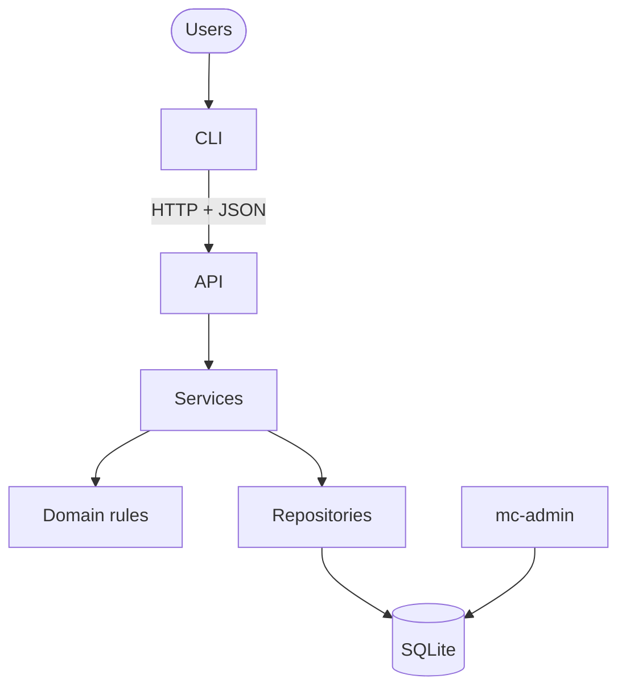
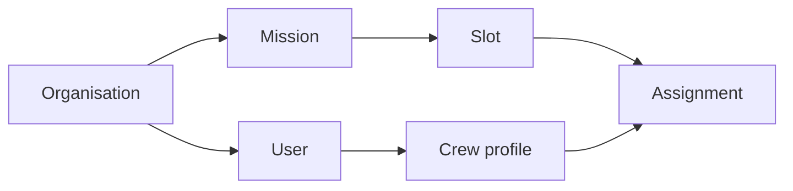
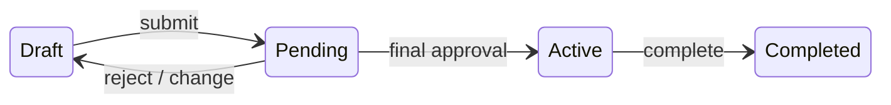
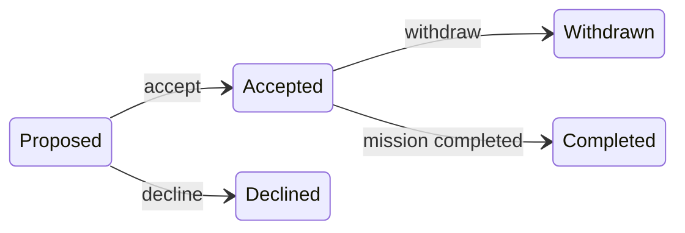
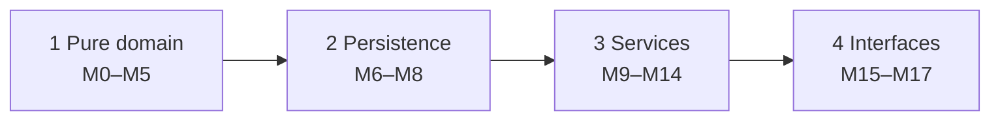

# Subagent (01): Independent review of M11 worktree

Source: `agent-a39853f67151c1019.jsonl` · 2026-10-12 02:18:22 UTC → 2026-10-12 02:24:47 UTC

Rendered from the raw JSONL without editing message content. Tool results and thinking are collapsed; expand them to read.


---

### 👤 User · 2026-10-12 02:18:22 UTC

You are doing an independent, READ-ONLY review of module **M11 (missions service)** of the Mission Control project. Another agent built it, then stopped before finishing its own review. Your review is the second opinion before the user reads it line by line and approves the merge.

**Location:** `/Users/pritanbarai/Desktop/JOBS/mutinex_mission_control/.worktrees/m11-missions` (branch `m11-missions`, based on `b7ecbba`).
- Do NOT edit, create, delete or format any file in the repository or any worktree.
- Do NOT run git commands that change state (no add, commit, stash, reset, checkout, rebase).
- You may read files, run `git -C <worktree> diff b7ecbba` / `git status`, run `uv run pytest -W error -o addopts="" -q` and `uv run ruff check src tests` inside the worktree, and write throwaway probe scripts under /tmp. A probe that builds a fresh seeded database (`mission_control.infra.db.connect/init_db`, `mission_control.seed.loader.load_seed(conn, password_hash="x")`) and calls the service through `mission_control.services.context.ServiceContext` is encouraged.

**What changed** (vs `b7ecbba`):
- new `src/mission_control/services/missions.py` (672 lines);
- new `tests/integration/test_missions_service.py` (63 test functions);
- two read helpers added to `src/mission_control/infra/repositories/missions.py`;
- seven events appended to `src/mission_control/domain/events.py`;
- design §7 additions: a new problem code `owner_not_active_lead` (awaiting approval), plus a note on 422 `validation_error`.

**Read for the rules:**
- `docs/prd.md` §3, §5.1, §5.4 (M1–M7 and the transition table), §5.5, §5.7 (visibility, V1, V2), §8 (AC-4, AC-5, AC-7, AC-27–AC-29);
- `docs/technical-design.md` §2, §4 (permissions, status codes, tenancy), §5 (Lifecycle and cross-cutting rules: touch_for_change, M7 edits, transactions), §7 (errors and problem codes), §10 (guidelines);
- `docs/phase-reviews.md` "Carried forward".
- Also read the code it builds on: `services/context.py`, `domain/lifecycle.py`, `domain/eligibility.py` (`invalidated_by` / SlotEdit / SlotRemoval / DatesEdit), `domain/permissions.py`, `infra/repositories/missions.py` and `facts.py`.

**Check especially:**
1. **Lifecycle correctness:**
   - every change to dates, slots or requirements calls `touch_for_change` first: Pending goes back to Draft (with a revert audit naming the cause), Active is refused with `mission_frozen`, final missions with `mission_final`.
   - transfer: Directors only; the new owner is an active Lead in the same org; Pending goes back to Draft; Active stays Active; final is refused. Is the round reset handled correctly?
2. **M7:** date, headcount, slot-removal and requirement edits that invalidate open assignments are refused with `invalidates_assignments`, listing every affected person; no crew are removed automatically. Probe with Station Reboost (3), which has 2 Engineer places with Gus accepted, and the Pending Deep Space Comms (6).
3. **Permissions and visibility:**
   - the right `Action` with all required `Context` fields (`owner_id`, `created_by_id`, `rostered_user_ids` from `missions.rostered_user_ids()`);
   - crew who aren't on a mission get NotFound (TR-10);
   - Leads editing others' missions get 403 `not_owner`;
   - creating: a Lead can only create for themselves, a Director only for an active Lead in the same org;
   - another org's ids give NotFound.
4. **Transactions and audit:** every write inside `ctx.write()`, checks after the lock, and a refusal writes nothing (verify with a probe that snapshots tables). Audit uses the `Event` enum with names in `data`.
5. **Validation and errors:** 422 vs 409 used consistently, and messages are natural sentences naming the people, slots and missions involved.
   - **Note:** a shared `domain.errors.InvalidInput` (code `validation_error`) was added to `main` after this branch was cut, so the branch doesn't have it. Report how M11 currently raises 422 so the lead can switch it to `InvalidInput` at merge.
6. **The new code `owner_not_active_lead`:** is it justified, or would an existing code fit? Give a recommendation.
7. **Out of scope:** assignments (M12), submit/approve/reject/complete/cancel (M13) and matching (M14) must NOT be implemented here.
8. **Tests:** do they cover the PRD rules they claim (names reference PRD IDs)? Are any brittle, or likely to pass for the wrong reason? Is anything important missing (e.g. AC-4 for each kind of edit, AC-7, Active freeze for every edit type, cross-org)?
9. **Conventions:** no PRD IDs in `src/`; named SQL binding `org_id = :org` with no `?`; no `httpx`; frozen dataclasses; type hints; no new dependencies.

**Report:**
- a one-paragraph verdict (would you merge it, and with what changes);
- findings ordered by severity (**Blocker / Major / Minor**), each with file:line, what's wrong, a concrete fix, and the PRD/design rule;
- your probe outputs (trimmed) for the lifecycle, M7, transfer and refusal-writes-nothing checks;
- a recommendation on `owner_not_active_lead`;
- how 422 is currently raised;
- test-coverage gaps;
- what's good and must stay.

<details>
<summary>⚙️ System/meta message · 2026-10-12 02:18:22 UTC</summary>

```
<system-reminder>
Your final report is delivered through SubagentHandback: when your work is complete, call SubagentHandback({message: <your full report>}). The call ends your run, so make it your last step. Only a SubagentHandback call reaches your caller as your result; plain text you write at the end is not delivered.
</system-reminder>
```

</details>

**🔧 Bash**

*Show worktree status and diff summary*

```bash
W=/Users/pritanbarai/Desktop/JOBS/mutinex_mission_control/.worktrees/m11-missions; cd $W && git status --short && git diff b7ecbba --stat && ls src/mission_control/services src/mission_control/domain src/mission_control/infra/repositories docs
```

<details>
<summary>↳ Result</summary>

```
 M docs/technical-design.md
 M src/mission_control/domain/events.py
 M src/mission_control/infra/repositories/missions.py
 M tests/unit/domain/test_events.py
?? src/mission_control/services/missions.py
?? tests/integration/test_missions_service.py
 docs/technical-design.md                           |  3 +++
 src/mission_control/domain/events.py               |  8 ++++++++
 src/mission_control/infra/repositories/missions.py | 20 ++++++++++++++++++++
 tests/unit/domain/test_events.py                   |  8 ++++++++
 4 files changed, 39 insertions(+)
docs:
brief.md
phase-reviews.md
prd.md
technical-design.md

src/mission_control/domain:
__init__.py
__pycache__
approvals.py
dates.py
eligibility.py
enums.py
errors.py
events.py
lifecycle.py
matching.py
passwords.py
permissions.py
records.py

src/mission_control/infra/repositories:
__init__.py
__pycache__
approvals.py
assignments.py
audit.py
base.py
crew.py
facts.py
missions.py
models.py
organisations.py
skills.py
users.py

src/mission_control/services:
__init__.py
__pycache__
auth.py
context.py
missions.py
```

</details>

**🔧 Bash**

*Show diff and new service file*

```bash
W=/Users/pritanbarai/Desktop/JOBS/mutinex_mission_control/.worktrees/m11-missions; cd $W && git diff b7ecbba && cat -n src/mission_control/services/missions.py
```

<details>
<summary>↳ Result</summary>

```
<persisted-output>
Output too large (31.8KB). Full output saved to: /Users/pritanbarai/.claude/projects/-Users-pritanbarai-Desktop-JOBS-mutinex-mission-control/3156d64e-bc59-4d21-acca-c4a1b10263cf/tool-results/b49h17le2.txt

Preview (first 2KB):
diff --git a/docs/technical-design.md b/docs/technical-design.md
index 57401c6..ac44ffc 100644
--- a/docs/technical-design.md
+++ b/docs/technical-design.md
@@ -400,6 +400,9 @@ Every error has the same shape, for every status code (401, 403, 404, 409, 422,
 | `invalidates_active_assignment` | A skill change would break an assignment on an Active mission | `mission_id`, `skill_id` |
 | `slot_unfilled` | Submitting with empty places | `slot_id` |
 | `proposal_unanswered` | Submitting while a proposal is still waiting for a reply (the message names the person and slot) | `assignment_id`, `slot_id`, `crew_profile_id` |
+| `owner_not_active_lead` | The owner named for a new mission, or for a transfer, isn't a Mission Lead or is deactivated (inside a 409 `rule_violation`) | `user_id` |
+
+*M11 missions:* `owner_not_active_lead` was added by M11 and is awaiting approval. Malformed mission and slot values (a blank name, headcount below 1, no required skill, a level outside 1–5, end before start, removing the only slot, transferring to the current owner) are 422 `validation_error`, with one `validation_error` problem per mistake.
 
 ---
 
diff --git a/src/mission_control/domain/events.py b/src/mission_control/domain/events.py
index e8ac43f..2454f66 100644
--- a/src/mission_control/domain/events.py
+++ b/src/mission_control/domain/events.py
@@ -11,3 +11,11 @@ class Event(StrEnum):
     MISSION_ACTIVATED = "mission.activated"
     MISSION_COMPLETED = "mission.completed"
     USER_PASSWORD_CHANGED = "user.password_changed"
+    # M11 missions
+    MISSION_UPDATED = "mission.updated"
+    MISSION_TRANSFERRED = "mission.transferred"
+    MISSION_RETURNED_TO_DRAFT = "mission.returned_to_draft"  # data names the change that caused it
+    SLOT_ADDED = "slot.added"
+    SLOT_UPDATED = "slot.updated"
+    SLOT_REQUIREMENTS_CHANGED = "slot.requirements_changed"
+    SLOT_REMOVED = "slot.removed"
...
</persisted-output>
```

</details>

**🔧 Bash**

*Show repo diff and first half of service*

```bash
W=/Users/pritanbarai/Desktop/JOBS/mutinex_mission_control/.worktrees/m11-missions; cd $W && git diff b7ecbba -- src/mission_control/infra tests/unit && cat -n src/mission_control/services/missions.py | sed -n 1,340p
```

<details>
<summary>↳ Result</summary>

```
diff --git a/src/mission_control/infra/repositories/missions.py b/src/mission_control/infra/repositories/missions.py
index d796e1d..ec8574e 100644
--- a/src/mission_control/infra/repositories/missions.py
+++ b/src/mission_control/infra/repositories/missions.py
@@ -269,6 +269,26 @@ class MissionRepo(Scoped):
         )
         return [assignment_from_row(r) for r in rows]
 
+    def assignee_names(self, mission_id: int) -> dict[int, str]:
+        """Display names of everyone who has held an assignment on the mission, by crew profile
+        id, so a mission's assignments can be shown with names."""
+        rows = self._all(
+            """SELECT DISTINCT c.id, c.display_name FROM assignments a
+               JOIN crew_profiles c ON c.org_id = a.org_id AND c.id = a.crew_profile_id
+               WHERE a.org_id = :org AND a.mission_id = :mission_id""",
+            mission_id=mission_id,
+        )
+        return {r["id"]: r["display_name"] for r in rows}
+
+    def slot_names(self, mission_id: int) -> dict[int, str]:
+        """Names of every slot the mission has had, removed ones included, so past assignments
+        still show the slot they were in."""
+        rows = self._all(
+            "SELECT id, name FROM slots WHERE org_id = :org AND mission_id = :mission_id",
+            mission_id=mission_id,
+        )
+        return {r["id"]: r["name"] for r in rows}
+
 
 def _crew_on_mission(crew_profile_id: int) -> tuple[str, dict[str, object]]:
     """A condition on mission `m`: the crew member holds an open or completed assignment on it.
diff --git a/tests/unit/domain/test_events.py b/tests/unit/domain/test_events.py
index 17ee13a..709ffd4 100644
--- a/tests/unit/domain/test_events.py
+++ b/tests/unit/domain/test_events.py
@@ -9,4 +9,12 @@ def test_event_names_are_the_stored_audit_strings():
         "MISSION_ACTIVATED": "mission.activated",
         "MISSION_COMPLETED": "mission.completed",
         "USER_PASSWORD_CHANGED": "user.password_changed",
+        # M11 missions
+        "MISSION_UPDATED": "mission.updated",
+        "MISSION_TRANSFERRED": "mission.transferred",
+        "MISSION_RETURNED_TO_DRAFT": "mission.returned_to_draft",
+        "SLOT_ADDED": "slot.added",
+        "SLOT_UPDATED": "slot.updated",
+        "SLOT_REQUIREMENTS_CHANGED": "slot.requirements_changed",
+        "SLOT_REMOVED": "slot.removed",
     }
     1	"""Missions: viewing them, creating them, editing their name, dates and slots, and handing them
     2	to another Lead.
     3	
     4	Every change follows one order inside a single write transaction: find what's named (missing,
     5	hidden or another organisation's is NotFound), check permission (Forbidden), check the mission's
     6	state with `touch_for_change` (StateConflict), check the input (InvalidInput), check the rules
     7	(RuleViolation), then write and audit. A Pending mission that is changed goes back to Draft and
     8	its approval round stops counting; that return is audited with the change that caused it.
     9	"""
    10	
    11	from collections.abc import Callable, Mapping, Sequence
    12	from dataclasses import dataclass, field
    13	from datetime import date
    14	from types import MappingProxyType
    15	
    16	from mission_control.domain.dates import DateRange, InvalidDateRange
    17	from mission_control.domain.eligibility import (
    18	    DatesEdit,
    19	    MissionEditKind,
    20	    SlotEdit,
    21	    SlotRemoval,
    22	    invalidated_by,
    23	)
    24	from mission_control.domain.enums import Action, AssignmentStatus, MissionStatus, Role
    25	from mission_control.domain.errors import Problem, RuleViolation
    26	from mission_control.domain.events import Event
    27	from mission_control.domain.lifecycle import (
    28	    StateConflict,
    29	    mission_status_after,
    30	    state_problem,
    31	    touch_for_change,
    32	)
    33	from mission_control.domain.permissions import Context
    34	from mission_control.domain.records import Requirement
    35	from mission_control.infra.repositories import Repos
    36	from mission_control.infra.repositories.models import Mission, Slot, User
    37	from mission_control.services.context import ServiceContext, found
    38	
    39	MIN_LEVEL, MAX_LEVEL = 1, 5
    40	_OPEN = frozenset({AssignmentStatus.PROPOSED, AssignmentStatus.ACCEPTED})
    41	# States reached through the current approval round, so its approvals are the live ones. A Draft
    42	# mission's round was rejected or voided by a change, so its approvals no longer count.
    43	_ROUND_IS_LIVE = frozenset(
    44	    {MissionStatus.PENDING_APPROVAL, MissionStatus.ACTIVE, MissionStatus.COMPLETED}
    45	)
    46	
    47	
    48	# Input and output records
    49	
    50	
    51	class InvalidInput(ValueError):
    52	    """The values given can't make a valid mission or slot, e.g. a headcount of 0. Every problem
    53	    is listed at once. Reported as `validation_error` (422)."""
    54	
    55	    code = "validation_error"
    56	
    57	    def __init__(self, problems: Sequence[Problem]) -> None:
    58	        if not problems:
    59	            raise ValueError("InvalidInput needs at least one problem")
    60	        self.problems = tuple(problems)
    61	        self.message = (
    62	            self.problems[0].message if len(self.problems) == 1 else "Some values aren't valid"
    63	        )
    64	        super().__init__(self.message)
    65	
    66	
    67	@dataclass(frozen=True)
    68	class SlotInput:
    69	    """A slot as given by the caller. `requirements` maps skill id to minimum level."""
    70	
    71	    name: str
    72	    headcount: int
    73	    requirements: Mapping[int, int] = field(default_factory=dict)
    74	
    75	    def __post_init__(self) -> None:
    76	        object.__setattr__(self, "requirements", MappingProxyType(dict(self.requirements)))
    77	
    78	
    79	@dataclass(frozen=True)
    80	class SlotView:
    81	    id: int
    82	    position: int
    83	    name: str
    84	    headcount: int
    85	    open_places: int
    86	    requirements: tuple[Requirement, ...]
    87	
    88	
    89	@dataclass(frozen=True)
    90	class AssignmentView:
    91	    id: int
    92	    slot_id: int
    93	    slot_name: str
    94	    crew_profile_id: int
    95	    crew_name: str
    96	    status: AssignmentStatus
    97	    reason: str | None
    98	
    99	
   100	@dataclass(frozen=True)
   101	class ApprovalView:
   102	    director_id: int
   103	    director_name: str
   104	    decision: str
   105	    reason: str | None
   106	
   107	
   108	@dataclass(frozen=True)
   109	class MissionView:
   110	    """A mission as its viewers see it: live slots in listed order, every assignment it has had,
   111	    and the approvals of its current round (none while it's in Draft or cancelled)."""
   112	
   113	    mission: Mission
   114	    owner_name: str
   115	    created_by_name: str
   116	    slots: tuple[SlotView, ...]
   117	    assignments: tuple[AssignmentView, ...]
   118	    approvals: tuple[ApprovalView, ...]
   119	
   120	
   121	# Viewing
   122	
   123	
   124	def list_missions(ctx: ServiceContext) -> list[Mission]:
   125	    """Directors and Leads see every mission in their organisation; crew see the missions
   126	    they're on."""
   127	    return ctx.repos.missions.list_visible(ctx.actor)
   128	
   129	
   130	def get_mission(ctx: ServiceContext, mission_id: int) -> MissionView:
   131	    """A mission the actor can't see is reported as not found, exactly like a missing one."""
   132	    with ctx.read() as repos:
   133	        mission = _visible(ctx, repos, mission_id)
   134	        ctx.authorize_view(Action.VIEW_MISSION, _context(repos, mission), "Mission")
   135	        return _view(repos, mission)
   136	
   137	
   138	# Creating
   139	
   140	
   141	def create_mission(
   142	    ctx: ServiceContext,
   143	    *,
   144	    name: str,
   145	    start: date,
   146	    end: date,
   147	    slots: Sequence[SlotInput],
   148	    owner_id: int | None = None,
   149	) -> MissionView:
   150	    """A new Draft mission with its slots. A Lead creates missions for themselves; a Director
   151	    names the Lead who will own it. The creator is recorded separately."""
   152	    owner_id = ctx.actor.user_id if owner_id is None else owner_id
   153	    with ctx.write() as repos:
   154	        owner = found(repos.users.get(owner_id), "User")
   155	        requirements = [_resolve(repos, s.requirements) for s in slots]
   156	        ctx.authorize(Action.CREATE_MISSION, Context(owner_id=owner.id))
   157	        problems = _name_problems(name)
   158	        window, date_problems = _window(start, end)
   159	        problems += date_problems
   160	        if not slots:
   161	            problems.append(_invalid("The mission needs at least one slot"))
   162	        for s in slots:
   163	            problems += _slot_problems(_label(s.name), s.name, s.headcount, s.requirements)
   164	        _refuse_input(problems)
   165	        assert window is not None
   166	        _require_owner(owner)
   167	
   168	        mission = repos.missions.create(name.strip(), window, owner.id, ctx.actor.user_id)
   169	        for s, reqs in zip(slots, requirements, strict=True):
   170	            repos.missions.add_slot(mission.id, s.name.strip(), s.headcount, _levels(reqs))
   171	        ctx.audit(
   172	            Event.MISSION_CREATED,
   173	            mission_id=mission.id,
   174	            to_status=MissionStatus.DRAFT,
   175	            data={
   176	                "mission_name": mission.name,
   177	                "owner_id": owner.id,
   178	                "owner_name": owner.name,
   179	                "start_date": window.start.isoformat(),
   180	                "end_date": window.end.isoformat(),
   181	                "slots": [
   182	                    {
   183	                        "slot_name": s.name.strip(),
   184	                        "headcount": s.headcount,
   185	                        "requirements": _requirement_data(reqs),
   186	                    }
   187	                    for s, reqs in zip(slots, requirements, strict=True)
   188	                ],
   189	            },
   190	        )
   191	        return _view(repos, mission)
   192	
   193	
   194	# Editing name and dates
   195	
   196	
   197	def update_mission(
   198	    ctx: ServiceContext,
   199	    mission_id: int,
   200	    *,
   201	    name: str | None = None,
   202	    start: date | None = None,
   203	    end: date | None = None,
   204	) -> MissionView:
   205	    """Rename or move the mission. Only its owner can. New dates are refused if anyone on the
   206	    roster would no longer be eligible."""
   207	    with ctx.write() as repos:
   208	        mission = _visible(ctx, repos, mission_id)
   209	        ctx.authorize(Action.EDIT_MISSION, _context(repos, mission))
   210	        status = touch_for_change(mission.status)
   211	        problems = _name_problems(name) if name is not None else []
   212	        window, date_problems = _window(
   213	            mission.window.start if start is None else start,
   214	            mission.window.end if end is None else end,
   215	        )
   216	        _refuse_input(problems + date_problems)
   217	        assert window is not None
   218	        new_name = name.strip() if name is not None else mission.name
   219	
   220	        changes: dict[str, list[str]] = {}
   221	        if new_name != mission.name:
   222	            changes["name"] = [mission.name, new_name]
   223	        for key, old, new in (
   224	            ("start_date", mission.window.start, window.start),
   225	            ("end_date", mission.window.end, window.end),
   226	        ):
   227	            if old != new:
   228	                changes[key] = [old.isoformat(), new.isoformat()]
   229	        if not changes:
   230	            return _view(repos, mission)
   231	        if window != mission.window:
   232	            _refuse_if_invalidated(
   233	                repos,
   234	                mission,
   235	                DatesEdit(window),
   236	                lambda names: (
   237	                    f"Can't change the dates of {mission.name}: {_join(names)} would no "
   238	                    "longer be eligible. Remove them from the mission first."
   239	                ),
   240	            )
   241	
   242	        repos.missions.update(mission.id, new_name, window)
   243	        _record_change(
   244	            ctx,
   245	            repos,
   246	            mission,
   247	            status,
   248	            Event.MISSION_UPDATED,
   249	            {"mission_name": new_name, "changes": changes},
   250	        )
   251	        return _view(repos, _reload(repos, mission))
   252	
   253	
   254	# Slots
   255	
   256	
   257	def add_slot(ctx: ServiceContext, mission_id: int, slot: SlotInput) -> MissionView:
   258	    """A new slot after the mission's last one. Only the owner can add one."""
   259	    with ctx.write() as repos:
   260	        mission = _visible(ctx, repos, mission_id)
   261	        requirements = _resolve(repos, slot.requirements)
   262	        ctx.authorize(Action.EDIT_MISSION, _context(repos, mission))
   263	        status = touch_for_change(mission.status)
   264	        _refuse_input(
   265	            _slot_problems(_label(slot.name), slot.name, slot.headcount, slot.requirements)
   266	        )
   267	
   268	        added = repos.missions.add_slot(
   269	            mission.id, slot.name.strip(), slot.headcount, _levels(requirements)
   270	        )
   271	        _record_change(
   272	            ctx,
   273	            repos,
   274	            mission,
   275	            status,
   276	            Event.SLOT_ADDED,
   277	            {
   278	                "mission_name": mission.name,
   279	                "slot_id": added.id,
   280	                "slot_name": added.name,
   281	                "headcount": added.headcount,
   282	                "requirements": _requirement_data(requirements),
   283	            },
   284	        )
   285	        return _view(repos, _reload(repos, mission))
   286	
   287	
   288	def update_slot(
   289	    ctx: ServiceContext,
   290	    mission_id: int,
   291	    slot_id: int,
   292	    *,
   293	    name: str | None = None,
   294	    headcount: int | None = None,
   295	) -> MissionView:
   296	    """Rename a slot or change its headcount. A headcount below the crew already assigned to the
   297	    slot is refused, naming them."""
   298	    with ctx.write() as repos:
   299	        mission = _visible(ctx, repos, mission_id)
   300	        slot = _slot_of(repos, mission, slot_id)
   301	        ctx.authorize(Action.EDIT_MISSION, _context(repos, mission))
   302	        status = touch_for_change(mission.status)
   303	        label = name.strip() if name is not None and name.strip() else slot.name
   304	        _refuse_input(_slot_problems(label, name, headcount, None))
   305	        new_name = name.strip() if name is not None else slot.name
   306	        new_headcount = headcount if headcount is not None else slot.headcount
   307	
   308	        changes: dict[str, list[object]] = {}
   309	        if new_name != slot.name:
   310	            changes["name"] = [slot.name, new_name]
   311	        if new_headcount != slot.headcount:
   312	            changes["headcount"] = [slot.headcount, new_headcount]
   313	        if not changes:
   314	            return _view(repos, mission)
   315	        _refuse_if_invalidated(
   316	            repos,
   317	            mission,
   318	            SlotEdit(slot.id, headcount=new_headcount),
   319	            lambda names: (
   320	                f"Can't lower the headcount of {slot.name} on {mission.name}: "
   321	                f"{_join(names)} {_are(names)} assigned. Remove crew from the slot first."
   322	            ),
   323	        )
   324	
   325	        repos.missions.update_slot(slot.id, new_name, new_headcount)
   326	        _record_change(
   327	            ctx,
   328	            repos,
   329	            mission,
   330	            status,
   331	            Event.SLOT_UPDATED,
   332	            {
   333	                "mission_name": mission.name,
   334	                "slot_id": slot.id,
   335	                "slot_name": new_name,
   336	                "changes": changes,
   337	            },
   338	        )
   339	        return _view(repos, _reload(repos, mission))
   340
```

</details>

**🔧 Bash**

*Show second half of service*

```bash
W=/Users/pritanbarai/Desktop/JOBS/mutinex_mission_control/.worktrees/m11-missions; cd $W && cat -n src/mission_control/services/missions.py | sed -n 340,680p
```

<details>
<summary>↳ Result</summary>

```
   340	
   341	
   342	def replace_requirements(
   343	    ctx: ServiceContext, mission_id: int, slot_id: int, requirements: Mapping[int, int]
   344	) -> MissionView:
   345	    """Replace every required skill of a slot ({skill id: minimum level}). Refused if anyone
   346	    assigned to the slot would no longer meet them."""
   347	    with ctx.write() as repos:
   348	        mission = _visible(ctx, repos, mission_id)
   349	        slot = _slot_of(repos, mission, slot_id)
   350	        new = _resolve(repos, requirements)
   351	        ctx.authorize(Action.EDIT_MISSION, _context(repos, mission))
   352	        status = touch_for_change(mission.status)
   353	        _refuse_input(_slot_problems(slot.name, None, None, requirements))
   354	
   355	        if _levels(new) == _levels(slot.requirements):
   356	            return _view(repos, mission)
   357	        _refuse_if_invalidated(
   358	            repos,
   359	            mission,
   360	            SlotEdit(slot.id, requirements=new),
   361	            lambda names: (
   362	                f"Can't change the requirements of {slot.name} on {mission.name}: "
   363	                f"{_join(names)} would no longer be eligible. Remove them from the mission first."
   364	            ),
   365	        )
   366	
   367	        repos.missions.replace_requirements(slot.id, _levels(new))
   368	        _record_change(
   369	            ctx,
   370	            repos,
   371	            mission,
   372	            status,
   373	            Event.SLOT_REQUIREMENTS_CHANGED,
   374	            {
   375	                "mission_name": mission.name,
   376	                "slot_id": slot.id,
   377	                "slot_name": slot.name,
   378	                "requirements": _requirement_data(new),
   379	                "previous_requirements": _requirement_data(slot.requirements),
   380	            },
   381	        )
   382	        return _view(repos, _reload(repos, mission))
   383	
   384	
   385	def remove_slot(ctx: ServiceContext, mission_id: int, slot_id: int) -> MissionView:
   386	    """Remove a slot. Its past assignments keep their history. Refused while anyone is assigned
   387	    to it, or if it's the mission's only slot."""
   388	    with ctx.write() as repos:
   389	        mission = _visible(ctx, repos, mission_id)
   390	        slot = _slot_of(repos, mission, slot_id)
   391	        ctx.authorize(Action.EDIT_MISSION, _context(repos, mission))
   392	        status = touch_for_change(mission.status)
   393	        if len(repos.missions.slots(mission.id)) == 1:
   394	            _refuse_input(
   395	                [_invalid(f"Can't remove {slot.name}: {mission.name} needs at least one slot")]
   396	            )
   397	        _refuse_if_invalidated(
   398	            repos,
   399	            mission,
   400	            SlotRemoval(slot.id),
   401	            lambda names: (
   402	                f"Can't remove {slot.name} from {mission.name} while {_join(names)} "
   403	                f"{_are(names)} assigned to it. Remove them from the mission first."
   404	            ),
   405	        )
   406	
   407	        repos.missions.remove_slot(slot.id)
   408	        _record_change(
   409	            ctx,
   410	            repos,
   411	            mission,
   412	            status,
   413	            Event.SLOT_REMOVED,
   414	            {"mission_name": mission.name, "slot_id": slot.id, "slot_name": slot.name},
   415	        )
   416	        return _view(repos, _reload(repos, mission))
   417	
   418	
   419	# Transferring ownership
   420	
   421	
   422	def transfer_ownership(ctx: ServiceContext, mission_id: int, new_owner_id: int) -> MissionView:
   423	    """Directors hand a mission that isn't finished to another active Lead. A Pending mission
   424	    goes back to Draft; an Active one stays Active, since its roster doesn't change."""
   425	    with ctx.write() as repos:
   426	        mission = _visible(ctx, repos, mission_id)
   427	        new_owner = found(repos.users.get(new_owner_id), "User")
   428	        ctx.authorize(Action.TRANSFER, _context(repos, mission))
   429	        problem = state_problem(mission.status, Action.TRANSFER)
   430	        if problem is not None:
   431	            raise StateConflict(problem)
   432	        if new_owner.id == mission.owner_id:
   433	            _refuse_input([_invalid(f"{new_owner.name} already owns {mission.name}")])
   434	        _require_owner(new_owner)
   435	        status = mission_status_after(mission.status, Action.TRANSFER)
   436	        old_owner = found(repos.users.get(mission.owner_id), "User")
   437	
   438	        repos.missions.set_owner(mission.id, new_owner.id)
   439	        _record_change(
   440	            ctx,
   441	            repos,
   442	            mission,
   443	            status,
   444	            Event.MISSION_TRANSFERRED,
   445	            {
   446	                "mission_name": mission.name,
   447	                "from_owner_id": old_owner.id,
   448	                "from_owner_name": old_owner.name,
   449	                "to_owner_id": new_owner.id,
   450	                "to_owner_name": new_owner.name,
   451	            },
   452	        )
   453	        return _view(repos, _reload(repos, mission))
   454	
   455	
   456	# Loading
   457	
   458	
   459	def _visible(ctx: ServiceContext, repos: Repos, mission_id: int) -> Mission:
   460	    return found(repos.missions.get_visible(ctx.actor, mission_id), "Mission")
   461	
   462	
   463	def _reload(repos: Repos, mission: Mission) -> Mission:
   464	    return found(repos.missions.get(mission.id), "Mission")
   465	
   466	
   467	def _context(repos: Repos, mission: Mission) -> Context:
   468	    """Everything the permission rules may ask about a mission."""
   469	    return Context(
   470	        owner_id=mission.owner_id,
   471	        created_by_id=mission.created_by_id,
   472	        rostered_user_ids=repos.missions.rostered_user_ids(mission.id),
   473	    )
   474	
   475	
   476	def _slot_of(repos: Repos, mission: Mission, slot_id: int) -> Slot:
   477	    """A live slot of this mission; any other slot id is not found."""
   478	    slot = repos.missions.get_slot(slot_id)
   479	    if slot is None or slot.mission_id != mission.id:
   480	        return found(None, "Slot")
   481	    return slot
   482	
   483	
   484	def _resolve(repos: Repos, levels: Mapping[int, int]) -> tuple[Requirement, ...]:
   485	    """Requirements with their skill names. A skill outside the catalogue is not found."""
   486	    return tuple(
   487	        Requirement(skill_id, found(repos.skills.get(skill_id), "Skill").name, level)
   488	        for skill_id, level in levels.items()
   489	    )
   490	
   491	
   492	def _view(repos: Repos, mission: Mission) -> MissionView:
   493	    assignments = repos.missions.assignments(mission.id)
   494	    crew_names = repos.missions.assignee_names(mission.id)
   495	    slot_names = repos.missions.slot_names(mission.id)
   496	    approvals = (
   497	        repos.approvals.for_round(mission.id, mission.approval_round)
   498	        if mission.status in _ROUND_IS_LIVE
   499	        else []
   500	    )
   501	    return MissionView(
   502	        mission=mission,
   503	        owner_name=_user_name(repos, mission.owner_id),
   504	        created_by_name=_user_name(repos, mission.created_by_id),
   505	        slots=tuple(
   506	            SlotView(
   507	                s.id,
   508	                s.position,
   509	                s.name,
   510	                s.headcount,
   511	                s.headcount
   512	                - sum(1 for a in assignments if a.slot_id == s.id and a.status in _OPEN),
   513	                s.requirements,
   514	            )
   515	            for s in repos.missions.slots(mission.id)
   516	        ),
   517	        assignments=tuple(
   518	            AssignmentView(
   519	                a.id,
   520	                a.slot_id,
   521	                slot_names[a.slot_id],
   522	                a.crew_profile_id,
   523	                crew_names[a.crew_profile_id],
   524	                a.status,
   525	                a.reason,
   526	            )
   527	            for a in assignments
   528	        ),
   529	        approvals=tuple(
   530	            ApprovalView(a.director_id, _user_name(repos, a.director_id), a.decision, a.reason)
   531	            for a in approvals
   532	        ),
   533	    )
   534	
   535	
   536	def _user_name(repos: Repos, user_id: int) -> str:
   537	    return found(repos.users.get(user_id), "User").name
   538	
   539	
   540	# Rules
   541	
   542	
   543	def _require_owner(user: User) -> None:
   544	    """Only an active Mission Lead can own a mission."""
   545	    if user.role != Role.LEAD:
   546	        message = f"{user.name} can't own a mission: only Mission Leads can"
   547	    elif not user.is_active:
   548	        message = f"{user.name} can't own a mission because they're deactivated"
   549	    else:
   550	        return
   551	    raise RuleViolation(message, [Problem("owner_not_active_lead", message, {"user_id": user.id})])
   552	
   553	
   554	def _refuse_if_invalidated(
   555	    repos: Repos, mission: Mission, edit: MissionEditKind, message: Callable[[list[str]], str]
   556	) -> None:
   557	    """Refuse an edit that would break open assignments. `message` gets the names of everyone
   558	    affected, in roster order."""
   559	    roster = repos.facts.roster(mission.id)
   560	    problems = invalidated_by(edit, roster)
   561	    if not problems:
   562	        return
   563	    names = {e.crew.crew_profile_id: e.crew.name for e in roster}
   564	    affected: list[int] = []
   565	    for p in problems:
   566	        ids = p.refs.get("crew_profile_ids") or [p.refs["crew_profile_id"]]
   567	        affected += [i for i in ids if isinstance(i, int) and i not in affected]
   568	    raise RuleViolation(
   569	        message([names[i] for i in affected]), problems, code="invalidates_assignments"
   570	    )
   571	
   572	
   573	def _record_change(
   574	    ctx: ServiceContext,
   575	    repos: Repos,
   576	    mission: Mission,
   577	    status: MissionStatus,
   578	    event: Event,
   579	    data: Mapping[str, object],
   580	) -> None:
   581	    """Apply the status `touch_for_change` (or the transfer rule) gave, then audit the change
   582	    and, if a Pending mission went back to Draft, that return with its cause."""
   583	    if status != mission.status:
   584	        repos.missions.set_status(mission.id, status)
   585	    ctx.audit(event, mission_id=mission.id, data=data)
   586	    if status != mission.status:
   587	        ctx.audit(
   588	            Event.MISSION_RETURNED_TO_DRAFT,
   589	            mission_id=mission.id,
   590	            from_status=mission.status,
   591	            to_status=status,
   592	            data={"mission_name": data["mission_name"], "cause": event.value},
   593	        )
   594	
   595	
   596	# Input checks
   597	
   598	
   599	def _invalid(message: str) -> Problem:
   600	    return Problem("validation_error", message)
   601	
   602	
   603	def _refuse_input(problems: Sequence[Problem]) -> None:
   604	    if problems:
   605	        raise InvalidInput(problems)
   606	
   607	
   608	def _name_problems(name: str) -> list[Problem]:
   609	    return [] if name.strip() else [_invalid("The mission needs a name")]
   610	
   611	
   612	def _window(start: date, end: date) -> tuple[DateRange | None, list[Problem]]:
   613	    try:
   614	        return DateRange(start, end), []
   615	    except InvalidDateRange:
   616	        return None, [
   617	            _invalid(f"The end date {end.isoformat()} is before the start date {start.isoformat()}")
   618	        ]
   619	
   620	
   621	def _label(name: str) -> str:
   622	    """How a slot is named in a message, even if its name is blank."""
   623	    return name.strip() or "A slot"
   624	
   625	
   626	def _slot_problems(
   627	    label: str,
   628	    name: str | None,
   629	    headcount: int | None,
   630	    requirements: Mapping[int, int] | None,
   631	) -> list[Problem]:
   632	    """What's wrong with a slot's given values. None means the value isn't being set."""
   633	    problems = []
   634	    if name is not None and not name.strip():
   635	        problems.append(_invalid("Every slot needs a name"))
   636	    if headcount is not None and headcount < 1:
   637	        problems.append(_invalid(f"{label} needs a headcount of at least 1"))
   638	    if requirements is not None:
   639	        if not requirements:
   640	            problems.append(_invalid(f"{label} needs at least one required skill"))
   641	        for level in requirements.values():
   642	            if not MIN_LEVEL <= level <= MAX_LEVEL:
   643	                problems.append(
   644	                    _invalid(
   645	                        f"{label}: a minimum skill level must be from {MIN_LEVEL} to "
   646	                        f"{MAX_LEVEL}, not {level}"
   647	                    )
   648	                )
   649	    return problems
   650	
   651	
   652	# Formatting
   653	
   654	
   655	def _levels(requirements: Sequence[Requirement]) -> dict[int, int]:
   656	    return {r.skill_id: r.min_level for r in requirements}
   657	
   658	
   659	def _requirement_data(requirements: Sequence[Requirement]) -> list[dict[str, object]]:
   660	    """Requirements for an audit event, with the skill names at the time."""
   661	    return [
   662	        {"skill_id": r.skill_id, "skill_name": r.skill_name, "min_level": r.min_level}
   663	        for r in requirements
   664	    ]
   665	
   666	
   667	def _join(names: Sequence[str]) -> str:
   668	    return names[0] if len(names) == 1 else ", ".join(names[:-1]) + " and " + names[-1]
   669	
   670	
   671	def _are(names: Sequence[str]) -> str:
   672	    return "is" if len(names) == 1 else "are"
```

</details>

### 🤖 Claude · 2026-10-12 02:18:38 UTC

Now the supporting code.

**🔧 Bash**

*Read context, lifecycle, errors*

```bash
W=/Users/pritanbarai/Desktop/JOBS/mutinex_mission_control/.worktrees/m11-missions; cd $W/src/mission_control && cat -n services/context.py domain/lifecycle.py domain/errors.py
```

**🔧 Bash**

*Read eligibility and permissions*

```bash
W=/Users/pritanbarai/Desktop/JOBS/mutinex_mission_control/.worktrees/m11-missions; cd $W/src/mission_control && cat -n domain/eligibility.py domain/permissions.py
```

**🔧 Bash**

*Read missions repo and list related repo functions*

```bash
W=/Users/pritanbarai/Desktop/JOBS/mutinex_mission_control/.worktrees/m11-missions; cd $W/src/mission_control && cat -n infra/repositories/missions.py | sed -n 1,300p; grep -n "def \|class " infra/repositories/facts.py infra/repositories/base.py infra/repositories/users.py infra/repositories/approvals.py
```

<details>
<summary>↳ Result</summary>

```
     1	"""What every use case runs with: who is acting, their organisation's repositories, the time,
     2	one transaction and its audit trail.
     3	
     4	A use case follows one shape: load through `ctx.repos`, check with domain rules, then write and
     5	audit inside `with ctx.write():`. Refusals raise `Forbidden`, `NotFound` or `RuleViolation`.
     6	"""
     7	
     8	import sqlite3
     9	from collections.abc import Generator, Sequence
    10	from contextlib import contextmanager
    11	from datetime import UTC, datetime
    12	
    13	from mission_control.domain.errors import Forbidden, NotFound, Problem, RuleViolation
    14	from mission_control.domain.events import Event
    15	from mission_control.domain.permissions import NO_CONTEXT, Action, Actor, Context, authorize
    16	from mission_control.infra.db import read_tx, write_tx
    17	from mission_control.infra.repositories import Repos
    18	
    19	
    20	class ServiceContext:
    21	    def __init__(self, conn: sqlite3.Connection, actor: Actor, now: datetime | None = None):
    22	        if now is not None and now.tzinfo is None:
    23	            raise ValueError("now must be timezone-aware")
    24	        self.conn = conn
    25	        self.actor = actor
    26	        self.now = (now or datetime.now(UTC)).astimezone(UTC)
    27	        self.repos = Repos(conn, actor.org_id)
    28	
    29	    @contextmanager
    30	    def write(self) -> Generator[Repos]:
    31	        """One write transaction: the lock is taken before any check inside the block, and
    32	        everything, audit included, commits together or not at all."""
    33	        with write_tx(self.conn):
    34	            yield self.repos
    35	
    36	    @contextmanager
    37	    def read(self) -> Generator[Repos]:
    38	        """Several reads against one consistent snapshot."""
    39	        with read_tx(self.conn):
    40	            yield self.repos
    41	
    42	    def audit(self, event: Event, **fields: object) -> None:
    43	        """Record an event as the acting user. Only inside `write()`, so it commits with the
    44	        change it describes."""
    45	        if not self.conn.in_transaction:
    46	            raise RuntimeError("audit events are written inside ctx.write()")
    47	        self.repos.audit.record(self.actor.user_id, event, **fields)  # type: ignore[arg-type]
    48	
    49	    def authorize(self, action: Action, context: Context = NO_CONTEXT) -> None:
    50	        """For a resource the actor can see: refusal is Forbidden (403)."""
    51	        authorize(self.actor, action, context)
    52	
    53	    def authorize_view(self, action: Action, context: Context, what: str) -> None:
    54	        """For looking at something: a refusal is reported as NotFound (404), so the response
    55	        never reveals that it exists."""
    56	        try:
    57	            authorize(self.actor, action, context)
    58	        except Forbidden as refused:
    59	            raise NotFound(what) from refused
    60	
    61	
    62	def found[T](value: T | None, what: str) -> T:
    63	    """The loaded record, or NotFound if the repository returned None."""
    64	    if value is None:
    65	        raise NotFound(what)
    66	    return value
    67	
    68	
    69	def check(problems: Sequence[Problem], message: str) -> None:
    70	    """Raise every problem at once as a RuleViolation; do nothing if there are none."""
    71	    if problems:
    72	        raise RuleViolation(message, problems)
     1	"""Mission and assignment state machines, and the checks a mission must pass to be submitted."""
     2	
     3	from collections.abc import Mapping, Sequence
     4	from types import MappingProxyType
     5	
     6	from mission_control.domain.dates import DateRange
     7	from mission_control.domain.eligibility import ineligibility_reasons
     8	from mission_control.domain.enums import Action, AssignmentStatus, MissionStatus
     9	from mission_control.domain.errors import Problem, RuleViolation
    10	from mission_control.domain.records import RosterEntry, SlotSpec
    11	
    12	M = MissionStatus
    13	A = AssignmentStatus
    14	
    15	FINAL = frozenset({M.COMPLETED, M.CANCELLED})
    16	
    17	
    18	# The states each mission action may start from. Its keys are the mission actions.
    19	MISSION_ALLOWED_FROM: Mapping[Action, frozenset[MissionStatus]] = MappingProxyType(
    20	    {
    21	        Action.SUBMIT: frozenset({M.DRAFT}),
    22	        Action.APPROVE: frozenset({M.PENDING_APPROVAL}),
    23	        Action.REJECT: frozenset({M.PENDING_APPROVAL}),
    24	        Action.TRANSFER: frozenset({M.DRAFT, M.PENDING_APPROVAL, M.ACTIVE}),
    25	        Action.COMPLETE: frozenset({M.ACTIVE}),
    26	        Action.CANCEL: frozenset({M.DRAFT, M.PENDING_APPROVAL, M.ACTIVE}),
    27	        Action.EDIT_MISSION: frozenset({M.DRAFT, M.PENDING_APPROVAL}),
    28	    }
    29	)
    30	
    31	# How each mission action reads after "Can't ...", e.g. "Can't approve a mission in draft".
    32	_MISSION_VERB: Mapping[Action, str] = MappingProxyType(
    33	    {
    34	        Action.SUBMIT: "submit",
    35	        Action.APPROVE: "approve",
    36	        Action.REJECT: "reject",
    37	        Action.TRANSFER: "transfer",
    38	        Action.COMPLETE: "complete",
    39	        Action.CANCEL: "cancel",
    40	        Action.EDIT_MISSION: "edit",
    41	    }
    42	)
    43	
    44	
    45	# How each state reads after "a mission ...", e.g. "Can't approve a mission in draft".
    46	_STATE_PHRASE: Mapping[MissionStatus, str] = MappingProxyType(
    47	    {
    48	        M.DRAFT: "in draft",
    49	        M.PENDING_APPROVAL: "pending approval",
    50	        M.COMPLETED: "that's completed",
    51	        M.CANCELLED: "that's cancelled",
    52	    }
    53	)
    54	
    55	
    56	def _wrong_state(status: MissionStatus, doing: str) -> Problem:
    57	    """`doing` is the start of the sentence, e.g. "approve" or "withdraw from"."""
    58	    if status == M.ACTIVE:
    59	        return Problem("mission_frozen", f"Can't {doing} an active mission")
    60	    code = "mission_final" if status in FINAL else "invalid_transition"
    61	    return Problem(code, f"Can't {doing} a mission {_STATE_PHRASE[status]}")
    62	
    63	
    64	class StateConflict(RuleViolation):
    65	    """The mission's state doesn't allow the change. `problem` says why; its code and message
    66	    become the refusal's own."""
    67	
    68	    def __init__(self, problem: Problem) -> None:
    69	        super().__init__(problem.message, [problem], code=problem.code)
    70	        self.problem = problem
    71	
    72	
    73	def _after_change(status: MissionStatus) -> MissionStatus:
    74	    """A change to a pending mission voids its approval round; otherwise status holds."""
    75	    return M.DRAFT if status == M.PENDING_APPROVAL else status
    76	
    77	
    78	def touch_for_change(status: MissionStatus) -> MissionStatus:
    79	    """The mission's status once a change to it is made. Every mutating service calls this
    80	    first. Draft stays Draft and Pending goes back to Draft; an Active or finished mission
    81	    can't be changed, so this raises `StateConflict`."""
    82	    if status not in MISSION_ALLOWED_FROM[Action.EDIT_MISSION]:
    83	        raise StateConflict(_wrong_state(status, _MISSION_VERB[Action.EDIT_MISSION]))
    84	    return _after_change(status)
    85	
    86	
    87	def _require_mission_action(action: Action) -> None:
    88	    if action not in MISSION_ALLOWED_FROM:
    89	        raise ValueError(f"{action!r} is not a mission action; use the assignment functions")
    90	
    91	
    92	def state_problem(status: MissionStatus, action: Action) -> Problem | None:
    93	    """Why mission `action` isn't allowed from `status`, or None if it is. Raises ValueError
    94	    for an action that isn't a mission action."""
    95	    _require_mission_action(action)
    96	    if status in MISSION_ALLOWED_FROM[action]:
    97	        return None
    98	    return _wrong_state(status, _MISSION_VERB[action])
    99	
   100	
   101	def mission_status_after(
   102	    status: MissionStatus, action: Action, *, reaches_quorum: bool = False
   103	) -> MissionStatus:
   104	    """The mission's status once `action` succeeds. Check `state_problem` first."""
   105	    if state_problem(status, action) is not None:
   106	        raise ValueError(f"{_MISSION_VERB[action]} is not allowed from {status.value}")
   107	    match action:
   108	        case Action.SUBMIT:
   109	            return M.PENDING_APPROVAL
   110	        case Action.APPROVE:
   111	            return M.ACTIVE if reaches_quorum else M.PENDING_APPROVAL
   112	        case Action.REJECT:
   113	            return M.DRAFT
   114	        case Action.COMPLETE:
   115	            return M.COMPLETED
   116	        case Action.CANCEL:
   117	            return M.CANCELLED
   118	        case Action.EDIT_MISSION | Action.TRANSFER:
   119	            return _after_change(status)
   120	
   121	
   122	# Assignments
   123	
   124	
   125	# action -> (assignment states it may start from, mission states it's allowed in). Its keys
   126	# are the assignment actions. PROPOSE_CREW creates the assignment, so it has no starting state.
   127	_ASSIGNMENT_RULES: Mapping[
   128	    Action, tuple[frozenset[AssignmentStatus] | None, frozenset[MissionStatus]]
   129	] = MappingProxyType(
   130	    {
   131	        Action.PROPOSE_CREW: (None, frozenset({M.DRAFT, M.PENDING_APPROVAL})),
   132	        Action.ACCEPT: (frozenset({A.PROPOSED}), frozenset({M.DRAFT})),
   133	        Action.DECLINE: (frozenset({A.PROPOSED}), frozenset({M.DRAFT})),
   134	        Action.WITHDRAW: (
   135	            frozenset({A.ACCEPTED}),
   136	            frozenset({M.DRAFT, M.PENDING_APPROVAL}),
   137	        ),
   138	        Action.REMOVE_CREW: (
   139	            frozenset({A.PROPOSED, A.ACCEPTED}),
   140	            frozenset({M.DRAFT, M.PENDING_APPROVAL}),
   141	        ),
   142	    }
   143	)
   144	
   145	_ASSIGNMENT_RESULT: Mapping[Action, AssignmentStatus] = MappingProxyType(
   146	    {
   147	        Action.PROPOSE_CREW: A.PROPOSED,
   148	        Action.ACCEPT: A.ACCEPTED,
   149	        Action.DECLINE: A.DECLINED,
   150	        Action.WITHDRAW: A.WITHDRAWN,
   151	        Action.REMOVE_CREW: A.REMOVED,
   152	    }
   153	)
   154	
   155	# How each assignment action reads before "a mission ...".
   156	_ASSIGNMENT_PHRASE: Mapping[Action, str] = MappingProxyType(
   157	    {
   158	        Action.PROPOSE_CREW: "propose crew for",
   159	        Action.ACCEPT: "accept a proposal on",
   160	        Action.DECLINE: "decline a proposal on",
   161	        Action.WITHDRAW: "withdraw from",
   162	        Action.REMOVE_CREW: "remove crew from",
   163	    }
   164	)
   165	
   166	# Actions that change the roster, and so send a pending mission back to Draft.
   167	_ROSTER_CHANGES = frozenset({Action.PROPOSE_CREW, Action.WITHDRAW, Action.REMOVE_CREW})
   168	
   169	# How each assignment action reads before "an assignment ...".
   170	_ASSIGNMENT_VERB: Mapping[Action, str] = MappingProxyType(
   171	    {
   172	        Action.PROPOSE_CREW: "propose",
   173	        Action.ACCEPT: "accept",
   174	        Action.DECLINE: "decline",
   175	        Action.WITHDRAW: "withdraw",
   176	        Action.REMOVE_CREW: "remove",
   177	    }
   178	)
   179	
   180	
   181	def _require_assignment_action(action: Action) -> None:
   182	    if action not in _ASSIGNMENT_RULES:
   183	        raise ValueError(f"{action!r} is not an assignment action; use the mission functions")
   184	
   185	
   186	def assignment_problem(
   187	    action: Action, current: AssignmentStatus | None, mission: MissionStatus
   188	) -> Problem | None:
   189	    """Why assignment `action` isn't allowed, or None. Mission state is checked before
   190	    assignment state. Raises ValueError for an action that isn't an assignment action."""
   191	    _require_assignment_action(action)
   192	    from_states, mission_states = _ASSIGNMENT_RULES[action]
   193	    if mission not in mission_states:
   194	        return _wrong_state(mission, _ASSIGNMENT_PHRASE[action])
   195	    if from_states is not None and current not in from_states:
   196	        label = current.value if current else "missing"
   197	        return Problem(
   198	            "invalid_transition", f"Can't {_ASSIGNMENT_VERB[action]} an assignment that is {label}"
   199	        )
   200	    return None
   201	
   202	
   203	def assignment_status_after(action: Action) -> AssignmentStatus:
   204	    _require_assignment_action(action)
   205	    return _ASSIGNMENT_RESULT[action]
   206	
   207	
   208	def mission_status_after_assignment_action(mission: MissionStatus, action: Action) -> MissionStatus:
   209	    _require_assignment_action(action)
   210	    return _after_change(mission) if action in _ROSTER_CHANGES else mission
   211	
   212	
   213	def cascade(mission_final_status: MissionStatus, assignment: AssignmentStatus) -> AssignmentStatus:
   214	    """What an assignment becomes when its mission completes or is cancelled."""
   215	    if mission_final_status == M.COMPLETED and assignment == A.ACCEPTED:
   216	        return A.COMPLETED
   217	    if mission_final_status == M.CANCELLED and assignment in (A.PROPOSED, A.ACCEPTED):
   218	        return A.CANCELLED
   219	    return assignment
   220	
   221	
   222	# Submit guard
   223	
   224	
   225	def roster_problems(roster: Sequence[RosterEntry], window: DateRange) -> list[Problem]:
   226	    """Accepted crew who are no longer eligible, e.g. after a skill change. Checked at submit
   227	    and again at every approval."""
   228	    return [
   229	        p
   230	        for e in roster
   231	        if e.status == A.ACCEPTED
   232	        for p in ineligibility_reasons(e.crew, e.slot, window)
   233	    ]
   234	
   235	
   236	def check_submit(
   237	    slots: Sequence[SlotSpec],
   238	    roster: Sequence[RosterEntry],
   239	    window: DateRange,
   240	    eligible_approvers: int,
   241	    approvals_required: int,
   242	) -> list[Problem]:
   243	    """Everything stopping a Draft mission being submitted, all at once. `slots[i].open_places`
   244	    is headcount minus open assignments.
   245	
   246	    The order is part of the contract, and callers show problems in it: unfilled places (in
   247	    slot order), then unanswered proposals, then accepted crew who are no longer eligible (in
   248	    roster order), then too few eligible approvers."""
   249	    problems: list[Problem] = []
   250	    for s in slots:
   251	        if s.open_places > 0:
   252	            problems.append(
   253	                Problem(
   254	                    "slot_unfilled",
   255	                    f"{s.name}: {s.open_places} place{'s' if s.open_places > 1 else ''} unfilled",
   256	                    {"slot_id": s.id},
   257	                )
   258	            )
   259	    for e in roster:
   260	        if e.status == A.PROPOSED:
   261	            problems.append(
   262	                Problem(
   263	                    "proposal_unanswered",
   264	                    f"{e.slot.name}: {e.crew.name} hasn't responded to the proposal",
   265	                    {
   266	                        "assignment_id": e.assignment_id,
   267	                        "slot_id": e.slot.id,
   268	                        "crew_profile_id": e.crew.crew_profile_id,
   269	                    },
   270	                )
   271	            )
   272	    problems.extend(roster_problems(roster, window))
   273	    if eligible_approvers < approvals_required:
   274	        problems.append(
   275	            Problem(
   276	                "insufficient_approvers",
   277	                f"{eligible_approvers} eligible approver{'s' if eligible_approvers != 1 else ''}, "
   278	                f"{approvals_required} required",
   279	            )
   280	        )
   281	    return problems
     1	from collections.abc import Mapping, Sequence
     2	from dataclasses import dataclass, field
     3	from types import MappingProxyType
     4	
     5	
     6	@dataclass(frozen=True)
     7	class Problem:
     8	    """One reason an action can't go ahead. `refs` names the records involved. It is copied
     9	    into a read-only mapping, so no two problems share it and it can't be changed later."""
    10	
    11	    code: str
    12	    message: str
    13	    refs: Mapping[str, int | str | list[int]] = field(default_factory=dict)
    14	
    15	    def __post_init__(self) -> None:
    16	        object.__setattr__(self, "refs", MappingProxyType(dict(self.refs)))
    17	
    18	
    19	class Forbidden(Exception):
    20	    """The actor can see the resource but isn't allowed to do this."""
    21	
    22	    def __init__(self, code: str, message: str) -> None:
    23	        super().__init__(message)
    24	        self.code = code
    25	        self.message = message
    26	
    27	
    28	class Unauthenticated(Exception):
    29	    """No valid identity: bad credentials, or a missing, expired or revoked session."""
    30	
    31	    def __init__(self, code: str, message: str) -> None:
    32	        super().__init__(message)
    33	        self.code = code
    34	        self.message = message
    35	
    36	
    37	class NotFound(Exception):
    38	    """Missing, belonging to another organisation, or not visible to the actor. All three look
    39	    the same, so a response never reveals that something exists."""
    40	
    41	    code = "not_found"
    42	
    43	    def __init__(self, what: str) -> None:
    44	        self.message = f"{what} not found"
    45	        super().__init__(self.message)
    46	
    47	
    48	class RuleViolation(Exception):
    49	    """A change conflicts with the rules or the current state. Carries every problem at once."""
    50	
    51	    def __init__(self, message: str, problems: Sequence[Problem], code: str = "rule_violation"):
    52	        if not problems:
    53	            raise ValueError("a RuleViolation needs at least one problem")
    54	        super().__init__(message)
    55	        self.code = code
    56	        self.message = message
    57	        self.problems = tuple(problems)
    58	
    59	    @classmethod
    60	    def of(cls, problem: Problem) -> "RuleViolation":
    61	        """A refusal with a single reason takes that reason's code and message."""
    62	        return cls(problem.message, [problem], code=problem.code)
```

</details>

<details>
<summary>↳ Result</summary>

```
     1	"""Who can fill a slot, how loaded they are, and which edits would break existing assignments."""
     2	
     3	from collections.abc import Iterable, Sequence
     4	from dataclasses import dataclass
     5	
     6	from mission_control.domain.dates import DateRange
     7	from mission_control.domain.enums import AssignmentStatus, MissionStatus
     8	from mission_control.domain.errors import Problem
     9	from mission_control.domain.records import (
    10	    ActiveAssignment,
    11	    AssignmentFact,
    12	    CandidateFacts,
    13	    Requirement,
    14	    RosterEntry,
    15	    SlotSpec,
    16	)
    17	
    18	
    19	def _span(window: DateRange) -> str:
    20	    return f"{window.start.isoformat()} to {window.end.isoformat()}"
    21	
    22	
    23	def ineligibility_reasons(
    24	    person: CandidateFacts, slot: SlotSpec, window: DateRange
    25	) -> list[Problem]:
    26	    """Every reason `person` can't fill `slot` for `window`. Empty means eligible."""
    27	    problems: list[Problem] = []
    28	    ref = {"crew_profile_id": person.crew_profile_id, "slot_id": slot.id}
    29	
    30	    if not person.active:
    31	        problems.append(Problem("inactive", f"{person.name} is deactivated", ref))
    32	
    33	    problems.extend(_skill_shortfalls(person, slot.requirements, ref))
    34	    problems.extend(_availability_conflicts(person, window, ref))
    35	    return problems
    36	
    37	
    38	def is_eligible(person: CandidateFacts, slot: SlotSpec, window: DateRange) -> bool:
    39	    return not ineligibility_reasons(person, slot, window)
    40	
    41	
    42	def _availability_conflicts(
    43	    person: CandidateFacts, window: DateRange, ref: dict[str, int | str]
    44	) -> list[Problem]:
    45	    """Unavailability or accepted assignments elsewhere that overlap `window`."""
    46	    problems = []
    47	    for blocked in person.unavailable:
    48	        if blocked.overlaps(window):
    49	            problems.append(
    50	                Problem("unavailable", f"{person.name} is unavailable {_span(blocked)}", ref)
    51	            )
    52	    for other in person.accepted_elsewhere:
    53	        if other.window.overlaps(window):
    54	            shared = DateRange(
    55	                max(other.window.start, window.start), min(other.window.end, window.end)
    56	            )
    57	            problems.append(
    58	                Problem(
    59	                    "overlap",
    60	                    f"{person.name} has an accepted assignment on {other.mission_name} "
    61	                    f"overlapping {_span(shared)}",
    62	                    {**ref, "mission_id": other.mission_id, "mission_name": other.mission_name},
    63	                )
    64	            )
    65	    return problems
    66	
    67	
    68	def _skill_shortfalls(
    69	    person: CandidateFacts, requirements: Iterable[Requirement], ref: dict[str, int | str]
    70	) -> list[Problem]:
    71	    problems = []
    72	    for r in requirements:
    73	        level = person.skills.get(r.skill_id)
    74	        if level is None or level < r.min_level:
    75	            have = (
    76	                f"doesn't have {r.skill_name}" if level is None else (f"has {r.skill_name} {level}")
    77	            )
    78	            problems.append(
    79	                Problem(
    80	                    "skill_below_minimum",
    81	                    f"{person.name} {have} (needs {r.min_level})",
    82	                    {**ref, "skill_id": r.skill_id},
    83	                )
    84	            )
    85	    return problems
    86	
    87	
    88	# Workload
    89	
    90	
    91	def workload(assignments: Iterable[AssignmentFact], excluding_mission_id: int | None) -> int:
    92	    """Mission-days of accepted assignments on missions that aren't completed."""
    93	    return sum(
    94	        a.window.mission_days
    95	        for a in assignments
    96	        if a.assignment_status == AssignmentStatus.ACCEPTED
    97	        and a.mission_status != MissionStatus.COMPLETED
    98	        and a.mission_id != excluding_mission_id
    99	    )
   100	
   101	
   102	# Edits that would invalidate open assignments
   103	
   104	
   105	@dataclass(frozen=True)
   106	class SlotRemoval:
   107	    slot_id: int
   108	
   109	
   110	@dataclass(frozen=True)
   111	class SlotEdit:
   112	    slot_id: int
   113	    headcount: int | None = None
   114	    requirements: tuple[Requirement, ...] | None = None
   115	
   116	
   117	@dataclass(frozen=True)
   118	class DatesEdit:
   119	    window: DateRange
   120	
   121	
   122	MissionEditKind = SlotRemoval | SlotEdit | DatesEdit
   123	
   124	
   125	def invalidated_by(edit: MissionEditKind, roster: Sequence[RosterEntry]) -> list[Problem]:
   126	    """Every open assignment the edit would break. Empty means the edit is safe."""
   127	    if isinstance(edit, DatesEdit):
   128	        return [
   129	            _in_slot(e, p)
   130	            for e in roster
   131	            for p in _availability_conflicts(e.crew, edit.window, _refs(e))
   132	        ]
   133	
   134	    in_slot = [e for e in roster if e.slot.id == edit.slot_id]
   135	
   136	    if isinstance(edit, SlotRemoval):
   137	        return [
   138	            Problem(
   139	                "slot_has_open_assignments",
   140	                f"{e.slot.name}: {e.crew.name} is still assigned",
   141	                _refs(e),
   142	            )
   143	            for e in in_slot
   144	        ]
   145	
   146	    problems: list[Problem] = []
   147	    if edit.headcount is not None and edit.headcount < len(in_slot):
   148	        names = _join_names([e.crew.name for e in in_slot])
   149	        problems.append(
   150	            Problem(
   151	                "headcount_below_open_assignments",
   152	                f"{in_slot[0].slot.name}: {names} are assigned, more than the new headcount "
   153	                f"of {edit.headcount}",
   154	                {
   155	                    "slot_id": edit.slot_id,
   156	                    "crew_profile_ids": [e.crew.crew_profile_id for e in in_slot],
   157	                },
   158	            )
   159	        )
   160	    if edit.requirements is not None:
   161	        for e in in_slot:
   162	            problems.extend(
   163	                _in_slot(e, p) for p in _skill_shortfalls(e.crew, edit.requirements, _refs(e))
   164	            )
   165	    return problems
   166	
   167	
   168	def _join_names(names: list[str]) -> str:
   169	    return names[0] if len(names) == 1 else ", ".join(names[:-1]) + " and " + names[-1]
   170	
   171	
   172	def _refs(e: RosterEntry) -> dict[str, int | str]:
   173	    """The records every problem about this assignment names."""
   174	    return {
   175	        "assignment_id": e.assignment_id,
   176	        "crew_profile_id": e.crew.crew_profile_id,
   177	        "slot_id": e.slot.id,
   178	    }
   179	
   180	
   181	def _in_slot(e: RosterEntry, p: Problem) -> Problem:
   182	    """`p` with the slot's name in front of its message."""
   183	    return Problem(p.code, f"{e.slot.name}: {p.message}", p.refs)
   184	
   185	
   186	# Skill changes against Active assignments
   187	
   188	
   189	def invalidated_by_skill_change(
   190	    person_name: str,
   191	    skill_id: int,
   192	    new_level: int | None,
   193	    active_assignments: Sequence[ActiveAssignment],
   194	) -> list[Problem]:
   195	    """A skill change is refused only if it breaks an assignment on an Active mission.
   196	    `new_level=None` means the skill is being removed."""
   197	    problems = []
   198	    for a in active_assignments:
   199	        for r in a.requirements:
   200	            if r.skill_id == skill_id and (new_level or 0) < r.min_level:
   201	                problems.append(
   202	                    Problem(
   203	                        "invalidates_active_assignment",
   204	                        f"{person_name} needs {r.skill_name} {r.min_level} as {a.slot_name} "
   205	                        f"on active mission {a.mission_name}",
   206	                        {"mission_id": a.mission_id, "skill_id": skill_id},
   207	                    )
   208	                )
   209	    return problems
     1	"""Who may do what. `authorize` is the single entry point; it raises Forbidden with a code.
     2	
     3	Each action combines a role check with, where needed, a relationship check: owner of the
     4	mission, the person themselves, the mission's creator, or someone on its roster.
     5	"""
     6	
     7	from collections.abc import Mapping
     8	from dataclasses import dataclass
     9	from types import MappingProxyType
    10	
    11	from mission_control.domain.approvals import conflict_problems
    12	from mission_control.domain.enums import Action, Role
    13	from mission_control.domain.errors import Forbidden
    14	
    15	
    16	@dataclass(frozen=True)
    17	class Actor:
    18	    user_id: int
    19	    org_id: int
    20	    role: Role
    21	    crew_profile_id: int | None
    22	
    23	
    24	@dataclass(frozen=True)
    25	class Context:
    26	    """Facts about the target that the relationship rules need. Unused fields stay None.
    27	
    28	    None means "not supplied", which differs from an empty roster ("nobody rostered"). An action
    29	    whose rule needs a field refuses to run without it rather than treating it as a mismatch.
    30	    """
    31	
    32	    owner_id: int | None = None  # the mission's owning Lead
    33	    created_by_id: int | None = None  # who created the mission
    34	    target_user_id: int | None = None  # whose profile, skills or assignment this is
    35	    rostered_user_ids: frozenset[int] | None = None
    36	
    37	
    38	D, L, C = Role.DIRECTOR, Role.LEAD, Role.CREW
    39	ALL = frozenset(Role)
    40	
    41	# Which roles may attempt each action at all. Relationship rules below narrow this further.
    42	ROLES: Mapping[Action, frozenset[Role]] = MappingProxyType(
    43	    {
    44	        Action.MANAGE_ORG: frozenset({D}),
    45	        Action.MANAGE_SKILLS: frozenset({D}),
    46	        Action.LIST_SKILLS: frozenset({D, L}),
    47	        Action.CHANGE_OWN_PASSWORD: ALL,
    48	        Action.VIEW_CREW: ALL,
    49	        Action.VIEW_ASSIGNMENT_HISTORY: ALL,
    50	        Action.VIEW_UNAVAILABILITY_REASON: ALL,
    51	        Action.EDIT_OWN_PROFILE: ALL,
    52	        Action.SET_SKILL_LEVEL: frozenset({D, L}),
    53	        Action.VIEW_MISSION: ALL,
    54	        Action.CREATE_MISSION: frozenset({D, L}),
    55	        Action.EDIT_MISSION: frozenset({L}),
    56	        Action.PROPOSE_CREW: frozenset({L}),
    57	        Action.REMOVE_CREW: frozenset({L}),
    58	        Action.APPLY_MATCH: frozenset({L}),
    59	        Action.SUBMIT: frozenset({L}),
    60	        Action.PREVIEW_MATCH: frozenset({D, L}),
    61	        Action.COMPLETE: frozenset({D, L}),
    62	        Action.CANCEL: frozenset({D, L}),
    63	        Action.TRANSFER: frozenset({D}),
    64	        Action.APPROVE: frozenset({D}),
    65	        Action.REJECT: frozenset({D}),
    66	        Action.ACCEPT: ALL,
    67	        Action.DECLINE: ALL,
    68	        Action.WITHDRAW: ALL,
    69	    }
    70	)
    71	
    72	_OWNER_ONLY = frozenset(
    73	    {
    74	        Action.EDIT_MISSION,
    75	        Action.PROPOSE_CREW,
    76	        Action.REMOVE_CREW,
    77	        Action.APPLY_MATCH,
    78	        Action.SUBMIT,
    79	    }
    80	)
    81	_OWNER_OR_DIRECTOR = frozenset({Action.PREVIEW_MATCH, Action.COMPLETE, Action.CANCEL})
    82	# Crew may only see their own record; Leads and Directors may see anyone's.
    83	_CREW_SELF_ONLY = frozenset({Action.VIEW_CREW, Action.VIEW_ASSIGNMENT_HISTORY})
    84	# Only the person themselves, whatever their role.
    85	_SELF_ONLY = frozenset({Action.EDIT_OWN_PROFILE, Action.ACCEPT, Action.DECLINE, Action.WITHDRAW})
    86	
    87	_OWNER = ("owner_id",)
    88	_TARGET = ("target_user_id",)
    89	# The Context fields each relationship rule reads. Leaving one out is a caller bug, not a refusal.
    90	_REQUIRED_CONTEXT: Mapping[Action, tuple[str, ...]] = MappingProxyType(
    91	    {
    92	        Action.EDIT_MISSION: _OWNER,
    93	        Action.PROPOSE_CREW: _OWNER,
    94	        Action.REMOVE_CREW: _OWNER,
    95	        Action.APPLY_MATCH: _OWNER,
    96	        Action.SUBMIT: _OWNER,
    97	        Action.PREVIEW_MATCH: _OWNER,
    98	        Action.COMPLETE: _OWNER,
    99	        Action.CANCEL: _OWNER,
   100	        Action.CREATE_MISSION: _OWNER,
   101	        Action.SET_SKILL_LEVEL: _TARGET,
   102	        Action.EDIT_OWN_PROFILE: _TARGET,
   103	        Action.ACCEPT: _TARGET,
   104	        Action.DECLINE: _TARGET,
   105	        Action.WITHDRAW: _TARGET,
   106	        Action.VIEW_CREW: _TARGET,
   107	        Action.VIEW_ASSIGNMENT_HISTORY: _TARGET,
   108	        Action.VIEW_UNAVAILABILITY_REASON: _TARGET,
   109	        Action.APPROVE: ("created_by_id", "rostered_user_ids"),
   110	        Action.REJECT: ("created_by_id", "rostered_user_ids"),
   111	        Action.VIEW_MISSION: ("rostered_user_ids",),
   112	    }
   113	)
   114	
   115	
   116	# Messages. Phrases are written out so every refusal reads as a natural sentence.
   117	
   118	_ROLE_PLURAL: Mapping[Role, str] = MappingProxyType({D: "Directors", L: "Leads", C: "Crew"})
   119	
   120	# Completes "<Role plural> can't ...".
   121	ROLE_PHRASE: Mapping[Action, str] = MappingProxyType(
   122	    {
   123	        Action.MANAGE_ORG: "manage the organisation",
   124	        Action.MANAGE_SKILLS: "manage the skill catalogue",
   125	        Action.LIST_SKILLS: "view the skill catalogue",
   126	        Action.CHANGE_OWN_PASSWORD: "change their password",
   127	        Action.VIEW_CREW: "view crew profiles",
   128	        Action.VIEW_ASSIGNMENT_HISTORY: "view assignment history",
   129	        Action.VIEW_UNAVAILABILITY_REASON: "see unavailability reasons",
   130	        Action.EDIT_OWN_PROFILE: "edit profiles",
   131	        Action.SET_SKILL_LEVEL: "change skill levels",
   132	        Action.VIEW_MISSION: "view missions",
   133	        Action.CREATE_MISSION: "create missions",
   134	        Action.EDIT_MISSION: "edit missions",
   135	        Action.PROPOSE_CREW: "propose crew",
   136	        Action.REMOVE_CREW: "remove crew",
   137	        Action.APPLY_MATCH: "apply matcher suggestions",
   138	        Action.SUBMIT: "submit missions",
   139	        Action.PREVIEW_MATCH: "preview matcher suggestions",
   140	        Action.COMPLETE: "complete missions",
   141	        Action.CANCEL: "cancel missions",
   142	        Action.TRANSFER: "transfer mission ownership",
   143	        Action.APPROVE: "approve missions",
   144	        Action.REJECT: "reject missions",
   145	        Action.ACCEPT: "accept assignments",
   146	        Action.DECLINE: "decline assignments",
   147	        Action.WITHDRAW: "withdraw from assignments",
   148	    }
   149	)
   150	
   151	# Completes "Only the mission's owner can ..." / "Only the owner or a Director can ...".
   152	_MISSION_PHRASE: Mapping[Action, str] = MappingProxyType(
   153	    {
   154	        Action.EDIT_MISSION: "edit this mission",
   155	        Action.PROPOSE_CREW: "propose crew for this mission",
   156	        Action.REMOVE_CREW: "remove crew from this mission",
   157	        Action.APPLY_MATCH: "apply matcher suggestions to this mission",
   158	        Action.SUBMIT: "submit this mission",
   159	        Action.PREVIEW_MATCH: "preview matching for this mission",
   160	        Action.COMPLETE: "complete this mission",
   161	        Action.CANCEL: "cancel this mission",
   162	    }
   163	)
   164	
   165	_RESPOND_ONLY_TO_OWN = "You can only respond to your own assignments"
   166	_SELF_ONLY_MESSAGE: Mapping[Action, str] = MappingProxyType(
   167	    {
   168	        Action.VIEW_CREW: "Crew can only view their own profile",
   169	        Action.VIEW_ASSIGNMENT_HISTORY: "Crew can only view their own assignment history",
   170	        Action.EDIT_OWN_PROFILE: "You can only edit your own profile and availability",
   171	        Action.ACCEPT: _RESPOND_ONLY_TO_OWN,
   172	        Action.DECLINE: _RESPOND_ONLY_TO_OWN,
   173	        Action.WITHDRAW: _RESPOND_ONLY_TO_OWN,
   174	    }
   175	)
   176	
   177	
   178	NO_CONTEXT = Context()
   179	
   180	
   181	def authorize(actor: Actor, action: Action, ctx: Context = NO_CONTEXT) -> None:
   182	    if actor.role not in ROLES[action]:
   183	        raise Forbidden("role_forbidden", f"{_ROLE_PLURAL[actor.role]} can't {ROLE_PHRASE[action]}")
   184	
   185	    missing = [name for name in _REQUIRED_CONTEXT.get(action, ()) if getattr(ctx, name) is None]
   186	    if missing:
   187	        raise ValueError(f"{action.value} needs context field(s): {', '.join(missing)}")
   188	
   189	    rostered = ctx.rostered_user_ids or frozenset()
   190	    is_self = ctx.target_user_id == actor.user_id
   191	    is_owner = ctx.owner_id == actor.user_id
   192	
   193	    if action in _OWNER_ONLY and not is_owner:
   194	        raise Forbidden("not_owner", f"Only the mission's owner can {_MISSION_PHRASE[action]}")
   195	
   196	    if action in _OWNER_OR_DIRECTOR and actor.role != D and not is_owner:
   197	        raise Forbidden("not_owner", f"Only the owner or a Director can {_MISSION_PHRASE[action]}")
   198	
   199	    if action == Action.CREATE_MISSION and actor.role == L and not is_owner:
   200	        raise Forbidden("not_owner", "Leads can only create missions they own")
   201	
   202	    if action in _CREW_SELF_ONLY and actor.role == C and not is_self:
   203	        raise Forbidden("role_forbidden", _SELF_ONLY_MESSAGE[action])
   204	
   205	    if action == Action.VIEW_UNAVAILABILITY_REASON and actor.role != D and not is_self:
   206	        raise Forbidden(
   207	            "role_forbidden", "Only Directors can see other people's unavailability reasons"
   208	        )
   209	
   210	    if action == Action.VIEW_MISSION and actor.role == C and actor.user_id not in rostered:
   211	        raise Forbidden("role_forbidden", "Crew can only view missions they're on")
   212	
   213	    if action in _SELF_ONLY and not is_self:
   214	        raise Forbidden("not_owner", _SELF_ONLY_MESSAGE[action])
   215	
   216	    if action == Action.SET_SKILL_LEVEL and is_self:
   217	        raise Forbidden("self_skill_edit", "You can't change your own skill levels")
   218	
   219	    if action in (Action.APPROVE, Action.REJECT):
   220	        # Creator and roster rules are shared with the approval module. "Already decided" is a
   221	        # state conflict, not a permission, so it's checked by the service, not here.
   222	        problems = conflict_problems(actor.user_id, ctx.created_by_id, rostered)
   223	        if problems:
   224	            raise Forbidden(problems[0].code, problems[0].message)
   225	
   226	
   227	def can(actor: Actor, action: Action, ctx: Context = NO_CONTEXT) -> bool:
   228	    try:
   229	        authorize(actor, action, ctx)
   230	    except Forbidden:
   231	        return False
   232	    return True
```

</details>

<details>
<summary>↳ Result</summary>

```
     1	"""Missions, their slots and requirements, and who can see them."""
     2	
     3	from __future__ import annotations
     4	
     5	import sqlite3
     6	from collections.abc import Iterable, Mapping
     7	
     8	from mission_control.domain.dates import DateRange
     9	from mission_control.domain.enums import AssignmentStatus, MissionStatus, Role
    10	from mission_control.domain.permissions import Actor
    11	from mission_control.domain.records import Requirement
    12	from mission_control.infra.repositories.assignments import assignment_from_row
    13	from mission_control.infra.repositories.base import (
    14	    FINAL,
    15	    NOW,
    16	    ON_MISSION,
    17	    Scoped,
    18	    in_list,
    19	    window,
    20	)
    21	from mission_control.infra.repositories.models import Assignment, Mission, Slot
    22	
    23	
    24	class MissionRepo(Scoped):
    25	    """Missions and their parts.
    26	
    27	    Mission visibility for crew is decided here: Directors and Leads see every mission in their
    28	    organisation, while crew see only the missions they're on (see `rostered_user_ids`). A
    29	    mission a crew member isn't on is reported as missing, exactly like an unknown id, so callers
    30	    answer 404. Permissions' VIEW_MISSION is the matching rule for services that have already
    31	    loaded the mission.
    32	    """
    33	
    34	    def get(self, mission_id: int) -> Mission | None:
    35	        r = self._one("SELECT * FROM missions WHERE org_id = :org AND id = :id", id=mission_id)
    36	        return _mission(r) if r else None
    37	
    38	    def list(self) -> list[Mission]:
    39	        return [
    40	            _mission(r)
    41	            for r in self._all("SELECT * FROM missions WHERE org_id = :org ORDER BY start_date, id")
    42	        ]
    43	
    44	    def rostered_user_ids(self, mission_id: int) -> frozenset[int]:
    45	        """User ids of the crew on the mission: those holding an open or completed assignment."""
    46	        statuses, params = in_list("s", ON_MISSION)
    47	        rows = self._all(
    48	            f"""SELECT DISTINCT u.id FROM assignments a
    49	                JOIN crew_profiles c ON c.org_id = a.org_id AND c.id = a.crew_profile_id
    50	                JOIN users u ON u.org_id = c.org_id AND u.id = c.user_id
    51	                WHERE a.org_id = :org AND a.mission_id = :mission_id
    52	                AND a.status IN ({statuses})""",
    53	            mission_id=mission_id,
    54	            **params,
    55	        )
    56	        return frozenset(r["id"] for r in rows)
    57	
    58	    def list_visible(self, actor: Actor) -> list[Mission]:
    59	        """Directors and Leads see every mission; crew see only the missions they're on."""
    60	        self._check_actor(actor)
    61	        if actor.role != Role.CREW:
    62	            return self.list()
    63	        if actor.crew_profile_id is None:
    64	            return []
    65	        on_mission, params = _crew_on_mission(actor.crew_profile_id)
    66	        rows = self._all(
    67	            f"SELECT * FROM missions m WHERE m.org_id = :org AND {on_mission}"
    68	            " ORDER BY m.start_date, m.id",
    69	            **params,
    70	        )
    71	        return [_mission(r) for r in rows]
    72	
    73	    def get_visible(self, actor: Actor, mission_id: int) -> Mission | None:
    74	        """The mission if the actor may see it; None if it's missing or hidden from them."""
    75	        self._check_actor(actor)
    76	        if actor.role != Role.CREW:
    77	            return self.get(mission_id)
    78	        if actor.crew_profile_id is None:
    79	            return None
    80	        on_mission, params = _crew_on_mission(actor.crew_profile_id)
    81	        r = self._one(
    82	            f"SELECT * FROM missions m WHERE m.org_id = :org AND m.id = :id AND {on_mission}",
    83	            id=mission_id,
    84	            **params,
    85	        )
    86	        return _mission(r) if r else None
    87	
    88	    def non_final_owned_by(self, user_id: int) -> list[Mission]:
    89	        finals, params = in_list("f", FINAL)
    90	        rows = self._all(
    91	            f"SELECT * FROM missions WHERE org_id = :org AND owner_id = :owner"
    92	            f" AND status NOT IN ({finals}) ORDER BY start_date, id",
    93	            owner=user_id,
    94	            **params,
    95	        )
    96	        return [_mission(r) for r in rows]
    97	
    98	    def create(self, name: str, window: DateRange, owner_id: int, created_by_id: int) -> Mission:
    99	        cur = self._exec(
   100	            "INSERT INTO missions(org_id, name, start_date, end_date, owner_id, created_by_id)"
   101	            " VALUES (:org, :name, :start, :end, :owner, :creator)",
   102	            name=name,
   103	            start=window.start.isoformat(),
   104	            end=window.end.isoformat(),
   105	            owner=owner_id,
   106	            creator=created_by_id,
   107	        )
   108	        created = self.get(cur.lastrowid)
   109	        assert created is not None
   110	        return created
   111	
   112	    def update(self, mission_id: int, name: str, window: DateRange) -> bool:
   113	        return (
   114	            self._exec(
   115	                f"UPDATE missions SET name = :name, start_date = :start, end_date = :end,"
   116	                f" updated_at = {NOW} WHERE org_id = :org AND id = :id",
   117	                name=name,
   118	                start=window.start.isoformat(),
   119	                end=window.end.isoformat(),
   120	                id=mission_id,
   121	            ).rowcount
   122	            == 1
   123	        )
   124	
   125	    def set_status(self, mission_id: int, status: MissionStatus) -> bool:
   126	        return (
   127	            self._exec(
   128	                f"UPDATE missions SET status = :status, updated_at = {NOW}"
   129	                " WHERE org_id = :org AND id = :id",
   130	                status=status,
   131	                id=mission_id,
   132	            ).rowcount
   133	            == 1
   134	        )
   135	
   136	    def set_owner(self, mission_id: int, owner_id: int) -> bool:
   137	        return (
   138	            self._exec(
   139	                f"UPDATE missions SET owner_id = :owner, updated_at = {NOW}"
   140	                " WHERE org_id = :org AND id = :id",
   141	                owner=owner_id,
   142	                id=mission_id,
   143	            ).rowcount
   144	            == 1
   145	        )
   146	
   147	    def get_slot(self, slot_id: int) -> Slot | None:
   148	        """A live slot by id, with its requirements."""
   149	        r = self._one(
   150	            "SELECT mission_id FROM slots WHERE org_id = :org AND id = :id AND removed_at IS NULL",
   151	            id=slot_id,
   152	        )
   153	        if r is None:
   154	            return None
   155	        return next(s for s in self.slots(r["mission_id"]) if s.id == slot_id)
   156	
   157	    def add_slot(
   158	        self, mission_id: int, name: str, headcount: int, requirements: Mapping[int, int]
   159	    ) -> Slot:
   160	        """Append a slot after the last live one, with its {skill_id: min_level}."""
   161	        cur = self._exec(
   162	            """INSERT INTO slots(org_id, mission_id, name, headcount, position)
   163	               VALUES (:org, :mission_id, :name, :headcount,
   164	                       (SELECT coalesce(max(position), 0) + 1 FROM slots
   165	                        WHERE org_id = :org AND mission_id = :mission_id
   166	                        AND removed_at IS NULL))""",
   167	            mission_id=mission_id,
   168	            name=name,
   169	            headcount=headcount,
   170	        )
   171	        self._insert_requirements(cur.lastrowid, requirements)
   172	        created = self.get_slot(cur.lastrowid)
   173	        assert created is not None
   174	        return created
   175	
   176	    def update_slot(self, slot_id: int, name: str, headcount: int) -> bool:
   177	        return (
   178	            self._exec(
   179	                "UPDATE slots SET name = :name, headcount = :headcount"
   180	                " WHERE org_id = :org AND id = :id AND removed_at IS NULL",
   181	                name=name,
   182	                headcount=headcount,
   183	                id=slot_id,
   184	            ).rowcount
   185	            == 1
   186	        )
   187	
   188	    def replace_requirements(self, slot_id: int, requirements: Mapping[int, int]) -> bool:
   189	        if self.get_slot(slot_id) is None:
   190	            return False
   191	        self._exec(
   192	            "DELETE FROM slot_requirements WHERE org_id = :org AND slot_id = :slot_id",
   193	            slot_id=slot_id,
   194	        )
   195	        self._insert_requirements(slot_id, requirements)
   196	        return True
   197	
   198	    def _insert_requirements(self, slot_id: int, requirements: Mapping[int, int]) -> None:
   199	        for skill_id, min_level in requirements.items():
   200	            self._exec(
   201	                "INSERT INTO slot_requirements(org_id, slot_id, skill_id, min_level)"
   202	                " VALUES (:org, :slot_id, :skill_id, :min_level)",
   203	                slot_id=slot_id,
   204	                skill_id=skill_id,
   205	                min_level=min_level,
   206	            )
   207	
   208	    def remove_slot(self, slot_id: int) -> bool:
   209	        """Soft delete: the slot disappears but its past assignments keep their history."""
   210	        return (
   211	            self._exec(
   212	                f"UPDATE slots SET removed_at = {NOW}"
   213	                " WHERE org_id = :org AND id = :id AND removed_at IS NULL",
   214	                id=slot_id,
   215	            ).rowcount
   216	            == 1
   217	        )
   218	
   219	    def _check_actor(self, actor: Actor) -> None:
   220	        if actor.org_id != self._org:
   221	            raise ValueError(
   222	                f"actor belongs to org {actor.org_id}, but these repositories are for {self._org}"
   223	            )
   224	
   225	    def slots(self, mission_id: int) -> list[Slot]:
   226	        """Live slots in listed order, each with its requirements."""
   227	        slot_rows = self._all(
   228	            "SELECT * FROM slots WHERE org_id = :org AND mission_id = :mission_id"
   229	            " AND removed_at IS NULL ORDER BY position",
   230	            mission_id=mission_id,
   231	        )
   232	        req_rows = self._all(
   233	            """SELECT r.slot_id, r.skill_id, k.name, r.min_level FROM slot_requirements r
   234	               JOIN skills k ON k.org_id = r.org_id AND k.id = r.skill_id
   235	               JOIN slots s ON s.org_id = r.org_id AND s.id = r.slot_id
   236	               WHERE r.org_id = :org AND s.mission_id = :mission_id
   237	               ORDER BY r.slot_id, r.skill_id""",
   238	            mission_id=mission_id,
   239	        )
   240	        reqs: dict[int, list[Requirement]] = {}
   241	        for r in req_rows:
   242	            reqs.setdefault(r["slot_id"], []).append(
   243	                Requirement(r["skill_id"], r["name"], r["min_level"])
   244	            )
   245	        return [
   246	            Slot(
   247	                s["id"],
   248	                s["mission_id"],
   249	                s["name"],
   250	                s["headcount"],
   251	                s["position"],
   252	                tuple(reqs.get(s["id"], ())),
   253	            )
   254	            for s in slot_rows
   255	        ]
   256	
   257	    def assignments(
   258	        self, mission_id: int, statuses: Iterable[AssignmentStatus] | None = None
   259	    ) -> list[Assignment]:
   260	        wanted = tuple(statuses) if statuses is not None else tuple(AssignmentStatus)
   261	        if not wanted:
   262	            return []
   263	        statuses, params = in_list("s", wanted)
   264	        rows = self._all(
   265	            f"SELECT * FROM assignments WHERE org_id = :org AND mission_id = :mission_id"
   266	            f" AND status IN ({statuses}) ORDER BY id",
   267	            mission_id=mission_id,
   268	            **params,
   269	        )
   270	        return [assignment_from_row(r) for r in rows]
   271	
   272	    def assignee_names(self, mission_id: int) -> dict[int, str]:
   273	        """Display names of everyone who has held an assignment on the mission, by crew profile
   274	        id, so a mission's assignments can be shown with names."""
   275	        rows = self._all(
   276	            """SELECT DISTINCT c.id, c.display_name FROM assignments a
   277	               JOIN crew_profiles c ON c.org_id = a.org_id AND c.id = a.crew_profile_id
   278	               WHERE a.org_id = :org AND a.mission_id = :mission_id""",
   279	            mission_id=mission_id,
   280	        )
   281	        return {r["id"]: r["display_name"] for r in rows}
   282	
   283	    def slot_names(self, mission_id: int) -> dict[int, str]:
   284	        """Names of every slot the mission has had, removed ones included, so past assignments
   285	        still show the slot they were in."""
   286	        rows = self._all(
   287	            "SELECT id, name FROM slots WHERE org_id = :org AND mission_id = :mission_id",
   288	            mission_id=mission_id,
   289	        )
   290	        return {r["id"]: r["name"] for r in rows}
   291	
   292	
   293	def _crew_on_mission(crew_profile_id: int) -> tuple[str, dict[str, object]]:
   294	    """A condition on mission `m`: the crew member holds an open or completed assignment on it.
   295	    It joins on m.org_id, so the enclosing query's `m.org_id = :org` scopes it too."""
   296	    statuses, params = in_list("s", ON_MISSION)
   297	    clause = (
   298	        "EXISTS (SELECT 1 FROM assignments a WHERE a.org_id = m.org_id"
   299	        " AND a.mission_id = m.id AND a.crew_profile_id = :crew_profile_id"
   300	        f" AND a.status IN ({statuses}))"
infra/repositories/base.py:19:def in_list(prefix: str, values: Iterable[object]) -> tuple[str, dict[str, object]]:
infra/repositories/base.py:25:def window(row: sqlite3.Row) -> DateRange:
infra/repositories/base.py:29:class Scoped:
infra/repositories/base.py:30:    def __init__(self, conn: sqlite3.Connection, org_id: int) -> None:
infra/repositories/base.py:34:    def _params(self, params: dict[str, object]) -> dict[str, object]:
infra/repositories/base.py:39:    def _one(self, sql: str, **params: object) -> sqlite3.Row | None:
infra/repositories/base.py:42:    def _all(self, sql: str, **params: object) -> list[sqlite3.Row]:
infra/repositories/base.py:45:    def _exec(self, sql: str, **params: object) -> sqlite3.Cursor:
infra/repositories/facts.py:22:class FactsRepo(Scoped):
infra/repositories/facts.py:23:    def slot_specs(self, mission_id: int) -> list[SlotSpec]:
infra/repositories/facts.py:48:    def _requirements(self, mission_id: int) -> dict[int, list[Requirement]]:
infra/repositories/facts.py:64:    def candidates(
infra/repositories/facts.py:117:    def candidate(
infra/repositories/facts.py:123:    def _by_profile(self, sql: str, profile_ids: list[int], order: str = "rowid") -> dict:
infra/repositories/facts.py:131:    def _accepted(self, profile_ids: list[int]) -> dict:
infra/repositories/facts.py:148:    def commitments(self, crew_profile_id: int) -> list[Commitment]:
infra/repositories/facts.py:154:    def roster(self, mission_id: int) -> list[RosterEntry]:
infra/repositories/facts.py:185:    def assignment_facts(self, crew_profile_id: int) -> list[AssignmentFact]:
infra/repositories/facts.py:195:    def active_assignments(self, crew_profile_id: int) -> list[ActiveAssignment]:
infra/repositories/facts.py:218:def _fact(r) -> AssignmentFact:
infra/repositories/approvals.py:11:class ApprovalRepo(Scoped):
infra/repositories/approvals.py:12:    def get(self, approval_id: int) -> Approval | None:
infra/repositories/approvals.py:16:    def for_round(self, mission_id: int, round_: int) -> list[Approval]:
infra/repositories/approvals.py:26:def _approval(r: sqlite3.Row) -> Approval:
infra/repositories/users.py:12:class UserRepo(Scoped):
infra/repositories/users.py:15:    def get(self, user_id: int) -> User | None:
infra/repositories/users.py:21:    def list(self) -> list[User]:
infra/repositories/users.py:25:    def create(self, email: str, name: str, role: Role, password_hash: str) -> User:
infra/repositories/users.py:38:    def set_role(self, user_id: int, role: Role) -> bool:
infra/repositories/users.py:49:    def set_active(self, user_id: int, active: bool) -> bool:
infra/repositories/users.py:60:    def count_active_directors(self) -> int:
infra/repositories/users.py:68:def _user(r: sqlite3.Row) -> User:
```

</details>

**🔧 Bash**

*Read roster facts and approval round usage*

```bash
W=/Users/pritanbarai/Desktop/JOBS/mutinex_mission_control/.worktrees/m11-missions; cd $W/src/mission_control && sed -n 140,220p infra/repositories/facts.py; cat infra/repositories/approvals.py | sed -n 1,30p; grep -rn "approval_round" --include=*.py . ../../migrations 2>/dev/null | head -30; ls ../..
```

<details>
<summary>↳ Result</summary>

```
            accepted=AssignmentStatus.ACCEPTED,
            **params,
        )
        grouped: dict[int, list] = {}
        for r in rows:
            grouped.setdefault(r["crew_profile_id"], []).append(r)
        return grouped

    def commitments(self, crew_profile_id: int) -> list[Commitment]:
        """Accepted assignments on missions that aren't finished, e.g. to check new
        unavailability against."""
        facts = self.candidate(crew_profile_id, excluding_mission_id=None)
        return list(facts.accepted_elsewhere) if facts else []

    def roster(self, mission_id: int) -> list[RosterEntry]:
        """Open assignments on the mission, each with its slot spec and the crew member's facts
        as seen from this mission."""
        open_statuses, params = in_list("o", OPEN)
        rows = self._all(
            f"SELECT id, slot_id, crew_profile_id, status FROM assignments"
            f" WHERE org_id = :org AND mission_id = :mission_id AND status IN ({open_statuses})"
            f" ORDER BY id",
            mission_id=mission_id,
            **params,
        )
        if not rows:
            return []
        specs = {s.id: s for s in self.slot_specs(mission_id)}
        crew = {
            c.crew_profile_id: c
            for c in self.candidates(
                mission_id, crew_profile_ids={r["crew_profile_id"] for r in rows}
            )
        }
        return [
            RosterEntry(
                r["id"],
                specs[r["slot_id"]],
                crew[r["crew_profile_id"]],
                AssignmentStatus(r["status"]),
            )
            for r in rows
            if r["slot_id"] in specs
        ]

    def assignment_facts(self, crew_profile_id: int) -> list[AssignmentFact]:
        rows = self._all(
            """SELECT a.status, m.id AS mission_id, m.status AS mission_status, m.start_date,
                      m.end_date
               FROM assignments a JOIN missions m ON m.org_id = a.org_id AND m.id = a.mission_id
               WHERE a.org_id = :org AND a.crew_profile_id = :crew_profile_id ORDER BY a.id""",
            crew_profile_id=crew_profile_id,
        )
        return [_fact(r) for r in rows]

    def active_assignments(self, crew_profile_id: int) -> list[ActiveAssignment]:
        """Accepted assignments on Active missions, with their slot's requirements."""
        rows = self._all(
            """SELECT m.id AS mission_id, m.name AS mission_name, s.id AS slot_id,
                      s.name AS slot_name
               FROM assignments a
               JOIN missions m ON m.org_id = a.org_id AND m.id = a.mission_id
               JOIN slots s ON s.org_id = a.org_id AND s.id = a.slot_id
               WHERE a.org_id = :org AND a.crew_profile_id = :crew_profile_id
               AND a.status = :accepted AND m.status = :active ORDER BY a.id""",
            crew_profile_id=crew_profile_id,
            accepted=AssignmentStatus.ACCEPTED,
            active=MissionStatus.ACTIVE,
        )
        result = []
        for r in rows:
            reqs = self._requirements(r["mission_id"]).get(r["slot_id"], [])
            result.append(
                ActiveAssignment(r["mission_id"], r["mission_name"], r["slot_name"], tuple(reqs))
            )
        return result


def _fact(r) -> AssignmentFact:
    return AssignmentFact(
        r["mission_id"],
"""Approval decisions, by round."""

from __future__ import annotations

import sqlite3

from mission_control.infra.repositories.base import Scoped
from mission_control.infra.repositories.models import Approval


class ApprovalRepo(Scoped):
    def get(self, approval_id: int) -> Approval | None:
        r = self._one("SELECT * FROM approvals WHERE org_id = :org AND id = :id", id=approval_id)
        return _approval(r) if r else None

    def for_round(self, mission_id: int, round_: int) -> list[Approval]:
        rows = self._all(
            "SELECT * FROM approvals WHERE org_id = :org AND mission_id = :mission_id"
            " AND round = :round ORDER BY id",
            mission_id=mission_id,
            round=round_,
        )
        return [_approval(r) for r in rows]


def _approval(r: sqlite3.Row) -> Approval:
    return Approval(
        r["id"], r["mission_id"], r["round"], r["director_id"], r["decision"], r["reason"]
    )
(eval):1: no matches found: --include=*.py
CLAUDE.md
docs
pyproject.toml
src
tests
uv.lock
```

</details>

**🔧 Bash**

*Find round usage and read CLAUDE.md*

```bash
W=/Users/pritanbarai/Desktop/JOBS/mutinex_mission_control/.worktrees/m11-missions; cd $W && grep -rn "approval_round\|round" src --include='*.py' --include='*.sql' | grep -v "__pycache__" | head -30; cat CLAUDE.md
```

<details>
<summary>↳ Result</summary>

```
src/mission_control/infra/repositories/models.py:64:    approval_round: int
src/mission_control/infra/repositories/models.py:92:    round: int
src/mission_control/infra/schema.sql:98:  approval_round     INTEGER NOT NULL DEFAULT 0 CHECK (approval_round >= 0),
src/mission_control/infra/schema.sql:164:  round       INTEGER NOT NULL CHECK (round >= 1),
src/mission_control/infra/schema.sql:170:  UNIQUE (mission_id, round, director_id),
src/mission_control/infra/repositories/approvals.py:1:"""Approval decisions, by round."""
src/mission_control/infra/repositories/approvals.py:16:    def for_round(self, mission_id: int, round_: int) -> list[Approval]:
src/mission_control/infra/repositories/approvals.py:19:            " AND round = :round ORDER BY id",
src/mission_control/infra/repositories/approvals.py:21:            round=round_,
src/mission_control/infra/repositories/approvals.py:28:        r["id"], r["mission_id"], r["round"], r["director_id"], r["decision"], r["reason"]
src/mission_control/infra/repositories/missions.py:314:        r["approval_round"],
src/mission_control/seed/loader.py:84:        " created_by_id, approval_round, approvals_required) VALUES (?, ?, ?, ?, ?, ?, ?, ?, ?, ?)",
src/mission_control/seed/loader.py:134:            "INSERT INTO approvals(org_id, mission_id, round, director_id, decision)"
src/mission_control/seed/data.py:58:    approvers: tuple[int, ...]  # director ids, round 1
src/mission_control/seed/data.py:126:# round 1), and slots with their requirements and (crew id, assignment status) pairs.
src/mission_control/domain/approvals.py:32:    decided_this_round: Set[int],
src/mission_control/domain/approvals.py:34:    """Every reason `approver` can't approve or reject this round. Empty means they can."""
src/mission_control/domain/approvals.py:38:    if approver.user_id in decided_this_round:
src/mission_control/domain/approvals.py:39:        problems.append(Problem("already_decided", "You've already decided this round of approval"))
src/mission_control/domain/approvals.py:56:def reaches_quorum(approvals_in_round: int, approvals_required: int) -> bool:
src/mission_control/domain/approvals.py:57:    """`approvals_in_round` counts approvals recorded this round, including the new one.
src/mission_control/domain/approvals.py:59:    return approvals_in_round >= approvals_required
src/mission_control/domain/lifecycle.py:74:    """A change to a pending mission voids its approval round; otherwise status holds."""
src/mission_control/services/missions.py:8:its approval round stops counting; that return is audited with the change that caused it.
src/mission_control/services/missions.py:41:# States reached through the current approval round, so its approvals are the live ones. A Draft
src/mission_control/services/missions.py:42:# mission's round was rejected or voided by a change, so its approvals no longer count.
src/mission_control/services/missions.py:111:    and the approvals of its current round (none while it's in Draft or cancelled)."""
src/mission_control/services/missions.py:497:        repos.approvals.for_round(mission.id, mission.approval_round)
# Mission Control

Multi-tenant mission planning API and CLI. Read these before doing any work. They are the source of truth, so don't copy their content here.

- [`docs/brief.md`](docs/brief.md): the assessment brief
- [`docs/prd.md`](docs/prd.md): **behaviour**. What the system does, its rules, acceptance criteria and seed scenarios.
- [`docs/technical-design.md`](docs/technical-design.md): **structure**. Architecture, schema, API, CLI, the delivery plan (§9) and the implementation guidelines (§10).

If the PRD and the design conflict, or are silent on something, stop and ask. Never invent behaviour.

## Workflow (every module)

1. **One approved module at a time.** Work only on the module from design §9 that I have approved. Don't start anything else.
2. **Tests first.** Write failing tests that reference the PRD IDs, then implement. Run the full suite and lint: `uv run pytest` and `uv run ruff check`.
3. **Real verification.** Exercise the behaviour for real, for example with a REPL call, an HTTP request or a CLI command. Show the actual output. A passing test run alone isn't verification.
4. **Read-only review.** Review the full diff against the PRD and design §10 without editing. Report findings, and fix them only once I agree.
5. **Stop for approval.** Summarise what changed, the test and verification results, and the review findings, and propose a commit message. **Don't commit, and don't start the next module, until I approve.**

## Waves (parallel modules in worktrees)

When I approve a wave of independent modules (design §9), build them in parallel and keep reviews small:

1. **One worktree per module.** Run `git worktree add .worktrees/<module> -b <module> main`, then `uv sync` inside it. Each agent edits only its own worktree and doesn't commit.
2. **Same workflow per module.** Steps 2 to 4 above still apply, inside the worktree.
3. **Review one branch at a time.** Show me only that module's diff against `main` (`git -C .worktrees/<module> diff main`, including new files), with its results.
4. **After I approve that module:**
   - commit on its branch;
   - rebase onto `main` if `main` has moved, and re-run its tests;
   - fast-forward `main`;
   - run the full suite on `main`;
   - remove the worktree and branch.

   Only then present the next branch.

Never push, add dependencies, change the schema, or add endpoints, error codes or CLI commands outside the design without asking first.
```

</details>

**🔧 Bash**

*List PRD headings*

```bash
W=/Users/pritanbarai/Desktop/JOBS/mutinex_mission_control/.worktrees/m11-missions; cd $W/docs && grep -n "^#" prd.md | head -80
```

<details>
<summary>↳ Result</summary>

```
1:# Mission Control — Product Requirements (v1)
7:## 1. Problem and goals
20:## 2. Requirements from the brief
33:## 3. Users and roles
45:## 4. Main workflows (all available through the CLI)
60:## 5. Business rules
62:### 5.1 Definitions
73:### 5.2 Tenancy and identity
79:### 5.3 People and skills
100:### 5.4 Missions and lifecycle
133:### 5.5 Approval
141:### 5.6 Assignments
155:### 5.7 Visibility and audit
169:## 6. Auto-matching
197:## 7. CLI requirements
204:## 8. Acceptance criteria
257:## 9. Seed data and scenarios
261:### 9.1 Aurora Space Agency (N = 2)
289:### 9.2 Helix Orbital (N = 1)
297:### 9.3 Scenarios
312:## 10. Test plan
325:## 11. Out of scope
```

</details>

**🔧 Bash**

*Read PRD rule sections*

```bash
W=/Users/pritanbarai/Desktop/JOBS/mutinex_mission_control/.worktrees/m11-missions; cd $W/docs && sed -n 33,44p prd.md && sed -n 60,168p prd.md && sed -n 204,312p prd.md
```

<details>
<summary>↳ Result</summary>

````
## 3. Users and roles

| Role | Responsibilities |
|---|---|
| **Director** | Manages users, roles, crew profiles, the skill catalogue and the approval setting. Creates missions for a Lead. Approves or rejects missions. Reassigns owners. Sees everything in their organisation. |
| **Mission Lead** | Owns missions. Defines slots, runs the matcher, proposes crew, submits. Maintains other people's skill levels. Reads all missions and crew profiles. |
| **Crew Member** | Manages own personal details and unavailability. Accepts, declines or withdraws from assignments. Sees only their own data and the missions they're on. |

- Each user belongs to exactly one organisation. The organisation is taken from the user's identity, never from the request.
- Each user has exactly one role, which controls permissions.
- Taking part in missions depends on a separate **crew profile**. Every Crew Member has one, and Leads and Directors may have one too.

## 5. Business rules

### 5.1 Definitions

| Term | Meaning |
|---|---|
| **Open assignment** | An assignment that is Proposed or Accepted. |
| **Open places** | A slot's headcount minus its open assignments. |
| **Mission-days** | The number of days from the start date to the end date, counting both. |
| **Overlap** | Two date ranges overlap if they share at least one calendar day. Dates have no time and no time zone. |
| **Eligible (crew for a slot)** | The person is active, has a crew profile, and has every required skill at or above its minimum level. They have no unavailability overlapping the mission, and no accepted assignment on another non-final mission that overlaps it. |
| **Eligible approver** | An active Director who did not create the mission and is not on its roster. |

### 5.2 Tenancy and identity

- **T1** Every record belongs to one organisation. Every read and write is limited to the caller's organisation. **[B]**
- **T2** Naming a resource from another organisation gives the same response as naming one that doesn't exist ("not found").
- **T3** Organisations are created only through seed data or an operator command. There is no self-service signup.

### 5.3 People and skills

- **P1** Each organisation has its own flat skill catalogue, managed by Directors. Skills with the same name in different organisations are unrelated.
  - Directors can rename a skill. Its identity stays the same.
  - Directors can delete a skill only if no crew skill or slot requirement uses it.
- **P2** Proficiency is an integer from 1 to 5.
- **P3** Leads and Directors set and remove skill levels. **Nobody can change their own levels.**
  - A skill change is allowed even if it makes someone ineligible for an assignment on a Draft or Pending mission. Eligibility is checked again at acceptance, submission and approval.
  - A skill change that would make someone ineligible for their assignment on an Active mission is refused.
- **P4** Crew profile holders manage their own personal details and unavailability. Nobody else edits them. Personal details are a display name and an optional bio.
- **P5** Crew are available by default. Unavailability is a date range with a reason.
- **P6** A crew member can't record unavailability that overlaps one of their accepted assignments.
- **P7** Users are deactivated, never deleted. Deactivated users can't sign in, aren't eligible for matching, and keep their history. Deactivation is refused while the user:
  - has open assignments; or
  - owns non-final missions. The same applies to changing a mission owner's role away from Lead. Their missions must be reassigned first.
- **P8** An organisation must always have at least one active Director.
- **P9** Crew profiles survive role changes and can't be deleted. Changing a user's role to Crew Member gives them a profile if they don't already have one.
- **P10** Directors set a new user's initial password. Users change their own password by entering their current one. There's no email or password-recovery flow.
  - Passwords must be at least 15 characters. Passphrases are welcome, and uppercase letters, numbers and symbols aren't required.
  - Changing a password ends all of that user's sessions, including the one used to change it.

### 5.4 Missions and lifecycle

- **M1** A mission has a name, a date range, one owning Lead and a separately recorded creator.
  - Leads create missions for themselves. Directors create them on behalf of a Lead.
  - Only Mission Leads can own missions.
  - Directors can transfer ownership of a non-final mission to another active Lead in the same organisation. If the mission is Pending, it returns to Draft and its approvals are cleared.
- **M2** A mission has one or more slots. Each slot has a name, a headcount of at least 1, and at least one required skill with a minimum level. Dates may be in the past, but the end date must be on or after the start date. The same rule applies to unavailability.
- **M3** Only the owning Lead can edit a mission, propose or remove crew, apply matcher results, or submit.

```
         submit                N-th approval                complete
 Draft ─────────▶ Pending ───────────────────▶ Active ─────────────▶ Completed
   ▲              Approval
   └── reject (reason) / any change ──┘
 Draft | Pending Approval | Active ──cancel (reason)──▶ Cancelled
```

| Transition | Who | Conditions and effects |
|---|---|---|
| Draft → Pending Approval | Owning Lead | All of these must hold: every slot is full, every assignment is Accepted, every rostered crew member is still eligible, and there are at least N eligible approvers. Otherwise the submission is refused with a list of the problems. |
| Pending → Active | The N-th distinct eligible approver | The roster is checked again at each approval. If the check fails, the approval is refused and the mission stays Pending, unchanged. |
| Pending → Draft | Eligible Director (reject) or system | A rejection needs a reason. Any change to dates, slots, roster or owner, including a crew withdrawal, also sends the mission back to Draft. Approvals are cleared, and remaining accepted assignments stay accepted. |
| Active → Completed | Owning Lead or Director | Accepted assignments become Completed. |
| Any non-final → Cancelled | Owning Lead or any Director | Reason required. Open assignments become Cancelled. |

- **M4** Draft missions can have unfilled places and unanswered proposals.
- **M5** Once a mission is Active, its dates, requirements and roster are frozen. Only completion or cancellation are allowed.
- **M6** Dates never trigger transitions on their own. There is no scheduler.
- **M7** An edit is refused if it would invalidate an open assignment. The response lists the affected crew, and the Lead must remove them first. Crew are never removed automatically. Edits that invalidate an assignment are:
  - removing a slot that has open assignments;
  - lowering a slot's headcount below its open assignments;
  - changing dates or requirements so that an assigned person is no longer eligible.

### 5.5 Approval

- **A1** Each organisation sets the number of approvals required (N ≥ 1). The approvals must come from N distinct eligible approvers.
  - N is fixed for a mission when it's submitted. Later changes to the setting don't affect a round already in progress.
  - An approval already given still counts if that Director is later deactivated or demoted.
- **A2** Leads can't approve anything, which satisfies R3. **[B]** A Director can't approve a mission they created or are rostered on.
- **A3** Each Director approves a round at most once. A single rejection ends the round.

### 5.6 Assignments

```
Proposed ──accept──▶ Accepted ──withdraw (reason)──▶ Withdrawn
   ├──decline──▶ Declined   └──removed by Lead──▶ Removed
   └──retracted by Lead──▶ Removed
Accepted ──mission completed──▶ Completed;  open ──mission cancelled──▶ Cancelled
```

- **S1** The owning Lead can propose only eligible crew. A person can hold at most one open assignment per mission. A slot can't have more open assignments than its headcount. A Lead can propose themselves, but they must be eligible and must accept like anyone else.
- **S2** Crew can accept only while the mission is in Draft and they're still eligible. Accepted assignments block overlapping dates. Proposals don't block anything.
- **S3** Declining takes an optional reason. Withdrawing needs a reason and is allowed only in Draft or Pending Approval.
- **S4** Every assignment needs the crew member's acceptance. Crew can't be placed on a mission directly.

### 5.7 Visibility and audit

| | Crew | Lead | Director |
|---|---|---|---|
| Own profile, skills, availability, assignments | ✓ | ✓ | ✓ |
| Missions they're on, with teammates' names and slots | ✓ | ✓ | ✓ |
| Other crew members' profiles, skills, busy/free dates | ✗ | ✓ | ✓ |
| Other people's *reasons* for unavailability | ✗ | ✗ | ✓ |
| All missions in the organisation | ✗ | read (edit own) | read |
| Users, catalogue management, organisation settings | ✗ | read catalogue | manage |

- **V1** Every state change, approval, rejection and assignment response is recorded with who did it, when, and any reason. Anyone who can see the mission can see this history.
- **V2** Former assignees see a summary of the mission in their own assignment history. They don't get full access to the mission unless their role allows it. Former assignees are people whose assignment was declined, withdrawn, removed or cancelled.

## 8. Acceptance criteria

Each criterion starts from a fresh seed. Scenario numbers (S-) refer to §9.3.

**Mission workflow**

- **AC-1** The golden path (S1) ends Completed, and every transition appears in the history with who did it and when.
- **AC-2** Submission is refused while any place is unfilled or any proposal is unanswered. The refusal lists them.
- **AC-3** Approvals before the N-th leave the mission Pending. The N-th approval makes it Active.
- **AC-4** Changing the dates, slots or roster of a Pending mission sends it back to Draft and clears its approvals. So does a crew withdrawal (S5).
- **AC-5** On an Active mission, edits, proposals, removals and withdrawals are refused. Completion and cancellation succeed.
- **AC-6** Cancelling needs a reason. The owning Lead or any Director can cancel, and any other Lead is refused. Open assignments become Cancelled.
- **AC-7** Only the owning Lead can edit, propose, apply or submit. After a Director reassigns the owner, the new owner can and the previous owner can't.

**Approval restrictions**

- **AC-8** The mission's creator can't approve it. In S1, Ruth is refused.
- **AC-9** Leads and Crew can't approve or reject.
- **AC-10** A Director can't approve the same round twice. Rejecting needs a reason and clears earlier approvals (S6).
- **AC-11** A Director rostered on a mission can't approve it.
- **AC-12** Submission is refused when there are fewer than N eligible approvers, not counting the creator or rostered Directors (S7).
- **AC-13** In Helix (N = 1), a single approval makes the mission Active (S8).

**Overlaps and availability**

- **AC-14** Proposing someone who is unavailable, or who has an overlapping accepted assignment, is refused. In S4, both Fay and Gus are refused.
- **AC-15** Overlapping proposals are allowed. Accepting one that overlaps an accepted assignment is refused, and the refusal names the conflicting mission (S4, Chen).
- **AC-16** Recording unavailability that overlaps an accepted assignment is refused.
- **AC-17** Two ranges that share only a boundary day overlap.

**Matching**

- **AC-18** S2 gives exactly the expected roster on every run.
- **AC-19** S3 marks Geologist as unfilled. S3b shows a new accepted assignment changing the suggestion.
- **AC-20** Workload counts only accepted assignments on missions that aren't Completed. Chen's workload is 5, not 35.
- **AC-21** The suggestion never puts one person in two slots. It never includes anyone who is ineligible, from another organisation, or already excluded from this mission.
- **AC-22** Running the matcher changes nothing. Applying it creates Proposed assignments.

**Roles and visibility**

- **AC-23** Ana can't change her own skill levels, but Lee can change hers. Ben can't edit skills, but he can edit his personal details and unavailability.
- **AC-24** Lee sees Fay as busy 5–8 Mar but doesn't see the reason. Ruth sees the reason. Ben can't view Fay's profile, and his mission list shows only missions he's on.
- **AC-25** Leads can't manage users, the catalogue or the approval setting.
- **AC-26** Deactivating someone with open assignments is refused. A deactivated user can't sign in. The last active Director can't be deactivated or demoted.

**Tenant isolation (S9)**

- **AC-27** Requesting another organisation's mission, crew member, user, skill or assignment by ID gives the same response as an ID that doesn't exist.
- **AC-28** Every list contains only the caller's organisation's records.
- **AC-29** Any write that references another organisation's ID fails as "not found", and neither organisation's data changes.
- **AC-30** Approving or rejecting another organisation's mission fails as "not found".
- **AC-31** Helix's Kai (Piloting 5, no commitments) is never suggested for an Aurora mission.

## 9. Seed data and scenarios

The table order of people is their stable-identifier order. All dates are in 2027 unless stated.

### 9.1 Aurora Space Agency (N = 2)

| Person | Role | Crew skills | Commitments (workload) |
|---|---|---|---|
| Ruth Adeyemi | Director | — | — |
| Marco Bianchi | Director | Flight Medicine 4 | Medical Study, accepted (4) |
| Ingrid Holm | Director | — | — |
| Lee Park | Lead | — | — |
| Nora Quinn | Lead | — | — |
| Ana Okafor | Lead | Piloting 5, Leadership 4, Systems Eng 4 | none (0) |
| Ben Ito | Crew | Systems Eng 4, EVA 3 | Deep Space Comms, accepted (20) |
| Chen Wu | Crew | Systems Eng 3 | Telescope (5). Mars Analog Completed, so it doesn't count |
| Dana Reyes | Crew | EVA 4 | Telescope (5) |
| Eli Novak | Crew | EVA 4, Piloting 4, Leadership 2 | Telescope (5) |
| Fay Moreau | Crew | Piloting 4, Leadership 4 | Unavailable 5–8 Mar (Medical) |
| Gus Patel | Crew | Systems Eng 5 | Station Reboost, accepted (6) |
| Hana Sato | Crew | EVA 3, Geology 2 | Telescope (5) |

| Mission | Owner / creator | Dates | State | Slots → crew |
|---|---|---|---|---|
| Lunar Gateway Resupply | Lee / Ruth | 1–10 Mar | Draft | Flight Engineer ×1 (Sys Eng ≥3) · Mission Specialist ×1 (EVA ≥3) · Commander ×1 (Piloting ≥4, Leadership ≥3) — no crew |
| Asteroid Survey | Nora | 5–12 Mar | Draft | Pilot ×1 (Piloting ≥4) · Geologist ×1 (Geology ≥4) — no crew |
| Station Reboost | Nora | 25 Feb – 2 Mar | Draft | Engineer ×2 (Sys Eng ≥3) — Gus accepted, 1 open place |
| Lunar Surface Medical Study | Nora / Ruth | 15–18 Mar | Draft | Flight Surgeon ×1 (Flight Medicine ≥4) — Marco accepted |
| Orbital Telescope Service | Lee | 10–14 Jan | Active | Engineer ×1 — Chen · EVA Specialist ×3 (EVA ≥3) — Dana, Eli, Hana |
| Deep Space Comms Upgrade | Nora | 1–20 Apr | Pending (Marco approved) | Engineer ×1 (Sys Eng ≥3) — Ben |
| Mars Analog Habitat | Lee | 1–30 May 2026 | Completed | Engineer ×1 — Chen |

### 9.2 Helix Orbital (N = 1)

People: Sam Rivera (Director), Priya Nair (Lead), and Crew Kai Tanaka (Piloting 5), Lena Fischer (Payload Integration 4), Omar Haddad (Field Medicine 4) and Tess Moreno (Life Support 3). Helix has its own catalogue, including a separate "Piloting" skill.

| Mission | Owner | Dates | State | Slots → crew |
|---|---|---|---|---|
| Payload Demo 1 | Priya | 1–3 Feb | Draft | Payload Specialist ×1 (Payload Int ≥3) — Lena accepted · Medic ×1 (Field Medicine ≥3) — Omar accepted |

### 9.3 Scenarios

| # | Steps | Expected outcome |
|---|---|---|
| **S1** | Lee matches and applies *Lunar Gateway Resupply* → Ana, Chen and Dana accept → Lee submits → Ruth approves → Marco approves → Ingrid approves → Lee completes | Proposed crew are Ana, Chen and Dana. Ruth is refused as creator. After Marco the mission is Pending (1/2). After Ingrid it's **Active**. Completing makes the assignments Completed. |
| **S2** | Match *Lunar Gateway Resupply* | Eligible crew: Commander {Ana}, because Fay is unavailable and Eli's Leadership is too low. Flight Engineer {Ana, Ben, Chen}, because Gus has an overlap. Specialist {Ben, Dana, Eli, Hana}. **Commander → Ana** (most constrained). **Flight Engineer → Chen** (workload 5 vs Ben's 20). **Specialist → Dana** (four-way workload tie at 5; Hana loses on proficiency; Dana beats Eli on ID). Filling the slots in listed order would have spent Ana on Flight Engineer and left Commander unfilled. |
| **S3** | Match *Asteroid Survey* | Geologist **unfilled** (Hana's Geology is only 2). Pilot → Ana (workload 0 vs Eli's 5; Fay unavailable). |
| **S3b** | S1 up to acceptance, then match *Asteroid Survey* | Ana is blocked by her overlapping accepted assignment, so Pilot → Eli. Geologist still unfilled. |
| **S4** | Lee proposes Gus and Fay for *Gateway*. Nora proposes Chen for *Station Reboost* and Lee proposes Chen for *Gateway*. Chen accepts *Station Reboost*, then *Gateway*. | Gus refused (overlap). Fay refused (unavailable). Both Chen proposals succeed. Chen's second acceptance is refused, naming *Station Reboost*. |
| **S5** | Ben withdraws from *Deep Space Comms* without a reason, then with one. Hana withdraws from *Telescope*. | Ben's first attempt is refused. The second succeeds: the mission returns to Draft and Marco's approval is cleared. Hana is refused because *Telescope* is Active. |
| **S6** | Marco approves *Deep Space Comms* again. Ingrid rejects it without a reason, then with one. | Marco is refused. Ingrid's first attempt is refused. The second sends the mission to Draft and clears approvals. |
| **S7** | Nora submits *Lunar Surface Medical Study* | Refused. Ruth created it and Marco is rostered, which leaves 1 eligible approver (Ingrid) when 2 are needed. |
| **S8** | Priya submits *Payload Demo 1* and Sam approves | **Active** after one approval. |
| **S9** | Each role in each organisation tries to read, list, write and approve the other organisation's resources, and matches an Aurora Piloting slot | Every attempt fails as "not found" and nothing changes. Lists show only the caller's organisation. Kai never appears. |

## 10. Test plan
````

</details>

**🔧 Bash**

*List design headings*

```bash
W=/Users/pritanbarai/Desktop/JOBS/mutinex_mission_control/.worktrees/m11-missions; cd $W/docs && grep -n "^#" technical-design.md
```

<details>
<summary>↳ Result</summary>

```
1:# Mission Control — Technical Design (v1)
24:## 1. Summary
43:## 2. Architecture
95:## 3. Data model
130:## 4. Security and tenancy
132:### Authentication
141:### Permissions
169:### Tenant isolation
181:## 5. Lifecycle
183:### Mission
205:### Assignment
228:### Cross-cutting rules
240:## 6. Matching
308:## 7. API
316:#### Auth and me
325:#### Organisation, users and skills (Directors)
335:#### Crew
345:#### Missions
358:#### Assignments
365:#### Errors
409:## 8. CLI
423:# Everyone
428:# Leads
434:# Directors
443:## 9. Delivery plan
507:## 10. Guidelines for implementing agents
509:### Source of truth
514:### The loop for each module
523:### Working in waves (worktrees)
532:### Architecture rules (never break these)
540:### Coding conventions
546:### Testing conventions
551:### Stop and ask before
559:## 11. Setup and testing
584:## Appendix A: Schema SQL
595:### Organisations, users and sessions
633:### Crew, skills and availability
687:### Missions, slots and requirements
741:### Assignments, approvals and audit
814:## Appendix B: Trade-offs and considerations
818:### B.1 Key decisions
835:### B.2 Risks
845:### B.3 Scaling path (not in v1)
```

</details>

**🔧 Bash**

*Read design sections 2-5*

```bash
W=/Users/pritanbarai/Desktop/JOBS/mutinex_mission_control/.worktrees/m11-missions; cd $W/docs && sed -n 43,240p technical-design.md
```

<details>
<summary>↳ Result</summary>

````
## 2. Architecture

**Stack:** Python 3.12 · FastAPI + Pydantic v2 · SQLite through stdlib `sqlite3` · argon2-cffi · Typer + httpx2 · uv, pytest, ruff

**Dependency policy:** don't use `httpx` anywhere, including tests. Use `httpx2`, which Starlette's `TestClient` now expects.

Why SQLite, hand-written SQL, and a CLI that goes through the API: [TR-1](#tr-1), [TR-2](#tr-2), [TR-4](#tr-4).



| Layer | Folder | Responsibility | May depend on |
|---|---|---|---|
| CLI | `cli/` | Commands, output, prompts | API over HTTP only |
| API | `api/` | Validate input, resolve `Actor`, call a service, map errors | services |
| Services | `services/` | One use case = one transaction + audit | domain, infra |
| Domain | `domain/` | Every business rule, pure (no I/O) | nothing |
| Infra | `infra/` | Connections, schema, scoped repositories, security | domain types |

**How a request flows** (example: `mc missions submit 12`)

1. The CLI sends `POST /api/v1/missions/12/submit` with the bearer token.
2. The API resolves the token to an `Actor` (user, organisation, role) and calls `services.missions.submit(actor, 12)`.
3. The service opens `BEGIN IMMEDIATE` and loads the mission through `Repos(conn, actor.org_id)`.
4. `domain.lifecycle.check_submit(...)` returns a list of problems. If the list is empty, the service writes the new status and an audit event, then commits.
5. The API returns `200` with the mission, or `409` with every problem. The CLI prints one bullet per problem and exits with code `1`.

<details><summary>Folder layout</summary>

```
src/mission_control/
  domain/    dates  enums  errors  eligibility  matching  lifecycle  approvals  permissions  passwords  records
  infra/     db  schema.sql  security  repositories/
  services/  auth  admin  crew  missions  assignments  approvals  matching  audit  inbox
  api/       app  deps  errors  schemas/  routers/
  cli/       main  client  config  render  resolve  commands/
  seed/      data  loader
  admin_cli.py        # mc-admin: init-db, seed, create-org
tests/  unit/  integration/  api/  cli/  builders.py  conftest.py
```
</details>

---

## 3. Data model

The core entities are below. Skills, unavailability, approvals, tokens and the audit log hang off these. All 13 tables are in [Appendix A](#appendix-a-schema-sql).



**Tenant safety.** Every tenant table has `org_id` and `UNIQUE (org_id, id)`. Every reference between tenant rows includes `org_id`, so the database itself rejects links across organisations. Why a shared database: [TR-3](#tr-3).

| Enforced by the database | Enforced by services |
|---|---|
| Value ranges and valid dates | Eligibility and overlaps |
| Cross-organisation links rejected | Open places |
| One open assignment per person per mission | State transitions |
| A slot belongs to its mission | Permissions and the owner's role |
| Reasons for withdrawals and rejections | At least one requirement per slot |
| Append-only audit log; used skills can't be deleted | |

**Modelling choices**
- **Approval rounds.** Submit sets `round += 1` and saves N in `approvals_required`. Only approvals in the current round count, and none are ever deleted ([TR-9](#tr-9)).
- **Soft-deleted slots.** `removed_at` keeps the history of past assignments.
- **Nothing derived is stored.** Workload, eligibility, open places and the roster are computed when needed ([TR-7](#tr-7)).
- **Integer IDs** keep CLI commands short ([TR-12](#tr-12)).
- **History survives renames.** Audit `data` keeps the names that applied at the time.
- **"On a mission"** means holding an open or completed assignment. Any other status gives summary access only (V2).

---

## 4. Security and tenancy

### Authentication

| | |
|---|---|
| Token | 32 random bytes. Only the SHA-256 hash is stored. 12-hour expiry. |
| Every request | Token → valid? → user active? → `Actor(user_id, org_id, role, crew_profile_id)`. Nothing is cached, so role changes apply immediately. |
| Revocation | Logout revokes that token. Deactivation or a password change revokes every token. Opaque tokens make this immediate ([TR-5](#tr-5)). |
| Passwords | Argon2id. At least 15 characters. No character-type rules. |

### Permissions

Each **role** sets the baseline:

| Role | Can | Can't |
|---|---|---|
| **Director** | Run the organisation: users, roles, skills, approval setting. See everything. Approve, transfer, complete and cancel missions. | Edit mission details, since that's the owner's job |
| **Lead** | Create and run their own missions. Rate other people's skills. See all crew and missions. | Approve anything. Touch missions they don't own. |
| **Crew** | Manage their own profile and availability. Respond to their own assignments. | See other crew, or missions they aren't on |

On top of the role, **relationship rules** make the decisions that matter:

| Rule | Effect | PRD |
|---|---|---|
| **Owner only** | Only the mission's owner edits it, proposes crew, applies the matcher or submits | M3 |
| **Not yourself** | Nobody sets their own skill levels | P3 |
| **Eligible approver** | A Director can't approve a mission they created or are on | A2 |
| **Self only** | Only you edit your details and availability. Only you, and Directors, see your unavailability reasons. | P4, §5.7 |
| **Visibility** | Crew only see missions they're on. Former assignees see a summary. | V2 |

**Enforcement.** `domain/permissions.authorize(actor, action, ctx)` is the single entry point. The complete action × role table is the parametrized test for this module, and that test is the source of truth.

| Status | When |
|---|---|
| **401** | Authentication failed |
| **404** | Missing, another organisation's, or not visible. All three look identical ([TR-10](#tr-10)). |
| **403** | Visible, but you're not allowed to do this |

### Tenant isolation

1. **Identity.** `org_id` comes only from the token, never from the request.
2. **Repositories.** `Repos(conn, org_id)` scopes every query. Another organisation's ID behaves as missing.
3. **Database.** Composite `(org_id, id)` foreign keys.
4. **Tests.**
   - An SQL lint checks every query mentions `org_id`.
   - A route inventory makes sure no endpoint is left out of the isolation tests.
   - A cross-organisation sweep compares database snapshots before and after.

---

## 5. Lifecycle

### Mission



Any state before Completed can also be **cancelled**.

| Action | Who | Must be true | Effect |
|---|---|---|---|
| submit | owner | Slots full, all accepted, roster eligible, eligible approvers ≥ N | `round += 1`, N saved |
| approve | eligible Director | Hasn't decided this round. Roster eligible. | Active once N is reached. **If a check fails, nothing is written.** |
| reject | eligible Director | Reason given | → Draft |
| transfer | Director | New owner is an active Lead | Pending → Draft. Active stays Active. |
| complete | owner or Director | Mission is Active | Accepted assignments → completed |
| cancel | owner or Director | Reason given | Open assignments → cancelled |

### Assignment



The owner can also **remove** an open assignment. Cancelling the mission **cancels** every open assignment.

| Action | Who | Mission must be | Notes |
|---|---|---|---|
| propose | owner | Draft or Pending* | Person eligible, place open, not already on this mission |
| accept | crew member | Draft | Still eligible. An overlap names the conflicting mission. |
| decline | crew member | Draft | Reason optional |
| withdraw | crew member | Draft or Pending* | Reason required |
| remove | owner | Draft or Pending* | |

\* Sends a Pending mission back to Draft.

### Cross-cutting rules

| Rule | How it's implemented |
|---|---|
| **Back to Draft** | Every mutating service calls `touch_for_change()` first. Draft → no change. Pending → Draft. Active → `mission_frozen`. Final → `mission_final`. |
| **Edits can't break assignments (M7)** | `invalidated_by()` checks slot removal, headcount, requirements and dates → `invalidates_assignments` |
| **Skill changes (P3)** | Allowed. Refused only if they'd break an **Active** assignment → `invalidates_active_assignment` |
| **Audit** | Written in the same transaction as the change. Refused actions write nothing. |
| **Transactions** | One connection per request. `foreign_keys=ON`. `busy_timeout=5000`. `BEGIN IMMEDIATE` *before* checks. Roll back on error. Lock timeout → 503 `busy`. ([TR-11](#tr-11)) |

---

## 6. Matching
````

</details>

**🔧 Bash**

*Read design API, errors, plan, guidelines*

```bash
W=/Users/pritanbarai/Desktop/JOBS/mutinex_mission_control/.worktrees/m11-missions; cd $W/docs && sed -n 308,410p technical-design.md && sed -n 443,560p technical-design.md
```

<details>
<summary>↳ Result</summary>

````
## 7. API

**Conventions**
- REST and JSON, under `/api/v1`.
- Authentication with the header `Authorization: Bearer <token>`.
- Lifecycle changes are explicit `POST` commands, for example `/submit`. They are never `PATCH status`, because each one has its own guards and audit event ([TR-8](#tr-8)).
- List endpoints return only what the caller is allowed to see.

#### Auth and me
| Method | Path | Purpose |
|---|---|---|
| POST | `/auth/login` | Exchange email and password for a token |
| POST | `/auth/logout` | Revoke the current token |
| GET | `/me` | Current user, role and crew profile |
| POST | `/me/password` | Change password (revokes all sessions) |
| GET | `/me/inbox` | Things waiting on me |

#### Organisation, users and skills (Directors)
| Method | Path | Purpose |
|---|---|---|
| GET · PATCH | `/org` | View settings, or set the required approvals |
| GET · POST | `/users` | List users, or create one with an initial password |
| PATCH | `/users/{id}` | Change role or deactivate |
| POST | `/users/{id}/crew-profile` | Give a user a crew profile |
| GET · POST | `/skills` | List skills (Leads too), or add one |
| PATCH · DELETE | `/skills/{id}` | Rename, or delete if unused |

#### Crew
| Method | Path | Purpose |
|---|---|---|
| GET | `/crew` · `/crew/{id}` | List or view profiles |
| PATCH | `/crew/{id}` | Edit own display name and bio |
| PUT · DELETE | `/crew/{id}/skills/{skill_id}` | Set or remove a skill level |
| GET · POST | `/crew/{id}/unavailability` | List or add own unavailability |
| DELETE | `/crew/{id}/unavailability/{uid}` | Remove own unavailability |
| GET | `/crew/{id}/assignments` | Assignment history (summaries) |

#### Missions
| Method | Path | Purpose |
|---|---|---|
| GET · POST | `/missions` | List visible missions, or create one with slots |
| GET · PATCH | `/missions/{id}` | View, or edit name and dates |
| POST | `/missions/{id}/slots` | Add a slot |
| PATCH · DELETE | `/missions/{id}/slots/{sid}` | Edit or remove a slot |
| GET | `/missions/{id}/history` | Audit trail |
| POST | `/missions/{id}/submit` · `approve` · `reject` · `complete` · `cancel` | Lifecycle commands |
| POST | `/missions/{id}/owner` | Transfer ownership |
| GET | `/missions/{id}/match` | Preview suggested roster |
| POST | `/missions/{id}/match/apply` | Create proposals from the suggestion |

#### Assignments
| Method | Path | Purpose |
|---|---|---|
| POST | `/missions/{id}/assignments` | Propose a crew member for a slot |
| GET | `/assignments` | My assignments |
| POST | `/assignments/{id}/accept` · `decline` · `withdraw` · `remove` | Respond or remove |

#### Errors

Every error has the same shape, for every status code (401, 403, 404, 409, 422, 503). `problems` is always present and always has at least one entry, so clients only ever handle one format. A rule or state conflict (409) lists **every** problem at once. A permission refusal (403) lists its single reason, because only one applies and the actor can't fix it themselves. Each problem names the record involved:

```json
{
  "error": {
    "code": "rule_violation",
    "message": "Mission can't be submitted",
    "problems": [
      { "code": "slot_unfilled", "message": "Commander: 1 of 1 place unfilled", "refs": { "slot_id": 12 } }
    ]
  }
}
```

| HTTP | Meaning | Codes |
|---|---|---|
| 401 | Not authenticated | `invalid_credentials` `unauthenticated` |
| 403 | Not allowed | `role_forbidden` `not_owner` `approver_is_creator` `approver_is_rostered` `self_skill_edit` `wrong_current_password` |
| 404 | Not found or not visible | `not_found` |
| 409 | Conflicts with state or a rule | **State:** `mission_frozen` `mission_final` `invalid_transition` `already_decided`<br>**Rules:** `rule_violation` `overlap` `unavailable` `insufficient_approvers` `invalidates_assignments` `invalidates_active_assignment`<br>**Admin:** `has_open_assignments` `owns_open_missions` `last_director` `skill_in_use` |
| 422 | Invalid input | `validation_error` `password_too_short` |
| 503 | Database busy, retry | `busy` |

**Problem codes.** These appear inside `problems` and explain each refusal. Adding one means updating this table in the same change.

| Code | Raised when | Typical `refs` |
|---|---|---|
| `inactive` | The person is deactivated | `crew_profile_id`, `slot_id` |
| `skill_below_minimum` | A required skill is missing or below the minimum | `crew_profile_id`, `slot_id`, `skill_id` |
| `unavailable` | Unavailability overlaps the mission's dates | `crew_profile_id`, `slot_id` |
| `overlap` | An accepted assignment on another mission overlaps (the message names that mission) | `crew_profile_id`, `mission_id`, `mission_name` |
| `slot_has_open_assignments` | Removing a slot that still has crew | `assignment_id`, `crew_profile_id`, `slot_id` |
| `headcount_below_open_assignments` | Lowering headcount below the assigned crew (the message names them) | `slot_id`, `crew_profile_ids` |
| `invalidates_active_assignment` | A skill change would break an assignment on an Active mission | `mission_id`, `skill_id` |
| `slot_unfilled` | Submitting with empty places | `slot_id` |
| `proposal_unanswered` | Submitting while a proposal is still waiting for a reply (the message names the person and slot) | `assignment_id`, `slot_id`, `crew_profile_id` |
| `owner_not_active_lead` | The owner named for a new mission, or for a transfer, isn't a Mission Lead or is deactivated (inside a 409 `rule_violation`) | `user_id` |

*M11 missions:* `owner_not_active_lead` was added by M11 and is awaiting approval. Malformed mission and slot values (a blank name, headcount below 1, no required skill, a level outside 1–5, end before start, removing the only slot, transferring to the current owner) are 422 `validation_error`, with one `validation_error` problem per mistake.

---

## 8. CLI

## 9. Delivery plan

We deliver in four phases. Each phase ends in something that can be demonstrated and tested.



| Phase | Milestone (what you can show) |
|---|---|
| 1. Pure domain | Matcher reproduces S2 and S3; lifecycle and permission tables pass, with no database involved |
| 2. Persistence | Seeded database matches PRD §9; tenant-scoped queries; login works |
| 3. Services | Every scenario passes at the service level (S1, S3b–S8) |
| 4. Interfaces | Full golden path (S1) through the real CLI; isolation sweep passes; README smoke test passes |

| # | Module | Write these tests first |
|---|---|---|
| **Phase 1** | | |
| M0 | Skeleton | `/health` returns 200 |
| M1 | dates | Boundary-day overlap (AC-17) · mission-days · end ≥ start |
| M2 | eligibility, passwords | Each ineligibility reason · workload (AC-20) · M7 and P3 checks · 14 characters rejected, 15 accepted |
| M3 | matching | S2, S3 · each tie-break · most-constrained first · unfilled · determinism |
| M4 | lifecycle, approvals | All submit problems at once (AC-2) · quorum uses saved N · approver rules (AC-8, 11, 12) · failed approval writes nothing |
| M5 | permissions | Full action × role table |
| **Phase 2** | | |
| M6 | schema | Pragmas · rollback · constraints · composite foreign keys |
| M7 | repos, seed | Seed matches PRD §9 · scoped `get` · V2 visibility · SQL lint |
| M8 | auth | Login · inactive user · expiry · every revocation path · role read fresh |
| **Phase 3** | | |
| SF | service foundation | Service context (actor + `Repos` + transaction + audit) · `RuleViolation` carrying problems · refused view becomes not-found · fact loaders building `CandidateFacts` / `RosterEntry` / `AssignmentFact` / `ActiveAssignment` from the database · the repository writes Wave 1 needs |
| M9 | admin | P1, P7–P10 · last Director (AC-25, 26) |
| M10 | crew | Self-only edits (AC-16) · skill rules (AC-23) · reasons hidden (AC-24) |
| M11 | missions | M7 · back to Draft (AC-4) · Active freeze · transfer (AC-7) |
| M12 | assignments | Propose (AC-14) · overlap on accept (AC-15) · withdraw (S5) · cascades |
| M13 | approvals | S1, S6, S7, S8 · audit trail (AC-1) |
| M14 | matching service | Preview writes nothing (AC-22) · apply · isolation (AC-31) · S3b |
| **Phase 4** | | |
| M15 | API | Error mapping: **every** error body has a non-empty `problems` list, 403/404/401/422/503 included · permissions over HTTP · isolation sweep (S9) · scenarios |
| M16 | CLI | Reference resolution · `--slot` parser · prompts · exit codes · S1, S4 |
| M17 | README | Smoke-test the README commands |

**Waves.** Independent modules may be built at the same time, each in its own git worktree ([§10](#working-in-waves-worktrees)), and then reviewed and committed one at a time. Phase 3 runs as:

```
SF service foundation (on main)
  → Wave 1: M9 admin ∥ M10 crew ∥ M11 missions
  → M12 assignments
  → Wave 3: M13 approvals ∥ M14 matching service
```

SF comes first so the waves share one service context and one set of fact loaders instead of each writing their own. Earlier pairs that were independent: M3 ∥ M4, M5 ∥ M6.

**Definition of done (every module)**
- [ ] Tests were written first, and each test name includes the PRD ID it covers.
- [ ] `uv run pytest` and `uv run ruff check` both pass on the whole repo.
- [ ] No layer-boundary violations ([§10](#10-guidelines-for-implementing-agents)).
- [ ] Any new endpoint is added to the isolation sweep.
- [ ] The module was verified by actually running it, and the output was shown, not just the test results.
- [ ] A read-only review of the diff was done and its findings reported.
- [ ] A commit was **proposed**, and made only after the user approved it.

---

## 10. Guidelines for implementing agents

### Source of truth
1. The **PRD** decides behaviour. **This document** decides structure. Code follows both.
2. **Don't invent behaviour.** If the PRD is silent or contradicts this document, stop and ask. Don't guess, and don't "improve" the rule.
3. Work on **one module at a time**, in the order in [§9](#9-delivery-plan). Start a module only when the user has approved it, and never before its dependencies are done.

### The loop for each module
1. Read the module's row in §9 and every PRD ID it references.
2. Write failing tests. Name them after the rule, for example `test_ac15_accept_overlap_names_conflicting_mission`.
3. Write the smallest implementation that makes them pass.
4. Refactor, then run the **full** suite and `ruff`.
5. Verify the behaviour by running it for real (a REPL call, a request, or a CLI command), and show the output.
6. Do a read-only review of the diff, and report findings without editing anything.
7. Propose a commit message, such as `feat(m12): assignment propose/accept/withdraw`. **Don't commit, and don't start the next module, until the user approves.**

### Working in waves (worktrees)
- **Approval:** a wave starts only when the user approves every module in it. The modules must not depend on each other.
- **Isolation:** each module gets its own worktree and branch, `.worktrees/<module>` on branch `<module>` (e.g. `m9-admin`), created from the current `main`. The agent works only inside it and runs `uv sync` and the tests there.
- **Agents don't commit.** Each leaves its changes uncommitted and reports the usual package: tests first, real run, read-only review.
- **Review is one branch at a time.** The user reviews only that module's diff against `main`.
- **Merge:** after approval, the lead commits on the branch, rebases it onto `main` if `main` has moved (re-running its tests), fast-forwards `main`, and runs the full suite on `main` before the next review.
- **Ports:** a real run that starts a server uses port `8000 + module number` (e.g. M11 uses 8011).
- **Clean-up:** remove the worktree and branch once merged.

### Architecture rules (never break these)
- `domain/` imports nothing from `infra/`, `services/`, `api/` or `sqlite3`.
- All SQL lives in `infra/repositories/`, and every query filters on `org_id`.
- `org_id` comes only from the `Actor`. Never read it from request input.
- Every mutating service calls `touch_for_change()` first, and writes an audit event in the same transaction.
- Writes open `BEGIN IMMEDIATE` **before** running checks.
- Errors use the codes in [§7](#7-api). Adding a code means updating that table in the same change.

### Coding conventions
- Type hints everywhere. Frozen dataclasses for domain records. No module-level mutable state.
- `date` objects in the domain, ISO strings only at the database and API edges. Timestamps are UTC.
- Use PRD vocabulary in names: `open_places`, `eligible_approver`, `workload`.
- Keep routers thin: validate, call one service, return.

### Testing conventions
- Use the `seeded_db` fixture for PRD scenarios, and `tests/builders.py` for edge cases.
- Every test gets its own database. No network calls. No reliance on the current date: pass dates in.
- Never weaken or delete a test to make it pass. If a test looks wrong, raise it.

### Stop and ask before
- adding a dependency;
- changing the schema (and if you do, update [Appendix A](#appendix-a-schema-sql) as well);
- adding an endpoint, error code or CLI command that isn't in this document;
- any case where the PRD looks ambiguous or a PRD scenario's expected outcome seems wrong.

---

## 11. Setup and testing
````

</details>

**🔧 Bash**

*Read carried-forward review notes*

```bash
W=/Users/pritanbarai/Desktop/JOBS/mutinex_mission_control/.worktrees/m11-missions; cd $W/docs && grep -n "Carried forward" -A 60 phase-reviews.md | head -100
```

<details>
<summary>↳ Result</summary>

```
44:### Carried forward
45-
46-- **M7:** seed crew in PRD §9 order. The ID is the matcher's final tie-break.
47-- **M10–M15:**
48-  - a refused *view* returns 404;
49-  - services always pass the context each action requires;
50-  - changes go through `touch_for_change()`.
51-- **M13:** test that an approval still counts after its Director leaves.
52-- **M15:** consistent error body. Validation errors map to 422.
53-- **M16:** friendlier date formatting in the CLI.
54-
55----
56-
57-## Phase 2: Persistence (M6–M8)
58-
59-`09439f4` → review fixes · 656 tests · schema, repositories, seed, auth
60-
61-**Headline:** the persistence layer matches the design. Every tenant query is scoped, the database itself refuses cross-tenant links, and login is safe against account probing. The phase-end review found no live data leak, but it did find patterns that Phase 3 would have copied, and those are fixed.
62-
63-### Where we diverged
64-
65-| Change | Why |
66-|---|---|
67-| **Repository queries bind the org by name** (`org_id = :org`); positional `?` is banned by a guard test | With positional binding, a query written `WHERE id = ? AND org_id = ?` would silently return another tenant's rows |
68-| **Argon2 runs outside the write lock**, then a cheap re-check happens inside it | Each hash takes ~40 ms, and failed logins were blocking every writer. The rule "re-check under the lock" still holds. |
69-| **Login costs the same for unknown emails** (a dummy hash is verified) | Otherwise response time reveals which accounts exist, even with identical messages |
70-| **One timestamp format**: `utc_timestamp()`, UTC, 3-digit ms | The original helper dropped time zones and disagreed with the schema's own format |
71-| **Seed ids fixed**, with crew profile id = user id | Keeps the matcher's final tie-break in PRD table order, and lets tests and the seed share ids |
72-| **Shared audit event names** (`Event` enum) | Services and the seed must write identical names, or mission history breaks |
73-
74-### Key decisions
75-
76-- **Seed assumptions** (PRD §9 is silent): the Telescope and Mars Analog Engineer slots need Systems Engineering ≥ 3, and both missions were approved by Marco and Ingrid.
77-- **Tests:** they use cheap Argon2 settings, and tests marked `real_argon2` keep the production settings.
78-- **Phase 3 runs in waves:** each module is built in its own git worktree, then reviewed and committed one at a time. A small **service foundation (SF)** comes first, so modules share one service context and one set of fact loaders.
79-
80-### Phase-end review
81-
82-A read-only subagent reviewed M6–M8, and three fix agents with separate file ownership applied every finding. Before-and-after outputs were compared, and they were identical apart from the approved timestamp precision.
83-
84-- **Fixed (High):**
85-  - named org binding with a stricter guard;
86-  - Argon2 moved out of the write lock.
87-- **Fixed (Medium):**
88-  - `read_tx` committed on error;
89-  - a dual-mode session revoke;
90-  - the time-zone-blind timestamps;
91-  - two definitions of "on the mission", now one `rostered_user_ids()`;
92-  - a timing-sensitive lock test;
93-  - seed duplication.
94-- **Fixed (Low):** test-only wrappers and tests that passed for the wrong reason.
95-
96:### Carried forward
97-
98-- **SF / M9–M14:**
99-  - use `Event` names, `utc_timestamp()` and `rostered_user_ids()`;
100-  - mission visibility for crew is a 404 through the repository;
101-  - deactivation calls `security.revoke_user_tokens` inside its own transaction.
102-- **M15:** build the dummy hash at startup. Wire the `MC_DATABASE_PATH` and `MC_DB_BUSY_TIMEOUT_MS` settings.
103-- **M17:** `mc-admin seed` hashes the demo passphrase (`orbital launch window`).
104-- **Out of scope:** deleting expired session tokens.
```

</details>

**🔧 Bash**

*Read remaining phase-reviews*

```bash
W=/Users/pritanbarai/Desktop/JOBS/mutinex_mission_control/.worktrees/m11-missions; cd $W/docs && sed -n 104,200p phase-reviews.md
```

<details>
<summary>↳ Result</summary>

```
- **Out of scope:** deleting expired session tokens.
```

</details>

### 🤖 Claude · 2026-10-12 02:19:20 UTC

Now the tests.

**🔧 Bash**

*Read test file part 1*

```bash
W=/Users/pritanbarai/Desktop/JOBS/mutinex_mission_control/.worktrees/m11-missions; cd $W && cat -n tests/integration/test_missions_service.py | sed -n 1,400p
```

<details>
<summary>↳ Result</summary>

```
     1	"""M11: the missions service. Viewing, creating and editing missions and their slots, and
     2	transferring ownership (PRD M1–M3, M5, M7, §5.7, AC-4, AC-5, AC-7, AC-24, AC-27, AC-29)."""
     3	
     4	import json
     5	from datetime import UTC, date, datetime
     6	
     7	import pytest
     8	
     9	from builders import make_assignment
    10	from mission_control.domain.enums import AssignmentStatus, MissionStatus, Role
    11	from mission_control.domain.errors import Forbidden, NotFound, RuleViolation
    12	from mission_control.domain.lifecycle import StateConflict
    13	from mission_control.domain.permissions import Actor
    14	from mission_control.services import missions
    15	from mission_control.services.context import ServiceContext
    16	from mission_control.services.missions import InvalidInput, SlotInput
    17	
    18	NOW = datetime(2027, 1, 5, 9, 0, tzinfo=UTC)
    19	
    20	RUTH = Actor(1, 1, Role.DIRECTOR, None)
    21	MARCO = Actor(2, 1, Role.DIRECTOR, 2)
    22	INGRID = Actor(3, 1, Role.DIRECTOR, None)
    23	LEE = Actor(4, 1, Role.LEAD, None)
    24	NORA = Actor(5, 1, Role.LEAD, None)
    25	ANA = Actor(6, 1, Role.LEAD, 6)
    26	BEN = Actor(7, 1, Role.CREW, 7)
    27	CHEN = Actor(8, 1, Role.CREW, 8)
    28	SAM = Actor(14, 2, Role.DIRECTOR, None)
    29	PRIYA = Actor(15, 2, Role.LEAD, None)
    30	
    31	# Seeded missions
    32	GATEWAY, ASTEROID, REBOOST, MEDICAL, TELESCOPE, COMMS, MARS, PAYLOAD = range(1, 9)
    33	# Seeded slots
    34	FLIGHT_ENGINEER, SPECIALIST, COMMANDER, PILOT, GEOLOGIST, REBOOST_ENGINEER = range(1, 7)
    35	TELESCOPE_ENGINEER, COMMS_ENGINEER = 8, 10
    36	# Aurora skills
    37	PILOTING, LEADERSHIP, SYS_ENG, EVA, GEOLOGY, FLIGHT_MEDICINE = range(1, 7)
    38	HELIX_PILOTING = 7
    39	
    40	
    41	def svc(conn, actor):
    42	    return ServiceContext(conn, actor, now=NOW)
    43	
    44	
    45	def d(iso):
    46	    return date.fromisoformat(iso)
    47	
    48	
    49	def snapshot(conn):
    50	    """Everything a missions use case can change."""
    51	    return {
    52	        table: [tuple(r) for r in conn.execute(f"SELECT * FROM {table} ORDER BY rowid")]
    53	        for table in ("missions", "slots", "slot_requirements", "audit_events", "approvals")
    54	    }
    55	
    56	
    57	def events(conn, mission_id):
    58	    rows = conn.execute(
    59	        "SELECT actor_id, event, from_status, to_status, data FROM audit_events"
    60	        " WHERE mission_id = ? ORDER BY id",
    61	        (mission_id,),
    62	    ).fetchall()
    63	    return [(r[0], r[1], r[2], r[3], json.loads(r[4])) for r in rows]
    64	
    65	
    66	def last_events(conn, mission_id, n):
    67	    return events(conn, mission_id)[-n:]
    68	
    69	
    70	def status_of(conn, mission_id):
    71	    return conn.execute("SELECT status FROM missions WHERE id = ?", (mission_id,)).fetchone()[0]
    72	
    73	
    74	def propose_chen_for_reboost(conn):
    75	    """Chen proposed as Station Reboost's second Engineer (Gus is already accepted)."""
    76	    return make_assignment(conn, 1, REBOOST, REBOOST_ENGINEER, 8, 5, status="proposed")
    77	
    78	
    79	def engineer(name="Engineer", headcount=1, **requirements):
    80	    return SlotInput(name, headcount, requirements or {SYS_ENG: 3})
    81	
    82	
    83	# --- View (§5.7, TR-10) -------------------------------------------------------------------
    84	
    85	
    86	def test_s57_directors_and_leads_list_every_mission_in_their_org(seeded_db):
    87	    for actor in (RUTH, LEE):
    88	        assert [m.id for m in missions.list_missions(svc(seeded_db, actor))] == [
    89	            MARS,
    90	            TELESCOPE,
    91	            REBOOST,
    92	            GATEWAY,
    93	            ASTEROID,
    94	            MEDICAL,
    95	            COMMS,
    96	        ]
    97	
    98	
    99	def test_ac24_crew_mission_list_shows_only_missions_they_are_on(seeded_db):
   100	    assert [m.id for m in missions.list_missions(svc(seeded_db, BEN))] == [COMMS]
   101	    assert [m.id for m in missions.list_missions(svc(seeded_db, CHEN))] == [MARS, TELESCOPE]
   102	
   103	
   104	def test_ac28_mission_list_contains_only_the_callers_org(seeded_db):
   105	    assert [m.id for m in missions.list_missions(svc(seeded_db, PRIYA))] == [PAYLOAD]
   106	
   107	
   108	def test_s57_view_has_slots_requirements_assignments_and_the_current_rounds_approvals(seeded_db):
   109	    view = missions.get_mission(svc(seeded_db, RUTH), COMMS)
   110	    assert (view.mission.name, view.mission.status) == (
   111	        "Deep Space Comms Upgrade",
   112	        MissionStatus.PENDING_APPROVAL,
   113	    )
   114	    assert (view.owner_name, view.created_by_name) == ("Nora Quinn", "Nora Quinn")
   115	    [slot] = view.slots
   116	    assert (slot.id, slot.name, slot.headcount, slot.open_places) == (
   117	        COMMS_ENGINEER,
   118	        "Engineer",
   119	        1,
   120	        0,
   121	    )
   122	    assert [(r.skill_name, r.min_level) for r in slot.requirements] == [("Systems Engineering", 3)]
   123	    assert [(a.crew_name, a.slot_name, a.status) for a in view.assignments] == [
   124	        ("Ben", "Engineer", AssignmentStatus.ACCEPTED)
   125	    ]
   126	    assert [(a.director_name, a.decision) for a in view.approvals] == [("Marco Bianchi", "approve")]
   127	
   128	
   129	def test_s57_view_of_a_draft_mission_lists_open_places_and_no_approvals(seeded_db):
   130	    view = missions.get_mission(svc(seeded_db, LEE), REBOOST)
   131	    assert [(s.name, s.headcount, s.open_places) for s in view.slots] == [("Engineer", 2, 1)]
   132	    assert view.approvals == ()
   133	    assert (view.owner_name, view.created_by_name) == ("Nora Quinn", "Nora Quinn")
   134	
   135	
   136	def test_ac24_crew_on_a_mission_see_their_teammates_names_and_slots(seeded_db):
   137	    view = missions.get_mission(svc(seeded_db, CHEN), TELESCOPE)
   138	    assert [(a.crew_name, a.slot_name) for a in view.assignments] == [
   139	        ("Chen", "Engineer"),
   140	        ("Dana", "EVA Specialist"),
   141	        ("Eli", "EVA Specialist"),
   142	        ("Hana", "EVA Specialist"),
   143	    ]
   144	
   145	
   146	def test_tr10_crew_viewing_a_mission_they_are_not_on_get_not_found(seeded_db):
   147	    with pytest.raises(NotFound) as err:
   148	        missions.get_mission(svc(seeded_db, BEN), GATEWAY)
   149	    assert err.value.message == "Mission not found"
   150	
   151	
   152	def test_v2_a_former_assignee_can_no_longer_view_the_mission(seeded_db):
   153	    seeded_db.execute(
   154	        "UPDATE assignments SET status = 'withdrawn', reason = 'Family' WHERE mission_id = ?",
   155	        (COMMS,),
   156	    )
   157	    with pytest.raises(NotFound):
   158	        missions.get_mission(svc(seeded_db, BEN), COMMS)
   159	
   160	
   161	@pytest.mark.parametrize("mission_id", [PAYLOAD, 999])
   162	def test_ac27_another_orgs_mission_looks_the_same_as_a_missing_one(seeded_db, mission_id):
   163	    with pytest.raises(NotFound) as err:
   164	        missions.get_mission(svc(seeded_db, LEE), mission_id)
   165	    assert err.value.message == "Mission not found"
   166	
   167	
   168	# --- Create (M1, M2) ----------------------------------------------------------------------
   169	
   170	
   171	def test_m1_a_lead_creates_a_draft_mission_for_themselves(seeded_db):
   172	    view = missions.create_mission(
   173	        svc(seeded_db, LEE),
   174	        name="Lunar Relay",
   175	        start=d("2027-07-01"),
   176	        end=d("2027-07-04"),
   177	        slots=[
   178	            SlotInput("Commander", 1, {PILOTING: 4, LEADERSHIP: 3}),
   179	            SlotInput("Engineer", 2, {SYS_ENG: 3}),
   180	        ],
   181	    )
   182	    m = view.mission
   183	    assert (m.name, m.status, m.owner_id, m.created_by_id) == (
   184	        "Lunar Relay",
   185	        MissionStatus.DRAFT,
   186	        LEE.user_id,
   187	        LEE.user_id,
   188	    )
   189	    assert (m.window.start, m.window.end) == (d("2027-07-01"), d("2027-07-04"))
   190	    assert [(s.position, s.name, s.headcount, s.open_places) for s in view.slots] == [
   191	        (1, "Commander", 1, 1),
   192	        (2, "Engineer", 2, 2),
   193	    ]
   194	    assert [(r.skill_name, r.min_level) for r in view.slots[0].requirements] == [
   195	        ("Piloting", 4),
   196	        ("Leadership", 3),
   197	    ]
   198	    [(actor, event, _, to_status, data)] = events(seeded_db, m.id)
   199	    assert (actor, event, to_status) == (LEE.user_id, "mission.created", "draft")
   200	    assert data["mission_name"] == "Lunar Relay"
   201	    assert data["owner_name"] == "Lee Park"
   202	    assert [s["slot_name"] for s in data["slots"]] == ["Commander", "Engineer"]
   203	
   204	
   205	def test_m1_a_director_creates_a_mission_for_a_lead_and_is_recorded_as_its_creator(seeded_db):
   206	    view = missions.create_mission(
   207	        svc(seeded_db, RUTH),
   208	        name="Lunar Relay",
   209	        start=d("2027-07-01"),
   210	        end=d("2027-07-04"),
   211	        slots=[engineer()],
   212	        owner_id=NORA.user_id,
   213	    )
   214	    assert (view.mission.owner_id, view.mission.created_by_id) == (NORA.user_id, RUTH.user_id)
   215	    assert (view.owner_name, view.created_by_name) == ("Nora Quinn", "Ruth Adeyemi")
   216	    [(actor, event, *_)] = events(seeded_db, view.mission.id)
   217	    assert (actor, event) == (RUTH.user_id, "mission.created")
   218	
   219	
   220	def test_m1_a_lead_cannot_create_a_mission_for_another_lead(seeded_db):
   221	    before = snapshot(seeded_db)
   222	    with pytest.raises(Forbidden) as err:
   223	        missions.create_mission(
   224	            svc(seeded_db, LEE),
   225	            name="Lunar Relay",
   226	            start=d("2027-07-01"),
   227	            end=d("2027-07-04"),
   228	            slots=[engineer()],
   229	            owner_id=NORA.user_id,
   230	        )
   231	    assert err.value.code == "not_owner"
   232	    assert snapshot(seeded_db) == before
   233	
   234	
   235	def test_m1_crew_cannot_create_missions(seeded_db):
   236	    with pytest.raises(Forbidden) as err:
   237	        missions.create_mission(
   238	            svc(seeded_db, BEN),
   239	            name="Lunar Relay",
   240	            start=d("2027-07-01"),
   241	            end=d("2027-07-04"),
   242	            slots=[engineer()],
   243	        )
   244	    assert (err.value.code, err.value.message) == ("role_forbidden", "Crew can't create missions")
   245	
   246	
   247	def deactivate(conn, user_id):
   248	    conn.execute("UPDATE users SET is_active = 0 WHERE id = ?", (user_id,))
   249	
   250	
   251	@pytest.mark.parametrize(
   252	    ("owner_id", "message"),
   253	    [
   254	        (7, "Ben Ito can't own a mission: only Mission Leads can"),
   255	        (3, "Ingrid Holm can't own a mission: only Mission Leads can"),
   256	        (6, "Ana Okafor can't own a mission because they're deactivated"),
   257	    ],
   258	)
   259	def test_m1_only_an_active_lead_can_own_a_new_mission(seeded_db, owner_id, message):
   260	    deactivate(seeded_db, 6)
   261	    before = snapshot(seeded_db)
   262	    with pytest.raises(RuleViolation) as err:
   263	        missions.create_mission(
   264	            svc(seeded_db, RUTH),
   265	            name="Lunar Relay",
   266	            start=d("2027-07-01"),
   267	            end=d("2027-07-04"),
   268	            slots=[engineer()],
   269	            owner_id=owner_id,
   270	        )
   271	    assert err.value.code == "rule_violation"
   272	    [problem] = err.value.problems
   273	    assert (problem.code, problem.message, dict(problem.refs)) == (
   274	        "owner_not_active_lead",
   275	        message,
   276	        {"user_id": owner_id},
   277	    )
   278	    assert snapshot(seeded_db) == before
   279	
   280	
   281	def test_m1_a_director_without_a_named_lead_cannot_own_the_mission_themselves(seeded_db):
   282	    with pytest.raises(RuleViolation) as err:
   283	        missions.create_mission(
   284	            svc(seeded_db, RUTH),
   285	            name="Lunar Relay",
   286	            start=d("2027-07-01"),
   287	            end=d("2027-07-04"),
   288	            slots=[engineer()],
   289	        )
   290	    assert err.value.problems[0].message == (
   291	        "Ruth Adeyemi can't own a mission: only Mission Leads can"
   292	    )
   293	
   294	
   295	def test_ac29_an_owner_from_another_org_is_not_found(seeded_db):
   296	    before = snapshot(seeded_db)
   297	    with pytest.raises(NotFound) as err:
   298	        missions.create_mission(
   299	            svc(seeded_db, RUTH),
   300	            name="Lunar Relay",
   301	            start=d("2027-07-01"),
   302	            end=d("2027-07-04"),
   303	            slots=[engineer()],
   304	            owner_id=PRIYA.user_id,
   305	        )
   306	    assert err.value.message == "User not found"
   307	    assert snapshot(seeded_db) == before
   308	
   309	
   310	def test_ac29_a_skill_from_another_orgs_catalogue_is_not_found(seeded_db):
   311	    before = snapshot(seeded_db)
   312	    with pytest.raises(NotFound) as err:
   313	        missions.create_mission(
   314	            svc(seeded_db, LEE),
   315	            name="Lunar Relay",
   316	            start=d("2027-07-01"),
   317	            end=d("2027-07-04"),
   318	            slots=[SlotInput("Pilot", 1, {HELIX_PILOTING: 4})],
   319	        )
   320	    assert err.value.message == "Skill not found"
   321	    assert snapshot(seeded_db) == before
   322	
   323	
   324	@pytest.mark.parametrize(
   325	    ("start", "end"), [("2020-01-01", "2020-01-03"), ("2027-07-01", "2027-07-01")]
   326	)
   327	def test_m2_dates_may_be_in_the_past_and_a_mission_may_last_one_day(seeded_db, start, end):
   328	    view = missions.create_mission(
   329	        svc(seeded_db, LEE), name="Retro", start=d(start), end=d(end), slots=[engineer()]
   330	    )
   331	    assert view.mission.window.start == d(start)
   332	
   333	
   334	def create_invalid(conn, **overrides):
   335	    args = {
   336	        "name": "Lunar Relay",
   337	        "start": d("2027-07-01"),
   338	        "end": d("2027-07-04"),
   339	        "slots": [engineer()],
   340	    } | overrides
   341	    before = snapshot(conn)
   342	    with pytest.raises(InvalidInput) as err:
   343	        missions.create_mission(svc(conn, LEE), **args)
   344	    assert snapshot(conn) == before
   345	    assert err.value.code == "validation_error"
   346	    return err.value
   347	
   348	
   349	def test_m2_the_end_date_cannot_be_before_the_start_date(seeded_db):
   350	    err = create_invalid(seeded_db, start=d("2027-07-04"), end=d("2027-07-01"))
   351	    assert [p.message for p in err.problems] == [
   352	        "The end date 2027-07-01 is before the start date 2027-07-04"
   353	    ]
   354	
   355	
   356	def test_m2_a_mission_needs_a_name(seeded_db):
   357	    err = create_invalid(seeded_db, name="  ")
   358	    assert [p.message for p in err.problems] == ["The mission needs a name"]
   359	
   360	
   361	def test_m2_a_mission_needs_at_least_one_slot(seeded_db):
   362	    err = create_invalid(seeded_db, slots=[])
   363	    assert [p.message for p in err.problems] == ["The mission needs at least one slot"]
   364	
   365	
   366	@pytest.mark.parametrize(
   367	    ("slot", "message"),
   368	    [
   369	        (SlotInput("Engineer", 0, {SYS_ENG: 3}), "Engineer needs a headcount of at least 1"),
   370	        (SlotInput("Engineer", 1, {}), "Engineer needs at least one required skill"),
   371	        (
   372	            SlotInput("Engineer", 1, {SYS_ENG: 0}),
   373	            "Engineer: a minimum skill level must be from 1 to 5, not 0",
   374	        ),
   375	        (
   376	            SlotInput("Engineer", 1, {SYS_ENG: 6}),
   377	            "Engineer: a minimum skill level must be from 1 to 5, not 6",
   378	        ),
   379	        (SlotInput(" ", 1, {SYS_ENG: 3}), "Every slot needs a name"),
   380	    ],
   381	)
   382	def test_m2_each_slot_needs_a_name_a_headcount_and_a_required_skill(seeded_db, slot, message):
   383	    err = create_invalid(seeded_db, slots=[slot])
   384	    assert [(p.code, p.message) for p in err.problems] == [("validation_error", message)]
   385	
   386	
   387	def test_m2_every_input_problem_is_listed_at_once(seeded_db):
   388	    err = create_invalid(
   389	        seeded_db,
   390	        name="",
   391	        slots=[SlotInput("Engineer", 0, {SYS_ENG: 3}), SlotInput("Pilot", 1, {})],
   392	    )
   393	    assert [p.message for p in err.problems] == [
   394	        "The mission needs a name",
   395	        "Engineer needs a headcount of at least 1",
   396	        "Pilot needs at least one required skill",
   397	    ]
   398	
   399	
   400	# --- Edit name and dates (M3, M5, M7, AC-4, AC-5) -----------------------------------------
```

</details>

**🔧 Bash**

*Read test file part 2*

```bash
W=/Users/pritanbarai/Desktop/JOBS/mutinex_mission_control/.worktrees/m11-missions; cd $W && cat -n tests/integration/test_missions_service.py | sed -n 400,1200p
```

<details>
<summary>↳ Result</summary>

```
   400	# --- Edit name and dates (M3, M5, M7, AC-4, AC-5) -----------------------------------------
   401	
   402	
   403	def test_m3_the_owner_renames_and_moves_a_draft_mission(seeded_db):
   404	    view = missions.update_mission(
   405	        svc(seeded_db, LEE),
   406	        GATEWAY,
   407	        name="Gateway Resupply II",
   408	        start=d("2027-03-02"),
   409	        end=d("2027-03-09"),
   410	    )
   411	    assert (view.mission.name, view.mission.status) == ("Gateway Resupply II", MissionStatus.DRAFT)
   412	    assert (view.mission.window.start, view.mission.window.end) == (
   413	        d("2027-03-02"),
   414	        d("2027-03-09"),
   415	    )
   416	    [(actor, event, _, _, data)] = last_events(seeded_db, GATEWAY, 1)
   417	    assert (actor, event) == (LEE.user_id, "mission.updated")
   418	    assert data["mission_name"] == "Gateway Resupply II"
   419	    assert data["changes"] == {
   420	        "name": ["Lunar Gateway Resupply", "Gateway Resupply II"],
   421	        "start_date": ["2027-03-01", "2027-03-02"],
   422	        "end_date": ["2027-03-10", "2027-03-09"],
   423	    }
   424	
   425	
   426	def test_m3_only_the_start_or_end_date_can_be_given(seeded_db):
   427	    view = missions.update_mission(svc(seeded_db, LEE), GATEWAY, end=d("2027-03-12"))
   428	    assert (view.mission.window.start, view.mission.window.end) == (
   429	        d("2027-03-01"),
   430	        d("2027-03-12"),
   431	    )
   432	
   433	
   434	def test_m2_an_edit_cannot_put_the_end_before_the_start(seeded_db):
   435	    before = snapshot(seeded_db)
   436	    with pytest.raises(InvalidInput) as err:
   437	        missions.update_mission(svc(seeded_db, LEE), GATEWAY, start=d("2027-03-11"))
   438	    assert err.value.problems[0].message == (
   439	        "The end date 2027-03-10 is before the start date 2027-03-11"
   440	    )
   441	    assert snapshot(seeded_db) == before
   442	
   443	
   444	@pytest.mark.parametrize(
   445	    ("actor", "mission_id", "error", "code"),
   446	    [
   447	        (NORA, GATEWAY, Forbidden, "not_owner"),  # another Lead
   448	        (RUTH, GATEWAY, Forbidden, "role_forbidden"),  # Directors don't edit mission details
   449	        (BEN, COMMS, Forbidden, "role_forbidden"),  # crew on the mission
   450	        (BEN, GATEWAY, NotFound, "not_found"),  # crew not on the mission can't see it
   451	        (PRIYA, GATEWAY, NotFound, "not_found"),  # another org
   452	    ],
   453	)
   454	def test_m3_ac7_only_the_owning_lead_can_edit_a_mission(seeded_db, actor, mission_id, error, code):
   455	    before = snapshot(seeded_db)
   456	    with pytest.raises(error) as err:
   457	        missions.update_mission(svc(seeded_db, actor), mission_id, name="Renamed")
   458	    assert err.value.code == code
   459	    assert snapshot(seeded_db) == before
   460	
   461	
   462	def test_ac4_editing_a_pending_mission_returns_it_to_draft_and_clears_its_approvals(seeded_db):
   463	    view = missions.update_mission(svc(seeded_db, NORA), COMMS, end=d("2027-04-21"))
   464	    assert view.mission.status == MissionStatus.DRAFT
   465	    assert view.approvals == ()
   466	    # Approvals are never deleted: Marco's stays in round 1, which no longer counts.
   467	    rows = seeded_db.execute(
   468	        "SELECT round, director_id FROM approvals WHERE mission_id = ?", (COMMS,)
   469	    ).fetchall()
   470	    assert [tuple(r) for r in rows] == [(1, MARCO.user_id)]
   471	    assert [e[:4] for e in last_events(seeded_db, COMMS, 2)] == [
   472	        (NORA.user_id, "mission.updated", None, None),
   473	        (NORA.user_id, "mission.returned_to_draft", "pending_approval", "draft"),
   474	    ]
   475	    revert = last_events(seeded_db, COMMS, 1)[0][4]
   476	    assert revert == {"mission_name": "Deep Space Comms Upgrade", "cause": "mission.updated"}
   477	    # Remaining accepted assignments stay accepted.
   478	    assert [a.status for a in view.assignments] == [AssignmentStatus.ACCEPTED]
   479	
   480	
   481	def test_ac4_renaming_a_pending_mission_also_returns_it_to_draft(seeded_db):
   482	    missions.update_mission(svc(seeded_db, NORA), COMMS, name="Deep Space Comms Upgrade II")
   483	    assert status_of(seeded_db, COMMS) == "draft"
   484	
   485	
   486	def test_ac4_an_edit_that_changes_nothing_leaves_a_pending_mission_alone(seeded_db):
   487	    before = snapshot(seeded_db)
   488	    view = missions.update_mission(
   489	        svc(seeded_db, NORA), COMMS, name="Deep Space Comms Upgrade", start=d("2027-04-01")
   490	    )
   491	    assert view.mission.status == MissionStatus.PENDING_APPROVAL
   492	    assert snapshot(seeded_db) == before
   493	
   494	
   495	def test_ac5_m5_an_active_missions_details_are_frozen(seeded_db):
   496	    before = snapshot(seeded_db)
   497	    with pytest.raises(StateConflict) as err:
   498	        missions.update_mission(svc(seeded_db, LEE), TELESCOPE, end=d("2027-01-15"))
   499	    assert (err.value.code, err.value.message) == (
   500	        "mission_frozen",
   501	        "Can't edit an active mission",
   502	    )
   503	    assert snapshot(seeded_db) == before
   504	
   505	
   506	def test_m5_a_completed_mission_cannot_be_edited_either(seeded_db):
   507	    with pytest.raises(StateConflict) as err:
   508	        missions.update_mission(svc(seeded_db, LEE), MARS, name="Mars Analog II")
   509	    assert (err.value.code, err.value.message) == (
   510	        "mission_final",
   511	        "Can't edit a mission that's completed",
   512	    )
   513	
   514	
   515	def test_m7_a_date_change_that_breaks_open_assignments_is_refused_naming_everyone(seeded_db):
   516	    propose_chen_for_reboost(seeded_db)  # Chen is on Telescope, 10–14 Jan
   517	    seeded_db.execute(
   518	        "INSERT INTO unavailability(org_id, crew_profile_id, start_date, end_date, reason)"
   519	        " VALUES (1, 12, '2027-03-05', '2027-03-06', 'Training')"
   520	    )
   521	    before = snapshot(seeded_db)
   522	    with pytest.raises(RuleViolation) as err:
   523	        missions.update_mission(
   524	            svc(seeded_db, NORA), REBOOST, start=d("2027-01-12"), end=d("2027-03-06")
   525	        )
   526	    assert err.value.code == "invalidates_assignments"
   527	    assert err.value.message == (
   528	        "Can't change the dates of Station Reboost: Gus and Chen would no longer be "
   529	        "eligible. Remove them from the mission first."
   530	    )
   531	    assert [(p.code, p.message, p.refs["crew_profile_id"]) for p in err.value.problems] == [
   532	        ("unavailable", "Engineer: Gus is unavailable 2027-03-05 to 2027-03-06", 12),
   533	        (
   534	            "overlap",
   535	            "Engineer: Chen has an accepted assignment on Orbital Telescope Service "
   536	            "overlapping 2027-01-12 to 2027-01-14",
   537	            8,
   538	        ),
   539	    ]
   540	    assert snapshot(seeded_db) == before
   541	
   542	
   543	def test_m7_a_date_change_that_keeps_the_crew_eligible_is_allowed(seeded_db):
   544	    view = missions.update_mission(svc(seeded_db, NORA), REBOOST, start=d("2027-02-20"))
   545	    assert view.mission.window.start == d("2027-02-20")
   546	
   547	
   548	# --- Slots (M2, M3, M5, M7, AC-4, AC-5) ---------------------------------------------------
   549	
   550	
   551	def test_m2_the_owner_adds_a_slot_after_the_last_one(seeded_db):
   552	    view = missions.add_slot(
   553	        svc(seeded_db, LEE), GATEWAY, SlotInput("Medic", 1, {FLIGHT_MEDICINE: 3})
   554	    )
   555	    assert [(s.position, s.name) for s in view.slots][-1] == (4, "Medic")
   556	    assert view.mission.status == MissionStatus.DRAFT
   557	    [(actor, event, _, _, data)] = last_events(seeded_db, GATEWAY, 1)
   558	    assert (actor, event) == (LEE.user_id, "slot.added")
   559	    assert data["mission_name"] == "Lunar Gateway Resupply"
   560	    assert data["slot_name"] == "Medic"
   561	    assert data["headcount"] == 1
   562	    assert data["requirements"] == [
   563	        {"skill_id": FLIGHT_MEDICINE, "skill_name": "Flight Medicine", "min_level": 3}
   564	    ]
   565	
   566	
   567	def test_ac4_adding_a_slot_to_a_pending_mission_returns_it_to_draft(seeded_db):
   568	    view = missions.add_slot(svc(seeded_db, NORA), COMMS, engineer("Backup Engineer"))
   569	    assert view.mission.status == MissionStatus.DRAFT
   570	    assert view.approvals == ()
   571	    assert [e[1] for e in last_events(seeded_db, COMMS, 2)] == [
   572	        "slot.added",
   573	        "mission.returned_to_draft",
   574	    ]
   575	    assert last_events(seeded_db, COMMS, 1)[0][4]["cause"] == "slot.added"
   576	
   577	
   578	def test_ac5_a_slot_cannot_be_added_to_an_active_mission(seeded_db):
   579	    before = snapshot(seeded_db)
   580	    with pytest.raises(StateConflict) as err:
   581	        missions.add_slot(svc(seeded_db, LEE), TELESCOPE, engineer("Backup Engineer"))
   582	    assert err.value.code == "mission_frozen"
   583	    assert snapshot(seeded_db) == before
   584	
   585	
   586	def test_m3_only_the_owner_can_add_a_slot(seeded_db):
   587	    with pytest.raises(Forbidden) as err:
   588	        missions.add_slot(svc(seeded_db, LEE), COMMS, engineer())
   589	    assert (err.value.code, err.value.message) == (
   590	        "not_owner",
   591	        "Only the mission's owner can edit this mission",
   592	    )
   593	
   594	
   595	def test_m2_a_new_slot_is_validated(seeded_db):
   596	    before = snapshot(seeded_db)
   597	    with pytest.raises(InvalidInput):
   598	        missions.add_slot(svc(seeded_db, LEE), GATEWAY, SlotInput("Medic", 1, {}))
   599	    assert snapshot(seeded_db) == before
   600	
   601	
   602	def test_ac29_a_new_slot_cannot_require_another_orgs_skill(seeded_db):
   603	    before = snapshot(seeded_db)
   604	    with pytest.raises(NotFound):
   605	        missions.add_slot(svc(seeded_db, LEE), GATEWAY, SlotInput("Pilot", 1, {HELIX_PILOTING: 3}))
   606	    assert snapshot(seeded_db) == before
   607	
   608	
   609	def test_m3_the_owner_renames_a_slot_and_changes_its_headcount(seeded_db):
   610	    view = missions.update_slot(
   611	        svc(seeded_db, LEE), GATEWAY, COMMANDER, name="Mission Commander", headcount=2
   612	    )
   613	    assert [(s.name, s.headcount, s.open_places) for s in view.slots][-1] == (
   614	        "Mission Commander",
   615	        2,
   616	        2,
   617	    )
   618	    [(_, event, _, _, data)] = last_events(seeded_db, GATEWAY, 1)
   619	    assert event == "slot.updated"
   620	    assert data["slot_id"] == COMMANDER
   621	    assert data["changes"] == {"name": ["Commander", "Mission Commander"], "headcount": [1, 2]}
   622	
   623	
   624	def test_m7_lowering_headcount_below_assigned_crew_is_refused(seeded_db):
   625	    propose_chen_for_reboost(seeded_db)
   626	    before = snapshot(seeded_db)
   627	    with pytest.raises(RuleViolation) as err:
   628	        missions.update_slot(svc(seeded_db, NORA), REBOOST, REBOOST_ENGINEER, headcount=1)
   629	    assert err.value.code == "invalidates_assignments"
   630	    assert err.value.message == (
   631	        "Can't lower the headcount of Engineer on Station Reboost: Gus and Chen are assigned. "
   632	        "Remove crew from the slot first."
   633	    )
   634	    [problem] = err.value.problems
   635	    assert problem.code == "headcount_below_open_assignments"
   636	    assert problem.message == (
   637	        "Engineer: Gus and Chen are assigned, more than the new headcount of 1"
   638	    )
   639	    assert problem.refs["crew_profile_ids"] == [12, 8]
   640	    assert snapshot(seeded_db) == before
   641	
   642	
   643	def test_m7_lowering_headcount_to_the_number_of_assigned_crew_is_allowed(seeded_db):
   644	    view = missions.update_slot(svc(seeded_db, NORA), REBOOST, REBOOST_ENGINEER, headcount=1)
   645	    assert [(s.headcount, s.open_places) for s in view.slots] == [(1, 0)]
   646	
   647	
   648	def test_ac4_raising_headcount_on_a_pending_mission_returns_it_to_draft(seeded_db):
   649	    view = missions.update_slot(svc(seeded_db, NORA), COMMS, COMMS_ENGINEER, headcount=2)
   650	    assert view.mission.status == MissionStatus.DRAFT
   651	    assert last_events(seeded_db, COMMS, 1)[0][4]["cause"] == "slot.updated"
   652	
   653	
   654	def test_m2_an_edited_slot_still_needs_a_name_and_a_headcount_of_at_least_one(seeded_db):
   655	    with pytest.raises(InvalidInput) as err:
   656	        missions.update_slot(svc(seeded_db, LEE), GATEWAY, COMMANDER, name="", headcount=0)
   657	    assert [p.message for p in err.value.problems] == [
   658	        "Every slot needs a name",
   659	        "Commander needs a headcount of at least 1",
   660	    ]
   661	
   662	
   663	@pytest.mark.parametrize("slot_id", [PILOT, 12, 999])  # another mission's, another org's, none
   664	def test_t2_ac29_a_slot_that_is_not_on_the_mission_is_not_found(seeded_db, slot_id):
   665	    with pytest.raises(NotFound) as err:
   666	        missions.update_slot(svc(seeded_db, LEE), GATEWAY, slot_id, headcount=2)
   667	    assert err.value.message == "Slot not found"
   668	
   669	
   670	def test_m2_m3_the_owner_replaces_a_slots_requirements(seeded_db):
   671	    view = missions.replace_requirements(
   672	        svc(seeded_db, LEE), GATEWAY, COMMANDER, {PILOTING: 5, LEADERSHIP: 4}
   673	    )
   674	    commander = next(s for s in view.slots if s.id == COMMANDER)
   675	    assert [(r.skill_name, r.min_level) for r in commander.requirements] == [
   676	        ("Piloting", 5),
   677	        ("Leadership", 4),
   678	    ]
   679	    [(_, event, _, _, data)] = last_events(seeded_db, GATEWAY, 1)
   680	    assert event == "slot.requirements_changed"
   681	    assert data["slot_name"] == "Commander"
   682	    assert data["requirements"] == [
   683	        {"skill_id": PILOTING, "skill_name": "Piloting", "min_level": 5},
   684	        {"skill_id": LEADERSHIP, "skill_name": "Leadership", "min_level": 4},
   685	    ]
   686	    assert data["previous_requirements"] == [
   687	        {"skill_id": PILOTING, "skill_name": "Piloting", "min_level": 4},
   688	        {"skill_id": LEADERSHIP, "skill_name": "Leadership", "min_level": 3},
   689	    ]
   690	
   691	
   692	def test_m7_a_requirement_change_that_breaks_an_assignee_is_refused(seeded_db):
   693	    before = snapshot(seeded_db)
   694	    with pytest.raises(RuleViolation) as err:
   695	        missions.replace_requirements(
   696	            svc(seeded_db, NORA), REBOOST, REBOOST_ENGINEER, {SYS_ENG: 3, EVA: 1}
   697	        )
   698	    assert err.value.code == "invalidates_assignments"
   699	    assert err.value.message == (
   700	        "Can't change the requirements of Engineer on Station Reboost: Gus would no longer be "
   701	        "eligible. Remove them from the mission first."
   702	    )
   703	    assert [(p.code, p.message) for p in err.value.problems] == [
   704	        ("skill_below_minimum", "Engineer: Gus doesn't have EVA (needs 1)")
   705	    ]
   706	    assert snapshot(seeded_db) == before
   707	
   708	
   709	def test_m2_a_slot_must_keep_at_least_one_requirement(seeded_db):
   710	    with pytest.raises(InvalidInput) as err:
   711	        missions.replace_requirements(svc(seeded_db, LEE), GATEWAY, COMMANDER, {})
   712	    assert [p.message for p in err.value.problems] == [
   713	        "Commander needs at least one required skill"
   714	    ]
   715	
   716	
   717	def test_ac4_changing_requirements_on_a_pending_mission_returns_it_to_draft(seeded_db):
   718	    view = missions.replace_requirements(svc(seeded_db, NORA), COMMS, COMMS_ENGINEER, {SYS_ENG: 4})
   719	    assert view.mission.status == MissionStatus.DRAFT
   720	
   721	
   722	def test_m2_m3_the_owner_removes_an_empty_slot_softly(seeded_db):
   723	    view = missions.remove_slot(svc(seeded_db, LEE), GATEWAY, COMMANDER)
   724	    assert [s.name for s in view.slots] == ["Flight Engineer", "Mission Specialist"]
   725	    removed_at = seeded_db.execute(
   726	        "SELECT removed_at FROM slots WHERE id = ?", (COMMANDER,)
   727	    ).fetchone()[0]
   728	    assert removed_at is not None  # soft delete
   729	    [(_, event, _, _, data)] = last_events(seeded_db, GATEWAY, 1)
   730	    assert (event, data["slot_name"], data["slot_id"]) == ("slot.removed", "Commander", COMMANDER)
   731	    with pytest.raises(NotFound):
   732	        missions.remove_slot(svc(seeded_db, LEE), GATEWAY, COMMANDER)
   733	
   734	
   735	def test_m7_removing_a_slot_with_open_assignments_is_refused(seeded_db):
   736	    missions.add_slot(svc(seeded_db, NORA), REBOOST, engineer("Backup Engineer"))
   737	    before = snapshot(seeded_db)
   738	    with pytest.raises(RuleViolation) as err:
   739	        missions.remove_slot(svc(seeded_db, NORA), REBOOST, REBOOST_ENGINEER)
   740	    assert err.value.code == "invalidates_assignments"
   741	    assert err.value.message == (
   742	        "Can't remove Engineer from Station Reboost while Gus is assigned to it. "
   743	        "Remove them from the mission first."
   744	    )
   745	    assert [(p.code, p.message) for p in err.value.problems] == [
   746	        ("slot_has_open_assignments", "Engineer: Gus is still assigned")
   747	    ]
   748	    assert snapshot(seeded_db) == before
   749	
   750	
   751	def test_m2_a_missions_last_slot_cannot_be_removed(seeded_db):
   752	    missions.remove_slot(svc(seeded_db, NORA), ASTEROID, GEOLOGIST)
   753	    with pytest.raises(InvalidInput) as err:
   754	        missions.remove_slot(svc(seeded_db, NORA), ASTEROID, PILOT)
   755	    assert [p.message for p in err.value.problems] == [
   756	        "Can't remove Pilot: Asteroid Survey needs at least one slot"
   757	    ]
   758	
   759	
   760	def test_ac4_removing_a_slot_from_a_pending_mission_returns_it_to_draft(seeded_db):
   761	    missions.add_slot(svc(seeded_db, NORA), COMMS, engineer("Backup Engineer"))  # now Draft
   762	    seeded_db.execute("UPDATE missions SET status = 'pending_approval' WHERE id = ?", (COMMS,))
   763	    backup = missions.get_mission(svc(seeded_db, NORA), COMMS).slots[-1].id
   764	    view = missions.remove_slot(svc(seeded_db, NORA), COMMS, backup)
   765	    assert view.mission.status == MissionStatus.DRAFT
   766	    assert last_events(seeded_db, COMMS, 1)[0][4]["cause"] == "slot.removed"
   767	
   768	
   769	@pytest.mark.parametrize(
   770	    "change",
   771	    [
   772	        lambda c: missions.update_slot(c, TELESCOPE, TELESCOPE_ENGINEER, headcount=2),
   773	        lambda c: missions.replace_requirements(c, TELESCOPE, TELESCOPE_ENGINEER, {SYS_ENG: 2}),
   774	        lambda c: missions.remove_slot(c, TELESCOPE, TELESCOPE_ENGINEER),
   775	    ],
   776	)
   777	def test_ac5_an_active_missions_slots_are_frozen(seeded_db, change):
   778	    before = snapshot(seeded_db)
   779	    with pytest.raises(StateConflict) as err:
   780	        change(svc(seeded_db, LEE))
   781	    assert err.value.code == "mission_frozen"
   782	    assert snapshot(seeded_db) == before
   783	
   784	
   785	# --- Transfer ownership (M1, AC-7) --------------------------------------------------------
   786	
   787	
   788	def test_ac7_after_transfer_the_new_owner_can_edit_and_the_old_cannot(seeded_db):
   789	    view = missions.transfer_ownership(svc(seeded_db, RUTH), GATEWAY, NORA.user_id)
   790	    assert (view.mission.owner_id, view.owner_name) == (NORA.user_id, "Nora Quinn")
   791	    assert view.mission.created_by_id == RUTH.user_id  # the creator is unchanged
   792	    assert view.mission.status == MissionStatus.DRAFT
   793	    [(actor, event, _, _, data)] = last_events(seeded_db, GATEWAY, 1)
   794	    assert (actor, event) == (RUTH.user_id, "mission.transferred")
   795	    assert data == {
   796	        "mission_name": "Lunar Gateway Resupply",
   797	        "from_owner_id": LEE.user_id,
   798	        "from_owner_name": "Lee Park",
   799	        "to_owner_id": NORA.user_id,
   800	        "to_owner_name": "Nora Quinn",
   801	    }
   802	
   803	    missions.update_mission(svc(seeded_db, NORA), GATEWAY, name="Gateway (Nora)")
   804	    with pytest.raises(Forbidden) as err:
   805	        missions.update_mission(svc(seeded_db, LEE), GATEWAY, name="Gateway (Lee)")
   806	    assert err.value.code == "not_owner"
   807	    with pytest.raises(Forbidden):
   808	        missions.add_slot(svc(seeded_db, LEE), GATEWAY, engineer())
   809	
   810	
   811	def test_m1_transferring_a_pending_mission_returns_it_to_draft_and_clears_approvals(seeded_db):
   812	    view = missions.transfer_ownership(svc(seeded_db, RUTH), COMMS, LEE.user_id)
   813	    assert view.mission.status == MissionStatus.DRAFT
   814	    assert view.approvals == ()
   815	    assert [e[:4] for e in last_events(seeded_db, COMMS, 2)] == [
   816	        (RUTH.user_id, "mission.transferred", None, None),
   817	        (RUTH.user_id, "mission.returned_to_draft", "pending_approval", "draft"),
   818	    ]
   819	    assert last_events(seeded_db, COMMS, 1)[0][4]["cause"] == "mission.transferred"
   820	
   821	
   822	def test_m1_transferring_an_active_mission_keeps_it_active(seeded_db):
   823	    view = missions.transfer_ownership(svc(seeded_db, INGRID), TELESCOPE, NORA.user_id)
   824	    assert (view.mission.status, view.mission.owner_id) == (MissionStatus.ACTIVE, NORA.user_id)
   825	    assert [e[1] for e in last_events(seeded_db, TELESCOPE, 1)] == ["mission.transferred"]
   826	
   827	
   828	@pytest.mark.parametrize(
   829	    ("mission_id", "message"),
   830	    [
   831	        (MARS, "Can't transfer a mission that's completed"),
   832	        (GATEWAY, "Can't transfer a mission that's cancelled"),
   833	    ],
   834	)
   835	def test_m1_a_final_mission_cannot_be_transferred(seeded_db, mission_id, message):
   836	    seeded_db.execute("UPDATE missions SET status = 'cancelled' WHERE id = ?", (GATEWAY,))
   837	    before = snapshot(seeded_db)
   838	    with pytest.raises(StateConflict) as err:
   839	        missions.transfer_ownership(svc(seeded_db, RUTH), mission_id, NORA.user_id)
   840	    assert (err.value.code, err.value.message) == ("mission_final", message)
   841	    assert snapshot(seeded_db) == before
   842	
   843	
   844	@pytest.mark.parametrize(
   845	    ("actor", "mission_id", "error", "code"),
   846	    [
   847	        (LEE, GATEWAY, Forbidden, "role_forbidden"),  # even the owner
   848	        (NORA, GATEWAY, Forbidden, "role_forbidden"),
   849	        (BEN, COMMS, Forbidden, "role_forbidden"),  # crew on the mission
   850	        (BEN, GATEWAY, NotFound, "not_found"),  # crew not on it
   851	        (SAM, GATEWAY, NotFound, "not_found"),  # another org's Director
   852	    ],
   853	)
   854	def test_m1_only_directors_can_transfer_ownership(seeded_db, actor, mission_id, error, code):
   855	    before = snapshot(seeded_db)
   856	    with pytest.raises(error) as err:
   857	        missions.transfer_ownership(svc(seeded_db, actor), mission_id, ANA.user_id)
   858	    assert err.value.code == code
   859	    assert snapshot(seeded_db) == before
   860	
   861	
   862	@pytest.mark.parametrize(
   863	    ("owner_id", "message"),
   864	    [
   865	        (7, "Ben Ito can't own a mission: only Mission Leads can"),
   866	        (3, "Ingrid Holm can't own a mission: only Mission Leads can"),
   867	        (6, "Ana Okafor can't own a mission because they're deactivated"),
   868	    ],
   869	)
   870	def test_m1_the_new_owner_must_be_an_active_lead(seeded_db, owner_id, message):
   871	    deactivate(seeded_db, 6)
   872	    before = snapshot(seeded_db)
   873	    with pytest.raises(RuleViolation) as err:
   874	        missions.transfer_ownership(svc(seeded_db, RUTH), COMMS, owner_id)
   875	    assert [(p.code, p.message) for p in err.value.problems] == [("owner_not_active_lead", message)]
   876	    assert snapshot(seeded_db) == before
   877	
   878	
   879	def test_ac29_transferring_to_another_orgs_lead_is_not_found(seeded_db):
   880	    before = snapshot(seeded_db)
   881	    with pytest.raises(NotFound) as err:
   882	        missions.transfer_ownership(svc(seeded_db, RUTH), GATEWAY, PRIYA.user_id)
   883	    assert err.value.message == "User not found"
   884	    assert snapshot(seeded_db) == before
   885	
   886	
   887	def test_m1_transferring_to_the_current_owner_is_invalid(seeded_db):
   888	    before = snapshot(seeded_db)
   889	    with pytest.raises(InvalidInput) as err:
   890	        missions.transfer_ownership(svc(seeded_db, RUTH), COMMS, NORA.user_id)
   891	    assert [p.message for p in err.value.problems] == [
   892	        "Nora Quinn already owns Deep Space Comms Upgrade"
   893	    ]
   894	    assert snapshot(seeded_db) == before
```

</details>

**🔧 Bash**

*Read schema slots/missions and main's InvalidInput*

```bash
W=/Users/pritanbarai/Desktop/JOBS/mutinex_mission_control/.worktrees/m11-missions; cd $W && sed -n 85,160p src/mission_control/infra/schema.sql; git -C $W log --oneline -3; git -C $W log --oneline -8 main; git -C $W show main:src/mission_control/domain/errors.py | sed -n 1,200p | grep -n "InvalidInput" -A 25
```

<details>
<summary>↳ Result</summary>

```
) STRICT;
CREATE INDEX unavailability_profile ON unavailability(crew_profile_id, start_date);

CREATE TABLE missions (
  id                 INTEGER PRIMARY KEY,
  org_id             INTEGER NOT NULL,
  name               TEXT    NOT NULL CHECK (length(trim(name)) > 0),
  start_date         TEXT    NOT NULL CHECK (date(start_date) IS start_date),
  end_date           TEXT    NOT NULL CHECK (date(end_date) IS end_date),
  status             TEXT    NOT NULL DEFAULT 'draft'
                     CHECK (status IN ('draft','pending_approval','active','completed','cancelled')),
  owner_id           INTEGER NOT NULL,   -- must be an active Lead: enforced in services
  created_by_id      INTEGER NOT NULL,   -- kept separately for approver eligibility
  approval_round     INTEGER NOT NULL DEFAULT 0 CHECK (approval_round >= 0),
  approvals_required INTEGER CHECK (approvals_required >= 1),   -- N copied at submit
  created_at         TEXT    NOT NULL DEFAULT (strftime('%Y-%m-%dT%H:%M:%fZ','now')),
  updated_at         TEXT    NOT NULL DEFAULT (strftime('%Y-%m-%dT%H:%M:%fZ','now')),
  CHECK (end_date >= start_date),
  CHECK (status IN ('draft','cancelled') OR approvals_required IS NOT NULL),
  UNIQUE (org_id, id),
  FOREIGN KEY (org_id, owner_id)      REFERENCES users(org_id, id),
  FOREIGN KEY (org_id, created_by_id) REFERENCES users(org_id, id)
) STRICT;
CREATE INDEX missions_org_status ON missions(org_id, status);
CREATE INDEX missions_owner      ON missions(owner_id, status);

CREATE TABLE slots (
  id         INTEGER PRIMARY KEY,
  org_id     INTEGER NOT NULL,
  mission_id INTEGER NOT NULL,
  name       TEXT    NOT NULL CHECK (length(trim(name)) > 0),
  headcount  INTEGER NOT NULL CHECK (headcount >= 1),
  position   INTEGER NOT NULL CHECK (position >= 1),   -- matcher tie-break: listed order
  removed_at TEXT,   -- soft delete keeps past assignments' history
  UNIQUE (org_id, id),
  UNIQUE (org_id, mission_id, id),   -- lets assignments prove slot ∈ mission
  FOREIGN KEY (org_id, mission_id) REFERENCES missions(org_id, id)
) STRICT;
CREATE UNIQUE INDEX slots_live_position ON slots(mission_id, position) WHERE removed_at IS NULL;

CREATE TABLE slot_requirements (
  org_id    INTEGER NOT NULL,
  slot_id   INTEGER NOT NULL,
  skill_id  INTEGER NOT NULL,
  min_level INTEGER NOT NULL CHECK (min_level BETWEEN 1 AND 5),
  PRIMARY KEY (slot_id, skill_id),
  FOREIGN KEY (org_id, slot_id)  REFERENCES slots(org_id, id) ON DELETE CASCADE,
  FOREIGN KEY (org_id, skill_id) REFERENCES skills(org_id, id)   -- RESTRICT blocks deleting used skills
) STRICT;
CREATE INDEX slot_requirements_skill ON slot_requirements(skill_id);

CREATE TABLE assignments (
  id              INTEGER PRIMARY KEY,
  org_id          INTEGER NOT NULL,
  mission_id      INTEGER NOT NULL,
  slot_id         INTEGER NOT NULL,
  crew_profile_id INTEGER NOT NULL,
  status          TEXT    NOT NULL DEFAULT 'proposed'
                  CHECK (status IN ('proposed','accepted','declined','withdrawn','removed','completed','cancelled')),
  proposed_by_id  INTEGER NOT NULL,
  reason          TEXT,   -- decline (optional) / withdraw (required)
  created_at      TEXT    NOT NULL DEFAULT (strftime('%Y-%m-%dT%H:%M:%fZ','now')),
  updated_at      TEXT    NOT NULL DEFAULT (strftime('%Y-%m-%dT%H:%M:%fZ','now')),
  CHECK (status <> 'withdrawn' OR length(trim(coalesce(reason, ''))) > 0),
  UNIQUE (org_id, id),
  FOREIGN KEY (org_id, mission_id)          REFERENCES missions(org_id, id),
  FOREIGN KEY (org_id, mission_id, slot_id) REFERENCES slots(org_id, mission_id, id),
  FOREIGN KEY (org_id, crew_profile_id)     REFERENCES crew_profiles(org_id, id),
  FOREIGN KEY (org_id, proposed_by_id)      REFERENCES users(org_id, id)
) STRICT;
CREATE UNIQUE INDEX assignments_one_open_per_mission
  ON assignments(mission_id, crew_profile_id) WHERE status IN ('proposed','accepted');
CREATE INDEX assignments_slot    ON assignments(slot_id, status);
CREATE INDEX assignments_profile ON assignments(crew_profile_id, status);   -- overlap + workload lookups

CREATE TABLE approvals (
b7ecbba refactor: split repositories into per-area modules
8ccb5c3 feat(sf): service foundation for Phase 3
aafba33 docs: phase review for Phase 2 (M6–M8)
a4a6005 chore: exclude .claude from ruff
b6bad6d feat(m9): admin service — org settings, users and roles, crew profiles, skill catalogue
d55a7ed feat(m10): crew service — profiles, unavailability, skill levels
8726531 chore: add cli-ux skill (CLI/TUI design and review)
b7ecbba refactor: split repositories into per-area modules
8ccb5c3 feat(sf): service foundation for Phase 3
aafba33 docs: phase review for Phase 2 (M6–M8)
44a31b4 docs: worktree wave workflow and Phase 3 plan (SF, waves)
65:class InvalidInput(ValueError):
66-    """A value the caller supplied is malformed, e.g. a blank name or a level out of range.
67-    Answered as 422. Distinct from plain ValueError, which also signals programming errors."""
68-
69-    code = "validation_error"
70-
71-    def __init__(self, message: str) -> None:
72-        super().__init__(message)
73-        self.message = message
```

</details>

**🔧 Bash**

*Inspect main's errors, events, diff stat, design errors section*

```bash
W=/Users/pritanbarai/Desktop/JOBS/mutinex_mission_control/.worktrees/m11-missions; cd $W && git show main:src/mission_control/domain/errors.py | sed -n 55,80p; git show main:src/mission_control/domain/events.py; git diff b7ecbba main --stat; git show main:docs/technical-design.md | sed -n 395,415p
```

<details>
<summary>↳ Result</summary>

```
        self.code = code
        self.message = message
        self.problems = tuple(problems)

    @classmethod
    def of(cls, problem: Problem) -> "RuleViolation":
        """A refusal with a single reason takes that reason's code and message."""
        return cls(problem.message, [problem], code=problem.code)


class InvalidInput(ValueError):
    """A value the caller supplied is malformed, e.g. a blank name or a level out of range.
    Answered as 422. Distinct from plain ValueError, which also signals programming errors."""

    code = "validation_error"

    def __init__(self, message: str) -> None:
        super().__init__(message)
        self.message = message
"""Audit event names. Every audit event is recorded under one of these names, so a mission's
history reads the same whichever code path wrote it."""

from enum import StrEnum


class Event(StrEnum):
    MISSION_CREATED = "mission.created"
    MISSION_SUBMITTED = "mission.submitted"
    MISSION_APPROVED = "mission.approved"
    MISSION_ACTIVATED = "mission.activated"
    MISSION_COMPLETED = "mission.completed"
    USER_PASSWORD_CHANGED = "user.password_changed"
    # M10 crew
    CREW_DETAILS_UPDATED = "crew.details_updated"
    CREW_UNAVAILABILITY_ADDED = "crew.unavailability_added"
    CREW_UNAVAILABILITY_REMOVED = "crew.unavailability_removed"
    CREW_SKILL_SET = "crew.skill_set"
    CREW_SKILL_REMOVED = "crew.skill_removed"
    # M9 admin
    ORG_REQUIRED_APPROVALS_CHANGED = "org.required_approvals_changed"
    USER_CREATED = "user.created"
    USER_ROLE_CHANGED = "user.role_changed"
    USER_DEACTIVATED = "user.deactivated"
    CREW_PROFILE_CREATED = "crew_profile.created"
    SKILL_CREATED = "skill.created"
    SKILL_UPDATED = "skill.updated"
    SKILL_DELETED = "skill.deleted"
 .claude/skills/cli-ux/SKILL.md                     |  47 ++
 .claude/skills/cli-ux/evals/evals.json             |  23 +
 .claude/skills/cli-ux/references/checklist.md      |  50 ++
 .claude/skills/cli-ux/references/examples.md       |  89 +++
 .claude/skills/cli-ux/references/principles.md     |  77 ++
 .../skills/cli-ux/references/terminal-mechanics.md |  85 +++
 docs/backlog.md                                    |   9 +
 docs/prd.md                                        |   2 +-
 docs/technical-design.md                           |   2 +
 pyproject.toml                                     |   2 +-
 src/mission_control/domain/errors.py               |  11 +
 src/mission_control/domain/events.py               |  15 +
 src/mission_control/infra/repositories/skills.py   |  47 ++
 src/mission_control/services/admin.py              | 368 +++++++++
 src/mission_control/services/crew.py               | 340 +++++++++
 tests/integration/test_admin_service.py            | 842 +++++++++++++++++++++
 tests/integration/test_crew_service.py             | 584 ++++++++++++++
 tests/unit/domain/test_errors.py                   |   8 +
 tests/unit/domain/test_events.py                   |  15 +
 19 files changed, 2614 insertions(+), 2 deletions(-)
| `skill_below_minimum` | A required skill is missing or below the minimum | `crew_profile_id`, `slot_id`, `skill_id` |
| `unavailable` | Unavailability overlaps the mission's dates | `crew_profile_id`, `slot_id` |
| `overlap` | An accepted assignment on another mission overlaps (the message names that mission) | `crew_profile_id`, `mission_id`, `mission_name` |
| `slot_has_open_assignments` | Removing a slot that still has crew | `assignment_id`, `crew_profile_id`, `slot_id` |
| `headcount_below_open_assignments` | Lowering headcount below the assigned crew (the message names them) | `slot_id`, `crew_profile_ids` |
| `invalidates_active_assignment` | A skill change would break an assignment on an Active mission | `mission_id`, `skill_id` |
| `slot_unfilled` | Submitting with empty places | `slot_id` |
| `proposal_unanswered` | Submitting while a proposal is still waiting for a reply (the message names the person and slot) | `assignment_id`, `slot_id`, `crew_profile_id` |
| `already_exists` | Inside a 409 `rule_violation`: the email address is already in use (anywhere on the platform, since login is by email alone; see [TR-13](#tr-13)), a skill name is already in the catalogue (ignoring case), or the user already has a crew profile | `email`; `skill_id`; `user_id`, `crew_profile_id` |

---

## 8. CLI

| Concern | Behaviour |
|---|---|
| Client | An `httpx2` wrapper passed into commands, so tests use `TestClient` and need no server |
| Auth | Token stored in `~/.config/mission-control/credentials.json` (mode 0600). Cleared on logout, password change or 401. |
| References | Missions and assignments by ID. People by email. Skills by name. Slots by name or position. |
| Passwords | Hidden prompt only, never a flag. Asked twice when setting one. |
| Output | Plain tables. No meaning carried by colour alone. `--json` for scripts. |
```

</details>

**🔧 Bash**

*See how main's M9/M10 raise errors and doc changes*

```bash
W=/Users/pritanbarai/Desktop/JOBS/mutinex_mission_control/.worktrees/m11-missions; cd $W && git show main:src/mission_control/services/admin.py | grep -n "Problem(\|InvalidInput\|RuleViolation\|code=" | head -40; git show main:src/mission_control/services/crew.py | grep -n "Problem(\|InvalidInput\|RuleViolation" | head; git show main:docs/backlog.md; git diff b7ecbba main -- docs/prd.md docs/technical-design.md
```

<details>
<summary>↳ Result</summary>

```
13:from mission_control.domain.errors import InvalidInput, Problem, RuleViolation
48:        raise InvalidInput("At least one approval must be required")
86:            raise RuleViolation(message, [Problem("already_exists", message, {"email": email})])
110:            raise RuleViolation(
113:                    Problem(
205:        Problem(
219:        Problem(
232:        Problem(
317:            raise RuleViolation.of(
318:                Problem(
332:def _name_taken(existing: Skill) -> RuleViolation:
334:    return RuleViolation(message, [Problem("already_exists", message, {"skill_id": existing.id})])
343:        raise RuleViolation.of(problems[0])
345:        raise RuleViolation(message, problems)
351:        raise InvalidInput(f"The {what} can't be blank")
17:from mission_control.domain.errors import InvalidInput, Problem, RuleViolation
115:        raise InvalidInput("Display name can't be blank")
140:        raise InvalidInput("Unavailability needs a reason")
191:        raise InvalidInput(f"Skill level must be between {MIN_LEVEL} and {MAX_LEVEL}")
274:    """Raise a RuleViolation if there are problems: a single one gives its own code and message;
277:        raise RuleViolation.of(problems[0])
279:        raise RuleViolation(several, problems, code=code)
286:    return Problem(
# Backlog

Things deliberately left as they are for v1, to revisit later. Each entry says what the system does today and what's open.

| Item | Today's behaviour | Open question | From |
|---|---|---|---|
| A Director demoting or deactivating themselves | Allowed, unless they're the last active Director. Deactivating ends their own session. | Should self-demotion or self-deactivation need another Director? | M9 |
| Role changes and new crew profiles for deactivated users | Allowed | Should changes to deactivated users be blocked until reactivation, which is out of scope? | M9 |
| Trimming names and emails | Leading and trailing spaces are removed on create and update | Should other fields (bio, reasons) be normalised the same way everywhere? | M9 |
diff --git a/docs/prd.md b/docs/prd.md
index 6dfb5b9..1214324 100644
--- a/docs/prd.md
+++ b/docs/prd.md
@@ -326,7 +326,7 @@ Every acceptance criterion maps to at least one automated test.
 
 - Web UI.
 - Self-service organisation signup, users in more than one organisation, SSO.
-- Password recovery and email flows. Deleting crew profiles.
+- Password recovery and email flows. Deleting crew profiles. Reactivating deactivated users.
 - Delivering notifications. The CLI's "needs attention" views replace them.
 - Certifications, skill expiry, skill verification, skill hierarchies.
 - Recurring availability, scheduling finer than a day, rest periods between missions.
diff --git a/docs/technical-design.md b/docs/technical-design.md
index 57401c6..4b28491 100644
--- a/docs/technical-design.md
+++ b/docs/technical-design.md
@@ -400,6 +400,7 @@ Every error has the same shape, for every status code (401, 403, 404, 409, 422,
 | `invalidates_active_assignment` | A skill change would break an assignment on an Active mission | `mission_id`, `skill_id` |
 | `slot_unfilled` | Submitting with empty places | `slot_id` |
 | `proposal_unanswered` | Submitting while a proposal is still waiting for a reply (the message names the person and slot) | `assignment_id`, `slot_id`, `crew_profile_id` |
+| `already_exists` | Inside a 409 `rule_violation`: the email address is already in use (anywhere on the platform, since login is by email alone; see [TR-13](#tr-13)), a skill name is already in the catalogue (ignoring case), or the user already has a crew profile | `email`; `skill_id`; `user_id`, `crew_profile_id` |
 
 ---
 
@@ -828,6 +829,7 @@ The main sections reference these decisions by ID, for example [TR-1](#tr-1).
 | <a id="tr-10"></a>TR-10 | **404 for anything not visible** | 403 | Never reveals that another tenant's data exists | Slightly harder to debug. Logs record the real reason. |
 | <a id="tr-11"></a>TR-11 | **`BEGIN IMMEDIATE` per write** | Optimistic locking or version columns | No race conditions in check-then-write rules | Writes are serialized, which is fine at this scale |
 | <a id="tr-12"></a>TR-12 | **Integer IDs** | UUIDs | Short and easy to type in the CLI | IDs can be guessed, but 404s and scoping make that harmless |
+| <a id="tr-13"></a>TR-13 | **Emails unique across the platform** | Unique per organisation, with login by org + email | Login needs only an email; one account per person | Refusing a duplicate email reveals that the address is in use in another organisation. The refusal names only the email, never that organisation or user. |
 
 ### B.2 Risks
```

</details>

**🔧 Bash**

*Run tests, ruff check and format check*

```bash
W=/Users/pritanbarai/Desktop/JOBS/mutinex_mission_control/.worktrees/m11-missions; cd $W && uv run pytest -W error -o addopts="" -q 2>&1 | tail -5; uv run ruff check src tests; uv run ruff format --check src tests 2>&1 | tail -3; git show main:src/mission_control/services/crew.py | grep -n "MIN_LEVEL" | head -3
```

```json
{
  "timeout": 300000
}
```

<details>
<summary>↳ Result</summary>

```
........................................................................ [ 80%]
........................................................................ [ 89%]
........................................................................ [ 98%]
..........                                                               [100%]
802 passed in 3.24s
All checks passed!
60 files already formatted
29:MIN_LEVEL, MAX_LEVEL = 1, 5
190:    if not MIN_LEVEL <= level <= MAX_LEVEL:
191:        raise InvalidInput(f"Skill level must be between {MIN_LEVEL} and {MAX_LEVEL}")
```

</details>

**🔧 Bash**

*Check conventions: PRD ids, positional binding, httpx*

```bash
W=/Users/pritanbarai/Desktop/JOBS/mutinex_mission_control/.worktrees/m11-missions; cd $W && grep -nE "\b(AC-?[0-9]+|M[0-9]+|TR-?[0-9]+|S[0-9]+|V[12]|P[0-9]+|T[0-9])\b" src/mission_control/services/missions.py src/mission_control/domain/events.py src/mission_control/infra/repositories/missions.py; grep -n "?" src/mission_control/infra/repositories/missions.py | grep -v '"""' ; grep -rn httpx src tests | grep -v httpx2 | head; grep -n "def test_" tests/integration/test_missions_service.py | wc -l
```

<details>
<summary>↳ Result</summary>

```
src/mission_control/domain/events.py:14:    # M11 missions
      63
```

</details>

**🔧 Bash**

*Look at fixtures and db helpers*

```bash
W=/Users/pritanbarai/Desktop/JOBS/mutinex_mission_control/.worktrees/m11-missions; cd $W && grep -n "seeded_db" -A 12 tests/conftest.py | head -40; grep -n "def make_assignment" -A 20 tests/builders.py; grep -n "def connect\|def init_db" -A 6 src/mission_control/infra/db.py
```

<details>
<summary>↳ Result</summary>

```
210:def make_assignment(
211-    conn,
212-    org_id,
213-    mission_id,
214-    slot_id,
215-    crew_profile_id,
216-    proposed_by_id,
217-    status="proposed",
218-    reason=None,
219-) -> int:
220-    cur = conn.execute(
221-        "INSERT INTO assignments(org_id, mission_id, slot_id, crew_profile_id, proposed_by_id,"
222-        " status, reason) VALUES (?, ?, ?, ?, ?, ?, ?)",
223-        (org_id, mission_id, slot_id, crew_profile_id, proposed_by_id, status, reason),
224-    )
225-    return cur.lastrowid
34:def connect(path: str | Path, *, busy_timeout_ms: int = 5000) -> sqlite3.Connection:
35-    """One connection per request. Python never opens transactions implicitly
36-    (isolation_level=None); the connection may be used from FastAPI's worker threads, but never
37-    by two requests at once."""
38-    conn = sqlite3.connect(path, isolation_level=None, check_same_thread=False)
39-    conn.row_factory = sqlite3.Row
40-    conn.execute("PRAGMA foreign_keys = ON")
--
45:def init_db(conn: sqlite3.Connection) -> None:
46-    """Create the schema on an empty database; do nothing if it's already current."""
47-    check_sqlite_version()
48-    version = conn.execute("PRAGMA user_version").fetchone()[0]
49-    if version == SCHEMA_VERSION:
50-        return
51-    if version != 0:
```

</details>

**🔧 Bash**

*Run probe script against fresh seeded DB*

```bash
mkdir -p /tmp/m11probe && cat > /tmp/m11probe/probe.py <<'EOF'
import json, sqlite3
from datetime import date, datetime, UTC
from mission_control.infra.db import connect, init_db
from mission_control.seed.loader import load_seed
from mission_control.services import missions as M
from mission_control.services.context import ServiceContext
from mission_control.domain.permissions import Actor
from mission_control.domain.enums import Role

RUTH=Actor(1,1,Role.DIRECTOR,None); INGRID=Actor(3,1,Role.DIRECTOR,None)
LEE=Actor(4,1,Role.LEAD,None); NORA=Actor(5,1,Role.LEAD,None)
BEN=Actor(7,1,Role.CREW,7); CHEN=Actor(8,1,Role.CREW,8)
SAM=Actor(14,2,Role.DIRECTOR,None); PRIYA=Actor(15,2,Role.LEAD,None)
GATEWAY, ASTEROID, REBOOST, MEDICAL, TELESCOPE, COMMS, MARS, PAYLOAD = range(1, 9)
SYS_ENG, EVA = 3, 4
NOW=datetime(2027,1,5,tzinfo=UTC)

def fresh():
    c = connect(":memory:"); init_db(c); load_seed(c, password_hash="x"); return c
def ctx(c,a): return ServiceContext(c,a,now=NOW)
TABLES=[r[0] for r in fresh().execute("SELECT name FROM sqlite_master WHERE type='table' AND name NOT LIKE 'sqlite_%'")]
def snap(c): return {t:[tuple(r) for r in c.execute(f"SELECT * FROM {t} ORDER BY rowid")] for t in TABLES}
def status(c,m): return c.execute("SELECT status, approval_round, owner_id FROM missions WHERE id=?", (m,)).fetchone()[:]
def evs(c,m,n=3): return [(r[0],r[1],r[2],r[3],json.loads(r[4])) for r in c.execute("SELECT actor_id,event,from_status,to_status,data FROM audit_events WHERE mission_id=? ORDER BY id",(m,)).fetchall()][-n:]

def attempt(label, c, fn, check_nothing=True):
    before = snap(c)
    try:
        r = fn()
        print(f"OK   {label}: status={status(c, r.mission.id)}")
        return r
    except Exception as e:
        probs = [(p.code, p.message) for p in getattr(e,'problems',())]
        same = snap(c) == before
        print(f"REF  {label}: {type(e).__name__} code={getattr(e,'code',None)} msg={getattr(e,'message',e)!r}")
        if probs: print(f"       problems={probs}")
        if check_nothing: print(f"       nothing written: {same}")

def slot_id(c, m, name):
    return c.execute("SELECT id FROM slots WHERE mission_id=? AND name=? AND removed_at IS NULL",(m,name)).fetchone()[0]

print("=== A. Pending (Comms) each edit kind -> Draft + revert audit")
edits = {
 "rename": lambda c: M.update_mission(ctx(c,NORA), COMMS, name="DSC II"),
 "dates": lambda c: M.update_mission(ctx(c,NORA), COMMS, end=date(2027,4,21)),
 "add_slot": lambda c: M.add_slot(ctx(c,NORA), COMMS, M.SlotInput("Backup",1,{SYS_ENG:3})),
 "headcount": lambda c: M.update_slot(ctx(c,NORA), COMMS, slot_id(c,COMMS,"Engineer"), headcount=2),
 "rename_slot": lambda c: M.update_slot(ctx(c,NORA), COMMS, slot_id(c,COMMS,"Engineer"), name="Eng"),
 "requirements": lambda c: M.replace_requirements(ctx(c,NORA), COMMS, slot_id(c,COMMS,"Engineer"), {SYS_ENG:4}),
}
for k,f in edits.items():
    c=fresh(); print(" before", status(c,COMMS)); attempt(k,c,lambda: f(c), False)
    print("   events:", [(e[1],e[2],e[3],e[4].get("cause")) for e in evs(c,COMMS,2)])
    print("   approvals rows:", c.execute("SELECT round,director_id FROM approvals WHERE mission_id=?",(COMMS,)).fetchall() and [tuple(r) for r in c.execute("SELECT round,director_id FROM approvals WHERE mission_id=?",(COMMS,))], "view approvals:", M.get_mission(ctx(c,RUTH),COMMS).approvals)
c=fresh()
M.add_slot(ctx(c,NORA), COMMS, M.SlotInput("Backup",1,{SYS_ENG:3})); c.execute("UPDATE missions SET status='pending_approval' WHERE id=?", (COMMS,))
attempt("remove_slot on pending", c, lambda: M.remove_slot(ctx(c,NORA), COMMS, slot_id(c,COMMS,"Backup")), False)
print("   events:", [(e[1],e[2],e[3],e[4].get("cause")) for e in evs(c,COMMS,2)])

print("\n=== A2. Active (Telescope) and final (Mars, cancelled Gateway): every edit")
for mid, owner, label in [(TELESCOPE, LEE, "active"), (MARS, LEE, "completed"), (GATEWAY, LEE, "cancelled")]:
    c=fresh()
    if label=="cancelled": c.execute("UPDATE missions SET status='cancelled' WHERE id=?", (GATEWAY,))
    sid = c.execute("SELECT id FROM slots WHERE mission_id=? AND removed_at IS NULL ORDER BY position",(mid,)).fetchone()[0]
    for k,f in {
      "rename": lambda: M.update_mission(ctx(c,owner), mid, name="X"),
      "dates": lambda: M.update_mission(ctx(c,owner), mid, end=date(2027,6,1)),
      "add_slot": lambda: M.add_slot(ctx(c,owner), mid, M.SlotInput("B",1,{SYS_ENG:3})),
      "headcount": lambda: M.update_slot(ctx(c,owner), mid, sid, headcount=5),
      "requirements": lambda: M.replace_requirements(ctx(c,owner), mid, sid, {SYS_ENG:1}),
      "remove_slot": lambda: M.remove_slot(ctx(c,owner), mid, sid),
      "noop rename same": lambda: M.update_mission(ctx(c,owner), mid, name=c.execute("SELECT name FROM missions WHERE id=?",(mid,)).fetchone()[0]),
    }.items():
        attempt(f"{label} {k}", c, f)

print("\n=== B. M7 on Station Reboost (Gus accepted, Chen proposed)")
def reboost():
    c=fresh()
    c.execute("INSERT INTO assignments(org_id,mission_id,slot_id,crew_profile_id,proposed_by_id,status) VALUES (1,3,6,8,5,'proposed')")
    return c
c=reboost()
print(" roster:", [tuple(r) for r in c.execute("SELECT a.id, c.display_name, a.status FROM assignments a JOIN crew_profiles c ON c.id=a.crew_profile_id WHERE a.mission_id=3")])
attempt("dates overlapping Telescope", c, lambda: M.update_mission(ctx(c,NORA), REBOOST, start=date(2027,1,12)))
attempt("headcount 1", c, lambda: M.update_slot(ctx(c,NORA), REBOOST, 6, headcount=1))
attempt("requirements SysEng 4 (Chen has 3)", c, lambda: M.replace_requirements(ctx(c,NORA), REBOOST, 6, {SYS_ENG:4}))
attempt("requirements add EVA 1", c, lambda: M.replace_requirements(ctx(c,NORA), REBOOST, 6, {SYS_ENG:3, EVA:1}))
M.add_slot(ctx(c,NORA), REBOOST, M.SlotInput("Backup",1,{SYS_ENG:3}))
attempt("remove slot with Gus+Chen", c, lambda: M.remove_slot(ctx(c,NORA), REBOOST, 6))
print(" assignments unchanged:", [tuple(r) for r in c.execute("SELECT id, crew_profile_id, status FROM assignments WHERE mission_id=3")])
attempt("rename slot (allowed)", c, lambda: M.update_slot(ctx(c,NORA), REBOOST, 6, name="Engineers"), False)

print("\n=== B2. M7 on Pending Comms: refused edit must leave it Pending")
c=fresh()
attempt("requirements SysEng 5 (Ben 4)", c, lambda: M.replace_requirements(ctx(c,NORA), COMMS, 10, {SYS_ENG:5}))
print(" status after:", status(c,COMMS))
c.execute("INSERT INTO unavailability(org_id,crew_profile_id,start_date,end_date,reason) VALUES (1,7,'2027-04-25','2027-04-26','Leave')")
attempt("dates extend into Ben's leave", c, lambda: M.update_mission(ctx(c,NORA), COMMS, end=date(2027,4,25)))
print(" status after:", status(c,COMMS))
attempt("headcount 0 (invalid)", c, lambda: M.update_slot(ctx(c,NORA), COMMS, 10, headcount=0))
attempt("remove only slot", c, lambda: M.remove_slot(ctx(c,NORA), COMMS, 10))
print(" status after:", status(c,COMMS))

print("\n=== B3. Pre-existing ineligibility blocks an unrelated date edit")
c=fresh()
c.execute("INSERT INTO unavailability(org_id,crew_profile_id,start_date,end_date,reason) VALUES (1,12,'2027-02-26','2027-02-26','Sick')")
attempt("move Reboost end by one day (Gus already unavailable 26 Feb)", c, lambda: M.update_mission(ctx(c,NORA), REBOOST, end=date(2027,3,3)))

print("\n=== C. Transfer")
c=fresh(); print(" Comms before", status(c,COMMS))
attempt("pending -> Lee", c, lambda: M.transfer_ownership(ctx(c,RUTH), COMMS, 4), False)
print("   events:", [(e[0],e[1],e[2],e[3]) for e in evs(c,COMMS,2)])
print("   approvals rows kept:", [tuple(r) for r in c.execute("SELECT round,director_id FROM approvals WHERE mission_id=6")], "view approvals:", M.get_mission(ctx(c,RUTH),COMMS).approvals)
attempt("active Telescope -> Nora", c, lambda: M.transfer_ownership(ctx(c,INGRID), TELESCOPE, 5), False)
print("   events:", [(e[1],e[2],e[3]) for e in evs(c,TELESCOPE,1)])
attempt("completed Mars", c, lambda: M.transfer_ownership(ctx(c,RUTH), MARS, 5))
attempt("Lead transfers", c, lambda: M.transfer_ownership(ctx(c,LEE), GATEWAY, 5))
attempt("to crew Ben", c, lambda: M.transfer_ownership(ctx(c,RUTH), GATEWAY, 7))
attempt("to Director Ingrid", c, lambda: M.transfer_ownership(ctx(c,RUTH), GATEWAY, 3))
c.execute("UPDATE users SET is_active=0 WHERE id=6")
attempt("to deactivated Ana", c, lambda: M.transfer_ownership(ctx(c,RUTH), GATEWAY, 6))
attempt("to current owner Lee", c, lambda: M.transfer_ownership(ctx(c,RUTH), GATEWAY, 4))
attempt("to Helix Priya", c, lambda: M.transfer_ownership(ctx(c,RUTH), GATEWAY, 15))
attempt("Sam transfers Aurora", c, lambda: M.transfer_ownership(ctx(c,SAM), GATEWAY, 15))
print(" new owner edits / old owner refused:")
attempt("Lee edits Comms after transfer to Lee", c, lambda: M.update_mission(ctx(c,LEE), COMMS, name="DSC Lee"), False)
attempt("Nora edits Comms", c, lambda: M.update_mission(ctx(c,NORA), COMMS, name="DSC Nora"))

print("\n=== E. Permissions/visibility")
c=fresh()
attempt("Nora edits Gateway", c, lambda: M.update_mission(ctx(c,NORA), GATEWAY, name="X"))
attempt("Ruth edits Gateway", c, lambda: M.update_mission(ctx(c,RUTH), GATEWAY, name="X"))
attempt("Ben views Gateway", c, lambda: M.get_mission(ctx(c,BEN), GATEWAY), False)
attempt("Ben edits Comms", c, lambda: M.update_mission(ctx(c,BEN), COMMS, name="X"))
attempt("Priya views Gateway", c, lambda: M.get_mission(ctx(c,PRIYA), GATEWAY), False)
attempt("Priya edits slot 1 of Gateway via own Payload", c, lambda: M.update_slot(ctx(c,PRIYA), PAYLOAD, 1, headcount=3))
attempt("Lee create for Nora", c, lambda: M.create_mission(ctx(c,LEE), name="N", start=date(2027,7,1), end=date(2027,7,2), slots=[M.SlotInput("E",1,{SYS_ENG:3})], owner_id=5))
attempt("Ruth create for Priya", c, lambda: M.create_mission(ctx(c,RUTH), name="N", start=date(2027,7,1), end=date(2027,7,2), slots=[M.SlotInput("E",1,{SYS_ENG:3})], owner_id=15))
attempt("Ruth create no owner", c, lambda: M.create_mission(ctx(c,RUTH), name="N", start=date(2027,7,1), end=date(2027,7,2), slots=[M.SlotInput("E",1,{SYS_ENG:3})]))

print("\n=== F. Check ordering (lookups before permission)")
attempt("Crew create owner_id=999", c, lambda: M.create_mission(ctx(c,BEN), name="N", start=date(2027,7,1), end=date(2027,7,2), slots=[M.SlotInput("E",1,{SYS_ENG:3})], owner_id=999))
attempt("Crew create owner_id=3", c, lambda: M.create_mission(ctx(c,BEN), name="N", start=date(2027,7,1), end=date(2027,7,2), slots=[M.SlotInput("E",1,{SYS_ENG:3})], owner_id=3))
attempt("Crew create skill 999", c, lambda: M.create_mission(ctx(c,BEN), name="N", start=date(2027,7,1), end=date(2027,7,2), slots=[M.SlotInput("E",1,{999:3})]))
attempt("Ben (on Comms) transfer Comms to 999", c, lambda: M.transfer_ownership(ctx(c,BEN), COMMS, 999))
attempt("Ben (on Comms) transfer Comms to 3", c, lambda: M.transfer_ownership(ctx(c,BEN), COMMS, 3))
attempt("Lee (not owner) add_slot to Comms skill 999", c, lambda: M.add_slot(ctx(c,LEE), COMMS, M.SlotInput("E",1,{999:3})))
attempt("Lee (not owner) update_slot Comms slot 999", c, lambda: M.update_slot(ctx(c,LEE), COMMS, 999, headcount=2))
attempt("Lee (not owner) replace reqs Comms skill 999", c, lambda: M.replace_requirements(ctx(c,LEE), COMMS, 10, {999:2}))
attempt("Lee on Active Telescope add_slot skill 999", c, lambda: M.add_slot(ctx(c,LEE), TELESCOPE, M.SlotInput("E",1,{999:3})))

print("\n=== G. Position reuse after removing last slot, duplicate slot names")
c=fresh()
M.remove_slot(ctx(c,LEE), GATEWAY, 3)
v=M.add_slot(ctx(c,LEE), GATEWAY, M.SlotInput("Commander",1,{1:4}))
print(" slots:", [(s.position,s.name) for s in v.slots])
v=M.add_slot(ctx(c,LEE), GATEWAY, M.SlotInput("Commander",1,{1:4}))
print(" dup names allowed:", [(s.position,s.name) for s in v.slots])
EOF
cd /Users/pritanbarai/Desktop/JOBS/mutinex_mission_control/.worktrees/m11-missions && uv run python /tmp/m11probe/probe.py
```

<details>
<summary>↳ Result</summary>

```
=== A. Pending (Comms) each edit kind -> Draft + revert audit
 before ('pending_approval', 1, 5)
OK   rename: status=('draft', 1, 5)
   events: [('mission.updated', None, None, None), ('mission.returned_to_draft', 'pending_approval', 'draft', 'mission.updated')]
   approvals rows: [(1, 2)] view approvals: ()
 before ('pending_approval', 1, 5)
OK   dates: status=('draft', 1, 5)
   events: [('mission.updated', None, None, None), ('mission.returned_to_draft', 'pending_approval', 'draft', 'mission.updated')]
   approvals rows: [(1, 2)] view approvals: ()
 before ('pending_approval', 1, 5)
OK   add_slot: status=('draft', 1, 5)
   events: [('slot.added', None, None, None), ('mission.returned_to_draft', 'pending_approval', 'draft', 'slot.added')]
   approvals rows: [(1, 2)] view approvals: ()
 before ('pending_approval', 1, 5)
OK   headcount: status=('draft', 1, 5)
   events: [('slot.updated', None, None, None), ('mission.returned_to_draft', 'pending_approval', 'draft', 'slot.updated')]
   approvals rows: [(1, 2)] view approvals: ()
 before ('pending_approval', 1, 5)
OK   rename_slot: status=('draft', 1, 5)
   events: [('slot.updated', None, None, None), ('mission.returned_to_draft', 'pending_approval', 'draft', 'slot.updated')]
   approvals rows: [(1, 2)] view approvals: ()
 before ('pending_approval', 1, 5)
OK   requirements: status=('draft', 1, 5)
   events: [('slot.requirements_changed', None, None, None), ('mission.returned_to_draft', 'pending_approval', 'draft', 'slot.requirements_changed')]
   approvals rows: [(1, 2)] view approvals: ()
OK   remove_slot on pending: status=('draft', 1, 5)
   events: [('slot.removed', None, None, None), ('mission.returned_to_draft', 'pending_approval', 'draft', 'slot.removed')]

=== A2. Active (Telescope) and final (Mars, cancelled Gateway): every edit
REF  active rename: StateConflict code=mission_frozen msg="Can't edit an active mission"
       problems=[('mission_frozen', "Can't edit an active mission")]
       nothing written: True
REF  active dates: StateConflict code=mission_frozen msg="Can't edit an active mission"
       problems=[('mission_frozen', "Can't edit an active mission")]
       nothing written: True
REF  active add_slot: StateConflict code=mission_frozen msg="Can't edit an active mission"
       problems=[('mission_frozen', "Can't edit an active mission")]
       nothing written: True
REF  active headcount: StateConflict code=mission_frozen msg="Can't edit an active mission"
       problems=[('mission_frozen', "Can't edit an active mission")]
       nothing written: True
REF  active requirements: StateConflict code=mission_frozen msg="Can't edit an active mission"
       problems=[('mission_frozen', "Can't edit an active mission")]
       nothing written: True
REF  active remove_slot: StateConflict code=mission_frozen msg="Can't edit an active mission"
       problems=[('mission_frozen', "Can't edit an active mission")]
       nothing written: True
REF  active noop rename same: StateConflict code=mission_frozen msg="Can't edit an active mission"
       problems=[('mission_frozen', "Can't edit an active mission")]
       nothing written: True
REF  completed rename: StateConflict code=mission_final msg="Can't edit a mission that's completed"
       problems=[('mission_final', "Can't edit a mission that's completed")]
       nothing written: True
REF  completed dates: StateConflict code=mission_final msg="Can't edit a mission that's completed"
       problems=[('mission_final', "Can't edit a mission that's completed")]
       nothing written: True
REF  completed add_slot: StateConflict code=mission_final msg="Can't edit a mission that's completed"
       problems=[('mission_final', "Can't edit a mission that's completed")]
       nothing written: True
REF  completed headcount: StateConflict code=mission_final msg="Can't edit a mission that's completed"
       problems=[('mission_final', "Can't edit a mission that's completed")]
       nothing written: True
REF  completed requirements: StateConflict code=mission_final msg="Can't edit a mission that's completed"
       problems=[('mission_final', "Can't edit a mission that's completed")]
       nothing written: True
REF  completed remove_slot: StateConflict code=mission_final msg="Can't edit a mission that's completed"
       problems=[('mission_final', "Can't edit a mission that's completed")]
       nothing written: True
REF  completed noop rename same: StateConflict code=mission_final msg="Can't edit a mission that's completed"
       problems=[('mission_final', "Can't edit a mission that's completed")]
       nothing written: True
REF  cancelled rename: StateConflict code=mission_final msg="Can't edit a mission that's cancelled"
       problems=[('mission_final', "Can't edit a mission that's cancelled")]
       nothing written: True
REF  cancelled dates: StateConflict code=mission_final msg="Can't edit a mission that's cancelled"
       problems=[('mission_final', "Can't edit a mission that's cancelled")]
       nothing written: True
REF  cancelled add_slot: StateConflict code=mission_final msg="Can't edit a mission that's cancelled"
       problems=[('mission_final', "Can't edit a mission that's cancelled")]
       nothing written: True
REF  cancelled headcount: StateConflict code=mission_final msg="Can't edit a mission that's cancelled"
       problems=[('mission_final', "Can't edit a mission that's cancelled")]
       nothing written: True
REF  cancelled requirements: StateConflict code=mission_final msg="Can't edit a mission that's cancelled"
       problems=[('mission_final', "Can't edit a mission that's cancelled")]
       nothing written: True
REF  cancelled remove_slot: StateConflict code=mission_final msg="Can't edit a mission that's cancelled"
       problems=[('mission_final', "Can't edit a mission that's cancelled")]
       nothing written: True
REF  cancelled noop rename same: StateConflict code=mission_final msg="Can't edit a mission that's cancelled"
       problems=[('mission_final', "Can't edit a mission that's cancelled")]
       nothing written: True

=== B. M7 on Station Reboost (Gus accepted, Chen proposed)
 roster: [(1, 'Gus', 'accepted'), (11, 'Chen', 'proposed')]
REF  dates overlapping Telescope: RuleViolation code=invalidates_assignments msg="Can't change the dates of Station Reboost: Chen would no longer be eligible. Remove them from the mission first."
       problems=[('overlap', 'Engineer: Chen has an accepted assignment on Orbital Telescope Service overlapping 2027-01-12 to 2027-01-14')]
       nothing written: True
REF  headcount 1: RuleViolation code=invalidates_assignments msg="Can't lower the headcount of Engineer on Station Reboost: Gus and Chen are assigned. Remove crew from the slot first."
       problems=[('headcount_below_open_assignments', 'Engineer: Gus and Chen are assigned, more than the new headcount of 1')]
       nothing written: True
REF  requirements SysEng 4 (Chen has 3): RuleViolation code=invalidates_assignments msg="Can't change the requirements of Engineer on Station Reboost: Chen would no longer be eligible. Remove them from the mission first."
       problems=[('skill_below_minimum', 'Engineer: Chen has Systems Engineering 3 (needs 4)')]
       nothing written: True
REF  requirements add EVA 1: RuleViolation code=invalidates_assignments msg="Can't change the requirements of Engineer on Station Reboost: Gus and Chen would no longer be eligible. Remove them from the mission first."
       problems=[('skill_below_minimum', "Engineer: Gus doesn't have EVA (needs 1)"), ('skill_below_minimum', "Engineer: Chen doesn't have EVA (needs 1)")]
       nothing written: True
REF  remove slot with Gus+Chen: RuleViolation code=invalidates_assignments msg="Can't remove Engineer from Station Reboost while Gus and Chen are assigned to it. Remove them from the mission first."
       problems=[('slot_has_open_assignments', 'Engineer: Gus is still assigned'), ('slot_has_open_assignments', 'Engineer: Chen is still assigned')]
       nothing written: True
 assignments unchanged: [(1, 12, 'accepted'), (11, 8, 'proposed')]
OK   rename slot (allowed): status=('draft', 0, 5)

=== B2. M7 on Pending Comms: refused edit must leave it Pending
REF  requirements SysEng 5 (Ben 4): RuleViolation code=invalidates_assignments msg="Can't change the requirements of Engineer on Deep Space Comms Upgrade: Ben would no longer be eligible. Remove them from the mission first."
       problems=[('skill_below_minimum', 'Engineer: Ben has Systems Engineering 4 (needs 5)')]
       nothing written: True
 status after: ('pending_approval', 1, 5)
REF  dates extend into Ben's leave: RuleViolation code=invalidates_assignments msg="Can't change the dates of Deep Space Comms Upgrade: Ben would no longer be eligible. Remove them from the mission first."
       problems=[('unavailable', 'Engineer: Ben is unavailable 2027-04-25 to 2027-04-26')]
       nothing written: True
 status after: ('pending_approval', 1, 5)
REF  headcount 0 (invalid): InvalidInput code=validation_error msg='Engineer needs a headcount of at least 1'
       problems=[('validation_error', 'Engineer needs a headcount of at least 1')]
       nothing written: True
REF  remove only slot: InvalidInput code=validation_error msg="Can't remove Engineer: Deep Space Comms Upgrade needs at least one slot"
       problems=[('validation_error', "Can't remove Engineer: Deep Space Comms Upgrade needs at least one slot")]
       nothing written: True
 status after: ('pending_approval', 1, 5)

=== B3. Pre-existing ineligibility blocks an unrelated date edit
REF  move Reboost end by one day (Gus already unavailable 26 Feb): RuleViolation code=invalidates_assignments msg="Can't change the dates of Station Reboost: Gus would no longer be eligible. Remove them from the mission first."
       problems=[('unavailable', 'Engineer: Gus is unavailable 2027-02-26 to 2027-02-26')]
       nothing written: True

=== C. Transfer
 Comms before ('pending_approval', 1, 5)
OK   pending -> Lee: status=('draft', 1, 4)
   events: [(1, 'mission.transferred', None, None), (1, 'mission.returned_to_draft', 'pending_approval', 'draft')]
   approvals rows kept: [(1, 2)] view approvals: ()
OK   active Telescope -> Nora: status=('active', 1, 5)
   events: [('mission.transferred', None, None)]
REF  completed Mars: StateConflict code=mission_final msg="Can't transfer a mission that's completed"
       problems=[('mission_final', "Can't transfer a mission that's completed")]
       nothing written: True
REF  Lead transfers: Forbidden code=role_forbidden msg="Leads can't transfer mission ownership"
       nothing written: True
REF  to crew Ben: RuleViolation code=rule_violation msg="Ben Ito can't own a mission: only Mission Leads can"
       problems=[('owner_not_active_lead', "Ben Ito can't own a mission: only Mission Leads can")]
       nothing written: True
REF  to Director Ingrid: RuleViolation code=rule_violation msg="Ingrid Holm can't own a mission: only Mission Leads can"
       problems=[('owner_not_active_lead', "Ingrid Holm can't own a mission: only Mission Leads can")]
       nothing written: True
REF  to deactivated Ana: RuleViolation code=rule_violation msg="Ana Okafor can't own a mission because they're deactivated"
       problems=[('owner_not_active_lead', "Ana Okafor can't own a mission because they're deactivated")]
       nothing written: True
REF  to current owner Lee: InvalidInput code=validation_error msg='Lee Park already owns Lunar Gateway Resupply'
       problems=[('validation_error', 'Lee Park already owns Lunar Gateway Resupply')]
       nothing written: True
REF  to Helix Priya: NotFound code=not_found msg='User not found'
       nothing written: True
REF  Sam transfers Aurora: NotFound code=not_found msg='Mission not found'
       nothing written: True
 new owner edits / old owner refused:
OK   Lee edits Comms after transfer to Lee: status=('draft', 1, 4)
REF  Nora edits Comms: Forbidden code=not_owner msg="Only the mission's owner can edit this mission"
       nothing written: True

=== E. Permissions/visibility
REF  Nora edits Gateway: Forbidden code=not_owner msg="Only the mission's owner can edit this mission"
       nothing written: True
REF  Ruth edits Gateway: Forbidden code=role_forbidden msg="Directors can't edit missions"
       nothing written: True
REF  Ben views Gateway: NotFound code=not_found msg='Mission not found'
REF  Ben edits Comms: Forbidden code=role_forbidden msg="Crew can't edit missions"
       nothing written: True
REF  Priya views Gateway: NotFound code=not_found msg='Mission not found'
REF  Priya edits slot 1 of Gateway via own Payload: NotFound code=not_found msg='Slot not found'
       nothing written: True
REF  Lee create for Nora: Forbidden code=not_owner msg='Leads can only create missions they own'
       nothing written: True
REF  Ruth create for Priya: NotFound code=not_found msg='User not found'
       nothing written: True
REF  Ruth create no owner: RuleViolation code=rule_violation msg="Ruth Adeyemi can't own a mission: only Mission Leads can"
       problems=[('owner_not_active_lead', "Ruth Adeyemi can't own a mission: only Mission Leads can")]
       nothing written: True

=== F. Check ordering (lookups before permission)
REF  Crew create owner_id=999: NotFound code=not_found msg='User not found'
       nothing written: True
REF  Crew create owner_id=3: Forbidden code=role_forbidden msg="Crew can't create missions"
       nothing written: True
REF  Crew create skill 999: NotFound code=not_found msg='Skill not found'
       nothing written: True
REF  Ben (on Comms) transfer Comms to 999: NotFound code=not_found msg='User not found'
       nothing written: True
REF  Ben (on Comms) transfer Comms to 3: Forbidden code=role_forbidden msg="Crew can't transfer mission ownership"
       nothing written: True
REF  Lee (not owner) add_slot to Comms skill 999: NotFound code=not_found msg='Skill not found'
       nothing written: True
REF  Lee (not owner) update_slot Comms slot 999: NotFound code=not_found msg='Slot not found'
       nothing written: True
REF  Lee (not owner) replace reqs Comms skill 999: NotFound code=not_found msg='Skill not found'
       nothing written: True
REF  Lee on Active Telescope add_slot skill 999: NotFound code=not_found msg='Skill not found'
       nothing written: True

=== G. Position reuse after removing last slot, duplicate slot names
 slots: [(1, 'Flight Engineer'), (2, 'Mission Specialist'), (3, 'Commander')]
 dup names allowed: [(1, 'Flight Engineer'), (2, 'Mission Specialist'), (3, 'Commander'), (4, 'Commander')]
```

</details>

**🔧 Bash**

*Check model dataclasses frozen and slot name references*

```bash
W=/Users/pritanbarai/Desktop/JOBS/mutinex_mission_control/.worktrees/m11-missions; cd $W && grep -n "@dataclass" -A1 src/mission_control/infra/repositories/models.py | head -30; grep -rn "slot.*name\|by name" docs/technical-design.md | sed -n 1,10p | cut -c1-200
```

<details>
<summary>↳ Result</summary>

```
10:@dataclass(frozen=True)
11-class Organisation:
--
18:@dataclass(frozen=True)
19-class User:
--
30:@dataclass(frozen=True)
31-class CrewProfile:
--
39:@dataclass(frozen=True)
40-class Skill:
--
47:@dataclass(frozen=True)
48-class Unavailability:
--
55:@dataclass(frozen=True)
56-class Mission:
--
68:@dataclass(frozen=True)
69-class Slot:
--
78:@dataclass(frozen=True)
79-class Assignment:
--
88:@dataclass(frozen=True)
89-class Approval:
--
98:@dataclass(frozen=True)
99-class AssignmentSummary:
docs/technical-design.md:262:| `ActiveAssignment` | `mission_id`, `mission_name`, `slot_name`, `requirements`: an accepted assignment on an Active mission, used to check skill changes |
docs/technical-design.md:405:*M11 missions:* `owner_not_active_lead` was added by M11 and is awaiting approval. Malformed mission and slot values (a blank name, headcount below 1, no required skill, a
docs/technical-design.md:415:| References | Missions and assignments by ID. People by email. Skills by name. Slots by name or position. |
```

</details>

**🔧 Bash**

*Probe S4 over-refusal case on Gateway dates*

```bash
cat > /tmp/m11probe/probe2.py <<'EOF'
from datetime import date, datetime, UTC
from mission_control.infra.db import connect, init_db
from mission_control.seed.loader import load_seed
from mission_control.services import missions as M
from mission_control.services.context import ServiceContext
from mission_control.domain.permissions import Actor
from mission_control.domain.enums import Role
LEE=Actor(4,1,Role.LEAD,None)
c=connect(":memory:"); init_db(c); load_seed(c, password_hash="x")
# S4 end state: Chen proposed on Gateway (slot 1), Chen accepted Station Reboost (25 Feb-2 Mar)
c.execute("INSERT INTO assignments(org_id,mission_id,slot_id,crew_profile_id,proposed_by_id,status) VALUES (1,1,1,8,4,'proposed')")
c.execute("INSERT INTO assignments(org_id,mission_id,slot_id,crew_profile_id,proposed_by_id,status) VALUES (1,3,6,8,5,'accepted')")
for end in (date(2027,3,12),):
    try:
        M.update_mission(ServiceContext(c,LEE,now=datetime(2027,1,5,tzinfo=UTC)), 1, end=end); print("OK")
    except Exception as e:
        print(type(e).__name__, e.code, e.message, [p.message for p in e.problems])
try:
    M.replace_requirements(ServiceContext(c,LEE), 1, 1, {3: 2}); print("lower SysEng req to 2: OK")
except Exception as e:
    print("lower SysEng req:", type(e).__name__, e.code, e.message)
EOF
cd /Users/pritanbarai/Desktop/JOBS/mutinex_mission_control/.worktrees/m11-missions && uv run python /tmp/m11probe/probe2.py
```

<details>
<summary>↳ Result</summary>

```
RuleViolation invalidates_assignments Can't change the dates of Lunar Gateway Resupply: Chen would no longer be eligible. Remove them from the mission first. ['Flight Engineer: Chen has an accepted assignment on Station Reboost overlapping 2027-03-01 to 2027-03-02']
lower SysEng req to 2: OK
```

</details>

**🔧 SubagentHandback**

````json
{
  "message": "## M11 (missions service): independent read-only review\n\n**Worktree:** `/Users/pritanbarai/Desktop/JOBS/mutinex_mission_control/.worktrees/m11-missions` (branch `m11-missions`, base `b7ecbba`). I edited nothing. My probes are in `/tmp/m11probe/probe.py` and `/tmp/m11probe/probe2.py`.\n**Results:** `uv run pytest -W error -o addopts=\"\" -q` gives 802 passed. `ruff check` and `ruff format --check` are clean.\n\n### Verdict\nI would merge it after a short round of fixes. Nothing blocks the merge. The core rules are correct, and I confirmed each of these with probes:\n- `touch_for_change` is applied to every edit kind.\n- Every M7 refusal lists every affected person and removes no crew.\n- Transfer follows the design table.\n- Every write and check runs inside `ctx.write()`, and every refusal I tried left all 13 tables unchanged.\n- Nothing from M12, M13 or M14 is implemented.\n\nBefore merging:\n1. **Switch to `InvalidInput`.** Replace the local `InvalidInput` with main's `domain.errors.InvalidInput`. This needs a decision on whether several input problems can be listed at once.\n2. **Over-strict M7 date check.** It refuses date edits that don't cause the ineligibility it reports. The user should decide whether to fix it, because it touches PRD wording.\n3. **Permission before lookups.** Check permission before looking up a referenced user or skill. Today Crew can tell which user and skill ids exist.\n4. **New tests.** Add the small set of missing tests listed below.\n\nApprove `owner_not_active_lead`.\n\n### Findings\n\n**Blocker:** none.\n\n**Major**\n\n1. **The 422 error doesn't match main** (`services/missions.py:51-64`, plus the test import at `tests/integration/test_missions_service.py:16`).\n   - M11 defines its own `InvalidInput(ValueError)`, which takes `Sequence[Problem]` and exposes `.problems`. Main's `domain.errors.InvalidInput(message: str)` takes one message and has no `.problems`. M9 and M10 stop at the first mistake; M11 lists every mistake.\n   - M11's design note promises \"one `validation_error` problem per mistake\", which disagrees with main.\n   - **Fix (pick one):**\n     - (a) Extend the domain class: `InvalidInput(message, problems=())`, defaulting to `(Problem(\"validation_error\", message),)`. This keeps M11's behaviour and its tests (`test_m2_every_input_problem_is_listed_at_once`, `test_m2_an_edited_slot_still_needs_a_name...`). It changes shared domain code, so it needs approval.\n     - (b) Raise main's class with only the first problem. This loses multi-listing; rewrite those two tests and the design note.\n   - Either way, delete the local class and import from `domain.errors`. Rule: design §7 and §10 (\"Errors use the codes in §7\"), and the carried-forward note \"Validation errors map to 422\".\n\n2. **The M7 date check refuses edits that don't cause the problem** (`services/missions.py:231-240`, via `domain/eligibility.py:127-132`).\n   - `invalidated_by(DatesEdit)` reports every availability conflict under the new dates, including ones that already existed. The PRD says \"so that an assigned person is **no longer** eligible\".\n   - Real seed path (S4 end state: Chen is proposed on Gateway and has accepted Station Reboost). Lee extends Gateway's end date from 10 to 12 Mar and is refused with \"Chen would no longer be eligible\". Chen already wasn't eligible.\n   - The same applies to requirement changes when someone's skill was lowered earlier (P3 allows that on Draft missions).\n   - **Fix:** in `_refuse_if_invalidated`, also evaluate the current window or requirements, and refuse only for problems that are new. Or change `invalidated_by` to take the before and after states. This is a PRD reading, so confirm with the user first.\n\n**Minor**\n\n3. **Referenced records are looked up before permission is checked** (`:154-156` create, `:261-262` add_slot, `:350-351` replace_requirements, `:427-428` transfer).\n   - Crew get 404 \"User not found\" for owner 999 but 403 for owner 3, and 404 \"Skill not found\" for a skill id that doesn't exist. Crew can see neither users nor the catalogue, so they can enumerate ids.\n   - A non-owner Lead, or anyone editing an Active mission, gets \"Skill not found\" instead of `not_owner` or `mission_frozen`.\n   - **Fix:**\n     - create: call `ctx.authorize(CREATE_MISSION, Context(owner_id=owner_id))` before `found(users.get)`; the raw id is enough.\n     - transfer: authorize before loading the new owner.\n     - add_slot / replace_requirements: call `_resolve` after `authorize` and `touch_for_change`.\n   - Rule: TR-10 and §4 (404 only for what isn't visible).\n\n4. **A Director who names no owner gets a 409** (`:152`, `:166`). The response is `owner_not_active_lead`: \"Ruth Adeyemi can't own a mission\". This is really a missing required input. Suggest a 422 like \"Name the Lead who will own the mission\" when a Director gives no `owner_id`.\n\n5. **422 vs 409 for two rules that depend on stored state.**\n   - Removing the only slot (`:393-396`) and transferring to the current owner (`:432-433`) are valid inputs that conflict with what's stored.\n   - The §7 table says \"409 = conflicts with state or a rule\". I'd use a 409 `rule_violation`. The design note pre-declares them as 422, so the user should decide.\n\n6. **Renaming a Pending mission sends it back to Draft** (`:207-251`). PRD M3's list is \"dates, slots, roster or owner\"; it doesn't mention the name. The design's \"every mutating service calls `touch_for_change()`\" supports what the code does. Confirm with the user (§10 says ask, don't invent).\n\n7. **Duplicate slot names are accepted** (probe G: two \"Commander\" slots). The design §8 CLI resolves slots \"by name or position\", so names become ambiguous. The PRD is silent: ask, or note it for M16.\n\n8. **Input problems carry no refs** (`:599-600` `_invalid`). Slot problems from `update_slot` and `replace_requirements` could include `{\"slot_id\": ...}`. Rule: §7 \"Each problem names the record involved\".\n\n9. **`MIN_LEVEL, MAX_LEVEL = 1, 5` is duplicated** (`:39`). Main's `services/crew.py:29` has the same line. Move it to the domain at merge (PRD P2).\n\n10. **Small code-quality points**\n    - `assert window is not None` in production code (`:165`, `:217`).\n    - `_ROUND_IS_LIVE` (`:43-45`) hides approvals on Cancelled missions, including ones that were Active. The design is silent; note it for M13.\n    - State refusals (\"Can't edit an active mission\") don't name the mission. That message comes from shared `domain/lifecycle.py`, not M11.\n\n11. **Expect trivial merge conflicts** in `domain/events.py`, `tests/unit/domain/test_events.py` and the design §7 problem-code table, where main's M9 added `already_exists`.\n\n### Probe outputs (trimmed)\n\n**Lifecycle: Pending Comms** (before: `pending_approval`, round 1, owner Nora)\n```\nrename / dates / add_slot / headcount / rename_slot / requirements / remove_slot -> ('draft', 1, 5)\n  events: (<change event>, None, None) then ('mission.returned_to_draft', 'pending_approval', 'draft', cause=<change event>)\n  approvals rows kept: [(1, 2)]   view approvals: ()\n```\n\n**Lifecycle: Active and final missions.** Every edit kind was tried, including a rename to the same name:\n```\nactive   * -> StateConflict mission_frozen \"Can't edit an active mission\"      nothing written: True\ncompleted* -> StateConflict mission_final  \"Can't edit a mission that's completed\"   nothing written: True\ncancelled* -> StateConflict mission_final  \"Can't edit a mission that's cancelled\"   nothing written: True\n```\n\n**M7: Station Reboost** (Gus accepted, Chen proposed)\n```\nheadcount 1  -> invalidates_assignments \"Can't lower the headcount of Engineer on Station Reboost: Gus and Chen are assigned. Remove crew from the slot first.\"\nreq +EVA 1   -> \"...Gus and Chen would no longer be eligible...\" problems: Gus doesn't have EVA, Chen doesn't have EVA\nremove slot  -> \"Can't remove Engineer from Station Reboost while Gus and Chen are assigned to it...\"\ndates 12 Jan -> \"...Chen would no longer be eligible\" [overlap with Orbital Telescope Service 2027-01-12 to 2027-01-14]\nall: nothing written: True; assignments unchanged [(1,12,'accepted'),(11,8,'proposed')]\n```\n\n**M7: Pending Comms**\n```\nreq SysEng 5 -> invalidates_assignments \"...Ben would no longer be eligible\"; status after ('pending_approval', 1, 5)\ndates into Ben's leave -> refused, still pending; headcount 0 -> 422; remove only slot -> 422; still pending\n```\n\n**M7 over-refusal (Major 2)**\n```\nS4 state; Lee moves Gateway end to 12 Mar -> \"Chen would no longer be eligible\" [overlap Station Reboost 2027-03-01 to 2027-03-02]\n```\n\n**Transfer**\n```\nComms pending -> Lee: ('draft', 1, 4); events mission.transferred, then mission.returned_to_draft pending_approval->draft; approvals row kept, view ()\nTelescope active -> Nora: ('active', 1, 5); only mission.transferred\nMars completed -> mission_final; Lee -> role_forbidden; Ben/Ingrid/deactivated Ana -> 409 owner_not_active_lead\nsame owner -> 422; Helix Priya -> 404 User; Sam -> 404 Mission\nafter transfer: Lee edits Comms OK, Nora -> not_owner\n```\nThe round reset is handled correctly: `approval_round` is left alone, and submit (M13) does `round += 1` per design §3. No approvals are deleted (TR-9), and the view hides them because the mission is Draft.\n\n**Refusal writes nothing:** every refusal in the probe was compared with a snapshot of all 13 tables, and all were unchanged.\n\n**Permissions**\n- Nora on Gateway: `not_owner`. Ruth on Gateway: `role_forbidden`.\n- Ben viewing Gateway: 404. Ben editing Comms: 403.\n- Priya on Aurora's mission or slot: 404.\n- Lee creating for Nora: `not_owner`. Ruth creating for Priya: 404.\n\n### `owner_not_active_lead`: approve it\nNo existing code fits:\n- `role_forbidden` and `not_owner` describe the *actor*, not the target user.\n- `inactive` is an eligibility code with crew-profile and slot refs, and it doesn't cover \"not a Lead\".\n- `owns_open_missions` is the reverse rule.\n- 422 is wrong because the input is well-formed; the problem is a fact about a stored record.\n\nThe code follows the pattern M9 already merged (`already_exists`): a problem code inside a 409 `rule_violation`, with a `user_id` ref and the §7 table updated in the same change. One code covering both causes, with distinct messages, is the right size. Only Major 2 and Minor 4 relate to it.\n\n### How 422 is raised today\nA module-local `services.missions.InvalidInput(ValueError)` with `code = \"validation_error\"`, built from `Sequence[Problem]`, each problem being `Problem(\"validation_error\", message)`.\n- `.message` is the single problem's message, or \"Some values aren't valid\" when there are several. `.problems` is a tuple.\n- It is raised through `_refuse_input(problems)` for:\n  - a blank mission or slot name;\n  - end before start;\n  - no slots, headcount below 1, no requirements, or a level outside 1–5;\n  - removing the only slot;\n  - transferring to the current owner.\n- To switch at merge, see Major 1.\n\n### Test-coverage gaps\nThe 63 tests are well named after PRD IDs and generally precise, with exact messages, codes and snapshots. Missing:\n- **Active freeze (AC-5):** no test renames an Active mission. Cancelled missions are never tested for edits; only Completed `update_mission` is.\n- **M7 on a Pending mission:** no test shows a refused M7 edit leaves the mission Pending with its approvals visible. It's safe today thanks to rollback, but untested.\n- **M7 breadth:** no requirement-change refusal naming several people, or naming a Proposed (not Accepted) person.\n- **AC-4:** slot rename on a Pending mission isn't tested. The `cause` field isn't asserted for requirements or dates.\n- **M3 / AC-7:** `not_owner` isn't tested for `update_slot`, `replace_requirements` or `remove_slot`. Crew not on the mission getting 404 is tested only for `update_mission`, `get_mission` and transfer.\n- **AC-29:** no test for `replace_requirements` with a Helix skill, or `remove_slot` with a Helix slot.\n- **Weak assertion:** `test_m1_only_directors_can_transfer_ownership` (`:844-859`) checks only `code == \"not_found\"` for Sam. It would still pass with \"User not found\" instead of \"Mission not found\". Assert the message.\n- **Brittle setup:** `test_ac4_removing_a_slot_from_a_pending_mission_returns_it_to_draft` sets Pending with raw SQL. That's acceptable until M13 exists.\n\n### Conventions\n- No PRD IDs in `src/`. The `# M11 missions` comment in `events.py` matches main's `# M10 crew`.\n- The repository uses only `org_id = :org` with no `?`.\n- No `httpx` and no new dependencies.\n- Records are frozen dataclasses, `SlotInput.requirements` is a `MappingProxyType`, and type hints are complete.\n\n### What's good and must stay\n- **Order of checks:** one consistent order inside `ctx.write()` (load, authorize, `touch_for_change`, input, rules, write and audit), so the lock is taken before every check.\n- **Revert audit:** `_record_change` writes a separate `mission.returned_to_draft` with from/to status and `cause`. History names are kept in `data`: mission, slot, skill and owner names, and before/after changes.\n- **Transfer:** correctly uses `state_problem` and `mission_status_after(TRANSFER)` instead of `touch_for_change`, so Active stays Active.\n- **Complete permission context:** `_context` always passes `owner_id`, `created_by_id` and `rostered_user_ids()`. Visibility goes through `get_visible`, and a refused view becomes a 404.\n- **M7 never removes crew:** refusals list every affected person in roster order and use the domain's problem codes.\n- **No-op edits write nothing**, and they still refuse on Active or final missions.\n- **Slots:** soft removal keeps history (`slot_names` includes removed slots), and removed slots are 404 for edits.\n- **Approvals view:** follows the round model with no deletes."
}
````

<details>
<summary>↳ Result</summary>

```
{"success":true,"message":"Report delivered to your caller."}
```

</details>
