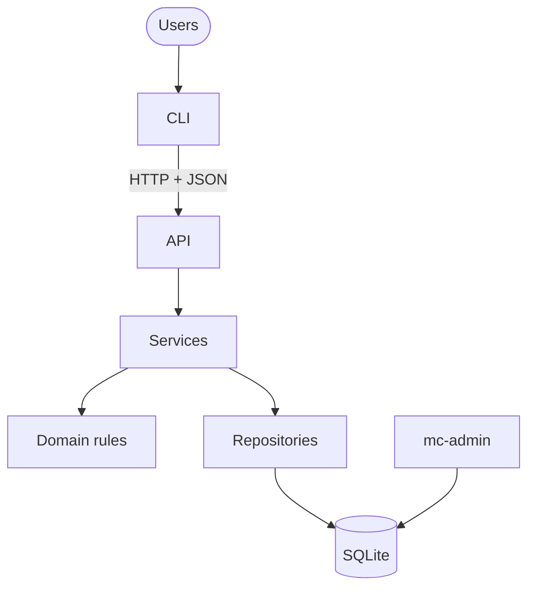
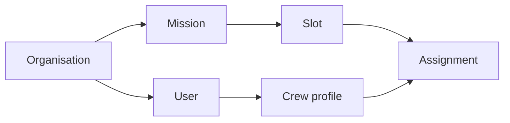
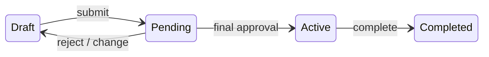
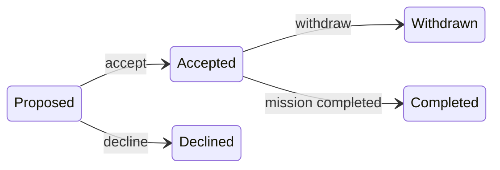
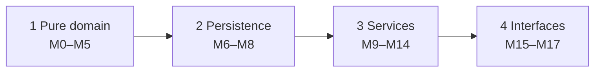

# Subagent (01): Build M11 missions in worktree

Source: `agent-a59c0e42b11bb920f.jsonl` · 2026-10-12 00:33:26 UTC → 2026-10-12 00:44:37 UTC

Rendered from the raw JSONL without editing message content. Tool results and thinking are collapsed; expand them to read.


---

### 👤 User · 2026-10-12 00:33:26 UTC

You are implementing module **M11 (missions service)** of the Mission Control project, in a dedicated git worktree. Two other agents are building M9 and M10 in parallel in their own worktrees.

**Work ONLY in:** `/Users/pritanbarai/Desktop/JOBS/mutinex_mission_control/.worktrees/m11-missions` (branch `m11-missions`, based on main `b7ecbba`).
- Use absolute paths, or `cd` into that directory for every command.
- NEVER touch the main checkout `/Users/pritanbarai/Desktop/JOBS/mutinex_mission_control` or the other worktrees.
- Do NOT commit, and do NOT run any git command that changes state (no add, commit, stash, rebase, checkout, reset, merge). `git status` and `git diff` are fine.
- Do NOT add dependencies.

**Read first** (inside the worktree):
- `CLAUDE.md`;
- `docs/prd.md` §3, §5.1, §5.4 (M1–M7 and the transition table), §5.7 (visibility, V1, V2), §8 (AC-4, AC-5, AC-7);
- `docs/technical-design.md` §2, §4, §5 (Lifecycle: mission table, cross-cutting rules, touch_for_change, M7 edits), §7, §9 (Phase 3 rows and Waves), §10;
- `docs/phase-reviews.md` "Carried forward".
- Then study:
  - `src/mission_control/services/context.py` (ServiceContext, found, check, authorize_view gives 404);
  - `src/mission_control/domain/` (lifecycle.py: `touch_for_change`, `state_problem`, `mission_status_after`, StateConflict; eligibility.py: `invalidated_by`, SlotEdit, SlotRemoval, DatesEdit; permissions.py; dates.py; errors.py; events.py; records.py);
  - `src/mission_control/infra/repositories/` (missions.py, facts.py `roster` / `slot_specs`, users.py, skills.py, base.py);
  - `tests/builders.py` and `tests/integration/conftest.py` (`seeded_db`).

**FILE OWNERSHIP**
- You may create or edit:
  - `src/mission_control/services/missions.py`;
  - `src/mission_control/infra/repositories/missions.py`;
  - new test files for M11 (e.g. `tests/integration/test_missions_service.py`).
- Shared files you may only APPEND to, in a section with a comment `# M11 missions`:
  - `src/mission_control/domain/events.py`;
  - `tests/unit/domain/test_events.py` (expected set);
  - design §7 code tables (only if you introduce a code).
- Everything else is read-only, including `facts.py`, `crew.py`, `users.py`, `skills.py`, `base.py`, `context.py`, `domain/*` (except events.py) and `schema.sql`.
- If you need a change elsewhere, STOP that part and describe it in your report.

**WHAT TO BUILD** (`services/missions.py`): use-case functions taking a `ServiceContext` first, following the design's shape:
1. authorize, or `authorize_view` for reads;
2. load through `ctx.repos`;
3. check domain rules;
4. inside `with ctx.write():`, **call `touch_for_change` first for any change**, then write, then audit (`ctx.audit(Event.X, ...)`, with names in `data`).

Cover:
- **View:**
  - list missions visible to the actor (`missions.list_visible`);
  - view one mission (`missions.get_visible`; a hidden or missing one is NotFound, per TR-10), with its slots and requirements, its assignments, and the current round's approvals as appropriate.
  - define a view record in services/missions.py.
- **Create** (M1, M2):
  - a Lead creates a mission for themselves; a Director creates one for an active Lead in the same org. The owner must be an active Lead, and the creator is recorded separately.
  - name, date range (end ≥ start; past dates allowed), and one or more slots given inline. Each slot has a name, headcount ≥ 1 and at least one required skill with a min level of 1–5. Skills must be in the caller's catalogue (NotFound otherwise).
  - status Draft. Audit `mission.created`.
- **Edit name and dates** (M3, M7): owner only.
  - `touch_for_change` (a Pending mission returns to Draft; Active gives mission_frozen; final gives mission_final).
  - date changes are refused if they invalidate an open assignment: `invalidated_by(DatesEdit, facts.roster(...))` gives `invalidates_assignments`, listing every affected person.
- **Slots** (M2, M3, M7): owner only. Add a slot; edit a slot's name or headcount; replace its requirements; remove it (soft delete).
  - Lowering headcount below open assignments, removing a slot with open assignments, or requirement changes that break an assignee are refused with `invalidates_assignments` (via `invalidated_by`).
  - Each change goes through `touch_for_change`.
- **Transfer ownership** (M1, AC-7): Directors only. The new owner is an active Lead in the same org.
  - Pending returns to Draft (approvals cleared by the round mechanism; the next submit starts a new round).
  - Active stays Active.
  - Final gives mission_final. Use `state_problem` / `mission_status_after` with `Action.TRANSFER`. Don't route it through touch_for_change, which refuses Active.
- **Revert audit:** whenever a Pending mission goes back to Draft, write a revert audit event with the cause.

Permissions use `domain/permissions.py` actions (VIEW_MISSION, CREATE_MISSION, EDIT_MISSION, TRANSFER), with required Context fields:
- `owner_id`, `created_by_id`;
- `rostered_user_ids` from `missions.rostered_user_ids()`, the one source of truth.

Refusals:
- Forbidden (403) for visible resources;
- NotFound (404) for missing, other-org or hidden;
- RuleViolation / StateConflict (409).

Messages are natural sentences from explicit phrases, naming the people, slots and missions involved.

**OUT OF SCOPE** (other modules): proposing or removing crew and assignments (M12); submit, approve, reject, complete and cancel (M13); matching (M14). Don't implement those.

**CONVENTIONS:**
- No PRD IDs in `src/` (fine in tests).
- Every write inside `ctx.write()`.
- The shared `Event` enum for audit.
- `-> Generator[T]` for context managers.
- Never use `httpx`.
- Frozen dataclasses; type hints.
- New repository SQL uses named binding `org_id = :org` (guard test; no `?`).

**NEW CODES:** if you need an error or problem code not in §7 (e.g. for "owner must be an active Lead" or "a slot needs at least one requirement"), first check whether `validation_error` (422) or an existing code fits. Otherwise implement it, append it to §7 under a `M11 missions` note, and list it in your report as **needing the user's approval**.

**WORKFLOW**
1. Tests first. Write failing tests named after PRD IDs (e.g. `test_ac4_editing_a_pending_mission_returns_it_to_draft`, `test_ac7_after_transfer_the_new_owner_can_edit_and_the_old_cannot`, `test_m7_lowering_headcount_below_assigned_crew_is_refused`). See them fail, then implement. Use `seeded_db`:
   - Deep Space Comms (6) is Pending with Marco's approval;
   - Telescope (5) is Active;
   - Mars Analog (7) is Completed;
   - Station Reboost (3) has 2 Engineer places with Gus accepted;
   - Gateway (1) is Draft, created by Ruth and owned by Lee.
2. Run the full suite and lint in the worktree:
   - `cd .worktrees/m11-missions && uv run pytest -W error -o addopts="" -q`;
   - `uv run ruff check src tests`;
   - `uv run ruff format --check src tests`.
3. **Real verification:** a script against a fresh seeded database, acting as Lee, Nora, Ruth and Ben. Print the outcomes and messages for the main paths and refusals. Use port 8011 if you start a server.
4. **Read-only review** of your diff (`git -C <worktree> diff main` plus untracked files). List the findings; don't fix them silently.

**FINAL REPORT:**
- files changed;
- use-case functions and what each enforces, with PRD IDs;
- tests, with before (failing) and after counts;
- full-suite and ruff results;
- trimmed real-run output;
- review findings;
- new events and codes (codes flagged for approval);
- changes needed in files you don't own;
- PRD gaps.

<details>
<summary>⚙️ System/meta message · 2026-10-12 00:33:26 UTC</summary>

```
<system-reminder>
Your final report is delivered through SubagentHandback: when your work is complete, call SubagentHandback({message: <your full report>}). The call ends your run, so make it your last step. Only a SubagentHandback call reaches your caller as your result; plain text you write at the end is not delivered.
</system-reminder>
```

</details>

**🔧 Bash**

*Inspect worktree state and layout*

```bash
cd /Users/pritanbarai/Desktop/JOBS/mutinex_mission_control/.worktrees/m11-missions && git status && git log --oneline -3 && cat CLAUDE.md && ls -R src tests | head -100
```

<details>
<summary>↳ Result</summary>

```
On branch m11-missions
nothing to commit, working tree clean
b7ecbba refactor: split repositories into per-area modules
8ccb5c3 feat(sf): service foundation for Phase 3
aafba33 docs: phase review for Phase 2 (M6–M8)
# Mission Control

Multi-tenant mission planning API and CLI. Read these before doing any work. They are the source of truth, so don't copy their content here.

- [`docs/brief.md`](docs/brief.md): the assessment brief
- [`docs/prd.md`](docs/prd.md): **behaviour**. What the system does, its rules, acceptance criteria and seed scenarios.
- [`docs/technical-design.md`](docs/technical-design.md): **structure**. Architecture, schema, API, CLI, the delivery plan (§9) and the implementation guidelines (§10).

If the PRD and the design conflict, or are silent on something, stop and ask. Never invent behaviour.

## Workflow (every module)

1. **One approved module at a time.** Work only on the module from design §9 that I have approved. Don't start anything else.
2. **Tests first.** Write failing tests that reference the PRD IDs, then implement. Run the full suite and lint: `uv run pytest` and `uv run ruff check`.
3. **Real verification.** Exercise the behaviour for real, for example with a REPL call, an HTTP request or a CLI command. Show the actual output. A passing test run alone isn't verification.
4. **Read-only review.** Review the full diff against the PRD and design §10 without editing. Report findings, and fix them only once I agree.
5. **Stop for approval.** Summarise what changed, the test and verification results, and the review findings, and propose a commit message. **Don't commit, and don't start the next module, until I approve.**

## Waves (parallel modules in worktrees)

When I approve a wave of independent modules (design §9), build them in parallel and keep reviews small:

1. **One worktree per module.** Run `git worktree add .worktrees/<module> -b <module> main`, then `uv sync` inside it. Each agent edits only its own worktree and doesn't commit.
2. **Same workflow per module.** Steps 2 to 4 above still apply, inside the worktree.
3. **Review one branch at a time.** Show me only that module's diff against `main` (`git -C .worktrees/<module> diff main`, including new files), with its results.
4. **After I approve that module:**
   - commit on its branch;
   - rebase onto `main` if `main` has moved, and re-run its tests;
   - fast-forward `main`;
   - run the full suite on `main`;
   - remove the worktree and branch.

   Only then present the next branch.

Never push, add dependencies, change the schema, or add endpoints, error codes or CLI commands outside the design without asking first.
src:
mission_control

src/mission_control:
__init__.py
__pycache__
api
domain
infra
seed
services

src/mission_control/__pycache__:
__init__.cpython-312.pyc

src/mission_control/api:
__init__.py
__pycache__
app.py

src/mission_control/api/__pycache__:
__init__.cpython-312.pyc
app.cpython-312.pyc

src/mission_control/domain:
__init__.py
__pycache__
approvals.py
dates.py
eligibility.py
enums.py
errors.py
events.py
lifecycle.py
matching.py
passwords.py
permissions.py
records.py

src/mission_control/domain/__pycache__:
__init__.cpython-312.pyc
approvals.cpython-312.pyc
dates.cpython-312.pyc
eligibility.cpython-312.pyc
enums.cpython-312.pyc
errors.cpython-312.pyc
events.cpython-312.pyc
lifecycle.cpython-312.pyc
matching.cpython-312.pyc
passwords.cpython-312.pyc
permissions.cpython-312.pyc
records.cpython-312.pyc

src/mission_control/infra:
__init__.py
__pycache__
db.py
repositories
schema.sql
security.py

src/mission_control/infra/__pycache__:
__init__.cpython-312.pyc
db.cpython-312.pyc
security.cpython-312.pyc

src/mission_control/infra/repositories:
__init__.py
__pycache__
approvals.py
assignments.py
audit.py
base.py
crew.py
facts.py
missions.py
models.py
organisations.py
skills.py
users.py

src/mission_control/infra/repositories/__pycache__:
__init__.cpython-312.pyc
approvals.cpython-312.pyc
assignments.cpython-312.pyc
audit.cpython-312.pyc
base.cpython-312.pyc
crew.cpython-312.pyc
facts.cpython-312.pyc
missions.cpython-312.pyc
models.cpython-312.pyc
organisations.cpython-312.pyc
skills.cpython-312.pyc
users.cpython-312.pyc

src/mission_control/seed:
__init__.py
__pycache__
data.py
loader.py
```

</details>

**🔧 Bash**

*List services/tests and doc headings*

```bash
cd /Users/pritanbarai/Desktop/JOBS/mutinex_mission_control/.worktrees/m11-missions && ls src/mission_control/services tests tests/* && wc -l docs/*.md && grep -n '^#' docs/prd.md
```

<details>
<summary>↳ Result</summary>

```
tests/builders.py
tests/conftest.py

src/mission_control/services:
__init__.py
__pycache__
auth.py
context.py

tests:
__pycache__
api
builders.py
conftest.py
integration
unit

tests/__pycache__:
builders.cpython-312.pyc
conftest.cpython-312-pytest-9.1.1.pyc

tests/api:
__pycache__
test_health.py

tests/integration:
__pycache__
conftest.py
test_auth.py
test_db.py
test_facts.py
test_repositories.py
test_repository_sql.py
test_repository_writes.py
test_schema_constraints.py
test_seed.py
test_service_context.py

tests/unit:
domain
      76 docs/brief.md
     104 docs/phase-reviews.md
     338 docs/prd.md
     847 docs/technical-design.md
    1365 total
1:# Mission Control — Product Requirements (v1)
7:## 1. Problem and goals
20:## 2. Requirements from the brief
33:## 3. Users and roles
45:## 4. Main workflows (all available through the CLI)
60:## 5. Business rules
62:### 5.1 Definitions
73:### 5.2 Tenancy and identity
79:### 5.3 People and skills
100:### 5.4 Missions and lifecycle
133:### 5.5 Approval
141:### 5.6 Assignments
155:### 5.7 Visibility and audit
169:## 6. Auto-matching
197:## 7. CLI requirements
204:## 8. Acceptance criteria
257:## 9. Seed data and scenarios
261:### 9.1 Aurora Space Agency (N = 2)
289:### 9.2 Helix Orbital (N = 1)
297:### 9.3 Scenarios
312:## 10. Test plan
325:## 11. Out of scope
```

</details>

**🔧 Bash**

*Read the PRD*

```bash
cd /Users/pritanbarai/Desktop/JOBS/mutinex_mission_control/.worktrees/m11-missions && cat docs/prd.md
```

<details>
<summary>↳ Result</summary>

````
# Mission Control — Product Requirements (v1)

**Status:** Agreed · **Source of truth:** [`brief.md`](brief.md) · **Next:** technical design (frameworks, schema, API and CLI design)

Rules tagged **[B]** come from the brief. Everything untagged is a product decision made while resolving the brief's open questions.

## 1. Problem and goals

Crew assignment is manual and error-prone. Leads cross-reference skills, availability and existing commitments by hand. **[B]** Mission Control is a multi-tenant B2B platform for managing missions and crew, with an auto-matcher that suggests crew. **[B]**

v1 succeeds when:

1. A Lead can take a mission from requirements to an active, confirmed roster entirely through the CLI.
2. Matcher suggestions never break a hard rule and are deterministic.
3. The system enforces the approval rules.
4. No read or write can reach another organisation's data.

**How we'll know:** every acceptance criterion in §8 passes as an automated test against the seed data in §9.

## 2. Requirements from the brief

- R1: Organisations are tenants. All data is scoped to one organisation and never leaks across tenants.
- R2: Three roles: Director, Mission Lead, Crew Member.
- R3: Leads can't approve their own missions.
- R4: Missions have requirements, a timeline, and a lifecycle with approval before going active.
- R5: Crew have skill profiles, availability and assignment history.
- R6: Assignments connect crew to missions, and crew respond to them.
- R7: An auto-matcher suggests crew based on skills, availability and workload.
- R8: Organisations differ in crew size, skill taxonomy and approval process.
- R9: A multi-tenant API, plus a CLI for the main workflows. CLI usability is assessed.
- R10: Runs locally with seed data.

## 3. Users and roles

| Role | Responsibilities |
|---|---|
| **Director** | Manages users, roles, crew profiles, the skill catalogue and the approval setting. Creates missions for a Lead. Approves or rejects missions. Reassigns owners. Sees everything in their organisation. |
| **Mission Lead** | Owns missions. Defines slots, runs the matcher, proposes crew, submits. Maintains other people's skill levels. Reads all missions and crew profiles. |
| **Crew Member** | Manages own personal details and unavailability. Accepts, declines or withdraws from assignments. Sees only their own data and the missions they're on. |

- Each user belongs to exactly one organisation. The organisation is taken from the user's identity, never from the request.
- Each user has exactly one role, which controls permissions.
- Taking part in missions depends on a separate **crew profile**. Every Crew Member has one, and Leads and Directors may have one too.

## 4. Main workflows (all available through the CLI)

1. **Sign in** with email and password, and change your own password. See what needs attention: pending assignments, approvals waiting on me, my missions.
2. **Director admin:** manage users and roles, crew profiles, the skill catalogue, and the number of approvals required.
3. **Lead or Director:** set crew skill levels (1–5).
4. **Crew profile holder:** maintain personal details and unavailability.
5. **Create a mission:** name, dates, and role slots with required skills.
6. **Owning Lead:** run the matcher, review the suggested roster, apply it or propose crew by hand.
7. **Crew:** accept or decline proposals, and withdraw if needed.
8. **Owning Lead:** submit a fully accepted roster for approval.
9. **Eligible Directors:** approve or reject. The final approval activates the mission.
10. **Owning Lead or Director:** complete or cancel a mission.
11. **Director:** reassign a mission's owning Lead.
12. **View history:** mission history and crew assignment history.

## 5. Business rules

### 5.1 Definitions

| Term | Meaning |
|---|---|
| **Open assignment** | An assignment that is Proposed or Accepted. |
| **Open places** | A slot's headcount minus its open assignments. |
| **Mission-days** | The number of days from the start date to the end date, counting both. |
| **Overlap** | Two date ranges overlap if they share at least one calendar day. Dates have no time and no time zone. |
| **Eligible (crew for a slot)** | The person is active, has a crew profile, and has every required skill at or above its minimum level. They have no unavailability overlapping the mission, and no accepted assignment on another non-final mission that overlaps it. |
| **Eligible approver** | An active Director who did not create the mission and is not on its roster. |

### 5.2 Tenancy and identity

- **T1** Every record belongs to one organisation. Every read and write is limited to the caller's organisation. **[B]**
- **T2** Naming a resource from another organisation gives the same response as naming one that doesn't exist ("not found").
- **T3** Organisations are created only through seed data or an operator command. There is no self-service signup.

### 5.3 People and skills

- **P1** Each organisation has its own flat skill catalogue, managed by Directors. Skills with the same name in different organisations are unrelated.
  - Directors can rename a skill. Its identity stays the same.
  - Directors can delete a skill only if no crew skill or slot requirement uses it.
- **P2** Proficiency is an integer from 1 to 5.
- **P3** Leads and Directors set and remove skill levels. **Nobody can change their own levels.**
  - A skill change is allowed even if it makes someone ineligible for an assignment on a Draft or Pending mission. Eligibility is checked again at acceptance, submission and approval.
  - A skill change that would make someone ineligible for their assignment on an Active mission is refused.
- **P4** Crew profile holders manage their own personal details and unavailability. Nobody else edits them. Personal details are a display name and an optional bio.
- **P5** Crew are available by default. Unavailability is a date range with a reason.
- **P6** A crew member can't record unavailability that overlaps one of their accepted assignments.
- **P7** Users are deactivated, never deleted. Deactivated users can't sign in, aren't eligible for matching, and keep their history. Deactivation is refused while the user:
  - has open assignments; or
  - owns non-final missions. The same applies to changing a mission owner's role away from Lead. Their missions must be reassigned first.
- **P8** An organisation must always have at least one active Director.
- **P9** Crew profiles survive role changes and can't be deleted. Changing a user's role to Crew Member gives them a profile if they don't already have one.
- **P10** Directors set a new user's initial password. Users change their own password by entering their current one. There's no email or password-recovery flow.
  - Passwords must be at least 15 characters. Passphrases are welcome, and uppercase letters, numbers and symbols aren't required.
  - Changing a password ends all of that user's sessions, including the one used to change it.

### 5.4 Missions and lifecycle

- **M1** A mission has a name, a date range, one owning Lead and a separately recorded creator.
  - Leads create missions for themselves. Directors create them on behalf of a Lead.
  - Only Mission Leads can own missions.
  - Directors can transfer ownership of a non-final mission to another active Lead in the same organisation. If the mission is Pending, it returns to Draft and its approvals are cleared.
- **M2** A mission has one or more slots. Each slot has a name, a headcount of at least 1, and at least one required skill with a minimum level. Dates may be in the past, but the end date must be on or after the start date. The same rule applies to unavailability.
- **M3** Only the owning Lead can edit a mission, propose or remove crew, apply matcher results, or submit.

```
         submit                N-th approval                complete
 Draft ─────────▶ Pending ───────────────────▶ Active ─────────────▶ Completed
   ▲              Approval
   └── reject (reason) / any change ──┘
 Draft | Pending Approval | Active ──cancel (reason)──▶ Cancelled
```

| Transition | Who | Conditions and effects |
|---|---|---|
| Draft → Pending Approval | Owning Lead | All of these must hold: every slot is full, every assignment is Accepted, every rostered crew member is still eligible, and there are at least N eligible approvers. Otherwise the submission is refused with a list of the problems. |
| Pending → Active | The N-th distinct eligible approver | The roster is checked again at each approval. If the check fails, the approval is refused and the mission stays Pending, unchanged. |
| Pending → Draft | Eligible Director (reject) or system | A rejection needs a reason. Any change to dates, slots, roster or owner, including a crew withdrawal, also sends the mission back to Draft. Approvals are cleared, and remaining accepted assignments stay accepted. |
| Active → Completed | Owning Lead or Director | Accepted assignments become Completed. |
| Any non-final → Cancelled | Owning Lead or any Director | Reason required. Open assignments become Cancelled. |

- **M4** Draft missions can have unfilled places and unanswered proposals.
- **M5** Once a mission is Active, its dates, requirements and roster are frozen. Only completion or cancellation are allowed.
- **M6** Dates never trigger transitions on their own. There is no scheduler.
- **M7** An edit is refused if it would invalidate an open assignment. The response lists the affected crew, and the Lead must remove them first. Crew are never removed automatically. Edits that invalidate an assignment are:
  - removing a slot that has open assignments;
  - lowering a slot's headcount below its open assignments;
  - changing dates or requirements so that an assigned person is no longer eligible.

### 5.5 Approval

- **A1** Each organisation sets the number of approvals required (N ≥ 1). The approvals must come from N distinct eligible approvers.
  - N is fixed for a mission when it's submitted. Later changes to the setting don't affect a round already in progress.
  - An approval already given still counts if that Director is later deactivated or demoted.
- **A2** Leads can't approve anything, which satisfies R3. **[B]** A Director can't approve a mission they created or are rostered on.
- **A3** Each Director approves a round at most once. A single rejection ends the round.

### 5.6 Assignments

```
Proposed ──accept──▶ Accepted ──withdraw (reason)──▶ Withdrawn
   ├──decline──▶ Declined   └──removed by Lead──▶ Removed
   └──retracted by Lead──▶ Removed
Accepted ──mission completed──▶ Completed;  open ──mission cancelled──▶ Cancelled
```

- **S1** The owning Lead can propose only eligible crew. A person can hold at most one open assignment per mission. A slot can't have more open assignments than its headcount. A Lead can propose themselves, but they must be eligible and must accept like anyone else.
- **S2** Crew can accept only while the mission is in Draft and they're still eligible. Accepted assignments block overlapping dates. Proposals don't block anything.
- **S3** Declining takes an optional reason. Withdrawing needs a reason and is allowed only in Draft or Pending Approval.
- **S4** Every assignment needs the crew member's acceptance. Crew can't be placed on a mission directly.

### 5.7 Visibility and audit

| | Crew | Lead | Director |
|---|---|---|---|
| Own profile, skills, availability, assignments | ✓ | ✓ | ✓ |
| Missions they're on, with teammates' names and slots | ✓ | ✓ | ✓ |
| Other crew members' profiles, skills, busy/free dates | ✗ | ✓ | ✓ |
| Other people's *reasons* for unavailability | ✗ | ✗ | ✓ |
| All missions in the organisation | ✗ | read (edit own) | read |
| Users, catalogue management, organisation settings | ✗ | read catalogue | manage |

- **V1** Every state change, approval, rejection and assignment response is recorded with who did it, when, and any reason. Anyone who can see the mission can see this history.
- **V2** Former assignees see a summary of the mission in their own assignment history. They don't get full access to the mission unless their role allows it. Former assignees are people whose assignment was declined, withdrawn, removed or cancelled.

## 6. Auto-matching

The matcher only advises. It suggests crew for a Draft mission's open places and changes nothing. The owner or a Director can preview a suggestion. When the owning Lead applies it, it creates Proposed assignments, which crew still have to accept.

**Candidates.** Active crew profiles in the mission's organisation only. Crew who already have an open assignment on this mission, or who declined or withdrew from it, are left out.

**Workload.** The total mission-days of a crew member's accepted assignments on missions that are not Completed, leaving out the mission being matched.

**Algorithm**

1. **Filter.** For each slot with open places, keep the candidates who are eligible (§5.1).
2. **Pick the most constrained slot.** Choose the slot with the fewest remaining eligible candidates. Ties go to the slot listed first.
3. **Fill one place in that slot.** Rank candidates by:
   1. lowest workload;
   2. then highest proficiency, meaning the sum of their levels across the slot's required skills;
   3. then stable identifier, ascending.
4. **Remove the chosen person** from every other slot's candidates.
5. **Repeat** from step 2 until every place is filled or has no candidates left.

**Output.** A suggested roster with no one in two slots. Places without a candidate are marked **unfilled**. The same inputs always give the same output.

**Why:**
- Filling the most constrained slot first stops a versatile person from being spent on a slot that's easy to fill.
- Ranking by lowest workload spreads missions across crew.
- Proficiency only breaks ties, because everyone left already meets the requirement.

**Known limitation:** this is a greedy heuristic. It can occasionally leave a place unfilled when a complete roster exists. That's acceptable for an advisory tool, and the Lead can still propose by hand.

## 7. CLI requirements

- **C1** Every workflow in §4 can be carried out from the CLI. **[B]**
- **C2** Refusals explain why in domain terms, for example "Gus has an accepted assignment on *Station Reboost* overlapping 1–2 Mar". Where possible they also say what to do next.
- **C3** Output is readable by people by default, with a machine-readable option for scripts and tests.
- **C4** Actions that send a mission back to Draft, or cancel it, warn before running.

## 8. Acceptance criteria

Each criterion starts from a fresh seed. Scenario numbers (S-) refer to §9.3.

**Mission workflow**

- **AC-1** The golden path (S1) ends Completed, and every transition appears in the history with who did it and when.
- **AC-2** Submission is refused while any place is unfilled or any proposal is unanswered. The refusal lists them.
- **AC-3** Approvals before the N-th leave the mission Pending. The N-th approval makes it Active.
- **AC-4** Changing the dates, slots or roster of a Pending mission sends it back to Draft and clears its approvals. So does a crew withdrawal (S5).
- **AC-5** On an Active mission, edits, proposals, removals and withdrawals are refused. Completion and cancellation succeed.
- **AC-6** Cancelling needs a reason. The owning Lead or any Director can cancel, and any other Lead is refused. Open assignments become Cancelled.
- **AC-7** Only the owning Lead can edit, propose, apply or submit. After a Director reassigns the owner, the new owner can and the previous owner can't.

**Approval restrictions**

- **AC-8** The mission's creator can't approve it. In S1, Ruth is refused.
- **AC-9** Leads and Crew can't approve or reject.
- **AC-10** A Director can't approve the same round twice. Rejecting needs a reason and clears earlier approvals (S6).
- **AC-11** A Director rostered on a mission can't approve it.
- **AC-12** Submission is refused when there are fewer than N eligible approvers, not counting the creator or rostered Directors (S7).
- **AC-13** In Helix (N = 1), a single approval makes the mission Active (S8).

**Overlaps and availability**

- **AC-14** Proposing someone who is unavailable, or who has an overlapping accepted assignment, is refused. In S4, both Fay and Gus are refused.
- **AC-15** Overlapping proposals are allowed. Accepting one that overlaps an accepted assignment is refused, and the refusal names the conflicting mission (S4, Chen).
- **AC-16** Recording unavailability that overlaps an accepted assignment is refused.
- **AC-17** Two ranges that share only a boundary day overlap.

**Matching**

- **AC-18** S2 gives exactly the expected roster on every run.
- **AC-19** S3 marks Geologist as unfilled. S3b shows a new accepted assignment changing the suggestion.
- **AC-20** Workload counts only accepted assignments on missions that aren't Completed. Chen's workload is 5, not 35.
- **AC-21** The suggestion never puts one person in two slots. It never includes anyone who is ineligible, from another organisation, or already excluded from this mission.
- **AC-22** Running the matcher changes nothing. Applying it creates Proposed assignments.

**Roles and visibility**

- **AC-23** Ana can't change her own skill levels, but Lee can change hers. Ben can't edit skills, but he can edit his personal details and unavailability.
- **AC-24** Lee sees Fay as busy 5–8 Mar but doesn't see the reason. Ruth sees the reason. Ben can't view Fay's profile, and his mission list shows only missions he's on.
- **AC-25** Leads can't manage users, the catalogue or the approval setting.
- **AC-26** Deactivating someone with open assignments is refused. A deactivated user can't sign in. The last active Director can't be deactivated or demoted.

**Tenant isolation (S9)**

- **AC-27** Requesting another organisation's mission, crew member, user, skill or assignment by ID gives the same response as an ID that doesn't exist.
- **AC-28** Every list contains only the caller's organisation's records.
- **AC-29** Any write that references another organisation's ID fails as "not found", and neither organisation's data changes.
- **AC-30** Approving or rejecting another organisation's mission fails as "not found".
- **AC-31** Helix's Kai (Piloting 5, no commitments) is never suggested for an Aurora mission.

## 9. Seed data and scenarios

The table order of people is their stable-identifier order. All dates are in 2027 unless stated.

### 9.1 Aurora Space Agency (N = 2)

| Person | Role | Crew skills | Commitments (workload) |
|---|---|---|---|
| Ruth Adeyemi | Director | — | — |
| Marco Bianchi | Director | Flight Medicine 4 | Medical Study, accepted (4) |
| Ingrid Holm | Director | — | — |
| Lee Park | Lead | — | — |
| Nora Quinn | Lead | — | — |
| Ana Okafor | Lead | Piloting 5, Leadership 4, Systems Eng 4 | none (0) |
| Ben Ito | Crew | Systems Eng 4, EVA 3 | Deep Space Comms, accepted (20) |
| Chen Wu | Crew | Systems Eng 3 | Telescope (5). Mars Analog Completed, so it doesn't count |
| Dana Reyes | Crew | EVA 4 | Telescope (5) |
| Eli Novak | Crew | EVA 4, Piloting 4, Leadership 2 | Telescope (5) |
| Fay Moreau | Crew | Piloting 4, Leadership 4 | Unavailable 5–8 Mar (Medical) |
| Gus Patel | Crew | Systems Eng 5 | Station Reboost, accepted (6) |
| Hana Sato | Crew | EVA 3, Geology 2 | Telescope (5) |

| Mission | Owner / creator | Dates | State | Slots → crew |
|---|---|---|---|---|
| Lunar Gateway Resupply | Lee / Ruth | 1–10 Mar | Draft | Flight Engineer ×1 (Sys Eng ≥3) · Mission Specialist ×1 (EVA ≥3) · Commander ×1 (Piloting ≥4, Leadership ≥3) — no crew |
| Asteroid Survey | Nora | 5–12 Mar | Draft | Pilot ×1 (Piloting ≥4) · Geologist ×1 (Geology ≥4) — no crew |
| Station Reboost | Nora | 25 Feb – 2 Mar | Draft | Engineer ×2 (Sys Eng ≥3) — Gus accepted, 1 open place |
| Lunar Surface Medical Study | Nora / Ruth | 15–18 Mar | Draft | Flight Surgeon ×1 (Flight Medicine ≥4) — Marco accepted |
| Orbital Telescope Service | Lee | 10–14 Jan | Active | Engineer ×1 — Chen · EVA Specialist ×3 (EVA ≥3) — Dana, Eli, Hana |
| Deep Space Comms Upgrade | Nora | 1–20 Apr | Pending (Marco approved) | Engineer ×1 (Sys Eng ≥3) — Ben |
| Mars Analog Habitat | Lee | 1–30 May 2026 | Completed | Engineer ×1 — Chen |

### 9.2 Helix Orbital (N = 1)

People: Sam Rivera (Director), Priya Nair (Lead), and Crew Kai Tanaka (Piloting 5), Lena Fischer (Payload Integration 4), Omar Haddad (Field Medicine 4) and Tess Moreno (Life Support 3). Helix has its own catalogue, including a separate "Piloting" skill.

| Mission | Owner | Dates | State | Slots → crew |
|---|---|---|---|---|
| Payload Demo 1 | Priya | 1–3 Feb | Draft | Payload Specialist ×1 (Payload Int ≥3) — Lena accepted · Medic ×1 (Field Medicine ≥3) — Omar accepted |

### 9.3 Scenarios

| # | Steps | Expected outcome |
|---|---|---|
| **S1** | Lee matches and applies *Lunar Gateway Resupply* → Ana, Chen and Dana accept → Lee submits → Ruth approves → Marco approves → Ingrid approves → Lee completes | Proposed crew are Ana, Chen and Dana. Ruth is refused as creator. After Marco the mission is Pending (1/2). After Ingrid it's **Active**. Completing makes the assignments Completed. |
| **S2** | Match *Lunar Gateway Resupply* | Eligible crew: Commander {Ana}, because Fay is unavailable and Eli's Leadership is too low. Flight Engineer {Ana, Ben, Chen}, because Gus has an overlap. Specialist {Ben, Dana, Eli, Hana}. **Commander → Ana** (most constrained). **Flight Engineer → Chen** (workload 5 vs Ben's 20). **Specialist → Dana** (four-way workload tie at 5; Hana loses on proficiency; Dana beats Eli on ID). Filling the slots in listed order would have spent Ana on Flight Engineer and left Commander unfilled. |
| **S3** | Match *Asteroid Survey* | Geologist **unfilled** (Hana's Geology is only 2). Pilot → Ana (workload 0 vs Eli's 5; Fay unavailable). |
| **S3b** | S1 up to acceptance, then match *Asteroid Survey* | Ana is blocked by her overlapping accepted assignment, so Pilot → Eli. Geologist still unfilled. |
| **S4** | Lee proposes Gus and Fay for *Gateway*. Nora proposes Chen for *Station Reboost* and Lee proposes Chen for *Gateway*. Chen accepts *Station Reboost*, then *Gateway*. | Gus refused (overlap). Fay refused (unavailable). Both Chen proposals succeed. Chen's second acceptance is refused, naming *Station Reboost*. |
| **S5** | Ben withdraws from *Deep Space Comms* without a reason, then with one. Hana withdraws from *Telescope*. | Ben's first attempt is refused. The second succeeds: the mission returns to Draft and Marco's approval is cleared. Hana is refused because *Telescope* is Active. |
| **S6** | Marco approves *Deep Space Comms* again. Ingrid rejects it without a reason, then with one. | Marco is refused. Ingrid's first attempt is refused. The second sends the mission to Draft and clears approvals. |
| **S7** | Nora submits *Lunar Surface Medical Study* | Refused. Ruth created it and Marco is rostered, which leaves 1 eligible approver (Ingrid) when 2 are needed. |
| **S8** | Priya submits *Payload Demo 1* and Sam approves | **Active** after one approval. |
| **S9** | Each role in each organisation tries to read, list, write and approve the other organisation's resources, and matches an Aurora Piloting slot | Every attempt fails as "not found" and nothing changes. Lists show only the caller's organisation. Kai never appears. |

## 10. Test plan

Every acceptance criterion maps to at least one automated test.

| Level | Covers |
|---|---|
| Unit: matcher (pure function) | Eligibility, workload, most-constrained-first, each tie-break, no person in two slots, unfilled places, determinism. Includes S2, S3 and a small hand-built case per rule. |
| Unit: lifecycle and rules | Every allowed transition and a sample of disallowed ones. Approver eligibility and the N count. Revert-to-Draft clearing approvals. The Active freeze. Overlap at boundary days. |
| API: permissions | A role × action table, checking each role is allowed or refused as expected. |
| API: tenant isolation | Every endpoint, for reads, lists and writes, tried with the other organisation's IDs. A route-inventory test makes any new endpoint fail CI until it's added to this sweep. |
| API: scenarios | S1 and S3b–S8 against a freshly seeded database. |
| CLI end to end | S1 and S4 run through the real CLI, checking machine-readable output and the wording of refusals. |

## 11. Out of scope

- Web UI.
- Self-service organisation signup, users in more than one organisation, SSO.
- Password recovery and email flows. Deleting crew profiles.
- Delivering notifications. The CLI's "needs attention" views replace them.
- Certifications, skill expiry, skill verification, skill hierarchies.
- Recurring availability, scheduling finer than a day, rest periods between missions.
- Conditional or multi-stage approvals.
- Assigning crew without their acceptance, response deadlines.
- Matcher extras: preferred skills, experience scoring, configurable weights, near-miss and exclusion lists, suggestions to relax requirements, LLM matching.
- Date-driven transitions. Roster changes once a mission is Active.
- Equipment and resource constraints. Keep slot requirements extensible so these can be added later.
- Billing, bulk import.
````

</details>

**🔧 Bash**

*Read design headings and start*

```bash
cd /Users/pritanbarai/Desktop/JOBS/mutinex_mission_control/.worktrees/m11-missions && grep -n '^#' docs/technical-design.md && sed -n 1,200p docs/technical-design.md
```

**🔧 Bash**

*Read phase reviews*

```bash
cd /Users/pritanbarai/Desktop/JOBS/mutinex_mission_control/.worktrees/m11-missions && cat docs/phase-reviews.md
```

<details>
<summary>↳ Result</summary>

```
# Mission Control: Phase Reviews

How the implementation diverged from the agreed plan (the [PRD](prd.md) and [technical design](technical-design.md) as of `dc0e41d`), and why. A section is added at the end of each phase. The PRD and design themselves are kept current.

---

## Phase 1: Pure domain (M0–M5)

`a70f07d` → `867ece8` · 458 tests · all domain rules, no database

**Headline:** the plan held. No PRD behaviour changed. Every divergence below was approved and written back into the design.

### Where we diverged

| Change | Why |
|---|---|
| **`httpx` replaced by `httpx2`** | Starlette's test client deprecated `httpx`, and the user flagged it as a supply-chain risk |
| **Records carry names**, not just IDs | Refusals must name the person, skill and conflicting mission ("Gus has an accepted assignment on Station Reboost…") |
| **One shared `Action` enum** | Lifecycle and permissions had separate enums with overlapping values, so mixing them up half-worked |
| **Four error codes added**: `invalid_transition`, `proposal_unanswered`, plus a table of problem codes | The design had no code for wrong-state actions or unanswered proposals |
| **Every error has a `problems` list**, for every status | One error shape for clients. Listing several reasons on a 403 wasn't worth the complexity. |
| **Commits need approval** | The user wanted to review every module before it's committed or the next one starts |

### Key decisions

- **Permissions:** we kept our own ~150-line module instead of a library (Casbin, Oso, Cerbos, OpenFGA). The rules are small, we need our own codes and messages anyway, and it avoids adding dependencies.
- **Messages:** written as explicit phrases, never generated from names. PRD IDs appear only in tests.

### Phase-end review

A read-only subagent reviewed M0–M5, and fixes were applied by parallel subagents. Codes and messages were checked byte-for-byte before and after, across 14,740 outcomes.

- **Fixed (High):**
  - forgetting permission context *allowed* the action, so a Lead could edit their own skills; it now fails closed;
  - the back-to-Draft rule was coded twice; it now lives in one `touch_for_change()`.
- **Fixed (Medium/Low):**
  - duplicated approver rule;
  - mutable `refs` and tables;
  - two records for one concept;
  - copied test builders, now in `tests/builders.py`;
  - weak tests.
- **Recorded instead of changed:** multiple 403 reasons, handled by the consistent error body in M15.

### Carried forward

- **M7:** seed crew in PRD §9 order. The ID is the matcher's final tie-break.
- **M10–M15:**
  - a refused *view* returns 404;
  - services always pass the context each action requires;
  - changes go through `touch_for_change()`.
- **M13:** test that an approval still counts after its Director leaves.
- **M15:** consistent error body. Validation errors map to 422.
- **M16:** friendlier date formatting in the CLI.

---

## Phase 2: Persistence (M6–M8)

`09439f4` → review fixes · 656 tests · schema, repositories, seed, auth

**Headline:** the persistence layer matches the design. Every tenant query is scoped, the database itself refuses cross-tenant links, and login is safe against account probing. The phase-end review found no live data leak, but it did find patterns that Phase 3 would have copied, and those are fixed.

### Where we diverged

| Change | Why |
|---|---|
| **Repository queries bind the org by name** (`org_id = :org`); positional `?` is banned by a guard test | With positional binding, a query written `WHERE id = ? AND org_id = ?` would silently return another tenant's rows |
| **Argon2 runs outside the write lock**, then a cheap re-check happens inside it | Each hash takes ~40 ms, and failed logins were blocking every writer. The rule "re-check under the lock" still holds. |
| **Login costs the same for unknown emails** (a dummy hash is verified) | Otherwise response time reveals which accounts exist, even with identical messages |
| **One timestamp format**: `utc_timestamp()`, UTC, 3-digit ms | The original helper dropped time zones and disagreed with the schema's own format |
| **Seed ids fixed**, with crew profile id = user id | Keeps the matcher's final tie-break in PRD table order, and lets tests and the seed share ids |
| **Shared audit event names** (`Event` enum) | Services and the seed must write identical names, or mission history breaks |

### Key decisions

- **Seed assumptions** (PRD §9 is silent): the Telescope and Mars Analog Engineer slots need Systems Engineering ≥ 3, and both missions were approved by Marco and Ingrid.
- **Tests:** they use cheap Argon2 settings, and tests marked `real_argon2` keep the production settings.
- **Phase 3 runs in waves:** each module is built in its own git worktree, then reviewed and committed one at a time. A small **service foundation (SF)** comes first, so modules share one service context and one set of fact loaders.

### Phase-end review

A read-only subagent reviewed M6–M8, and three fix agents with separate file ownership applied every finding. Before-and-after outputs were compared, and they were identical apart from the approved timestamp precision.

- **Fixed (High):**
  - named org binding with a stricter guard;
  - Argon2 moved out of the write lock.
- **Fixed (Medium):**
  - `read_tx` committed on error;
  - a dual-mode session revoke;
  - the time-zone-blind timestamps;
  - two definitions of "on the mission", now one `rostered_user_ids()`;
  - a timing-sensitive lock test;
  - seed duplication.
- **Fixed (Low):** test-only wrappers and tests that passed for the wrong reason.

### Carried forward

- **SF / M9–M14:**
  - use `Event` names, `utc_timestamp()` and `rostered_user_ids()`;
  - mission visibility for crew is a 404 through the repository;
  - deactivation calls `security.revoke_user_tokens` inside its own transaction.
- **M15:** build the dummy hash at startup. Wire the `MC_DATABASE_PATH` and `MC_DB_BUSY_TIMEOUT_MS` settings.
- **M17:** `mc-admin seed` hashes the demo passphrase (`orbital launch window`).
- **Out of scope:** deleting expired session tokens.
```

</details>

<details>
<summary>↳ Result</summary>

````
1:# Mission Control — Technical Design (v1)
24:## 1. Summary
43:## 2. Architecture
95:## 3. Data model
130:## 4. Security and tenancy
132:### Authentication
141:### Permissions
169:### Tenant isolation
181:## 5. Lifecycle
183:### Mission
205:### Assignment
228:### Cross-cutting rules
240:## 6. Matching
308:## 7. API
316:#### Auth and me
325:#### Organisation, users and skills (Directors)
335:#### Crew
345:#### Missions
358:#### Assignments
365:#### Errors
406:## 8. CLI
420:# Everyone
425:# Leads
431:# Directors
440:## 9. Delivery plan
504:## 10. Guidelines for implementing agents
506:### Source of truth
511:### The loop for each module
520:### Working in waves (worktrees)
529:### Architecture rules (never break these)
537:### Coding conventions
543:### Testing conventions
548:### Stop and ask before
556:## 11. Setup and testing
581:## Appendix A: Schema SQL
592:### Organisations, users and sessions
630:### Crew, skills and availability
684:### Missions, slots and requirements
738:### Assignments, approvals and audit
811:## Appendix B: Trade-offs and considerations
815:### B.1 Key decisions
832:### B.2 Risks
842:### B.3 Scaling path (not in v1)
# Mission Control — Technical Design (v1)

> **Status:** Agreed · **Implements:** [`prd.md`](prd.md) · **Audience:** the engineering team and the coding agents implementing v1
>
> The PRD defines *what* the system does. This document defines *how* we build it, *why* we chose this approach, and *in what order* we deliver it. IDs such as P3, M7 or AC-15 refer to the PRD.

**Contents**
1. [Summary](#1-summary)
2. [Architecture](#2-architecture)
3. [Data model](#3-data-model)
4. [Security and tenancy](#4-security-and-tenancy)
5. [Lifecycle](#5-lifecycle)
6. [Matching](#6-matching)
7. [API](#7-api)
8. [CLI](#8-cli)
9. [Delivery plan](#9-delivery-plan)
10. [Guidelines for implementing agents](#10-guidelines-for-implementing-agents)
11. [Setup and testing](#11-setup-and-testing)
- [Appendix A: Schema SQL](#appendix-a-schema-sql)
- [Appendix B: Trade-offs and considerations](#appendix-b-trade-offs-and-considerations)

---

## 1. Summary

**What we're building.** A multi-tenant API and CLI for planning space missions:
- organisations manage crew and their skills;
- Leads define missions and get crew suggestions from a deterministic matcher;
- Directors approve missions before they go active.

**Design principles**

1. **Business rules live in one place.** All rules are pure functions in `domain/`, so they're easy to test and shared by every entry point.
2. **Tenant isolation in depth.** Identity, queries, database constraints and tests each block cross-tenant access independently.
3. **The CLI is just a client.** It uses the same API as any other client, so the API is the only place behaviour is enforced.
4. **Simple to run, simple to reason about.** One process, one SQLite file, no background jobs.
5. **Test-first.** Every module begins with failing tests derived from PRD acceptance criteria.

**Non-goals for v1:** web UI, horizontal scaling, notifications, background scheduling, SSO, migrations tooling. See [Appendix B](#appendix-b-trade-offs-and-considerations) for the trade-offs and what we'd change at scale.

---

## 2. Architecture

**Stack:** Python 3.12 · FastAPI + Pydantic v2 · SQLite through stdlib `sqlite3` · argon2-cffi · Typer + httpx2 · uv, pytest, ruff

**Dependency policy:** don't use `httpx` anywhere, including tests. Use `httpx2`, which Starlette's `TestClient` now expects.

Why SQLite, hand-written SQL, and a CLI that goes through the API: [TR-1](#tr-1), [TR-2](#tr-2), [TR-4](#tr-4).



| Layer | Folder | Responsibility | May depend on |
|---|---|---|---|
| CLI | `cli/` | Commands, output, prompts | API over HTTP only |
| API | `api/` | Validate input, resolve `Actor`, call a service, map errors | services |
| Services | `services/` | One use case = one transaction + audit | domain, infra |
| Domain | `domain/` | Every business rule, pure (no I/O) | nothing |
| Infra | `infra/` | Connections, schema, scoped repositories, security | domain types |

**How a request flows** (example: `mc missions submit 12`)

1. The CLI sends `POST /api/v1/missions/12/submit` with the bearer token.
2. The API resolves the token to an `Actor` (user, organisation, role) and calls `services.missions.submit(actor, 12)`.
3. The service opens `BEGIN IMMEDIATE` and loads the mission through `Repos(conn, actor.org_id)`.
4. `domain.lifecycle.check_submit(...)` returns a list of problems. If the list is empty, the service writes the new status and an audit event, then commits.
5. The API returns `200` with the mission, or `409` with every problem. The CLI prints one bullet per problem and exits with code `1`.

<details><summary>Folder layout</summary>

```
src/mission_control/
  domain/    dates  enums  errors  eligibility  matching  lifecycle  approvals  permissions  passwords  records
  infra/     db  schema.sql  security  repositories/
  services/  auth  admin  crew  missions  assignments  approvals  matching  audit  inbox
  api/       app  deps  errors  schemas/  routers/
  cli/       main  client  config  render  resolve  commands/
  seed/      data  loader
  admin_cli.py        # mc-admin: init-db, seed, create-org
tests/  unit/  integration/  api/  cli/  builders.py  conftest.py
```
</details>

---

## 3. Data model

The core entities are below. Skills, unavailability, approvals, tokens and the audit log hang off these. All 13 tables are in [Appendix A](#appendix-a-schema-sql).



**Tenant safety.** Every tenant table has `org_id` and `UNIQUE (org_id, id)`. Every reference between tenant rows includes `org_id`, so the database itself rejects links across organisations. Why a shared database: [TR-3](#tr-3).

| Enforced by the database | Enforced by services |
|---|---|
| Value ranges and valid dates | Eligibility and overlaps |
| Cross-organisation links rejected | Open places |
| One open assignment per person per mission | State transitions |
| A slot belongs to its mission | Permissions and the owner's role |
| Reasons for withdrawals and rejections | At least one requirement per slot |
| Append-only audit log; used skills can't be deleted | |

**Modelling choices**
- **Approval rounds.** Submit sets `round += 1` and saves N in `approvals_required`. Only approvals in the current round count, and none are ever deleted ([TR-9](#tr-9)).
- **Soft-deleted slots.** `removed_at` keeps the history of past assignments.
- **Nothing derived is stored.** Workload, eligibility, open places and the roster are computed when needed ([TR-7](#tr-7)).
- **Integer IDs** keep CLI commands short ([TR-12](#tr-12)).
- **History survives renames.** Audit `data` keeps the names that applied at the time.
- **"On a mission"** means holding an open or completed assignment. Any other status gives summary access only (V2).

---

## 4. Security and tenancy

### Authentication

| | |
|---|---|
| Token | 32 random bytes. Only the SHA-256 hash is stored. 12-hour expiry. |
| Every request | Token → valid? → user active? → `Actor(user_id, org_id, role, crew_profile_id)`. Nothing is cached, so role changes apply immediately. |
| Revocation | Logout revokes that token. Deactivation or a password change revokes every token. Opaque tokens make this immediate ([TR-5](#tr-5)). |
| Passwords | Argon2id. At least 15 characters. No character-type rules. |

### Permissions

Each **role** sets the baseline:

| Role | Can | Can't |
|---|---|---|
| **Director** | Run the organisation: users, roles, skills, approval setting. See everything. Approve, transfer, complete and cancel missions. | Edit mission details, since that's the owner's job |
| **Lead** | Create and run their own missions. Rate other people's skills. See all crew and missions. | Approve anything. Touch missions they don't own. |
| **Crew** | Manage their own profile and availability. Respond to their own assignments. | See other crew, or missions they aren't on |

On top of the role, **relationship rules** make the decisions that matter:

| Rule | Effect | PRD |
|---|---|---|
| **Owner only** | Only the mission's owner edits it, proposes crew, applies the matcher or submits | M3 |
| **Not yourself** | Nobody sets their own skill levels | P3 |
| **Eligible approver** | A Director can't approve a mission they created or are on | A2 |
| **Self only** | Only you edit your details and availability. Only you, and Directors, see your unavailability reasons. | P4, §5.7 |
| **Visibility** | Crew only see missions they're on. Former assignees see a summary. | V2 |

**Enforcement.** `domain/permissions.authorize(actor, action, ctx)` is the single entry point. The complete action × role table is the parametrized test for this module, and that test is the source of truth.

| Status | When |
|---|---|
| **401** | Authentication failed |
| **404** | Missing, another organisation's, or not visible. All three look identical ([TR-10](#tr-10)). |
| **403** | Visible, but you're not allowed to do this |

### Tenant isolation

1. **Identity.** `org_id` comes only from the token, never from the request.
2. **Repositories.** `Repos(conn, org_id)` scopes every query. Another organisation's ID behaves as missing.
3. **Database.** Composite `(org_id, id)` foreign keys.
4. **Tests.**
   - An SQL lint checks every query mentions `org_id`.
   - A route inventory makes sure no endpoint is left out of the isolation tests.
   - A cross-organisation sweep compares database snapshots before and after.

---

## 5. Lifecycle

### Mission



Any state before Completed can also be **cancelled**.

| Action | Who | Must be true | Effect |
|---|---|---|---|
| submit | owner | Slots full, all accepted, roster eligible, eligible approvers ≥ N | `round += 1`, N saved |
| approve | eligible Director | Hasn't decided this round. Roster eligible. | Active once N is reached. **If a check fails, nothing is written.** |
| reject | eligible Director | Reason given | → Draft |
````

</details>

**🔧 Bash**

*Read design sections 5-10*

```bash
cd /Users/pritanbarai/Desktop/JOBS/mutinex_mission_control/.worktrees/m11-missions && sed -n 200,560p docs/technical-design.md
```

<details>
<summary>↳ Result</summary>

````
| reject | eligible Director | Reason given | → Draft |
| transfer | Director | New owner is an active Lead | Pending → Draft. Active stays Active. |
| complete | owner or Director | Mission is Active | Accepted assignments → completed |
| cancel | owner or Director | Reason given | Open assignments → cancelled |

### Assignment



The owner can also **remove** an open assignment. Cancelling the mission **cancels** every open assignment.

| Action | Who | Mission must be | Notes |
|---|---|---|---|
| propose | owner | Draft or Pending* | Person eligible, place open, not already on this mission |
| accept | crew member | Draft | Still eligible. An overlap names the conflicting mission. |
| decline | crew member | Draft | Reason optional |
| withdraw | crew member | Draft or Pending* | Reason required |
| remove | owner | Draft or Pending* | |

\* Sends a Pending mission back to Draft.

### Cross-cutting rules

| Rule | How it's implemented |
|---|---|
| **Back to Draft** | Every mutating service calls `touch_for_change()` first. Draft → no change. Pending → Draft. Active → `mission_frozen`. Final → `mission_final`. |
| **Edits can't break assignments (M7)** | `invalidated_by()` checks slot removal, headcount, requirements and dates → `invalidates_assignments` |
| **Skill changes (P3)** | Allowed. Refused only if they'd break an **Active** assignment → `invalidates_active_assignment` |
| **Audit** | Written in the same transaction as the change. Refused actions write nothing. |
| **Transactions** | One connection per request. `foreign_keys=ON`. `busy_timeout=5000`. `BEGIN IMMEDIATE` *before* checks. Roll back on error. Lock timeout → 503 `busy`. ([TR-11](#tr-11)) |

---

## 6. Matching

The matcher suggests crew for a Draft mission's open places. It's a pure function: same inputs, same output. It's greedy rather than optimal, which keeps it explainable ([TR-6](#tr-6)).

**How it works**

1. **Filter.** For each slot, keep candidates who are eligible: active, skills meet the requirements, available, and no overlapping accepted assignment.
2. **Pick a slot.** Take the open slot with the fewest candidates, so scarce skills are protected.
3. **Pick a person.** Take the lowest workload, then the highest proficiency, then the lowest ID.
4. **Place** that person and remove them from every other slot's candidates.
5. **Repeat** until all places are filled or marked **unfilled**.

**Inputs** (`domain/records.py`). They carry names as well as IDs, so every refusal can name the person, skill and mission involved:

| Record | Fields |
|---|---|
| `Requirement` | `skill_id`, `skill_name`, `min_level` |
| `SlotSpec` | `id`, `position`, `name`, `open_places`, `requirements: tuple[Requirement, ...]` |
| `Commitment` | `mission_id`, `mission_name`, `window`: an accepted assignment on another non-final mission |
| `CandidateFacts` | `crew_profile_id`, `name`, `active`, `skills: {skill_id: level}`, `unavailable: tuple[DateRange, ...]`, `accepted_elsewhere: tuple[Commitment, ...]`, `workload` |
| `RosterEntry` | `assignment_id`, `slot: SlotSpec`, `crew: CandidateFacts`, `status`: an open assignment on the mission being edited or submitted (`crew.accepted_elsewhere` excludes this mission) |
| `AssignmentFact` | `mission_id`, `mission_status`, `assignment_status`, `window`: one of a person's assignments, used to compute workload |
| `ActiveAssignment` | `mission_id`, `mission_name`, `slot_name`, `requirements`: an accepted assignment on an Active mission, used to check skill changes |

```python
def suggest_roster(slots: list[SlotSpec], candidates: list[CandidateFacts],
                   window: DateRange) -> Suggestion:
    by_id = {c.crew_profile_id: c for c in candidates}
    eligible = {s.id: {c.crew_profile_id for c in candidates if is_eligible(c, s, window)}
                for s in slots}
    remaining = {s.id: s.open_places for s in slots}
    placements, unfilled = [], []

    while open_slots := [s for s in slots if remaining[s.id] > 0]:
        # Most-constrained slot first; ties by listed position, then id.
        slot = min(open_slots, key=lambda s: (len(eligible[s.id]), s.position, s.id))

        if not eligible[slot.id]:
            unfilled.append(Unfilled(slot.id, remaining[slot.id]))
            remaining[slot.id] = 0
            continue

        # Lowest workload, then highest proficiency, then stable id.
        person = min((by_id[i] for i in eligible[slot.id]),
                     key=lambda c: (c.workload, -proficiency(c, slot), c.crew_profile_id))

        placements.append(Placement(slot.id, person.crew_profile_id))
        remaining[slot.id] -= 1
        for ids in eligible.values():
            ids.discard(person.crew_profile_id)

    return Suggestion(placements, unfilled)


def proficiency(c: CandidateFacts, slot: SlotSpec) -> int:
    return sum(c.skills.get(r.skill_id, 0) for r in slot.requirements)
```

**Workload** = total mission-days of accepted assignments on missions that aren't completed, leaving out the mission being matched.

| | Preview | Apply |
|---|---|---|
| Who | Owner or Director | Owner only |
| Writes | Nothing | Proposals, created through the normal `propose` path |
| Data | Loaded with one query per fact type | Recomputed inside the write transaction, so it's never stale |

---

## 7. API

**Conventions**
- REST and JSON, under `/api/v1`.
- Authentication with the header `Authorization: Bearer <token>`.
- Lifecycle changes are explicit `POST` commands, for example `/submit`. They are never `PATCH status`, because each one has its own guards and audit event ([TR-8](#tr-8)).
- List endpoints return only what the caller is allowed to see.

#### Auth and me
| Method | Path | Purpose |
|---|---|---|
| POST | `/auth/login` | Exchange email and password for a token |
| POST | `/auth/logout` | Revoke the current token |
| GET | `/me` | Current user, role and crew profile |
| POST | `/me/password` | Change password (revokes all sessions) |
| GET | `/me/inbox` | Things waiting on me |

#### Organisation, users and skills (Directors)
| Method | Path | Purpose |
|---|---|---|
| GET · PATCH | `/org` | View settings, or set the required approvals |
| GET · POST | `/users` | List users, or create one with an initial password |
| PATCH | `/users/{id}` | Change role or deactivate |
| POST | `/users/{id}/crew-profile` | Give a user a crew profile |
| GET · POST | `/skills` | List skills (Leads too), or add one |
| PATCH · DELETE | `/skills/{id}` | Rename, or delete if unused |

#### Crew
| Method | Path | Purpose |
|---|---|---|
| GET | `/crew` · `/crew/{id}` | List or view profiles |
| PATCH | `/crew/{id}` | Edit own display name and bio |
| PUT · DELETE | `/crew/{id}/skills/{skill_id}` | Set or remove a skill level |
| GET · POST | `/crew/{id}/unavailability` | List or add own unavailability |
| DELETE | `/crew/{id}/unavailability/{uid}` | Remove own unavailability |
| GET | `/crew/{id}/assignments` | Assignment history (summaries) |

#### Missions
| Method | Path | Purpose |
|---|---|---|
| GET · POST | `/missions` | List visible missions, or create one with slots |
| GET · PATCH | `/missions/{id}` | View, or edit name and dates |
| POST | `/missions/{id}/slots` | Add a slot |
| PATCH · DELETE | `/missions/{id}/slots/{sid}` | Edit or remove a slot |
| GET | `/missions/{id}/history` | Audit trail |
| POST | `/missions/{id}/submit` · `approve` · `reject` · `complete` · `cancel` | Lifecycle commands |
| POST | `/missions/{id}/owner` | Transfer ownership |
| GET | `/missions/{id}/match` | Preview suggested roster |
| POST | `/missions/{id}/match/apply` | Create proposals from the suggestion |

#### Assignments
| Method | Path | Purpose |
|---|---|---|
| POST | `/missions/{id}/assignments` | Propose a crew member for a slot |
| GET | `/assignments` | My assignments |
| POST | `/assignments/{id}/accept` · `decline` · `withdraw` · `remove` | Respond or remove |

#### Errors

Every error has the same shape, for every status code (401, 403, 404, 409, 422, 503). `problems` is always present and always has at least one entry, so clients only ever handle one format. A rule or state conflict (409) lists **every** problem at once. A permission refusal (403) lists its single reason, because only one applies and the actor can't fix it themselves. Each problem names the record involved:

```json
{
  "error": {
    "code": "rule_violation",
    "message": "Mission can't be submitted",
    "problems": [
      { "code": "slot_unfilled", "message": "Commander: 1 of 1 place unfilled", "refs": { "slot_id": 12 } }
    ]
  }
}
```

| HTTP | Meaning | Codes |
|---|---|---|
| 401 | Not authenticated | `invalid_credentials` `unauthenticated` |
| 403 | Not allowed | `role_forbidden` `not_owner` `approver_is_creator` `approver_is_rostered` `self_skill_edit` `wrong_current_password` |
| 404 | Not found or not visible | `not_found` |
| 409 | Conflicts with state or a rule | **State:** `mission_frozen` `mission_final` `invalid_transition` `already_decided`<br>**Rules:** `rule_violation` `overlap` `unavailable` `insufficient_approvers` `invalidates_assignments` `invalidates_active_assignment`<br>**Admin:** `has_open_assignments` `owns_open_missions` `last_director` `skill_in_use` |
| 422 | Invalid input | `validation_error` `password_too_short` |
| 503 | Database busy, retry | `busy` |

**Problem codes.** These appear inside `problems` and explain each refusal. Adding one means updating this table in the same change.

| Code | Raised when | Typical `refs` |
|---|---|---|
| `inactive` | The person is deactivated | `crew_profile_id`, `slot_id` |
| `skill_below_minimum` | A required skill is missing or below the minimum | `crew_profile_id`, `slot_id`, `skill_id` |
| `unavailable` | Unavailability overlaps the mission's dates | `crew_profile_id`, `slot_id` |
| `overlap` | An accepted assignment on another mission overlaps (the message names that mission) | `crew_profile_id`, `mission_id`, `mission_name` |
| `slot_has_open_assignments` | Removing a slot that still has crew | `assignment_id`, `crew_profile_id`, `slot_id` |
| `headcount_below_open_assignments` | Lowering headcount below the assigned crew (the message names them) | `slot_id`, `crew_profile_ids` |
| `invalidates_active_assignment` | A skill change would break an assignment on an Active mission | `mission_id`, `skill_id` |
| `slot_unfilled` | Submitting with empty places | `slot_id` |
| `proposal_unanswered` | Submitting while a proposal is still waiting for a reply (the message names the person and slot) | `assignment_id`, `slot_id`, `crew_profile_id` |

---

## 8. CLI

| Concern | Behaviour |
|---|---|
| Client | An `httpx2` wrapper passed into commands, so tests use `TestClient` and need no server |
| Auth | Token stored in `~/.config/mission-control/credentials.json` (mode 0600). Cleared on logout, password change or 401. |
| References | Missions and assignments by ID. People by email. Skills by name. Slots by name or position. |
| Passwords | Hidden prompt only, never a flag. Asked twice when setting one. |
| Output | Plain tables. No meaning carried by colour alone. `--json` for scripts. |
| Errors | The message, then one bullet per problem, then a hint for known codes |
| Exit codes | `0` OK · `1` refused · `2` usage · `3` authentication · `4` unreachable or busy |
| Confirmations | Changing a Pending mission, or cancelling, asks first. `--yes` skips the prompt. |

```bash
# Everyone
mc login | logout | whoami | password | inbox
mc me show | update | unavailable add|list|remove
mc assignments list [--pending] | accept ID | decline ID | withdraw ID --reason R

# Leads
mc missions create --name N --start D --end D --slot "Commander:1:Piloting>=4,Leadership>=3"
mc missions edit | slot add|edit|remove | match ID [--apply]
mc missions propose ID --slot S --crew EMAIL | remove-crew ID ASSIGNMENT | submit ID
mc crew list | show | history | set-skill EMAIL SKILL LEVEL | unset-skill EMAIL SKILL

# Directors
mc missions approve ID | reject ID --reason R | transfer ID --owner EMAIL
mc missions complete ID | cancel ID --reason R | list | show | history
mc users list | add | set-role | deactivate | enable-crew
mc skills list | add | rename | remove          mc org show | set-approvals N
```

---

## 9. Delivery plan

We deliver in four phases. Each phase ends in something that can be demonstrated and tested.



| Phase | Milestone (what you can show) |
|---|---|
| 1. Pure domain | Matcher reproduces S2 and S3; lifecycle and permission tables pass, with no database involved |
| 2. Persistence | Seeded database matches PRD §9; tenant-scoped queries; login works |
| 3. Services | Every scenario passes at the service level (S1, S3b–S8) |
| 4. Interfaces | Full golden path (S1) through the real CLI; isolation sweep passes; README smoke test passes |

| # | Module | Write these tests first |
|---|---|---|
| **Phase 1** | | |
| M0 | Skeleton | `/health` returns 200 |
| M1 | dates | Boundary-day overlap (AC-17) · mission-days · end ≥ start |
| M2 | eligibility, passwords | Each ineligibility reason · workload (AC-20) · M7 and P3 checks · 14 characters rejected, 15 accepted |
| M3 | matching | S2, S3 · each tie-break · most-constrained first · unfilled · determinism |
| M4 | lifecycle, approvals | All submit problems at once (AC-2) · quorum uses saved N · approver rules (AC-8, 11, 12) · failed approval writes nothing |
| M5 | permissions | Full action × role table |
| **Phase 2** | | |
| M6 | schema | Pragmas · rollback · constraints · composite foreign keys |
| M7 | repos, seed | Seed matches PRD §9 · scoped `get` · V2 visibility · SQL lint |
| M8 | auth | Login · inactive user · expiry · every revocation path · role read fresh |
| **Phase 3** | | |
| SF | service foundation | Service context (actor + `Repos` + transaction + audit) · `RuleViolation` carrying problems · refused view becomes not-found · fact loaders building `CandidateFacts` / `RosterEntry` / `AssignmentFact` / `ActiveAssignment` from the database · the repository writes Wave 1 needs |
| M9 | admin | P1, P7–P10 · last Director (AC-25, 26) |
| M10 | crew | Self-only edits (AC-16) · skill rules (AC-23) · reasons hidden (AC-24) |
| M11 | missions | M7 · back to Draft (AC-4) · Active freeze · transfer (AC-7) |
| M12 | assignments | Propose (AC-14) · overlap on accept (AC-15) · withdraw (S5) · cascades |
| M13 | approvals | S1, S6, S7, S8 · audit trail (AC-1) |
| M14 | matching service | Preview writes nothing (AC-22) · apply · isolation (AC-31) · S3b |
| **Phase 4** | | |
| M15 | API | Error mapping: **every** error body has a non-empty `problems` list, 403/404/401/422/503 included · permissions over HTTP · isolation sweep (S9) · scenarios |
| M16 | CLI | Reference resolution · `--slot` parser · prompts · exit codes · S1, S4 |
| M17 | README | Smoke-test the README commands |

**Waves.** Independent modules may be built at the same time, each in its own git worktree ([§10](#working-in-waves-worktrees)), and then reviewed and committed one at a time. Phase 3 runs as:

```
SF service foundation (on main)
  → Wave 1: M9 admin ∥ M10 crew ∥ M11 missions
  → M12 assignments
  → Wave 3: M13 approvals ∥ M14 matching service
```

SF comes first so the waves share one service context and one set of fact loaders instead of each writing their own. Earlier pairs that were independent: M3 ∥ M4, M5 ∥ M6.

**Definition of done (every module)**
- [ ] Tests were written first, and each test name includes the PRD ID it covers.
- [ ] `uv run pytest` and `uv run ruff check` both pass on the whole repo.
- [ ] No layer-boundary violations ([§10](#10-guidelines-for-implementing-agents)).
- [ ] Any new endpoint is added to the isolation sweep.
- [ ] The module was verified by actually running it, and the output was shown, not just the test results.
- [ ] A read-only review of the diff was done and its findings reported.
- [ ] A commit was **proposed**, and made only after the user approved it.

---

## 10. Guidelines for implementing agents

### Source of truth
1. The **PRD** decides behaviour. **This document** decides structure. Code follows both.
2. **Don't invent behaviour.** If the PRD is silent or contradicts this document, stop and ask. Don't guess, and don't "improve" the rule.
3. Work on **one module at a time**, in the order in [§9](#9-delivery-plan). Start a module only when the user has approved it, and never before its dependencies are done.

### The loop for each module
1. Read the module's row in §9 and every PRD ID it references.
2. Write failing tests. Name them after the rule, for example `test_ac15_accept_overlap_names_conflicting_mission`.
3. Write the smallest implementation that makes them pass.
4. Refactor, then run the **full** suite and `ruff`.
5. Verify the behaviour by running it for real (a REPL call, a request, or a CLI command), and show the output.
6. Do a read-only review of the diff, and report findings without editing anything.
7. Propose a commit message, such as `feat(m12): assignment propose/accept/withdraw`. **Don't commit, and don't start the next module, until the user approves.**

### Working in waves (worktrees)
- **Approval:** a wave starts only when the user approves every module in it. The modules must not depend on each other.
- **Isolation:** each module gets its own worktree and branch, `.worktrees/<module>` on branch `<module>` (e.g. `m9-admin`), created from the current `main`. The agent works only inside it and runs `uv sync` and the tests there.
- **Agents don't commit.** Each leaves its changes uncommitted and reports the usual package: tests first, real run, read-only review.
- **Review is one branch at a time.** The user reviews only that module's diff against `main`.
- **Merge:** after approval, the lead commits on the branch, rebases it onto `main` if `main` has moved (re-running its tests), fast-forwards `main`, and runs the full suite on `main` before the next review.
- **Ports:** a real run that starts a server uses port `8000 + module number` (e.g. M11 uses 8011).
- **Clean-up:** remove the worktree and branch once merged.

### Architecture rules (never break these)
- `domain/` imports nothing from `infra/`, `services/`, `api/` or `sqlite3`.
- All SQL lives in `infra/repositories/`, and every query filters on `org_id`.
- `org_id` comes only from the `Actor`. Never read it from request input.
- Every mutating service calls `touch_for_change()` first, and writes an audit event in the same transaction.
- Writes open `BEGIN IMMEDIATE` **before** running checks.
- Errors use the codes in [§7](#7-api). Adding a code means updating that table in the same change.

### Coding conventions
- Type hints everywhere. Frozen dataclasses for domain records. No module-level mutable state.
- `date` objects in the domain, ISO strings only at the database and API edges. Timestamps are UTC.
- Use PRD vocabulary in names: `open_places`, `eligible_approver`, `workload`.
- Keep routers thin: validate, call one service, return.

### Testing conventions
- Use the `seeded_db` fixture for PRD scenarios, and `tests/builders.py` for edge cases.
- Every test gets its own database. No network calls. No reliance on the current date: pass dates in.
- Never weaken or delete a test to make it pass. If a test looks wrong, raise it.

### Stop and ask before
- adding a dependency;
- changing the schema (and if you do, update [Appendix A](#appendix-a-schema-sql) as well);
- adding an endpoint, error code or CLI command that isn't in this document;
- any case where the PRD looks ambiguous or a PRD scenario's expected outcome seems wrong.

---

## 11. Setup and testing

```bash
uv sync
uv run mc-admin seed --reset      # load PRD §9 data
````

</details>

**🔧 Bash**

*Read mission schema and service context*

```bash
cd /Users/pritanbarai/Desktop/JOBS/mutinex_mission_control/.worktrees/m11-missions && sed -n 680,740p docs/technical-design.md && cat src/mission_control/services/context.py src/mission_control/services/auth.py
```

<details>
<summary>↳ Result</summary>

````
) STRICT;
CREATE INDEX unavailability_profile ON unavailability(crew_profile_id, start_date);
```

### Missions, slots and requirements

```sql
CREATE TABLE missions (
  id                 INTEGER PRIMARY KEY,
  org_id             INTEGER NOT NULL,
  name               TEXT    NOT NULL CHECK (length(trim(name)) > 0),
  start_date         TEXT    NOT NULL CHECK (date(start_date) IS start_date),
  end_date           TEXT    NOT NULL CHECK (date(end_date) IS end_date),
  status             TEXT    NOT NULL DEFAULT 'draft'
                     CHECK (status IN ('draft','pending_approval','active','completed','cancelled')),
  owner_id           INTEGER NOT NULL,                          -- must be an active Lead: enforced in services (M1)
  created_by_id      INTEGER NOT NULL,                          -- kept separately for approver eligibility (A2)
  approval_round     INTEGER NOT NULL DEFAULT 0 CHECK (approval_round >= 0),
  approvals_required INTEGER CHECK (approvals_required >= 1),  -- N copied at submit (A1)
  created_at         TEXT    NOT NULL DEFAULT (<now>),
  updated_at         TEXT    NOT NULL DEFAULT (<now>),
  CHECK (end_date >= start_date),
  CHECK (status IN ('draft','cancelled') OR approvals_required IS NOT NULL),
  UNIQUE (org_id, id),
  FOREIGN KEY (org_id, owner_id)      REFERENCES users(org_id, id),
  FOREIGN KEY (org_id, created_by_id) REFERENCES users(org_id, id)
) STRICT;
CREATE INDEX missions_org_status ON missions(org_id, status);
CREATE INDEX missions_owner      ON missions(owner_id, status);

CREATE TABLE slots (
  id         INTEGER PRIMARY KEY,
  org_id     INTEGER NOT NULL,
  mission_id INTEGER NOT NULL,
  name       TEXT    NOT NULL CHECK (length(trim(name)) > 0),
  headcount  INTEGER NOT NULL CHECK (headcount >= 1),           -- M2
  position   INTEGER NOT NULL CHECK (position >= 1),            -- matcher tie-break: listed order
  removed_at TEXT,                                               -- soft delete keeps past assignments' history
  UNIQUE (org_id, id),
  UNIQUE (org_id, mission_id, id),                               -- lets assignments prove slot ∈ mission
  FOREIGN KEY (org_id, mission_id) REFERENCES missions(org_id, id)
) STRICT;
CREATE UNIQUE INDEX slots_live_position ON slots(mission_id, position) WHERE removed_at IS NULL;

CREATE TABLE slot_requirements (
  org_id    INTEGER NOT NULL,
  slot_id   INTEGER NOT NULL,
  skill_id  INTEGER NOT NULL,
  min_level INTEGER NOT NULL CHECK (min_level BETWEEN 1 AND 5),
  PRIMARY KEY (slot_id, skill_id),
  FOREIGN KEY (org_id, slot_id)  REFERENCES slots(org_id, id) ON DELETE CASCADE,
  FOREIGN KEY (org_id, skill_id) REFERENCES skills(org_id, id)     -- RESTRICT blocks deleting used skills
) STRICT;
CREATE INDEX slot_requirements_skill ON slot_requirements(skill_id);
```

"At least one required skill per slot" (M2) covers more than one row, so the service checks it when a slot is created or edited.

### Assignments, approvals and audit

```sql
"""What every use case runs with: who is acting, their organisation's repositories, the time,
one transaction and its audit trail.

A use case follows one shape: load through `ctx.repos`, check with domain rules, then write and
audit inside `with ctx.write():`. Refusals raise `Forbidden`, `NotFound` or `RuleViolation`.
"""

import sqlite3
from collections.abc import Generator, Sequence
from contextlib import contextmanager
from datetime import UTC, datetime

from mission_control.domain.errors import Forbidden, NotFound, Problem, RuleViolation
from mission_control.domain.events import Event
from mission_control.domain.permissions import NO_CONTEXT, Action, Actor, Context, authorize
from mission_control.infra.db import read_tx, write_tx
from mission_control.infra.repositories import Repos


class ServiceContext:
    def __init__(self, conn: sqlite3.Connection, actor: Actor, now: datetime | None = None):
        if now is not None and now.tzinfo is None:
            raise ValueError("now must be timezone-aware")
        self.conn = conn
        self.actor = actor
        self.now = (now or datetime.now(UTC)).astimezone(UTC)
        self.repos = Repos(conn, actor.org_id)

    @contextmanager
    def write(self) -> Generator[Repos]:
        """One write transaction: the lock is taken before any check inside the block, and
        everything, audit included, commits together or not at all."""
        with write_tx(self.conn):
            yield self.repos

    @contextmanager
    def read(self) -> Generator[Repos]:
        """Several reads against one consistent snapshot."""
        with read_tx(self.conn):
            yield self.repos

    def audit(self, event: Event, **fields: object) -> None:
        """Record an event as the acting user. Only inside `write()`, so it commits with the
        change it describes."""
        if not self.conn.in_transaction:
            raise RuntimeError("audit events are written inside ctx.write()")
        self.repos.audit.record(self.actor.user_id, event, **fields)  # type: ignore[arg-type]

    def authorize(self, action: Action, context: Context = NO_CONTEXT) -> None:
        """For a resource the actor can see: refusal is Forbidden (403)."""
        authorize(self.actor, action, context)

    def authorize_view(self, action: Action, context: Context, what: str) -> None:
        """For looking at something: a refusal is reported as NotFound (404), so the response
        never reveals that it exists."""
        try:
            authorize(self.actor, action, context)
        except Forbidden as refused:
            raise NotFound(what) from refused


def found[T](value: T | None, what: str) -> T:
    """The loaded record, or NotFound if the repository returned None."""
    if value is None:
        raise NotFound(what)
    return value


def check(problems: Sequence[Problem], message: str) -> None:
    """Raise every problem at once as a RuleViolation; do nothing if there are none."""
    if problems:
        raise RuleViolation(message, problems)
"""Logging in and out, resolving a request's token to an Actor, and changing passwords."""

import sqlite3
from dataclasses import dataclass
from datetime import UTC, datetime, timedelta

from mission_control.domain.enums import Role
from mission_control.domain.errors import Forbidden, Unauthenticated
from mission_control.domain.events import Event
from mission_control.domain.passwords import validate_password
from mission_control.domain.permissions import Actor
from mission_control.infra import security
from mission_control.infra.db import read_tx, write_tx
from mission_control.infra.repositories import Repos
from mission_control.infra.repositories.models import User

SESSION_LIFETIME = timedelta(hours=12)

_BAD_LOGIN = Unauthenticated("invalid_credentials", "Email or password is incorrect")


@dataclass(frozen=True)
class Session:
    token: str  # shown to the client once; only its hash is stored
    expires_at: datetime
    user: User


def _now(now: datetime | None) -> datetime:
    return now or datetime.now(UTC)


def login(
    conn: sqlite3.Connection,
    email: str,
    password: str,
    *,
    now: datetime | None = None,
    lifetime: timedelta = SESSION_LIFETIME,
) -> Session:
    """Unknown email, wrong password and deactivated user all get the same refusal, so the
    response never reveals which accounts exist."""
    now = _now(now)
    # Argon2 is slow, so it runs before the write lock is taken; the transaction then checks
    # that nothing changed since the verify.
    found = security.find_login(conn, email)
    if found is None:
        security.verify_password(security.dummy_hash(), password)  # same cost as a real check
        raise _BAD_LOGIN
    verified_hash = found["password_hash"]
    if not security.verify_password(verified_hash, password):
        raise _BAD_LOGIN
    if not found["is_active"]:
        raise _BAD_LOGIN
    upgraded_hash = (
        security.hash_password(password) if security.needs_rehash(verified_hash) else None
    )
    token = security.new_token()
    expires = now + lifetime
    with write_tx(conn):
        current = security.login_state(conn, found["id"])
        if current is None or current["password_hash"] != verified_hash:
            raise _BAD_LOGIN
        if not current["is_active"]:
            raise _BAD_LOGIN
        if upgraded_hash is not None:
            security.set_password_hash(conn, found["id"], upgraded_hash)
        security.store_token(conn, found["id"], security.hash_token(token), now, expires)
        user = Repos(conn, found["org_id"]).users.get(found["id"])
    assert user is not None
    return Session(token=token, expires_at=expires, user=user)


def authenticate(
    conn: sqlite3.Connection, token: str | None, *, now: datetime | None = None
) -> Actor:
    """Resolve a bearer token to the current Actor. Nothing is cached: role and active status
    are read on every call, so changes apply to the very next request."""
    if not token:
        raise _session_error()
    with read_tx(conn):
        row = security.find_session(conn, security.hash_token(token), _now(now))
    if row is None:
        raise _session_error()
    return Actor(
        user_id=row["id"],
        org_id=row["org_id"],
        role=Role(row["role"]),
        crew_profile_id=row["crew_profile_id"],
    )


def logout(conn: sqlite3.Connection, token: str, *, now: datetime | None = None) -> None:
    with write_tx(conn):
        security.revoke_token(conn, security.hash_token(token), _now(now))


def revoke_all_sessions(
    conn: sqlite3.Connection, user_id: int, *, now: datetime | None = None
) -> None:
    """End every session of a user, in its own write transaction.

    A service making a larger change (such as deactivating a user) doesn't call this: it calls
    security.revoke_user_tokens inside its own write_tx, next to its audit write."""
    with write_tx(conn):
        security.revoke_user_tokens(conn, user_id, _now(now))


def change_password(
    conn: sqlite3.Connection,
    actor: Actor,
    current_password: str,
    new_password: str,
    *,
    now: datetime | None = None,
) -> None:
    """Needs the current password. Every session ends, including the one used to change it."""
    validate_password(new_password)
    now = _now(now)
    # Argon2 runs before the write lock is taken; the transaction then checks that the stored
    # hash is still the one the current password was verified against.
    verified_hash = security.password_hash_of(conn, actor.user_id)
    if not security.verify_password(verified_hash, current_password):
        raise _wrong_current_password()
    new_hash = security.hash_password(new_password)
    with write_tx(conn):
        if security.password_hash_of(conn, actor.user_id) != verified_hash:
            raise _wrong_current_password()
        security.set_password_hash(conn, actor.user_id, new_hash)
        security.revoke_user_tokens(conn, actor.user_id, now)
        Repos(conn, actor.org_id).audit.record(actor.user_id, Event.USER_PASSWORD_CHANGED)


def _wrong_current_password() -> Forbidden:
    return Forbidden("wrong_current_password", "Your current password is incorrect")


def _session_error() -> Unauthenticated:
    return Unauthenticated(
        "unauthenticated", "Your session has expired or isn't valid; log in again"
    )
````

</details>

**🔧 Bash**

*Read lifecycle, errors, events, enums*

```bash
cd /Users/pritanbarai/Desktop/JOBS/mutinex_mission_control/.worktrees/m11-missions/src/mission_control/domain && cat lifecycle.py errors.py events.py enums.py
```

**🔧 Bash**

*Read eligibility, permissions, dates*

```bash
cd /Users/pritanbarai/Desktop/JOBS/mutinex_mission_control/.worktrees/m11-missions/src/mission_control/domain && cat eligibility.py permissions.py dates.py
```

**🔧 Bash**

*Read records*

```bash
cd /Users/pritanbarai/Desktop/JOBS/mutinex_mission_control/.worktrees/m11-missions/src/mission_control/domain && cat records.py
```

**🔧 Bash**

*Read repositories*

```bash
cd /Users/pritanbarai/Desktop/JOBS/mutinex_mission_control/.worktrees/m11-missions/src/mission_control/infra/repositories && cat __init__.py base.py missions.py facts.py models.py
```

**🔧 Bash**

*Read other repositories*

```bash
cd /Users/pritanbarai/Desktop/JOBS/mutinex_mission_control/.worktrees/m11-missions/src/mission_control/infra/repositories && cat users.py skills.py assignments.py approvals.py audit.py | head -400
```

<details>
<summary>↳ Result</summary>

```
"""Plain facts the domain rules work on. Services build these from the database."""

from collections.abc import Mapping
from dataclasses import dataclass

from mission_control.domain.dates import DateRange
from mission_control.domain.enums import AssignmentStatus, MissionStatus


@dataclass(frozen=True)
class Requirement:
    skill_id: int
    skill_name: str
    min_level: int


@dataclass(frozen=True)
class SlotSpec:
    id: int
    position: int
    name: str
    open_places: int
    requirements: tuple[Requirement, ...]


@dataclass(frozen=True)
class Commitment:
    """An accepted assignment on another non-final mission."""

    mission_id: int
    mission_name: str
    window: DateRange


@dataclass(frozen=True)
class CandidateFacts:
    crew_profile_id: int
    name: str
    active: bool
    skills: Mapping[int, int]  # skill_id -> level
    unavailable: tuple[DateRange, ...]
    accepted_elsewhere: tuple[Commitment, ...]
    workload: int


@dataclass(frozen=True)
class RosterEntry:
    """A proposed or accepted assignment on the mission being checked, edited or submitted.
    `crew.accepted_elsewhere` must exclude this mission."""

    assignment_id: int
    slot: SlotSpec
    crew: CandidateFacts
    status: AssignmentStatus


@dataclass(frozen=True)
class AssignmentFact:
    """One of a person's assignments, as counted towards their workload."""

    mission_id: int
    mission_status: MissionStatus
    assignment_status: AssignmentStatus
    window: DateRange


@dataclass(frozen=True)
class ActiveAssignment:
    """An accepted assignment on an Active mission."""

    mission_id: int
    mission_name: str
    slot_name: str
    requirements: tuple[Requirement, ...]
```

</details>

<details>
<summary>↳ Result</summary>

```
"""Who can fill a slot, how loaded they are, and which edits would break existing assignments."""

from collections.abc import Iterable, Sequence
from dataclasses import dataclass

from mission_control.domain.dates import DateRange
from mission_control.domain.enums import AssignmentStatus, MissionStatus
from mission_control.domain.errors import Problem
from mission_control.domain.records import (
    ActiveAssignment,
    AssignmentFact,
    CandidateFacts,
    Requirement,
    RosterEntry,
    SlotSpec,
)


def _span(window: DateRange) -> str:
    return f"{window.start.isoformat()} to {window.end.isoformat()}"


def ineligibility_reasons(
    person: CandidateFacts, slot: SlotSpec, window: DateRange
) -> list[Problem]:
    """Every reason `person` can't fill `slot` for `window`. Empty means eligible."""
    problems: list[Problem] = []
    ref = {"crew_profile_id": person.crew_profile_id, "slot_id": slot.id}

    if not person.active:
        problems.append(Problem("inactive", f"{person.name} is deactivated", ref))

    problems.extend(_skill_shortfalls(person, slot.requirements, ref))
    problems.extend(_availability_conflicts(person, window, ref))
    return problems


def is_eligible(person: CandidateFacts, slot: SlotSpec, window: DateRange) -> bool:
    return not ineligibility_reasons(person, slot, window)


def _availability_conflicts(
    person: CandidateFacts, window: DateRange, ref: dict[str, int | str]
) -> list[Problem]:
    """Unavailability or accepted assignments elsewhere that overlap `window`."""
    problems = []
    for blocked in person.unavailable:
        if blocked.overlaps(window):
            problems.append(
                Problem("unavailable", f"{person.name} is unavailable {_span(blocked)}", ref)
            )
    for other in person.accepted_elsewhere:
        if other.window.overlaps(window):
            shared = DateRange(
                max(other.window.start, window.start), min(other.window.end, window.end)
            )
            problems.append(
                Problem(
                    "overlap",
                    f"{person.name} has an accepted assignment on {other.mission_name} "
                    f"overlapping {_span(shared)}",
                    {**ref, "mission_id": other.mission_id, "mission_name": other.mission_name},
                )
            )
    return problems


def _skill_shortfalls(
    person: CandidateFacts, requirements: Iterable[Requirement], ref: dict[str, int | str]
) -> list[Problem]:
    problems = []
    for r in requirements:
        level = person.skills.get(r.skill_id)
        if level is None or level < r.min_level:
            have = (
                f"doesn't have {r.skill_name}" if level is None else (f"has {r.skill_name} {level}")
            )
            problems.append(
                Problem(
                    "skill_below_minimum",
                    f"{person.name} {have} (needs {r.min_level})",
                    {**ref, "skill_id": r.skill_id},
                )
            )
    return problems


# Workload


def workload(assignments: Iterable[AssignmentFact], excluding_mission_id: int | None) -> int:
    """Mission-days of accepted assignments on missions that aren't completed."""
    return sum(
        a.window.mission_days
        for a in assignments
        if a.assignment_status == AssignmentStatus.ACCEPTED
        and a.mission_status != MissionStatus.COMPLETED
        and a.mission_id != excluding_mission_id
    )


# Edits that would invalidate open assignments


@dataclass(frozen=True)
class SlotRemoval:
    slot_id: int


@dataclass(frozen=True)
class SlotEdit:
    slot_id: int
    headcount: int | None = None
    requirements: tuple[Requirement, ...] | None = None


@dataclass(frozen=True)
class DatesEdit:
    window: DateRange


MissionEditKind = SlotRemoval | SlotEdit | DatesEdit


def invalidated_by(edit: MissionEditKind, roster: Sequence[RosterEntry]) -> list[Problem]:
    """Every open assignment the edit would break. Empty means the edit is safe."""
    if isinstance(edit, DatesEdit):
        return [
            _in_slot(e, p)
            for e in roster
            for p in _availability_conflicts(e.crew, edit.window, _refs(e))
        ]

    in_slot = [e for e in roster if e.slot.id == edit.slot_id]

    if isinstance(edit, SlotRemoval):
        return [
            Problem(
                "slot_has_open_assignments",
                f"{e.slot.name}: {e.crew.name} is still assigned",
                _refs(e),
            )
            for e in in_slot
        ]

    problems: list[Problem] = []
    if edit.headcount is not None and edit.headcount < len(in_slot):
        names = _join_names([e.crew.name for e in in_slot])
        problems.append(
            Problem(
                "headcount_below_open_assignments",
                f"{in_slot[0].slot.name}: {names} are assigned, more than the new headcount "
                f"of {edit.headcount}",
                {
                    "slot_id": edit.slot_id,
                    "crew_profile_ids": [e.crew.crew_profile_id for e in in_slot],
                },
            )
        )
    if edit.requirements is not None:
        for e in in_slot:
            problems.extend(
                _in_slot(e, p) for p in _skill_shortfalls(e.crew, edit.requirements, _refs(e))
            )
    return problems


def _join_names(names: list[str]) -> str:
    return names[0] if len(names) == 1 else ", ".join(names[:-1]) + " and " + names[-1]


def _refs(e: RosterEntry) -> dict[str, int | str]:
    """The records every problem about this assignment names."""
    return {
        "assignment_id": e.assignment_id,
        "crew_profile_id": e.crew.crew_profile_id,
        "slot_id": e.slot.id,
    }


def _in_slot(e: RosterEntry, p: Problem) -> Problem:
    """`p` with the slot's name in front of its message."""
    return Problem(p.code, f"{e.slot.name}: {p.message}", p.refs)


# Skill changes against Active assignments


def invalidated_by_skill_change(
    person_name: str,
    skill_id: int,
    new_level: int | None,
    active_assignments: Sequence[ActiveAssignment],
) -> list[Problem]:
    """A skill change is refused only if it breaks an assignment on an Active mission.
    `new_level=None` means the skill is being removed."""
    problems = []
    for a in active_assignments:
        for r in a.requirements:
            if r.skill_id == skill_id and (new_level or 0) < r.min_level:
                problems.append(
                    Problem(
                        "invalidates_active_assignment",
                        f"{person_name} needs {r.skill_name} {r.min_level} as {a.slot_name} "
                        f"on active mission {a.mission_name}",
                        {"mission_id": a.mission_id, "skill_id": skill_id},
                    )
                )
    return problems
"""Who may do what. `authorize` is the single entry point; it raises Forbidden with a code.

Each action combines a role check with, where needed, a relationship check: owner of the
mission, the person themselves, the mission's creator, or someone on its roster.
"""

from collections.abc import Mapping
from dataclasses import dataclass
from types import MappingProxyType

from mission_control.domain.approvals import conflict_problems
from mission_control.domain.enums import Action, Role
from mission_control.domain.errors import Forbidden


@dataclass(frozen=True)
class Actor:
    user_id: int
    org_id: int
    role: Role
    crew_profile_id: int | None


@dataclass(frozen=True)
class Context:
    """Facts about the target that the relationship rules need. Unused fields stay None.

    None means "not supplied", which differs from an empty roster ("nobody rostered"). An action
    whose rule needs a field refuses to run without it rather than treating it as a mismatch.
    """

    owner_id: int | None = None  # the mission's owning Lead
    created_by_id: int | None = None  # who created the mission
    target_user_id: int | None = None  # whose profile, skills or assignment this is
    rostered_user_ids: frozenset[int] | None = None


D, L, C = Role.DIRECTOR, Role.LEAD, Role.CREW
ALL = frozenset(Role)

# Which roles may attempt each action at all. Relationship rules below narrow this further.
ROLES: Mapping[Action, frozenset[Role]] = MappingProxyType(
    {
        Action.MANAGE_ORG: frozenset({D}),
        Action.MANAGE_SKILLS: frozenset({D}),
        Action.LIST_SKILLS: frozenset({D, L}),
        Action.CHANGE_OWN_PASSWORD: ALL,
        Action.VIEW_CREW: ALL,
        Action.VIEW_ASSIGNMENT_HISTORY: ALL,
        Action.VIEW_UNAVAILABILITY_REASON: ALL,
        Action.EDIT_OWN_PROFILE: ALL,
        Action.SET_SKILL_LEVEL: frozenset({D, L}),
        Action.VIEW_MISSION: ALL,
        Action.CREATE_MISSION: frozenset({D, L}),
        Action.EDIT_MISSION: frozenset({L}),
        Action.PROPOSE_CREW: frozenset({L}),
        Action.REMOVE_CREW: frozenset({L}),
        Action.APPLY_MATCH: frozenset({L}),
        Action.SUBMIT: frozenset({L}),
        Action.PREVIEW_MATCH: frozenset({D, L}),
        Action.COMPLETE: frozenset({D, L}),
        Action.CANCEL: frozenset({D, L}),
        Action.TRANSFER: frozenset({D}),
        Action.APPROVE: frozenset({D}),
        Action.REJECT: frozenset({D}),
        Action.ACCEPT: ALL,
        Action.DECLINE: ALL,
        Action.WITHDRAW: ALL,
    }
)

_OWNER_ONLY = frozenset(
    {
        Action.EDIT_MISSION,
        Action.PROPOSE_CREW,
        Action.REMOVE_CREW,
        Action.APPLY_MATCH,
        Action.SUBMIT,
    }
)
_OWNER_OR_DIRECTOR = frozenset({Action.PREVIEW_MATCH, Action.COMPLETE, Action.CANCEL})
# Crew may only see their own record; Leads and Directors may see anyone's.
_CREW_SELF_ONLY = frozenset({Action.VIEW_CREW, Action.VIEW_ASSIGNMENT_HISTORY})
# Only the person themselves, whatever their role.
_SELF_ONLY = frozenset({Action.EDIT_OWN_PROFILE, Action.ACCEPT, Action.DECLINE, Action.WITHDRAW})

_OWNER = ("owner_id",)
_TARGET = ("target_user_id",)
# The Context fields each relationship rule reads. Leaving one out is a caller bug, not a refusal.
_REQUIRED_CONTEXT: Mapping[Action, tuple[str, ...]] = MappingProxyType(
    {
        Action.EDIT_MISSION: _OWNER,
        Action.PROPOSE_CREW: _OWNER,
        Action.REMOVE_CREW: _OWNER,
        Action.APPLY_MATCH: _OWNER,
        Action.SUBMIT: _OWNER,
        Action.PREVIEW_MATCH: _OWNER,
        Action.COMPLETE: _OWNER,
        Action.CANCEL: _OWNER,
        Action.CREATE_MISSION: _OWNER,
        Action.SET_SKILL_LEVEL: _TARGET,
        Action.EDIT_OWN_PROFILE: _TARGET,
        Action.ACCEPT: _TARGET,
        Action.DECLINE: _TARGET,
        Action.WITHDRAW: _TARGET,
        Action.VIEW_CREW: _TARGET,
        Action.VIEW_ASSIGNMENT_HISTORY: _TARGET,
        Action.VIEW_UNAVAILABILITY_REASON: _TARGET,
        Action.APPROVE: ("created_by_id", "rostered_user_ids"),
        Action.REJECT: ("created_by_id", "rostered_user_ids"),
        Action.VIEW_MISSION: ("rostered_user_ids",),
    }
)


# Messages. Phrases are written out so every refusal reads as a natural sentence.

_ROLE_PLURAL: Mapping[Role, str] = MappingProxyType({D: "Directors", L: "Leads", C: "Crew"})

# Completes "<Role plural> can't ...".
ROLE_PHRASE: Mapping[Action, str] = MappingProxyType(
    {
        Action.MANAGE_ORG: "manage the organisation",
        Action.MANAGE_SKILLS: "manage the skill catalogue",
        Action.LIST_SKILLS: "view the skill catalogue",
        Action.CHANGE_OWN_PASSWORD: "change their password",
        Action.VIEW_CREW: "view crew profiles",
        Action.VIEW_ASSIGNMENT_HISTORY: "view assignment history",
        Action.VIEW_UNAVAILABILITY_REASON: "see unavailability reasons",
        Action.EDIT_OWN_PROFILE: "edit profiles",
        Action.SET_SKILL_LEVEL: "change skill levels",
        Action.VIEW_MISSION: "view missions",
        Action.CREATE_MISSION: "create missions",
        Action.EDIT_MISSION: "edit missions",
        Action.PROPOSE_CREW: "propose crew",
        Action.REMOVE_CREW: "remove crew",
        Action.APPLY_MATCH: "apply matcher suggestions",
        Action.SUBMIT: "submit missions",
        Action.PREVIEW_MATCH: "preview matcher suggestions",
        Action.COMPLETE: "complete missions",
        Action.CANCEL: "cancel missions",
        Action.TRANSFER: "transfer mission ownership",
        Action.APPROVE: "approve missions",
        Action.REJECT: "reject missions",
        Action.ACCEPT: "accept assignments",
        Action.DECLINE: "decline assignments",
        Action.WITHDRAW: "withdraw from assignments",
    }
)

# Completes "Only the mission's owner can ..." / "Only the owner or a Director can ...".
_MISSION_PHRASE: Mapping[Action, str] = MappingProxyType(
    {
        Action.EDIT_MISSION: "edit this mission",
        Action.PROPOSE_CREW: "propose crew for this mission",
        Action.REMOVE_CREW: "remove crew from this mission",
        Action.APPLY_MATCH: "apply matcher suggestions to this mission",
        Action.SUBMIT: "submit this mission",
        Action.PREVIEW_MATCH: "preview matching for this mission",
        Action.COMPLETE: "complete this mission",
        Action.CANCEL: "cancel this mission",
    }
)

_RESPOND_ONLY_TO_OWN = "You can only respond to your own assignments"
_SELF_ONLY_MESSAGE: Mapping[Action, str] = MappingProxyType(
    {
        Action.VIEW_CREW: "Crew can only view their own profile",
        Action.VIEW_ASSIGNMENT_HISTORY: "Crew can only view their own assignment history",
        Action.EDIT_OWN_PROFILE: "You can only edit your own profile and availability",
        Action.ACCEPT: _RESPOND_ONLY_TO_OWN,
        Action.DECLINE: _RESPOND_ONLY_TO_OWN,
        Action.WITHDRAW: _RESPOND_ONLY_TO_OWN,
    }
)


NO_CONTEXT = Context()


def authorize(actor: Actor, action: Action, ctx: Context = NO_CONTEXT) -> None:
    if actor.role not in ROLES[action]:
        raise Forbidden("role_forbidden", f"{_ROLE_PLURAL[actor.role]} can't {ROLE_PHRASE[action]}")

    missing = [name for name in _REQUIRED_CONTEXT.get(action, ()) if getattr(ctx, name) is None]
    if missing:
        raise ValueError(f"{action.value} needs context field(s): {', '.join(missing)}")

    rostered = ctx.rostered_user_ids or frozenset()
    is_self = ctx.target_user_id == actor.user_id
    is_owner = ctx.owner_id == actor.user_id

    if action in _OWNER_ONLY and not is_owner:
        raise Forbidden("not_owner", f"Only the mission's owner can {_MISSION_PHRASE[action]}")

    if action in _OWNER_OR_DIRECTOR and actor.role != D and not is_owner:
        raise Forbidden("not_owner", f"Only the owner or a Director can {_MISSION_PHRASE[action]}")

    if action == Action.CREATE_MISSION and actor.role == L and not is_owner:
        raise Forbidden("not_owner", "Leads can only create missions they own")

    if action in _CREW_SELF_ONLY and actor.role == C and not is_self:
        raise Forbidden("role_forbidden", _SELF_ONLY_MESSAGE[action])

    if action == Action.VIEW_UNAVAILABILITY_REASON and actor.role != D and not is_self:
        raise Forbidden(
            "role_forbidden", "Only Directors can see other people's unavailability reasons"
        )

    if action == Action.VIEW_MISSION and actor.role == C and actor.user_id not in rostered:
        raise Forbidden("role_forbidden", "Crew can only view missions they're on")

    if action in _SELF_ONLY and not is_self:
        raise Forbidden("not_owner", _SELF_ONLY_MESSAGE[action])

    if action == Action.SET_SKILL_LEVEL and is_self:
        raise Forbidden("self_skill_edit", "You can't change your own skill levels")

    if action in (Action.APPROVE, Action.REJECT):
        # Creator and roster rules are shared with the approval module. "Already decided" is a
        # state conflict, not a permission, so it's checked by the service, not here.
        problems = conflict_problems(actor.user_id, ctx.created_by_id, rostered)
        if problems:
            raise Forbidden(problems[0].code, problems[0].message)


def can(actor: Actor, action: Action, ctx: Context = NO_CONTEXT) -> bool:
    try:
        authorize(actor, action, ctx)
    except Forbidden:
        return False
    return True
"""Calendar date ranges. Dates have no time or time zone; both ends are inclusive."""

from dataclasses import dataclass
from datetime import date


class InvalidDateRange(ValueError):
    """The end date is before the start date."""


@dataclass(frozen=True)
class DateRange:
    start: date
    end: date

    def __post_init__(self) -> None:
        if self.end < self.start:
            raise InvalidDateRange(
                f"end date {self.end.isoformat()} is before start date {self.start.isoformat()}"
            )

    def overlaps(self, other: "DateRange") -> bool:
        """True if the ranges share at least one calendar day, including a boundary day."""
        return self.start <= other.end and other.start <= self.end

    @property
    def mission_days(self) -> int:
        """Days from start to end, counting both."""
        return (self.end - self.start).days + 1
```

</details>

<details>
<summary>↳ Result</summary>

```
"""Mission and assignment state machines, and the checks a mission must pass to be submitted."""

from collections.abc import Mapping, Sequence
from types import MappingProxyType

from mission_control.domain.dates import DateRange
from mission_control.domain.eligibility import ineligibility_reasons
from mission_control.domain.enums import Action, AssignmentStatus, MissionStatus
from mission_control.domain.errors import Problem, RuleViolation
from mission_control.domain.records import RosterEntry, SlotSpec

M = MissionStatus
A = AssignmentStatus

FINAL = frozenset({M.COMPLETED, M.CANCELLED})


# The states each mission action may start from. Its keys are the mission actions.
MISSION_ALLOWED_FROM: Mapping[Action, frozenset[MissionStatus]] = MappingProxyType(
    {
        Action.SUBMIT: frozenset({M.DRAFT}),
        Action.APPROVE: frozenset({M.PENDING_APPROVAL}),
        Action.REJECT: frozenset({M.PENDING_APPROVAL}),
        Action.TRANSFER: frozenset({M.DRAFT, M.PENDING_APPROVAL, M.ACTIVE}),
        Action.COMPLETE: frozenset({M.ACTIVE}),
        Action.CANCEL: frozenset({M.DRAFT, M.PENDING_APPROVAL, M.ACTIVE}),
        Action.EDIT_MISSION: frozenset({M.DRAFT, M.PENDING_APPROVAL}),
    }
)

# How each mission action reads after "Can't ...", e.g. "Can't approve a mission in draft".
_MISSION_VERB: Mapping[Action, str] = MappingProxyType(
    {
        Action.SUBMIT: "submit",
        Action.APPROVE: "approve",
        Action.REJECT: "reject",
        Action.TRANSFER: "transfer",
        Action.COMPLETE: "complete",
        Action.CANCEL: "cancel",
        Action.EDIT_MISSION: "edit",
    }
)


# How each state reads after "a mission ...", e.g. "Can't approve a mission in draft".
_STATE_PHRASE: Mapping[MissionStatus, str] = MappingProxyType(
    {
        M.DRAFT: "in draft",
        M.PENDING_APPROVAL: "pending approval",
        M.COMPLETED: "that's completed",
        M.CANCELLED: "that's cancelled",
    }
)


def _wrong_state(status: MissionStatus, doing: str) -> Problem:
    """`doing` is the start of the sentence, e.g. "approve" or "withdraw from"."""
    if status == M.ACTIVE:
        return Problem("mission_frozen", f"Can't {doing} an active mission")
    code = "mission_final" if status in FINAL else "invalid_transition"
    return Problem(code, f"Can't {doing} a mission {_STATE_PHRASE[status]}")


class StateConflict(RuleViolation):
    """The mission's state doesn't allow the change. `problem` says why; its code and message
    become the refusal's own."""

    def __init__(self, problem: Problem) -> None:
        super().__init__(problem.message, [problem], code=problem.code)
        self.problem = problem


def _after_change(status: MissionStatus) -> MissionStatus:
    """A change to a pending mission voids its approval round; otherwise status holds."""
    return M.DRAFT if status == M.PENDING_APPROVAL else status


def touch_for_change(status: MissionStatus) -> MissionStatus:
    """The mission's status once a change to it is made. Every mutating service calls this
    first. Draft stays Draft and Pending goes back to Draft; an Active or finished mission
    can't be changed, so this raises `StateConflict`."""
    if status not in MISSION_ALLOWED_FROM[Action.EDIT_MISSION]:
        raise StateConflict(_wrong_state(status, _MISSION_VERB[Action.EDIT_MISSION]))
    return _after_change(status)


def _require_mission_action(action: Action) -> None:
    if action not in MISSION_ALLOWED_FROM:
        raise ValueError(f"{action!r} is not a mission action; use the assignment functions")


def state_problem(status: MissionStatus, action: Action) -> Problem | None:
    """Why mission `action` isn't allowed from `status`, or None if it is. Raises ValueError
    for an action that isn't a mission action."""
    _require_mission_action(action)
    if status in MISSION_ALLOWED_FROM[action]:
        return None
    return _wrong_state(status, _MISSION_VERB[action])


def mission_status_after(
    status: MissionStatus, action: Action, *, reaches_quorum: bool = False
) -> MissionStatus:
    """The mission's status once `action` succeeds. Check `state_problem` first."""
    if state_problem(status, action) is not None:
        raise ValueError(f"{_MISSION_VERB[action]} is not allowed from {status.value}")
    match action:
        case Action.SUBMIT:
            return M.PENDING_APPROVAL
        case Action.APPROVE:
            return M.ACTIVE if reaches_quorum else M.PENDING_APPROVAL
        case Action.REJECT:
            return M.DRAFT
        case Action.COMPLETE:
            return M.COMPLETED
        case Action.CANCEL:
            return M.CANCELLED
        case Action.EDIT_MISSION | Action.TRANSFER:
            return _after_change(status)


# Assignments


# action -> (assignment states it may start from, mission states it's allowed in). Its keys
# are the assignment actions. PROPOSE_CREW creates the assignment, so it has no starting state.
_ASSIGNMENT_RULES: Mapping[
    Action, tuple[frozenset[AssignmentStatus] | None, frozenset[MissionStatus]]
] = MappingProxyType(
    {
        Action.PROPOSE_CREW: (None, frozenset({M.DRAFT, M.PENDING_APPROVAL})),
        Action.ACCEPT: (frozenset({A.PROPOSED}), frozenset({M.DRAFT})),
        Action.DECLINE: (frozenset({A.PROPOSED}), frozenset({M.DRAFT})),
        Action.WITHDRAW: (
            frozenset({A.ACCEPTED}),
            frozenset({M.DRAFT, M.PENDING_APPROVAL}),
        ),
        Action.REMOVE_CREW: (
            frozenset({A.PROPOSED, A.ACCEPTED}),
            frozenset({M.DRAFT, M.PENDING_APPROVAL}),
        ),
    }
)

_ASSIGNMENT_RESULT: Mapping[Action, AssignmentStatus] = MappingProxyType(
    {
        Action.PROPOSE_CREW: A.PROPOSED,
        Action.ACCEPT: A.ACCEPTED,
        Action.DECLINE: A.DECLINED,
        Action.WITHDRAW: A.WITHDRAWN,
        Action.REMOVE_CREW: A.REMOVED,
    }
)

# How each assignment action reads before "a mission ...".
_ASSIGNMENT_PHRASE: Mapping[Action, str] = MappingProxyType(
    {
        Action.PROPOSE_CREW: "propose crew for",
        Action.ACCEPT: "accept a proposal on",
        Action.DECLINE: "decline a proposal on",
        Action.WITHDRAW: "withdraw from",
        Action.REMOVE_CREW: "remove crew from",
    }
)

# Actions that change the roster, and so send a pending mission back to Draft.
_ROSTER_CHANGES = frozenset({Action.PROPOSE_CREW, Action.WITHDRAW, Action.REMOVE_CREW})

# How each assignment action reads before "an assignment ...".
_ASSIGNMENT_VERB: Mapping[Action, str] = MappingProxyType(
    {
        Action.PROPOSE_CREW: "propose",
        Action.ACCEPT: "accept",
        Action.DECLINE: "decline",
        Action.WITHDRAW: "withdraw",
        Action.REMOVE_CREW: "remove",
    }
)


def _require_assignment_action(action: Action) -> None:
    if action not in _ASSIGNMENT_RULES:
        raise ValueError(f"{action!r} is not an assignment action; use the mission functions")


def assignment_problem(
    action: Action, current: AssignmentStatus | None, mission: MissionStatus
) -> Problem | None:
    """Why assignment `action` isn't allowed, or None. Mission state is checked before
    assignment state. Raises ValueError for an action that isn't an assignment action."""
    _require_assignment_action(action)
    from_states, mission_states = _ASSIGNMENT_RULES[action]
    if mission not in mission_states:
        return _wrong_state(mission, _ASSIGNMENT_PHRASE[action])
    if from_states is not None and current not in from_states:
        label = current.value if current else "missing"
        return Problem(
            "invalid_transition", f"Can't {_ASSIGNMENT_VERB[action]} an assignment that is {label}"
        )
    return None


def assignment_status_after(action: Action) -> AssignmentStatus:
    _require_assignment_action(action)
    return _ASSIGNMENT_RESULT[action]


def mission_status_after_assignment_action(mission: MissionStatus, action: Action) -> MissionStatus:
    _require_assignment_action(action)
    return _after_change(mission) if action in _ROSTER_CHANGES else mission


def cascade(mission_final_status: MissionStatus, assignment: AssignmentStatus) -> AssignmentStatus:
    """What an assignment becomes when its mission completes or is cancelled."""
    if mission_final_status == M.COMPLETED and assignment == A.ACCEPTED:
        return A.COMPLETED
    if mission_final_status == M.CANCELLED and assignment in (A.PROPOSED, A.ACCEPTED):
        return A.CANCELLED
    return assignment


# Submit guard


def roster_problems(roster: Sequence[RosterEntry], window: DateRange) -> list[Problem]:
    """Accepted crew who are no longer eligible, e.g. after a skill change. Checked at submit
    and again at every approval."""
    return [
        p
        for e in roster
        if e.status == A.ACCEPTED
        for p in ineligibility_reasons(e.crew, e.slot, window)
    ]


def check_submit(
    slots: Sequence[SlotSpec],
    roster: Sequence[RosterEntry],
    window: DateRange,
    eligible_approvers: int,
    approvals_required: int,
) -> list[Problem]:
    """Everything stopping a Draft mission being submitted, all at once. `slots[i].open_places`
    is headcount minus open assignments.

    The order is part of the contract, and callers show problems in it: unfilled places (in
    slot order), then unanswered proposals, then accepted crew who are no longer eligible (in
    roster order), then too few eligible approvers."""
    problems: list[Problem] = []
    for s in slots:
        if s.open_places > 0:
            problems.append(
                Problem(
                    "slot_unfilled",
                    f"{s.name}: {s.open_places} place{'s' if s.open_places > 1 else ''} unfilled",
                    {"slot_id": s.id},
                )
            )
    for e in roster:
        if e.status == A.PROPOSED:
            problems.append(
                Problem(
                    "proposal_unanswered",
                    f"{e.slot.name}: {e.crew.name} hasn't responded to the proposal",
                    {
                        "assignment_id": e.assignment_id,
                        "slot_id": e.slot.id,
                        "crew_profile_id": e.crew.crew_profile_id,
                    },
                )
            )
    problems.extend(roster_problems(roster, window))
    if eligible_approvers < approvals_required:
        problems.append(
            Problem(
                "insufficient_approvers",
                f"{eligible_approvers} eligible approver{'s' if eligible_approvers != 1 else ''}, "
                f"{approvals_required} required",
            )
        )
    return problems
from collections.abc import Mapping, Sequence
from dataclasses import dataclass, field
from types import MappingProxyType


@dataclass(frozen=True)
class Problem:
    """One reason an action can't go ahead. `refs` names the records involved. It is copied
    into a read-only mapping, so no two problems share it and it can't be changed later."""

    code: str
    message: str
    refs: Mapping[str, int | str | list[int]] = field(default_factory=dict)

    def __post_init__(self) -> None:
        object.__setattr__(self, "refs", MappingProxyType(dict(self.refs)))


class Forbidden(Exception):
    """The actor can see the resource but isn't allowed to do this."""

    def __init__(self, code: str, message: str) -> None:
        super().__init__(message)
        self.code = code
        self.message = message


class Unauthenticated(Exception):
    """No valid identity: bad credentials, or a missing, expired or revoked session."""

    def __init__(self, code: str, message: str) -> None:
        super().__init__(message)
        self.code = code
        self.message = message


class NotFound(Exception):
    """Missing, belonging to another organisation, or not visible to the actor. All three look
    the same, so a response never reveals that something exists."""

    code = "not_found"

    def __init__(self, what: str) -> None:
        self.message = f"{what} not found"
        super().__init__(self.message)


class RuleViolation(Exception):
    """A change conflicts with the rules or the current state. Carries every problem at once."""

    def __init__(self, message: str, problems: Sequence[Problem], code: str = "rule_violation"):
        if not problems:
            raise ValueError("a RuleViolation needs at least one problem")
        super().__init__(message)
        self.code = code
        self.message = message
        self.problems = tuple(problems)

    @classmethod
    def of(cls, problem: Problem) -> "RuleViolation":
        """A refusal with a single reason takes that reason's code and message."""
        return cls(problem.message, [problem], code=problem.code)
"""Audit event names. Every audit event is recorded under one of these names, so a mission's
history reads the same whichever code path wrote it."""

from enum import StrEnum


class Event(StrEnum):
    MISSION_CREATED = "mission.created"
    MISSION_SUBMITTED = "mission.submitted"
    MISSION_APPROVED = "mission.approved"
    MISSION_ACTIVATED = "mission.activated"
    MISSION_COMPLETED = "mission.completed"
    USER_PASSWORD_CHANGED = "user.password_changed"
from enum import StrEnum


class MissionStatus(StrEnum):
    DRAFT = "draft"
    PENDING_APPROVAL = "pending_approval"
    ACTIVE = "active"
    COMPLETED = "completed"
    CANCELLED = "cancelled"


class AssignmentStatus(StrEnum):
    PROPOSED = "proposed"
    ACCEPTED = "accepted"
    DECLINED = "declined"
    WITHDRAWN = "withdrawn"
    REMOVED = "removed"
    COMPLETED = "completed"
    CANCELLED = "cancelled"


class Role(StrEnum):
    DIRECTOR = "director"
    LEAD = "lead"
    CREW = "crew"


class Action(StrEnum):
    """Everything a user can attempt. The lifecycle and permission modules share this one enum,
    so a mission or assignment action means the same member everywhere."""

    # Mission transitions
    SUBMIT = "submit"
    APPROVE = "approve"
    REJECT = "reject"
    TRANSFER = "transfer"  # hand the mission to another Lead
    COMPLETE = "complete"
    CANCEL = "cancel"
    EDIT_MISSION = "edit_mission"  # any change to dates, slots or requirements
    # Assignment actions
    PROPOSE_CREW = "propose_crew"
    REMOVE_CREW = "remove_crew"
    ACCEPT = "accept"
    DECLINE = "decline"
    WITHDRAW = "withdraw"
    # Administration, profiles and viewing
    MANAGE_ORG = "manage_org"  # settings, users, roles, initial passwords, crew profiles
    MANAGE_SKILLS = "manage_skills"
    LIST_SKILLS = "list_skills"
    CHANGE_OWN_PASSWORD = "change_own_password"
    VIEW_CREW = "view_crew"
    VIEW_ASSIGNMENT_HISTORY = "view_assignment_history"
    VIEW_UNAVAILABILITY_REASON = "view_unavailability_reason"
    EDIT_OWN_PROFILE = "edit_own_profile"  # personal details and unavailability
    SET_SKILL_LEVEL = "set_skill_level"
    VIEW_MISSION = "view_mission"  # includes its history
    CREATE_MISSION = "create_mission"
    APPLY_MATCH = "apply_match"
    PREVIEW_MATCH = "preview_match"
```

</details>

<details>
<summary>↳ Result</summary>

```
"""Users of one organisation. Records never carry the password hash."""

from __future__ import annotations

import sqlite3

from mission_control.domain.enums import Role
from mission_control.infra.repositories.base import NOW, Scoped
from mission_control.infra.repositories.models import User


class UserRepo(Scoped):
    _COLUMNS = "id, org_id, email, name, role, is_active"

    def get(self, user_id: int) -> User | None:
        r = self._one(
            f"SELECT {self._COLUMNS} FROM users WHERE org_id = :org AND id = :id", id=user_id
        )
        return _user(r) if r else None

    def list(self) -> list[User]:
        rows = self._all(f"SELECT {self._COLUMNS} FROM users WHERE org_id = :org ORDER BY id")
        return [_user(r) for r in rows]

    def create(self, email: str, name: str, role: Role, password_hash: str) -> User:
        cur = self._exec(
            "INSERT INTO users(org_id, email, name, role, password_hash)"
            " VALUES (:org, :email, :name, :role, :password_hash)",
            email=email,
            name=name,
            role=role,
            password_hash=password_hash,
        )
        created = self.get(cur.lastrowid)
        assert created is not None
        return created

    def set_role(self, user_id: int, role: Role) -> bool:
        return (
            self._exec(
                f"UPDATE users SET role = :role, updated_at = {NOW}"
                " WHERE org_id = :org AND id = :id",
                role=role,
                id=user_id,
            ).rowcount
            == 1
        )

    def set_active(self, user_id: int, active: bool) -> bool:
        return (
            self._exec(
                f"UPDATE users SET is_active = :active, updated_at = {NOW}"
                " WHERE org_id = :org AND id = :id",
                active=int(active),
                id=user_id,
            ).rowcount
            == 1
        )

    def count_active_directors(self) -> int:
        r = self._one(
            "SELECT count(*) FROM users WHERE org_id = :org AND role = :director AND is_active = 1",
            director=Role.DIRECTOR,
        )
        return r[0]


def _user(r: sqlite3.Row) -> User:
    return User(r["id"], r["org_id"], r["email"], r["name"], Role(r["role"]), bool(r["is_active"]))
"""The organisation's skill catalogue."""

from __future__ import annotations

import sqlite3

from mission_control.infra.repositories.base import Scoped
from mission_control.infra.repositories.models import Skill


class SkillRepo(Scoped):
    def get(self, skill_id: int) -> Skill | None:
        r = self._one("SELECT * FROM skills WHERE org_id = :org AND id = :id", id=skill_id)
        return _skill(r) if r else None

    def by_name(self, name: str) -> Skill | None:
        r = self._one(
            "SELECT * FROM skills WHERE org_id = :org AND name = :name COLLATE NOCASE", name=name
        )
        return _skill(r) if r else None

    def list(self) -> list[Skill]:
        return [
            _skill(r)
            for r in self._all(
                "SELECT * FROM skills WHERE org_id = :org ORDER BY name COLLATE NOCASE"
            )
        ]

    def create(self, name: str, category: str | None = None) -> Skill:
        cur = self._exec(
            "INSERT INTO skills(org_id, name, category) VALUES (:org, :name, :category)",
            name=name,
            category=category,
        )
        created = self.get(cur.lastrowid)
        assert created is not None
        return created

    def update(self, skill_id: int, name: str, category: str | None) -> bool:
        """Rename or recategorise. The id stays the same, so levels and requirements follow."""
        return (
            self._exec(
                "UPDATE skills SET name = :name, category = :category"
                " WHERE org_id = :org AND id = :id",
                name=name,
                category=category,
                id=skill_id,
            ).rowcount
            == 1
        )

    def is_in_use(self, skill_id: int) -> bool:
        r = self._one(
            """SELECT EXISTS (SELECT 1 FROM crew_skills WHERE org_id = :org AND skill_id = :id)
                   OR EXISTS (SELECT 1 FROM slot_requirements WHERE org_id = :org
                              AND skill_id = :id)""",
            id=skill_id,
        )
        return bool(r[0])

    def delete(self, skill_id: int) -> bool:
        return (
            self._exec("DELETE FROM skills WHERE org_id = :org AND id = :id", id=skill_id).rowcount
            == 1
        )


def _skill(r: sqlite3.Row) -> Skill:
    return Skill(r["id"], r["org_id"], r["name"], r["category"])
"""Assignments by id, and the shared row mapping for them."""

from __future__ import annotations

import sqlite3

from mission_control.domain.enums import AssignmentStatus
from mission_control.infra.repositories.base import Scoped
from mission_control.infra.repositories.models import Assignment


class AssignmentRepo(Scoped):
    def get(self, assignment_id: int) -> Assignment | None:
        r = self._one(
            "SELECT * FROM assignments WHERE org_id = :org AND id = :id", id=assignment_id
        )
        return assignment_from_row(r) if r else None


def assignment_from_row(r: sqlite3.Row) -> Assignment:
    return Assignment(
        r["id"],
        r["mission_id"],
        r["slot_id"],
        r["crew_profile_id"],
        AssignmentStatus(r["status"]),
        r["reason"],
    )
"""Approval decisions, by round."""

from __future__ import annotations

import sqlite3

from mission_control.infra.repositories.base import Scoped
from mission_control.infra.repositories.models import Approval


class ApprovalRepo(Scoped):
    def get(self, approval_id: int) -> Approval | None:
        r = self._one("SELECT * FROM approvals WHERE org_id = :org AND id = :id", id=approval_id)
        return _approval(r) if r else None

    def for_round(self, mission_id: int, round_: int) -> list[Approval]:
        rows = self._all(
            "SELECT * FROM approvals WHERE org_id = :org AND mission_id = :mission_id"
            " AND round = :round ORDER BY id",
            mission_id=mission_id,
            round=round_,
        )
        return [_approval(r) for r in rows]


def _approval(r: sqlite3.Row) -> Approval:
    return Approval(
        r["id"], r["mission_id"], r["round"], r["director_id"], r["decision"], r["reason"]
    )
"""The append-only audit trail."""

from __future__ import annotations

import json
from collections.abc import Mapping

from mission_control.infra.repositories.base import Scoped


class AuditRepo(Scoped):
    def record(
        self,
        actor_id: int,
        event: str,
        *,
        mission_id: int | None = None,
        assignment_id: int | None = None,
        crew_profile_id: int | None = None,
        from_status: str | None = None,
        to_status: str | None = None,
        reason: str | None = None,
        data: Mapping[str, object] | None = None,
    ) -> None:
        """Append one event. `data` should hold the names involved at the time."""
        self._exec(
            "INSERT INTO audit_events(org_id, actor_id, event, mission_id, assignment_id,"
            " crew_profile_id, from_status, to_status, reason, data)"
            " VALUES (:org, :actor_id, :event, :mission_id, :assignment_id,"
            " :crew_profile_id, :from_status, :to_status, :reason, :data)",
            actor_id=actor_id,
            event=event,
            mission_id=mission_id,
            assignment_id=assignment_id,
            crew_profile_id=crew_profile_id,
            from_status=from_status,
            to_status=to_status,
            reason=reason,
            data=json.dumps(dict(data or {})),
        )
```

</details>

<details>
<summary>↳ Result</summary>

```
"""Tenant-scoped data access. All SQL lives here, and every statement filters on org_id.

Parameters are bound by name and the caller's org is always `:org`, so a statement reads
`org_id = :org` wherever the filter sits; placeholder order can't bind another tenant's id.

Build one `Repos(conn, org_id)` per request from the authenticated actor's organisation.
Looking up another organisation's id returns None, exactly like a missing id.
"""

import sqlite3

from mission_control.infra.repositories.approvals import ApprovalRepo
from mission_control.infra.repositories.assignments import AssignmentRepo
from mission_control.infra.repositories.audit import AuditRepo
from mission_control.infra.repositories.crew import CrewRepo
from mission_control.infra.repositories.facts import FactsRepo
from mission_control.infra.repositories.missions import MissionRepo
from mission_control.infra.repositories.organisations import OrganisationRepo
from mission_control.infra.repositories.skills import SkillRepo
from mission_control.infra.repositories.users import UserRepo

__all__ = [
    "ApprovalRepo",
    "AssignmentRepo",
    "AuditRepo",
    "CrewRepo",
    "FactsRepo",
    "MissionRepo",
    "OrganisationRepo",
    "Repos",
    "SkillRepo",
    "UserRepo",
]


class Repos:
    """All repositories for one organisation, built from the authenticated actor."""

    def __init__(self, conn: sqlite3.Connection, org_id: int) -> None:
        self.org_id = org_id
        self.organisation = OrganisationRepo(conn, org_id)
        self.users = UserRepo(conn, org_id)
        self.crew = CrewRepo(conn, org_id)
        self.skills = SkillRepo(conn, org_id)
        self.missions = MissionRepo(conn, org_id)
        self.assignments = AssignmentRepo(conn, org_id)
        self.approvals = ApprovalRepo(conn, org_id)
        self.audit = AuditRepo(conn, org_id)
        self.facts = FactsRepo(conn, org_id)
"""Shared plumbing for the tenant-scoped repositories. The caller's org is always bound by
name as `:org`, so a statement reads `org_id = :org` wherever the filter sits."""

import sqlite3
from collections.abc import Iterable
from datetime import date

from mission_control.domain.dates import DateRange
from mission_control.domain.enums import AssignmentStatus, MissionStatus

# A crew member is "on" a mission while they hold an open or completed assignment on it.
ON_MISSION = (AssignmentStatus.PROPOSED, AssignmentStatus.ACCEPTED, AssignmentStatus.COMPLETED)
OPEN = (AssignmentStatus.PROPOSED, AssignmentStatus.ACCEPTED)
FINAL = (MissionStatus.COMPLETED, MissionStatus.CANCELLED)
# The current UTC time in the same format as the schema's column defaults.
NOW = "strftime('%Y-%m-%dT%H:%M:%fZ','now')"


def in_list(prefix: str, values: Iterable[object]) -> tuple[str, dict[str, object]]:
    """Named placeholders for an IN list: (":s0, :s1", {"s0": ..., "s1": ...})."""
    params = {f"{prefix}{i}": v for i, v in enumerate(values)}
    return ", ".join(f":{name}" for name in params), params


def window(row: sqlite3.Row) -> DateRange:
    return DateRange(date.fromisoformat(row["start_date"]), date.fromisoformat(row["end_date"]))


class Scoped:
    def __init__(self, conn: sqlite3.Connection, org_id: int) -> None:
        self._conn = conn
        self._org = org_id

    def _params(self, params: dict[str, object]) -> dict[str, object]:
        if "org" in params:
            raise ValueError("`org` is bound from the repository, not passed in")
        return {"org": self._org, **params}

    def _one(self, sql: str, **params: object) -> sqlite3.Row | None:
        return self._conn.execute(sql, self._params(params)).fetchone()

    def _all(self, sql: str, **params: object) -> list[sqlite3.Row]:
        return self._conn.execute(sql, self._params(params)).fetchall()

    def _exec(self, sql: str, **params: object) -> sqlite3.Cursor:
        return self._conn.execute(sql, self._params(params))
"""Missions, their slots and requirements, and who can see them."""

from __future__ import annotations

import sqlite3
from collections.abc import Iterable, Mapping

from mission_control.domain.dates import DateRange
from mission_control.domain.enums import AssignmentStatus, MissionStatus, Role
from mission_control.domain.permissions import Actor
from mission_control.domain.records import Requirement
from mission_control.infra.repositories.assignments import assignment_from_row
from mission_control.infra.repositories.base import (
    FINAL,
    NOW,
    ON_MISSION,
    Scoped,
    in_list,
    window,
)
from mission_control.infra.repositories.models import Assignment, Mission, Slot


class MissionRepo(Scoped):
    """Missions and their parts.

    Mission visibility for crew is decided here: Directors and Leads see every mission in their
    organisation, while crew see only the missions they're on (see `rostered_user_ids`). A
    mission a crew member isn't on is reported as missing, exactly like an unknown id, so callers
    answer 404. Permissions' VIEW_MISSION is the matching rule for services that have already
    loaded the mission.
    """

    def get(self, mission_id: int) -> Mission | None:
        r = self._one("SELECT * FROM missions WHERE org_id = :org AND id = :id", id=mission_id)
        return _mission(r) if r else None

    def list(self) -> list[Mission]:
        return [
            _mission(r)
            for r in self._all("SELECT * FROM missions WHERE org_id = :org ORDER BY start_date, id")
        ]

    def rostered_user_ids(self, mission_id: int) -> frozenset[int]:
        """User ids of the crew on the mission: those holding an open or completed assignment."""
        statuses, params = in_list("s", ON_MISSION)
        rows = self._all(
            f"""SELECT DISTINCT u.id FROM assignments a
                JOIN crew_profiles c ON c.org_id = a.org_id AND c.id = a.crew_profile_id
                JOIN users u ON u.org_id = c.org_id AND u.id = c.user_id
                WHERE a.org_id = :org AND a.mission_id = :mission_id
                AND a.status IN ({statuses})""",
            mission_id=mission_id,
            **params,
        )
        return frozenset(r["id"] for r in rows)

    def list_visible(self, actor: Actor) -> list[Mission]:
        """Directors and Leads see every mission; crew see only the missions they're on."""
        self._check_actor(actor)
        if actor.role != Role.CREW:
            return self.list()
        if actor.crew_profile_id is None:
            return []
        on_mission, params = _crew_on_mission(actor.crew_profile_id)
        rows = self._all(
            f"SELECT * FROM missions m WHERE m.org_id = :org AND {on_mission}"
            " ORDER BY m.start_date, m.id",
            **params,
        )
        return [_mission(r) for r in rows]

    def get_visible(self, actor: Actor, mission_id: int) -> Mission | None:
        """The mission if the actor may see it; None if it's missing or hidden from them."""
        self._check_actor(actor)
        if actor.role != Role.CREW:
            return self.get(mission_id)
        if actor.crew_profile_id is None:
            return None
        on_mission, params = _crew_on_mission(actor.crew_profile_id)
        r = self._one(
            f"SELECT * FROM missions m WHERE m.org_id = :org AND m.id = :id AND {on_mission}",
            id=mission_id,
            **params,
        )
        return _mission(r) if r else None

    def non_final_owned_by(self, user_id: int) -> list[Mission]:
        finals, params = in_list("f", FINAL)
        rows = self._all(
            f"SELECT * FROM missions WHERE org_id = :org AND owner_id = :owner"
            f" AND status NOT IN ({finals}) ORDER BY start_date, id",
            owner=user_id,
            **params,
        )
        return [_mission(r) for r in rows]

    def create(self, name: str, window: DateRange, owner_id: int, created_by_id: int) -> Mission:
        cur = self._exec(
            "INSERT INTO missions(org_id, name, start_date, end_date, owner_id, created_by_id)"
            " VALUES (:org, :name, :start, :end, :owner, :creator)",
            name=name,
            start=window.start.isoformat(),
            end=window.end.isoformat(),
            owner=owner_id,
            creator=created_by_id,
        )
        created = self.get(cur.lastrowid)
        assert created is not None
        return created

    def update(self, mission_id: int, name: str, window: DateRange) -> bool:
        return (
            self._exec(
                f"UPDATE missions SET name = :name, start_date = :start, end_date = :end,"
                f" updated_at = {NOW} WHERE org_id = :org AND id = :id",
                name=name,
                start=window.start.isoformat(),
                end=window.end.isoformat(),
                id=mission_id,
            ).rowcount
            == 1
        )

    def set_status(self, mission_id: int, status: MissionStatus) -> bool:
        return (
            self._exec(
                f"UPDATE missions SET status = :status, updated_at = {NOW}"
                " WHERE org_id = :org AND id = :id",
                status=status,
                id=mission_id,
            ).rowcount
            == 1
        )

    def set_owner(self, mission_id: int, owner_id: int) -> bool:
        return (
            self._exec(
                f"UPDATE missions SET owner_id = :owner, updated_at = {NOW}"
                " WHERE org_id = :org AND id = :id",
                owner=owner_id,
                id=mission_id,
            ).rowcount
            == 1
        )

    def get_slot(self, slot_id: int) -> Slot | None:
        """A live slot by id, with its requirements."""
        r = self._one(
            "SELECT mission_id FROM slots WHERE org_id = :org AND id = :id AND removed_at IS NULL",
            id=slot_id,
        )
        if r is None:
            return None
        return next(s for s in self.slots(r["mission_id"]) if s.id == slot_id)

    def add_slot(
        self, mission_id: int, name: str, headcount: int, requirements: Mapping[int, int]
    ) -> Slot:
        """Append a slot after the last live one, with its {skill_id: min_level}."""
        cur = self._exec(
            """INSERT INTO slots(org_id, mission_id, name, headcount, position)
               VALUES (:org, :mission_id, :name, :headcount,
                       (SELECT coalesce(max(position), 0) + 1 FROM slots
                        WHERE org_id = :org AND mission_id = :mission_id
                        AND removed_at IS NULL))""",
            mission_id=mission_id,
            name=name,
            headcount=headcount,
        )
        self._insert_requirements(cur.lastrowid, requirements)
        created = self.get_slot(cur.lastrowid)
        assert created is not None
        return created

    def update_slot(self, slot_id: int, name: str, headcount: int) -> bool:
        return (
            self._exec(
                "UPDATE slots SET name = :name, headcount = :headcount"
                " WHERE org_id = :org AND id = :id AND removed_at IS NULL",
                name=name,
                headcount=headcount,
                id=slot_id,
            ).rowcount
            == 1
        )

    def replace_requirements(self, slot_id: int, requirements: Mapping[int, int]) -> bool:
        if self.get_slot(slot_id) is None:
            return False
        self._exec(
            "DELETE FROM slot_requirements WHERE org_id = :org AND slot_id = :slot_id",
            slot_id=slot_id,
        )
        self._insert_requirements(slot_id, requirements)
        return True

    def _insert_requirements(self, slot_id: int, requirements: Mapping[int, int]) -> None:
        for skill_id, min_level in requirements.items():
            self._exec(
                "INSERT INTO slot_requirements(org_id, slot_id, skill_id, min_level)"
                " VALUES (:org, :slot_id, :skill_id, :min_level)",
                slot_id=slot_id,
                skill_id=skill_id,
                min_level=min_level,
            )

    def remove_slot(self, slot_id: int) -> bool:
        """Soft delete: the slot disappears but its past assignments keep their history."""
        return (
            self._exec(
                f"UPDATE slots SET removed_at = {NOW}"
                " WHERE org_id = :org AND id = :id AND removed_at IS NULL",
                id=slot_id,
            ).rowcount
            == 1
        )

    def _check_actor(self, actor: Actor) -> None:
        if actor.org_id != self._org:
            raise ValueError(
                f"actor belongs to org {actor.org_id}, but these repositories are for {self._org}"
            )

    def slots(self, mission_id: int) -> list[Slot]:
        """Live slots in listed order, each with its requirements."""
        slot_rows = self._all(
            "SELECT * FROM slots WHERE org_id = :org AND mission_id = :mission_id"
            " AND removed_at IS NULL ORDER BY position",
            mission_id=mission_id,
        )
        req_rows = self._all(
            """SELECT r.slot_id, r.skill_id, k.name, r.min_level FROM slot_requirements r
               JOIN skills k ON k.org_id = r.org_id AND k.id = r.skill_id
               JOIN slots s ON s.org_id = r.org_id AND s.id = r.slot_id
               WHERE r.org_id = :org AND s.mission_id = :mission_id
               ORDER BY r.slot_id, r.skill_id""",
            mission_id=mission_id,
        )
        reqs: dict[int, list[Requirement]] = {}
        for r in req_rows:
            reqs.setdefault(r["slot_id"], []).append(
                Requirement(r["skill_id"], r["name"], r["min_level"])
            )
        return [
            Slot(
                s["id"],
                s["mission_id"],
                s["name"],
                s["headcount"],
                s["position"],
                tuple(reqs.get(s["id"], ())),
            )
            for s in slot_rows
        ]

    def assignments(
        self, mission_id: int, statuses: Iterable[AssignmentStatus] | None = None
    ) -> list[Assignment]:
        wanted = tuple(statuses) if statuses is not None else tuple(AssignmentStatus)
        if not wanted:
            return []
        statuses, params = in_list("s", wanted)
        rows = self._all(
            f"SELECT * FROM assignments WHERE org_id = :org AND mission_id = :mission_id"
            f" AND status IN ({statuses}) ORDER BY id",
            mission_id=mission_id,
            **params,
        )
        return [assignment_from_row(r) for r in rows]


def _crew_on_mission(crew_profile_id: int) -> tuple[str, dict[str, object]]:
    """A condition on mission `m`: the crew member holds an open or completed assignment on it.
    It joins on m.org_id, so the enclosing query's `m.org_id = :org` scopes it too."""
    statuses, params = in_list("s", ON_MISSION)
    clause = (
        "EXISTS (SELECT 1 FROM assignments a WHERE a.org_id = m.org_id"
        " AND a.mission_id = m.id AND a.crew_profile_id = :crew_profile_id"
        f" AND a.status IN ({statuses}))"
    )
    return clause, {"crew_profile_id": crew_profile_id, **params}


def _mission(r: sqlite3.Row) -> Mission:
    return Mission(
        r["id"],
        r["org_id"],
        r["name"],
        window(r),
        MissionStatus(r["status"]),
        r["owner_id"],
        r["created_by_id"],
        r["approval_round"],
        r["approvals_required"],
    )
"""Build the domain's input records from the database: slot specs, candidate facts, rosters,
workload facts and active assignments. Each loader uses one query per kind of fact."""

from __future__ import annotations

from collections.abc import Iterable

from mission_control.domain.eligibility import workload
from mission_control.domain.enums import AssignmentStatus, MissionStatus
from mission_control.domain.records import (
    ActiveAssignment,
    AssignmentFact,
    CandidateFacts,
    Commitment,
    Requirement,
    RosterEntry,
    SlotSpec,
)
from mission_control.infra.repositories.base import FINAL, OPEN, Scoped, in_list, window


class FactsRepo(Scoped):
    def slot_specs(self, mission_id: int) -> list[SlotSpec]:
        """Live slots in listed order. open_places = headcount minus open assignments."""
        open_statuses, open_params = in_list("o", OPEN)
        rows = self._all(
            f"""SELECT s.id, s.position, s.name, s.headcount,
                       (SELECT count(*) FROM assignments a
                        WHERE a.org_id = s.org_id AND a.slot_id = s.id
                        AND a.status IN ({open_statuses})) AS open_count
                FROM slots s WHERE s.org_id = :org AND s.mission_id = :mission_id
                AND s.removed_at IS NULL ORDER BY s.position""",
            mission_id=mission_id,
            **open_params,
        )
        reqs = self._requirements(mission_id)
        return [
            SlotSpec(
                r["id"],
                r["position"],
                r["name"],
                r["headcount"] - r["open_count"],
                tuple(reqs.get(r["id"], ())),
            )
            for r in rows
        ]

    def _requirements(self, mission_id: int) -> dict[int, list[Requirement]]:
        rows = self._all(
            """SELECT r.slot_id, r.skill_id, k.name, r.min_level FROM slot_requirements r
               JOIN skills k ON k.org_id = r.org_id AND k.id = r.skill_id
               JOIN slots s ON s.org_id = r.org_id AND s.id = r.slot_id
               WHERE r.org_id = :org AND s.mission_id = :mission_id
               ORDER BY r.slot_id, r.skill_id""",
            mission_id=mission_id,
        )
        reqs: dict[int, list[Requirement]] = {}
        for r in rows:
            reqs.setdefault(r["slot_id"], []).append(
                Requirement(r["skill_id"], r["name"], r["min_level"])
            )
        return reqs

    def candidates(
        self, excluding_mission_id: int | None, crew_profile_ids: Iterable[int] | None = None
    ) -> list[CandidateFacts]:
        """Facts for every crew profile in the org (or just those listed), as seen from one
        mission: commitments and workload leave that mission out."""
        ids = None if crew_profile_ids is None else tuple(crew_profile_ids)
        if ids == ():
            return []
        id_filter, id_params = "", {}
        if ids is not None:
            placeholders, id_params = in_list("p", ids)
            id_filter = f" AND p.id IN ({placeholders})"

        profiles = self._all(
            f"""SELECT p.id, p.display_name, u.is_active FROM crew_profiles p
                JOIN users u ON u.org_id = p.org_id AND u.id = p.user_id
                WHERE p.org_id = :org{id_filter} ORDER BY p.id""",
            **id_params,
        )
        if not profiles:
            return []
        wanted = [r["id"] for r in profiles]
        skills = self._by_profile(
            "SELECT crew_profile_id, skill_id, level FROM crew_skills WHERE org_id = :org", wanted
        )
        blocked = self._by_profile(
            "SELECT crew_profile_id, start_date, end_date FROM unavailability WHERE org_id = :org",
            wanted,
            order="start_date, id",
        )
        accepted = self._accepted(wanted)

        facts = []
        for p in profiles:
            mine = accepted.get(p["id"], [])
            facts.append(
                CandidateFacts(
                    crew_profile_id=p["id"],
                    name=p["display_name"],
                    active=bool(p["is_active"]),
                    skills={r["skill_id"]: r["level"] for r in skills.get(p["id"], [])},
                    unavailable=tuple(window(r) for r in blocked.get(p["id"], [])),
                    accepted_elsewhere=tuple(
                        Commitment(r["mission_id"], r["mission_name"], window(r))
                        for r in mine
                        if r["mission_status"] not in FINAL
                        and r["mission_id"] != excluding_mission_id
                    ),
                    workload=workload([_fact(r) for r in mine], excluding_mission_id),
                )
            )
        return facts

    def candidate(
        self, crew_profile_id: int, excluding_mission_id: int | None
    ) -> CandidateFacts | None:
        found = self.candidates(excluding_mission_id, crew_profile_ids=[crew_profile_id])
        return found[0] if found else None

    def _by_profile(self, sql: str, profile_ids: list[int], order: str = "rowid") -> dict:
        ids, params = in_list("p", profile_ids)
        rows = self._all(f"{sql} AND crew_profile_id IN ({ids}) ORDER BY {order}", **params)
        grouped: dict[int, list] = {}
        for r in rows:
            grouped.setdefault(r["crew_profile_id"], []).append(r)
        return grouped

    def _accepted(self, profile_ids: list[int]) -> dict:
        """Accepted assignments of these crew, with their missions, oldest mission first."""
        ids, params = in_list("p", profile_ids)
        rows = self._all(
            f"""SELECT a.crew_profile_id, a.status, m.id AS mission_id, m.name AS mission_name,
                       m.status AS mission_status, m.start_date, m.end_date
                FROM assignments a JOIN missions m ON m.org_id = a.org_id AND m.id = a.mission_id
                WHERE a.org_id = :org AND a.status = :accepted AND a.crew_profile_id IN ({ids})
                ORDER BY m.start_date, m.id""",
            accepted=AssignmentStatus.ACCEPTED,
            **params,
        )
        grouped: dict[int, list] = {}
        for r in rows:
            grouped.setdefault(r["crew_profile_id"], []).append(r)
        return grouped

    def commitments(self, crew_profile_id: int) -> list[Commitment]:
        """Accepted assignments on missions that aren't finished, e.g. to check new
        unavailability against."""
        facts = self.candidate(crew_profile_id, excluding_mission_id=None)
        return list(facts.accepted_elsewhere) if facts else []

    def roster(self, mission_id: int) -> list[RosterEntry]:
        """Open assignments on the mission, each with its slot spec and the crew member's facts
        as seen from this mission."""
        open_statuses, params = in_list("o", OPEN)
        rows = self._all(
            f"SELECT id, slot_id, crew_profile_id, status FROM assignments"
            f" WHERE org_id = :org AND mission_id = :mission_id AND status IN ({open_statuses})"
            f" ORDER BY id",
            mission_id=mission_id,
            **params,
        )
        if not rows:
            return []
        specs = {s.id: s for s in self.slot_specs(mission_id)}
        crew = {
            c.crew_profile_id: c
            for c in self.candidates(
                mission_id, crew_profile_ids={r["crew_profile_id"] for r in rows}
            )
        }
        return [
            RosterEntry(
                r["id"],
                specs[r["slot_id"]],
                crew[r["crew_profile_id"]],
                AssignmentStatus(r["status"]),
            )
            for r in rows
            if r["slot_id"] in specs
        ]

    def assignment_facts(self, crew_profile_id: int) -> list[AssignmentFact]:
        rows = self._all(
            """SELECT a.status, m.id AS mission_id, m.status AS mission_status, m.start_date,
                      m.end_date
               FROM assignments a JOIN missions m ON m.org_id = a.org_id AND m.id = a.mission_id
               WHERE a.org_id = :org AND a.crew_profile_id = :crew_profile_id ORDER BY a.id""",
            crew_profile_id=crew_profile_id,
        )
        return [_fact(r) for r in rows]

    def active_assignments(self, crew_profile_id: int) -> list[ActiveAssignment]:
        """Accepted assignments on Active missions, with their slot's requirements."""
        rows = self._all(
            """SELECT m.id AS mission_id, m.name AS mission_name, s.id AS slot_id,
                      s.name AS slot_name
               FROM assignments a
               JOIN missions m ON m.org_id = a.org_id AND m.id = a.mission_id
               JOIN slots s ON s.org_id = a.org_id AND s.id = a.slot_id
               WHERE a.org_id = :org AND a.crew_profile_id = :crew_profile_id
               AND a.status = :accepted AND m.status = :active ORDER BY a.id""",
            crew_profile_id=crew_profile_id,
            accepted=AssignmentStatus.ACCEPTED,
            active=MissionStatus.ACTIVE,
        )
        result = []
        for r in rows:
            reqs = self._requirements(r["mission_id"]).get(r["slot_id"], [])
            result.append(
                ActiveAssignment(r["mission_id"], r["mission_name"], r["slot_name"], tuple(reqs))
            )
        return result


def _fact(r) -> AssignmentFact:
    return AssignmentFact(
        r["mission_id"],
        MissionStatus(r["mission_status"]),
        AssignmentStatus(r["status"]),
        window(r),
    )
"""What the repositories return. Plain frozen records; no database types leak out."""

from dataclasses import dataclass

from mission_control.domain.dates import DateRange
from mission_control.domain.enums import AssignmentStatus, MissionStatus, Role
from mission_control.domain.records import Requirement


@dataclass(frozen=True)
class Organisation:
    id: int
    name: str
    slug: str
    required_approvals: int


@dataclass(frozen=True)
class User:
    """Never carries the password hash; only the security module reads that."""

    id: int
    org_id: int
    email: str
    name: str
    role: Role
    is_active: bool


@dataclass(frozen=True)
class CrewProfile:
    id: int
    org_id: int
    user_id: int
    display_name: str
    bio: str | None


@dataclass(frozen=True)
class Skill:
    id: int
    org_id: int
    name: str
    category: str | None


@dataclass(frozen=True)
class Unavailability:
    id: int
    crew_profile_id: int
    window: DateRange
    reason: str


@dataclass(frozen=True)
class Mission:
    id: int
    org_id: int
    name: str
    window: DateRange
    status: MissionStatus
    owner_id: int
    created_by_id: int
    approval_round: int
    approvals_required: int | None


@dataclass(frozen=True)
class Slot:
    id: int
    mission_id: int
    name: str
    headcount: int
    position: int
    requirements: tuple[Requirement, ...]


@dataclass(frozen=True)
class Assignment:
    id: int
    mission_id: int
    slot_id: int
    crew_profile_id: int
    status: AssignmentStatus
    reason: str | None


@dataclass(frozen=True)
class Approval:
    id: int
    mission_id: int
    round: int
    director_id: int
    decision: str
    reason: str | None


@dataclass(frozen=True)
class AssignmentSummary:
    """One line of a crew member's history, readable even after they've left the mission."""

    assignment_id: int
    mission_id: int
    mission_name: str
    window: DateRange
    mission_status: MissionStatus
    slot_name: str
    status: AssignmentStatus
    reason: str | None
```

</details>

**🔧 Bash**

*Read test fixtures and events test*

```bash
cd /Users/pritanbarai/Desktop/JOBS/mutinex_mission_control/.worktrees/m11-missions && cat tests/conftest.py tests/integration/conftest.py tests/builders.py && cat tests/unit/domain/test_events.py && ls tests/unit/domain
```

**🔧 Bash**

*Read seed loader*

```bash
cd /Users/pritanbarai/Desktop/JOBS/mutinex_mission_control/.worktrees/m11-missions && cat src/mission_control/seed/loader.py && grep -n 'audit\|Event' src/mission_control/seed/data.py | head -30
```

**🔧 Bash**

*Read service context tests and SQL guard test*

```bash
cd /Users/pritanbarai/Desktop/JOBS/mutinex_mission_control/.worktrees/m11-missions && sed -n 1,200p tests/integration/test_service_context.py && sed -n 1,60p tests/integration/test_repository_sql.py
```

<details>
<summary>↳ Result</summary>

```
"""SF: the service context every use case runs in (design §2, §4)."""

from datetime import UTC, datetime, timedelta, timezone

import pytest

from mission_control.domain.enums import Role
from mission_control.domain.errors import Forbidden, NotFound, Problem, RuleViolation
from mission_control.domain.events import Event
from mission_control.domain.permissions import Action, Actor, Context
from mission_control.services.context import ServiceContext, check, found

NOW = datetime(2027, 1, 5, 9, 0, tzinfo=UTC)
LEE = Actor(user_id=4, org_id=1, role=Role.LEAD, crew_profile_id=None)
BEN = Actor(user_id=7, org_id=1, role=Role.CREW, crew_profile_id=7)


def audit_count(conn):
    return conn.execute("SELECT count(*) FROM audit_events").fetchone()[0]


def test_context_is_scoped_to_the_actors_organisation(seeded_db):
    ctx = ServiceContext(seeded_db, LEE, now=NOW)
    assert ctx.repos.org_id == 1
    assert ctx.repos.missions.get(8) is None  # Helix mission


def test_now_must_be_timezone_aware_and_is_kept_in_utc(seeded_db):
    with pytest.raises(ValueError):
        ServiceContext(seeded_db, LEE, now=datetime(2027, 1, 5, 9, 0))
    ctx = ServiceContext(
        seeded_db, LEE, now=datetime(2027, 1, 5, 19, tzinfo=timezone(timedelta(hours=10)))
    )
    assert ctx.now == NOW


def test_now_defaults_to_the_current_utc_time(seeded_db):
    ctx = ServiceContext(seeded_db, LEE)
    assert ctx.now.tzinfo is not None
    assert abs((datetime.now(UTC) - ctx.now).total_seconds()) < 5


def test_write_commits_the_change_and_its_audit_together(seeded_db):
    ctx = ServiceContext(seeded_db, LEE, now=NOW)
    before = audit_count(seeded_db)
    with ctx.write():
        ctx.audit(Event.MISSION_CREATED, mission_id=1, data={"mission_name": "x"})
    assert audit_count(seeded_db) == before + 1
    actor_id, event = seeded_db.execute(
        "SELECT actor_id, event FROM audit_events ORDER BY id DESC LIMIT 1"
    ).fetchone()
    assert (actor_id, event) == (LEE.user_id, "mission.created")


def test_a_refused_write_leaves_no_audit_behind(seeded_db):
    ctx = ServiceContext(seeded_db, LEE, now=NOW)
    before = audit_count(seeded_db)
    with pytest.raises(RuleViolation):
        with ctx.write():
            ctx.audit(Event.MISSION_CREATED, mission_id=1)
            check([Problem("slot_unfilled", "Commander: 1 place unfilled")], "Can't submit")
    assert audit_count(seeded_db) == before


def test_audit_outside_a_write_transaction_is_a_programming_error(seeded_db):
    with pytest.raises(RuntimeError):
        ServiceContext(seeded_db, LEE, now=NOW).audit(Event.MISSION_CREATED, mission_id=1)


def test_authorize_raises_forbidden_for_a_visible_resource(seeded_db):
    ctx = ServiceContext(seeded_db, LEE, now=NOW)
    with pytest.raises(Forbidden) as err:
        ctx.authorize(Action.MANAGE_ORG)
    assert err.value.code == "role_forbidden"


def test_a_refused_view_is_reported_as_not_found(seeded_db):
    ctx = ServiceContext(seeded_db, BEN, now=NOW)
    with pytest.raises(NotFound) as err:
        ctx.authorize_view(Action.VIEW_CREW, Context(target_user_id=11), "Crew member")
    assert (err.value.code, err.value.message) == ("not_found", "Crew member not found")


def test_an_allowed_view_passes(seeded_db):
    ServiceContext(seeded_db, BEN, now=NOW).authorize_view(
        Action.VIEW_CREW, Context(target_user_id=BEN.user_id), "Crew member"
    )


def test_found_returns_the_value_or_raises_not_found():
    assert found(5, "Mission") == 5
    with pytest.raises(NotFound, match="Mission not found"):
        found(None, "Mission")


def test_check_passes_with_no_problems_and_raises_every_problem_otherwise():
    check([], "fine")
    problems = [Problem("a", "first"), Problem("b", "second")]
    with pytest.raises(RuleViolation) as err:
        check(problems, "Mission can't be submitted")
    assert err.value.problems == tuple(problems)
"""Guard test (design §4): every SQL statement in infra/repositories filters on the caller's org,
bound by name as `org_id = :org`, and no statement uses positional `?` placeholders."""

import ast
import re
from pathlib import Path

import pytest

REPOS = Path(__file__).resolve().parents[2] / "src/mission_control/infra/repositories"
SQL = re.compile(r"^\s*(SELECT|INSERT|UPDATE|DELETE|WITH)\b", re.I)

# The org filter, written exactly as `org_id = :org`, optionally alias-qualified (`m.org_id`).
ORG_FILTER = re.compile(r"(?<![\w.])(?:\w+\.)?org_id = :org\b")
# The organisations table is the tenant itself: its own id is the caller's org, so a statement
# on it must be scoped by `WHERE id = :org` (reads and the settings update alike).
TENANT_LOOKUP = re.compile(r"\borganisations\b[^;]*\bWHERE id = :org\b")
# An INSERT has no WHERE: it must write the org as its first column, from the named :org value.
ORG_INSERT = re.compile(r"^\s*INSERT INTO \w+\s*\(\s*org_id\s*,[^)]*\)\s*VALUES\s*\(\s*:org\s*,")
POSITIONAL = re.compile(r"\?")


def problems(sql: str) -> list[str]:
    """Why a repository statement is unsafe; empty when it is scoped and bound by name."""
    found = []
    if POSITIONAL.search(sql):
        found.append("positional ? placeholder")
    if not (ORG_FILTER.search(sql) or TENANT_LOOKUP.search(sql) or ORG_INSERT.search(sql)):
        found.append("no `org_id = :org` filter")
    return found


def sql_strings():
    """Every SQL literal in the package. An f-string is read as one statement: its literal
    parts are joined and each interpolation is shown as {...}."""
    for path in sorted(REPOS.glob("*.py")):
        tree = ast.parse(path.read_text())
        inside_fstrings = set()
        for node in ast.walk(tree):
            if isinstance(node, ast.JoinedStr):
                parts = []
                for value in node.values:
                    inside_fstrings.add(id(value))
                    is_text = isinstance(value, ast.Constant)
                    parts.append(value.value if is_text else "{...}")
                text = "".join(parts)
                if SQL.match(text):
                    yield path.name, node.lineno, text
        for node in ast.walk(tree):
            if (
                isinstance(node, ast.Constant)
                and isinstance(node.value, str)
                and id(node) not in inside_fstrings
                and SQL.match(node.value)
            ):
                yield path.name, node.lineno, node.value


def test_repositories_contain_sql():
    found = list(sql_strings())
```

</details>

<details>
<summary>↳ Result</summary>

```
"""Shared test setup.

- Puts this directory on sys.path so tests can `import builders`.
- Swaps in cheap Argon2 settings for speed. Tests marked `real_argon2` keep the production
  settings, so those stay covered.
"""

import sys
from pathlib import Path

import pytest
from argon2 import PasswordHasher

_TESTS_DIR = str(Path(__file__).resolve().parent)
if _TESTS_DIR not in sys.path:
    sys.path.insert(0, _TESTS_DIR)

_CHEAP_HASHER = PasswordHasher(time_cost=1, memory_cost=8, parallelism=1)


def pytest_configure(config):
    config.addinivalue_line("markers", "real_argon2: use production Argon2 settings")


@pytest.fixture(autouse=True)
def _cheap_argon2(request, monkeypatch):
    if request.node.get_closest_marker("real_argon2") is None:
        from mission_control.infra import security

        monkeypatch.setattr(security, "_hasher", _CHEAP_HASHER)
import pytest

from mission_control.infra.db import connect, init_db


@pytest.fixture
def db_path(tmp_path):
    return tmp_path / "mission_control.db"


@pytest.fixture
def conn(db_path):
    """A fresh, initialised database file per test."""
    c = connect(db_path)
    init_db(c)
    yield c
    c.close()


@pytest.fixture
def seeded_db(conn):
    """A fresh database loaded with the PRD §9 seed."""
    from mission_control.seed.loader import load_seed

    load_seed(conn, password_hash="test-hash")
    return conn
"""Small builders and PRD §9.1 Aurora seed records for focused domain tests.

Builders only fill in defaults. Records are frozen dataclasses, so the module-level
constants below can be shared between tests. Build variations with the builders or
`dataclasses.replace`, never by mutating a constant.
"""

from collections.abc import Iterable, Mapping
from datetime import date
from types import MappingProxyType

from mission_control.domain.dates import DateRange
from mission_control.domain.enums import AssignmentStatus
from mission_control.domain.records import (
    CandidateFacts,
    Commitment,
    Requirement,
    RosterEntry,
    SlotSpec,
)

# --- Dates --------------------------------------------------------------------------------


def date_range(start: str, end: str) -> DateRange:
    """A DateRange from two ISO dates, both inclusive."""
    return DateRange(date.fromisoformat(start), date.fromisoformat(end))


# --- Aurora skill catalogue (PRD §9.1) ----------------------------------------------------

PILOTING, LEADERSHIP, SYS_ENG, EVA, GEOLOGY, FLIGHT_MEDICINE = 1, 2, 3, 4, 5, 6
SKILL_NAMES: Mapping[int, str] = MappingProxyType(
    {
        PILOTING: "Piloting",
        LEADERSHIP: "Leadership",
        SYS_ENG: "Systems Eng",
        EVA: "EVA",
        GEOLOGY: "Geology",
        FLIGHT_MEDICINE: "Flight Medicine",
    }
)


# --- Record builders ----------------------------------------------------------------------


def req(skill_id: int, min_level: int) -> Requirement:
    return Requirement(skill_id, SKILL_NAMES[skill_id], min_level)


def slot(
    *requirements: Requirement,
    id: int = 10,
    position: int = 1,
    name: str = "Commander",
    open_places: int = 1,
) -> SlotSpec:
    return SlotSpec(
        id=id,
        position=position,
        name=name,
        open_places=open_places,
        requirements=tuple(requirements),
    )


def crew(
    name: str = "Test Crew",
    id: int = 1,
    active: bool = True,
    skills: Mapping[int, int] | None = None,
    unavailable: Iterable[DateRange] = (),
    accepted_elsewhere: Iterable[Commitment] = (),
    workload: int = 0,
) -> CandidateFacts:
    return CandidateFacts(
        crew_profile_id=id,
        name=name,
        active=active,
        skills=skills or {},
        unavailable=tuple(unavailable),
        accepted_elsewhere=tuple(accepted_elsewhere),
        workload=workload,
    )


def commitment(mission_id: int, mission_name: str, start: str, end: str) -> Commitment:
    return Commitment(mission_id, mission_name, date_range(start, end))


def roster_entry(
    crew: CandidateFacts,
    slot: SlotSpec,
    id: int = 100,
    status: AssignmentStatus = AssignmentStatus.ACCEPTED,
) -> RosterEntry:
    return RosterEntry(assignment_id=id, slot=slot, crew=crew, status=status)


# --- Aurora seed crew (PRD §9.1) ----------------------------------------------------------

STATION_REBOOST = commitment(3, "Station Reboost", "2027-02-25", "2027-03-02")

# IDs follow the PRD §9 table order (the stable identifier used for the last tie-break).
ANA = crew("Ana", 6, skills={PILOTING: 5, LEADERSHIP: 4, SYS_ENG: 4}, workload=0)
BEN = crew("Ben", 7, skills={SYS_ENG: 4, EVA: 3}, workload=20)
CHEN = crew("Chen", 8, skills={SYS_ENG: 3}, workload=5)
DANA = crew("Dana", 9, skills={EVA: 4}, workload=5)
ELI = crew("Eli", 10, skills={EVA: 4, PILOTING: 4, LEADERSHIP: 2}, workload=5)
FAY = crew(
    "Fay",
    11,
    skills={PILOTING: 4, LEADERSHIP: 4},
    unavailable=[date_range("2027-03-05", "2027-03-08")],
)
GUS = crew("Gus", 12, skills={SYS_ENG: 5}, workload=6, accepted_elsewhere=[STATION_REBOOST])
HANA = crew("Hana", 13, skills={EVA: 3, GEOLOGY: 2}, workload=5)
AURORA_CREW = (ANA, BEN, CHEN, DANA, ELI, FAY, GUS, HANA)

# --- Aurora seed missions (PRD §9.1) ------------------------------------------------------

# Lunar Gateway Resupply, 1–10 Mar 2027. Slots listed Flight Engineer first, as in the PRD.
GATEWAY_WINDOW = date_range("2027-03-01", "2027-03-10")
FLIGHT_ENGINEER = slot(req(SYS_ENG, 3), id=21, position=1, name="Flight Engineer")
SPECIALIST = slot(req(EVA, 3), id=22, position=2, name="Mission Specialist")
COMMANDER = slot(req(PILOTING, 4), req(LEADERSHIP, 3), id=23, position=3, name="Commander")
GATEWAY_SLOTS = (FLIGHT_ENGINEER, SPECIALIST, COMMANDER)

# Asteroid Survey, 5–12 Mar 2027.
ASTEROID_WINDOW = date_range("2027-03-05", "2027-03-12")
PILOT = slot(req(PILOTING, 4), id=31, position=1, name="Pilot")
GEOLOGIST = slot(req(GEOLOGY, 4), id=32, position=2, name="Geologist")
ASTEROID_SLOTS = (PILOT, GEOLOGIST)


# --- Database builders (focused fixtures for integration tests) ---------------------------
# Thin INSERT helpers with defaults. Each returns the new row's id.


def make_org(conn, name="Test Org", slug=None, required_approvals=1) -> int:
    cur = conn.execute(
        "INSERT INTO organisations(name, slug, required_approvals) VALUES (?, ?, ?)",
        (name, slug or name.lower().replace(" ", "-"), required_approvals),
    )
    return cur.lastrowid


def make_user(conn, org_id, name="Test User", role="crew", email=None, is_active=True) -> int:
    cur = conn.execute(
        "INSERT INTO users(org_id, email, name, role, password_hash, is_active)"
        " VALUES (?, ?, ?, ?, 'test-hash', ?)",
        (
            org_id,
            email or f"{name.lower().replace(' ', '.')}.{org_id}@test.example",
            name,
            role,
            int(is_active),
        ),
    )
    return cur.lastrowid


def make_crew_profile(conn, org_id, user_id, display_name="Test Crew") -> int:
    cur = conn.execute(
        "INSERT INTO crew_profiles(org_id, user_id, display_name) VALUES (?, ?, ?)",
        (org_id, user_id, display_name),
    )
    return cur.lastrowid


def make_mission(
    conn,
    org_id,
    owner_id,
    created_by_id=None,
    name="Test Mission",
    start="2027-06-01",
    end="2027-06-05",
    status="draft",
    approvals_required=None,
    approval_round=0,
) -> int:
    cur = conn.execute(
        "INSERT INTO missions(org_id, name, start_date, end_date, status, owner_id,"
        " created_by_id, approval_round, approvals_required) VALUES (?, ?, ?, ?, ?, ?, ?, ?, ?)",
        (
            org_id,
            name,
            start,
            end,
            status,
            owner_id,
            created_by_id or owner_id,
            approval_round,
            approvals_required,
        ),
    )
    return cur.lastrowid


def make_slot(conn, org_id, mission_id, name="Engineer", headcount=1, position=1) -> int:
    cur = conn.execute(
        "INSERT INTO slots(org_id, mission_id, name, headcount, position) VALUES (?, ?, ?, ?, ?)",
        (org_id, mission_id, name, headcount, position),
    )
    return cur.lastrowid


def make_assignment(
    conn,
    org_id,
    mission_id,
    slot_id,
    crew_profile_id,
    proposed_by_id,
    status="proposed",
    reason=None,
) -> int:
    cur = conn.execute(
        "INSERT INTO assignments(org_id, mission_id, slot_id, crew_profile_id, proposed_by_id,"
        " status, reason) VALUES (?, ?, ?, ?, ?, ?, ?)",
        (org_id, mission_id, slot_id, crew_profile_id, proposed_by_id, status, reason),
    )
    return cur.lastrowid
from mission_control.domain.events import Event


def test_event_names_are_the_stored_audit_strings():
    assert {e.name: e.value for e in Event} == {
        "MISSION_CREATED": "mission.created",
        "MISSION_SUBMITTED": "mission.submitted",
        "MISSION_APPROVED": "mission.approved",
        "MISSION_ACTIVATED": "mission.activated",
        "MISSION_COMPLETED": "mission.completed",
        "USER_PASSWORD_CHANGED": "user.password_changed",
    }
__pycache__
test_approvals.py
test_dates.py
test_eligibility.py
test_errors.py
test_events.py
test_lifecycle.py
test_matching.py
test_passwords.py
test_permissions.py
```

</details>

<details>
<summary>↳ Result</summary>

```
"""Load the demo data into an empty database, in one transaction.

Missions are written straight into their seeded states, with the approvals and audit events
that would have produced them.
"""

import sqlite3

from mission_control.domain.events import Event
from mission_control.infra.db import write_tx
from mission_control.infra.repositories import Repos
from mission_control.seed import data


def load_seed(conn: sqlite3.Connection, password_hash: str) -> None:
    """`password_hash` is stored for every user; the caller hashes `data.DEMO_PASSWORD`."""
    with write_tx(conn):
        if conn.execute("SELECT count(*) FROM organisations").fetchone()[0]:
            raise RuntimeError("the database is not empty; reset it before seeding")
        for org in data.ORGANISATIONS:
            _load_org(conn, org, password_hash)


def _load_org(conn: sqlite3.Connection, org: data.Organisation, password_hash: str) -> None:
    q = conn.execute
    q(
        "INSERT INTO organisations(id, name, slug, required_approvals) VALUES (?, ?, ?, ?)",
        (org.id, org.name, org.slug, org.required_approvals),
    )

    users = [u for u in data.USERS if u.org_id == org.id]
    for user in users:
        email = f"{user.name.split()[0].lower()}@{org.slug}.example"
        q(
            "INSERT INTO users(id, org_id, email, name, role, password_hash)"
            " VALUES (?, ?, ?, ?, ?, ?)",
            (user.id, org.id, email, user.name, user.role, password_hash),
        )
    for user in users:
        if user.has_crew_profile:
            q(
                "INSERT INTO crew_profiles(id, org_id, user_id, display_name) VALUES (?, ?, ?, ?)",
                (user.id, org.id, user.id, user.name.split()[0]),
            )

    for skill in data.SKILLS:
        if skill.org_id == org.id:
            q(
                "INSERT INTO skills(id, org_id, name) VALUES (?, ?, ?)",
                (skill.id, org.id, skill.name),
            )

    director = next(u.id for u in users if u.role == "director")
    profile_ids = {u.id for u in users if u.has_crew_profile}
    for crew_id, levels in data.CREW_SKILLS.items():
        if crew_id in profile_ids:
            for skill_id, level in levels.items():
                q(
                    "INSERT INTO crew_skills(org_id, crew_profile_id, skill_id, level,"
                    " updated_by_id) VALUES (?, ?, ?, ?, ?)",
                    (org.id, crew_id, skill_id, level, director),
                )

    for absence in data.UNAVAILABILITY:
        if absence.crew_id in profile_ids:
            q(
                "INSERT INTO unavailability(org_id, crew_profile_id, start_date, end_date, reason)"
                " VALUES (?, ?, ?, ?, ?)",
                (org.id, absence.crew_id, absence.start, absence.end, absence.reason),
            )

    for mission in data.MISSIONS:
        if mission.org_id == org.id:
            _load_mission(conn, org, mission)


def _load_mission(conn: sqlite3.Connection, org: data.Organisation, m: data.Mission) -> None:
    q = conn.execute
    audit = Repos(conn, org.id).audit
    seeded = {"mission_name": m.name, "seeded": True}
    submitted = m.status != "draft"
    q(
        "INSERT INTO missions(id, org_id, name, start_date, end_date, status, owner_id,"
        " created_by_id, approval_round, approvals_required) VALUES (?, ?, ?, ?, ?, ?, ?, ?, ?, ?)",
        (
            m.id,
            org.id,
            m.name,
            m.start,
            m.end,
            m.status,
            m.owner_id,
            m.creator_id,
            1 if submitted else 0,
            org.required_approvals if submitted else None,
        ),
    )
    audit.record(
        m.creator_id, Event.MISSION_CREATED, mission_id=m.id, to_status="draft", data=seeded
    )

    for position, slot in enumerate(m.slots, start=1):
        slot_id = q(
            "INSERT INTO slots(org_id, mission_id, name, headcount, position)"
            " VALUES (?, ?, ?, ?, ?)",
            (org.id, m.id, slot.name, slot.headcount, position),
        ).lastrowid
        for skill_id, min_level in slot.requirements.items():
            q(
                "INSERT INTO slot_requirements(org_id, slot_id, skill_id, min_level)"
                " VALUES (?, ?, ?, ?)",
                (org.id, slot_id, skill_id, min_level),
            )
        for crew_id, assignment_status in slot.crew:
            q(
                "INSERT INTO assignments(org_id, mission_id, slot_id, crew_profile_id,"
                " proposed_by_id, status) VALUES (?, ?, ?, ?, ?, ?)",
                (org.id, m.id, slot_id, crew_id, m.owner_id, assignment_status),
            )

    # Audit events in the order they would really have happened: submit, each approval, then
    # activation (made by the final approval) and completion (by the owner).
    if submitted:
        audit.record(
            m.owner_id,
            Event.MISSION_SUBMITTED,
            mission_id=m.id,
            from_status="draft",
            to_status="pending_approval",
            data=seeded,
        )
    for director_id in m.approvers:
        q(
            "INSERT INTO approvals(org_id, mission_id, round, director_id, decision)"
            " VALUES (?, ?, 1, ?, 'approve')",
            (org.id, m.id, director_id),
        )
        audit.record(director_id, Event.MISSION_APPROVED, mission_id=m.id, data=seeded)
    if m.status in ("active", "completed"):
        audit.record(
            m.approvers[-1],
            Event.MISSION_ACTIVATED,
            mission_id=m.id,
            from_status="pending_approval",
            to_status="active",
            data=seeded,
        )
    if m.status == "completed":
        audit.record(
            m.owner_id,
            Event.MISSION_COMPLETED,
            mission_id=m.id,
            from_status="active",
            to_status="completed",
            data=seeded,
        )
```

</details>

**🔧 Bash**

*Read seed data*

```bash
cd /Users/pritanbarai/Desktop/JOBS/mutinex_mission_control/.worktrees/m11-missions && sed -n 1,400p src/mission_control/seed/data.py
```

<details>
<summary>↳ Result</summary>

```
"""Demo data for two organisations. Shared by `mc-admin seed` and the tests.

Ids are fixed and follow the people and mission tables in the PRD, so a crew profile's id
equals its user's id. The matcher's final tie-break is the crew profile id.
"""

from collections.abc import Mapping
from types import MappingProxyType as _ro
from typing import NamedTuple

DEMO_PASSWORD = "orbital launch window"  # every seeded user; at least 15 characters


class Organisation(NamedTuple):
    id: int
    name: str
    slug: str
    required_approvals: int


class User(NamedTuple):
    id: int
    org_id: int
    name: str
    role: str
    has_crew_profile: bool


class Skill(NamedTuple):
    id: int
    org_id: int
    name: str


class Unavailability(NamedTuple):
    crew_id: int
    start: str
    end: str
    reason: str


class Slot(NamedTuple):
    name: str
    headcount: int
    requirements: Mapping[int, int]  # skill id: min level
    crew: tuple[tuple[int, str], ...]  # (crew id, assignment status)


class Mission(NamedTuple):
    id: int
    org_id: int
    name: str
    owner_id: int
    creator_id: int
    start: str
    end: str
    status: str
    approvers: tuple[int, ...]  # director ids, round 1
    slots: tuple[Slot, ...]


ORGANISATIONS = (
    Organisation(1, "Aurora Space Agency", "aurora", 2),
    Organisation(2, "Helix Orbital", "helix", 1),
)

USERS = (
    # id, org, name, role, has crew profile
    User(1, 1, "Ruth Adeyemi", "director", False),
    User(2, 1, "Marco Bianchi", "director", True),
    User(3, 1, "Ingrid Holm", "director", False),
    User(4, 1, "Lee Park", "lead", False),
    User(5, 1, "Nora Quinn", "lead", False),
    User(6, 1, "Ana Okafor", "lead", True),
    User(7, 1, "Ben Ito", "crew", True),
    User(8, 1, "Chen Wu", "crew", True),
    User(9, 1, "Dana Reyes", "crew", True),
    User(10, 1, "Eli Novak", "crew", True),
    User(11, 1, "Fay Moreau", "crew", True),
    User(12, 1, "Gus Patel", "crew", True),
    User(13, 1, "Hana Sato", "crew", True),
    User(14, 2, "Sam Rivera", "director", False),
    User(15, 2, "Priya Nair", "lead", False),
    User(16, 2, "Kai Tanaka", "crew", True),
    User(17, 2, "Lena Fischer", "crew", True),
    User(18, 2, "Omar Haddad", "crew", True),
    User(19, 2, "Tess Moreno", "crew", True),
)

SKILLS = (
    # id, org, name
    Skill(1, 1, "Piloting"),
    Skill(2, 1, "Leadership"),
    Skill(3, 1, "Systems Engineering"),
    Skill(4, 1, "EVA"),
    Skill(5, 1, "Geology"),
    Skill(6, 1, "Flight Medicine"),
    Skill(7, 2, "Piloting"),
    Skill(8, 2, "Payload Integration"),
    Skill(9, 2, "Life Support"),
    Skill(10, 2, "Field Medicine"),
)

CREW_SKILLS = _ro(
    {
        # crew profile (= user) id: {skill id: level}
        2: _ro({6: 4}),
        6: _ro({1: 5, 2: 4, 3: 4}),
        7: _ro({3: 4, 4: 3}),
        8: _ro({3: 3}),
        9: _ro({4: 4}),
        10: _ro({4: 4, 1: 4, 2: 2}),
        11: _ro({1: 4, 2: 4}),
        12: _ro({3: 5}),
        13: _ro({4: 3, 5: 2}),
        16: _ro({7: 5}),
        17: _ro({8: 4}),
        18: _ro({10: 4}),
        19: _ro({9: 3}),
    }
)

UNAVAILABILITY = (Unavailability(11, "2027-03-05", "2027-03-08", "Medical"),)

# Each mission: id, org, name, owner, creator, start, end, status, approvals (director ids,
# round 1), and slots with their requirements and (crew id, assignment status) pairs.
MISSIONS = (
    Mission(
        1,
        1,
        "Lunar Gateway Resupply",
        4,
        1,
        "2027-03-01",
        "2027-03-10",
        "draft",
        (),
        (
            Slot("Flight Engineer", 1, _ro({3: 3}), ()),
            Slot("Mission Specialist", 1, _ro({4: 3}), ()),
            Slot("Commander", 1, _ro({1: 4, 2: 3}), ()),
        ),
    ),
    Mission(
        2,
        1,
        "Asteroid Survey",
        5,
        5,
        "2027-03-05",
        "2027-03-12",
        "draft",
        (),
        (
            Slot("Pilot", 1, _ro({1: 4}), ()),
            Slot("Geologist", 1, _ro({5: 4}), ()),
        ),
    ),
    Mission(
        3,
        1,
        "Station Reboost",
        5,
        5,
        "2027-02-25",
        "2027-03-02",
        "draft",
        (),
        (Slot("Engineer", 2, _ro({3: 3}), ((12, "accepted"),)),),
    ),
    Mission(
        4,
        1,
        "Lunar Surface Medical Study",
        5,
        1,
        "2027-03-15",
        "2027-03-18",
        "draft",
        (),
        (Slot("Flight Surgeon", 1, _ro({6: 4}), ((2, "accepted"),)),),
    ),
    Mission(
        5,
        1,
        "Orbital Telescope Service",
        4,
        4,
        "2027-01-10",
        "2027-01-14",
        "active",
        (2, 3),
        (
            Slot("Engineer", 1, _ro({3: 3}), ((8, "accepted"),)),
            Slot(
                "EVA Specialist",
                3,
                _ro({4: 3}),
                ((9, "accepted"), (10, "accepted"), (13, "accepted")),
            ),
        ),
    ),
    Mission(
        6,
        1,
        "Deep Space Comms Upgrade",
        5,
        5,
        "2027-04-01",
        "2027-04-20",
        "pending_approval",
        (2,),
        (Slot("Engineer", 1, _ro({3: 3}), ((7, "accepted"),)),),
    ),
    Mission(
        7,
        1,
        "Mars Analog Habitat",
        4,
        4,
        "2026-05-01",
        "2026-05-30",
        "completed",
        (2, 3),
        (Slot("Engineer", 1, _ro({3: 3}), ((8, "completed"),)),),
    ),
    Mission(
        8,
        2,
        "Payload Demo 1",
        15,
        15,
        "2027-02-01",
        "2027-02-03",
        "draft",
        (),
        (
            Slot("Payload Specialist", 1, _ro({8: 3}), ((17, "accepted"),)),
            Slot("Medic", 1, _ro({10: 3}), ((18, "accepted"),)),
        ),
    ),
)
```

</details>

**🔧 Bash**

*Look for validation error types*

```bash
cd /Users/pritanbarai/Desktop/JOBS/mutinex_mission_control/.worktrees/m11-missions && cat src/mission_control/domain/passwords.py src/mission_control/domain/approvals.py; grep -rn "validation_error\|InvalidInput\|class .*Error" src | grep -v pycache
```

<details>
<summary>↳ Result</summary>

```
MIN_PASSWORD_LENGTH = 15


class PasswordTooShort(ValueError):
    pass


def validate_password(password: str) -> None:
    """Length is the only rule: no character-type requirements, so passphrases work."""
    if len(password) < MIN_PASSWORD_LENGTH:
        raise PasswordTooShort(f"password must be at least {MIN_PASSWORD_LENGTH} characters")
"""Who may approve a mission, and when enough of them have."""

from collections.abc import Iterable, Set
from dataclasses import dataclass

from mission_control.domain.errors import Problem


@dataclass(frozen=True)
class Approver:
    user_id: int
    is_director: bool
    active: bool


def conflict_problems(
    user_id: int, created_by_id: int | None, rostered_user_ids: Set[int]
) -> list[Problem]:
    """Why this person is too close to the mission to approve it: they created it or are on it."""
    problems = []
    if user_id == created_by_id:
        problems.append(Problem("approver_is_creator", "You can't approve a mission you created"))
    if user_id in rostered_user_ids:
        problems.append(Problem("approver_is_rostered", "You can't approve a mission you're on"))
    return problems


def approver_problems(
    approver: Approver,
    created_by_id: int | None,
    rostered_user_ids: Set[int],
    decided_this_round: Set[int],
) -> list[Problem]:
    """Every reason `approver` can't approve or reject this round. Empty means they can."""
    if not approver.is_director:
        return [Problem("role_forbidden", "Only Directors can approve or reject missions")]
    problems = conflict_problems(approver.user_id, created_by_id, rostered_user_ids)
    if approver.user_id in decided_this_round:
        problems.append(Problem("already_decided", "You've already decided this round of approval"))
    return problems


def count_eligible_approvers(
    people: Iterable[Approver], created_by_id: int | None, rostered_user_ids: Set[int]
) -> int:
    """Active Directors who didn't create the mission and aren't on it."""
    return sum(
        1
        for p in people
        if p.is_director
        and p.active
        and not conflict_problems(p.user_id, created_by_id, rostered_user_ids)
    )


def reaches_quorum(approvals_in_round: int, approvals_required: int) -> bool:
    """`approvals_in_round` counts approvals recorded this round, including the new one.
    `approvals_required` is the N saved at submit, not the organisation's current setting."""
    return approvals_in_round >= approvals_required
src/mission_control/infra/db.py:19:class UnsupportedSQLite(RuntimeError):
src/mission_control/domain/dates.py:7:class InvalidDateRange(ValueError):
src/mission_control/domain/passwords.py:4:class PasswordTooShort(ValueError):
```

</details>

**🔧 Bash**

*Read schema for assignments/audit and appendix B*

```bash
cd /Users/pritanbarai/Desktop/JOBS/mutinex_mission_control/.worktrees/m11-missions && sed -n 738,847p docs/technical-design.md
```

<details>
<summary>↳ Result</summary>

````
### Assignments, approvals and audit

```sql
CREATE TABLE assignments (
  id              INTEGER PRIMARY KEY,
  org_id          INTEGER NOT NULL,
  mission_id      INTEGER NOT NULL,
  slot_id         INTEGER NOT NULL,
  crew_profile_id INTEGER NOT NULL,
  status          TEXT    NOT NULL DEFAULT 'proposed'
                  CHECK (status IN ('proposed','accepted','declined','withdrawn','removed','completed','cancelled')),
  proposed_by_id  INTEGER NOT NULL,
  reason          TEXT,                                          -- decline (optional) / withdraw (required)
  created_at      TEXT    NOT NULL DEFAULT (<now>),
  updated_at      TEXT    NOT NULL DEFAULT (<now>),
  CHECK (status <> 'withdrawn' OR length(trim(coalesce(reason, ''))) > 0),   -- S3
  UNIQUE (org_id, id),
  FOREIGN KEY (org_id, mission_id)          REFERENCES missions(org_id, id),
  FOREIGN KEY (org_id, mission_id, slot_id) REFERENCES slots(org_id, mission_id, id),
  FOREIGN KEY (org_id, crew_profile_id)     REFERENCES crew_profiles(org_id, id),
  FOREIGN KEY (org_id, proposed_by_id)      REFERENCES users(org_id, id)
) STRICT;
CREATE UNIQUE INDEX assignments_one_open_per_mission                -- S1
  ON assignments(mission_id, crew_profile_id) WHERE status IN ('proposed','accepted');
CREATE INDEX assignments_slot    ON assignments(slot_id, status);
CREATE INDEX assignments_profile ON assignments(crew_profile_id, status);   -- overlap + workload lookups

CREATE TABLE approvals (
  id          INTEGER PRIMARY KEY,
  org_id      INTEGER NOT NULL,
  mission_id  INTEGER NOT NULL,
  round       INTEGER NOT NULL CHECK (round >= 1),
  director_id INTEGER NOT NULL,
  decision    TEXT    NOT NULL CHECK (decision IN ('approve','reject')),
  reason      TEXT,
  created_at  TEXT    NOT NULL DEFAULT (<now>),
  CHECK (decision = 'approve' OR length(trim(coalesce(reason, ''))) > 0),   -- rejection needs a reason
  UNIQUE (mission_id, round, director_id),                       -- A3
  UNIQUE (org_id, id),
  FOREIGN KEY (org_id, mission_id)  REFERENCES missions(org_id, id),
  FOREIGN KEY (org_id, director_id) REFERENCES users(org_id, id)
) STRICT;

CREATE TABLE audit_events (                                      -- append-only (V1)
  id              INTEGER PRIMARY KEY,
  org_id          INTEGER NOT NULL REFERENCES organisations(id),
  actor_id        INTEGER NOT NULL,
  event           TEXT    NOT NULL,                              -- e.g. 'mission.submitted', 'assignment.accepted'
  mission_id      INTEGER,
  assignment_id   INTEGER,
  crew_profile_id INTEGER,
  from_status     TEXT,
  to_status       TEXT,
  reason          TEXT,
  data            TEXT    NOT NULL DEFAULT '{}' CHECK (json_valid(data)),   -- names at the time of the event
  created_at      TEXT    NOT NULL DEFAULT (<now>),
  FOREIGN KEY (org_id, actor_id)        REFERENCES users(org_id, id),
  FOREIGN KEY (org_id, mission_id)      REFERENCES missions(org_id, id),
  FOREIGN KEY (org_id, assignment_id)   REFERENCES assignments(org_id, id),
  FOREIGN KEY (org_id, crew_profile_id) REFERENCES crew_profiles(org_id, id)
) STRICT;
CREATE INDEX audit_events_mission ON audit_events(mission_id, created_at);
CREATE INDEX audit_events_profile ON audit_events(crew_profile_id, created_at);
CREATE TRIGGER audit_events_no_update BEFORE UPDATE ON audit_events
  BEGIN SELECT RAISE(ABORT, 'audit_events is append-only'); END;
CREATE TRIGGER audit_events_no_delete BEFORE DELETE ON audit_events
  BEGIN SELECT RAISE(ABORT, 'audit_events is append-only'); END;
```

Composite foreign keys are only checked when every column in them is non-NULL, so the optional references on `audit_events` work as expected.

---

## Appendix B: Trade-offs and considerations

The main sections reference these decisions by ID, for example [TR-1](#tr-1).

### B.1 Key decisions

| ID | Decision | Alternatives considered | Why we chose it | What it costs / when to revisit |
|---|---|---|---|---|
| <a id="tr-1"></a>TR-1 | **SQLite** | Postgres | No setup; one file; real constraints, partial indexes, foreign keys | One writer at a time. Move to Postgres for multiple instances or high write volume. |
| <a id="tr-2"></a>TR-2 | **Hand-written SQL** (`sqlite3`) | SQLAlchemy ORM | Every query is visible and easy to check for `org_id`; no hidden queries | More boilerplate. Revisit if the schema grows a lot. |
| <a id="tr-3"></a>TR-3 | **Shared database, `org_id` everywhere** | Database per tenant; Postgres row-level security | Simple, and strong enough when combined with composite foreign keys and tests | Relies on discipline, which our lint and sweep tests enforce. RLS is the upgrade path on Postgres. |
| <a id="tr-4"></a>TR-4 | **CLI calls the API** | CLI imports services directly | One place enforces rules; the API is used for real every day | Needs a running server. Tests avoid this with an in-process client. |
| <a id="tr-5"></a>TR-5 | **Opaque tokens in the database** | JWTs | Instant revocation on logout, deactivation or password change | One lookup per request, which is trivial at this scale |
| <a id="tr-6"></a>TR-6 | **Greedy, deterministic matcher** | Optimal assignment (bipartite matching, ILP) | Explainable ("lowest workload won"), predictable, easy to test | Can occasionally leave a place unfilled when a full roster exists. The matcher only advises, so the Lead can fill it manually. |
| <a id="tr-7"></a>TR-7 | **Compute, don't store** (workload, eligibility) | Cached columns | Can never go stale; small data | More reads per request. Add caching only if profiling shows a need. |
| <a id="tr-8"></a>TR-8 | **Command endpoints** (`/submit`) | `PATCH {status}` | Each transition has its own guards, audit event and CLI command | More routes |
| <a id="tr-9"></a>TR-9 | **Approval rounds** | Delete approvals on revert | History is never lost | Every query must filter by the current round |
| <a id="tr-10"></a>TR-10 | **404 for anything not visible** | 403 | Never reveals that another tenant's data exists | Slightly harder to debug. Logs record the real reason. |
| <a id="tr-11"></a>TR-11 | **`BEGIN IMMEDIATE` per write** | Optimistic locking or version columns | No race conditions in check-then-write rules | Writes are serialized, which is fine at this scale |
| <a id="tr-12"></a>TR-12 | **Integer IDs** | UUIDs | Short and easy to type in the CLI | IDs can be guessed, but 404s and scoping make that harmless |

### B.2 Risks

| Risk | Mitigation |
|---|---|
| A new endpoint leaks data across tenants | Scoped repositories, composite foreign keys, a route inventory test that fails CI, and the isolation sweep |
| Rules drift between layers | Rules exist only in `domain/`. The CLI has none. Services call domain functions. |
| The greedy matcher leaves a fixable gap | The gap is reported as unfilled. Manual proposals are still possible. Optimal matching is a documented upgrade. |
| SQLite lock contention | Short transactions, `busy_timeout`, and a clear 503 `busy` that the CLI retries or reports |
| Agents invent behaviour when the PRD is silent | §10 guidelines: stop and ask, and never guess |

### B.3 Scaling path (not in v1)

1. Postgres with row-level security.
2. Several API instances behind a load balancer.
3. A background worker for notifications and date-driven transitions.
4. Optimal matching as an option for large organisations.
````

</details>

**🔧 Bash**

*Inspect crew repo and existing repo tests*

```bash
cd /Users/pritanbarai/Desktop/JOBS/mutinex_mission_control/.worktrees/m11-missions && grep -n 'def \|class ' src/mission_control/infra/repositories/crew.py src/mission_control/infra/repositories/organisations.py && sed -n 1,80p tests/integration/test_repository_writes.py && grep -n 'def test' tests/integration/test_repositories.py | head -50
```

<details>
<summary>↳ Result</summary>

```
src/mission_control/infra/repositories/organisations.py:9:class OrganisationRepo(Scoped):
src/mission_control/infra/repositories/organisations.py:10:    def get(self) -> Organisation:
src/mission_control/infra/repositories/organisations.py:15:    def set_required_approvals(self, n: int) -> None:
src/mission_control/infra/repositories/crew.py:19:class CrewRepo(Scoped):
src/mission_control/infra/repositories/crew.py:20:    def get(self, crew_profile_id: int) -> CrewProfile | None:
src/mission_control/infra/repositories/crew.py:26:    def by_user(self, user_id: int) -> CrewProfile | None:
src/mission_control/infra/repositories/crew.py:33:    def list(self) -> list[CrewProfile]:
src/mission_control/infra/repositories/crew.py:39:    def skills(self, crew_profile_id: int) -> dict[int, int]:
src/mission_control/infra/repositories/crew.py:47:    def unavailability(self, crew_profile_id: int) -> list[Unavailability]:
src/mission_control/infra/repositories/crew.py:55:    def create(self, user_id: int, display_name: str, bio: str | None = None) -> CrewProfile:
src/mission_control/infra/repositories/crew.py:67:    def update(self, crew_profile_id: int, display_name: str, bio: str | None) -> bool:
src/mission_control/infra/repositories/crew.py:79:    def open_assignments(self, crew_profile_id: int) -> list[Assignment]:
src/mission_control/infra/repositories/crew.py:89:    def add_unavailability(
src/mission_control/infra/repositories/crew.py:102:    def remove_unavailability(self, crew_profile_id: int, unavailability_id: int) -> bool:
src/mission_control/infra/repositories/crew.py:113:    def set_skill(self, crew_profile_id: int, skill_id: int, level: int, updated_by: int) -> None:
src/mission_control/infra/repositories/crew.py:127:    def remove_skill(self, crew_profile_id: int, skill_id: int) -> bool:
src/mission_control/infra/repositories/crew.py:138:    def history(self, crew_profile_id: int) -> list[AssignmentSummary]:
src/mission_control/infra/repositories/crew.py:165:def _crew(r: sqlite3.Row) -> CrewProfile:
"""SF: the repository writes Wave 1 (admin, crew, missions) needs. Every write is scoped."""

import sqlite3
from datetime import date

import pytest

from mission_control.domain.dates import DateRange
from mission_control.domain.enums import AssignmentStatus, MissionStatus, Role
from mission_control.infra.repositories import Repos

GATEWAY, REBOOST, TELESCOPE, PAYLOAD = 1, 3, 5, 8


@pytest.fixture
def aurora(seeded_db):
    return Repos(seeded_db, 1)


@pytest.fixture
def helix(seeded_db):
    return Repos(seeded_db, 2)


def window(a, b):
    return DateRange(date.fromisoformat(a), date.fromisoformat(b))


# --- Organisation and users (admin) -------------------------------------------------------


def test_set_required_approvals_changes_only_this_org(aurora, helix):
    aurora.organisation.set_required_approvals(3)
    assert aurora.organisation.get().required_approvals == 3
    assert helix.organisation.get().required_approvals == 1


def test_create_user_in_this_org(seeded_db, aurora):
    user = aurora.users.create("zoe@aurora.example", "Zoe Lane", Role.CREW, "hash")
    assert (user.org_id, user.email, user.role, user.is_active) == (
        1,
        "zoe@aurora.example",
        Role.CREW,
        True,
    )
    assert (
        seeded_db.execute("SELECT password_hash FROM users WHERE id = ?", (user.id,)).fetchone()[0]
        == "hash"
    )


def test_duplicate_email_anywhere_is_refused_by_the_database(aurora):
    with pytest.raises(sqlite3.IntegrityError):
        aurora.users.create("SAM@helix.example", "Sam Again", Role.CREW, "hash")


def test_role_and_active_changes_are_scoped(aurora, helix):
    assert aurora.users.set_role(7, Role.LEAD) is True
    assert aurora.users.get(7).role == Role.LEAD
    assert helix.users.set_role(7, Role.DIRECTOR) is False  # Ben is Aurora's
    assert aurora.users.set_active(7, False) is True
    assert aurora.users.get(7).is_active is False
    assert helix.users.set_active(7, True) is False


def test_count_active_directors(aurora, helix):
    assert aurora.users.count_active_directors() == 3
    aurora.users.set_active(3, False)
    assert aurora.users.count_active_directors() == 2
    assert helix.users.count_active_directors() == 1


def test_missions_a_lead_owns_that_are_not_finished(aurora, helix):
    assert [m.name for m in aurora.missions.non_final_owned_by(4)] == [
        "Orbital Telescope Service",
        "Lunar Gateway Resupply",
    ]  # Mars Analog is completed
    assert helix.missions.non_final_owned_by(4) == []


33:def test_get_returns_the_record_for_its_own_org(aurora):
52:def test_get_returns_none_for_another_orgs_id(helix, aurora, repo, foreign_id):
59:def test_get_returns_none_for_a_missing_id(aurora):
64:def test_lists_only_contain_the_callers_org(aurora, helix, repo):
69:def test_organisation_is_always_the_callers_own(aurora, helix):
74:def test_mission_children_from_another_org_are_empty(helix):
79:def test_skill_lookup_by_name_is_scoped_and_case_insensitive(aurora, helix):
88:def test_slots_come_in_listed_order_with_named_requirements(aurora):
98:def test_removed_slots_are_not_listed(seeded_db, aurora):
110:def test_assignments_can_be_filtered_by_status(aurora):
117:def test_approvals_for_a_round(aurora):
122:def test_crew_skills_and_unavailability(aurora):
130:def test_user_has_role_and_active_flag_but_no_password_hash(aurora):
143:def test_directors_and_leads_see_every_mission_in_their_org(aurora):
149:def test_crew_see_only_missions_they_are_on_including_completed(aurora):
156:def test_crew_without_assignments_see_no_missions(aurora):
160:def test_get_visible_hides_missions_the_crew_member_is_not_on(aurora):
167:def test_an_open_assignment_makes_the_mission_visible(seeded_db, aurora, status):
178:def test_v2_former_assignees_lose_the_mission_but_keep_a_summary(seeded_db, aurora, status, reason):
195:def test_history_lists_every_assignment_newest_mission_first(aurora):
203:def test_history_of_another_orgs_crew_is_empty(helix):
207:def test_another_orgs_crew_member_is_unknown_to_this_orgs_repos(seeded_db):
230:def test_org_is_bound_by_name_so_placeholder_order_cannot_leak(seeded_db):
248:def test_rostered_user_ids_for_seeded_missions(aurora, mission, rostered):
256:def test_former_assignees_are_not_rostered(seeded_db, aurora, status, reason):
263:def test_open_assignees_are_rostered(seeded_db, aurora, status):
269:def test_get_visible_matches_list_visible_for_every_actor_and_mission(aurora):
279:def test_visibility_rejects_an_actor_from_another_org(aurora):
```

</details>

**🔧 Bash**

*Read db helpers, crew repo, pyproject*

```bash
cd /Users/pritanbarai/Desktop/JOBS/mutinex_mission_control/.worktrees/m11-missions && sed -n 1,200p src/mission_control/infra/db.py && sed -n 1,60p src/mission_control/infra/repositories/crew.py && cat pyproject.toml | sed -n 1,80p
```

<details>
<summary>↳ Result</summary>

```
"""SQLite connections, schema setup and transactions.

Every connection enforces foreign keys and waits a bounded time for locks. Writes take the
database write lock *before* any checks run, so check-then-write rules can't race.
"""

import sqlite3
from collections.abc import Generator
from contextlib import contextmanager
from datetime import UTC, datetime
from importlib.resources import files
from pathlib import Path

SCHEMA_VERSION = 1
SCHEMA_SQL = files("mission_control.infra").joinpath("schema.sql").read_text()
MIN_SQLITE_VERSION = (3, 37, 0)  # STRICT tables


class UnsupportedSQLite(RuntimeError):
    pass


class DatabaseBusy(Exception):
    """Another writer held the lock for longer than the busy timeout."""


def check_sqlite_version(version: tuple[int, int, int] = sqlite3.sqlite_version_info) -> None:
    if version < MIN_SQLITE_VERSION:
        need = ".".join(map(str, MIN_SQLITE_VERSION))
        have = ".".join(map(str, version))
        raise UnsupportedSQLite(f"SQLite {need} or later is required, found {have}")


def connect(path: str | Path, *, busy_timeout_ms: int = 5000) -> sqlite3.Connection:
    """One connection per request. Python never opens transactions implicitly
    (isolation_level=None); the connection may be used from FastAPI's worker threads, but never
    by two requests at once."""
    conn = sqlite3.connect(path, isolation_level=None, check_same_thread=False)
    conn.row_factory = sqlite3.Row
    conn.execute("PRAGMA foreign_keys = ON")
    conn.execute(f"PRAGMA busy_timeout = {int(busy_timeout_ms)}")
    return conn


def init_db(conn: sqlite3.Connection) -> None:
    """Create the schema on an empty database; do nothing if it's already current."""
    check_sqlite_version()
    version = conn.execute("PRAGMA user_version").fetchone()[0]
    if version == SCHEMA_VERSION:
        return
    if version != 0:
        raise RuntimeError(
            f"database schema version {version} is not supported (expected {SCHEMA_VERSION})"
        )
    conn.executescript(f"BEGIN;\n{SCHEMA_SQL}\nCOMMIT;")
    conn.execute("PRAGMA journal_mode = WAL")


def utc_timestamp(moment: datetime) -> str:
    """A time as stored in the database: UTC with millisecond precision, in the same format the
    schema's defaults write, so stored values compare correctly as text. Naive times are refused,
    because their time zone is unknown."""
    if moment.tzinfo is None or moment.utcoffset() is None:
        raise ValueError("a timestamp needs a time zone")
    utc = moment.astimezone(UTC)
    return f"{utc:%Y-%m-%dT%H:%M:%S}.{utc.microsecond // 1000:03d}Z"


def _is_locked(error: sqlite3.OperationalError) -> bool:
    return "locked" in str(error) or "busy" in str(error)


@contextmanager
def write_tx(conn: sqlite3.Connection) -> Generator[sqlite3.Connection]:
    """Run a block in one write transaction: commit on success, roll back on any error.

    BEGIN IMMEDIATE takes the write lock up front, so the checks inside the block see the same
    data the writes will change. If the lock isn't free within the busy timeout, DatabaseBusy.
    """
    try:
        conn.execute("BEGIN IMMEDIATE")
    except sqlite3.OperationalError as e:
        if _is_locked(e):
            raise DatabaseBusy("the database is busy; try again") from e
        raise
    try:
        yield conn
    except BaseException:
        conn.execute("ROLLBACK")
        raise
    try:
        conn.execute("COMMIT")
    except sqlite3.OperationalError as e:
        conn.execute("ROLLBACK")
        if _is_locked(e):
            raise DatabaseBusy("the database is busy; try again") from e
        raise


@contextmanager
def read_tx(conn: sqlite3.Connection) -> Generator[sqlite3.Connection]:
    """Run several reads against one consistent snapshot. Ends with COMMIT on success and
    ROLLBACK on any error, so nothing written by a failing block is kept and the original error
    always reaches the caller."""
    conn.execute("BEGIN")
    try:
        yield conn
    except BaseException:
        if conn.in_transaction:
            conn.execute("ROLLBACK")
        raise
    if conn.in_transaction:
        conn.execute("COMMIT")
"""Crew profiles: details, skills, unavailability and assignment history."""

from __future__ import annotations

import sqlite3

from mission_control.domain.dates import DateRange
from mission_control.domain.enums import AssignmentStatus, MissionStatus
from mission_control.infra.repositories.assignments import assignment_from_row
from mission_control.infra.repositories.base import NOW, OPEN, Scoped, in_list, window
from mission_control.infra.repositories.models import (
    Assignment,
    AssignmentSummary,
    CrewProfile,
    Unavailability,
)


class CrewRepo(Scoped):
    def get(self, crew_profile_id: int) -> CrewProfile | None:
        r = self._one(
            "SELECT * FROM crew_profiles WHERE org_id = :org AND id = :id", id=crew_profile_id
        )
        return _crew(r) if r else None

    def by_user(self, user_id: int) -> CrewProfile | None:
        r = self._one(
            "SELECT * FROM crew_profiles WHERE org_id = :org AND user_id = :user_id",
            user_id=user_id,
        )
        return _crew(r) if r else None

    def list(self) -> list[CrewProfile]:
        return [
            _crew(r)
            for r in self._all("SELECT * FROM crew_profiles WHERE org_id = :org ORDER BY id")
        ]

    def skills(self, crew_profile_id: int) -> dict[int, int]:
        rows = self._all(
            "SELECT skill_id, level FROM crew_skills"
            " WHERE org_id = :org AND crew_profile_id = :crew_profile_id",
            crew_profile_id=crew_profile_id,
        )
        return {r["skill_id"]: r["level"] for r in rows}

    def unavailability(self, crew_profile_id: int) -> list[Unavailability]:
        rows = self._all(
            "SELECT * FROM unavailability"
            " WHERE org_id = :org AND crew_profile_id = :crew_profile_id ORDER BY start_date, id",
            crew_profile_id=crew_profile_id,
        )
        return [Unavailability(r["id"], r["crew_profile_id"], window(r), r["reason"]) for r in rows]

    def create(self, user_id: int, display_name: str, bio: str | None = None) -> CrewProfile:
        cur = self._exec(
            "INSERT INTO crew_profiles(org_id, user_id, display_name, bio)"
            " VALUES (:org, :user_id, :display_name, :bio)",
            user_id=user_id,
            display_name=display_name,
[project]
name = "mission-control"
version = "0.1.0"
description = "Multi-tenant mission planning API and CLI"
requires-python = ">=3.12,<3.13"
dependencies = [
    "argon2-cffi>=25.1.0",
    "fastapi>=0.115",
    "uvicorn>=0.30",
]

[project.scripts]
mc-server = "mission_control.api.app:main"

[dependency-groups]
dev = [
    "httpx2>=2.13",
    "pytest>=8",
    "ruff>=0.6",
]

[build-system]
requires = ["hatchling"]
build-backend = "hatchling.build"

[tool.hatch.build.targets.wheel]
packages = ["src/mission_control"]

[tool.pytest.ini_options]
testpaths = ["tests"]
addopts = "-q"

[tool.ruff]
line-length = 100
target-version = "py312"
src = ["src", "tests"]
extend-exclude = ["docs"]

[tool.ruff.lint]
select = ["E", "F", "I", "B", "UP"]
```

</details>

**🔧 Bash**

*Run baseline test suite*

```bash
cd /Users/pritanbarai/Desktop/JOBS/mutinex_mission_control/.worktrees/m11-missions && ls -a | head -30 && uv run pytest -W error -o addopts="" -q 2>&1 | tail -3
```

<details>
<summary>↳ Result</summary>

```
.
..
.git
.gitignore
.pytest_cache
.python-version
.venv
CLAUDE.md
docs
pyproject.toml
src
tests
uv.lock
........................................................................ [ 90%]
....................................................................     [100%]
716 passed in 2.65s
```

</details>

**🔧 Bash**

*Confirm package resolves to worktree*

```bash
cd /Users/pritanbarai/Desktop/JOBS/mutinex_mission_control/.worktrees/m11-missions && uv run python -c "import mission_control; print(mission_control.__file__)"
```

<details>
<summary>↳ Result</summary>

```
/Users/pritanbarai/Desktop/JOBS/mutinex_mission_control/.worktrees/m11-missions/src/mission_control/__init__.py
```

</details>

### 🤖 Claude · 2026-10-12 00:37:40 UTC

Baseline is 716 passing. Now writing the tests first.

**🔧 Write**

```json
{
  "file_path": "/Users/pritanbarai/Desktop/JOBS/mutinex_mission_control/.worktrees/m11-missions/tests/integration/test_missions_service.py",
  "content": "\"\"\"M11: the missions service. Viewing, creating and editing missions and their slots, and\ntransferring ownership (PRD M1–M3, M5, M7, §5.7, AC-4, AC-5, AC-7, AC-24, AC-27, AC-29).\"\"\"\n\nimport json\nfrom datetime import UTC, date, datetime\n\nimport pytest\n\nfrom builders import make_assignment\nfrom mission_control.domain.enums import AssignmentStatus, MissionStatus, Role\nfrom mission_control.domain.errors import Forbidden, NotFound, RuleViolation\nfrom mission_control.domain.lifecycle import StateConflict\nfrom mission_control.domain.permissions import Actor\nfrom mission_control.services import missions\nfrom mission_control.services.context import ServiceContext\nfrom mission_control.services.missions import InvalidInput, SlotInput\n\nNOW = datetime(2027, 1, 5, 9, 0, tzinfo=UTC)\n\nRUTH = Actor(1, 1, Role.DIRECTOR, None)\nMARCO = Actor(2, 1, Role.DIRECTOR, 2)\nINGRID = Actor(3, 1, Role.DIRECTOR, None)\nLEE = Actor(4, 1, Role.LEAD, None)\nNORA = Actor(5, 1, Role.LEAD, None)\nANA = Actor(6, 1, Role.LEAD, 6)\nBEN = Actor(7, 1, Role.CREW, 7)\nCHEN = Actor(8, 1, Role.CREW, 8)\nSAM = Actor(14, 2, Role.DIRECTOR, None)\nPRIYA = Actor(15, 2, Role.LEAD, None)\n\n# Seeded missions\nGATEWAY, ASTEROID, REBOOST, MEDICAL, TELESCOPE, COMMS, MARS, PAYLOAD = range(1, 9)\n# Seeded slots\nFLIGHT_ENGINEER, SPECIALIST, COMMANDER, PILOT, GEOLOGIST, REBOOST_ENGINEER = range(1, 7)\nTELESCOPE_ENGINEER, COMMS_ENGINEER = 8, 10\n# Aurora skills\nPILOTING, LEADERSHIP, SYS_ENG, EVA, GEOLOGY, FLIGHT_MEDICINE = range(1, 7)\nHELIX_PILOTING = 7\n\n\ndef svc(conn, actor):\n    return ServiceContext(conn, actor, now=NOW)\n\n\ndef d(iso):\n    return date.fromisoformat(iso)\n\n\ndef snapshot(conn):\n    \"\"\"Everything a missions use case can change.\"\"\"\n    return {\n        table: [tuple(r) for r in conn.execute(f\"SELECT * FROM {table} ORDER BY rowid\")]\n        for table in (\"missions\", \"slots\", \"slot_requirements\", \"audit_events\", \"approvals\")\n    }\n\n\ndef events(conn, mission_id):\n    rows = conn.execute(\n        \"SELECT actor_id, event, from_status, to_status, data FROM audit_events\"\n        \" WHERE mission_id = ? ORDER BY id\",\n        (mission_id,),\n    ).fetchall()\n    return [(r[0], r[1], r[2], r[3], json.loads(r[4])) for r in rows]\n\n\ndef last_events(conn, mission_id, n):\n    return events(conn, mission_id)[-n:]\n\n\ndef status_of(conn, mission_id):\n    return conn.execute(\"SELECT status FROM missions WHERE id = ?\", (mission_id,)).fetchone()[0]\n\n\ndef propose_chen_for_reboost(conn):\n    \"\"\"Chen proposed as Station Reboost's second Engineer (Gus is already accepted).\"\"\"\n    return make_assignment(conn, 1, REBOOST, REBOOST_ENGINEER, 8, 5, status=\"proposed\")\n\n\ndef engineer(name=\"Engineer\", headcount=1, **requirements):\n    return SlotInput(name, headcount, requirements or {SYS_ENG: 3})\n\n\n# --- View (§5.7, TR-10) -------------------------------------------------------------------\n\n\ndef test_s57_directors_and_leads_list_every_mission_in_their_org(seeded_db):\n    for actor in (RUTH, LEE):\n        assert [m.id for m in missions.list_missions(svc(seeded_db, actor))] == [\n            MARS,\n            TELESCOPE,\n            REBOOST,\n            GATEWAY,\n            ASTEROID,\n            MEDICAL,\n            COMMS,\n        ]\n\n\ndef test_ac24_crew_mission_list_shows_only_missions_they_are_on(seeded_db):\n    assert [m.id for m in missions.list_missions(svc(seeded_db, BEN))] == [COMMS]\n    assert [m.id for m in missions.list_missions(svc(seeded_db, CHEN))] == [MARS, TELESCOPE]\n\n\ndef test_ac28_mission_list_contains_only_the_callers_org(seeded_db):\n    assert [m.id for m in missions.list_missions(svc(seeded_db, PRIYA))] == [PAYLOAD]\n\n\ndef test_s57_view_has_slots_requirements_assignments_and_the_current_rounds_approvals(seeded_db):\n    view = missions.get_mission(svc(seeded_db, RUTH), COMMS)\n    assert (view.mission.name, view.mission.status) == (\n        \"Deep Space Comms Upgrade\",\n        MissionStatus.PENDING_APPROVAL,\n    )\n    assert (view.owner_name, view.created_by_name) == (\"Nora Quinn\", \"Nora Quinn\")\n    [slot] = view.slots\n    assert (slot.id, slot.name, slot.headcount, slot.open_places) == (\n        COMMS_ENGINEER,\n        \"Engineer\",\n        1,\n        0,\n    )\n    assert [(r.skill_name, r.min_level) for r in slot.requirements] == [\n        (\"Systems Engineering\", 3)\n    ]\n    assert [(a.crew_name, a.slot_name, a.status) for a in view.assignments] == [\n        (\"Ben\", \"Engineer\", AssignmentStatus.ACCEPTED)\n    ]\n    assert [(a.director_name, a.decision) for a in view.approvals] == [\n        (\"Marco Bianchi\", \"approve\")\n    ]\n\n\ndef test_s57_view_of_a_draft_mission_lists_open_places_and_no_approvals(seeded_db):\n    view = missions.get_mission(svc(seeded_db, LEE), REBOOST)\n    assert [(s.name, s.headcount, s.open_places) for s in view.slots] == [(\"Engineer\", 2, 1)]\n    assert view.approvals == ()\n    assert (view.owner_name, view.created_by_name) == (\"Nora Quinn\", \"Nora Quinn\")\n\n\ndef test_ac24_crew_on_a_mission_see_their_teammates_names_and_slots(seeded_db):\n    view = missions.get_mission(svc(seeded_db, CHEN), TELESCOPE)\n    assert [(a.crew_name, a.slot_name) for a in view.assignments] == [\n        (\"Chen\", \"Engineer\"),\n        (\"Dana\", \"EVA Specialist\"),\n        (\"Eli\", \"EVA Specialist\"),\n        (\"Hana\", \"EVA Specialist\"),\n    ]\n\n\ndef test_tr10_crew_viewing_a_mission_they_are_not_on_get_not_found(seeded_db):\n    with pytest.raises(NotFound) as err:\n        missions.get_mission(svc(seeded_db, BEN), GATEWAY)\n    assert err.value.message == \"Mission not found\"\n\n\ndef test_v2_a_former_assignee_can_no_longer_view_the_mission(seeded_db):\n    seeded_db.execute(\n        \"UPDATE assignments SET status = 'withdrawn', reason = 'Family' WHERE mission_id = ?\",\n        (COMMS,),\n    )\n    with pytest.raises(NotFound):\n        missions.get_mission(svc(seeded_db, BEN), COMMS)\n\n\n@pytest.mark.parametrize(\"mission_id\", [PAYLOAD, 999])\ndef test_ac27_another_orgs_mission_looks_the_same_as_a_missing_one(seeded_db, mission_id):\n    with pytest.raises(NotFound) as err:\n        missions.get_mission(svc(seeded_db, LEE), mission_id)\n    assert err.value.message == \"Mission not found\"\n\n\n# --- Create (M1, M2) ----------------------------------------------------------------------\n\n\ndef test_m1_a_lead_creates_a_draft_mission_for_themselves(seeded_db):\n    view = missions.create_mission(\n        svc(seeded_db, LEE),\n        name=\"Lunar Relay\",\n        start=d(\"2027-07-01\"),\n        end=d(\"2027-07-04\"),\n        slots=[\n            SlotInput(\"Commander\", 1, {PILOTING: 4, LEADERSHIP: 3}),\n            SlotInput(\"Engineer\", 2, {SYS_ENG: 3}),\n        ],\n    )\n    m = view.mission\n    assert (m.name, m.status, m.owner_id, m.created_by_id) == (\n        \"Lunar Relay\",\n        MissionStatus.DRAFT,\n        LEE.user_id,\n        LEE.user_id,\n    )\n    assert (m.window.start, m.window.end) == (d(\"2027-07-01\"), d(\"2027-07-04\"))\n    assert [(s.position, s.name, s.headcount, s.open_places) for s in view.slots] == [\n        (1, \"Commander\", 1, 1),\n        (2, \"Engineer\", 2, 2),\n    ]\n    assert [(r.skill_name, r.min_level) for r in view.slots[0].requirements] == [\n        (\"Piloting\", 4),\n        (\"Leadership\", 3),\n    ]\n    [(actor, event, _, to_status, data)] = events(seeded_db, m.id)\n    assert (actor, event, to_status) == (LEE.user_id, \"mission.created\", \"draft\")\n    assert data[\"mission_name\"] == \"Lunar Relay\"\n    assert data[\"owner_name\"] == \"Lee Park\"\n    assert [s[\"slot_name\"] for s in data[\"slots\"]] == [\"Commander\", \"Engineer\"]\n\n\ndef test_m1_a_director_creates_a_mission_for_a_lead_and_is_recorded_as_its_creator(seeded_db):\n    view = missions.create_mission(\n        svc(seeded_db, RUTH),\n        name=\"Lunar Relay\",\n        start=d(\"2027-07-01\"),\n        end=d(\"2027-07-04\"),\n        slots=[engineer()],\n        owner_id=NORA.user_id,\n    )\n    assert (view.mission.owner_id, view.mission.created_by_id) == (NORA.user_id, RUTH.user_id)\n    assert (view.owner_name, view.created_by_name) == (\"Nora Quinn\", \"Ruth Adeyemi\")\n    [(actor, event, *_)] = events(seeded_db, view.mission.id)\n    assert (actor, event) == (RUTH.user_id, \"mission.created\")\n\n\ndef test_m1_a_lead_cannot_create_a_mission_for_another_lead(seeded_db):\n    before = snapshot(seeded_db)\n    with pytest.raises(Forbidden) as err:\n        missions.create_mission(\n            svc(seeded_db, LEE),\n            name=\"Lunar Relay\",\n            start=d(\"2027-07-01\"),\n            end=d(\"2027-07-04\"),\n            slots=[engineer()],\n            owner_id=NORA.user_id,\n        )\n    assert err.value.code == \"not_owner\"\n    assert snapshot(seeded_db) == before\n\n\ndef test_m1_crew_cannot_create_missions(seeded_db):\n    with pytest.raises(Forbidden) as err:\n        missions.create_mission(\n            svc(seeded_db, BEN),\n            name=\"Lunar Relay\",\n            start=d(\"2027-07-01\"),\n            end=d(\"2027-07-04\"),\n            slots=[engineer()],\n        )\n    assert (err.value.code, err.value.message) == (\"role_forbidden\", \"Crew can't create missions\")\n\n\ndef deactivate(conn, user_id):\n    conn.execute(\"UPDATE users SET is_active = 0 WHERE id = ?\", (user_id,))\n\n\n@pytest.mark.parametrize(\n    (\"owner_id\", \"message\"),\n    [\n        (7, \"Ben Ito can't own a mission: only Mission Leads can\"),\n        (3, \"Ingrid Holm can't own a mission: only Mission Leads can\"),\n        (6, \"Ana Okafor can't own a mission because they're deactivated\"),\n    ],\n)\ndef test_m1_only_an_active_lead_can_own_a_new_mission(seeded_db, owner_id, message):\n    deactivate(seeded_db, 6)\n    before = snapshot(seeded_db)\n    with pytest.raises(RuleViolation) as err:\n        missions.create_mission(\n            svc(seeded_db, RUTH),\n            name=\"Lunar Relay\",\n            start=d(\"2027-07-01\"),\n            end=d(\"2027-07-04\"),\n            slots=[engineer()],\n            owner_id=owner_id,\n        )\n    assert err.value.code == \"rule_violation\"\n    [problem] = err.value.problems\n    assert (problem.code, problem.message, dict(problem.refs)) == (\n        \"owner_not_active_lead\",\n        message,\n        {\"user_id\": owner_id},\n    )\n    assert snapshot(seeded_db) == before\n\n\ndef test_m1_a_director_without_a_named_lead_cannot_own_the_mission_themselves(seeded_db):\n    with pytest.raises(RuleViolation) as err:\n        missions.create_mission(\n            svc(seeded_db, RUTH),\n            name=\"Lunar Relay\",\n            start=d(\"2027-07-01\"),\n            end=d(\"2027-07-04\"),\n            slots=[engineer()],\n        )\n    assert err.value.problems[0].message == (\n        \"Ruth Adeyemi can't own a mission: only Mission Leads can\"\n    )\n\n\ndef test_ac29_an_owner_from_another_org_is_not_found(seeded_db):\n    before = snapshot(seeded_db)\n    with pytest.raises(NotFound) as err:\n        missions.create_mission(\n            svc(seeded_db, RUTH),\n            name=\"Lunar Relay\",\n            start=d(\"2027-07-01\"),\n            end=d(\"2027-07-04\"),\n            slots=[engineer()],\n            owner_id=PRIYA.user_id,\n        )\n    assert err.value.message == \"User not found\"\n    assert snapshot(seeded_db) == before\n\n\ndef test_ac29_a_skill_from_another_orgs_catalogue_is_not_found(seeded_db):\n    before = snapshot(seeded_db)\n    with pytest.raises(NotFound) as err:\n        missions.create_mission(\n            svc(seeded_db, LEE),\n            name=\"Lunar Relay\",\n            start=d(\"2027-07-01\"),\n            end=d(\"2027-07-04\"),\n            slots=[SlotInput(\"Pilot\", 1, {HELIX_PILOTING: 4})],\n        )\n    assert err.value.message == \"Skill not found\"\n    assert snapshot(seeded_db) == before\n\n\n@pytest.mark.parametrize(\n    (\"start\", \"end\"), [(\"2020-01-01\", \"2020-01-03\"), (\"2027-07-01\", \"2027-07-01\")]\n)\ndef test_m2_dates_may_be_in_the_past_and_a_mission_may_last_one_day(seeded_db, start, end):\n    view = missions.create_mission(\n        svc(seeded_db, LEE), name=\"Retro\", start=d(start), end=d(end), slots=[engineer()]\n    )\n    assert view.mission.window.start == d(start)\n\n\ndef create_invalid(conn, **overrides):\n    args = {\n        \"name\": \"Lunar Relay\",\n        \"start\": d(\"2027-07-01\"),\n        \"end\": d(\"2027-07-04\"),\n        \"slots\": [engineer()],\n    } | overrides\n    before = snapshot(conn)\n    with pytest.raises(InvalidInput) as err:\n        missions.create_mission(svc(conn, LEE), **args)\n    assert snapshot(conn) == before\n    assert err.value.code == \"validation_error\"\n    return err.value\n\n\ndef test_m2_the_end_date_cannot_be_before_the_start_date(seeded_db):\n    err = create_invalid(seeded_db, start=d(\"2027-07-04\"), end=d(\"2027-07-01\"))\n    assert [p.message for p in err.problems] == [\n        \"The end date 2027-07-01 is before the start date 2027-07-04\"\n    ]\n\n\ndef test_m2_a_mission_needs_a_name(seeded_db):\n    err = create_invalid(seeded_db, name=\"  \")\n    assert [p.message for p in err.problems] == [\"The mission needs a name\"]\n\n\ndef test_m2_a_mission_needs_at_least_one_slot(seeded_db):\n    err = create_invalid(seeded_db, slots=[])\n    assert [p.message for p in err.problems] == [\"The mission needs at least one slot\"]\n\n\n@pytest.mark.parametrize(\n    (\"slot\", \"message\"),\n    [\n        (SlotInput(\"Engineer\", 0, {SYS_ENG: 3}), \"Engineer needs a headcount of at least 1\"),\n        (SlotInput(\"Engineer\", 1, {}), \"Engineer needs at least one required skill\"),\n        (\n            SlotInput(\"Engineer\", 1, {SYS_ENG: 0}),\n            \"Engineer: a minimum skill level must be from 1 to 5, not 0\",\n        ),\n        (\n            SlotInput(\"Engineer\", 1, {SYS_ENG: 6}),\n            \"Engineer: a minimum skill level must be from 1 to 5, not 6\",\n        ),\n        (SlotInput(\" \", 1, {SYS_ENG: 3}), \"Every slot needs a name\"),\n    ],\n)\ndef test_m2_each_slot_needs_a_name_a_headcount_and_a_required_skill(seeded_db, slot, message):\n    err = create_invalid(seeded_db, slots=[slot])\n    assert [(p.code, p.message) for p in err.problems] == [(\"validation_error\", message)]\n\n\ndef test_m2_every_input_problem_is_listed_at_once(seeded_db):\n    err = create_invalid(\n        seeded_db,\n        name=\"\",\n        slots=[SlotInput(\"Engineer\", 0, {SYS_ENG: 3}), SlotInput(\"Pilot\", 1, {})],\n    )\n    assert [p.message for p in err.problems] == [\n        \"The mission needs a name\",\n        \"Engineer needs a headcount of at least 1\",\n        \"Pilot needs at least one required skill\",\n    ]\n\n\n# --- Edit name and dates (M3, M5, M7, AC-4, AC-5) -----------------------------------------\n\n\ndef test_m3_the_owner_renames_and_moves_a_draft_mission(seeded_db):\n    view = missions.update_mission(\n        svc(seeded_db, LEE),\n        GATEWAY,\n        name=\"Gateway Resupply II\",\n        start=d(\"2027-03-02\"),\n        end=d(\"2027-03-09\"),\n    )\n    assert (view.mission.name, view.mission.status) == (\"Gateway Resupply II\", MissionStatus.DRAFT)\n    assert (view.mission.window.start, view.mission.window.end) == (\n        d(\"2027-03-02\"),\n        d(\"2027-03-09\"),\n    )\n    [(actor, event, _, _, data)] = last_events(seeded_db, GATEWAY, 1)\n    assert (actor, event) == (LEE.user_id, \"mission.updated\")\n    assert data[\"mission_name\"] == \"Gateway Resupply II\"\n    assert data[\"changes\"] == {\n        \"name\": [\"Lunar Gateway Resupply\", \"Gateway Resupply II\"],\n        \"start_date\": [\"2027-03-01\", \"2027-03-02\"],\n        \"end_date\": [\"2027-03-10\", \"2027-03-09\"],\n    }\n\n\ndef test_m3_only_the_start_or_end_date_can_be_given(seeded_db):\n    view = missions.update_mission(svc(seeded_db, LEE), GATEWAY, end=d(\"2027-03-12\"))\n    assert (view.mission.window.start, view.mission.window.end) == (\n        d(\"2027-03-01\"),\n        d(\"2027-03-12\"),\n    )\n\n\ndef test_m2_an_edit_cannot_put_the_end_before_the_start(seeded_db):\n    before = snapshot(seeded_db)\n    with pytest.raises(InvalidInput) as err:\n        missions.update_mission(svc(seeded_db, LEE), GATEWAY, start=d(\"2027-03-11\"))\n    assert err.value.problems[0].message == (\n        \"The end date 2027-03-10 is before the start date 2027-03-11\"\n    )\n    assert snapshot(seeded_db) == before\n\n\n@pytest.mark.parametrize(\n    (\"actor\", \"mission_id\", \"error\", \"code\"),\n    [\n        (NORA, GATEWAY, Forbidden, \"not_owner\"),  # another Lead\n        (RUTH, GATEWAY, Forbidden, \"role_forbidden\"),  # Directors don't edit mission details\n        (BEN, COMMS, Forbidden, \"role_forbidden\"),  # crew on the mission\n        (BEN, GATEWAY, NotFound, \"not_found\"),  # crew not on the mission can't see it\n        (PRIYA, GATEWAY, NotFound, \"not_found\"),  # another org\n    ],\n)\ndef test_m3_ac7_only_the_owning_lead_can_edit_a_mission(seeded_db, actor, mission_id, error, code):\n    before = snapshot(seeded_db)\n    with pytest.raises(error) as err:\n        missions.update_mission(svc(seeded_db, actor), mission_id, name=\"Renamed\")\n    assert err.value.code == code\n    assert snapshot(seeded_db) == before\n\n\ndef test_ac4_editing_a_pending_mission_returns_it_to_draft_and_clears_its_approvals(seeded_db):\n    view = missions.update_mission(svc(seeded_db, NORA), COMMS, end=d(\"2027-04-21\"))\n    assert view.mission.status == MissionStatus.DRAFT\n    assert view.approvals == ()\n    # Approvals are never deleted: Marco's stays in round 1, which no longer counts.\n    assert seeded_db.execute(\n        \"SELECT round, director_id FROM approvals WHERE mission_id = ?\", (COMMS,)\n    ).fetchall() == [(1, MARCO.user_id)]\n    assert [e[:4] for e in last_events(seeded_db, COMMS, 2)] == [\n        (NORA.user_id, \"mission.updated\", None, None),\n        (NORA.user_id, \"mission.returned_to_draft\", \"pending_approval\", \"draft\"),\n    ]\n    revert = last_events(seeded_db, COMMS, 1)[0][4]\n    assert revert == {\"mission_name\": \"Deep Space Comms Upgrade\", \"cause\": \"mission.updated\"}\n    # Remaining accepted assignments stay accepted.\n    assert [a.status for a in view.assignments] == [AssignmentStatus.ACCEPTED]\n\n\ndef test_ac4_renaming_a_pending_mission_also_returns_it_to_draft(seeded_db):\n    missions.update_mission(svc(seeded_db, NORA), COMMS, name=\"Deep Space Comms Upgrade II\")\n    assert status_of(seeded_db, COMMS) == \"draft\"\n\n\ndef test_an_edit_that_changes_nothing_writes_nothing(seeded_db):\n    before = snapshot(seeded_db)\n    view = missions.update_mission(\n        svc(seeded_db, NORA), COMMS, name=\"Deep Space Comms Upgrade\", start=d(\"2027-04-01\")\n    )\n    assert view.mission.status == MissionStatus.PENDING_APPROVAL\n    assert snapshot(seeded_db) == before\n\n\ndef test_ac5_m5_an_active_missions_details_are_frozen(seeded_db):\n    before = snapshot(seeded_db)\n    with pytest.raises(StateConflict) as err:\n        missions.update_mission(svc(seeded_db, LEE), TELESCOPE, end=d(\"2027-01-15\"))\n    assert (err.value.code, err.value.message) == (\n        \"mission_frozen\",\n        \"Can't edit an active mission\",\n    )\n    assert snapshot(seeded_db) == before\n\n\ndef test_a_completed_mission_cannot_be_edited(seeded_db):\n    with pytest.raises(StateConflict) as err:\n        missions.update_mission(svc(seeded_db, LEE), MARS, name=\"Mars Analog II\")\n    assert (err.value.code, err.value.message) == (\n        \"mission_final\",\n        \"Can't edit a mission that's completed\",\n    )\n\n\ndef test_m7_a_date_change_that_breaks_open_assignments_is_refused_naming_everyone(seeded_db):\n    propose_chen_for_reboost(seeded_db)  # Chen is on Telescope, 10–14 Jan\n    seeded_db.execute(\n        \"INSERT INTO unavailability(org_id, crew_profile_id, start_date, end_date, reason)\"\n        \" VALUES (1, 12, '2027-03-05', '2027-03-06', 'Training')\"\n    )\n    before = snapshot(seeded_db)\n    with pytest.raises(RuleViolation) as err:\n        missions.update_mission(\n            svc(seeded_db, NORA), REBOOST, start=d(\"2027-01-12\"), end=d(\"2027-03-06\")\n        )\n    assert err.value.code == \"invalidates_assignments\"\n    assert err.value.message == (\n        \"Can't change the dates of Station Reboost: Gus and Chen would no longer be \"\n        \"eligible. Remove them from the mission first.\"\n    )\n    assert [(p.code, p.message, p.refs[\"crew_profile_id\"]) for p in err.value.problems] == [\n        (\"unavailable\", \"Engineer: Gus is unavailable 2027-03-05 to 2027-03-06\", 12),\n        (\n            \"overlap\",\n            \"Engineer: Chen has an accepted assignment on Orbital Telescope Service \"\n            \"overlapping 2027-01-12 to 2027-01-14\",\n            8,\n        ),\n    ]\n    assert snapshot(seeded_db) == before\n\n\ndef test_m7_a_date_change_that_keeps_the_crew_eligible_is_allowed(seeded_db):\n    view = missions.update_mission(svc(seeded_db, NORA), REBOOST, start=d(\"2027-02-20\"))\n    assert view.mission.window.start == d(\"2027-02-20\")\n\n\n# --- Slots (M2, M3, M5, M7, AC-4, AC-5) ---------------------------------------------------\n\n\ndef test_m2_the_owner_adds_a_slot_after_the_last_one(seeded_db):\n    view = missions.add_slot(svc(seeded_db, LEE), GATEWAY, SlotInput(\"Medic\", 1, {FLIGHT_MEDICINE: 3}))\n    assert [(s.position, s.name) for s in view.slots][-1] == (4, \"Medic\")\n    assert view.mission.status == MissionStatus.DRAFT\n    [(actor, event, _, _, data)] = last_events(seeded_db, GATEWAY, 1)\n    assert (actor, event) == (LEE.user_id, \"slot.added\")\n    assert data[\"mission_name\"] == \"Lunar Gateway Resupply\"\n    assert data[\"slot_name\"] == \"Medic\"\n    assert data[\"headcount\"] == 1\n    assert data[\"requirements\"] == [\n        {\"skill_id\": FLIGHT_MEDICINE, \"skill_name\": \"Flight Medicine\", \"min_level\": 3}\n    ]\n\n\ndef test_ac4_adding_a_slot_to_a_pending_mission_returns_it_to_draft(seeded_db):\n    view = missions.add_slot(svc(seeded_db, NORA), COMMS, engineer(\"Backup Engineer\"))\n    assert view.mission.status == MissionStatus.DRAFT\n    assert view.approvals == ()\n    assert [e[1] for e in last_events(seeded_db, COMMS, 2)] == [\n        \"slot.added\",\n        \"mission.returned_to_draft\",\n    ]\n    assert last_events(seeded_db, COMMS, 1)[0][4][\"cause\"] == \"slot.added\"\n\n\ndef test_ac5_a_slot_cannot_be_added_to_an_active_mission(seeded_db):\n    before = snapshot(seeded_db)\n    with pytest.raises(StateConflict) as err:\n        missions.add_slot(svc(seeded_db, LEE), TELESCOPE, engineer(\"Backup Engineer\"))\n    assert err.value.code == \"mission_frozen\"\n    assert snapshot(seeded_db) == before\n\n\ndef test_m3_only_the_owner_can_add_a_slot(seeded_db):\n    with pytest.raises(Forbidden) as err:\n        missions.add_slot(svc(seeded_db, LEE), COMMS, engineer())\n    assert (err.value.code, err.value.message) == (\n        \"not_owner\",\n        \"Only the mission's owner can edit this mission\",\n    )\n\n\ndef test_m2_a_new_slot_is_validated(seeded_db):\n    before = snapshot(seeded_db)\n    with pytest.raises(InvalidInput):\n        missions.add_slot(svc(seeded_db, LEE), GATEWAY, SlotInput(\"Medic\", 1, {}))\n    assert snapshot(seeded_db) == before\n\n\ndef test_ac29_a_new_slot_cannot_require_another_orgs_skill(seeded_db):\n    before = snapshot(seeded_db)\n    with pytest.raises(NotFound):\n        missions.add_slot(svc(seeded_db, LEE), GATEWAY, SlotInput(\"Pilot\", 1, {HELIX_PILOTING: 3}))\n    assert snapshot(seeded_db) == before\n\n\ndef test_m3_the_owner_renames_a_slot_and_changes_its_headcount(seeded_db):\n    view = missions.update_slot(\n        svc(seeded_db, LEE), GATEWAY, COMMANDER, name=\"Mission Commander\", headcount=2\n    )\n    assert [(s.name, s.headcount, s.open_places) for s in view.slots][-1] == (\n        \"Mission Commander\",\n        2,\n        2,\n    )\n    [(_, event, _, _, data)] = last_events(seeded_db, GATEWAY, 1)\n    assert event == \"slot.updated\"\n    assert data[\"slot_id\"] == COMMANDER\n    assert data[\"changes\"] == {\"name\": [\"Commander\", \"Mission Commander\"], \"headcount\": [1, 2]}\n\n\ndef test_m7_lowering_headcount_below_assigned_crew_is_refused(seeded_db):\n    propose_chen_for_reboost(seeded_db)\n    before = snapshot(seeded_db)\n    with pytest.raises(RuleViolation) as err:\n        missions.update_slot(svc(seeded_db, NORA), REBOOST, REBOOST_ENGINEER, headcount=1)\n    assert err.value.code == \"invalidates_assignments\"\n    assert err.value.message == (\n        \"Can't lower the headcount of Engineer on Station Reboost: Gus and Chen are assigned. \"\n        \"Remove crew from the slot first.\"\n    )\n    [problem] = err.value.problems\n    assert problem.code == \"headcount_below_open_assignments\"\n    assert problem.message == (\n        \"Engineer: Gus and Chen are assigned, more than the new headcount of 1\"\n    )\n    assert problem.refs[\"crew_profile_ids\"] == [12, 8]\n    assert snapshot(seeded_db) == before\n\n\ndef test_m7_lowering_headcount_to_the_number_of_assigned_crew_is_allowed(seeded_db):\n    view = missions.update_slot(svc(seeded_db, NORA), REBOOST, REBOOST_ENGINEER, headcount=1)\n    assert [(s.headcount, s.open_places) for s in view.slots] == [(1, 0)]\n\n\ndef test_ac4_raising_headcount_on_a_pending_mission_returns_it_to_draft(seeded_db):\n    view = missions.update_slot(svc(seeded_db, NORA), COMMS, COMMS_ENGINEER, headcount=2)\n    assert view.mission.status == MissionStatus.DRAFT\n    assert last_events(seeded_db, COMMS, 1)[0][4][\"cause\"] == \"slot.updated\"\n\n\ndef test_m2_an_edited_slot_still_needs_a_name_and_a_headcount_of_at_least_one(seeded_db):\n    with pytest.raises(InvalidInput) as err:\n        missions.update_slot(svc(seeded_db, LEE), GATEWAY, COMMANDER, name=\"\", headcount=0)\n    assert [p.message for p in err.value.problems] == [\n        \"Every slot needs a name\",\n        \"Commander needs a headcount of at least 1\",\n    ]\n\n\n@pytest.mark.parametrize(\"slot_id\", [PILOT, 12, 999])  # another mission's, another org's, none\ndef test_a_slot_that_is_not_on_the_mission_is_not_found(seeded_db, slot_id):\n    with pytest.raises(NotFound) as err:\n        missions.update_slot(svc(seeded_db, LEE), GATEWAY, slot_id, headcount=2)\n    assert err.value.message == \"Slot not found\"\n\n\ndef test_the_owner_replaces_a_slots_requirements(seeded_db):\n    view = missions.replace_requirements(\n        svc(seeded_db, LEE), GATEWAY, COMMANDER, {PILOTING: 5, LEADERSHIP: 4}\n    )\n    commander = next(s for s in view.slots if s.id == COMMANDER)\n    assert [(r.skill_name, r.min_level) for r in commander.requirements] == [\n        (\"Piloting\", 5),\n        (\"Leadership\", 4),\n    ]\n    [(_, event, _, _, data)] = last_events(seeded_db, GATEWAY, 1)\n    assert event == \"slot.requirements_changed\"\n    assert data[\"slot_name\"] == \"Commander\"\n    assert data[\"requirements\"] == [\n        {\"skill_id\": PILOTING, \"skill_name\": \"Piloting\", \"min_level\": 5},\n        {\"skill_id\": LEADERSHIP, \"skill_name\": \"Leadership\", \"min_level\": 4},\n    ]\n    assert data[\"previous_requirements\"] == [\n        {\"skill_id\": PILOTING, \"skill_name\": \"Piloting\", \"min_level\": 4},\n        {\"skill_id\": LEADERSHIP, \"skill_name\": \"Leadership\", \"min_level\": 3},\n    ]\n\n\ndef test_m7_a_requirement_change_that_breaks_an_assignee_is_refused(seeded_db):\n    before = snapshot(seeded_db)\n    with pytest.raises(RuleViolation) as err:\n        missions.replace_requirements(\n            svc(seeded_db, NORA), REBOOST, REBOOST_ENGINEER, {SYS_ENG: 3, EVA: 1}\n        )\n    assert err.value.code == \"invalidates_assignments\"\n    assert err.value.message == (\n        \"Can't change the requirements of Engineer on Station Reboost: Gus would no longer be \"\n        \"eligible. Remove them from the mission first.\"\n    )\n    assert [(p.code, p.message) for p in err.value.problems] == [\n        (\"skill_below_minimum\", \"Engineer: Gus doesn't have EVA (needs 1)\")\n    ]\n    assert snapshot(seeded_db) == before\n\n\ndef test_m2_a_slot_must_keep_at_least_one_requirement(seeded_db):\n    with pytest.raises(InvalidInput) as err:\n        missions.replace_requirements(svc(seeded_db, LEE), GATEWAY, COMMANDER, {})\n    assert [p.message for p in err.value.problems] == [\n        \"Commander needs at least one required skill\"\n    ]\n\n\ndef test_ac4_changing_requirements_on_a_pending_mission_returns_it_to_draft(seeded_db):\n    view = missions.replace_requirements(svc(seeded_db, NORA), COMMS, COMMS_ENGINEER, {SYS_ENG: 4})\n    assert view.mission.status == MissionStatus.DRAFT\n\n\ndef test_the_owner_removes_an_empty_slot(seeded_db):\n    view = missions.remove_slot(svc(seeded_db, LEE), GATEWAY, COMMANDER)\n    assert [s.name for s in view.slots] == [\"Flight Engineer\", \"Mission Specialist\"]\n    removed_at = seeded_db.execute(\n        \"SELECT removed_at FROM slots WHERE id = ?\", (COMMANDER,)\n    ).fetchone()[0]\n    assert removed_at is not None  # soft delete\n    [(_, event, _, _, data)] = last_events(seeded_db, GATEWAY, 1)\n    assert (event, data[\"slot_name\"], data[\"slot_id\"]) == (\"slot.removed\", \"Commander\", COMMANDER)\n    with pytest.raises(NotFound):\n        missions.remove_slot(svc(seeded_db, LEE), GATEWAY, COMMANDER)\n\n\ndef test_m7_removing_a_slot_with_open_assignments_is_refused(seeded_db):\n    missions.add_slot(svc(seeded_db, NORA), REBOOST, engineer(\"Backup Engineer\"))\n    before = snapshot(seeded_db)\n    with pytest.raises(RuleViolation) as err:\n        missions.remove_slot(svc(seeded_db, NORA), REBOOST, REBOOST_ENGINEER)\n    assert err.value.code == \"invalidates_assignments\"\n    assert err.value.message == (\n        \"Can't remove Engineer from Station Reboost while Gus is assigned to it. \"\n        \"Remove them from the mission first.\"\n    )\n    assert [(p.code, p.message) for p in err.value.problems] == [\n        (\"slot_has_open_assignments\", \"Engineer: Gus is still assigned\")\n    ]\n    assert snapshot(seeded_db) == before\n\n\ndef test_m2_a_missions_last_slot_cannot_be_removed(seeded_db):\n    missions.remove_slot(svc(seeded_db, NORA), ASTEROID, GEOLOGIST)\n    with pytest.raises(InvalidInput) as err:\n        missions.remove_slot(svc(seeded_db, NORA), ASTEROID, PILOT)\n    assert [p.message for p in err.value.problems] == [\n        \"Can't remove Pilot: Asteroid Survey needs at least one slot\"\n    ]\n\n\ndef test_ac4_removing_a_slot_from_a_pending_mission_returns_it_to_draft(seeded_db):\n    missions.add_slot(svc(seeded_db, NORA), COMMS, engineer(\"Backup Engineer\"))  # now Draft\n    seeded_db.execute(\"UPDATE missions SET status = 'pending_approval' WHERE id = ?\", (COMMS,))\n    backup = missions.get_mission(svc(seeded_db, NORA), COMMS).slots[-1].id\n    view = missions.remove_slot(svc(seeded_db, NORA), COMMS, backup)\n    assert view.mission.status == MissionStatus.DRAFT\n    assert last_events(seeded_db, COMMS, 1)[0][4][\"cause\"] == \"slot.removed\"\n\n\n@pytest.mark.parametrize(\n    \"change\",\n    [\n        lambda c: missions.update_slot(c, TELESCOPE, TELESCOPE_ENGINEER, headcount=2),\n        lambda c: missions.replace_requirements(c, TELESCOPE, TELESCOPE_ENGINEER, {SYS_ENG: 2}),\n        lambda c: missions.remove_slot(c, TELESCOPE, TELESCOPE_ENGINEER),\n    ],\n)\ndef test_ac5_an_active_missions_slots_are_frozen(seeded_db, change):\n    before = snapshot(seeded_db)\n    with pytest.raises(StateConflict) as err:\n        change(svc(seeded_db, LEE))\n    assert err.value.code == \"mission_frozen\"\n    assert snapshot(seeded_db) == before\n\n\n# --- Transfer ownership (M1, AC-7) --------------------------------------------------------\n\n\ndef test_ac7_after_transfer_the_new_owner_can_edit_and_the_old_cannot(seeded_db):\n    view = missions.transfer_ownership(svc(seeded_db, RUTH), GATEWAY, NORA.user_id)\n    assert (view.mission.owner_id, view.owner_name) == (NORA.user_id, \"Nora Quinn\")\n    assert view.mission.created_by_id == RUTH.user_id  # the creator is unchanged\n    assert view.mission.status == MissionStatus.DRAFT\n    [(actor, event, _, _, data)] = last_events(seeded_db, GATEWAY, 1)\n    assert (actor, event) == (RUTH.user_id, \"mission.transferred\")\n    assert data == {\n        \"mission_name\": \"Lunar Gateway Resupply\",\n        \"from_owner_id\": LEE.user_id,\n        \"from_owner_name\": \"Lee Park\",\n        \"to_owner_id\": NORA.user_id,\n        \"to_owner_name\": \"Nora Quinn\",\n    }\n\n    missions.update_mission(svc(seeded_db, NORA), GATEWAY, name=\"Gateway (Nora)\")\n    with pytest.raises(Forbidden) as err:\n        missions.update_mission(svc(seeded_db, LEE), GATEWAY, name=\"Gateway (Lee)\")\n    assert err.value.code == \"not_owner\"\n    with pytest.raises(Forbidden):\n        missions.add_slot(svc(seeded_db, LEE), GATEWAY, engineer())\n\n\ndef test_m1_transferring_a_pending_mission_returns_it_to_draft_and_clears_approvals(seeded_db):\n    view = missions.transfer_ownership(svc(seeded_db, RUTH), COMMS, LEE.user_id)\n    assert view.mission.status == MissionStatus.DRAFT\n    assert view.approvals == ()\n    assert [e[:4] for e in last_events(seeded_db, COMMS, 2)] == [\n        (RUTH.user_id, \"mission.transferred\", None, None),\n        (RUTH.user_id, \"mission.returned_to_draft\", \"pending_approval\", \"draft\"),\n    ]\n    assert last_events(seeded_db, COMMS, 1)[0][4][\"cause\"] == \"mission.transferred\"\n\n\ndef test_m1_transferring_an_active_mission_keeps_it_active(seeded_db):\n    view = missions.transfer_ownership(svc(seeded_db, INGRID), TELESCOPE, NORA.user_id)\n    assert (view.mission.status, view.mission.owner_id) == (MissionStatus.ACTIVE, NORA.user_id)\n    assert [e[1] for e in last_events(seeded_db, TELESCOPE, 1)] == [\"mission.transferred\"]\n\n\n@pytest.mark.parametrize(\n    (\"status\", \"message\"),\n    [\n        (\"completed\", \"Can't transfer a mission that's completed\"),\n        (\"cancelled\", \"Can't transfer a mission that's cancelled\"),\n    ],\n)\ndef test_m1_a_final_mission_cannot_be_transferred(seeded_db, status, message):\n    seeded_db.execute(\"UPDATE missions SET status = ? WHERE id = ?\", (status, GATEWAY))\n    before = snapshot(seeded_db)\n    with pytest.raises(StateConflict) as err:\n        missions.transfer_ownership(svc(seeded_db, RUTH), GATEWAY, NORA.user_id)\n    assert (err.value.code, err.value.message) == (\"mission_final\", message)\n    assert snapshot(seeded_db) == before\n\n\n@pytest.mark.parametrize(\n    (\"actor\", \"mission_id\", \"error\", \"code\"),\n    [\n        (LEE, GATEWAY, Forbidden, \"role_forbidden\"),  # even the owner\n        (NORA, GATEWAY, Forbidden, \"role_forbidden\"),\n        (BEN, COMMS, Forbidden, \"role_forbidden\"),  # crew on the mission\n        (BEN, GATEWAY, NotFound, \"not_found\"),  # crew not on it\n        (SAM, GATEWAY, NotFound, \"not_found\"),  # another org's Director\n    ],\n)\ndef test_m1_only_directors_can_transfer_ownership(seeded_db, actor, mission_id, error, code):\n    before = snapshot(seeded_db)\n    with pytest.raises(error) as err:\n        missions.transfer_ownership(svc(seeded_db, actor), mission_id, ANA.user_id)\n    assert err.value.code == code\n    assert snapshot(seeded_db) == before\n\n\n@pytest.mark.parametrize(\n    (\"owner_id\", \"message\"),\n    [\n        (7, \"Ben Ito can't own a mission: only Mission Leads can\"),\n        (3, \"Ingrid Holm can't own a mission: only Mission Leads can\"),\n        (6, \"Ana Okafor can't own a mission because they're deactivated\"),\n    ],\n)\ndef test_m1_the_new_owner_must_be_an_active_lead(seeded_db, owner_id, message):\n    deactivate(seeded_db, 6)\n    before = snapshot(seeded_db)\n    with pytest.raises(RuleViolation) as err:\n        missions.transfer_ownership(svc(seeded_db, RUTH), COMMS, owner_id)\n    assert [(p.code, p.message) for p in err.value.problems] == [\n        (\"owner_not_active_lead\", message)\n    ]\n    assert snapshot(seeded_db) == before\n\n\ndef test_ac29_transferring_to_another_orgs_lead_is_not_found(seeded_db):\n    before = snapshot(seeded_db)\n    with pytest.raises(NotFound) as err:\n        missions.transfer_ownership(svc(seeded_db, RUTH), GATEWAY, PRIYA.user_id)\n    assert err.value.message == \"User not found\"\n    assert snapshot(seeded_db) == before\n\n\ndef test_m1_transferring_to_the_current_owner_is_invalid(seeded_db):\n    before = snapshot(seeded_db)\n    with pytest.raises(InvalidInput) as err:\n        missions.transfer_ownership(svc(seeded_db, RUTH), COMMS, NORA.user_id)\n    assert [p.message for p in err.value.problems] == [\n        \"Nora Quinn already owns Deep Space Comms Upgrade\"\n    ]\n    assert snapshot(seeded_db) == before\n"
}
```

<details>
<summary>↳ Result</summary>

```
File created successfully at: /Users/pritanbarai/Desktop/JOBS/mutinex_mission_control/.worktrees/m11-missions/tests/integration/test_missions_service.py (file state is current in your context — no need to Read it back)
```

</details>

<details>
<summary>📎 File attached: .worktrees/m11-missions/CLAUDE.md</summary>

```
{
  "path": "/Users/pritanbarai/Desktop/JOBS/mutinex_mission_control/.worktrees/m11-missions/CLAUDE.md",
  "type": "Project",
  "content": "# Mission Control\n\nMulti-tenant mission planning API and CLI. Read these before doing any work. They are the source of truth, so don't copy their content here.\n\n- [`docs/brief.md`](docs/brief.md): the assessment brief\n- [`docs/prd.md`](docs/prd.md): **behaviour**. What the system does, its rules, acceptance criteria and seed scenarios.\n- [`docs/technical-design.md`](docs/technical-design.md): **structure**. Architecture, schema, API, CLI, the delivery plan (§9) and the implementation guidelines (§10).\n\nIf the PRD and the design conflict, or are silent on something, stop and ask. Never invent behaviour.\n\n## Workflow (every module)\n\n1. **One approved module at a time.** Work only on the module from design §9 that I have approved. Don't start anything else.\n2. **Tests first.** Write failing tests that reference the PRD IDs, then implement. Run the full suite and lint: `uv run pytest` and `uv run ruff check`.\n3. **Real verification.** Exercise the behaviour for real, for example with a REPL call, an HTTP request or a CLI command. Show the actual output. A passing test run alone isn't verification.\n4. **Read-only review.** Review the full diff against the PRD and design §10 without editing. Report findings, and fix them only once I agree.\n5. **Stop for approval.** Summarise what changed, the test and verification results, and the review findings, and propose a commit message. **Don't commit, and don't start the next module, until I approve.**\n\n## Waves (parallel modules in worktrees)\n\nWhen I approve a wave of independent modules (design §9), build them in parallel and keep reviews small:\n\n1. **One worktree per module.** Run `git worktree add .worktrees/<module> -b <module> main`, then `uv sync` inside it. Each agent edits only its own worktree and doesn't commit.\n2. **Same workflow per module.** Steps 2 to 4 above still apply, inside the worktree.\n3. **Review one branch at a time.** Show me only that module's diff against `main` (`git -C .worktrees/<module> diff main`, including new files), with its results.\n4. **After I approve that module:**\n   - commit on its branch;\n   - rebase onto `main` if `main` has moved, and re-run its tests;\n   - fast-forward `main`;\n   - run the full suite on `main`;\n   - remove the worktree and branch.\n\n   Only then present the next branch.\n\nNever push, add dependencies, change the schema, or add endpoints, error codes or CLI commands outside the design without asking first.\n",
  "contentDiffersFromDisk": false
}
```

</details>

**🔧 Bash**

*Update events test, add stub, run failing tests*

```bash
cd /Users/pritanbarai/Desktop/JOBS/mutinex_mission_control/.worktrees/m11-missions && python3 - <<'EOF'
p='tests/unit/domain/test_events.py'
s=open(p).read()
s=s.replace('''        "USER_PASSWORD_CHANGED": "user.password_changed",
    }''','''        "USER_PASSWORD_CHANGED": "user.password_changed",
        # M11 missions
        "MISSION_UPDATED": "mission.updated",
        "MISSION_TRANSFERRED": "mission.transferred",
        "MISSION_RETURNED_TO_DRAFT": "mission.returned_to_draft",
        "SLOT_ADDED": "slot.added",
        "SLOT_UPDATED": "slot.updated",
        "SLOT_REQUIREMENTS_CHANGED": "slot.requirements_changed",
        "SLOT_REMOVED": "slot.removed",
    }''')
open(p,'w').write(s)
EOF
cat > src/mission_control/services/missions.py <<'EOF'
"""Stub (tests first)."""

from dataclasses import dataclass
from collections.abc import Mapping


class InvalidInput(ValueError):
    code = "validation_error"


@dataclass(frozen=True)
class SlotInput:
    name: str
    headcount: int
    requirements: Mapping[int, int]


def _todo(*args, **kwargs):
    raise NotImplementedError


list_missions = get_mission = create_mission = update_mission = _todo
add_slot = update_slot = replace_requirements = remove_slot = transfer_ownership = _todo
EOF
uv run pytest -W error -o addopts="" -q tests/integration/test_missions_service.py tests/unit/domain/test_events.py 2>&1 | tail -5
```

<details>
<summary>↳ Result</summary>

```
FAILED tests/integration/test_missions_service.py::test_m1_the_new_owner_must_be_an_active_lead[6-Ana Okafor can't own a mission because they're deactivated]
FAILED tests/integration/test_missions_service.py::test_ac29_transferring_to_another_orgs_lead_is_not_found
FAILED tests/integration/test_missions_service.py::test_m1_transferring_to_the_current_owner_is_invalid
FAILED tests/unit/domain/test_events.py::test_event_names_are_the_stored_audit_strings
87 failed in 1.45s
```

</details>

### 🤖 Claude · 2026-10-12 00:39:42 UTC

All 87 new tests fail as expected. Now the events and the service.

**🔧 Bash**

*Append M11 events to Event enum*

```bash
cd /Users/pritanbarai/Desktop/JOBS/mutinex_mission_control/.worktrees/m11-missions && cat >> src/mission_control/domain/events.py <<'EOF'
    # M11 missions
    MISSION_UPDATED = "mission.updated"
    MISSION_TRANSFERRED = "mission.transferred"
    MISSION_RETURNED_TO_DRAFT = "mission.returned_to_draft"  # data names the change that caused it
    SLOT_ADDED = "slot.added"
    SLOT_UPDATED = "slot.updated"
    SLOT_REQUIREMENTS_CHANGED = "slot.requirements_changed"
    SLOT_REMOVED = "slot.removed"
EOF
tail -12 src/mission_control/domain/events.py
```

<details>
<summary>↳ Result</summary>

```
    MISSION_APPROVED = "mission.approved"
    MISSION_ACTIVATED = "mission.activated"
    MISSION_COMPLETED = "mission.completed"
    USER_PASSWORD_CHANGED = "user.password_changed"
    # M11 missions
    MISSION_UPDATED = "mission.updated"
    MISSION_TRANSFERRED = "mission.transferred"
    MISSION_RETURNED_TO_DRAFT = "mission.returned_to_draft"  # data names the change that caused it
    SLOT_ADDED = "slot.added"
    SLOT_UPDATED = "slot.updated"
    SLOT_REQUIREMENTS_CHANGED = "slot.requirements_changed"
    SLOT_REMOVED = "slot.removed"
```

</details>

**🔧 Edit**

```json
{
  "replace_all": false,
  "file_path": "/Users/pritanbarai/Desktop/JOBS/mutinex_mission_control/.worktrees/m11-missions/src/mission_control/infra/repositories/missions.py",
  "old_string": "        return [assignment_from_row(r) for r in rows]\n\n\ndef _crew_on_mission(",
  "new_string": "        return [assignment_from_row(r) for r in rows]\n\n    def assignee_names(self, mission_id: int) -> dict[int, str]:\n        \"\"\"Display names of everyone who has held an assignment on the mission, by crew profile\n        id, so a mission's assignments can be shown with names.\"\"\"\n        rows = self._all(\n            \"\"\"SELECT DISTINCT c.id, c.display_name FROM assignments a\n               JOIN crew_profiles c ON c.org_id = a.org_id AND c.id = a.crew_profile_id\n               WHERE a.org_id = :org AND a.mission_id = :mission_id\"\"\",\n            mission_id=mission_id,\n        )\n        return {r[\"id\"]: r[\"display_name\"] for r in rows}\n\n    def slot_names(self, mission_id: int) -> dict[int, str]:\n        \"\"\"Names of every slot the mission has had, removed ones included, so past assignments\n        still show the slot they were in.\"\"\"\n        rows = self._all(\n            \"SELECT id, name FROM slots WHERE org_id = :org AND mission_id = :mission_id\",\n            mission_id=mission_id,\n        )\n        return {r[\"id\"]: r[\"name\"] for r in rows}\n\n\ndef _crew_on_mission("
}
```

**🔧 Bash**

*Look for skill level constants*

```bash
cd /Users/pritanbarai/Desktop/JOBS/mutinex_mission_control/.worktrees/m11-missions && grep -rn "1, 5\|MAX_LEVEL\|MIN_LEVEL\|BETWEEN 1 AND 5\|<= 5" src | grep -v pycache
```

<details>
<summary>↳ Result</summary>

```
The file /Users/pritanbarai/Desktop/JOBS/mutinex_mission_control/.worktrees/m11-missions/src/mission_control/infra/repositories/missions.py has been updated successfully.
```

</details>

<details>
<summary>↳ Result</summary>

```
src/mission_control/infra/schema.sql:64:  level           INTEGER NOT NULL CHECK (level BETWEEN 1 AND 5),
src/mission_control/infra/schema.sql:129:  min_level INTEGER NOT NULL CHECK (min_level BETWEEN 1 AND 5),
```

</details>

**🔧 Write**

```json
{
  "file_path": "/Users/pritanbarai/Desktop/JOBS/mutinex_mission_control/.worktrees/m11-missions/src/mission_control/services/missions.py",
  "content": "\"\"\"Missions: viewing them, creating them, editing their name, dates and slots, and handing them\nto another Lead.\n\nEvery change follows one order inside a single write transaction: find what's named (missing,\nhidden or another organisation's is NotFound), check permission (Forbidden), check the mission's\nstate with `touch_for_change` (StateConflict), check the input (InvalidInput), check the rules\n(RuleViolation), then write and audit. A Pending mission that is changed goes back to Draft and\nits approval round stops counting; that return is audited with the change that caused it.\n\"\"\"\n\nfrom collections.abc import Callable, Mapping, Sequence\nfrom dataclasses import dataclass, field\nfrom datetime import date\nfrom types import MappingProxyType\n\nfrom mission_control.domain.dates import DateRange, InvalidDateRange\nfrom mission_control.domain.eligibility import (\n    DatesEdit,\n    MissionEditKind,\n    SlotEdit,\n    SlotRemoval,\n    invalidated_by,\n)\nfrom mission_control.domain.enums import Action, AssignmentStatus, MissionStatus, Role\nfrom mission_control.domain.errors import Problem, RuleViolation\nfrom mission_control.domain.events import Event\nfrom mission_control.domain.lifecycle import (\n    StateConflict,\n    mission_status_after,\n    state_problem,\n    touch_for_change,\n)\nfrom mission_control.domain.permissions import Context\nfrom mission_control.domain.records import Requirement\nfrom mission_control.infra.repositories import Repos\nfrom mission_control.infra.repositories.models import Mission, Slot, User\nfrom mission_control.services.context import ServiceContext, found\n\nMIN_LEVEL, MAX_LEVEL = 1, 5\n_OPEN = frozenset({AssignmentStatus.PROPOSED, AssignmentStatus.ACCEPTED})\n# States reached through the current approval round, so its approvals are the live ones. A Draft\n# mission's round was rejected or voided by a change, so its approvals no longer count.\n_ROUND_IS_LIVE = frozenset(\n    {MissionStatus.PENDING_APPROVAL, MissionStatus.ACTIVE, MissionStatus.COMPLETED}\n)\n\n\n# Input and output records\n\n\nclass InvalidInput(ValueError):\n    \"\"\"The values given can't make a valid mission or slot, e.g. a headcount of 0. Every problem\n    is listed at once. Reported as `validation_error` (422).\"\"\"\n\n    code = \"validation_error\"\n\n    def __init__(self, problems: Sequence[Problem]) -> None:\n        if not problems:\n            raise ValueError(\"InvalidInput needs at least one problem\")\n        self.problems = tuple(problems)\n        self.message = (\n            self.problems[0].message if len(self.problems) == 1 else \"Some values aren't valid\"\n        )\n        super().__init__(self.message)\n\n\n@dataclass(frozen=True)\nclass SlotInput:\n    \"\"\"A slot as given by the caller. `requirements` maps skill id to minimum level.\"\"\"\n\n    name: str\n    headcount: int\n    requirements: Mapping[int, int] = field(default_factory=dict)\n\n    def __post_init__(self) -> None:\n        object.__setattr__(self, \"requirements\", MappingProxyType(dict(self.requirements)))\n\n\n@dataclass(frozen=True)\nclass SlotView:\n    id: int\n    position: int\n    name: str\n    headcount: int\n    open_places: int\n    requirements: tuple[Requirement, ...]\n\n\n@dataclass(frozen=True)\nclass AssignmentView:\n    id: int\n    slot_id: int\n    slot_name: str\n    crew_profile_id: int\n    crew_name: str\n    status: AssignmentStatus\n    reason: str | None\n\n\n@dataclass(frozen=True)\nclass ApprovalView:\n    director_id: int\n    director_name: str\n    decision: str\n    reason: str | None\n\n\n@dataclass(frozen=True)\nclass MissionView:\n    \"\"\"A mission as its viewers see it: live slots in listed order, every assignment it has had,\n    and the approvals of its current round (none while it's in Draft or cancelled).\"\"\"\n\n    mission: Mission\n    owner_name: str\n    created_by_name: str\n    slots: tuple[SlotView, ...]\n    assignments: tuple[AssignmentView, ...]\n    approvals: tuple[ApprovalView, ...]\n\n\n# Viewing\n\n\ndef list_missions(ctx: ServiceContext) -> list[Mission]:\n    \"\"\"Directors and Leads see every mission in their organisation; crew see the missions\n    they're on.\"\"\"\n    return ctx.repos.missions.list_visible(ctx.actor)\n\n\ndef get_mission(ctx: ServiceContext, mission_id: int) -> MissionView:\n    \"\"\"A mission the actor can't see is reported as not found, exactly like a missing one.\"\"\"\n    with ctx.read() as repos:\n        mission = _visible(ctx, repos, mission_id)\n        ctx.authorize_view(Action.VIEW_MISSION, _context(repos, mission), \"Mission\")\n        return _view(repos, mission)\n\n\n# Creating\n\n\ndef create_mission(\n    ctx: ServiceContext,\n    *,\n    name: str,\n    start: date,\n    end: date,\n    slots: Sequence[SlotInput],\n    owner_id: int | None = None,\n) -> MissionView:\n    \"\"\"A new Draft mission with its slots. A Lead creates missions for themselves; a Director\n    names the Lead who will own it. The creator is recorded separately.\"\"\"\n    owner_id = ctx.actor.user_id if owner_id is None else owner_id\n    with ctx.write() as repos:\n        owner = found(repos.users.get(owner_id), \"User\")\n        requirements = [_resolve(repos, s.requirements) for s in slots]\n        ctx.authorize(Action.CREATE_MISSION, Context(owner_id=owner.id))\n        problems = _name_problems(name)\n        window, date_problems = _window(start, end)\n        problems += date_problems\n        if not slots:\n            problems.append(_invalid(\"The mission needs at least one slot\"))\n        for s in slots:\n            problems += _slot_problems(_label(s.name), s.name, s.headcount, s.requirements)\n        _refuse_input(problems)\n        assert window is not None\n        _require_owner(owner)\n\n        mission = repos.missions.create(name.strip(), window, owner.id, ctx.actor.user_id)\n        for s, reqs in zip(slots, requirements, strict=True):\n            repos.missions.add_slot(mission.id, s.name.strip(), s.headcount, _levels(reqs))\n        ctx.audit(\n            Event.MISSION_CREATED,\n            mission_id=mission.id,\n            to_status=MissionStatus.DRAFT,\n            data={\n                \"mission_name\": mission.name,\n                \"owner_id\": owner.id,\n                \"owner_name\": owner.name,\n                \"start_date\": window.start.isoformat(),\n                \"end_date\": window.end.isoformat(),\n                \"slots\": [\n                    {\n                        \"slot_name\": s.name.strip(),\n                        \"headcount\": s.headcount,\n                        \"requirements\": _requirement_data(reqs),\n                    }\n                    for s, reqs in zip(slots, requirements, strict=True)\n                ],\n            },\n        )\n        return _view(repos, mission)\n\n\n# Editing name and dates\n\n\ndef update_mission(\n    ctx: ServiceContext,\n    mission_id: int,\n    *,\n    name: str | None = None,\n    start: date | None = None,\n    end: date | None = None,\n) -> MissionView:\n    \"\"\"Rename or move the mission. Only its owner can. New dates are refused if anyone on the\n    roster would no longer be eligible.\"\"\"\n    with ctx.write() as repos:\n        mission = _visible(ctx, repos, mission_id)\n        ctx.authorize(Action.EDIT_MISSION, _context(repos, mission))\n        status = touch_for_change(mission.status)\n        problems = _name_problems(name) if name is not None else []\n        window, date_problems = _window(start or mission.window.start, end or mission.window.end)\n        _refuse_input(problems + date_problems)\n        assert window is not None\n        new_name = name.strip() if name is not None else mission.name\n\n        changes: dict[str, list[str]] = {}\n        if new_name != mission.name:\n            changes[\"name\"] = [mission.name, new_name]\n        for key, old, new in (\n            (\"start_date\", mission.window.start, window.start),\n            (\"end_date\", mission.window.end, window.end),\n        ):\n            if old != new:\n                changes[key] = [old.isoformat(), new.isoformat()]\n        if not changes:\n            return _view(repos, mission)\n        if window != mission.window:\n            _refuse_if_invalidated(\n                repos,\n                mission,\n                DatesEdit(window),\n                lambda names: f\"Can't change the dates of {mission.name}: {names} would no \"\n                \"longer be eligible. Remove them from the mission first.\",\n            )\n\n        repos.missions.update(mission.id, new_name, window)\n        _record_change(\n            ctx,\n            repos,\n            mission,\n            status,\n            Event.MISSION_UPDATED,\n            {\"mission_name\": new_name, \"changes\": changes},\n        )\n        return _view(repos, _reload(repos, mission))\n\n\n# Slots\n\n\ndef add_slot(ctx: ServiceContext, mission_id: int, slot: SlotInput) -> MissionView:\n    \"\"\"A new slot after the mission's last one. Only the owner can add one.\"\"\"\n    with ctx.write() as repos:\n        mission = _visible(ctx, repos, mission_id)\n        requirements = _resolve(repos, slot.requirements)\n        ctx.authorize(Action.EDIT_MISSION, _context(repos, mission))\n        status = touch_for_change(mission.status)\n        _refuse_input(\n            _slot_problems(_label(slot.name), slot.name, slot.headcount, slot.requirements)\n        )\n\n        added = repos.missions.add_slot(\n            mission.id, slot.name.strip(), slot.headcount, _levels(requirements)\n        )\n        _record_change(\n            ctx,\n            repos,\n            mission,\n            status,\n            Event.SLOT_ADDED,\n            {\n                \"mission_name\": mission.name,\n                \"slot_id\": added.id,\n                \"slot_name\": added.name,\n                \"headcount\": added.headcount,\n                \"requirements\": _requirement_data(requirements),\n            },\n        )\n        return _view(repos, _reload(repos, mission))\n\n\ndef update_slot(\n    ctx: ServiceContext,\n    mission_id: int,\n    slot_id: int,\n    *,\n    name: str | None = None,\n    headcount: int | None = None,\n) -> MissionView:\n    \"\"\"Rename a slot or change its headcount. A headcount below the crew already assigned to the\n    slot is refused, naming them.\"\"\"\n    with ctx.write() as repos:\n        mission = _visible(ctx, repos, mission_id)\n        slot = _slot_of(repos, mission, slot_id)\n        ctx.authorize(Action.EDIT_MISSION, _context(repos, mission))\n        status = touch_for_change(mission.status)\n        label = name.strip() if name is not None and name.strip() else slot.name\n        _refuse_input(_slot_problems(label, name, headcount, None))\n        new_name = name.strip() if name is not None else slot.name\n        new_headcount = headcount if headcount is not None else slot.headcount\n\n        changes: dict[str, list[object]] = {}\n        if new_name != slot.name:\n            changes[\"name\"] = [slot.name, new_name]\n        if new_headcount != slot.headcount:\n            changes[\"headcount\"] = [slot.headcount, new_headcount]\n        if not changes:\n            return _view(repos, mission)\n        _refuse_if_invalidated(\n            repos,\n            mission,\n            SlotEdit(slot.id, headcount=new_headcount),\n            lambda names: f\"Can't lower the headcount of {slot.name} on {mission.name}: \"\n            f\"{names} {_are(names)} assigned. Remove crew from the slot first.\",\n        )\n\n        repos.missions.update_slot(slot.id, new_name, new_headcount)\n        _record_change(\n            ctx,\n            repos,\n            mission,\n            status,\n            Event.SLOT_UPDATED,\n            {\n                \"mission_name\": mission.name,\n                \"slot_id\": slot.id,\n                \"slot_name\": new_name,\n                \"changes\": changes,\n            },\n        )\n        return _view(repos, _reload(repos, mission))\n\n\ndef replace_requirements(\n    ctx: ServiceContext, mission_id: int, slot_id: int, requirements: Mapping[int, int]\n) -> MissionView:\n    \"\"\"Replace every required skill of a slot ({skill id: minimum level}). Refused if anyone\n    assigned to the slot would no longer meet them.\"\"\"\n    with ctx.write() as repos:\n        mission = _visible(ctx, repos, mission_id)\n        slot = _slot_of(repos, mission, slot_id)\n        new = _resolve(repos, requirements)\n        ctx.authorize(Action.EDIT_MISSION, _context(repos, mission))\n        status = touch_for_change(mission.status)\n        _refuse_input(_slot_problems(slot.name, None, None, requirements))\n\n        if _levels(new) == _levels(slot.requirements):\n            return _view(repos, mission)\n        _refuse_if_invalidated(\n            repos,\n            mission,\n            SlotEdit(slot.id, requirements=new),\n            lambda names: f\"Can't change the requirements of {slot.name} on {mission.name}: \"\n            f\"{names} would no longer be eligible. Remove them from the mission first.\",\n        )\n\n        repos.missions.replace_requirements(slot.id, _levels(new))\n        _record_change(\n            ctx,\n            repos,\n            mission,\n            status,\n            Event.SLOT_REQUIREMENTS_CHANGED,\n            {\n                \"mission_name\": mission.name,\n                \"slot_id\": slot.id,\n                \"slot_name\": slot.name,\n                \"requirements\": _requirement_data(new),\n                \"previous_requirements\": _requirement_data(slot.requirements),\n            },\n        )\n        return _view(repos, _reload(repos, mission))\n\n\ndef remove_slot(ctx: ServiceContext, mission_id: int, slot_id: int) -> MissionView:\n    \"\"\"Remove a slot. Its past assignments keep their history. Refused while anyone is assigned\n    to it, or if it's the mission's only slot.\"\"\"\n    with ctx.write() as repos:\n        mission = _visible(ctx, repos, mission_id)\n        slot = _slot_of(repos, mission, slot_id)\n        ctx.authorize(Action.EDIT_MISSION, _context(repos, mission))\n        status = touch_for_change(mission.status)\n        if len(repos.missions.slots(mission.id)) == 1:\n            _refuse_input(\n                [_invalid(f\"Can't remove {slot.name}: {mission.name} needs at least one slot\")]\n            )\n        _refuse_if_invalidated(\n            repos,\n            mission,\n            SlotRemoval(slot.id),\n            lambda names: f\"Can't remove {slot.name} from {mission.name} while {names} \"\n            f\"{_are(names)} assigned to it. Remove them from the mission first.\",\n        )\n\n        repos.missions.remove_slot(slot.id)\n        _record_change(\n            ctx,\n            repos,\n            mission,\n            status,\n            Event.SLOT_REMOVED,\n            {\"mission_name\": mission.name, \"slot_id\": slot.id, \"slot_name\": slot.name},\n        )\n        return _view(repos, _reload(repos, mission))\n\n\n# Transferring ownership\n\n\ndef transfer_ownership(ctx: ServiceContext, mission_id: int, new_owner_id: int) -> MissionView:\n    \"\"\"Directors hand a mission that isn't finished to another active Lead. A Pending mission\n    goes back to Draft; an Active one stays Active, since its roster doesn't change.\"\"\"\n    with ctx.write() as repos:\n        mission = _visible(ctx, repos, mission_id)\n        new_owner = found(repos.users.get(new_owner_id), \"User\")\n        ctx.authorize(Action.TRANSFER, _context(repos, mission))\n        problem = state_problem(mission.status, Action.TRANSFER)\n        if problem is not None:\n            raise StateConflict(problem)\n        if new_owner.id == mission.owner_id:\n            _refuse_input([_invalid(f\"{new_owner.name} already owns {mission.name}\")])\n        _require_owner(new_owner)\n        status = mission_status_after(mission.status, Action.TRANSFER)\n        old_owner = found(repos.users.get(mission.owner_id), \"User\")\n\n        repos.missions.set_owner(mission.id, new_owner.id)\n        _record_change(\n            ctx,\n            repos,\n            mission,\n            status,\n            Event.MISSION_TRANSFERRED,\n            {\n                \"mission_name\": mission.name,\n                \"from_owner_id\": old_owner.id,\n                \"from_owner_name\": old_owner.name,\n                \"to_owner_id\": new_owner.id,\n                \"to_owner_name\": new_owner.name,\n            },\n        )\n        return _view(repos, _reload(repos, mission))\n\n\n# Loading\n\n\ndef _visible(ctx: ServiceContext, repos: Repos, mission_id: int) -> Mission:\n    return found(repos.missions.get_visible(ctx.actor, mission_id), \"Mission\")\n\n\ndef _reload(repos: Repos, mission: Mission) -> Mission:\n    return found(repos.missions.get(mission.id), \"Mission\")\n\n\ndef _context(repos: Repos, mission: Mission) -> Context:\n    \"\"\"Everything the permission rules may ask about a mission.\"\"\"\n    return Context(\n        owner_id=mission.owner_id,\n        created_by_id=mission.created_by_id,\n        rostered_user_ids=repos.missions.rostered_user_ids(mission.id),\n    )\n\n\ndef _slot_of(repos: Repos, mission: Mission, slot_id: int) -> Slot:\n    \"\"\"A live slot of this mission; any other slot id is not found.\"\"\"\n    slot = repos.missions.get_slot(slot_id)\n    if slot is None or slot.mission_id != mission.id:\n        return found(None, \"Slot\")\n    return slot\n\n\ndef _resolve(repos: Repos, levels: Mapping[int, int]) -> tuple[Requirement, ...]:\n    \"\"\"Requirements with their skill names. A skill outside the catalogue is not found.\"\"\"\n    return tuple(\n        Requirement(skill_id, found(repos.skills.get(skill_id), \"Skill\").name, level)\n        for skill_id, level in levels.items()\n    )\n\n\ndef _view(repos: Repos, mission: Mission) -> MissionView:\n    assignments = repos.missions.assignments(mission.id)\n    crew_names = repos.missions.assignee_names(mission.id)\n    slot_names = repos.missions.slot_names(mission.id)\n    approvals = (\n        repos.approvals.for_round(mission.id, mission.approval_round)\n        if mission.status in _ROUND_IS_LIVE\n        else []\n    )\n    return MissionView(\n        mission=mission,\n        owner_name=_user_name(repos, mission.owner_id),\n        created_by_name=_user_name(repos, mission.created_by_id),\n        slots=tuple(\n            SlotView(\n                s.id,\n                s.position,\n                s.name,\n                s.headcount,\n                s.headcount - sum(1 for a in assignments if a.slot_id == s.id and a.status in _OPEN),\n                s.requirements,\n            )\n            for s in repos.missions.slots(mission.id)\n        ),\n        assignments=tuple(\n            AssignmentView(\n                a.id,\n                a.slot_id,\n                slot_names[a.slot_id],\n                a.crew_profile_id,\n                crew_names[a.crew_profile_id],\n                a.status,\n                a.reason,\n            )\n            for a in assignments\n        ),\n        approvals=tuple(\n            ApprovalView(a.director_id, _user_name(repos, a.director_id), a.decision, a.reason)\n            for a in approvals\n        ),\n    )\n\n\ndef _user_name(repos: Repos, user_id: int) -> str:\n    return found(repos.users.get(user_id), \"User\").name\n\n\n# Rules\n\n\ndef _require_owner(user: User) -> None:\n    \"\"\"Only an active Mission Lead can own a mission.\"\"\"\n    if user.role != Role.LEAD:\n        message = f\"{user.name} can't own a mission: only Mission Leads can\"\n    elif not user.is_active:\n        message = f\"{user.name} can't own a mission because they're deactivated\"\n    else:\n        return\n    raise RuleViolation(message, [Problem(\"owner_not_active_lead\", message, {\"user_id\": user.id})])\n\n\ndef _refuse_if_invalidated(\n    repos: Repos, mission: Mission, edit: MissionEditKind, message: Callable[[str], str]\n) -> None:\n    \"\"\"Refuse an edit that would break open assignments. `message` gets the names of everyone\n    affected, e.g. \"Gus and Chen\".\"\"\"\n    roster = repos.facts.roster(mission.id)\n    problems = invalidated_by(edit, roster)\n    if not problems:\n        return\n    names = {e.crew.crew_profile_id: e.crew.name for e in roster}\n    affected: list[int] = []\n    for p in problems:\n        ids = p.refs.get(\"crew_profile_ids\") or [p.refs[\"crew_profile_id\"]]\n        affected += [i for i in ids if isinstance(i, int) and i not in affected]\n    raise RuleViolation(\n        message(_join([names[i] for i in affected])), problems, code=\"invalidates_assignments\"\n    )\n\n\ndef _record_change(\n    ctx: ServiceContext,\n    repos: Repos,\n    mission: Mission,\n    status: MissionStatus,\n    event: Event,\n    data: Mapping[str, object],\n) -> None:\n    \"\"\"Apply the status `touch_for_change` (or the transfer rule) gave, then audit the change\n    and, if a Pending mission went back to Draft, that return with its cause.\"\"\"\n    if status != mission.status:\n        repos.missions.set_status(mission.id, status)\n    ctx.audit(event, mission_id=mission.id, data=data)\n    if status != mission.status:\n        ctx.audit(\n            Event.MISSION_RETURNED_TO_DRAFT,\n            mission_id=mission.id,\n            from_status=mission.status,\n            to_status=status,\n            data={\"mission_name\": data[\"mission_name\"], \"cause\": event.value},\n        )\n\n\n# Input checks\n\n\ndef _invalid(message: str) -> Problem:\n    return Problem(\"validation_error\", message)\n\n\ndef _refuse_input(problems: Sequence[Problem]) -> None:\n    if problems:\n        raise InvalidInput(problems)\n\n\ndef _name_problems(name: str) -> list[Problem]:\n    return [] if name.strip() else [_invalid(\"The mission needs a name\")]\n\n\ndef _window(start: date, end: date) -> tuple[DateRange | None, list[Problem]]:\n    try:\n        return DateRange(start, end), []\n    except InvalidDateRange:\n        return None, [\n            _invalid(f\"The end date {end.isoformat()} is before the start date {start.isoformat()}\")\n        ]\n\n\ndef _label(name: str) -> str:\n    \"\"\"How a slot is named in a message, even if its name is blank.\"\"\"\n    return name.strip() or \"A slot\"\n\n\ndef _slot_problems(\n    label: str,\n    name: str | None,\n    headcount: int | None,\n    requirements: Mapping[int, int] | None,\n) -> list[Problem]:\n    \"\"\"What's wrong with a slot's given values. None means the value isn't being set.\"\"\"\n    problems = []\n    if name is not None and not name.strip():\n        problems.append(_invalid(\"Every slot needs a name\"))\n    if headcount is not None and headcount < 1:\n        problems.append(_invalid(f\"{label} needs a headcount of at least 1\"))\n    if requirements is not None:\n        if not requirements:\n            problems.append(_invalid(f\"{label} needs at least one required skill\"))\n        for level in requirements.values():\n            if not MIN_LEVEL <= level <= MAX_LEVEL:\n                problems.append(\n                    _invalid(\n                        f\"{label}: a minimum skill level must be from {MIN_LEVEL} to \"\n                        f\"{MAX_LEVEL}, not {level}\"\n                    )\n                )\n    return problems\n\n\n# Formatting\n\n\ndef _levels(requirements: Sequence[Requirement]) -> dict[int, int]:\n    return {r.skill_id: r.min_level for r in requirements}\n\n\ndef _requirement_data(requirements: Sequence[Requirement]) -> list[dict[str, object]]:\n    \"\"\"Requirements for an audit event, with the skill names at the time.\"\"\"\n    return [\n        {\"skill_id\": r.skill_id, \"skill_name\": r.skill_name, \"min_level\": r.min_level}\n        for r in requirements\n    ]\n\n\ndef _join(names: Sequence[str]) -> str:\n    return names[0] if len(names) == 1 else \", \".join(names[:-1]) + \" and \" + names[-1]\n\n\ndef _are(names: str) -> str:\n    \"\"\"\"is\" or \"are\" after a list made by `_join`.\"\"\"\n    return \"are\" if \" and \" in names else \"is\"\n"
}
```

<details>
<summary>↳ Result</summary>

```
The file /Users/pritanbarai/Desktop/JOBS/mutinex_mission_control/.worktrees/m11-missions/src/mission_control/services/missions.py has been updated successfully. (file state is current in your context — no need to Read it back)
```

</details>

**🔧 Bash**

*Refine name-list helpers, format, run M11 tests*

```bash
cd /Users/pritanbarai/Desktop/JOBS/mutinex_mission_control/.worktrees/m11-missions && python3 - <<'EOF'
p='src/mission_control/services/missions.py'
s=open(p).read()
rep = [
('lambda names: f"Can\'t change the dates of {mission.name}: {names} would no "',
 'lambda names: f"Can\'t change the dates of {mission.name}: {_join(names)} would no "'),
('f"{names} {_are(names)} assigned. Remove crew from the slot first."',
 'f"{_join(names)} {_are(names)} assigned. Remove crew from the slot first."'),
('f"{names} would no longer be eligible. Remove them from the mission first."',
 'f"{_join(names)} would no longer be eligible. Remove them from the mission first."'),
('lambda names: f"Can\'t remove {slot.name} from {mission.name} while {names} "',
 'lambda names: f"Can\'t remove {slot.name} from {mission.name} while {_join(names)} "'),
('edit: MissionEditKind, message: Callable[[str], str]',
 'edit: MissionEditKind, message: Callable[[list[str]], str]'),
('''`message` gets the names of everyone
    affected, e.g. "Gus and Chen".''', '''`message` gets the names of everyone
    affected, in roster order.'''),
('message(_join([names[i] for i in affected]))', 'message([names[i] for i in affected])'),
('''def _are(names: str) -> str:
    """"is" or "are" after a list made by `_join`."""
    return "are" if " and " in names else "is"''', '''def _are(names: Sequence[str]) -> str:
    return "is" if len(names) == 1 else "are"'''),
('window, date_problems = _window(start or mission.window.start, end or mission.window.end)',
 '''window, date_problems = _window(
            mission.window.start if start is None else start,
            mission.window.end if end is None else end,
        )'''),
]
for a,b in rep:
    assert a in s, a
    s=s.replace(a,b)
open(p,'w').write(s)
EOF
uv run ruff format src/mission_control/services/missions.py src/mission_control/infra/repositories/missions.py tests/integration/test_missions_service.py tests/unit/domain/test_events.py && uv run pytest -W error -o addopts="" -q tests/integration/test_missions_service.py tests/unit/domain/test_events.py 2>&1 | tail -30
```

<details>
<summary>↳ Result</summary>

```
2 files reformatted, 2 files left unchanged
>       assert seeded_db.execute(
            "SELECT round, director_id FROM approvals WHERE mission_id = ?", (COMMS,)
        ).fetchall() == [(1, MARCO.user_id)]
E       assert [<sqlite3.Row... 0x10bc2a6b0>] == [(1, 2)]
E         
E         At index 0 diff: <sqlite3.Row object at 0x10bc2a6b0> != (1, 2)
E         Use -v to get more diff

tests/integration/test_missions_service.py:467: AssertionError
_ test_m1_a_final_mission_cannot_be_transferred[completed-Can't transfer a mission that's completed] _

seeded_db = <sqlite3.Connection object at 0x10b7c6110>, status = 'completed'
message = "Can't transfer a mission that's completed"

    @pytest.mark.parametrize(
        ("status", "message"),
        [
            ("completed", "Can't transfer a mission that's completed"),
            ("cancelled", "Can't transfer a mission that's cancelled"),
        ],
    )
    def test_m1_a_final_mission_cannot_be_transferred(seeded_db, status, message):
>       seeded_db.execute("UPDATE missions SET status = ? WHERE id = ?", (status, GATEWAY))
E       sqlite3.IntegrityError: CHECK constraint failed: status IN ('draft','cancelled') OR approvals_required IS NOT NULL

tests/integration/test_missions_service.py:835: IntegrityError
=========================== short test summary info ============================
FAILED tests/integration/test_missions_service.py::test_ac4_editing_a_pending_mission_returns_it_to_draft_and_clears_its_approvals
FAILED tests/integration/test_missions_service.py::test_m1_a_final_mission_cannot_be_transferred[completed-Can't transfer a mission that's completed]
2 failed, 85 passed in 0.74s
[This command modified 2 files you've previously read: .worktrees/m11-missions/src/mission_control/services/missions.py, .worktrees/m11-missions/tests/integration/test_missions_service.py. Call Read before editing.]
```

</details>

<details>
<summary>✏️ User edited None</summary>

```

```

</details>

<details>
<summary>✏️ User edited None</summary>

```

```

</details>

### 🤖 Claude · 2026-10-12 00:42:15 UTC

Both failures are test-setup bugs (Row vs tuple; a schema check on the status update). Fixing the tests.

**🔧 Bash**

*Fix test setup, run full suite and lint*

```bash
cd /Users/pritanbarai/Desktop/JOBS/mutinex_mission_control/.worktrees/m11-missions && python3 - <<'EOF'
p='tests/integration/test_missions_service.py'
s=open(p).read()
a='''    assert seeded_db.execute(
        "SELECT round, director_id FROM approvals WHERE mission_id = ?", (COMMS,)
    ).fetchall() == [(1, MARCO.user_id)]'''
b='''    rows = seeded_db.execute(
        "SELECT round, director_id FROM approvals WHERE mission_id = ?", (COMMS,)
    ).fetchall()
    assert [tuple(r) for r in rows] == [(1, MARCO.user_id)]'''
assert a in s; s=s.replace(a,b)
a='''        ("completed", "Can't transfer a mission that's completed"),
        ("cancelled", "Can't transfer a mission that's cancelled"),
    ],
)
def test_m1_a_final_mission_cannot_be_transferred(seeded_db, status, message):
    seeded_db.execute("UPDATE missions SET status = ? WHERE id = ?", (status, GATEWAY))
    before = snapshot(seeded_db)
    with pytest.raises(StateConflict) as err:
        missions.transfer_ownership(svc(seeded_db, RUTH), GATEWAY, NORA.user_id)'''
b='''        (MARS, "Can't transfer a mission that's completed"),
        (GATEWAY, "Can't transfer a mission that's cancelled"),
    ],
)
def test_m1_a_final_mission_cannot_be_transferred(seeded_db, mission_id, message):
    seeded_db.execute("UPDATE missions SET status = 'cancelled' WHERE id = ?", (GATEWAY,))
    before = snapshot(seeded_db)
    with pytest.raises(StateConflict) as err:
        missions.transfer_ownership(svc(seeded_db, RUTH), mission_id, NORA.user_id)'''
assert a in s; s=s.replace(a,b)
s=s.replace('''    ("status", "message"),
    [
        (MARS,''','''    ("mission_id", "message"),
    [
        (MARS,''')
open(p,'w').write(s)
EOF
grep -n '("status", "message")\|("mission_id", "message")' tests/integration/test_missions_service.py; uv run ruff format tests/integration/test_missions_service.py; uv run pytest -W error -o addopts="" -q 2>&1 | tail -3; uv run ruff check src tests; uv run ruff format --check src tests
```

<details>
<summary>↳ Result</summary>

```
829:    ("mission_id", "message"),
1 file left unchanged
........................................................................ [ 98%]
..........                                                               [100%]
802 passed in 3.83s
All checks passed!
60 files already formatted
[This command modified 1 file you've previously read: .worktrees/m11-missions/tests/integration/test_missions_service.py. Call Read before editing.]
```

</details>

### 🤖 Claude · 2026-10-12 00:42:32 UTC

Full suite 802 passed, ruff clean. Now appending the new problem code to design §7.

**🔧 Edit**

```json
{
  "replace_all": false,
  "file_path": "/Users/pritanbarai/Desktop/JOBS/mutinex_mission_control/.worktrees/m11-missions/docs/technical-design.md",
  "old_string": "| `proposal_unanswered` | Submitting while a proposal is still waiting for a reply (the message names the person and slot) | `assignment_id`, `slot_id`, `crew_profile_id` |\n",
  "new_string": "| `proposal_unanswered` | Submitting while a proposal is still waiting for a reply (the message names the person and slot) | `assignment_id`, `slot_id`, `crew_profile_id` |\n| `owner_not_active_lead` | The owner named for a new mission, or for a transfer, isn't a Mission Lead or is deactivated (inside a 409 `rule_violation`) | `user_id` |\n\n*M11 missions:* `owner_not_active_lead` was added by M11 and is awaiting approval. Malformed mission and slot values (a blank name, headcount below 1, no required skill, a level outside 1–5, end before start, removing the only slot, transferring to the current owner) are 422 `validation_error`, with one `validation_error` problem per mistake.\n"
}
```

**🔧 Read**

```json
{
  "file_path": "/Users/pritanbarai/Desktop/JOBS/mutinex_mission_control/.worktrees/m11-missions/src/mission_control/services/missions.py",
  "offset": 440,
  "limit": 80
}
```

<details>
<summary>↳ Result</summary>

```
The file /Users/pritanbarai/Desktop/JOBS/mutinex_mission_control/.worktrees/m11-missions/docs/technical-design.md has been updated successfully.
```

</details>

<details>
<summary>↳ Result</summary>

```
440	            ctx,
441	            repos,
442	            mission,
443	            status,
444	            Event.MISSION_TRANSFERRED,
445	            {
446	                "mission_name": mission.name,
447	                "from_owner_id": old_owner.id,
448	                "from_owner_name": old_owner.name,
449	                "to_owner_id": new_owner.id,
450	                "to_owner_name": new_owner.name,
451	            },
452	        )
453	        return _view(repos, _reload(repos, mission))
454	
455	
456	# Loading
457	
458	
459	def _visible(ctx: ServiceContext, repos: Repos, mission_id: int) -> Mission:
460	    return found(repos.missions.get_visible(ctx.actor, mission_id), "Mission")
461	
462	
463	def _reload(repos: Repos, mission: Mission) -> Mission:
464	    return found(repos.missions.get(mission.id), "Mission")
465	
466	
467	def _context(repos: Repos, mission: Mission) -> Context:
468	    """Everything the permission rules may ask about a mission."""
469	    return Context(
470	        owner_id=mission.owner_id,
471	        created_by_id=mission.created_by_id,
472	        rostered_user_ids=repos.missions.rostered_user_ids(mission.id),
473	    )
474	
475	
476	def _slot_of(repos: Repos, mission: Mission, slot_id: int) -> Slot:
477	    """A live slot of this mission; any other slot id is not found."""
478	    slot = repos.missions.get_slot(slot_id)
479	    if slot is None or slot.mission_id != mission.id:
480	        return found(None, "Slot")
481	    return slot
482	
483	
484	def _resolve(repos: Repos, levels: Mapping[int, int]) -> tuple[Requirement, ...]:
485	    """Requirements with their skill names. A skill outside the catalogue is not found."""
486	    return tuple(
487	        Requirement(skill_id, found(repos.skills.get(skill_id), "Skill").name, level)
488	        for skill_id, level in levels.items()
489	    )
490	
491	
492	def _view(repos: Repos, mission: Mission) -> MissionView:
493	    assignments = repos.missions.assignments(mission.id)
494	    crew_names = repos.missions.assignee_names(mission.id)
495	    slot_names = repos.missions.slot_names(mission.id)
496	    approvals = (
497	        repos.approvals.for_round(mission.id, mission.approval_round)
498	        if mission.status in _ROUND_IS_LIVE
499	        else []
500	    )
501	    return MissionView(
502	        mission=mission,
503	        owner_name=_user_name(repos, mission.owner_id),
504	        created_by_name=_user_name(repos, mission.created_by_id),
505	        slots=tuple(
506	            SlotView(
507	                s.id,
508	                s.position,
509	                s.name,
510	                s.headcount,
511	                s.headcount
512	                - sum(1 for a in assignments if a.slot_id == s.id and a.status in _OPEN),
513	                s.requirements,
514	            )
515	            for s in repos.missions.slots(mission.id)
516	        ),
517	        assignments=tuple(
518	            AssignmentView(
519	                a.id,
```

</details>

### 🤖 Claude · 2026-10-12 00:42:40 UTC

Now the real run against a fresh seeded database file.

**🔧 Bash**

*Run real verification script on fresh seeded DB*

```bash
mkdir -p /tmp/m11-verify && cat > /tmp/m11-verify/run.py <<'EOF'
import sys, tempfile, json
from datetime import UTC, date, datetime
from pathlib import Path
from mission_control.infra.db import connect, init_db
from mission_control.seed.loader import load_seed
from mission_control.domain.enums import Role
from mission_control.domain.permissions import Actor
from mission_control.domain.errors import Forbidden, NotFound, RuleViolation
from mission_control.services import missions
from mission_control.services.context import ServiceContext
from mission_control.services.missions import InvalidInput, SlotInput

db = Path(tempfile.mkdtemp()) / "mc.db"
conn = connect(db); init_db(conn); load_seed(conn, password_hash="x")
ACT = {"Lee": Actor(4,1,Role.LEAD,None), "Nora": Actor(5,1,Role.LEAD,None),
       "Ruth": Actor(1,1,Role.DIRECTOR,None), "Ben": Actor(7,1,Role.CREW,7)}
def ctx(who): return ServiceContext(conn, ACT[who], now=datetime(2027,1,5,tzinfo=UTC))
def run(label, who, fn):
    try:
        r = fn(ctx(who))
        if isinstance(r, missions.MissionView):
            m = r.mission
            print(f"OK   {who:5} {label}: #{m.id} {m.name!r} {m.status.value} owner={r.owner_name} "
                  f"slots={[(s.name, s.headcount, s.open_places) for s in r.slots]} "
                  f"approvals={[a.director_name for a in r.approvals]}")
        else:
            print(f"OK   {who:5} {label}: {[m.name for m in r]}")
    except (Forbidden, NotFound, RuleViolation, InvalidInput) as e:
        probs = "; ".join(f"[{p.code}] {p.message}" for p in getattr(e, "problems", ()))
        print(f"NO   {who:5} {label}: {type(e).__name__}({e.code}) {e.message}" + (f" | {probs}" if probs else ""))

run("list", "Ben", missions.list_missions)
run("list", "Lee", missions.list_missions)
run("view Gateway", "Ben", lambda c: missions.get_mission(c, 1))
run("view Deep Space Comms", "Ben", lambda c: missions.get_mission(c, 6))
run("create for self", "Lee", lambda c: missions.create_mission(c, name="Lunar Relay", start=date(2027,7,1), end=date(2027,7,4),
    slots=[SlotInput("Commander",1,{1:4,2:3}), SlotInput("Engineer",2,{3:3})]))
run("create for Nora", "Lee", lambda c: missions.create_mission(c, name="X", start=date(2027,7,1), end=date(2027,7,4), slots=[SlotInput("E",1,{3:3})], owner_id=5))
run("create for Nora", "Ruth", lambda c: missions.create_mission(c, name="Relay B", start=date(2027,7,1), end=date(2027,7,4), slots=[SlotInput("E",1,{3:3})], owner_id=5))
run("create for Ben", "Ruth", lambda c: missions.create_mission(c, name="X", start=date(2027,7,1), end=date(2027,7,4), slots=[SlotInput("E",1,{3:3})], owner_id=7))
run("create bad input", "Lee", lambda c: missions.create_mission(c, name="", start=date(2027,7,4), end=date(2027,7,1), slots=[SlotInput("Engineer",0,{3:6}), SlotInput("Pilot",1,{})]))
run("create Helix skill", "Lee", lambda c: missions.create_mission(c, name="X", start=date(2027,7,1), end=date(2027,7,4), slots=[SlotInput("Pilot",1,{7:3})]))
run("create", "Ben", lambda c: missions.create_mission(c, name="X", start=date(2027,7,1), end=date(2027,7,4), slots=[SlotInput("E",1,{3:3})]))
run("rename Gateway", "Nora", lambda c: missions.update_mission(c, 1, name="Mine now"))
run("rename Gateway", "Ruth", lambda c: missions.update_mission(c, 1, name="Mine now"))
run("edit Telescope dates", "Lee", lambda c: missions.update_mission(c, 5, end=date(2027,1,15)))
run("edit Mars name", "Lee", lambda c: missions.update_mission(c, 7, name="Mars II"))
conn.execute("INSERT INTO assignments(org_id, mission_id, slot_id, crew_profile_id, proposed_by_id) VALUES (1,3,6,8,5)")  # Chen proposed on Reboost
conn.execute("INSERT INTO unavailability(org_id, crew_profile_id, start_date, end_date, reason) VALUES (1,12,'2027-03-05','2027-03-06','Training')")
run("Reboost dates 12 Jan-6 Mar", "Nora", lambda c: missions.update_mission(c, 3, start=date(2027,1,12), end=date(2027,3,6)))
run("Reboost Engineer headcount 1", "Nora", lambda c: missions.update_slot(c, 3, 6, headcount=1))
run("Reboost Engineer reqs +EVA", "Nora", lambda c: missions.replace_requirements(c, 3, 6, {3:3, 4:1}))
run("Reboost add Backup slot", "Nora", lambda c: missions.add_slot(c, 3, SlotInput("Backup Engineer",1,{3:3})))
run("Reboost remove Engineer", "Nora", lambda c: missions.remove_slot(c, 3, 6))
run("Asteroid remove Geologist", "Nora", lambda c: missions.remove_slot(c, 2, 5))
run("Asteroid remove Pilot", "Nora", lambda c: missions.remove_slot(c, 2, 4))
run("view DSC", "Ruth", lambda c: missions.get_mission(c, 6))
run("DSC headcount 2 (Pending)", "Nora", lambda c: missions.update_slot(c, 6, 10, headcount=2))
run("transfer Telescope -> Nora", "Lee", lambda c: missions.transfer_ownership(c, 5, 5))
run("transfer Telescope -> Nora", "Ruth", lambda c: missions.transfer_ownership(c, 5, 5))
run("transfer Mars -> Nora", "Ruth", lambda c: missions.transfer_ownership(c, 7, 5))
run("transfer Gateway -> Ben", "Ruth", lambda c: missions.transfer_ownership(c, 1, 7))
run("transfer Gateway -> Priya", "Ruth", lambda c: missions.transfer_ownership(c, 1, 15))
run("transfer Gateway -> Lee", "Ruth", lambda c: missions.transfer_ownership(c, 1, 4))
run("transfer Gateway -> Nora", "Ruth", lambda c: missions.transfer_ownership(c, 1, 5))
run("rename Gateway (new owner)", "Nora", lambda c: missions.update_mission(c, 1, name="Gateway (Nora)"))
run("rename Gateway (old owner)", "Lee", lambda c: missions.update_mission(c, 1, name="Gateway (Lee)"))
print("\nDeep Space Comms history:")
for r in conn.execute("SELECT u.name, event, from_status, to_status, data FROM audit_events a JOIN users u ON u.id=a.actor_id WHERE mission_id=6 ORDER BY a.id"):
    print("  ", r[0], r[1], r[2] or "", r[3] or "", r[4])
EOF
cd /Users/pritanbarai/Desktop/JOBS/mutinex_mission_control/.worktrees/m11-missions && uv run python /tmp/m11-verify/run.py
```

<details>
<summary>↳ Result</summary>

```
OK   Ben   list: ['Deep Space Comms Upgrade']
OK   Lee   list: ['Mars Analog Habitat', 'Orbital Telescope Service', 'Station Reboost', 'Lunar Gateway Resupply', 'Asteroid Survey', 'Lunar Surface Medical Study', 'Deep Space Comms Upgrade']
NO   Ben   view Gateway: NotFound(not_found) Mission not found
OK   Ben   view Deep Space Comms: #6 'Deep Space Comms Upgrade' pending_approval owner=Nora Quinn slots=[('Engineer', 1, 0)] approvals=['Marco Bianchi']
OK   Lee   create for self: #9 'Lunar Relay' draft owner=Lee Park slots=[('Commander', 1, 1), ('Engineer', 2, 2)] approvals=[]
NO   Lee   create for Nora: Forbidden(not_owner) Leads can only create missions they own
OK   Ruth  create for Nora: #10 'Relay B' draft owner=Nora Quinn slots=[('E', 1, 1)] approvals=[]
NO   Ruth  create for Ben: RuleViolation(rule_violation) Ben Ito can't own a mission: only Mission Leads can | [owner_not_active_lead] Ben Ito can't own a mission: only Mission Leads can
NO   Lee   create bad input: InvalidInput(validation_error) Some values aren't valid | [validation_error] The mission needs a name; [validation_error] The end date 2027-07-01 is before the start date 2027-07-04; [validation_error] Engineer needs a headcount of at least 1; [validation_error] Engineer: a minimum skill level must be from 1 to 5, not 6; [validation_error] Pilot needs at least one required skill
NO   Lee   create Helix skill: NotFound(not_found) Skill not found
NO   Ben   create: Forbidden(role_forbidden) Crew can't create missions
NO   Nora  rename Gateway: Forbidden(not_owner) Only the mission's owner can edit this mission
NO   Ruth  rename Gateway: Forbidden(role_forbidden) Directors can't edit missions
NO   Lee   edit Telescope dates: StateConflict(mission_frozen) Can't edit an active mission | [mission_frozen] Can't edit an active mission
NO   Lee   edit Mars name: StateConflict(mission_final) Can't edit a mission that's completed | [mission_final] Can't edit a mission that's completed
NO   Nora  Reboost dates 12 Jan-6 Mar: RuleViolation(invalidates_assignments) Can't change the dates of Station Reboost: Gus and Chen would no longer be eligible. Remove them from the mission first. | [unavailable] Engineer: Gus is unavailable 2027-03-05 to 2027-03-06; [overlap] Engineer: Chen has an accepted assignment on Orbital Telescope Service overlapping 2027-01-12 to 2027-01-14
NO   Nora  Reboost Engineer headcount 1: RuleViolation(invalidates_assignments) Can't lower the headcount of Engineer on Station Reboost: Gus and Chen are assigned. Remove crew from the slot first. | [headcount_below_open_assignments] Engineer: Gus and Chen are assigned, more than the new headcount of 1
NO   Nora  Reboost Engineer reqs +EVA: RuleViolation(invalidates_assignments) Can't change the requirements of Engineer on Station Reboost: Gus and Chen would no longer be eligible. Remove them from the mission first. | [skill_below_minimum] Engineer: Gus doesn't have EVA (needs 1); [skill_below_minimum] Engineer: Chen doesn't have EVA (needs 1)
OK   Nora  Reboost add Backup slot: #3 'Station Reboost' draft owner=Nora Quinn slots=[('Engineer', 2, 0), ('Backup Engineer', 1, 1)] approvals=[]
NO   Nora  Reboost remove Engineer: RuleViolation(invalidates_assignments) Can't remove Engineer from Station Reboost while Gus and Chen are assigned to it. Remove them from the mission first. | [slot_has_open_assignments] Engineer: Gus is still assigned; [slot_has_open_assignments] Engineer: Chen is still assigned
OK   Nora  Asteroid remove Geologist: #2 'Asteroid Survey' draft owner=Nora Quinn slots=[('Pilot', 1, 1)] approvals=[]
NO   Nora  Asteroid remove Pilot: InvalidInput(validation_error) Can't remove Pilot: Asteroid Survey needs at least one slot | [validation_error] Can't remove Pilot: Asteroid Survey needs at least one slot
OK   Ruth  view DSC: #6 'Deep Space Comms Upgrade' pending_approval owner=Nora Quinn slots=[('Engineer', 1, 0)] approvals=['Marco Bianchi']
OK   Nora  DSC headcount 2 (Pending): #6 'Deep Space Comms Upgrade' draft owner=Nora Quinn slots=[('Engineer', 2, 1)] approvals=[]
NO   Lee   transfer Telescope -> Nora: Forbidden(role_forbidden) Leads can't transfer mission ownership
OK   Ruth  transfer Telescope -> Nora: #5 'Orbital Telescope Service' active owner=Nora Quinn slots=[('Engineer', 1, 0), ('EVA Specialist', 3, 0)] approvals=['Marco Bianchi', 'Ingrid Holm']
NO   Ruth  transfer Mars -> Nora: StateConflict(mission_final) Can't transfer a mission that's completed | [mission_final] Can't transfer a mission that's completed
NO   Ruth  transfer Gateway -> Ben: RuleViolation(rule_violation) Ben Ito can't own a mission: only Mission Leads can | [owner_not_active_lead] Ben Ito can't own a mission: only Mission Leads can
NO   Ruth  transfer Gateway -> Priya: NotFound(not_found) User not found
NO   Ruth  transfer Gateway -> Lee: InvalidInput(validation_error) Lee Park already owns Lunar Gateway Resupply | [validation_error] Lee Park already owns Lunar Gateway Resupply
OK   Ruth  transfer Gateway -> Nora: #1 'Lunar Gateway Resupply' draft owner=Nora Quinn slots=[('Flight Engineer', 1, 1), ('Mission Specialist', 1, 1), ('Commander', 1, 1)] approvals=[]
OK   Nora  rename Gateway (new owner): #1 'Gateway (Nora)' draft owner=Nora Quinn slots=[('Flight Engineer', 1, 1), ('Mission Specialist', 1, 1), ('Commander', 1, 1)] approvals=[]
NO   Lee   rename Gateway (old owner): Forbidden(not_owner) Only the mission's owner can edit this mission

Deep Space Comms history:
   Nora Quinn mission.created  draft {"mission_name": "Deep Space Comms Upgrade", "seeded": true}
   Nora Quinn mission.submitted draft pending_approval {"mission_name": "Deep Space Comms Upgrade", "seeded": true}
   Marco Bianchi mission.approved   {"mission_name": "Deep Space Comms Upgrade", "seeded": true}
   Nora Quinn slot.updated   {"mission_name": "Deep Space Comms Upgrade", "slot_id": 10, "slot_name": "Engineer", "changes": {"headcount": [1, 2]}}
   Nora Quinn mission.returned_to_draft pending_approval draft {"mission_name": "Deep Space Comms Upgrade", "cause": "slot.updated"}
```

</details>

### 🤖 Claude · 2026-10-12 00:43:13 UTC

Real run matches expectations. Now the read-only review of the diff.

**🔧 Bash**

*Show diff against main*

```bash
cd /Users/pritanbarai/Desktop/JOBS/mutinex_mission_control/.worktrees/m11-missions && git status --short && git diff main --stat && git diff main -- src/mission_control/infra src/mission_control/domain docs tests/unit
```

<details>
<summary>↳ Result</summary>

```
 M docs/technical-design.md
 M src/mission_control/domain/events.py
 M src/mission_control/infra/repositories/missions.py
 M tests/unit/domain/test_events.py
?? src/mission_control/services/missions.py
?? tests/integration/test_missions_service.py
 docs/technical-design.md                           |  3 +++
 src/mission_control/domain/events.py               |  8 ++++++++
 src/mission_control/infra/repositories/missions.py | 20 ++++++++++++++++++++
 tests/unit/domain/test_events.py                   |  8 ++++++++
 4 files changed, 39 insertions(+)
diff --git a/docs/technical-design.md b/docs/technical-design.md
index 57401c6..ac44ffc 100644
--- a/docs/technical-design.md
+++ b/docs/technical-design.md
@@ -400,6 +400,9 @@ Every error has the same shape, for every status code (401, 403, 404, 409, 422,
 | `invalidates_active_assignment` | A skill change would break an assignment on an Active mission | `mission_id`, `skill_id` |
 | `slot_unfilled` | Submitting with empty places | `slot_id` |
 | `proposal_unanswered` | Submitting while a proposal is still waiting for a reply (the message names the person and slot) | `assignment_id`, `slot_id`, `crew_profile_id` |
+| `owner_not_active_lead` | The owner named for a new mission, or for a transfer, isn't a Mission Lead or is deactivated (inside a 409 `rule_violation`) | `user_id` |
+
+*M11 missions:* `owner_not_active_lead` was added by M11 and is awaiting approval. Malformed mission and slot values (a blank name, headcount below 1, no required skill, a level outside 1–5, end before start, removing the only slot, transferring to the current owner) are 422 `validation_error`, with one `validation_error` problem per mistake.
 
 ---
 
diff --git a/src/mission_control/domain/events.py b/src/mission_control/domain/events.py
index e8ac43f..2454f66 100644
--- a/src/mission_control/domain/events.py
+++ b/src/mission_control/domain/events.py
@@ -11,3 +11,11 @@ class Event(StrEnum):
     MISSION_ACTIVATED = "mission.activated"
     MISSION_COMPLETED = "mission.completed"
     USER_PASSWORD_CHANGED = "user.password_changed"
+    # M11 missions
+    MISSION_UPDATED = "mission.updated"
+    MISSION_TRANSFERRED = "mission.transferred"
+    MISSION_RETURNED_TO_DRAFT = "mission.returned_to_draft"  # data names the change that caused it
+    SLOT_ADDED = "slot.added"
+    SLOT_UPDATED = "slot.updated"
+    SLOT_REQUIREMENTS_CHANGED = "slot.requirements_changed"
+    SLOT_REMOVED = "slot.removed"
diff --git a/src/mission_control/infra/repositories/missions.py b/src/mission_control/infra/repositories/missions.py
index d796e1d..ec8574e 100644
--- a/src/mission_control/infra/repositories/missions.py
+++ b/src/mission_control/infra/repositories/missions.py
@@ -269,6 +269,26 @@ class MissionRepo(Scoped):
         )
         return [assignment_from_row(r) for r in rows]
 
+    def assignee_names(self, mission_id: int) -> dict[int, str]:
+        """Display names of everyone who has held an assignment on the mission, by crew profile
+        id, so a mission's assignments can be shown with names."""
+        rows = self._all(
+            """SELECT DISTINCT c.id, c.display_name FROM assignments a
+               JOIN crew_profiles c ON c.org_id = a.org_id AND c.id = a.crew_profile_id
+               WHERE a.org_id = :org AND a.mission_id = :mission_id""",
+            mission_id=mission_id,
+        )
+        return {r["id"]: r["display_name"] for r in rows}
+
+    def slot_names(self, mission_id: int) -> dict[int, str]:
+        """Names of every slot the mission has had, removed ones included, so past assignments
+        still show the slot they were in."""
+        rows = self._all(
+            "SELECT id, name FROM slots WHERE org_id = :org AND mission_id = :mission_id",
+            mission_id=mission_id,
+        )
+        return {r["id"]: r["name"] for r in rows}
+
 
 def _crew_on_mission(crew_profile_id: int) -> tuple[str, dict[str, object]]:
     """A condition on mission `m`: the crew member holds an open or completed assignment on it.
diff --git a/tests/unit/domain/test_events.py b/tests/unit/domain/test_events.py
index 17ee13a..709ffd4 100644
--- a/tests/unit/domain/test_events.py
+++ b/tests/unit/domain/test_events.py
@@ -9,4 +9,12 @@ def test_event_names_are_the_stored_audit_strings():
         "MISSION_ACTIVATED": "mission.activated",
         "MISSION_COMPLETED": "mission.completed",
         "USER_PASSWORD_CHANGED": "user.password_changed",
+        # M11 missions
+        "MISSION_UPDATED": "mission.updated",
+        "MISSION_TRANSFERRED": "mission.transferred",
+        "MISSION_RETURNED_TO_DRAFT": "mission.returned_to_draft",
+        "SLOT_ADDED": "slot.added",
+        "SLOT_UPDATED": "slot.updated",
+        "SLOT_REQUIREMENTS_CHANGED": "slot.requirements_changed",
+        "SLOT_REMOVED": "slot.removed",
     }
```

</details>

**🔧 Read**

```json
{
  "file_path": "/Users/pritanbarai/Desktop/JOBS/mutinex_mission_control/.worktrees/m11-missions/src/mission_control/services/missions.py",
  "offset": 125,
  "limit": 320
}
```

<details>
<summary>↳ Result</summary>

```
125	    """Directors and Leads see every mission in their organisation; crew see the missions
126	    they're on."""
127	    return ctx.repos.missions.list_visible(ctx.actor)
128	
129	
130	def get_mission(ctx: ServiceContext, mission_id: int) -> MissionView:
131	    """A mission the actor can't see is reported as not found, exactly like a missing one."""
132	    with ctx.read() as repos:
133	        mission = _visible(ctx, repos, mission_id)
134	        ctx.authorize_view(Action.VIEW_MISSION, _context(repos, mission), "Mission")
135	        return _view(repos, mission)
136	
137	
138	# Creating
139	
140	
141	def create_mission(
142	    ctx: ServiceContext,
143	    *,
144	    name: str,
145	    start: date,
146	    end: date,
147	    slots: Sequence[SlotInput],
148	    owner_id: int | None = None,
149	) -> MissionView:
150	    """A new Draft mission with its slots. A Lead creates missions for themselves; a Director
151	    names the Lead who will own it. The creator is recorded separately."""
152	    owner_id = ctx.actor.user_id if owner_id is None else owner_id
153	    with ctx.write() as repos:
154	        owner = found(repos.users.get(owner_id), "User")
155	        requirements = [_resolve(repos, s.requirements) for s in slots]
156	        ctx.authorize(Action.CREATE_MISSION, Context(owner_id=owner.id))
157	        problems = _name_problems(name)
158	        window, date_problems = _window(start, end)
159	        problems += date_problems
160	        if not slots:
161	            problems.append(_invalid("The mission needs at least one slot"))
162	        for s in slots:
163	            problems += _slot_problems(_label(s.name), s.name, s.headcount, s.requirements)
164	        _refuse_input(problems)
165	        assert window is not None
166	        _require_owner(owner)
167	
168	        mission = repos.missions.create(name.strip(), window, owner.id, ctx.actor.user_id)
169	        for s, reqs in zip(slots, requirements, strict=True):
170	            repos.missions.add_slot(mission.id, s.name.strip(), s.headcount, _levels(reqs))
171	        ctx.audit(
172	            Event.MISSION_CREATED,
173	            mission_id=mission.id,
174	            to_status=MissionStatus.DRAFT,
175	            data={
176	                "mission_name": mission.name,
177	                "owner_id": owner.id,
178	                "owner_name": owner.name,
179	                "start_date": window.start.isoformat(),
180	                "end_date": window.end.isoformat(),
181	                "slots": [
182	                    {
183	                        "slot_name": s.name.strip(),
184	                        "headcount": s.headcount,
185	                        "requirements": _requirement_data(reqs),
186	                    }
187	                    for s, reqs in zip(slots, requirements, strict=True)
188	                ],
189	            },
190	        )
191	        return _view(repos, mission)
192	
193	
194	# Editing name and dates
195	
196	
197	def update_mission(
198	    ctx: ServiceContext,
199	    mission_id: int,
200	    *,
201	    name: str | None = None,
202	    start: date | None = None,
203	    end: date | None = None,
204	) -> MissionView:
205	    """Rename or move the mission. Only its owner can. New dates are refused if anyone on the
206	    roster would no longer be eligible."""
207	    with ctx.write() as repos:
208	        mission = _visible(ctx, repos, mission_id)
209	        ctx.authorize(Action.EDIT_MISSION, _context(repos, mission))
210	        status = touch_for_change(mission.status)
211	        problems = _name_problems(name) if name is not None else []
212	        window, date_problems = _window(
213	            mission.window.start if start is None else start,
214	            mission.window.end if end is None else end,
215	        )
216	        _refuse_input(problems + date_problems)
217	        assert window is not None
218	        new_name = name.strip() if name is not None else mission.name
219	
220	        changes: dict[str, list[str]] = {}
221	        if new_name != mission.name:
222	            changes["name"] = [mission.name, new_name]
223	        for key, old, new in (
224	            ("start_date", mission.window.start, window.start),
225	            ("end_date", mission.window.end, window.end),
226	        ):
227	            if old != new:
228	                changes[key] = [old.isoformat(), new.isoformat()]
229	        if not changes:
230	            return _view(repos, mission)
231	        if window != mission.window:
232	            _refuse_if_invalidated(
233	                repos,
234	                mission,
235	                DatesEdit(window),
236	                lambda names: (
237	                    f"Can't change the dates of {mission.name}: {_join(names)} would no "
238	                    "longer be eligible. Remove them from the mission first."
239	                ),
240	            )
241	
242	        repos.missions.update(mission.id, new_name, window)
243	        _record_change(
244	            ctx,
245	            repos,
246	            mission,
247	            status,
248	            Event.MISSION_UPDATED,
249	            {"mission_name": new_name, "changes": changes},
250	        )
251	        return _view(repos, _reload(repos, mission))
252	
253	
254	# Slots
255	
256	
257	def add_slot(ctx: ServiceContext, mission_id: int, slot: SlotInput) -> MissionView:
258	    """A new slot after the mission's last one. Only the owner can add one."""
259	    with ctx.write() as repos:
260	        mission = _visible(ctx, repos, mission_id)
261	        requirements = _resolve(repos, slot.requirements)
262	        ctx.authorize(Action.EDIT_MISSION, _context(repos, mission))
263	        status = touch_for_change(mission.status)
264	        _refuse_input(
265	            _slot_problems(_label(slot.name), slot.name, slot.headcount, slot.requirements)
266	        )
267	
268	        added = repos.missions.add_slot(
269	            mission.id, slot.name.strip(), slot.headcount, _levels(requirements)
270	        )
271	        _record_change(
272	            ctx,
273	            repos,
274	            mission,
275	            status,
276	            Event.SLOT_ADDED,
277	            {
278	                "mission_name": mission.name,
279	                "slot_id": added.id,
280	                "slot_name": added.name,
281	                "headcount": added.headcount,
282	                "requirements": _requirement_data(requirements),
283	            },
284	        )
285	        return _view(repos, _reload(repos, mission))
286	
287	
288	def update_slot(
289	    ctx: ServiceContext,
290	    mission_id: int,
291	    slot_id: int,
292	    *,
293	    name: str | None = None,
294	    headcount: int | None = None,
295	) -> MissionView:
296	    """Rename a slot or change its headcount. A headcount below the crew already assigned to the
297	    slot is refused, naming them."""
298	    with ctx.write() as repos:
299	        mission = _visible(ctx, repos, mission_id)
300	        slot = _slot_of(repos, mission, slot_id)
301	        ctx.authorize(Action.EDIT_MISSION, _context(repos, mission))
302	        status = touch_for_change(mission.status)
303	        label = name.strip() if name is not None and name.strip() else slot.name
304	        _refuse_input(_slot_problems(label, name, headcount, None))
305	        new_name = name.strip() if name is not None else slot.name
306	        new_headcount = headcount if headcount is not None else slot.headcount
307	
308	        changes: dict[str, list[object]] = {}
309	        if new_name != slot.name:
310	            changes["name"] = [slot.name, new_name]
311	        if new_headcount != slot.headcount:
312	            changes["headcount"] = [slot.headcount, new_headcount]
313	        if not changes:
314	            return _view(repos, mission)
315	        _refuse_if_invalidated(
316	            repos,
317	            mission,
318	            SlotEdit(slot.id, headcount=new_headcount),
319	            lambda names: (
320	                f"Can't lower the headcount of {slot.name} on {mission.name}: "
321	                f"{_join(names)} {_are(names)} assigned. Remove crew from the slot first."
322	            ),
323	        )
324	
325	        repos.missions.update_slot(slot.id, new_name, new_headcount)
326	        _record_change(
327	            ctx,
328	            repos,
329	            mission,
330	            status,
331	            Event.SLOT_UPDATED,
332	            {
333	                "mission_name": mission.name,
334	                "slot_id": slot.id,
335	                "slot_name": new_name,
336	                "changes": changes,
337	            },
338	        )
339	        return _view(repos, _reload(repos, mission))
340	
341	
342	def replace_requirements(
343	    ctx: ServiceContext, mission_id: int, slot_id: int, requirements: Mapping[int, int]
344	) -> MissionView:
345	    """Replace every required skill of a slot ({skill id: minimum level}). Refused if anyone
346	    assigned to the slot would no longer meet them."""
347	    with ctx.write() as repos:
348	        mission = _visible(ctx, repos, mission_id)
349	        slot = _slot_of(repos, mission, slot_id)
350	        new = _resolve(repos, requirements)
351	        ctx.authorize(Action.EDIT_MISSION, _context(repos, mission))
352	        status = touch_for_change(mission.status)
353	        _refuse_input(_slot_problems(slot.name, None, None, requirements))
354	
355	        if _levels(new) == _levels(slot.requirements):
356	            return _view(repos, mission)
357	        _refuse_if_invalidated(
358	            repos,
359	            mission,
360	            SlotEdit(slot.id, requirements=new),
361	            lambda names: (
362	                f"Can't change the requirements of {slot.name} on {mission.name}: "
363	                f"{_join(names)} would no longer be eligible. Remove them from the mission first."
364	            ),
365	        )
366	
367	        repos.missions.replace_requirements(slot.id, _levels(new))
368	        _record_change(
369	            ctx,
370	            repos,
371	            mission,
372	            status,
373	            Event.SLOT_REQUIREMENTS_CHANGED,
374	            {
375	                "mission_name": mission.name,
376	                "slot_id": slot.id,
377	                "slot_name": slot.name,
378	                "requirements": _requirement_data(new),
379	                "previous_requirements": _requirement_data(slot.requirements),
380	            },
381	        )
382	        return _view(repos, _reload(repos, mission))
383	
384	
385	def remove_slot(ctx: ServiceContext, mission_id: int, slot_id: int) -> MissionView:
386	    """Remove a slot. Its past assignments keep their history. Refused while anyone is assigned
387	    to it, or if it's the mission's only slot."""
388	    with ctx.write() as repos:
389	        mission = _visible(ctx, repos, mission_id)
390	        slot = _slot_of(repos, mission, slot_id)
391	        ctx.authorize(Action.EDIT_MISSION, _context(repos, mission))
392	        status = touch_for_change(mission.status)
393	        if len(repos.missions.slots(mission.id)) == 1:
394	            _refuse_input(
395	                [_invalid(f"Can't remove {slot.name}: {mission.name} needs at least one slot")]
396	            )
397	        _refuse_if_invalidated(
398	            repos,
399	            mission,
400	            SlotRemoval(slot.id),
401	            lambda names: (
402	                f"Can't remove {slot.name} from {mission.name} while {_join(names)} "
403	                f"{_are(names)} assigned to it. Remove them from the mission first."
404	            ),
405	        )
406	
407	        repos.missions.remove_slot(slot.id)
408	        _record_change(
409	            ctx,
410	            repos,
411	            mission,
412	            status,
413	            Event.SLOT_REMOVED,
414	            {"mission_name": mission.name, "slot_id": slot.id, "slot_name": slot.name},
415	        )
416	        return _view(repos, _reload(repos, mission))
417	
418	
419	# Transferring ownership
420	
421	
422	def transfer_ownership(ctx: ServiceContext, mission_id: int, new_owner_id: int) -> MissionView:
423	    """Directors hand a mission that isn't finished to another active Lead. A Pending mission
424	    goes back to Draft; an Active one stays Active, since its roster doesn't change."""
425	    with ctx.write() as repos:
426	        mission = _visible(ctx, repos, mission_id)
427	        new_owner = found(repos.users.get(new_owner_id), "User")
428	        ctx.authorize(Action.TRANSFER, _context(repos, mission))
429	        problem = state_problem(mission.status, Action.TRANSFER)
430	        if problem is not None:
431	            raise StateConflict(problem)
432	        if new_owner.id == mission.owner_id:
433	            _refuse_input([_invalid(f"{new_owner.name} already owns {mission.name}")])
434	        _require_owner(new_owner)
435	        status = mission_status_after(mission.status, Action.TRANSFER)
436	        old_owner = found(repos.users.get(mission.owner_id), "User")
437	
438	        repos.missions.set_owner(mission.id, new_owner.id)
439	        _record_change(
440	            ctx,
441	            repos,
442	            mission,
443	            status,
444	            Event.MISSION_TRANSFERRED,
```

</details>

### 🤖 Claude · 2026-10-12 00:43:42 UTC

Renaming the five tests whose names lack a PRD ID (design DoD), then re-running.

**🔧 Bash**

*Rename tests, rerun suite and lint*

```bash
cd /Users/pritanbarai/Desktop/JOBS/mutinex_mission_control/.worktrees/m11-missions && f=tests/integration/test_missions_service.py && sed -i '' \
 -e 's/def test_an_edit_that_changes_nothing_writes_nothing/def test_ac4_an_edit_that_changes_nothing_leaves_a_pending_mission_alone/' \
 -e 's/def test_a_completed_mission_cannot_be_edited/def test_m5_a_completed_mission_cannot_be_edited_either/' \
 -e 's/def test_a_slot_that_is_not_on_the_mission_is_not_found/def test_t2_ac29_a_slot_that_is_not_on_the_mission_is_not_found/' \
 -e 's/def test_the_owner_replaces_a_slots_requirements/def test_m2_m3_the_owner_replaces_a_slots_requirements/' \
 -e 's/def test_the_owner_removes_an_empty_slot/def test_m2_m3_the_owner_removes_an_empty_slot_softly/' $f && grep -n '^def test_' $f | grep -vE 'test_(s57|ac[0-9]+|m[0-9]|v2|tr10|t2)_' ; uv run pytest -W error -o addopts="" -q 2>&1 | tail -2; uv run ruff check src tests; uv run ruff format --check src tests; grep -c '^def test_\|^@pytest' $f; uv run pytest -o addopts="" -q tests/integration/test_missions_service.py 2>&1 | tail -1
```

<details>
<summary>↳ Result</summary>

```
..........                                                               [100%]
802 passed in 3.31s
All checks passed!
60 files already formatted
73
86 passed in 1.04s
[This command modified 1 file you've previously read: .worktrees/m11-missions/tests/integration/test_missions_service.py. Call Read before editing.]
```

</details>

**🔧 Bash**

*Check for PRD IDs in src and httpx usage*

```bash
cd /Users/pritanbarai/Desktop/JOBS/mutinex_mission_control/.worktrees/m11-missions && grep -nE '\b(AC-?[0-9]+|M[0-9]+|P[0-9]+|V[0-9]|TR-[0-9]+|S[0-9])\b' src/mission_control/services/missions.py src/mission_control/infra/repositories/missions.py src/mission_control/domain/events.py; grep -rn 'httpx\b' src tests | grep -v httpx2 | grep -v pycache; git status --short
```

<details>
<summary>↳ Result</summary>

```
src/mission_control/domain/events.py:14:    # M11 missions
 M docs/technical-design.md
 M src/mission_control/domain/events.py
 M src/mission_control/infra/repositories/missions.py
 M tests/unit/domain/test_events.py
?? src/mission_control/services/missions.py
?? tests/integration/test_missions_service.py
```

</details>

**🔧 SubagentHandback**

````json
{
  "message": "## M11 missions: report\n\nAll work is in `/Users/pritanbarai/Desktop/JOBS/mutinex_mission_control/.worktrees/m11-missions`. Nothing is committed and I ran no git command that changes state. M11 is built and tested. The full suite passes (802) and ruff is clean. One new problem code, `owner_not_active_lead`, needs the user's approval.\n\n### Files changed\n- **New:** `src/mission_control/services/missions.py`, the service.\n- **New:** `tests/integration/test_missions_service.py`, 86 tests.\n- `src/mission_control/infra/repositories/missions.py`: added `assignee_names(mission_id)` and `slot_names(mission_id)`, which includes removed slots. Both use `org_id = :org`, and the SQL guard test passes.\n- `src/mission_control/domain/events.py`: appended 7 events under `# M11 missions`.\n- `tests/unit/domain/test_events.py`: the expected set now includes the 7 new events.\n- `docs/technical-design.md` §7: added one problem-code row and an \"M11 missions\" note.\n\n### Use-case functions\nEvery write runs entirely inside `ctx.write()`, so the lock is taken before any check. Refusals come in this order:\n1. Anything named that is missing, hidden or in another org: `NotFound`. This covers the mission, slot, skill and owner (AC-29, TR-10).\n2. Permission: `Forbidden`.\n3. Mission state: `touch_for_change`, or `state_problem` for a transfer, raises `StateConflict`.\n4. Bad input: `InvalidInput`, which is 422 `validation_error`.\n5. Rules: `RuleViolation`.\n6. Only then the write, the change's audit event, and a `mission.returned_to_draft` event (`data.cause` = the event that caused it) whenever a Pending mission goes back to Draft.\n\nEvery write returns the updated `MissionView`.\n\n- **`list_missions(ctx)`** uses `list_visible`. Crew see only missions they're on (§5.7, AC-24, AC-28).\n- **`get_mission(ctx, id)`** uses `get_visible` plus `authorize_view(VIEW_MISSION, owner_id, created_by_id, rostered_user_ids)`. A hidden, missing or other-org mission gives \"Mission not found\".\n  - It returns `MissionView`: the mission, owner and creator names, live slots (headcount, open places, named requirements), every assignment (crew name, slot name, status, reason), and the current round's approvals.\n  - Approvals are shown only when the mission is Pending, Active or Completed. In Draft the round no longer counts.\n- **`create_mission(ctx, *, name, start, end, slots, owner_id=None)`** (M1, M2):\n  - A Lead can only create for themselves (`not_owner` otherwise). A Director names the owner, who must be an active Lead, and the Director is recorded as creator. Crew get `role_forbidden`.\n  - Input rules: name required, end ≥ start (past dates allowed), at least one slot, each slot has a name, headcount ≥ 1 and at least one skill at level 1–5. Skills must be in the caller's catalogue.\n  - Starts in Draft. Audit `mission.created` with the names.\n- **`update_mission(ctx, id, *, name, start, end)`** (M3, M5, M7, AC-4, AC-5): owner only. Pending goes back to Draft, Active gives `mission_frozen`, a final state gives `mission_final`. Date changes go through `invalidated_by(DatesEdit, facts.roster)` and are refused with `invalidates_assignments`, naming everyone affected.\n- **Slots** (M2, M3, M7, AC-4, AC-5), all owner only and all through `touch_for_change`:\n  - `add_slot` adds a slot after the last one.\n  - `update_slot` changes name or headcount. Headcount below the assigned crew is refused (`headcount_below_open_assignments`).\n  - `replace_requirements` must keep at least one skill. If an assignee no longer qualifies, it's refused (`skill_below_minimum`).\n  - `remove_slot` is a soft delete. It's refused while the slot has open assignments (`slot_has_open_assignments`), or if it's the only slot.\n- **`transfer_ownership(ctx, id, new_owner_id)`** (M1, AC-7): Directors only, using `state_problem` / `mission_status_after(TRANSFER)`.\n  - Pending goes back to Draft (with the revert event), Active stays Active, final gives `mission_final`.\n  - The new owner must be an active Lead in the same org, and can't be the current owner. The creator is unchanged.\n\n### Tests\n- Before implementing: 87 failing (86 new plus the events test) against a stub.\n- After: 86 of 86 pass. Every test name carries a PRD ID.\n- Full suite: `uv run pytest -W error -o addopts=\"\" -q` gives **802 passed** (716 before).\n- `ruff check src tests`: all checks passed. `ruff format --check src tests`: 60 files already formatted.\n\n### Real run (fresh seeded database file, script in `/tmp/m11-verify/run.py`, trimmed)\n```\nOK   Ben   list: ['Deep Space Comms Upgrade']\nNO   Ben   view Gateway: NotFound(not_found) Mission not found\nOK   Lee   create for self: #9 'Lunar Relay' draft owner=Lee Park slots=[('Commander',1,1),('Engineer',2,2)]\nNO   Lee   create for Nora: Forbidden(not_owner) Leads can only create missions they own\nOK   Ruth  create for Nora: #10 'Relay B' draft owner=Nora Quinn\nNO   Ruth  create for Ben: RuleViolation(rule_violation) Ben Ito can't own a mission: only Mission Leads can | [owner_not_active_lead] ...\nNO   Lee   create bad input: InvalidInput(validation_error) Some values aren't valid | The mission needs a name; The end date 2027-07-01 is before the start date 2027-07-04; Engineer needs a headcount of at least 1; Engineer: a minimum skill level must be from 1 to 5, not 6; Pilot needs at least one required skill\nNO   Lee   create Helix skill: NotFound(not_found) Skill not found\nNO   Ruth  rename Gateway: Forbidden(role_forbidden) Directors can't edit missions\nNO   Lee   edit Telescope dates: StateConflict(mission_frozen) Can't edit an active mission\nNO   Nora  Reboost dates 12 Jan-6 Mar: RuleViolation(invalidates_assignments) Can't change the dates of Station Reboost: Gus and Chen would no longer be eligible. Remove them from the mission first. | [unavailable] Engineer: Gus is unavailable 2027-03-05 to 2027-03-06; [overlap] Engineer: Chen has an accepted assignment on Orbital Telescope Service overlapping 2027-01-12 to 2027-01-14\nNO   Nora  Reboost Engineer headcount 1: ... Can't lower the headcount of Engineer on Station Reboost: Gus and Chen are assigned. Remove crew from the slot first.\nNO   Nora  Reboost remove Engineer: ... Can't remove Engineer from Station Reboost while Gus and Chen are assigned to it. ...\nNO   Nora  Asteroid remove Pilot: InvalidInput(validation_error) Can't remove Pilot: Asteroid Survey needs at least one slot\nOK   Nora  DSC headcount 2 (Pending): #6 ... draft ... approvals=[]\nOK   Ruth  transfer Telescope -> Nora: #5 ... active owner=Nora Quinn\nNO   Ruth  transfer Mars -> Nora: StateConflict(mission_final) Can't transfer a mission that's completed\nNO   Ruth  transfer Gateway -> Priya: NotFound(not_found) User not found\nOK   Ruth  transfer Gateway -> Nora → Nora renames OK; Lee: Forbidden(not_owner) Only the mission's owner can edit this mission\nDSC history: ... Nora slot.updated {\"changes\":{\"headcount\":[1,2]}} → Nora mission.returned_to_draft pending_approval→draft {\"cause\":\"slot.updated\"}\n```\n\n### Review findings (read-only; I fixed none of them)\n1. **Renames count as changes.** Renaming a mission or slot on a Pending mission sends it back to Draft, and on an Active mission it's refused. That follows design §5 (\"every mutating service calls `touch_for_change`\") and your brief. But PRD AC-4 and the M3 table list only dates, slots, roster and owner, and M5 doesn't mention the name.\n2. **No-op edits write nothing.** An edit that changes no value doesn't touch the status and writes no audit event. On an Active or final mission it's still refused, because `touch_for_change` runs first. The PRD doesn't spell this out.\n3. **Crew see every assignment.** `MissionView` shows all assignments, including declined, withdrawn and removed ones with their reasons, to anyone who can view the mission. I read V1 (\"anyone who can see the mission can see this history\") as allowing that. Hiding them from crew would be a different reading.\n4. **Cancelled missions show no approvals,** even if cancelled from Pending or Active. The history still has them.\n5. **Error order.** It is 404 → 403 → 409 state → 422 → 409 rule. Other-org references are resolved before permission, so AC-29 holds even for actors who aren't allowed to act.\n6. **`InvalidInput` subclasses `ValueError`.** M15 must map it explicitly to 422. A blanket `except ValueError` would also catch programming errors, such as `authorize` being called without required context.\n7. **Repository times come from SQLite.** `updated_at` and `removed_at` use the database's `NOW`, not `ctx.now`. That's the existing repository behaviour.\n8. **Mixed name forms.** Messages name crew by display name (\"Gus\"), from the domain functions, and owners by full user name (\"Lee Park\").\n9. **`MIN_LEVEL` / `MAX_LEVEL` (1–5)** are defined locally. M10 probably needs the same constant.\n\n### New events and codes\n- **Events** (appended to `Event`): `mission.updated`, `mission.transferred`, `mission.returned_to_draft` (data: `mission_name`, `cause`), `slot.added`, `slot.updated`, `slot.requirements_changed`, `slot.removed`. M12 and M13 can reuse `mission.returned_to_draft` for withdraw, propose and remove.\n- **Needs approval:** the new problem code `owner_not_active_lead`, carried inside a 409 `rule_violation` with refs `user_id`, for an owner who isn't a Lead or is deactivated. It's added to §7 with an M11 note. The alternative is to use 422 `validation_error` and drop the code.\n- **Existing codes, no approval needed:** `validation_error` (422) covers the input rules, and also \"removing the only slot\" and \"transferring to the current owner\". Both of those are my own classification, recorded in the §7 note.\n\n### Changes needed in files I don't own\n- `domain/errors.py`: consider moving `InvalidInput` (422 with a list of problems) here, so M9, M10 and M15 share one class instead of each module defining its own.\n- `domain/` (enums or records): a shared skill-level range constant.\n- M15 error mapping: `InvalidInput` and `InvalidDateRange` should both map to 422.\n\n### PRD gaps (need the user's decision)\n- Whether renaming a mission or slot is a \"change\" that returns a Pending mission to Draft and is frozen when Active (finding 1).\n- Slot names don't have to be unique within a mission, but the design's CLI looks slots up by name or position, so two slots with the same name would be ambiguous.\n- Transferring to the current owner: refused as 422, based on \"another active Lead\" in M1.\n- Removing the last slot: refused, based on M2's \"one or more slots\". The PRD gives no code for it.\n- What a crew member's mission view should include: all assignments and the current round's approvals (findings 3 and 4).\n\nProposed commit message: `feat(m11): missions service: view, create, edit, slots, transfer`."
}
````

<details>
<summary>↳ Result</summary>

```
{"success":true,"message":"Report delivered to your caller."}
```

</details>
