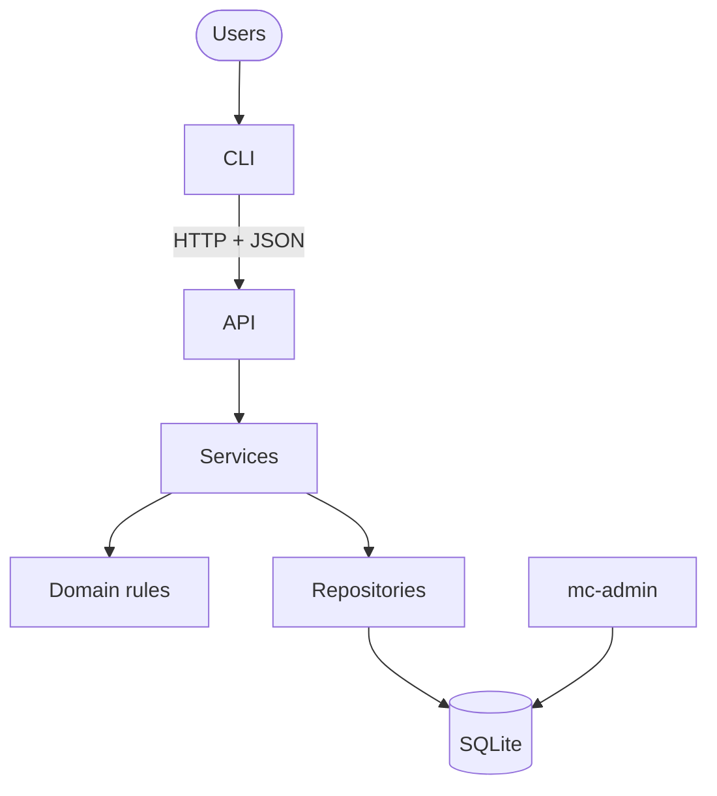
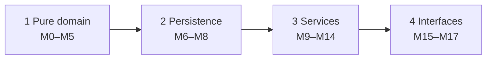

# Subagent (01): Build M14 matching preview

Source: `agent-a83588484897c4b98.jsonl` · 2026-10-12 02:18:22 UTC → 2026-10-12 02:37:39 UTC

Rendered from the raw JSONL without editing message content. Tool results and thinking are collapsed; expand them to read.


---

### 👤 User · 2026-10-12 02:18:22 UTC

You are implementing **M14 (matching service), preview part only**, of the Mission Control project, in a dedicated git worktree. "Apply" (turning a suggestion into proposals) needs M12's propose path, which doesn't exist yet, so it is OUT OF SCOPE for now. It will be a small follow-up.

**Work ONLY in:** `/Users/pritanbarai/Desktop/JOBS/mutinex_mission_control/.worktrees/m14-matching` (branch `m14-matching`, based on main `a4a6005`).
- Use absolute paths or `cd` into it for every command.
- Never touch the main checkout or other worktrees.
- Do NOT commit or run state-changing git commands (`git status` / `git diff` are fine).
- Do NOT add dependencies.

**Read first** (in the worktree):
- `CLAUDE.md`;
- `docs/prd.md` §5.1 (Eligible, Workload), §5.4, §5.7, §6 (Auto-matching, entirely), §8 (AC-18 to AC-22, AC-31), §9.3 (S2, S3, S3b);
- `docs/technical-design.md` §2, §4, §6 (Matching), §7, §9 (M14 row), §10, Appendix B TR-6;
- `docs/phase-reviews.md` "Carried forward" (M14/M16: a Placement holds only slot and person; consider workload and proficiency for explaining picks).
- Then the code you build on:
  - `src/mission_control/domain/matching.py` (`suggest_roster`, `proficiency`, Placement / Unfilled / Suggestion);
  - `src/mission_control/domain/eligibility.py`;
  - `src/mission_control/infra/repositories/facts.py` (`slot_specs`, `candidates`);
  - `src/mission_control/infra/repositories/missions.py` (`get_visible`, `assignments`, `rostered_user_ids`);
  - `src/mission_control/services/context.py`;
  - `src/mission_control/domain/permissions.py` (`Action.PREVIEW_MATCH`: owner or Director);
  - `src/mission_control/services/crew.py` (a merged service to copy the style from);
  - `tests/builders.py` and `tests/integration/conftest.py` (`seeded_db`).

**Use the project's `cli-ux` skill:** read `.claude/skills/cli-ux/SKILL.md` and its `references/` (principles.md, checklist.md, examples.md) in the worktree. The preview's output will be shown by `mc missions match <id>` (built later in M16), so shape the data so the CLI can follow the skill:
- react with a clear result;
- write for skimmers: per slot, who and why;
- unfilled places stated plainly;
- suggest the next step (apply, once it exists);
- `--json` gets a stable shape;
- errors say what's wrong and how to fix it.

The service returns data; the CLI does the rendering. Don't put terminal formatting in the service.

**FILE OWNERSHIP**
- Create or edit only:
  - `src/mission_control/services/matching.py`;
  - `tests/integration/test_matching_service.py`;
  - a NEW design doc `docs/cli-ux.md`, for the mock session described below.
- Everything else is read-only, including domain/, repositories/ and services/context.py.
- Preview writes nothing, so no audit events are expected. If you think you need one, or need a change in a file you don't own, stop and describe it in your report.
- New error or problem codes: only if truly needed. Mark them in your report as needing the user's approval. Don't edit design §7.

**WHAT TO BUILD** (`services/matching.py`): `preview(ctx, mission_id) -> MatchPreview` (frozen view records of your design), following PRD §6 exactly.
1. **Visibility and permission:**
   - a mission the actor can't see is NotFound (`missions.get_visible`, TR-10);
   - then `Action.PREVIEW_MATCH` with `Context(owner_id=..., created_by_id=..., rostered_user_ids=missions.rostered_user_ids(id))`: owner or Director, otherwise Forbidden.
2. **Draft only:** the PRD says the matcher suggests crew for a Draft mission's open places. For a non-Draft mission, refuse with a 409. Prefer an existing state code from `domain/lifecycle.py`'s vocabulary (`mission_frozen` for Active, `mission_final` for finished, `invalid_transition` for Pending). Check whether lifecycle exposes a helper; if not, say so in your report rather than editing domain.
3. **Candidates** (PRD §6):
   - active crew profiles in the mission's org only (`facts.candidates(excluding_mission_id=id)`);
   - leave out anyone holding an open assignment (proposed/accepted) on this mission, and anyone who declined or withdrew from it (`missions.assignments(id, statuses=...)`).
4. **Suggest:** run `domain.matching.suggest_roster(facts.slot_specs(id), candidates, mission.window)`. **Read only: nothing is written** (prove it with a table snapshot in tests, AC-22).
5. **Output to support explanation:**
   - per slot, in listed order: slot id and name, open places, the suggested people (crew profile id, name, workload in mission-days, proficiency = sum of required-skill levels via `domain.matching.proficiency`), and the number of places left unfilled;
   - mission id, name and window;
   - the pick order, if useful.
   - Explaining *why someone was picked* via workload and proficiency is allowed. **Near-miss lists, exclusion reasons and relaxation suggestions are OUT OF SCOPE** (PRD §6 "Out of scope for matching"): don't add them.
   - Determinism: the same inputs give the same output (AC-18).
6. **Mock terminal session** (`docs/cli-ux.md`, using the skill's design mode): exact commands and exact output for `mc missions match`:
   - S2 on a TTY (Lunar Gateway Resupply gives Commander Ana, Flight Engineer Chen, Mission Specialist Dana, each with workload and proficiency);
   - S3 with an unfilled Geologist, stated plainly with a next step that is honest about what's possible (no relaxation suggestions);
   - a refusal for a non-Draft mission (what it says and the fix);
   - a crew member trying it (not found);
   - piped output (`| cat`: no colour or escape codes);
   - the `--json` shape;
   - the exit codes.

   Show the next step as `mc missions match <id> --apply`, and mark it "available after M12". Run the skill's checklist over the design and note any gaps. Keep the doc short, about one screen per scenario.

**CONVENTIONS:**
- No PRD IDs in `src/` (fine in tests).
- Frozen dataclasses; type hints.
- `-> Generator[T]` for any context manager.
- Never use `httpx`.
- Reads inside `ctx.read()`.
- Refusals: `NotFound` / `Forbidden` / `RuleViolation` (`RuleViolation.of(problem)` for single-reason codes).
- Messages are natural sentences from explicit phrases.

**WORKFLOW**
1. **Tests first:** failing tests named after PRD IDs and scenarios, e.g.:
   - `test_s2_gateway_preview_suggests_ana_chen_dana_with_workload_and_proficiency`;
   - `test_ac19_s3_geologist_is_reported_unfilled`;
   - `test_ac22_preview_writes_nothing`;
   - `test_ac31_other_orgs_crew_never_appear`;
   - `test_preview_leaves_out_crew_who_declined_this_mission`;
   - `test_s3b_new_accepted_assignment_changes_the_suggestion` (simulate with a builder-inserted accepted assignment);
   - permission and visibility tests (Lee owner allowed, Ruth Director allowed, Nora non-owner Lead forbidden, Ben crew not found, Helix not found);
   - non-Draft refusals (Telescope 5 Active, Deep Space Comms 6 Pending, Mars Analog 7 Completed).

   Run them and see them fail, then implement.
2. Run the full suite and lint in the worktree:
   - `uv run pytest -W error -o addopts="" -q`;
   - `uv run ruff check src tests`;
   - `uv run ruff format --check src tests`.
3. **Real run:** a script against a fresh seeded database printing the preview for Gateway (1) and Asteroid Survey (2), as Lee and Nora, plus the refusals. Port 8014 if you start a server.
4. **Read-only review** of your own diff, including running the cli-ux checklist on `docs/cli-ux.md`. List the findings; don't silently fix them.

**FINAL REPORT** (keep it concise; it's all the lead sees):
- files;
- the preview function and what it enforces (with PRD IDs);
- the MatchPreview shape;
- tests, with before (failing) and after counts;
- suite and ruff results;
- trimmed real-run output;
- review findings;
- any codes needing approval;
- any changes needed in files you don't own;
- PRD gaps.

<details>
<summary>⚙️ System/meta message · 2026-10-12 02:18:22 UTC</summary>

```
<system-reminder>
Your final report is delivered through SubagentHandback: when your work is complete, call SubagentHandback({message: <your full report>}). The call ends your run, so make it your last step. Only a SubagentHandback call reaches your caller as your result; plain text you write at the end is not delivered.
</system-reminder>
```

</details>

**🔧 Bash**

*Inspect worktree state and layout*

```bash
git status && git log --oneline -3 && cat CLAUDE.md && ls docs src/mission_control/* tests tests/* .claude/skills/cli-ux -R | head -100
```

<details>
<summary>↳ Result</summary>

```
On branch m14-matching
nothing to commit, working tree clean
a4a6005 chore: exclude .claude from ruff
b6bad6d feat(m9): admin service — org settings, users and roles, crew profiles, skill catalogue
d55a7ed feat(m10): crew service — profiles, unavailability, skill levels
# Mission Control

Multi-tenant mission planning API and CLI. Read these before doing any work. They are the source of truth, so don't copy their content here.

- [`docs/brief.md`](docs/brief.md): the assessment brief
- [`docs/prd.md`](docs/prd.md): **behaviour**. What the system does, its rules, acceptance criteria and seed scenarios.
- [`docs/technical-design.md`](docs/technical-design.md): **structure**. Architecture, schema, API, CLI, the delivery plan (§9) and the implementation guidelines (§10).

If the PRD and the design conflict, or are silent on something, stop and ask. Never invent behaviour.

## Workflow (every module)

1. **One approved module at a time.** Work only on the module from design §9 that I have approved. Don't start anything else.
2. **Tests first.** Write failing tests that reference the PRD IDs, then implement. Run the full suite and lint: `uv run pytest` and `uv run ruff check`.
3. **Real verification.** Exercise the behaviour for real, for example with a REPL call, an HTTP request or a CLI command. Show the actual output. A passing test run alone isn't verification.
4. **Read-only review.** Review the full diff against the PRD and design §10 without editing. Report findings, and fix them only once I agree.
5. **Stop for approval.** Summarise what changed, the test and verification results, and the review findings, and propose a commit message. **Don't commit, and don't start the next module, until I approve.**

## Waves (parallel modules in worktrees)

When I approve a wave of independent modules (design §9), build them in parallel and keep reviews small:

1. **One worktree per module.** Run `git worktree add .worktrees/<module> -b <module> main`, then `uv sync` inside it. Each agent edits only its own worktree and doesn't commit.
2. **Same workflow per module.** Steps 2 to 4 above still apply, inside the worktree.
3. **Review one branch at a time.** Show me only that module's diff against `main` (`git -C .worktrees/<module> diff main`, including new files), with its results.
4. **After I approve that module:**
   - commit on its branch;
   - rebase onto `main` if `main` has moved, and re-run its tests;
   - fast-forward `main`;
   - run the full suite on `main`;
   - remove the worktree and branch.

   Only then present the next branch.

Never push, add dependencies, change the schema, or add endpoints, error codes or CLI commands outside the design without asking first.
ls: -R: No such file or directory
src/mission_control/__init__.py
tests/builders.py
tests/conftest.py

.claude/skills/cli-ux:
SKILL.md
evals
references

docs:
backlog.md
brief.md
phase-reviews.md
prd.md
technical-design.md

src/mission_control/__pycache__:
__init__.cpython-312.pyc

src/mission_control/api:
__init__.py
__pycache__
app.py

src/mission_control/domain:
__init__.py
__pycache__
approvals.py
dates.py
eligibility.py
enums.py
errors.py
events.py
lifecycle.py
matching.py
passwords.py
permissions.py
records.py

src/mission_control/infra:
__init__.py
__pycache__
db.py
repositories
schema.sql
security.py

src/mission_control/seed:
__init__.py
__pycache__
data.py
loader.py

src/mission_control/services:
__init__.py
__pycache__
admin.py
auth.py
context.py
crew.py

tests:
__pycache__
api
builders.py
conftest.py
integration
unit

tests/__pycache__:
builders.cpython-312.pyc
conftest.cpython-312-pytest-9.1.1.pyc

tests/api:
__pycache__
test_health.py

tests/integration:
__pycache__
conftest.py
test_admin_service.py
test_auth.py
test_crew_service.py
test_db.py
test_facts.py
test_repositories.py
test_repository_sql.py
test_repository_writes.py
test_schema_constraints.py
test_seed.py
test_service_context.py

tests/unit:
domain
```

</details>

**🔧 Bash**

*List PRD headings*

```bash
grep -n "^#" docs/prd.md | head -80
```

<details>
<summary>↳ Result</summary>

```
1:# Mission Control — Product Requirements (v1)
7:## 1. Problem and goals
20:## 2. Requirements from the brief
33:## 3. Users and roles
45:## 4. Main workflows (all available through the CLI)
60:## 5. Business rules
62:### 5.1 Definitions
73:### 5.2 Tenancy and identity
79:### 5.3 People and skills
100:### 5.4 Missions and lifecycle
133:### 5.5 Approval
141:### 5.6 Assignments
155:### 5.7 Visibility and audit
169:## 6. Auto-matching
197:## 7. CLI requirements
204:## 8. Acceptance criteria
257:## 9. Seed data and scenarios
261:### 9.1 Aurora Space Agency (N = 2)
289:### 9.2 Helix Orbital (N = 1)
297:### 9.3 Scenarios
312:## 10. Test plan
325:## 11. Out of scope
```

</details>

**🔧 Bash**

*Read PRD sections 5-10*

```bash
sed -n 60,330p docs/prd.md
```

<details>
<summary>↳ Result</summary>

````
## 5. Business rules

### 5.1 Definitions

| Term | Meaning |
|---|---|
| **Open assignment** | An assignment that is Proposed or Accepted. |
| **Open places** | A slot's headcount minus its open assignments. |
| **Mission-days** | The number of days from the start date to the end date, counting both. |
| **Overlap** | Two date ranges overlap if they share at least one calendar day. Dates have no time and no time zone. |
| **Eligible (crew for a slot)** | The person is active, has a crew profile, and has every required skill at or above its minimum level. They have no unavailability overlapping the mission, and no accepted assignment on another non-final mission that overlaps it. |
| **Eligible approver** | An active Director who did not create the mission and is not on its roster. |

### 5.2 Tenancy and identity

- **T1** Every record belongs to one organisation. Every read and write is limited to the caller's organisation. **[B]**
- **T2** Naming a resource from another organisation gives the same response as naming one that doesn't exist ("not found").
- **T3** Organisations are created only through seed data or an operator command. There is no self-service signup.

### 5.3 People and skills

- **P1** Each organisation has its own flat skill catalogue, managed by Directors. Skills with the same name in different organisations are unrelated.
  - Directors can rename a skill. Its identity stays the same.
  - Directors can delete a skill only if no crew skill or slot requirement uses it.
- **P2** Proficiency is an integer from 1 to 5.
- **P3** Leads and Directors set and remove skill levels. **Nobody can change their own levels.**
  - A skill change is allowed even if it makes someone ineligible for an assignment on a Draft or Pending mission. Eligibility is checked again at acceptance, submission and approval.
  - A skill change that would make someone ineligible for their assignment on an Active mission is refused.
- **P4** Crew profile holders manage their own personal details and unavailability. Nobody else edits them. Personal details are a display name and an optional bio.
- **P5** Crew are available by default. Unavailability is a date range with a reason.
- **P6** A crew member can't record unavailability that overlaps one of their accepted assignments.
- **P7** Users are deactivated, never deleted. Deactivated users can't sign in, aren't eligible for matching, and keep their history. Deactivation is refused while the user:
  - has open assignments; or
  - owns non-final missions. The same applies to changing a mission owner's role away from Lead. Their missions must be reassigned first.
- **P8** An organisation must always have at least one active Director.
- **P9** Crew profiles survive role changes and can't be deleted. Changing a user's role to Crew Member gives them a profile if they don't already have one.
- **P10** Directors set a new user's initial password. Users change their own password by entering their current one. There's no email or password-recovery flow.
  - Passwords must be at least 15 characters. Passphrases are welcome, and uppercase letters, numbers and symbols aren't required.
  - Changing a password ends all of that user's sessions, including the one used to change it.

### 5.4 Missions and lifecycle

- **M1** A mission has a name, a date range, one owning Lead and a separately recorded creator.
  - Leads create missions for themselves. Directors create them on behalf of a Lead.
  - Only Mission Leads can own missions.
  - Directors can transfer ownership of a non-final mission to another active Lead in the same organisation. If the mission is Pending, it returns to Draft and its approvals are cleared.
- **M2** A mission has one or more slots. Each slot has a name, a headcount of at least 1, and at least one required skill with a minimum level. Dates may be in the past, but the end date must be on or after the start date. The same rule applies to unavailability.
- **M3** Only the owning Lead can edit a mission, propose or remove crew, apply matcher results, or submit.

```
         submit                N-th approval                complete
 Draft ─────────▶ Pending ───────────────────▶ Active ─────────────▶ Completed
   ▲              Approval
   └── reject (reason) / any change ──┘
 Draft | Pending Approval | Active ──cancel (reason)──▶ Cancelled
```

| Transition | Who | Conditions and effects |
|---|---|---|
| Draft → Pending Approval | Owning Lead | All of these must hold: every slot is full, every assignment is Accepted, every rostered crew member is still eligible, and there are at least N eligible approvers. Otherwise the submission is refused with a list of the problems. |
| Pending → Active | The N-th distinct eligible approver | The roster is checked again at each approval. If the check fails, the approval is refused and the mission stays Pending, unchanged. |
| Pending → Draft | Eligible Director (reject) or system | A rejection needs a reason. Any change to dates, slots, roster or owner, including a crew withdrawal, also sends the mission back to Draft. Approvals are cleared, and remaining accepted assignments stay accepted. |
| Active → Completed | Owning Lead or Director | Accepted assignments become Completed. |
| Any non-final → Cancelled | Owning Lead or any Director | Reason required. Open assignments become Cancelled. |

- **M4** Draft missions can have unfilled places and unanswered proposals.
- **M5** Once a mission is Active, its dates, requirements and roster are frozen. Only completion or cancellation are allowed.
- **M6** Dates never trigger transitions on their own. There is no scheduler.
- **M7** An edit is refused if it would invalidate an open assignment. The response lists the affected crew, and the Lead must remove them first. Crew are never removed automatically. Edits that invalidate an assignment are:
  - removing a slot that has open assignments;
  - lowering a slot's headcount below its open assignments;
  - changing dates or requirements so that an assigned person is no longer eligible.

### 5.5 Approval

- **A1** Each organisation sets the number of approvals required (N ≥ 1). The approvals must come from N distinct eligible approvers.
  - N is fixed for a mission when it's submitted. Later changes to the setting don't affect a round already in progress.
  - An approval already given still counts if that Director is later deactivated or demoted.
- **A2** Leads can't approve anything, which satisfies R3. **[B]** A Director can't approve a mission they created or are rostered on.
- **A3** Each Director approves a round at most once. A single rejection ends the round.

### 5.6 Assignments

```
Proposed ──accept──▶ Accepted ──withdraw (reason)──▶ Withdrawn
   ├──decline──▶ Declined   └──removed by Lead──▶ Removed
   └──retracted by Lead──▶ Removed
Accepted ──mission completed──▶ Completed;  open ──mission cancelled──▶ Cancelled
```

- **S1** The owning Lead can propose only eligible crew. A person can hold at most one open assignment per mission. A slot can't have more open assignments than its headcount. A Lead can propose themselves, but they must be eligible and must accept like anyone else.
- **S2** Crew can accept only while the mission is in Draft and they're still eligible. Accepted assignments block overlapping dates. Proposals don't block anything.
- **S3** Declining takes an optional reason. Withdrawing needs a reason and is allowed only in Draft or Pending Approval.
- **S4** Every assignment needs the crew member's acceptance. Crew can't be placed on a mission directly.

### 5.7 Visibility and audit

| | Crew | Lead | Director |
|---|---|---|---|
| Own profile, skills, availability, assignments | ✓ | ✓ | ✓ |
| Missions they're on, with teammates' names and slots | ✓ | ✓ | ✓ |
| Other crew members' profiles, skills, busy/free dates | ✗ | ✓ | ✓ |
| Other people's *reasons* for unavailability | ✗ | ✗ | ✓ |
| All missions in the organisation | ✗ | read (edit own) | read |
| Users, catalogue management, organisation settings | ✗ | read catalogue | manage |

- **V1** Every state change, approval, rejection and assignment response is recorded with who did it, when, and any reason. Anyone who can see the mission can see this history.
- **V2** Former assignees see a summary of the mission in their own assignment history. They don't get full access to the mission unless their role allows it. Former assignees are people whose assignment was declined, withdrawn, removed or cancelled.

## 6. Auto-matching

The matcher only advises. It suggests crew for a Draft mission's open places and changes nothing. The owner or a Director can preview a suggestion. When the owning Lead applies it, it creates Proposed assignments, which crew still have to accept.

**Candidates.** Active crew profiles in the mission's organisation only. Crew who already have an open assignment on this mission, or who declined or withdrew from it, are left out.

**Workload.** The total mission-days of a crew member's accepted assignments on missions that are not Completed, leaving out the mission being matched.

**Algorithm**

1. **Filter.** For each slot with open places, keep the candidates who are eligible (§5.1).
2. **Pick the most constrained slot.** Choose the slot with the fewest remaining eligible candidates. Ties go to the slot listed first.
3. **Fill one place in that slot.** Rank candidates by:
   1. lowest workload;
   2. then highest proficiency, meaning the sum of their levels across the slot's required skills;
   3. then stable identifier, ascending.
4. **Remove the chosen person** from every other slot's candidates.
5. **Repeat** from step 2 until every place is filled or has no candidates left.

**Output.** A suggested roster with no one in two slots. Places without a candidate are marked **unfilled**. The same inputs always give the same output.

**Why:**
- Filling the most constrained slot first stops a versatile person from being spent on a slot that's easy to fill.
- Ranking by lowest workload spreads missions across crew.
- Proficiency only breaks ties, because everyone left already meets the requirement.

**Known limitation:** this is a greedy heuristic. It can occasionally leave a place unfilled when a complete roster exists. That's acceptable for an advisory tool, and the Lead can still propose by hand.

## 7. CLI requirements

- **C1** Every workflow in §4 can be carried out from the CLI. **[B]**
- **C2** Refusals explain why in domain terms, for example "Gus has an accepted assignment on *Station Reboost* overlapping 1–2 Mar". Where possible they also say what to do next.
- **C3** Output is readable by people by default, with a machine-readable option for scripts and tests.
- **C4** Actions that send a mission back to Draft, or cancel it, warn before running.

## 8. Acceptance criteria

Each criterion starts from a fresh seed. Scenario numbers (S-) refer to §9.3.

**Mission workflow**

- **AC-1** The golden path (S1) ends Completed, and every transition appears in the history with who did it and when.
- **AC-2** Submission is refused while any place is unfilled or any proposal is unanswered. The refusal lists them.
- **AC-3** Approvals before the N-th leave the mission Pending. The N-th approval makes it Active.
- **AC-4** Changing the dates, slots or roster of a Pending mission sends it back to Draft and clears its approvals. So does a crew withdrawal (S5).
- **AC-5** On an Active mission, edits, proposals, removals and withdrawals are refused. Completion and cancellation succeed.
- **AC-6** Cancelling needs a reason. The owning Lead or any Director can cancel, and any other Lead is refused. Open assignments become Cancelled.
- **AC-7** Only the owning Lead can edit, propose, apply or submit. After a Director reassigns the owner, the new owner can and the previous owner can't.

**Approval restrictions**

- **AC-8** The mission's creator can't approve it. In S1, Ruth is refused.
- **AC-9** Leads and Crew can't approve or reject.
- **AC-10** A Director can't approve the same round twice. Rejecting needs a reason and clears earlier approvals (S6).
- **AC-11** A Director rostered on a mission can't approve it.
- **AC-12** Submission is refused when there are fewer than N eligible approvers, not counting the creator or rostered Directors (S7).
- **AC-13** In Helix (N = 1), a single approval makes the mission Active (S8).

**Overlaps and availability**

- **AC-14** Proposing someone who is unavailable, or who has an overlapping accepted assignment, is refused. In S4, both Fay and Gus are refused.
- **AC-15** Overlapping proposals are allowed. Accepting one that overlaps an accepted assignment is refused, and the refusal names the conflicting mission (S4, Chen).
- **AC-16** Recording unavailability that overlaps an accepted assignment is refused.
- **AC-17** Two ranges that share only a boundary day overlap.

**Matching**

- **AC-18** S2 gives exactly the expected roster on every run.
- **AC-19** S3 marks Geologist as unfilled. S3b shows a new accepted assignment changing the suggestion.
- **AC-20** Workload counts only accepted assignments on missions that aren't Completed. Chen's workload is 5, not 35.
- **AC-21** The suggestion never puts one person in two slots. It never includes anyone who is ineligible, from another organisation, or already excluded from this mission.
- **AC-22** Running the matcher changes nothing. Applying it creates Proposed assignments.

**Roles and visibility**

- **AC-23** Ana can't change her own skill levels, but Lee can change hers. Ben can't edit skills, but he can edit his personal details and unavailability.
- **AC-24** Lee sees Fay as busy 5–8 Mar but doesn't see the reason. Ruth sees the reason. Ben can't view Fay's profile, and his mission list shows only missions he's on.
- **AC-25** Leads can't manage users, the catalogue or the approval setting.
- **AC-26** Deactivating someone with open assignments is refused. A deactivated user can't sign in. The last active Director can't be deactivated or demoted.

**Tenant isolation (S9)**

- **AC-27** Requesting another organisation's mission, crew member, user, skill or assignment by ID gives the same response as an ID that doesn't exist.
- **AC-28** Every list contains only the caller's organisation's records.
- **AC-29** Any write that references another organisation's ID fails as "not found", and neither organisation's data changes.
- **AC-30** Approving or rejecting another organisation's mission fails as "not found".
- **AC-31** Helix's Kai (Piloting 5, no commitments) is never suggested for an Aurora mission.

## 9. Seed data and scenarios

The table order of people is their stable-identifier order. All dates are in 2027 unless stated.

### 9.1 Aurora Space Agency (N = 2)

| Person | Role | Crew skills | Commitments (workload) |
|---|---|---|---|
| Ruth Adeyemi | Director | — | — |
| Marco Bianchi | Director | Flight Medicine 4 | Medical Study, accepted (4) |
| Ingrid Holm | Director | — | — |
| Lee Park | Lead | — | — |
| Nora Quinn | Lead | — | — |
| Ana Okafor | Lead | Piloting 5, Leadership 4, Systems Eng 4 | none (0) |
| Ben Ito | Crew | Systems Eng 4, EVA 3 | Deep Space Comms, accepted (20) |
| Chen Wu | Crew | Systems Eng 3 | Telescope (5). Mars Analog Completed, so it doesn't count |
| Dana Reyes | Crew | EVA 4 | Telescope (5) |
| Eli Novak | Crew | EVA 4, Piloting 4, Leadership 2 | Telescope (5) |
| Fay Moreau | Crew | Piloting 4, Leadership 4 | Unavailable 5–8 Mar (Medical) |
| Gus Patel | Crew | Systems Eng 5 | Station Reboost, accepted (6) |
| Hana Sato | Crew | EVA 3, Geology 2 | Telescope (5) |

| Mission | Owner / creator | Dates | State | Slots → crew |
|---|---|---|---|---|
| Lunar Gateway Resupply | Lee / Ruth | 1–10 Mar | Draft | Flight Engineer ×1 (Sys Eng ≥3) · Mission Specialist ×1 (EVA ≥3) · Commander ×1 (Piloting ≥4, Leadership ≥3) — no crew |
| Asteroid Survey | Nora | 5–12 Mar | Draft | Pilot ×1 (Piloting ≥4) · Geologist ×1 (Geology ≥4) — no crew |
| Station Reboost | Nora | 25 Feb – 2 Mar | Draft | Engineer ×2 (Sys Eng ≥3) — Gus accepted, 1 open place |
| Lunar Surface Medical Study | Nora / Ruth | 15–18 Mar | Draft | Flight Surgeon ×1 (Flight Medicine ≥4) — Marco accepted |
| Orbital Telescope Service | Lee | 10–14 Jan | Active | Engineer ×1 — Chen · EVA Specialist ×3 (EVA ≥3) — Dana, Eli, Hana |
| Deep Space Comms Upgrade | Nora | 1–20 Apr | Pending (Marco approved) | Engineer ×1 (Sys Eng ≥3) — Ben |
| Mars Analog Habitat | Lee | 1–30 May 2026 | Completed | Engineer ×1 — Chen |

### 9.2 Helix Orbital (N = 1)

People: Sam Rivera (Director), Priya Nair (Lead), and Crew Kai Tanaka (Piloting 5), Lena Fischer (Payload Integration 4), Omar Haddad (Field Medicine 4) and Tess Moreno (Life Support 3). Helix has its own catalogue, including a separate "Piloting" skill.

| Mission | Owner | Dates | State | Slots → crew |
|---|---|---|---|---|
| Payload Demo 1 | Priya | 1–3 Feb | Draft | Payload Specialist ×1 (Payload Int ≥3) — Lena accepted · Medic ×1 (Field Medicine ≥3) — Omar accepted |

### 9.3 Scenarios

| # | Steps | Expected outcome |
|---|---|---|
| **S1** | Lee matches and applies *Lunar Gateway Resupply* → Ana, Chen and Dana accept → Lee submits → Ruth approves → Marco approves → Ingrid approves → Lee completes | Proposed crew are Ana, Chen and Dana. Ruth is refused as creator. After Marco the mission is Pending (1/2). After Ingrid it's **Active**. Completing makes the assignments Completed. |
| **S2** | Match *Lunar Gateway Resupply* | Eligible crew: Commander {Ana}, because Fay is unavailable and Eli's Leadership is too low. Flight Engineer {Ana, Ben, Chen}, because Gus has an overlap. Specialist {Ben, Dana, Eli, Hana}. **Commander → Ana** (most constrained). **Flight Engineer → Chen** (workload 5 vs Ben's 20). **Specialist → Dana** (four-way workload tie at 5; Hana loses on proficiency; Dana beats Eli on ID). Filling the slots in listed order would have spent Ana on Flight Engineer and left Commander unfilled. |
| **S3** | Match *Asteroid Survey* | Geologist **unfilled** (Hana's Geology is only 2). Pilot → Ana (workload 0 vs Eli's 5; Fay unavailable). |
| **S3b** | S1 up to acceptance, then match *Asteroid Survey* | Ana is blocked by her overlapping accepted assignment, so Pilot → Eli. Geologist still unfilled. |
| **S4** | Lee proposes Gus and Fay for *Gateway*. Nora proposes Chen for *Station Reboost* and Lee proposes Chen for *Gateway*. Chen accepts *Station Reboost*, then *Gateway*. | Gus refused (overlap). Fay refused (unavailable). Both Chen proposals succeed. Chen's second acceptance is refused, naming *Station Reboost*. |
| **S5** | Ben withdraws from *Deep Space Comms* without a reason, then with one. Hana withdraws from *Telescope*. | Ben's first attempt is refused. The second succeeds: the mission returns to Draft and Marco's approval is cleared. Hana is refused because *Telescope* is Active. |
| **S6** | Marco approves *Deep Space Comms* again. Ingrid rejects it without a reason, then with one. | Marco is refused. Ingrid's first attempt is refused. The second sends the mission to Draft and clears approvals. |
| **S7** | Nora submits *Lunar Surface Medical Study* | Refused. Ruth created it and Marco is rostered, which leaves 1 eligible approver (Ingrid) when 2 are needed. |
| **S8** | Priya submits *Payload Demo 1* and Sam approves | **Active** after one approval. |
| **S9** | Each role in each organisation tries to read, list, write and approve the other organisation's resources, and matches an Aurora Piloting slot | Every attempt fails as "not found" and nothing changes. Lists show only the caller's organisation. Kai never appears. |

## 10. Test plan

Every acceptance criterion maps to at least one automated test.

| Level | Covers |
|---|---|
| Unit: matcher (pure function) | Eligibility, workload, most-constrained-first, each tie-break, no person in two slots, unfilled places, determinism. Includes S2, S3 and a small hand-built case per rule. |
| Unit: lifecycle and rules | Every allowed transition and a sample of disallowed ones. Approver eligibility and the N count. Revert-to-Draft clearing approvals. The Active freeze. Overlap at boundary days. |
| API: permissions | A role × action table, checking each role is allowed or refused as expected. |
| API: tenant isolation | Every endpoint, for reads, lists and writes, tried with the other organisation's IDs. A route-inventory test makes any new endpoint fail CI until it's added to this sweep. |
| API: scenarios | S1 and S3b–S8 against a freshly seeded database. |
| CLI end to end | S1 and S4 run through the real CLI, checking machine-readable output and the wording of refusals. |

## 11. Out of scope

- Web UI.
- Self-service organisation signup, users in more than one organisation, SSO.
- Password recovery and email flows. Deleting crew profiles. Reactivating deactivated users.
- Delivering notifications. The CLI's "needs attention" views replace them.
````

</details>

<details>
<summary>📎 File attached: CLAUDE.md</summary>

```
{
  "path": "/Users/pritanbarai/Desktop/JOBS/mutinex_mission_control/.worktrees/m14-matching/CLAUDE.md",
  "type": "Project",
  "content": "# Mission Control\n\nMulti-tenant mission planning API and CLI. Read these before doing any work. They are the source of truth, so don't copy their content here.\n\n- [`docs/brief.md`](docs/brief.md): the assessment brief\n- [`docs/prd.md`](docs/prd.md): **behaviour**. What the system does, its rules, acceptance criteria and seed scenarios.\n- [`docs/technical-design.md`](docs/technical-design.md): **structure**. Architecture, schema, API, CLI, the delivery plan (§9) and the implementation guidelines (§10).\n\nIf the PRD and the design conflict, or are silent on something, stop and ask. Never invent behaviour.\n\n## Workflow (every module)\n\n1. **One approved module at a time.** Work only on the module from design §9 that I have approved. Don't start anything else.\n2. **Tests first.** Write failing tests that reference the PRD IDs, then implement. Run the full suite and lint: `uv run pytest` and `uv run ruff check`.\n3. **Real verification.** Exercise the behaviour for real, for example with a REPL call, an HTTP request or a CLI command. Show the actual output. A passing test run alone isn't verification.\n4. **Read-only review.** Review the full diff against the PRD and design §10 without editing. Report findings, and fix them only once I agree.\n5. **Stop for approval.** Summarise what changed, the test and verification results, and the review findings, and propose a commit message. **Don't commit, and don't start the next module, until I approve.**\n\n## Waves (parallel modules in worktrees)\n\nWhen I approve a wave of independent modules (design §9), build them in parallel and keep reviews small:\n\n1. **One worktree per module.** Run `git worktree add .worktrees/<module> -b <module> main`, then `uv sync` inside it. Each agent edits only its own worktree and doesn't commit.\n2. **Same workflow per module.** Steps 2 to 4 above still apply, inside the worktree.\n3. **Review one branch at a time.** Show me only that module's diff against `main` (`git -C .worktrees/<module> diff main`, including new files), with its results.\n4. **After I approve that module:**\n   - commit on its branch;\n   - rebase onto `main` if `main` has moved, and re-run its tests;\n   - fast-forward `main`;\n   - run the full suite on `main`;\n   - remove the worktree and branch.\n\n   Only then present the next branch.\n\nNever push, add dependencies, change the schema, or add endpoints, error codes or CLI commands outside the design without asking first.\n",
  "contentDiffersFromDisk": false
}
```

</details>

**🔧 Bash**

*List design headings*

```bash
grep -n "^#" docs/technical-design.md
```

**🔧 Bash**

*Read carried-forward notes*

```bash
sed -n 1,200p docs/phase-reviews.md | grep -n -i -A30 "carried forward" | head -80
```

<details>
<summary>↳ Result</summary>

```
44:### Carried forward
45-
46-- **M7:** seed crew in PRD §9 order. The ID is the matcher's final tie-break.
47-- **M10–M15:**
48-  - a refused *view* returns 404;
49-  - services always pass the context each action requires;
50-  - changes go through `touch_for_change()`.
51-- **M13:** test that an approval still counts after its Director leaves.
52-- **M15:** consistent error body. Validation errors map to 422.
53-- **M16:** friendlier date formatting in the CLI.
54-
55----
56-
57-## Phase 2: Persistence (M6–M8)
58-
59-`09439f4` → review fixes · 656 tests · schema, repositories, seed, auth
60-
61-**Headline:** the persistence layer matches the design. Every tenant query is scoped, the database itself refuses cross-tenant links, and login is safe against account probing. The phase-end review found no live data leak, but it did find patterns that Phase 3 would have copied, and those are fixed.
62-
63-### Where we diverged
64-
65-| Change | Why |
66-|---|---|
67-| **Repository queries bind the org by name** (`org_id = :org`); positional `?` is banned by a guard test | With positional binding, a query written `WHERE id = ? AND org_id = ?` would silently return another tenant's rows |
68-| **Argon2 runs outside the write lock**, then a cheap re-check happens inside it | Each hash takes ~40 ms, and failed logins were blocking every writer. The rule "re-check under the lock" still holds. |
69-| **Login costs the same for unknown emails** (a dummy hash is verified) | Otherwise response time reveals which accounts exist, even with identical messages |
70-| **One timestamp format**: `utc_timestamp()`, UTC, 3-digit ms | The original helper dropped time zones and disagreed with the schema's own format |
71-| **Seed ids fixed**, with crew profile id = user id | Keeps the matcher's final tie-break in PRD table order, and lets tests and the seed share ids |
72-| **Shared audit event names** (`Event` enum) | Services and the seed must write identical names, or mission history breaks |
73-
74-### Key decisions
--
96:### Carried forward
97-
98-- **SF / M9–M14:**
99-  - use `Event` names, `utc_timestamp()` and `rostered_user_ids()`;
100-  - mission visibility for crew is a 404 through the repository;
101-  - deactivation calls `security.revoke_user_tokens` inside its own transaction.
102-- **M15:** build the dummy hash at startup. Wire the `MC_DATABASE_PATH` and `MC_DB_BUSY_TIMEOUT_MS` settings.
103-- **M17:** `mc-admin seed` hashes the demo passphrase (`orbital launch window`).
104-- **Out of scope:** deleting expired session tokens.
```

</details>

<details>
<summary>↳ Result</summary>

```
1:# Mission Control — Technical Design (v1)
24:## 1. Summary
43:## 2. Architecture
95:## 3. Data model
130:## 4. Security and tenancy
132:### Authentication
141:### Permissions
169:### Tenant isolation
181:## 5. Lifecycle
183:### Mission
205:### Assignment
228:### Cross-cutting rules
240:## 6. Matching
308:## 7. API
316:#### Auth and me
325:#### Organisation, users and skills (Directors)
335:#### Crew
345:#### Missions
358:#### Assignments
365:#### Errors
407:## 8. CLI
421:# Everyone
426:# Leads
432:# Directors
441:## 9. Delivery plan
505:## 10. Guidelines for implementing agents
507:### Source of truth
512:### The loop for each module
521:### Working in waves (worktrees)
530:### Architecture rules (never break these)
538:### Coding conventions
544:### Testing conventions
549:### Stop and ask before
557:## 11. Setup and testing
582:## Appendix A: Schema SQL
593:### Organisations, users and sessions
631:### Crew, skills and availability
685:### Missions, slots and requirements
739:### Assignments, approvals and audit
812:## Appendix B: Trade-offs and considerations
816:### B.1 Key decisions
834:### B.2 Risks
844:### B.3 Scaling path (not in v1)
```

</details>

**🔧 Bash**

*Find M14 mentions in phase reviews*

```bash
grep -n -i "M14\|M16\|placement\|carried" docs/phase-reviews.md
```

<details>
<summary>↳ Result</summary>

```
44:### Carried forward
53:- **M16:** friendlier date formatting in the CLI.
96:### Carried forward
98:- **SF / M9–M14:**
```

</details>

**🔧 Bash**

*Read design §2, §4, §6, §7, §8*

```bash
sed -n 43,95p docs/technical-design.md; sed -n 130,180p docs/technical-design.md; sed -n 240,420p docs/technical-design.md
```

<details>
<summary>↳ Result</summary>

````
## 2. Architecture

**Stack:** Python 3.12 · FastAPI + Pydantic v2 · SQLite through stdlib `sqlite3` · argon2-cffi · Typer + httpx2 · uv, pytest, ruff

**Dependency policy:** don't use `httpx` anywhere, including tests. Use `httpx2`, which Starlette's `TestClient` now expects.

Why SQLite, hand-written SQL, and a CLI that goes through the API: [TR-1](#tr-1), [TR-2](#tr-2), [TR-4](#tr-4).



| Layer | Folder | Responsibility | May depend on |
|---|---|---|---|
| CLI | `cli/` | Commands, output, prompts | API over HTTP only |
| API | `api/` | Validate input, resolve `Actor`, call a service, map errors | services |
| Services | `services/` | One use case = one transaction + audit | domain, infra |
| Domain | `domain/` | Every business rule, pure (no I/O) | nothing |
| Infra | `infra/` | Connections, schema, scoped repositories, security | domain types |

**How a request flows** (example: `mc missions submit 12`)

1. The CLI sends `POST /api/v1/missions/12/submit` with the bearer token.
2. The API resolves the token to an `Actor` (user, organisation, role) and calls `services.missions.submit(actor, 12)`.
3. The service opens `BEGIN IMMEDIATE` and loads the mission through `Repos(conn, actor.org_id)`.
4. `domain.lifecycle.check_submit(...)` returns a list of problems. If the list is empty, the service writes the new status and an audit event, then commits.
5. The API returns `200` with the mission, or `409` with every problem. The CLI prints one bullet per problem and exits with code `1`.

<details><summary>Folder layout</summary>

```
src/mission_control/
  domain/    dates  enums  errors  eligibility  matching  lifecycle  approvals  permissions  passwords  records
  infra/     db  schema.sql  security  repositories/
  services/  auth  admin  crew  missions  assignments  approvals  matching  audit  inbox
  api/       app  deps  errors  schemas/  routers/
  cli/       main  client  config  render  resolve  commands/
  seed/      data  loader
  admin_cli.py        # mc-admin: init-db, seed, create-org
tests/  unit/  integration/  api/  cli/  builders.py  conftest.py
```
</details>

---

## 3. Data model
## 4. Security and tenancy

### Authentication

| | |
|---|---|
| Token | 32 random bytes. Only the SHA-256 hash is stored. 12-hour expiry. |
| Every request | Token → valid? → user active? → `Actor(user_id, org_id, role, crew_profile_id)`. Nothing is cached, so role changes apply immediately. |
| Revocation | Logout revokes that token. Deactivation or a password change revokes every token. Opaque tokens make this immediate ([TR-5](#tr-5)). |
| Passwords | Argon2id. At least 15 characters. No character-type rules. |

### Permissions

Each **role** sets the baseline:

| Role | Can | Can't |
|---|---|---|
| **Director** | Run the organisation: users, roles, skills, approval setting. See everything. Approve, transfer, complete and cancel missions. | Edit mission details, since that's the owner's job |
| **Lead** | Create and run their own missions. Rate other people's skills. See all crew and missions. | Approve anything. Touch missions they don't own. |
| **Crew** | Manage their own profile and availability. Respond to their own assignments. | See other crew, or missions they aren't on |

On top of the role, **relationship rules** make the decisions that matter:

| Rule | Effect | PRD |
|---|---|---|
| **Owner only** | Only the mission's owner edits it, proposes crew, applies the matcher or submits | M3 |
| **Not yourself** | Nobody sets their own skill levels | P3 |
| **Eligible approver** | A Director can't approve a mission they created or are on | A2 |
| **Self only** | Only you edit your details and availability. Only you, and Directors, see your unavailability reasons. | P4, §5.7 |
| **Visibility** | Crew only see missions they're on. Former assignees see a summary. | V2 |

**Enforcement.** `domain/permissions.authorize(actor, action, ctx)` is the single entry point. The complete action × role table is the parametrized test for this module, and that test is the source of truth.

| Status | When |
|---|---|
| **401** | Authentication failed |
| **404** | Missing, another organisation's, or not visible. All three look identical ([TR-10](#tr-10)). |
| **403** | Visible, but you're not allowed to do this |

### Tenant isolation

1. **Identity.** `org_id` comes only from the token, never from the request.
2. **Repositories.** `Repos(conn, org_id)` scopes every query. Another organisation's ID behaves as missing.
3. **Database.** Composite `(org_id, id)` foreign keys.
4. **Tests.**
   - An SQL lint checks every query mentions `org_id`.
   - A route inventory makes sure no endpoint is left out of the isolation tests.
   - A cross-organisation sweep compares database snapshots before and after.

---

## 6. Matching

The matcher suggests crew for a Draft mission's open places. It's a pure function: same inputs, same output. It's greedy rather than optimal, which keeps it explainable ([TR-6](#tr-6)).

**How it works**

1. **Filter.** For each slot, keep candidates who are eligible: active, skills meet the requirements, available, and no overlapping accepted assignment.
2. **Pick a slot.** Take the open slot with the fewest candidates, so scarce skills are protected.
3. **Pick a person.** Take the lowest workload, then the highest proficiency, then the lowest ID.
4. **Place** that person and remove them from every other slot's candidates.
5. **Repeat** until all places are filled or marked **unfilled**.

**Inputs** (`domain/records.py`). They carry names as well as IDs, so every refusal can name the person, skill and mission involved:

| Record | Fields |
|---|---|
| `Requirement` | `skill_id`, `skill_name`, `min_level` |
| `SlotSpec` | `id`, `position`, `name`, `open_places`, `requirements: tuple[Requirement, ...]` |
| `Commitment` | `mission_id`, `mission_name`, `window`: an accepted assignment on another non-final mission |
| `CandidateFacts` | `crew_profile_id`, `name`, `active`, `skills: {skill_id: level}`, `unavailable: tuple[DateRange, ...]`, `accepted_elsewhere: tuple[Commitment, ...]`, `workload` |
| `RosterEntry` | `assignment_id`, `slot: SlotSpec`, `crew: CandidateFacts`, `status`: an open assignment on the mission being edited or submitted (`crew.accepted_elsewhere` excludes this mission) |
| `AssignmentFact` | `mission_id`, `mission_status`, `assignment_status`, `window`: one of a person's assignments, used to compute workload |
| `ActiveAssignment` | `mission_id`, `mission_name`, `slot_name`, `requirements`: an accepted assignment on an Active mission, used to check skill changes |

```python
def suggest_roster(slots: list[SlotSpec], candidates: list[CandidateFacts],
                   window: DateRange) -> Suggestion:
    by_id = {c.crew_profile_id: c for c in candidates}
    eligible = {s.id: {c.crew_profile_id for c in candidates if is_eligible(c, s, window)}
                for s in slots}
    remaining = {s.id: s.open_places for s in slots}
    placements, unfilled = [], []

    while open_slots := [s for s in slots if remaining[s.id] > 0]:
        # Most-constrained slot first; ties by listed position, then id.
        slot = min(open_slots, key=lambda s: (len(eligible[s.id]), s.position, s.id))

        if not eligible[slot.id]:
            unfilled.append(Unfilled(slot.id, remaining[slot.id]))
            remaining[slot.id] = 0
            continue

        # Lowest workload, then highest proficiency, then stable id.
        person = min((by_id[i] for i in eligible[slot.id]),
                     key=lambda c: (c.workload, -proficiency(c, slot), c.crew_profile_id))

        placements.append(Placement(slot.id, person.crew_profile_id))
        remaining[slot.id] -= 1
        for ids in eligible.values():
            ids.discard(person.crew_profile_id)

    return Suggestion(placements, unfilled)


def proficiency(c: CandidateFacts, slot: SlotSpec) -> int:
    return sum(c.skills.get(r.skill_id, 0) for r in slot.requirements)
```

**Workload** = total mission-days of accepted assignments on missions that aren't completed, leaving out the mission being matched.

| | Preview | Apply |
|---|---|---|
| Who | Owner or Director | Owner only |
| Writes | Nothing | Proposals, created through the normal `propose` path |
| Data | Loaded with one query per fact type | Recomputed inside the write transaction, so it's never stale |

---

## 7. API

**Conventions**
- REST and JSON, under `/api/v1`.
- Authentication with the header `Authorization: Bearer <token>`.
- Lifecycle changes are explicit `POST` commands, for example `/submit`. They are never `PATCH status`, because each one has its own guards and audit event ([TR-8](#tr-8)).
- List endpoints return only what the caller is allowed to see.

#### Auth and me
| Method | Path | Purpose |
|---|---|---|
| POST | `/auth/login` | Exchange email and password for a token |
| POST | `/auth/logout` | Revoke the current token |
| GET | `/me` | Current user, role and crew profile |
| POST | `/me/password` | Change password (revokes all sessions) |
| GET | `/me/inbox` | Things waiting on me |

#### Organisation, users and skills (Directors)
| Method | Path | Purpose |
|---|---|---|
| GET · PATCH | `/org` | View settings, or set the required approvals |
| GET · POST | `/users` | List users, or create one with an initial password |
| PATCH | `/users/{id}` | Change role or deactivate |
| POST | `/users/{id}/crew-profile` | Give a user a crew profile |
| GET · POST | `/skills` | List skills (Leads too), or add one |
| PATCH · DELETE | `/skills/{id}` | Rename, or delete if unused |

#### Crew
| Method | Path | Purpose |
|---|---|---|
| GET | `/crew` · `/crew/{id}` | List or view profiles |
| PATCH | `/crew/{id}` | Edit own display name and bio |
| PUT · DELETE | `/crew/{id}/skills/{skill_id}` | Set or remove a skill level |
| GET · POST | `/crew/{id}/unavailability` | List or add own unavailability |
| DELETE | `/crew/{id}/unavailability/{uid}` | Remove own unavailability |
| GET | `/crew/{id}/assignments` | Assignment history (summaries) |

#### Missions
| Method | Path | Purpose |
|---|---|---|
| GET · POST | `/missions` | List visible missions, or create one with slots |
| GET · PATCH | `/missions/{id}` | View, or edit name and dates |
| POST | `/missions/{id}/slots` | Add a slot |
| PATCH · DELETE | `/missions/{id}/slots/{sid}` | Edit or remove a slot |
| GET | `/missions/{id}/history` | Audit trail |
| POST | `/missions/{id}/submit` · `approve` · `reject` · `complete` · `cancel` | Lifecycle commands |
| POST | `/missions/{id}/owner` | Transfer ownership |
| GET | `/missions/{id}/match` | Preview suggested roster |
| POST | `/missions/{id}/match/apply` | Create proposals from the suggestion |

#### Assignments
| Method | Path | Purpose |
|---|---|---|
| POST | `/missions/{id}/assignments` | Propose a crew member for a slot |
| GET | `/assignments` | My assignments |
| POST | `/assignments/{id}/accept` · `decline` · `withdraw` · `remove` | Respond or remove |

#### Errors

Every error has the same shape, for every status code (401, 403, 404, 409, 422, 503). `problems` is always present and always has at least one entry, so clients only ever handle one format. A rule or state conflict (409) lists **every** problem at once. A permission refusal (403) lists its single reason, because only one applies and the actor can't fix it themselves. Each problem names the record involved:

```json
{
  "error": {
    "code": "rule_violation",
    "message": "Mission can't be submitted",
    "problems": [
      { "code": "slot_unfilled", "message": "Commander: 1 of 1 place unfilled", "refs": { "slot_id": 12 } }
    ]
  }
}
```

| HTTP | Meaning | Codes |
|---|---|---|
| 401 | Not authenticated | `invalid_credentials` `unauthenticated` |
| 403 | Not allowed | `role_forbidden` `not_owner` `approver_is_creator` `approver_is_rostered` `self_skill_edit` `wrong_current_password` |
| 404 | Not found or not visible | `not_found` |
| 409 | Conflicts with state or a rule | **State:** `mission_frozen` `mission_final` `invalid_transition` `already_decided`<br>**Rules:** `rule_violation` `overlap` `unavailable` `insufficient_approvers` `invalidates_assignments` `invalidates_active_assignment`<br>**Admin:** `has_open_assignments` `owns_open_missions` `last_director` `skill_in_use` |
| 422 | Invalid input | `validation_error` `password_too_short` |
| 503 | Database busy, retry | `busy` |

**Problem codes.** These appear inside `problems` and explain each refusal. Adding one means updating this table in the same change.

| Code | Raised when | Typical `refs` |
|---|---|---|
| `inactive` | The person is deactivated | `crew_profile_id`, `slot_id` |
| `skill_below_minimum` | A required skill is missing or below the minimum | `crew_profile_id`, `slot_id`, `skill_id` |
| `unavailable` | Unavailability overlaps the mission's dates | `crew_profile_id`, `slot_id` |
| `overlap` | An accepted assignment on another mission overlaps (the message names that mission) | `crew_profile_id`, `mission_id`, `mission_name` |
| `slot_has_open_assignments` | Removing a slot that still has crew | `assignment_id`, `crew_profile_id`, `slot_id` |
| `headcount_below_open_assignments` | Lowering headcount below the assigned crew (the message names them) | `slot_id`, `crew_profile_ids` |
| `invalidates_active_assignment` | A skill change would break an assignment on an Active mission | `mission_id`, `skill_id` |
| `slot_unfilled` | Submitting with empty places | `slot_id` |
| `proposal_unanswered` | Submitting while a proposal is still waiting for a reply (the message names the person and slot) | `assignment_id`, `slot_id`, `crew_profile_id` |
| `already_exists` | Inside a 409 `rule_violation`: the email address is already in use (anywhere on the platform, since login is by email alone; see [TR-13](#tr-13)), a skill name is already in the catalogue (ignoring case), or the user already has a crew profile | `email`; `skill_id`; `user_id`, `crew_profile_id` |

---

## 8. CLI

| Concern | Behaviour |
|---|---|
| Client | An `httpx2` wrapper passed into commands, so tests use `TestClient` and need no server |
| Auth | Token stored in `~/.config/mission-control/credentials.json` (mode 0600). Cleared on logout, password change or 401. |
| References | Missions and assignments by ID. People by email. Skills by name. Slots by name or position. |
| Passwords | Hidden prompt only, never a flag. Asked twice when setting one. |
| Output | Plain tables. No meaning carried by colour alone. `--json` for scripts. |
| Errors | The message, then one bullet per problem, then a hint for known codes |
| Exit codes | `0` OK · `1` refused · `2` usage · `3` authentication · `4` unreachable or busy |
| Confirmations | Changing a Pending mission, or cancelling, asks first. `--yes` skips the prompt. |

```bash
````

</details>

**🔧 Bash**

*Read design §8-§10 and TR-6*

```bash
sed -n 420,560p docs/technical-design.md; grep -n -A12 "TR-6" docs/technical-design.md | sed -n 1,60p | tail -25
```

<details>
<summary>↳ Result</summary>

````
```bash
# Everyone
mc login | logout | whoami | password | inbox
mc me show | update | unavailable add|list|remove
mc assignments list [--pending] | accept ID | decline ID | withdraw ID --reason R

# Leads
mc missions create --name N --start D --end D --slot "Commander:1:Piloting>=4,Leadership>=3"
mc missions edit | slot add|edit|remove | match ID [--apply]
mc missions propose ID --slot S --crew EMAIL | remove-crew ID ASSIGNMENT | submit ID
mc crew list | show | history | set-skill EMAIL SKILL LEVEL | unset-skill EMAIL SKILL

# Directors
mc missions approve ID | reject ID --reason R | transfer ID --owner EMAIL
mc missions complete ID | cancel ID --reason R | list | show | history
mc users list | add | set-role | deactivate | enable-crew
mc skills list | add | rename | remove          mc org show | set-approvals N
```

---

## 9. Delivery plan

We deliver in four phases. Each phase ends in something that can be demonstrated and tested.



| Phase | Milestone (what you can show) |
|---|---|
| 1. Pure domain | Matcher reproduces S2 and S3; lifecycle and permission tables pass, with no database involved |
| 2. Persistence | Seeded database matches PRD §9; tenant-scoped queries; login works |
| 3. Services | Every scenario passes at the service level (S1, S3b–S8) |
| 4. Interfaces | Full golden path (S1) through the real CLI; isolation sweep passes; README smoke test passes |

| # | Module | Write these tests first |
|---|---|---|
| **Phase 1** | | |
| M0 | Skeleton | `/health` returns 200 |
| M1 | dates | Boundary-day overlap (AC-17) · mission-days · end ≥ start |
| M2 | eligibility, passwords | Each ineligibility reason · workload (AC-20) · M7 and P3 checks · 14 characters rejected, 15 accepted |
| M3 | matching | S2, S3 · each tie-break · most-constrained first · unfilled · determinism |
| M4 | lifecycle, approvals | All submit problems at once (AC-2) · quorum uses saved N · approver rules (AC-8, 11, 12) · failed approval writes nothing |
| M5 | permissions | Full action × role table |
| **Phase 2** | | |
| M6 | schema | Pragmas · rollback · constraints · composite foreign keys |
| M7 | repos, seed | Seed matches PRD §9 · scoped `get` · V2 visibility · SQL lint |
| M8 | auth | Login · inactive user · expiry · every revocation path · role read fresh |
| **Phase 3** | | |
| SF | service foundation | Service context (actor + `Repos` + transaction + audit) · `RuleViolation` carrying problems · refused view becomes not-found · fact loaders building `CandidateFacts` / `RosterEntry` / `AssignmentFact` / `ActiveAssignment` from the database · the repository writes Wave 1 needs |
| M9 | admin | P1, P7–P10 · last Director (AC-25, 26) |
| M10 | crew | Self-only edits (AC-16) · skill rules (AC-23) · reasons hidden (AC-24) |
| M11 | missions | M7 · back to Draft (AC-4) · Active freeze · transfer (AC-7) |
| M12 | assignments | Propose (AC-14) · overlap on accept (AC-15) · withdraw (S5) · cascades |
| M13 | approvals | S1, S6, S7, S8 · audit trail (AC-1) |
| M14 | matching service | Preview writes nothing (AC-22) · apply · isolation (AC-31) · S3b |
| **Phase 4** | | |
| M15 | API | Error mapping: **every** error body has a non-empty `problems` list, 403/404/401/422/503 included · permissions over HTTP · isolation sweep (S9) · scenarios |
| M16 | CLI | Reference resolution · `--slot` parser · prompts · exit codes · S1, S4 |
| M17 | README | Smoke-test the README commands |

**Waves.** Independent modules may be built at the same time, each in its own git worktree ([§10](#working-in-waves-worktrees)), and then reviewed and committed one at a time. Phase 3 runs as:

```
SF service foundation (on main)
  → Wave 1: M9 admin ∥ M10 crew ∥ M11 missions
  → M12 assignments
  → Wave 3: M13 approvals ∥ M14 matching service
```

SF comes first so the waves share one service context and one set of fact loaders instead of each writing their own. Earlier pairs that were independent: M3 ∥ M4, M5 ∥ M6.

**Definition of done (every module)**
- [ ] Tests were written first, and each test name includes the PRD ID it covers.
- [ ] `uv run pytest` and `uv run ruff check` both pass on the whole repo.
- [ ] No layer-boundary violations ([§10](#10-guidelines-for-implementing-agents)).
- [ ] Any new endpoint is added to the isolation sweep.
- [ ] The module was verified by actually running it, and the output was shown, not just the test results.
- [ ] A read-only review of the diff was done and its findings reported.
- [ ] A commit was **proposed**, and made only after the user approved it.

---

## 10. Guidelines for implementing agents

### Source of truth
1. The **PRD** decides behaviour. **This document** decides structure. Code follows both.
2. **Don't invent behaviour.** If the PRD is silent or contradicts this document, stop and ask. Don't guess, and don't "improve" the rule.
3. Work on **one module at a time**, in the order in [§9](#9-delivery-plan). Start a module only when the user has approved it, and never before its dependencies are done.

### The loop for each module
1. Read the module's row in §9 and every PRD ID it references.
2. Write failing tests. Name them after the rule, for example `test_ac15_accept_overlap_names_conflicting_mission`.
3. Write the smallest implementation that makes them pass.
4. Refactor, then run the **full** suite and `ruff`.
5. Verify the behaviour by running it for real (a REPL call, a request, or a CLI command), and show the output.
6. Do a read-only review of the diff, and report findings without editing anything.
7. Propose a commit message, such as `feat(m12): assignment propose/accept/withdraw`. **Don't commit, and don't start the next module, until the user approves.**

### Working in waves (worktrees)
- **Approval:** a wave starts only when the user approves every module in it. The modules must not depend on each other.
- **Isolation:** each module gets its own worktree and branch, `.worktrees/<module>` on branch `<module>` (e.g. `m9-admin`), created from the current `main`. The agent works only inside it and runs `uv sync` and the tests there.
- **Agents don't commit.** Each leaves its changes uncommitted and reports the usual package: tests first, real run, read-only review.
- **Review is one branch at a time.** The user reviews only that module's diff against `main`.
- **Merge:** after approval, the lead commits on the branch, rebases it onto `main` if `main` has moved (re-running its tests), fast-forwards `main`, and runs the full suite on `main` before the next review.
- **Ports:** a real run that starts a server uses port `8000 + module number` (e.g. M11 uses 8011).
- **Clean-up:** remove the worktree and branch once merged.

### Architecture rules (never break these)
- `domain/` imports nothing from `infra/`, `services/`, `api/` or `sqlite3`.
- All SQL lives in `infra/repositories/`, and every query filters on `org_id`.
- `org_id` comes only from the `Actor`. Never read it from request input.
- Every mutating service calls `touch_for_change()` first, and writes an audit event in the same transaction.
- Writes open `BEGIN IMMEDIATE` **before** running checks.
- Errors use the codes in [§7](#7-api). Adding a code means updating that table in the same change.

### Coding conventions
- Type hints everywhere. Frozen dataclasses for domain records. No module-level mutable state.
- `date` objects in the domain, ISO strings only at the database and API edges. Timestamps are UTC.
- Use PRD vocabulary in names: `open_places`, `eligible_approver`, `workload`.
- Keep routers thin: validate, call one service, return.

### Testing conventions
- Use the `seeded_db` fixture for PRD scenarios, and `tests/builders.py` for edge cases.
- Every test gets its own database. No network calls. No reliance on the current date: pass dates in.
- Never weaken or delete a test to make it pass. If a test looks wrong, raise it.

### Stop and ask before
- adding a dependency;
- changing the schema (and if you do, update [Appendix A](#appendix-a-schema-sql) as well);
- adding an endpoint, error code or CLI command that isn't in this document;
- any case where the PRD looks ambiguous or a PRD scenario's expected outcome seems wrong.

---

## 11. Setup and testing

```bash
uv sync
244-**How it works**
245-
246-1. **Filter.** For each slot, keep candidates who are eligible: active, skills meet the requirements, available, and no overlapping accepted assignment.
247-2. **Pick a slot.** Take the open slot with the fewest candidates, so scarce skills are protected.
248-3. **Pick a person.** Take the lowest workload, then the highest proficiency, then the lowest ID.
249-4. **Place** that person and remove them from every other slot's candidates.
250-5. **Repeat** until all places are filled or marked **unfilled**.
251-
252-**Inputs** (`domain/records.py`). They carry names as well as IDs, so every refusal can name the person, skill and mission involved:
253-
254-| Record | Fields |
--
825:| <a id="tr-6"></a>TR-6 | **Greedy, deterministic matcher** | Optimal assignment (bipartite matching, ILP) | Explainable ("lowest workload won"), predictable, easy to test | Can occasionally leave a place unfilled when a full roster exists. The matcher only advises, so the Lead can fill it manually. |
826-| <a id="tr-7"></a>TR-7 | **Compute, don't store** (workload, eligibility) | Cached columns | Can never go stale; small data | More reads per request. Add caching only if profiling shows a need. |
827-| <a id="tr-8"></a>TR-8 | **Command endpoints** (`/submit`) | `PATCH {status}` | Each transition has its own guards, audit event and CLI command | More routes |
828-| <a id="tr-9"></a>TR-9 | **Approval rounds** | Delete approvals on revert | History is never lost | Every query must filter by the current round |
829-| <a id="tr-10"></a>TR-10 | **404 for anything not visible** | 403 | Never reveals that another tenant's data exists | Slightly harder to debug. Logs record the real reason. |
830-| <a id="tr-11"></a>TR-11 | **`BEGIN IMMEDIATE` per write** | Optimistic locking or version columns | No race conditions in check-then-write rules | Writes are serialized, which is fine at this scale |
831-| <a id="tr-12"></a>TR-12 | **Integer IDs** | UUIDs | Short and easy to type in the CLI | IDs can be guessed, but 404s and scoping make that harmless |
832-| <a id="tr-13"></a>TR-13 | **Emails unique across the platform** | Unique per organisation, with login by org + email | Login needs only an email; one account per person | Refusing a duplicate email reveals that the address is in use in another organisation. The refusal names only the email, never that organisation or user. |
833-
834-### B.2 Risks
835-
836-| Risk | Mitigation |
837-|---|---|
````

</details>

### 🤖 Claude · 2026-10-12 02:18:41 UTC

Now the code.

**🔧 Bash**

*Read domain matching, eligibility, records*

```bash
cd /Users/pritanbarai/Desktop/JOBS/mutinex_mission_control/.worktrees/m14-matching/src/mission_control && cat domain/matching.py domain/eligibility.py domain/records.py
```

<details>
<summary>↳ Result</summary>

```
"""Suggest crew for a mission's open places. Advisory only: nothing is written.

1. Filter: find the eligible candidates for each slot.
2. Pick the open slot with the fewest candidates (ties: position, then id).
3. Pick the person with the lowest workload, then highest proficiency, then lowest id.
4. Place them and remove them from every other slot's candidates.
5. Repeat, recounting each time. Places with no candidates left are reported as unfilled.
"""

from collections.abc import Sequence
from dataclasses import dataclass

from mission_control.domain.dates import DateRange
from mission_control.domain.eligibility import is_eligible
from mission_control.domain.records import CandidateFacts, SlotSpec


@dataclass(frozen=True)
class Placement:
    """One suggested person for one place in a slot."""

    slot_id: int
    crew_profile_id: int


@dataclass(frozen=True)
class Unfilled:
    """Places in a slot that no eligible candidate was left to fill."""

    slot_id: int
    count: int


@dataclass(frozen=True)
class Suggestion:
    placements: tuple[Placement, ...]  # in the order they were picked
    unfilled: tuple[Unfilled, ...]  # in the order the gaps were found


def suggest_roster(
    slots: Sequence[SlotSpec], candidates: Sequence[CandidateFacts], window: DateRange
) -> Suggestion:
    by_id = {c.crew_profile_id: c for c in candidates}

    # Step 1: who could fill each slot. Computed once, then shrunk as people are placed.
    # Eligibility doesn't change during a run, only who is still free.
    eligible: dict[int, set[int]] = {
        s.id: {c.crew_profile_id for c in candidates if is_eligible(c, s, window)} for s in slots
    }
    # Places still to fill per slot. Slots that are already full start at 0 and are never picked.
    remaining: dict[int, int] = {s.id: s.open_places for s in slots}

    placements: list[Placement] = []
    unfilled: list[Unfilled] = []

    while open_slots := [s for s in slots if remaining[s.id] > 0]:
        # Step 2: most constrained slot first. Recounted on every pass, because each placement
        # can shrink other slots' candidate lists.
        slot = min(open_slots, key=lambda s: (len(eligible[s.id]), s.position, s.id))

        if not eligible[slot.id]:
            # Nobody left who can fill this slot: report every remaining place as a gap and stop
            # considering the slot.
            unfilled.append(Unfilled(slot.id, remaining[slot.id]))
            remaining[slot.id] = 0
            continue

        # Step 3: best person for this slot. Negating proficiency makes "higher is better" work
        # with min(); the id at the end makes the ordering total.
        person = min(
            (by_id[i] for i in eligible[slot.id]),
            key=lambda c: (c.workload, -proficiency(c, slot), c.crew_profile_id),
        )

        # Step 4: place them, and make sure they can't be picked for any other slot or place.
        placements.append(Placement(slot.id, person.crew_profile_id))
        remaining[slot.id] -= 1
        for ids in eligible.values():
            ids.discard(person.crew_profile_id)

    return Suggestion(tuple(placements), tuple(unfilled))


def proficiency(person: CandidateFacts, slot: SlotSpec) -> int:
    """Sum of the person's levels in the slot's required skills. Other skills don't count."""
    return sum(person.skills.get(r.skill_id, 0) for r in slot.requirements)
"""Who can fill a slot, how loaded they are, and which edits would break existing assignments."""

from collections.abc import Iterable, Sequence
from dataclasses import dataclass

from mission_control.domain.dates import DateRange
from mission_control.domain.enums import AssignmentStatus, MissionStatus
from mission_control.domain.errors import Problem
from mission_control.domain.records import (
    ActiveAssignment,
    AssignmentFact,
    CandidateFacts,
    Requirement,
    RosterEntry,
    SlotSpec,
)


def _span(window: DateRange) -> str:
    return f"{window.start.isoformat()} to {window.end.isoformat()}"


def ineligibility_reasons(
    person: CandidateFacts, slot: SlotSpec, window: DateRange
) -> list[Problem]:
    """Every reason `person` can't fill `slot` for `window`. Empty means eligible."""
    problems: list[Problem] = []
    ref = {"crew_profile_id": person.crew_profile_id, "slot_id": slot.id}

    if not person.active:
        problems.append(Problem("inactive", f"{person.name} is deactivated", ref))

    problems.extend(_skill_shortfalls(person, slot.requirements, ref))
    problems.extend(_availability_conflicts(person, window, ref))
    return problems


def is_eligible(person: CandidateFacts, slot: SlotSpec, window: DateRange) -> bool:
    return not ineligibility_reasons(person, slot, window)


def _availability_conflicts(
    person: CandidateFacts, window: DateRange, ref: dict[str, int | str]
) -> list[Problem]:
    """Unavailability or accepted assignments elsewhere that overlap `window`."""
    problems = []
    for blocked in person.unavailable:
        if blocked.overlaps(window):
            problems.append(
                Problem("unavailable", f"{person.name} is unavailable {_span(blocked)}", ref)
            )
    for other in person.accepted_elsewhere:
        if other.window.overlaps(window):
            shared = DateRange(
                max(other.window.start, window.start), min(other.window.end, window.end)
            )
            problems.append(
                Problem(
                    "overlap",
                    f"{person.name} has an accepted assignment on {other.mission_name} "
                    f"overlapping {_span(shared)}",
                    {**ref, "mission_id": other.mission_id, "mission_name": other.mission_name},
                )
            )
    return problems


def _skill_shortfalls(
    person: CandidateFacts, requirements: Iterable[Requirement], ref: dict[str, int | str]
) -> list[Problem]:
    problems = []
    for r in requirements:
        level = person.skills.get(r.skill_id)
        if level is None or level < r.min_level:
            have = (
                f"doesn't have {r.skill_name}" if level is None else (f"has {r.skill_name} {level}")
            )
            problems.append(
                Problem(
                    "skill_below_minimum",
                    f"{person.name} {have} (needs {r.min_level})",
                    {**ref, "skill_id": r.skill_id},
                )
            )
    return problems


# Workload


def workload(assignments: Iterable[AssignmentFact], excluding_mission_id: int | None) -> int:
    """Mission-days of accepted assignments on missions that aren't completed."""
    return sum(
        a.window.mission_days
        for a in assignments
        if a.assignment_status == AssignmentStatus.ACCEPTED
        and a.mission_status != MissionStatus.COMPLETED
        and a.mission_id != excluding_mission_id
    )


# Edits that would invalidate open assignments


@dataclass(frozen=True)
class SlotRemoval:
    slot_id: int


@dataclass(frozen=True)
class SlotEdit:
    slot_id: int
    headcount: int | None = None
    requirements: tuple[Requirement, ...] | None = None


@dataclass(frozen=True)
class DatesEdit:
    window: DateRange


MissionEditKind = SlotRemoval | SlotEdit | DatesEdit


def invalidated_by(edit: MissionEditKind, roster: Sequence[RosterEntry]) -> list[Problem]:
    """Every open assignment the edit would break. Empty means the edit is safe."""
    if isinstance(edit, DatesEdit):
        return [
            _in_slot(e, p)
            for e in roster
            for p in _availability_conflicts(e.crew, edit.window, _refs(e))
        ]

    in_slot = [e for e in roster if e.slot.id == edit.slot_id]

    if isinstance(edit, SlotRemoval):
        return [
            Problem(
                "slot_has_open_assignments",
                f"{e.slot.name}: {e.crew.name} is still assigned",
                _refs(e),
            )
            for e in in_slot
        ]

    problems: list[Problem] = []
    if edit.headcount is not None and edit.headcount < len(in_slot):
        names = _join_names([e.crew.name for e in in_slot])
        problems.append(
            Problem(
                "headcount_below_open_assignments",
                f"{in_slot[0].slot.name}: {names} are assigned, more than the new headcount "
                f"of {edit.headcount}",
                {
                    "slot_id": edit.slot_id,
                    "crew_profile_ids": [e.crew.crew_profile_id for e in in_slot],
                },
            )
        )
    if edit.requirements is not None:
        for e in in_slot:
            problems.extend(
                _in_slot(e, p) for p in _skill_shortfalls(e.crew, edit.requirements, _refs(e))
            )
    return problems


def _join_names(names: list[str]) -> str:
    return names[0] if len(names) == 1 else ", ".join(names[:-1]) + " and " + names[-1]


def _refs(e: RosterEntry) -> dict[str, int | str]:
    """The records every problem about this assignment names."""
    return {
        "assignment_id": e.assignment_id,
        "crew_profile_id": e.crew.crew_profile_id,
        "slot_id": e.slot.id,
    }


def _in_slot(e: RosterEntry, p: Problem) -> Problem:
    """`p` with the slot's name in front of its message."""
    return Problem(p.code, f"{e.slot.name}: {p.message}", p.refs)


# Skill changes against Active assignments


def invalidated_by_skill_change(
    person_name: str,
    skill_id: int,
    new_level: int | None,
    active_assignments: Sequence[ActiveAssignment],
) -> list[Problem]:
    """A skill change is refused only if it breaks an assignment on an Active mission.
    `new_level=None` means the skill is being removed."""
    problems = []
    for a in active_assignments:
        for r in a.requirements:
            if r.skill_id == skill_id and (new_level or 0) < r.min_level:
                problems.append(
                    Problem(
                        "invalidates_active_assignment",
                        f"{person_name} needs {r.skill_name} {r.min_level} as {a.slot_name} "
                        f"on active mission {a.mission_name}",
                        {"mission_id": a.mission_id, "skill_id": skill_id},
                    )
                )
    return problems
"""Plain facts the domain rules work on. Services build these from the database."""

from collections.abc import Mapping
from dataclasses import dataclass

from mission_control.domain.dates import DateRange
from mission_control.domain.enums import AssignmentStatus, MissionStatus


@dataclass(frozen=True)
class Requirement:
    skill_id: int
    skill_name: str
    min_level: int


@dataclass(frozen=True)
class SlotSpec:
    id: int
    position: int
    name: str
    open_places: int
    requirements: tuple[Requirement, ...]


@dataclass(frozen=True)
class Commitment:
    """An accepted assignment on another non-final mission."""

    mission_id: int
    mission_name: str
    window: DateRange


@dataclass(frozen=True)
class CandidateFacts:
    crew_profile_id: int
    name: str
    active: bool
    skills: Mapping[int, int]  # skill_id -> level
    unavailable: tuple[DateRange, ...]
    accepted_elsewhere: tuple[Commitment, ...]
    workload: int


@dataclass(frozen=True)
class RosterEntry:
    """A proposed or accepted assignment on the mission being checked, edited or submitted.
    `crew.accepted_elsewhere` must exclude this mission."""

    assignment_id: int
    slot: SlotSpec
    crew: CandidateFacts
    status: AssignmentStatus


@dataclass(frozen=True)
class AssignmentFact:
    """One of a person's assignments, as counted towards their workload."""

    mission_id: int
    mission_status: MissionStatus
    assignment_status: AssignmentStatus
    window: DateRange


@dataclass(frozen=True)
class ActiveAssignment:
    """An accepted assignment on an Active mission."""

    mission_id: int
    mission_name: str
    slot_name: str
    requirements: tuple[Requirement, ...]
```

</details>

**🔧 Bash**

*Read facts repository and service context*

```bash
cd /Users/pritanbarai/Desktop/JOBS/mutinex_mission_control/.worktrees/m14-matching/src/mission_control && ls infra/repositories; cat infra/repositories/facts.py; cat services/context.py
```

<details>
<summary>↳ Result</summary>

```
__init__.py
__pycache__
approvals.py
assignments.py
audit.py
base.py
crew.py
facts.py
missions.py
models.py
organisations.py
skills.py
users.py
"""Build the domain's input records from the database: slot specs, candidate facts, rosters,
workload facts and active assignments. Each loader uses one query per kind of fact."""

from __future__ import annotations

from collections.abc import Iterable

from mission_control.domain.eligibility import workload
from mission_control.domain.enums import AssignmentStatus, MissionStatus
from mission_control.domain.records import (
    ActiveAssignment,
    AssignmentFact,
    CandidateFacts,
    Commitment,
    Requirement,
    RosterEntry,
    SlotSpec,
)
from mission_control.infra.repositories.base import FINAL, OPEN, Scoped, in_list, window


class FactsRepo(Scoped):
    def slot_specs(self, mission_id: int) -> list[SlotSpec]:
        """Live slots in listed order. open_places = headcount minus open assignments."""
        open_statuses, open_params = in_list("o", OPEN)
        rows = self._all(
            f"""SELECT s.id, s.position, s.name, s.headcount,
                       (SELECT count(*) FROM assignments a
                        WHERE a.org_id = s.org_id AND a.slot_id = s.id
                        AND a.status IN ({open_statuses})) AS open_count
                FROM slots s WHERE s.org_id = :org AND s.mission_id = :mission_id
                AND s.removed_at IS NULL ORDER BY s.position""",
            mission_id=mission_id,
            **open_params,
        )
        reqs = self._requirements(mission_id)
        return [
            SlotSpec(
                r["id"],
                r["position"],
                r["name"],
                r["headcount"] - r["open_count"],
                tuple(reqs.get(r["id"], ())),
            )
            for r in rows
        ]

    def _requirements(self, mission_id: int) -> dict[int, list[Requirement]]:
        rows = self._all(
            """SELECT r.slot_id, r.skill_id, k.name, r.min_level FROM slot_requirements r
               JOIN skills k ON k.org_id = r.org_id AND k.id = r.skill_id
               JOIN slots s ON s.org_id = r.org_id AND s.id = r.slot_id
               WHERE r.org_id = :org AND s.mission_id = :mission_id
               ORDER BY r.slot_id, r.skill_id""",
            mission_id=mission_id,
        )
        reqs: dict[int, list[Requirement]] = {}
        for r in rows:
            reqs.setdefault(r["slot_id"], []).append(
                Requirement(r["skill_id"], r["name"], r["min_level"])
            )
        return reqs

    def candidates(
        self, excluding_mission_id: int | None, crew_profile_ids: Iterable[int] | None = None
    ) -> list[CandidateFacts]:
        """Facts for every crew profile in the org (or just those listed), as seen from one
        mission: commitments and workload leave that mission out."""
        ids = None if crew_profile_ids is None else tuple(crew_profile_ids)
        if ids == ():
            return []
        id_filter, id_params = "", {}
        if ids is not None:
            placeholders, id_params = in_list("p", ids)
            id_filter = f" AND p.id IN ({placeholders})"

        profiles = self._all(
            f"""SELECT p.id, p.display_name, u.is_active FROM crew_profiles p
                JOIN users u ON u.org_id = p.org_id AND u.id = p.user_id
                WHERE p.org_id = :org{id_filter} ORDER BY p.id""",
            **id_params,
        )
        if not profiles:
            return []
        wanted = [r["id"] for r in profiles]
        skills = self._by_profile(
            "SELECT crew_profile_id, skill_id, level FROM crew_skills WHERE org_id = :org", wanted
        )
        blocked = self._by_profile(
            "SELECT crew_profile_id, start_date, end_date FROM unavailability WHERE org_id = :org",
            wanted,
            order="start_date, id",
        )
        accepted = self._accepted(wanted)

        facts = []
        for p in profiles:
            mine = accepted.get(p["id"], [])
            facts.append(
                CandidateFacts(
                    crew_profile_id=p["id"],
                    name=p["display_name"],
                    active=bool(p["is_active"]),
                    skills={r["skill_id"]: r["level"] for r in skills.get(p["id"], [])},
                    unavailable=tuple(window(r) for r in blocked.get(p["id"], [])),
                    accepted_elsewhere=tuple(
                        Commitment(r["mission_id"], r["mission_name"], window(r))
                        for r in mine
                        if r["mission_status"] not in FINAL
                        and r["mission_id"] != excluding_mission_id
                    ),
                    workload=workload([_fact(r) for r in mine], excluding_mission_id),
                )
            )
        return facts

    def candidate(
        self, crew_profile_id: int, excluding_mission_id: int | None
    ) -> CandidateFacts | None:
        found = self.candidates(excluding_mission_id, crew_profile_ids=[crew_profile_id])
        return found[0] if found else None

    def _by_profile(self, sql: str, profile_ids: list[int], order: str = "rowid") -> dict:
        ids, params = in_list("p", profile_ids)
        rows = self._all(f"{sql} AND crew_profile_id IN ({ids}) ORDER BY {order}", **params)
        grouped: dict[int, list] = {}
        for r in rows:
            grouped.setdefault(r["crew_profile_id"], []).append(r)
        return grouped

    def _accepted(self, profile_ids: list[int]) -> dict:
        """Accepted assignments of these crew, with their missions, oldest mission first."""
        ids, params = in_list("p", profile_ids)
        rows = self._all(
            f"""SELECT a.crew_profile_id, a.status, m.id AS mission_id, m.name AS mission_name,
                       m.status AS mission_status, m.start_date, m.end_date
                FROM assignments a JOIN missions m ON m.org_id = a.org_id AND m.id = a.mission_id
                WHERE a.org_id = :org AND a.status = :accepted AND a.crew_profile_id IN ({ids})
                ORDER BY m.start_date, m.id""",
            accepted=AssignmentStatus.ACCEPTED,
            **params,
        )
        grouped: dict[int, list] = {}
        for r in rows:
            grouped.setdefault(r["crew_profile_id"], []).append(r)
        return grouped

    def commitments(self, crew_profile_id: int) -> list[Commitment]:
        """Accepted assignments on missions that aren't finished, e.g. to check new
        unavailability against."""
        facts = self.candidate(crew_profile_id, excluding_mission_id=None)
        return list(facts.accepted_elsewhere) if facts else []

    def roster(self, mission_id: int) -> list[RosterEntry]:
        """Open assignments on the mission, each with its slot spec and the crew member's facts
        as seen from this mission."""
        open_statuses, params = in_list("o", OPEN)
        rows = self._all(
            f"SELECT id, slot_id, crew_profile_id, status FROM assignments"
            f" WHERE org_id = :org AND mission_id = :mission_id AND status IN ({open_statuses})"
            f" ORDER BY id",
            mission_id=mission_id,
            **params,
        )
        if not rows:
            return []
        specs = {s.id: s for s in self.slot_specs(mission_id)}
        crew = {
            c.crew_profile_id: c
            for c in self.candidates(
                mission_id, crew_profile_ids={r["crew_profile_id"] for r in rows}
            )
        }
        return [
            RosterEntry(
                r["id"],
                specs[r["slot_id"]],
                crew[r["crew_profile_id"]],
                AssignmentStatus(r["status"]),
            )
            for r in rows
            if r["slot_id"] in specs
        ]

    def assignment_facts(self, crew_profile_id: int) -> list[AssignmentFact]:
        rows = self._all(
            """SELECT a.status, m.id AS mission_id, m.status AS mission_status, m.start_date,
                      m.end_date
               FROM assignments a JOIN missions m ON m.org_id = a.org_id AND m.id = a.mission_id
               WHERE a.org_id = :org AND a.crew_profile_id = :crew_profile_id ORDER BY a.id""",
            crew_profile_id=crew_profile_id,
        )
        return [_fact(r) for r in rows]

    def active_assignments(self, crew_profile_id: int) -> list[ActiveAssignment]:
        """Accepted assignments on Active missions, with their slot's requirements."""
        rows = self._all(
            """SELECT m.id AS mission_id, m.name AS mission_name, s.id AS slot_id,
                      s.name AS slot_name
               FROM assignments a
               JOIN missions m ON m.org_id = a.org_id AND m.id = a.mission_id
               JOIN slots s ON s.org_id = a.org_id AND s.id = a.slot_id
               WHERE a.org_id = :org AND a.crew_profile_id = :crew_profile_id
               AND a.status = :accepted AND m.status = :active ORDER BY a.id""",
            crew_profile_id=crew_profile_id,
            accepted=AssignmentStatus.ACCEPTED,
            active=MissionStatus.ACTIVE,
        )
        result = []
        for r in rows:
            reqs = self._requirements(r["mission_id"]).get(r["slot_id"], [])
            result.append(
                ActiveAssignment(r["mission_id"], r["mission_name"], r["slot_name"], tuple(reqs))
            )
        return result


def _fact(r) -> AssignmentFact:
    return AssignmentFact(
        r["mission_id"],
        MissionStatus(r["mission_status"]),
        AssignmentStatus(r["status"]),
        window(r),
    )
"""What every use case runs with: who is acting, their organisation's repositories, the time,
one transaction and its audit trail.

A use case follows one shape: load through `ctx.repos`, check with domain rules, then write and
audit inside `with ctx.write():`. Refusals raise `Forbidden`, `NotFound` or `RuleViolation`.
"""

import sqlite3
from collections.abc import Generator, Sequence
from contextlib import contextmanager
from datetime import UTC, datetime

from mission_control.domain.errors import Forbidden, NotFound, Problem, RuleViolation
from mission_control.domain.events import Event
from mission_control.domain.permissions import NO_CONTEXT, Action, Actor, Context, authorize
from mission_control.infra.db import read_tx, write_tx
from mission_control.infra.repositories import Repos


class ServiceContext:
    def __init__(self, conn: sqlite3.Connection, actor: Actor, now: datetime | None = None):
        if now is not None and now.tzinfo is None:
            raise ValueError("now must be timezone-aware")
        self.conn = conn
        self.actor = actor
        self.now = (now or datetime.now(UTC)).astimezone(UTC)
        self.repos = Repos(conn, actor.org_id)

    @contextmanager
    def write(self) -> Generator[Repos]:
        """One write transaction: the lock is taken before any check inside the block, and
        everything, audit included, commits together or not at all."""
        with write_tx(self.conn):
            yield self.repos

    @contextmanager
    def read(self) -> Generator[Repos]:
        """Several reads against one consistent snapshot."""
        with read_tx(self.conn):
            yield self.repos

    def audit(self, event: Event, **fields: object) -> None:
        """Record an event as the acting user. Only inside `write()`, so it commits with the
        change it describes."""
        if not self.conn.in_transaction:
            raise RuntimeError("audit events are written inside ctx.write()")
        self.repos.audit.record(self.actor.user_id, event, **fields)  # type: ignore[arg-type]

    def authorize(self, action: Action, context: Context = NO_CONTEXT) -> None:
        """For a resource the actor can see: refusal is Forbidden (403)."""
        authorize(self.actor, action, context)

    def authorize_view(self, action: Action, context: Context, what: str) -> None:
        """For looking at something: a refusal is reported as NotFound (404), so the response
        never reveals that it exists."""
        try:
            authorize(self.actor, action, context)
        except Forbidden as refused:
            raise NotFound(what) from refused


def found[T](value: T | None, what: str) -> T:
    """The loaded record, or NotFound if the repository returned None."""
    if value is None:
        raise NotFound(what)
    return value


def check(problems: Sequence[Problem], message: str) -> None:
    """Raise every problem at once as a RuleViolation; do nothing if there are none."""
    if problems:
        raise RuleViolation(message, problems)
```

</details>

**🔧 Bash**

*Read missions repo, base, models*

```bash
cd /Users/pritanbarai/Desktop/JOBS/mutinex_mission_control/.worktrees/m14-matching/src/mission_control && cat infra/repositories/missions.py infra/repositories/base.py infra/repositories/models.py infra/repositories/__init__.py
```

<details>
<summary>↳ Result</summary>

```
"""Missions, their slots and requirements, and who can see them."""

from __future__ import annotations

import sqlite3
from collections.abc import Iterable, Mapping

from mission_control.domain.dates import DateRange
from mission_control.domain.enums import AssignmentStatus, MissionStatus, Role
from mission_control.domain.permissions import Actor
from mission_control.domain.records import Requirement
from mission_control.infra.repositories.assignments import assignment_from_row
from mission_control.infra.repositories.base import (
    FINAL,
    NOW,
    ON_MISSION,
    Scoped,
    in_list,
    window,
)
from mission_control.infra.repositories.models import Assignment, Mission, Slot


class MissionRepo(Scoped):
    """Missions and their parts.

    Mission visibility for crew is decided here: Directors and Leads see every mission in their
    organisation, while crew see only the missions they're on (see `rostered_user_ids`). A
    mission a crew member isn't on is reported as missing, exactly like an unknown id, so callers
    answer 404. Permissions' VIEW_MISSION is the matching rule for services that have already
    loaded the mission.
    """

    def get(self, mission_id: int) -> Mission | None:
        r = self._one("SELECT * FROM missions WHERE org_id = :org AND id = :id", id=mission_id)
        return _mission(r) if r else None

    def list(self) -> list[Mission]:
        return [
            _mission(r)
            for r in self._all("SELECT * FROM missions WHERE org_id = :org ORDER BY start_date, id")
        ]

    def rostered_user_ids(self, mission_id: int) -> frozenset[int]:
        """User ids of the crew on the mission: those holding an open or completed assignment."""
        statuses, params = in_list("s", ON_MISSION)
        rows = self._all(
            f"""SELECT DISTINCT u.id FROM assignments a
                JOIN crew_profiles c ON c.org_id = a.org_id AND c.id = a.crew_profile_id
                JOIN users u ON u.org_id = c.org_id AND u.id = c.user_id
                WHERE a.org_id = :org AND a.mission_id = :mission_id
                AND a.status IN ({statuses})""",
            mission_id=mission_id,
            **params,
        )
        return frozenset(r["id"] for r in rows)

    def list_visible(self, actor: Actor) -> list[Mission]:
        """Directors and Leads see every mission; crew see only the missions they're on."""
        self._check_actor(actor)
        if actor.role != Role.CREW:
            return self.list()
        if actor.crew_profile_id is None:
            return []
        on_mission, params = _crew_on_mission(actor.crew_profile_id)
        rows = self._all(
            f"SELECT * FROM missions m WHERE m.org_id = :org AND {on_mission}"
            " ORDER BY m.start_date, m.id",
            **params,
        )
        return [_mission(r) for r in rows]

    def get_visible(self, actor: Actor, mission_id: int) -> Mission | None:
        """The mission if the actor may see it; None if it's missing or hidden from them."""
        self._check_actor(actor)
        if actor.role != Role.CREW:
            return self.get(mission_id)
        if actor.crew_profile_id is None:
            return None
        on_mission, params = _crew_on_mission(actor.crew_profile_id)
        r = self._one(
            f"SELECT * FROM missions m WHERE m.org_id = :org AND m.id = :id AND {on_mission}",
            id=mission_id,
            **params,
        )
        return _mission(r) if r else None

    def non_final_owned_by(self, user_id: int) -> list[Mission]:
        finals, params = in_list("f", FINAL)
        rows = self._all(
            f"SELECT * FROM missions WHERE org_id = :org AND owner_id = :owner"
            f" AND status NOT IN ({finals}) ORDER BY start_date, id",
            owner=user_id,
            **params,
        )
        return [_mission(r) for r in rows]

    def create(self, name: str, window: DateRange, owner_id: int, created_by_id: int) -> Mission:
        cur = self._exec(
            "INSERT INTO missions(org_id, name, start_date, end_date, owner_id, created_by_id)"
            " VALUES (:org, :name, :start, :end, :owner, :creator)",
            name=name,
            start=window.start.isoformat(),
            end=window.end.isoformat(),
            owner=owner_id,
            creator=created_by_id,
        )
        created = self.get(cur.lastrowid)
        assert created is not None
        return created

    def update(self, mission_id: int, name: str, window: DateRange) -> bool:
        return (
            self._exec(
                f"UPDATE missions SET name = :name, start_date = :start, end_date = :end,"
                f" updated_at = {NOW} WHERE org_id = :org AND id = :id",
                name=name,
                start=window.start.isoformat(),
                end=window.end.isoformat(),
                id=mission_id,
            ).rowcount
            == 1
        )

    def set_status(self, mission_id: int, status: MissionStatus) -> bool:
        return (
            self._exec(
                f"UPDATE missions SET status = :status, updated_at = {NOW}"
                " WHERE org_id = :org AND id = :id",
                status=status,
                id=mission_id,
            ).rowcount
            == 1
        )

    def set_owner(self, mission_id: int, owner_id: int) -> bool:
        return (
            self._exec(
                f"UPDATE missions SET owner_id = :owner, updated_at = {NOW}"
                " WHERE org_id = :org AND id = :id",
                owner=owner_id,
                id=mission_id,
            ).rowcount
            == 1
        )

    def get_slot(self, slot_id: int) -> Slot | None:
        """A live slot by id, with its requirements."""
        r = self._one(
            "SELECT mission_id FROM slots WHERE org_id = :org AND id = :id AND removed_at IS NULL",
            id=slot_id,
        )
        if r is None:
            return None
        return next(s for s in self.slots(r["mission_id"]) if s.id == slot_id)

    def add_slot(
        self, mission_id: int, name: str, headcount: int, requirements: Mapping[int, int]
    ) -> Slot:
        """Append a slot after the last live one, with its {skill_id: min_level}."""
        cur = self._exec(
            """INSERT INTO slots(org_id, mission_id, name, headcount, position)
               VALUES (:org, :mission_id, :name, :headcount,
                       (SELECT coalesce(max(position), 0) + 1 FROM slots
                        WHERE org_id = :org AND mission_id = :mission_id
                        AND removed_at IS NULL))""",
            mission_id=mission_id,
            name=name,
            headcount=headcount,
        )
        self._insert_requirements(cur.lastrowid, requirements)
        created = self.get_slot(cur.lastrowid)
        assert created is not None
        return created

    def update_slot(self, slot_id: int, name: str, headcount: int) -> bool:
        return (
            self._exec(
                "UPDATE slots SET name = :name, headcount = :headcount"
                " WHERE org_id = :org AND id = :id AND removed_at IS NULL",
                name=name,
                headcount=headcount,
                id=slot_id,
            ).rowcount
            == 1
        )

    def replace_requirements(self, slot_id: int, requirements: Mapping[int, int]) -> bool:
        if self.get_slot(slot_id) is None:
            return False
        self._exec(
            "DELETE FROM slot_requirements WHERE org_id = :org AND slot_id = :slot_id",
            slot_id=slot_id,
        )
        self._insert_requirements(slot_id, requirements)
        return True

    def _insert_requirements(self, slot_id: int, requirements: Mapping[int, int]) -> None:
        for skill_id, min_level in requirements.items():
            self._exec(
                "INSERT INTO slot_requirements(org_id, slot_id, skill_id, min_level)"
                " VALUES (:org, :slot_id, :skill_id, :min_level)",
                slot_id=slot_id,
                skill_id=skill_id,
                min_level=min_level,
            )

    def remove_slot(self, slot_id: int) -> bool:
        """Soft delete: the slot disappears but its past assignments keep their history."""
        return (
            self._exec(
                f"UPDATE slots SET removed_at = {NOW}"
                " WHERE org_id = :org AND id = :id AND removed_at IS NULL",
                id=slot_id,
            ).rowcount
            == 1
        )

    def _check_actor(self, actor: Actor) -> None:
        if actor.org_id != self._org:
            raise ValueError(
                f"actor belongs to org {actor.org_id}, but these repositories are for {self._org}"
            )

    def slots(self, mission_id: int) -> list[Slot]:
        """Live slots in listed order, each with its requirements."""
        slot_rows = self._all(
            "SELECT * FROM slots WHERE org_id = :org AND mission_id = :mission_id"
            " AND removed_at IS NULL ORDER BY position",
            mission_id=mission_id,
        )
        req_rows = self._all(
            """SELECT r.slot_id, r.skill_id, k.name, r.min_level FROM slot_requirements r
               JOIN skills k ON k.org_id = r.org_id AND k.id = r.skill_id
               JOIN slots s ON s.org_id = r.org_id AND s.id = r.slot_id
               WHERE r.org_id = :org AND s.mission_id = :mission_id
               ORDER BY r.slot_id, r.skill_id""",
            mission_id=mission_id,
        )
        reqs: dict[int, list[Requirement]] = {}
        for r in req_rows:
            reqs.setdefault(r["slot_id"], []).append(
                Requirement(r["skill_id"], r["name"], r["min_level"])
            )
        return [
            Slot(
                s["id"],
                s["mission_id"],
                s["name"],
                s["headcount"],
                s["position"],
                tuple(reqs.get(s["id"], ())),
            )
            for s in slot_rows
        ]

    def assignments(
        self, mission_id: int, statuses: Iterable[AssignmentStatus] | None = None
    ) -> list[Assignment]:
        wanted = tuple(statuses) if statuses is not None else tuple(AssignmentStatus)
        if not wanted:
            return []
        statuses, params = in_list("s", wanted)
        rows = self._all(
            f"SELECT * FROM assignments WHERE org_id = :org AND mission_id = :mission_id"
            f" AND status IN ({statuses}) ORDER BY id",
            mission_id=mission_id,
            **params,
        )
        return [assignment_from_row(r) for r in rows]


def _crew_on_mission(crew_profile_id: int) -> tuple[str, dict[str, object]]:
    """A condition on mission `m`: the crew member holds an open or completed assignment on it.
    It joins on m.org_id, so the enclosing query's `m.org_id = :org` scopes it too."""
    statuses, params = in_list("s", ON_MISSION)
    clause = (
        "EXISTS (SELECT 1 FROM assignments a WHERE a.org_id = m.org_id"
        " AND a.mission_id = m.id AND a.crew_profile_id = :crew_profile_id"
        f" AND a.status IN ({statuses}))"
    )
    return clause, {"crew_profile_id": crew_profile_id, **params}


def _mission(r: sqlite3.Row) -> Mission:
    return Mission(
        r["id"],
        r["org_id"],
        r["name"],
        window(r),
        MissionStatus(r["status"]),
        r["owner_id"],
        r["created_by_id"],
        r["approval_round"],
        r["approvals_required"],
    )
"""Shared plumbing for the tenant-scoped repositories. The caller's org is always bound by
name as `:org`, so a statement reads `org_id = :org` wherever the filter sits."""

import sqlite3
from collections.abc import Iterable
from datetime import date

from mission_control.domain.dates import DateRange
from mission_control.domain.enums import AssignmentStatus, MissionStatus

# A crew member is "on" a mission while they hold an open or completed assignment on it.
ON_MISSION = (AssignmentStatus.PROPOSED, AssignmentStatus.ACCEPTED, AssignmentStatus.COMPLETED)
OPEN = (AssignmentStatus.PROPOSED, AssignmentStatus.ACCEPTED)
FINAL = (MissionStatus.COMPLETED, MissionStatus.CANCELLED)
# The current UTC time in the same format as the schema's column defaults.
NOW = "strftime('%Y-%m-%dT%H:%M:%fZ','now')"


def in_list(prefix: str, values: Iterable[object]) -> tuple[str, dict[str, object]]:
    """Named placeholders for an IN list: (":s0, :s1", {"s0": ..., "s1": ...})."""
    params = {f"{prefix}{i}": v for i, v in enumerate(values)}
    return ", ".join(f":{name}" for name in params), params


def window(row: sqlite3.Row) -> DateRange:
    return DateRange(date.fromisoformat(row["start_date"]), date.fromisoformat(row["end_date"]))


class Scoped:
    def __init__(self, conn: sqlite3.Connection, org_id: int) -> None:
        self._conn = conn
        self._org = org_id

    def _params(self, params: dict[str, object]) -> dict[str, object]:
        if "org" in params:
            raise ValueError("`org` is bound from the repository, not passed in")
        return {"org": self._org, **params}

    def _one(self, sql: str, **params: object) -> sqlite3.Row | None:
        return self._conn.execute(sql, self._params(params)).fetchone()

    def _all(self, sql: str, **params: object) -> list[sqlite3.Row]:
        return self._conn.execute(sql, self._params(params)).fetchall()

    def _exec(self, sql: str, **params: object) -> sqlite3.Cursor:
        return self._conn.execute(sql, self._params(params))
"""What the repositories return. Plain frozen records; no database types leak out."""

from dataclasses import dataclass

from mission_control.domain.dates import DateRange
from mission_control.domain.enums import AssignmentStatus, MissionStatus, Role
from mission_control.domain.records import Requirement


@dataclass(frozen=True)
class Organisation:
    id: int
    name: str
    slug: str
    required_approvals: int


@dataclass(frozen=True)
class User:
    """Never carries the password hash; only the security module reads that."""

    id: int
    org_id: int
    email: str
    name: str
    role: Role
    is_active: bool


@dataclass(frozen=True)
class CrewProfile:
    id: int
    org_id: int
    user_id: int
    display_name: str
    bio: str | None


@dataclass(frozen=True)
class Skill:
    id: int
    org_id: int
    name: str
    category: str | None


@dataclass(frozen=True)
class Unavailability:
    id: int
    crew_profile_id: int
    window: DateRange
    reason: str


@dataclass(frozen=True)
class Mission:
    id: int
    org_id: int
    name: str
    window: DateRange
    status: MissionStatus
    owner_id: int
    created_by_id: int
    approval_round: int
    approvals_required: int | None


@dataclass(frozen=True)
class Slot:
    id: int
    mission_id: int
    name: str
    headcount: int
    position: int
    requirements: tuple[Requirement, ...]


@dataclass(frozen=True)
class Assignment:
    id: int
    mission_id: int
    slot_id: int
    crew_profile_id: int
    status: AssignmentStatus
    reason: str | None


@dataclass(frozen=True)
class Approval:
    id: int
    mission_id: int
    round: int
    director_id: int
    decision: str
    reason: str | None


@dataclass(frozen=True)
class AssignmentSummary:
    """One line of a crew member's history, readable even after they've left the mission."""

    assignment_id: int
    mission_id: int
    mission_name: str
    window: DateRange
    mission_status: MissionStatus
    slot_name: str
    status: AssignmentStatus
    reason: str | None
"""Tenant-scoped data access. All SQL lives here, and every statement filters on org_id.

Parameters are bound by name and the caller's org is always `:org`, so a statement reads
`org_id = :org` wherever the filter sits; placeholder order can't bind another tenant's id.

Build one `Repos(conn, org_id)` per request from the authenticated actor's organisation.
Looking up another organisation's id returns None, exactly like a missing id.
"""

import sqlite3

from mission_control.infra.repositories.approvals import ApprovalRepo
from mission_control.infra.repositories.assignments import AssignmentRepo
from mission_control.infra.repositories.audit import AuditRepo
from mission_control.infra.repositories.crew import CrewRepo
from mission_control.infra.repositories.facts import FactsRepo
from mission_control.infra.repositories.missions import MissionRepo
from mission_control.infra.repositories.organisations import OrganisationRepo
from mission_control.infra.repositories.skills import SkillRepo
from mission_control.infra.repositories.users import UserRepo

__all__ = [
    "ApprovalRepo",
    "AssignmentRepo",
    "AuditRepo",
    "CrewRepo",
    "FactsRepo",
    "MissionRepo",
    "OrganisationRepo",
    "Repos",
    "SkillRepo",
    "UserRepo",
]


class Repos:
    """All repositories for one organisation, built from the authenticated actor."""

    def __init__(self, conn: sqlite3.Connection, org_id: int) -> None:
        self.org_id = org_id
        self.organisation = OrganisationRepo(conn, org_id)
        self.users = UserRepo(conn, org_id)
        self.crew = CrewRepo(conn, org_id)
        self.skills = SkillRepo(conn, org_id)
        self.missions = MissionRepo(conn, org_id)
        self.assignments = AssignmentRepo(conn, org_id)
        self.approvals = ApprovalRepo(conn, org_id)
        self.audit = AuditRepo(conn, org_id)
        self.facts = FactsRepo(conn, org_id)
```

</details>

**🔧 Bash**

*Read permissions, lifecycle, errors, enums*

```bash
cd /Users/pritanbarai/Desktop/JOBS/mutinex_mission_control/.worktrees/m14-matching/src/mission_control && cat domain/permissions.py domain/lifecycle.py domain/errors.py domain/enums.py
```

<details>
<summary>↳ Result</summary>

```
"""Who may do what. `authorize` is the single entry point; it raises Forbidden with a code.

Each action combines a role check with, where needed, a relationship check: owner of the
mission, the person themselves, the mission's creator, or someone on its roster.
"""

from collections.abc import Mapping
from dataclasses import dataclass
from types import MappingProxyType

from mission_control.domain.approvals import conflict_problems
from mission_control.domain.enums import Action, Role
from mission_control.domain.errors import Forbidden


@dataclass(frozen=True)
class Actor:
    user_id: int
    org_id: int
    role: Role
    crew_profile_id: int | None


@dataclass(frozen=True)
class Context:
    """Facts about the target that the relationship rules need. Unused fields stay None.

    None means "not supplied", which differs from an empty roster ("nobody rostered"). An action
    whose rule needs a field refuses to run without it rather than treating it as a mismatch.
    """

    owner_id: int | None = None  # the mission's owning Lead
    created_by_id: int | None = None  # who created the mission
    target_user_id: int | None = None  # whose profile, skills or assignment this is
    rostered_user_ids: frozenset[int] | None = None


D, L, C = Role.DIRECTOR, Role.LEAD, Role.CREW
ALL = frozenset(Role)

# Which roles may attempt each action at all. Relationship rules below narrow this further.
ROLES: Mapping[Action, frozenset[Role]] = MappingProxyType(
    {
        Action.MANAGE_ORG: frozenset({D}),
        Action.MANAGE_SKILLS: frozenset({D}),
        Action.LIST_SKILLS: frozenset({D, L}),
        Action.CHANGE_OWN_PASSWORD: ALL,
        Action.VIEW_CREW: ALL,
        Action.VIEW_ASSIGNMENT_HISTORY: ALL,
        Action.VIEW_UNAVAILABILITY_REASON: ALL,
        Action.EDIT_OWN_PROFILE: ALL,
        Action.SET_SKILL_LEVEL: frozenset({D, L}),
        Action.VIEW_MISSION: ALL,
        Action.CREATE_MISSION: frozenset({D, L}),
        Action.EDIT_MISSION: frozenset({L}),
        Action.PROPOSE_CREW: frozenset({L}),
        Action.REMOVE_CREW: frozenset({L}),
        Action.APPLY_MATCH: frozenset({L}),
        Action.SUBMIT: frozenset({L}),
        Action.PREVIEW_MATCH: frozenset({D, L}),
        Action.COMPLETE: frozenset({D, L}),
        Action.CANCEL: frozenset({D, L}),
        Action.TRANSFER: frozenset({D}),
        Action.APPROVE: frozenset({D}),
        Action.REJECT: frozenset({D}),
        Action.ACCEPT: ALL,
        Action.DECLINE: ALL,
        Action.WITHDRAW: ALL,
    }
)

_OWNER_ONLY = frozenset(
    {
        Action.EDIT_MISSION,
        Action.PROPOSE_CREW,
        Action.REMOVE_CREW,
        Action.APPLY_MATCH,
        Action.SUBMIT,
    }
)
_OWNER_OR_DIRECTOR = frozenset({Action.PREVIEW_MATCH, Action.COMPLETE, Action.CANCEL})
# Crew may only see their own record; Leads and Directors may see anyone's.
_CREW_SELF_ONLY = frozenset({Action.VIEW_CREW, Action.VIEW_ASSIGNMENT_HISTORY})
# Only the person themselves, whatever their role.
_SELF_ONLY = frozenset({Action.EDIT_OWN_PROFILE, Action.ACCEPT, Action.DECLINE, Action.WITHDRAW})

_OWNER = ("owner_id",)
_TARGET = ("target_user_id",)
# The Context fields each relationship rule reads. Leaving one out is a caller bug, not a refusal.
_REQUIRED_CONTEXT: Mapping[Action, tuple[str, ...]] = MappingProxyType(
    {
        Action.EDIT_MISSION: _OWNER,
        Action.PROPOSE_CREW: _OWNER,
        Action.REMOVE_CREW: _OWNER,
        Action.APPLY_MATCH: _OWNER,
        Action.SUBMIT: _OWNER,
        Action.PREVIEW_MATCH: _OWNER,
        Action.COMPLETE: _OWNER,
        Action.CANCEL: _OWNER,
        Action.CREATE_MISSION: _OWNER,
        Action.SET_SKILL_LEVEL: _TARGET,
        Action.EDIT_OWN_PROFILE: _TARGET,
        Action.ACCEPT: _TARGET,
        Action.DECLINE: _TARGET,
        Action.WITHDRAW: _TARGET,
        Action.VIEW_CREW: _TARGET,
        Action.VIEW_ASSIGNMENT_HISTORY: _TARGET,
        Action.VIEW_UNAVAILABILITY_REASON: _TARGET,
        Action.APPROVE: ("created_by_id", "rostered_user_ids"),
        Action.REJECT: ("created_by_id", "rostered_user_ids"),
        Action.VIEW_MISSION: ("rostered_user_ids",),
    }
)


# Messages. Phrases are written out so every refusal reads as a natural sentence.

_ROLE_PLURAL: Mapping[Role, str] = MappingProxyType({D: "Directors", L: "Leads", C: "Crew"})

# Completes "<Role plural> can't ...".
ROLE_PHRASE: Mapping[Action, str] = MappingProxyType(
    {
        Action.MANAGE_ORG: "manage the organisation",
        Action.MANAGE_SKILLS: "manage the skill catalogue",
        Action.LIST_SKILLS: "view the skill catalogue",
        Action.CHANGE_OWN_PASSWORD: "change their password",
        Action.VIEW_CREW: "view crew profiles",
        Action.VIEW_ASSIGNMENT_HISTORY: "view assignment history",
        Action.VIEW_UNAVAILABILITY_REASON: "see unavailability reasons",
        Action.EDIT_OWN_PROFILE: "edit profiles",
        Action.SET_SKILL_LEVEL: "change skill levels",
        Action.VIEW_MISSION: "view missions",
        Action.CREATE_MISSION: "create missions",
        Action.EDIT_MISSION: "edit missions",
        Action.PROPOSE_CREW: "propose crew",
        Action.REMOVE_CREW: "remove crew",
        Action.APPLY_MATCH: "apply matcher suggestions",
        Action.SUBMIT: "submit missions",
        Action.PREVIEW_MATCH: "preview matcher suggestions",
        Action.COMPLETE: "complete missions",
        Action.CANCEL: "cancel missions",
        Action.TRANSFER: "transfer mission ownership",
        Action.APPROVE: "approve missions",
        Action.REJECT: "reject missions",
        Action.ACCEPT: "accept assignments",
        Action.DECLINE: "decline assignments",
        Action.WITHDRAW: "withdraw from assignments",
    }
)

# Completes "Only the mission's owner can ..." / "Only the owner or a Director can ...".
_MISSION_PHRASE: Mapping[Action, str] = MappingProxyType(
    {
        Action.EDIT_MISSION: "edit this mission",
        Action.PROPOSE_CREW: "propose crew for this mission",
        Action.REMOVE_CREW: "remove crew from this mission",
        Action.APPLY_MATCH: "apply matcher suggestions to this mission",
        Action.SUBMIT: "submit this mission",
        Action.PREVIEW_MATCH: "preview matching for this mission",
        Action.COMPLETE: "complete this mission",
        Action.CANCEL: "cancel this mission",
    }
)

_RESPOND_ONLY_TO_OWN = "You can only respond to your own assignments"
_SELF_ONLY_MESSAGE: Mapping[Action, str] = MappingProxyType(
    {
        Action.VIEW_CREW: "Crew can only view their own profile",
        Action.VIEW_ASSIGNMENT_HISTORY: "Crew can only view their own assignment history",
        Action.EDIT_OWN_PROFILE: "You can only edit your own profile and availability",
        Action.ACCEPT: _RESPOND_ONLY_TO_OWN,
        Action.DECLINE: _RESPOND_ONLY_TO_OWN,
        Action.WITHDRAW: _RESPOND_ONLY_TO_OWN,
    }
)


NO_CONTEXT = Context()


def authorize(actor: Actor, action: Action, ctx: Context = NO_CONTEXT) -> None:
    if actor.role not in ROLES[action]:
        raise Forbidden("role_forbidden", f"{_ROLE_PLURAL[actor.role]} can't {ROLE_PHRASE[action]}")

    missing = [name for name in _REQUIRED_CONTEXT.get(action, ()) if getattr(ctx, name) is None]
    if missing:
        raise ValueError(f"{action.value} needs context field(s): {', '.join(missing)}")

    rostered = ctx.rostered_user_ids or frozenset()
    is_self = ctx.target_user_id == actor.user_id
    is_owner = ctx.owner_id == actor.user_id

    if action in _OWNER_ONLY and not is_owner:
        raise Forbidden("not_owner", f"Only the mission's owner can {_MISSION_PHRASE[action]}")

    if action in _OWNER_OR_DIRECTOR and actor.role != D and not is_owner:
        raise Forbidden("not_owner", f"Only the owner or a Director can {_MISSION_PHRASE[action]}")

    if action == Action.CREATE_MISSION and actor.role == L and not is_owner:
        raise Forbidden("not_owner", "Leads can only create missions they own")

    if action in _CREW_SELF_ONLY and actor.role == C and not is_self:
        raise Forbidden("role_forbidden", _SELF_ONLY_MESSAGE[action])

    if action == Action.VIEW_UNAVAILABILITY_REASON and actor.role != D and not is_self:
        raise Forbidden(
            "role_forbidden", "Only Directors can see other people's unavailability reasons"
        )

    if action == Action.VIEW_MISSION and actor.role == C and actor.user_id not in rostered:
        raise Forbidden("role_forbidden", "Crew can only view missions they're on")

    if action in _SELF_ONLY and not is_self:
        raise Forbidden("not_owner", _SELF_ONLY_MESSAGE[action])

    if action == Action.SET_SKILL_LEVEL and is_self:
        raise Forbidden("self_skill_edit", "You can't change your own skill levels")

    if action in (Action.APPROVE, Action.REJECT):
        # Creator and roster rules are shared with the approval module. "Already decided" is a
        # state conflict, not a permission, so it's checked by the service, not here.
        problems = conflict_problems(actor.user_id, ctx.created_by_id, rostered)
        if problems:
            raise Forbidden(problems[0].code, problems[0].message)


def can(actor: Actor, action: Action, ctx: Context = NO_CONTEXT) -> bool:
    try:
        authorize(actor, action, ctx)
    except Forbidden:
        return False
    return True
"""Mission and assignment state machines, and the checks a mission must pass to be submitted."""

from collections.abc import Mapping, Sequence
from types import MappingProxyType

from mission_control.domain.dates import DateRange
from mission_control.domain.eligibility import ineligibility_reasons
from mission_control.domain.enums import Action, AssignmentStatus, MissionStatus
from mission_control.domain.errors import Problem, RuleViolation
from mission_control.domain.records import RosterEntry, SlotSpec

M = MissionStatus
A = AssignmentStatus

FINAL = frozenset({M.COMPLETED, M.CANCELLED})


# The states each mission action may start from. Its keys are the mission actions.
MISSION_ALLOWED_FROM: Mapping[Action, frozenset[MissionStatus]] = MappingProxyType(
    {
        Action.SUBMIT: frozenset({M.DRAFT}),
        Action.APPROVE: frozenset({M.PENDING_APPROVAL}),
        Action.REJECT: frozenset({M.PENDING_APPROVAL}),
        Action.TRANSFER: frozenset({M.DRAFT, M.PENDING_APPROVAL, M.ACTIVE}),
        Action.COMPLETE: frozenset({M.ACTIVE}),
        Action.CANCEL: frozenset({M.DRAFT, M.PENDING_APPROVAL, M.ACTIVE}),
        Action.EDIT_MISSION: frozenset({M.DRAFT, M.PENDING_APPROVAL}),
    }
)

# How each mission action reads after "Can't ...", e.g. "Can't approve a mission in draft".
_MISSION_VERB: Mapping[Action, str] = MappingProxyType(
    {
        Action.SUBMIT: "submit",
        Action.APPROVE: "approve",
        Action.REJECT: "reject",
        Action.TRANSFER: "transfer",
        Action.COMPLETE: "complete",
        Action.CANCEL: "cancel",
        Action.EDIT_MISSION: "edit",
    }
)


# How each state reads after "a mission ...", e.g. "Can't approve a mission in draft".
_STATE_PHRASE: Mapping[MissionStatus, str] = MappingProxyType(
    {
        M.DRAFT: "in draft",
        M.PENDING_APPROVAL: "pending approval",
        M.COMPLETED: "that's completed",
        M.CANCELLED: "that's cancelled",
    }
)


def _wrong_state(status: MissionStatus, doing: str) -> Problem:
    """`doing` is the start of the sentence, e.g. "approve" or "withdraw from"."""
    if status == M.ACTIVE:
        return Problem("mission_frozen", f"Can't {doing} an active mission")
    code = "mission_final" if status in FINAL else "invalid_transition"
    return Problem(code, f"Can't {doing} a mission {_STATE_PHRASE[status]}")


class StateConflict(RuleViolation):
    """The mission's state doesn't allow the change. `problem` says why; its code and message
    become the refusal's own."""

    def __init__(self, problem: Problem) -> None:
        super().__init__(problem.message, [problem], code=problem.code)
        self.problem = problem


def _after_change(status: MissionStatus) -> MissionStatus:
    """A change to a pending mission voids its approval round; otherwise status holds."""
    return M.DRAFT if status == M.PENDING_APPROVAL else status


def touch_for_change(status: MissionStatus) -> MissionStatus:
    """The mission's status once a change to it is made. Every mutating service calls this
    first. Draft stays Draft and Pending goes back to Draft; an Active or finished mission
    can't be changed, so this raises `StateConflict`."""
    if status not in MISSION_ALLOWED_FROM[Action.EDIT_MISSION]:
        raise StateConflict(_wrong_state(status, _MISSION_VERB[Action.EDIT_MISSION]))
    return _after_change(status)


def _require_mission_action(action: Action) -> None:
    if action not in MISSION_ALLOWED_FROM:
        raise ValueError(f"{action!r} is not a mission action; use the assignment functions")


def state_problem(status: MissionStatus, action: Action) -> Problem | None:
    """Why mission `action` isn't allowed from `status`, or None if it is. Raises ValueError
    for an action that isn't a mission action."""
    _require_mission_action(action)
    if status in MISSION_ALLOWED_FROM[action]:
        return None
    return _wrong_state(status, _MISSION_VERB[action])


def mission_status_after(
    status: MissionStatus, action: Action, *, reaches_quorum: bool = False
) -> MissionStatus:
    """The mission's status once `action` succeeds. Check `state_problem` first."""
    if state_problem(status, action) is not None:
        raise ValueError(f"{_MISSION_VERB[action]} is not allowed from {status.value}")
    match action:
        case Action.SUBMIT:
            return M.PENDING_APPROVAL
        case Action.APPROVE:
            return M.ACTIVE if reaches_quorum else M.PENDING_APPROVAL
        case Action.REJECT:
            return M.DRAFT
        case Action.COMPLETE:
            return M.COMPLETED
        case Action.CANCEL:
            return M.CANCELLED
        case Action.EDIT_MISSION | Action.TRANSFER:
            return _after_change(status)


# Assignments


# action -> (assignment states it may start from, mission states it's allowed in). Its keys
# are the assignment actions. PROPOSE_CREW creates the assignment, so it has no starting state.
_ASSIGNMENT_RULES: Mapping[
    Action, tuple[frozenset[AssignmentStatus] | None, frozenset[MissionStatus]]
] = MappingProxyType(
    {
        Action.PROPOSE_CREW: (None, frozenset({M.DRAFT, M.PENDING_APPROVAL})),
        Action.ACCEPT: (frozenset({A.PROPOSED}), frozenset({M.DRAFT})),
        Action.DECLINE: (frozenset({A.PROPOSED}), frozenset({M.DRAFT})),
        Action.WITHDRAW: (
            frozenset({A.ACCEPTED}),
            frozenset({M.DRAFT, M.PENDING_APPROVAL}),
        ),
        Action.REMOVE_CREW: (
            frozenset({A.PROPOSED, A.ACCEPTED}),
            frozenset({M.DRAFT, M.PENDING_APPROVAL}),
        ),
    }
)

_ASSIGNMENT_RESULT: Mapping[Action, AssignmentStatus] = MappingProxyType(
    {
        Action.PROPOSE_CREW: A.PROPOSED,
        Action.ACCEPT: A.ACCEPTED,
        Action.DECLINE: A.DECLINED,
        Action.WITHDRAW: A.WITHDRAWN,
        Action.REMOVE_CREW: A.REMOVED,
    }
)

# How each assignment action reads before "a mission ...".
_ASSIGNMENT_PHRASE: Mapping[Action, str] = MappingProxyType(
    {
        Action.PROPOSE_CREW: "propose crew for",
        Action.ACCEPT: "accept a proposal on",
        Action.DECLINE: "decline a proposal on",
        Action.WITHDRAW: "withdraw from",
        Action.REMOVE_CREW: "remove crew from",
    }
)

# Actions that change the roster, and so send a pending mission back to Draft.
_ROSTER_CHANGES = frozenset({Action.PROPOSE_CREW, Action.WITHDRAW, Action.REMOVE_CREW})

# How each assignment action reads before "an assignment ...".
_ASSIGNMENT_VERB: Mapping[Action, str] = MappingProxyType(
    {
        Action.PROPOSE_CREW: "propose",
        Action.ACCEPT: "accept",
        Action.DECLINE: "decline",
        Action.WITHDRAW: "withdraw",
        Action.REMOVE_CREW: "remove",
    }
)


def _require_assignment_action(action: Action) -> None:
    if action not in _ASSIGNMENT_RULES:
        raise ValueError(f"{action!r} is not an assignment action; use the mission functions")


def assignment_problem(
    action: Action, current: AssignmentStatus | None, mission: MissionStatus
) -> Problem | None:
    """Why assignment `action` isn't allowed, or None. Mission state is checked before
    assignment state. Raises ValueError for an action that isn't an assignment action."""
    _require_assignment_action(action)
    from_states, mission_states = _ASSIGNMENT_RULES[action]
    if mission not in mission_states:
        return _wrong_state(mission, _ASSIGNMENT_PHRASE[action])
    if from_states is not None and current not in from_states:
        label = current.value if current else "missing"
        return Problem(
            "invalid_transition", f"Can't {_ASSIGNMENT_VERB[action]} an assignment that is {label}"
        )
    return None


def assignment_status_after(action: Action) -> AssignmentStatus:
    _require_assignment_action(action)
    return _ASSIGNMENT_RESULT[action]


def mission_status_after_assignment_action(mission: MissionStatus, action: Action) -> MissionStatus:
    _require_assignment_action(action)
    return _after_change(mission) if action in _ROSTER_CHANGES else mission


def cascade(mission_final_status: MissionStatus, assignment: AssignmentStatus) -> AssignmentStatus:
    """What an assignment becomes when its mission completes or is cancelled."""
    if mission_final_status == M.COMPLETED and assignment == A.ACCEPTED:
        return A.COMPLETED
    if mission_final_status == M.CANCELLED and assignment in (A.PROPOSED, A.ACCEPTED):
        return A.CANCELLED
    return assignment


# Submit guard


def roster_problems(roster: Sequence[RosterEntry], window: DateRange) -> list[Problem]:
    """Accepted crew who are no longer eligible, e.g. after a skill change. Checked at submit
    and again at every approval."""
    return [
        p
        for e in roster
        if e.status == A.ACCEPTED
        for p in ineligibility_reasons(e.crew, e.slot, window)
    ]


def check_submit(
    slots: Sequence[SlotSpec],
    roster: Sequence[RosterEntry],
    window: DateRange,
    eligible_approvers: int,
    approvals_required: int,
) -> list[Problem]:
    """Everything stopping a Draft mission being submitted, all at once. `slots[i].open_places`
    is headcount minus open assignments.

    The order is part of the contract, and callers show problems in it: unfilled places (in
    slot order), then unanswered proposals, then accepted crew who are no longer eligible (in
    roster order), then too few eligible approvers."""
    problems: list[Problem] = []
    for s in slots:
        if s.open_places > 0:
            problems.append(
                Problem(
                    "slot_unfilled",
                    f"{s.name}: {s.open_places} place{'s' if s.open_places > 1 else ''} unfilled",
                    {"slot_id": s.id},
                )
            )
    for e in roster:
        if e.status == A.PROPOSED:
            problems.append(
                Problem(
                    "proposal_unanswered",
                    f"{e.slot.name}: {e.crew.name} hasn't responded to the proposal",
                    {
                        "assignment_id": e.assignment_id,
                        "slot_id": e.slot.id,
                        "crew_profile_id": e.crew.crew_profile_id,
                    },
                )
            )
    problems.extend(roster_problems(roster, window))
    if eligible_approvers < approvals_required:
        problems.append(
            Problem(
                "insufficient_approvers",
                f"{eligible_approvers} eligible approver{'s' if eligible_approvers != 1 else ''}, "
                f"{approvals_required} required",
            )
        )
    return problems
from collections.abc import Mapping, Sequence
from dataclasses import dataclass, field
from types import MappingProxyType


@dataclass(frozen=True)
class Problem:
    """One reason an action can't go ahead. `refs` names the records involved. It is copied
    into a read-only mapping, so no two problems share it and it can't be changed later."""

    code: str
    message: str
    refs: Mapping[str, int | str | list[int]] = field(default_factory=dict)

    def __post_init__(self) -> None:
        object.__setattr__(self, "refs", MappingProxyType(dict(self.refs)))


class Forbidden(Exception):
    """The actor can see the resource but isn't allowed to do this."""

    def __init__(self, code: str, message: str) -> None:
        super().__init__(message)
        self.code = code
        self.message = message


class Unauthenticated(Exception):
    """No valid identity: bad credentials, or a missing, expired or revoked session."""

    def __init__(self, code: str, message: str) -> None:
        super().__init__(message)
        self.code = code
        self.message = message


class NotFound(Exception):
    """Missing, belonging to another organisation, or not visible to the actor. All three look
    the same, so a response never reveals that something exists."""

    code = "not_found"

    def __init__(self, what: str) -> None:
        self.message = f"{what} not found"
        super().__init__(self.message)


class RuleViolation(Exception):
    """A change conflicts with the rules or the current state. Carries every problem at once."""

    def __init__(self, message: str, problems: Sequence[Problem], code: str = "rule_violation"):
        if not problems:
            raise ValueError("a RuleViolation needs at least one problem")
        super().__init__(message)
        self.code = code
        self.message = message
        self.problems = tuple(problems)

    @classmethod
    def of(cls, problem: Problem) -> "RuleViolation":
        """A refusal with a single reason takes that reason's code and message."""
        return cls(problem.message, [problem], code=problem.code)


class InvalidInput(ValueError):
    """A value the caller supplied is malformed, e.g. a blank name or a level out of range.
    Answered as 422. Distinct from plain ValueError, which also signals programming errors."""

    code = "validation_error"

    def __init__(self, message: str) -> None:
        super().__init__(message)
        self.message = message
from enum import StrEnum


class MissionStatus(StrEnum):
    DRAFT = "draft"
    PENDING_APPROVAL = "pending_approval"
    ACTIVE = "active"
    COMPLETED = "completed"
    CANCELLED = "cancelled"


class AssignmentStatus(StrEnum):
    PROPOSED = "proposed"
    ACCEPTED = "accepted"
    DECLINED = "declined"
    WITHDRAWN = "withdrawn"
    REMOVED = "removed"
    COMPLETED = "completed"
    CANCELLED = "cancelled"


class Role(StrEnum):
    DIRECTOR = "director"
    LEAD = "lead"
    CREW = "crew"


class Action(StrEnum):
    """Everything a user can attempt. The lifecycle and permission modules share this one enum,
    so a mission or assignment action means the same member everywhere."""

    # Mission transitions
    SUBMIT = "submit"
    APPROVE = "approve"
    REJECT = "reject"
    TRANSFER = "transfer"  # hand the mission to another Lead
    COMPLETE = "complete"
    CANCEL = "cancel"
    EDIT_MISSION = "edit_mission"  # any change to dates, slots or requirements
    # Assignment actions
    PROPOSE_CREW = "propose_crew"
    REMOVE_CREW = "remove_crew"
    ACCEPT = "accept"
    DECLINE = "decline"
    WITHDRAW = "withdraw"
    # Administration, profiles and viewing
    MANAGE_ORG = "manage_org"  # settings, users, roles, initial passwords, crew profiles
    MANAGE_SKILLS = "manage_skills"
    LIST_SKILLS = "list_skills"
    CHANGE_OWN_PASSWORD = "change_own_password"
    VIEW_CREW = "view_crew"
    VIEW_ASSIGNMENT_HISTORY = "view_assignment_history"
    VIEW_UNAVAILABILITY_REASON = "view_unavailability_reason"
    EDIT_OWN_PROFILE = "edit_own_profile"  # personal details and unavailability
    SET_SKILL_LEVEL = "set_skill_level"
    VIEW_MISSION = "view_mission"  # includes its history
    CREATE_MISSION = "create_mission"
    APPLY_MATCH = "apply_match"
    PREVIEW_MATCH = "preview_match"
```

</details>

**🔧 Bash**

*Read crew service for style*

```bash
cat src/mission_control/services/crew.py; ls tests/unit/domain; sed -n 1,80p src/mission_control/services/admin.py
```

<details>
<summary>↳ Result</summary>

```
"""Crew profiles: viewing people, their skills, availability and assignment history; editing
your own personal details and unavailability; and setting other people's skill levels.

Who sees what:
- Directors and Leads see every profile; crew see only their own. A profile the caller can't
  see is reported as not found.
- Unavailability dates are visible with the profile, but the reasons only to Directors and to
  the person themselves.
"""

from collections.abc import Mapping, Sequence
from dataclasses import dataclass
from datetime import date

from mission_control.domain.dates import DateRange
from mission_control.domain.eligibility import invalidated_by_skill_change
from mission_control.domain.errors import InvalidInput, Problem, RuleViolation
from mission_control.domain.events import Event
from mission_control.domain.permissions import Action, Context, can
from mission_control.infra.repositories import Repos
from mission_control.infra.repositories.models import (
    AssignmentSummary,
    CrewProfile,
    Unavailability,
    User,
)
from mission_control.services.context import ServiceContext, found

MIN_LEVEL, MAX_LEVEL = 1, 5

_CREW_MEMBER = "Crew member"


@dataclass(frozen=True)
class SkillLevel:
    skill_id: int
    skill_name: str
    level: int


@dataclass(frozen=True)
class UnavailabilityView:
    """A period someone is unavailable. `reason` is None when the viewer may not see it."""

    id: int
    window: DateRange
    reason: str | None


@dataclass(frozen=True)
class CrewView:
    """A crew profile as the caller may see it."""

    crew_profile_id: int
    user_id: int
    name: str
    email: str
    active: bool
    bio: str | None
    skills: tuple[SkillLevel, ...]  # by skill name
    unavailability: tuple[UnavailabilityView, ...]  # by start date


# Viewing


def list_crew(ctx: ServiceContext) -> list[CrewView]:
    """Every profile the caller may see: all of them for Directors and Leads, only their own
    for crew."""
    with ctx.read() as repos:
        users = {u.id: u for u in repos.users.list()}
        skill_names = _skill_names(repos)
        return [
            _view(ctx, repos, profile, users[profile.user_id], skill_names)
            for profile in repos.crew.list()
            if can(ctx.actor, Action.VIEW_CREW, _about(profile))
        ]


def view_crew(ctx: ServiceContext, crew_profile_id: int) -> CrewView:
    with ctx.read() as repos:
        profile = _visible_profile(ctx, crew_profile_id, Action.VIEW_CREW)
        user = found(repos.users.get(profile.user_id), _CREW_MEMBER)
        return _view(ctx, repos, profile, user, _skill_names(repos))


def list_unavailability(ctx: ServiceContext, crew_profile_id: int) -> list[UnavailabilityView]:
    with ctx.read() as repos:
        profile = _visible_profile(ctx, crew_profile_id, Action.VIEW_CREW)
        return list(_unavailability(ctx, repos, profile))


def assignment_history(ctx: ServiceContext, crew_profile_id: int) -> list[AssignmentSummary]:
    """Every assignment the person has held, newest first, including missions they've left.
    Each is a summary: it doesn't give access to the mission itself."""
    with ctx.read() as repos:
        profile = _visible_profile(ctx, crew_profile_id, Action.VIEW_ASSIGNMENT_HISTORY)
        return repos.crew.history(profile.id)


# Personal details and unavailability: the person themselves only


def update_details(
    ctx: ServiceContext,
    crew_profile_id: int,
    *,
    display_name: str | None = None,
    bio: str | None = None,
) -> CrewProfile:
    """Change your display name and bio. A value left as None stays as it is; a blank bio
    clears it."""
    new_name = None if display_name is None else display_name.strip()
    if new_name == "":
        raise InvalidInput("Display name can't be blank")
    if display_name is None and bio is None:
        with ctx.read():  # nothing to change: still check access, but write nothing
            return _own_profile(ctx, crew_profile_id)
    with ctx.write() as repos:
        profile = _own_profile(ctx, crew_profile_id)
        name = profile.display_name if new_name is None else new_name
        new_bio = profile.bio if bio is None else (bio.strip() or None)
        repos.crew.update(profile.id, name, new_bio)
        ctx.audit(
            Event.CREW_DETAILS_UPDATED,
            crew_profile_id=profile.id,
            data={"crew_name": name, "previous_name": profile.display_name},
        )
        return found(repos.crew.get(profile.id), _CREW_MEMBER)


def add_unavailability(
    ctx: ServiceContext, crew_profile_id: int, start: date, end: date, reason: str
) -> Unavailability:
    """Record a period you're unavailable. Past dates are allowed. Refused if it overlaps one
    of your accepted assignments on a mission that isn't finished."""
    window = DateRange(start, end)
    reason = reason.strip()
    if not reason:
        raise InvalidInput("Unavailability needs a reason")
    with ctx.write() as repos:
        profile = _own_profile(ctx, crew_profile_id)
        clashes = [
            _overlap(profile, c.mission_id, c.mission_name, c.window, window)
            for c in repos.facts.commitments(profile.id)
            if c.window.overlaps(window)
        ]
        _refuse(
            clashes,
            "overlap",
            f"{profile.display_name} has accepted assignments overlapping those dates",
        )
        added = repos.crew.add_unavailability(profile.id, window, reason)
        ctx.audit(
            Event.CREW_UNAVAILABILITY_ADDED,
            crew_profile_id=profile.id,
            data=_period(profile, window),  # the reason stays private: not in the audit log
        )
        return added


def remove_unavailability(
    ctx: ServiceContext, crew_profile_id: int, unavailability_id: int
) -> None:
    with ctx.write() as repos:
        profile = _own_profile(ctx, crew_profile_id)
        entry = found(
            next(
                (u for u in repos.crew.unavailability(profile.id) if u.id == unavailability_id),
                None,
            ),
            "Unavailability",
        )
        repos.crew.remove_unavailability(profile.id, entry.id)
        ctx.audit(
            Event.CREW_UNAVAILABILITY_REMOVED,
            crew_profile_id=profile.id,
            data=_period(profile, entry.window),
        )


# Skill levels: Leads and Directors, never on themselves


def set_skill_level(
    ctx: ServiceContext, crew_profile_id: int, skill_id: int, level: int
) -> SkillLevel:
    """Add or change someone's level in one of the organisation's skills. Refused if it would
    leave them short of a requirement on an Active mission they're on."""
    if not MIN_LEVEL <= level <= MAX_LEVEL:
        raise InvalidInput(f"Skill level must be between {MIN_LEVEL} and {MAX_LEVEL}")
    with ctx.write() as repos:
        profile, skill_name, previous = _skill_target(ctx, repos, crew_profile_id, skill_id)
        _refuse_if_active_assignment_breaks(repos, profile, skill_id, skill_name, level)
        repos.crew.set_skill(profile.id, skill_id, level, updated_by=ctx.actor.user_id)
        ctx.audit(
            Event.CREW_SKILL_SET,
            crew_profile_id=profile.id,
            data={
                "crew_name": profile.display_name,
                "skill_name": skill_name,
                "level": level,
                "previous_level": previous,
            },
        )
        return SkillLevel(skill_id, skill_name, level)


def remove_skill_level(ctx: ServiceContext, crew_profile_id: int, skill_id: int) -> None:
    with ctx.write() as repos:
        profile, skill_name, previous = _skill_target(ctx, repos, crew_profile_id, skill_id)
        found(previous, "Skill level")
        _refuse_if_active_assignment_breaks(repos, profile, skill_id, skill_name, None)
        repos.crew.remove_skill(profile.id, skill_id)
        ctx.audit(
            Event.CREW_SKILL_REMOVED,
            crew_profile_id=profile.id,
            data={
                "crew_name": profile.display_name,
                "skill_name": skill_name,
                "previous_level": previous,
            },
        )


# Helpers


def _about(profile: CrewProfile) -> Context:
    """Permission context for a profile: the person is its user, not the profile id."""
    return Context(target_user_id=profile.user_id)


def _visible_profile(ctx: ServiceContext, crew_profile_id: int, action: Action) -> CrewProfile:
    """The profile, or NotFound if it's missing, another organisation's, or hidden from the
    caller."""
    profile = found(ctx.repos.crew.get(crew_profile_id), _CREW_MEMBER)
    ctx.authorize_view(action, _about(profile), _CREW_MEMBER)
    return profile


def _own_profile(ctx: ServiceContext, crew_profile_id: int) -> CrewProfile:
    """The caller's own profile. Someone else's they can see is Forbidden."""
    profile = _visible_profile(ctx, crew_profile_id, Action.VIEW_CREW)
    ctx.authorize(Action.EDIT_OWN_PROFILE, _about(profile))
    return profile


def _skill_target(
    ctx: ServiceContext, repos: Repos, crew_profile_id: int, skill_id: int
) -> tuple[CrewProfile, str, int | None]:
    """The profile whose level is changing, the skill's name, and the current level."""
    profile = _visible_profile(ctx, crew_profile_id, Action.VIEW_CREW)
    ctx.authorize(Action.SET_SKILL_LEVEL, _about(profile))
    skill = found(repos.skills.get(skill_id), "Skill")
    return profile, skill.name, repos.crew.skills(profile.id).get(skill_id)


def _refuse_if_active_assignment_breaks(
    repos: Repos, profile: CrewProfile, skill_id: int, skill_name: str, level: int | None
) -> None:
    broken = invalidated_by_skill_change(
        profile.display_name, skill_id, level, repos.facts.active_assignments(profile.id)
    )
    _refuse(
        broken,
        "invalidates_active_assignment",
        f"Changing {profile.display_name}'s {skill_name} level would break their assignments "
        f"on active missions",
    )


def _refuse(problems: Sequence[Problem], code: str, several: str) -> None:
    """Raise a RuleViolation if there are problems: a single one gives its own code and message;
    several share `code` and the summary `several`."""
    if len(problems) == 1:
        raise RuleViolation.of(problems[0])
    if problems:
        raise RuleViolation(several, problems, code=code)


def _overlap(
    profile: CrewProfile, mission_id: int, mission_name: str, busy: DateRange, wanted: DateRange
) -> Problem:
    shared = DateRange(max(busy.start, wanted.start), min(busy.end, wanted.end))
    return Problem(
        "overlap",
        f"{profile.display_name} has an accepted assignment on {mission_name} overlapping "
        f"{shared.start.isoformat()} to {shared.end.isoformat()}",
        {"crew_profile_id": profile.id, "mission_id": mission_id, "mission_name": mission_name},
    )


def _period(profile: CrewProfile, window: DateRange) -> dict[str, str]:
    return {
        "crew_name": profile.display_name,
        "start_date": window.start.isoformat(),
        "end_date": window.end.isoformat(),
    }


def _skill_names(repos: Repos) -> dict[int, str]:
    return {s.id: s.name for s in repos.skills.list()}


def _view(
    ctx: ServiceContext,
    repos: Repos,
    profile: CrewProfile,
    user: User,
    skill_names: Mapping[int, str],
) -> CrewView:
    skills = sorted(
        (
            SkillLevel(skill_id, skill_names[skill_id], level)
            for skill_id, level in repos.crew.skills(profile.id).items()
        ),
        key=lambda s: (s.skill_name.casefold(), s.skill_id),
    )
    return CrewView(
        crew_profile_id=profile.id,
        user_id=profile.user_id,
        name=profile.display_name,
        email=user.email,
        active=user.is_active,
        bio=profile.bio,
        skills=tuple(skills),
        unavailability=_unavailability(ctx, repos, profile),
    )


def _unavailability(
    ctx: ServiceContext, repos: Repos, profile: CrewProfile
) -> tuple[UnavailabilityView, ...]:
    """Dates for anyone who can see the profile; reasons only for Directors and the person."""
    show_reason = can(ctx.actor, Action.VIEW_UNAVAILABILITY_REASON, _about(profile))
    return tuple(
        UnavailabilityView(u.id, u.window, u.reason if show_reason else None)
        for u in repos.crew.unavailability(profile.id)
    )
__pycache__
test_approvals.py
test_dates.py
test_eligibility.py
test_errors.py
test_events.py
test_lifecycle.py
test_matching.py
test_passwords.py
test_permissions.py
"""Director administration: organisation settings, users and roles, crew profiles and the skill
catalogue.

Each use case authorizes first, then loads, checks, writes and audits inside one write
transaction, so the checks see the same data the write changes. Audit `data` keeps the names
that applied at the time.
"""

from collections.abc import Iterable, Sequence
from enum import Enum

from mission_control.domain.enums import Action, Role
from mission_control.domain.errors import InvalidInput, Problem, RuleViolation
from mission_control.domain.events import Event
from mission_control.domain.passwords import validate_password
from mission_control.infra import security
from mission_control.infra.repositories import Repos
from mission_control.infra.repositories.models import (
    CrewProfile,
    Mission,
    Organisation,
    Skill,
    User,
)
from mission_control.services.context import ServiceContext, found


class _Keep(Enum):
    KEEP = "keep"


KEEP = _Keep.KEEP  # update_skill: leave the category as it is


# --- Organisation settings ----------------------------------------------------------------


def view_organisation(ctx: ServiceContext) -> Organisation:
    ctx.authorize(Action.MANAGE_ORG)
    return ctx.repos.organisation.get()


def set_required_approvals(ctx: ServiceContext, n: int) -> Organisation:
    """Only missions submitted from now on use the new number: a submitted mission keeps the
    number it was submitted with."""
    ctx.authorize(Action.MANAGE_ORG)
    if n < 1:
        raise InvalidInput("At least one approval must be required")
    with ctx.write() as repos:
        current = repos.organisation.get()
        if current.required_approvals == n:
            return current
        repos.organisation.set_required_approvals(n)
        ctx.audit(
            Event.ORG_REQUIRED_APPROVALS_CHANGED,
            data={"from": current.required_approvals, "to": n},
        )
        return repos.organisation.get()


# --- Users --------------------------------------------------------------------------------


def list_users(ctx: ServiceContext) -> list[User]:
    ctx.authorize(Action.MANAGE_ORG)
    return ctx.repos.users.list()


def view_user(ctx: ServiceContext, user_id: int) -> User:
    ctx.authorize(Action.MANAGE_ORG)
    return found(ctx.repos.users.get(user_id), "User")


def create_user(ctx: ServiceContext, email: str, name: str, role: Role, password: str) -> User:
    """A Director sets the initial password. A new Crew Member gets a crew profile straight
    away; Leads and Directors get one only on request."""
    ctx.authorize(Action.MANAGE_ORG)
    email = _required(email, "email address")
    name = _required(name, "name")
    validate_password(password)
```

</details>

### 🤖 Claude · 2026-10-12 02:19:00 UTC

Now tests infrastructure.

**🔧 Bash**

*Read test fixtures and builders*

```bash
cat tests/integration/conftest.py tests/conftest.py; cat tests/builders.py; sed -n 1,80p tests/integration/test_crew_service.py
```

<details>
<summary>↳ Result</summary>

```
import pytest

from mission_control.infra.db import connect, init_db


@pytest.fixture
def db_path(tmp_path):
    return tmp_path / "mission_control.db"


@pytest.fixture
def conn(db_path):
    """A fresh, initialised database file per test."""
    c = connect(db_path)
    init_db(c)
    yield c
    c.close()


@pytest.fixture
def seeded_db(conn):
    """A fresh database loaded with the PRD §9 seed."""
    from mission_control.seed.loader import load_seed

    load_seed(conn, password_hash="test-hash")
    return conn
"""Shared test setup.

- Puts this directory on sys.path so tests can `import builders`.
- Swaps in cheap Argon2 settings for speed. Tests marked `real_argon2` keep the production
  settings, so those stay covered.
"""

import sys
from pathlib import Path

import pytest
from argon2 import PasswordHasher

_TESTS_DIR = str(Path(__file__).resolve().parent)
if _TESTS_DIR not in sys.path:
    sys.path.insert(0, _TESTS_DIR)

_CHEAP_HASHER = PasswordHasher(time_cost=1, memory_cost=8, parallelism=1)


def pytest_configure(config):
    config.addinivalue_line("markers", "real_argon2: use production Argon2 settings")


@pytest.fixture(autouse=True)
def _cheap_argon2(request, monkeypatch):
    if request.node.get_closest_marker("real_argon2") is None:
        from mission_control.infra import security

        monkeypatch.setattr(security, "_hasher", _CHEAP_HASHER)
"""Small builders and PRD §9.1 Aurora seed records for focused domain tests.

Builders only fill in defaults. Records are frozen dataclasses, so the module-level
constants below can be shared between tests. Build variations with the builders or
`dataclasses.replace`, never by mutating a constant.
"""

from collections.abc import Iterable, Mapping
from datetime import date
from types import MappingProxyType

from mission_control.domain.dates import DateRange
from mission_control.domain.enums import AssignmentStatus
from mission_control.domain.records import (
    CandidateFacts,
    Commitment,
    Requirement,
    RosterEntry,
    SlotSpec,
)

# --- Dates --------------------------------------------------------------------------------


def date_range(start: str, end: str) -> DateRange:
    """A DateRange from two ISO dates, both inclusive."""
    return DateRange(date.fromisoformat(start), date.fromisoformat(end))


# --- Aurora skill catalogue (PRD §9.1) ----------------------------------------------------

PILOTING, LEADERSHIP, SYS_ENG, EVA, GEOLOGY, FLIGHT_MEDICINE = 1, 2, 3, 4, 5, 6
SKILL_NAMES: Mapping[int, str] = MappingProxyType(
    {
        PILOTING: "Piloting",
        LEADERSHIP: "Leadership",
        SYS_ENG: "Systems Eng",
        EVA: "EVA",
        GEOLOGY: "Geology",
        FLIGHT_MEDICINE: "Flight Medicine",
    }
)


# --- Record builders ----------------------------------------------------------------------


def req(skill_id: int, min_level: int) -> Requirement:
    return Requirement(skill_id, SKILL_NAMES[skill_id], min_level)


def slot(
    *requirements: Requirement,
    id: int = 10,
    position: int = 1,
    name: str = "Commander",
    open_places: int = 1,
) -> SlotSpec:
    return SlotSpec(
        id=id,
        position=position,
        name=name,
        open_places=open_places,
        requirements=tuple(requirements),
    )


def crew(
    name: str = "Test Crew",
    id: int = 1,
    active: bool = True,
    skills: Mapping[int, int] | None = None,
    unavailable: Iterable[DateRange] = (),
    accepted_elsewhere: Iterable[Commitment] = (),
    workload: int = 0,
) -> CandidateFacts:
    return CandidateFacts(
        crew_profile_id=id,
        name=name,
        active=active,
        skills=skills or {},
        unavailable=tuple(unavailable),
        accepted_elsewhere=tuple(accepted_elsewhere),
        workload=workload,
    )


def commitment(mission_id: int, mission_name: str, start: str, end: str) -> Commitment:
    return Commitment(mission_id, mission_name, date_range(start, end))


def roster_entry(
    crew: CandidateFacts,
    slot: SlotSpec,
    id: int = 100,
    status: AssignmentStatus = AssignmentStatus.ACCEPTED,
) -> RosterEntry:
    return RosterEntry(assignment_id=id, slot=slot, crew=crew, status=status)


# --- Aurora seed crew (PRD §9.1) ----------------------------------------------------------

STATION_REBOOST = commitment(3, "Station Reboost", "2027-02-25", "2027-03-02")

# IDs follow the PRD §9 table order (the stable identifier used for the last tie-break).
ANA = crew("Ana", 6, skills={PILOTING: 5, LEADERSHIP: 4, SYS_ENG: 4}, workload=0)
BEN = crew("Ben", 7, skills={SYS_ENG: 4, EVA: 3}, workload=20)
CHEN = crew("Chen", 8, skills={SYS_ENG: 3}, workload=5)
DANA = crew("Dana", 9, skills={EVA: 4}, workload=5)
ELI = crew("Eli", 10, skills={EVA: 4, PILOTING: 4, LEADERSHIP: 2}, workload=5)
FAY = crew(
    "Fay",
    11,
    skills={PILOTING: 4, LEADERSHIP: 4},
    unavailable=[date_range("2027-03-05", "2027-03-08")],
)
GUS = crew("Gus", 12, skills={SYS_ENG: 5}, workload=6, accepted_elsewhere=[STATION_REBOOST])
HANA = crew("Hana", 13, skills={EVA: 3, GEOLOGY: 2}, workload=5)
AURORA_CREW = (ANA, BEN, CHEN, DANA, ELI, FAY, GUS, HANA)

# --- Aurora seed missions (PRD §9.1) ------------------------------------------------------

# Lunar Gateway Resupply, 1–10 Mar 2027. Slots listed Flight Engineer first, as in the PRD.
GATEWAY_WINDOW = date_range("2027-03-01", "2027-03-10")
FLIGHT_ENGINEER = slot(req(SYS_ENG, 3), id=21, position=1, name="Flight Engineer")
SPECIALIST = slot(req(EVA, 3), id=22, position=2, name="Mission Specialist")
COMMANDER = slot(req(PILOTING, 4), req(LEADERSHIP, 3), id=23, position=3, name="Commander")
GATEWAY_SLOTS = (FLIGHT_ENGINEER, SPECIALIST, COMMANDER)

# Asteroid Survey, 5–12 Mar 2027.
ASTEROID_WINDOW = date_range("2027-03-05", "2027-03-12")
PILOT = slot(req(PILOTING, 4), id=31, position=1, name="Pilot")
GEOLOGIST = slot(req(GEOLOGY, 4), id=32, position=2, name="Geologist")
ASTEROID_SLOTS = (PILOT, GEOLOGIST)


# --- Database builders (focused fixtures for integration tests) ---------------------------
# Thin INSERT helpers with defaults. Each returns the new row's id.


def make_org(conn, name="Test Org", slug=None, required_approvals=1) -> int:
    cur = conn.execute(
        "INSERT INTO organisations(name, slug, required_approvals) VALUES (?, ?, ?)",
        (name, slug or name.lower().replace(" ", "-"), required_approvals),
    )
    return cur.lastrowid


def make_user(conn, org_id, name="Test User", role="crew", email=None, is_active=True) -> int:
    cur = conn.execute(
        "INSERT INTO users(org_id, email, name, role, password_hash, is_active)"
        " VALUES (?, ?, ?, ?, 'test-hash', ?)",
        (
            org_id,
            email or f"{name.lower().replace(' ', '.')}.{org_id}@test.example",
            name,
            role,
            int(is_active),
        ),
    )
    return cur.lastrowid


def make_crew_profile(conn, org_id, user_id, display_name="Test Crew") -> int:
    cur = conn.execute(
        "INSERT INTO crew_profiles(org_id, user_id, display_name) VALUES (?, ?, ?)",
        (org_id, user_id, display_name),
    )
    return cur.lastrowid


def make_mission(
    conn,
    org_id,
    owner_id,
    created_by_id=None,
    name="Test Mission",
    start="2027-06-01",
    end="2027-06-05",
    status="draft",
    approvals_required=None,
    approval_round=0,
) -> int:
    cur = conn.execute(
        "INSERT INTO missions(org_id, name, start_date, end_date, status, owner_id,"
        " created_by_id, approval_round, approvals_required) VALUES (?, ?, ?, ?, ?, ?, ?, ?, ?)",
        (
            org_id,
            name,
            start,
            end,
            status,
            owner_id,
            created_by_id or owner_id,
            approval_round,
            approvals_required,
        ),
    )
    return cur.lastrowid


def make_slot(conn, org_id, mission_id, name="Engineer", headcount=1, position=1) -> int:
    cur = conn.execute(
        "INSERT INTO slots(org_id, mission_id, name, headcount, position) VALUES (?, ?, ?, ?, ?)",
        (org_id, mission_id, name, headcount, position),
    )
    return cur.lastrowid


def make_assignment(
    conn,
    org_id,
    mission_id,
    slot_id,
    crew_profile_id,
    proposed_by_id,
    status="proposed",
    reason=None,
) -> int:
    cur = conn.execute(
        "INSERT INTO assignments(org_id, mission_id, slot_id, crew_profile_id, proposed_by_id,"
        " status, reason) VALUES (?, ?, ?, ?, ?, ?, ?)",
        (org_id, mission_id, slot_id, crew_profile_id, proposed_by_id, status, reason),
    )
    return cur.lastrowid
"""M10: the crew service. Viewing profiles and history, personal details, unavailability and
skill levels (PRD P2–P6, §5.7, V2, AC-16, AC-23, AC-24, AC-27–AC-29).

Seed ids (PRD §9): a crew profile's id equals its user's id. Ruth 1 · Marco 2 · Lee 4 · Ana 6 ·
Ben 7 · Chen 8 · Fay 11 · Gus 12 · Hana 13 · Sam 14 (Helix) · Kai 16 (Helix).
Skills: Piloting 1 · Leadership 2 · Systems Engineering 3 · EVA 4 · Geology 5 · Helix Piloting 7.
"""

import json
from datetime import UTC, date, datetime

import pytest

from builders import make_assignment, make_crew_profile, make_user
from mission_control.domain.dates import InvalidDateRange
from mission_control.domain.enums import AssignmentStatus, MissionStatus, Role
from mission_control.domain.errors import Forbidden, NotFound, RuleViolation
from mission_control.domain.permissions import Actor
from mission_control.services import crew
from mission_control.services.context import ServiceContext

NOW = datetime(2027, 1, 5, 9, 0, tzinfo=UTC)

RUTH = Actor(user_id=1, org_id=1, role=Role.DIRECTOR, crew_profile_id=None)
LEE = Actor(user_id=4, org_id=1, role=Role.LEAD, crew_profile_id=None)
ANA = Actor(user_id=6, org_id=1, role=Role.LEAD, crew_profile_id=6)
BEN = Actor(user_id=7, org_id=1, role=Role.CREW, crew_profile_id=7)
FAY = Actor(user_id=11, org_id=1, role=Role.CREW, crew_profile_id=11)
HANA = Actor(user_id=13, org_id=1, role=Role.CREW, crew_profile_id=13)
SAM = Actor(user_id=14, org_id=2, role=Role.DIRECTOR, crew_profile_id=None)
KAI = Actor(user_id=16, org_id=2, role=Role.CREW, crew_profile_id=16)

PILOTING, LEADERSHIP, SYS_ENG, EVA, GEOLOGY, HELIX_PILOTING = 1, 2, 3, 4, 5, 7
FAY_LEAVE = 1  # Fay's seeded Medical leave, 5–8 Mar 2027


def as_(conn, actor):
    return ServiceContext(conn, actor, now=NOW)


def audit_count(conn):
    return conn.execute("SELECT count(*) FROM audit_events").fetchone()[0]


def last_audit(conn):
    row = conn.execute(
        "SELECT actor_id, event, crew_profile_id, reason, data FROM audit_events"
        " ORDER BY id DESC LIMIT 1"
    ).fetchone()
    return (
        row["actor_id"],
        row["event"],
        row["crew_profile_id"],
        row["reason"],
        json.loads(row["data"]),
    )


def snapshot(conn):
    """Everything the crew service can change, to prove a refusal changed nothing."""
    return [
        conn.execute(f"SELECT * FROM {table} ORDER BY rowid").fetchall()
        for table in ("crew_profiles", "crew_skills", "unavailability", "audit_events")
    ]


def unchanged(conn, before):
    return [list(map(tuple, t)) for t in snapshot(conn)] == [list(map(tuple, t)) for t in before]


# --- Viewing profiles (§5.7, AC-24) -------------------------------------------------------


def test_ac24_lead_sees_fays_busy_dates_without_the_reason(seeded_db):
    fay = crew.view_crew(as_(seeded_db, LEE), 11)
    assert [(u.window.start, u.window.end) for u in fay.unavailability] == [
        (date(2027, 3, 5), date(2027, 3, 8))
    ]
    assert [u.reason for u in fay.unavailability] == [None]
```

</details>

**🔧 Bash**

*Read seed data*

```bash
cat src/mission_control/seed/data.py | head -250
```

<details>
<summary>↳ Result</summary>

```
"""Demo data for two organisations. Shared by `mc-admin seed` and the tests.

Ids are fixed and follow the people and mission tables in the PRD, so a crew profile's id
equals its user's id. The matcher's final tie-break is the crew profile id.
"""

from collections.abc import Mapping
from types import MappingProxyType as _ro
from typing import NamedTuple

DEMO_PASSWORD = "orbital launch window"  # every seeded user; at least 15 characters


class Organisation(NamedTuple):
    id: int
    name: str
    slug: str
    required_approvals: int


class User(NamedTuple):
    id: int
    org_id: int
    name: str
    role: str
    has_crew_profile: bool


class Skill(NamedTuple):
    id: int
    org_id: int
    name: str


class Unavailability(NamedTuple):
    crew_id: int
    start: str
    end: str
    reason: str


class Slot(NamedTuple):
    name: str
    headcount: int
    requirements: Mapping[int, int]  # skill id: min level
    crew: tuple[tuple[int, str], ...]  # (crew id, assignment status)


class Mission(NamedTuple):
    id: int
    org_id: int
    name: str
    owner_id: int
    creator_id: int
    start: str
    end: str
    status: str
    approvers: tuple[int, ...]  # director ids, round 1
    slots: tuple[Slot, ...]


ORGANISATIONS = (
    Organisation(1, "Aurora Space Agency", "aurora", 2),
    Organisation(2, "Helix Orbital", "helix", 1),
)

USERS = (
    # id, org, name, role, has crew profile
    User(1, 1, "Ruth Adeyemi", "director", False),
    User(2, 1, "Marco Bianchi", "director", True),
    User(3, 1, "Ingrid Holm", "director", False),
    User(4, 1, "Lee Park", "lead", False),
    User(5, 1, "Nora Quinn", "lead", False),
    User(6, 1, "Ana Okafor", "lead", True),
    User(7, 1, "Ben Ito", "crew", True),
    User(8, 1, "Chen Wu", "crew", True),
    User(9, 1, "Dana Reyes", "crew", True),
    User(10, 1, "Eli Novak", "crew", True),
    User(11, 1, "Fay Moreau", "crew", True),
    User(12, 1, "Gus Patel", "crew", True),
    User(13, 1, "Hana Sato", "crew", True),
    User(14, 2, "Sam Rivera", "director", False),
    User(15, 2, "Priya Nair", "lead", False),
    User(16, 2, "Kai Tanaka", "crew", True),
    User(17, 2, "Lena Fischer", "crew", True),
    User(18, 2, "Omar Haddad", "crew", True),
    User(19, 2, "Tess Moreno", "crew", True),
)

SKILLS = (
    # id, org, name
    Skill(1, 1, "Piloting"),
    Skill(2, 1, "Leadership"),
    Skill(3, 1, "Systems Engineering"),
    Skill(4, 1, "EVA"),
    Skill(5, 1, "Geology"),
    Skill(6, 1, "Flight Medicine"),
    Skill(7, 2, "Piloting"),
    Skill(8, 2, "Payload Integration"),
    Skill(9, 2, "Life Support"),
    Skill(10, 2, "Field Medicine"),
)

CREW_SKILLS = _ro(
    {
        # crew profile (= user) id: {skill id: level}
        2: _ro({6: 4}),
        6: _ro({1: 5, 2: 4, 3: 4}),
        7: _ro({3: 4, 4: 3}),
        8: _ro({3: 3}),
        9: _ro({4: 4}),
        10: _ro({4: 4, 1: 4, 2: 2}),
        11: _ro({1: 4, 2: 4}),
        12: _ro({3: 5}),
        13: _ro({4: 3, 5: 2}),
        16: _ro({7: 5}),
        17: _ro({8: 4}),
        18: _ro({10: 4}),
        19: _ro({9: 3}),
    }
)

UNAVAILABILITY = (Unavailability(11, "2027-03-05", "2027-03-08", "Medical"),)

# Each mission: id, org, name, owner, creator, start, end, status, approvals (director ids,
# round 1), and slots with their requirements and (crew id, assignment status) pairs.
MISSIONS = (
    Mission(
        1,
        1,
        "Lunar Gateway Resupply",
        4,
        1,
        "2027-03-01",
        "2027-03-10",
        "draft",
        (),
        (
            Slot("Flight Engineer", 1, _ro({3: 3}), ()),
            Slot("Mission Specialist", 1, _ro({4: 3}), ()),
            Slot("Commander", 1, _ro({1: 4, 2: 3}), ()),
        ),
    ),
    Mission(
        2,
        1,
        "Asteroid Survey",
        5,
        5,
        "2027-03-05",
        "2027-03-12",
        "draft",
        (),
        (
            Slot("Pilot", 1, _ro({1: 4}), ()),
            Slot("Geologist", 1, _ro({5: 4}), ()),
        ),
    ),
    Mission(
        3,
        1,
        "Station Reboost",
        5,
        5,
        "2027-02-25",
        "2027-03-02",
        "draft",
        (),
        (Slot("Engineer", 2, _ro({3: 3}), ((12, "accepted"),)),),
    ),
    Mission(
        4,
        1,
        "Lunar Surface Medical Study",
        5,
        1,
        "2027-03-15",
        "2027-03-18",
        "draft",
        (),
        (Slot("Flight Surgeon", 1, _ro({6: 4}), ((2, "accepted"),)),),
    ),
    Mission(
        5,
        1,
        "Orbital Telescope Service",
        4,
        4,
        "2027-01-10",
        "2027-01-14",
        "active",
        (2, 3),
        (
            Slot("Engineer", 1, _ro({3: 3}), ((8, "accepted"),)),
            Slot(
                "EVA Specialist",
                3,
                _ro({4: 3}),
                ((9, "accepted"), (10, "accepted"), (13, "accepted")),
            ),
        ),
    ),
    Mission(
        6,
        1,
        "Deep Space Comms Upgrade",
        5,
        5,
        "2027-04-01",
        "2027-04-20",
        "pending_approval",
        (2,),
        (Slot("Engineer", 1, _ro({3: 3}), ((7, "accepted"),)),),
    ),
    Mission(
        7,
        1,
        "Mars Analog Habitat",
        4,
        4,
        "2026-05-01",
        "2026-05-30",
        "completed",
        (2, 3),
        (Slot("Engineer", 1, _ro({3: 3}), ((8, "completed"),)),),
    ),
    Mission(
        8,
        2,
        "Payload Demo 1",
        15,
        15,
        "2027-02-01",
        "2027-02-03",
        "draft",
        (),
        (
            Slot("Payload Specialist", 1, _ro({8: 3}), ((17, "accepted"),)),
            Slot("Medic", 1, _ro({10: 3}), ((18, "accepted"),)),
        ),
    ),
)
```

</details>

**🔧 Bash**

*Read cli-ux skill*

```bash
cd /Users/pritanbarai/Desktop/JOBS/mutinex_mission_control/.worktrees/m14-matching/.claude/skills/cli-ux && ls -R references; cat SKILL.md
```

<details>
<summary>↳ Result</summary>

```
checklist.md
examples.md
principles.md
terminal-mechanics.md
---
name: cli-ux
description: Design or review the user experience of a command-line tool (CLI) or terminal UI (TUI). Use when planning commands, flags, help text, output, prompts or errors, when writing a CLI UX spec or mock terminal sessions, when reviewing CLI code or a CLI diff for usability, or when building interactive or full-screen terminal features (spinners, progress bars, prompts, raw mode, alternate screen, colors, resizing). Triggers on "CLI", "command line", "terminal UI", "TUI", "help text", "error message", "flags", "--json", "progress bar", "spinner", "interactive prompt", "Ctrl+C", "colors in terminal".
---

# CLI and TUI UX

Make terminal tools that are easy to learn, safe to script, and that leave the terminal as they found it.

## Two modes

**Designing.** Start from the user's workflows, not the command list:
1. Write the main workflows as mock terminal sessions: the exact commands typed and the exact output.
2. Apply the core rules below to every command and message.
3. Check the terminal mechanics in [references/terminal-mechanics.md](references/terminal-mechanics.md) for anything interactive, coloured or full-screen.
4. Run the checklist in [references/checklist.md](references/checklist.md) before calling the design done.

**Reviewing.** Read the code or diff and, where possible, run the tool for real, in a terminal and piped (`| cat`), with bad input and with Ctrl+C.
- Walk [references/checklist.md](references/checklist.md).
- Report findings using the output format below.

## Core rules

1. **Follow conventions.** Behave like the tools users already know. Use standard flags: `--help`, `--version`, `-q`, `-v`, `--json`, `--yes`. Use standard exit codes.
2. **Help everywhere.** `tool --help` lists every command with a one-line description, and `tool <cmd> --help` shows usage, arguments, options and an example.
3. **React to every action.** Success says what happened ("Logged out."). Silence is reserved for scriptable and quiet modes.
4. **Errors say what went wrong and how to fix it.** Never show a raw stack trace or back-end error. Name the thing involved and give the next command to run.
5. **Suggest the next step** at the end of common sequences (after `login`, suggest `create`).
6. **Flags over positional arguments** once there is more than one value. Give short forms to frequent flags.
7. **Prompt for missing required input** only when attached to a terminal, and offer sensible defaults. When not interactive, fail with a clear error instead of hanging.
8. **Show progress** for anything over about a second: a spinner for unknown length, a bar or named steps for known length. Progress goes to stderr.
9. **Always an easy way out.** Ctrl+C stops cleanly, restores the terminal, and exits 130. Interactive screens say how to quit.
10. **Write for skimmers.** Paragraphs of at most 3 short sentences, lists over prose, and a few consistent icons or colours used only as markers.
11. **Pipe-safe output.** Data goes to stdout and messages to stderr. Colour, spinners and prompts only when stdout or stdin is a TTY. Honour `NO_COLOR`, and offer `--json` for machines.
12. **Never depend on colour alone** for meaning. Pair it with a word or symbol.

Details, rationale and source for each rule: [references/principles.md](references/principles.md). Before/after examples: [references/examples.md](references/examples.md).

## Review output format

Group findings by severity: **Blocker** (unsafe, or breaks scripts), **Major** (users get stuck), **Minor** (friction). Each finding gives:
- the command or file:line;
- what the user sees today (exact text);
- the rule it breaks;
- a concrete rewrite (exact text, or the code change).

End with what works well, so it isn't changed by accident.
```

</details>

**🔧 Bash**

*Read cli-ux references*

```bash
cd /Users/pritanbarai/Desktop/JOBS/mutinex_mission_control/.worktrees/m14-matching/.claude/skills/cli-ux/references && cat checklist.md principles.md examples.md
```

<details>
<summary>↳ Result</summary>

````
# Review checklist

Run each item for real where you can: in a terminal, piped (`| cat`), with no TTY on stdin (`< /dev/null`), with `NO_COLOR=1`, with bad input, and with Ctrl+C. Mark each item ✓, ✗ (with a finding) or n/a.

## Discoverability
- [ ] `tool`, `tool --help` and `tool <cmd> --help` all work; each command has a one-line description and at least one example.
- [ ] `--version` works.
- [ ] Command and flag names are consistent: same verbs, same `noun verb` order, no near-synonyms.
- [ ] Unknown commands and flags give a suggestion, not just "invalid".

## Input
- [ ] More than one value means named flags, not positional order. Frequent flags have short forms.
- [ ] A missing required input prompts when interactive, and gives a clear error when not. It never hangs.
- [ ] Sensible defaults cover the common case.
- [ ] Secrets are never accepted as flags; they're prompted for with input hidden.
- [ ] Destructive actions ask for confirmation, and `--yes` skips it.
- [ ] Invalid input is rejected before any side effect, and the message says what's valid.

## Feedback and output
- [ ] Every command reports its result in words ("Mission 12 created"), and `--quiet` suppresses it.
- [ ] Anything over about 1 second shows a spinner, a bar or named steps, on stderr, and only on a TTY.
- [ ] The next likely command is suggested at the end of common flows.
- [ ] Text is skimmable: short paragraphs, aligned tables, values truncated by display width.
- [ ] Icons and colours are few, consistent, and never the only signal.

## Errors
- [ ] No raw stack traces or back-end errors without `--verbose` / `--debug`.
- [ ] Each error says what went wrong, names the objects involved, and says how to fix it (ideally the exact next command).
- [ ] Several problems are listed together, one per line.
- [ ] Errors go to stderr, with a documented non-zero exit code.

## Scripting
- [ ] stdout holds only data; messages and progress go to stderr.
- [ ] When piped, there are no colours, spinners or escape codes. `NO_COLOR` and `TERM=dumb` are honoured.
- [ ] `--json` output is stable, documented and complete.
- [ ] Exit codes are documented: 0 ok, 1 failed or refused, 2 usage, 130 interrupted.
- [ ] `tool list | head` exits quietly (no broken-pipe traceback).

## Exit and interruption
- [ ] Ctrl+C stops promptly, cleans up, restores the terminal and exits 130. A second Ctrl+C forces exit.
- [ ] Interactive and full-screen modes show how to quit.
- [ ] After any exit (normal, error, signal), the cursor is visible, echo works and the prompt isn't coloured.

## TUI-specific (if full-screen or raw mode)
- [ ] Uses the alternate screen and always leaves it. The final result is printed after leaving.
- [ ] Raw mode is restored on every exit path, including exceptions.
- [ ] Resizing (SIGWINCH) redraws correctly. Very small sizes degrade gracefully.
- [ ] Rendering doesn't flicker (only changed cells are drawn).
- [ ] Focus is visible and keyboard-movable. Mouse support, if any, is opt-in and copy/paste is still possible.
- [ ] Works with 16 colours. Truecolor only when detected.
# Principles in detail

Sources:
- **[A]** Atlassian, "10 design principles for delightful CLIs" (https://www.atlassian.com/blog/jira-service-management/10-design-principles-for-delightful-clis).
- **[T]** "How Terminals Work" (https://how-terminals-work.vercel.app/).
- **[+]** A widely used convention that neither source covers, added for completeness.

## 1. Align with established conventions [A]
- Follow published style guides (Heroku CLI style guide, Microsoft style guide) and the tools your users already run.
- Use standard flags: `-h/--help`, `--version`, `-q/--quiet`, `-v/--verbose`, `-y/--yes`, `--json`, `--no-color`. [+]
- Exit codes [+]:
  - `0` success;
  - `1` general failure, or the request was refused;
  - `2` usage error (bad flags);
  - `130` interrupted by Ctrl+C (128 + SIGINT);
  - document any others.
- Command shape: `tool <noun> <verb>` or `tool <verb>`. Pick one and use it everywhere.

## 2. Build help into the tool [A]
- Top-level `--help` lists every command, subcommand and alias, each with a short description.
- `tool <cmd> --help` shows the full syntax: usage line, arguments, options with defaults, and at least one example.
- `tool` with no arguments shows short help, not an error. [+]
- An unknown command suggests the closest match ("Did you mean `missions`?"). [+]

## 3. Show progress visually [A]
- A text interface gives no other sign of life. Use a spinner for unknown durations and a progress bar for known ones.
- Split long jobs into named steps ("Seeding database… done", "Starting server…").
- Draw progress on stderr, and only on a TTY. When piped, print nothing or one line per step. [+][T]

## 4. A reaction for every action [A]
- Every command confirms what happened: `forge logout` gives "Logged out."
- Confirm with the result, not the verb: "Mission 12 submitted for approval (needs 2 approvals)", not "OK".
- `--quiet` suppresses confirmations. Scripts rely on exit codes. [+]

## 5. Human-readable errors [A]
- Never print a raw back-end error or stack trace. Show it only with `--verbose` or `--debug`.
- Each error says what went wrong and how to fix it. Link to more information if it exists.
- Name the objects involved, in the user's terms: "Gus has an accepted assignment on Station Reboost overlapping 1–2 Mar", not "constraint violation".
- When several things are wrong, list them all at once, one per line. [+]
- Errors go to stderr, with a non-zero exit code. [+]

## 6. Support skim-readers [A]
- Keep each paragraph to at most 3 sentences, or about 50–75 characters.
- Highlight the key fact with formatting or a list.
- Use a small, consistent set of icons, such as ✓ success, ✗ error, ! warning. They are markers, not decoration.
- Align tables, and truncate long values rather than wrapping them. [+]

## 7. Suggest the next best step [A]
- Find common command sequences and end each one with the likely next command: after `forge login`, suggest `forge create`.
- When something is refused, the hint is the fix ("Remove them first: `mc missions remove-crew 12 34`").

## 8. Consider your options [A]
- When a required option is missing, prompt for it instead of erroring, but only when stdin is a TTY. Without a TTY, error clearly and never block waiting for input. [+]
- Handle every case: no options, some options, and all options.
- Give sensible defaults so common cases need no flags: Forge defaults to the development environment.
- Never take secrets as flags (they end up in shell history and process lists). Prompt with input hidden, or read from stdin or a file. [+]

## 9. Provide an easy way out [A][T]
- Mark the exit paths. Interactive and full-screen modes say how to quit ("q to quit", "Ctrl+C to cancel").
- Ctrl+C must work. Catch SIGINT only to clean up (restore the terminal, remove temp files), then exit 130. [T][+]
- Destructive actions ask for confirmation, and `--yes` skips the prompt for scripts. [+]

## 10. Flags over arguments [A]
- Prefer labelled flags to positional arguments, so order needn't be memorised: `forge deploy --environment production --product jira`, not `forge deploy production jira`.
- Offer short forms for frequent flags: `-e production -p jira`.
- A single obvious argument (`tool show <id>`) is fine as a positional. Use flags from the second value onwards.

## 11. Pipe-safe output [+][T]
- stdout is for data, stderr for messages, progress and prompts. Then `tool list | grep x` and `tool list > file` work.
- Check `isatty(stdout)` before emitting colour, spinners or cursor movement.
- Honour `NO_COLOR` (any value disables colour) and a `--no-color` flag. `TERM=dumb` means no escape codes.
- `--json` prints stable, documented, machine-readable output, unchanged by colour or width.

## 12. Accessibility [+]
- Never use colour as the only signal; pair it with words or symbols.
- Avoid relying on Nerd Font or private-use icons, which show as boxes without the font. [T] Offer ASCII fallbacks.
- Keep wording plain. Screen readers read the raw text, so avoid decorative boxes made of characters.
# Before and after

## 1. Error message (rules 4, 5, 7)

Before:
```
$ mc missions propose 12 --slot Engineer --crew gus@aurora.example
Error: 409 Conflict {"error":{"code":"rule_violation"}}
```
After:
```
$ mc missions propose 12 --slot Engineer --crew gus@aurora.example
✗ Can't propose Gus Patel for Engineer on Lunar Gateway Resupply
  • Gus has an accepted assignment on Station Reboost overlapping 1–2 Mar 2027

  See who is free: mc missions match 12
```
It says what failed, names everyone involved, and gives the next command. Exit code 1, printed on stderr.

## 2. Flags over positional arguments (rule 6)

Before: `mc missions create "Europa Flyby" 2027-09-01 2027-09-20 lee@aurora.example`
(Which date is which? Is the email the owner or the creator?)

After: `mc missions create --name "Europa Flyby" --start 2027-09-01 --end 2027-09-20 --owner lee@aurora.example`

## 3. Missing required input (rule 7)

Before:
```
$ mc login
Error: --email is required
```
After (interactive):
```
$ mc login
Email: lee@aurora.example
Password: ••••••••••••••••
✓ Logged in as Lee Park (Mission Lead, Aurora Space Agency). Session lasts 12 hours.
  Next: mc inbox
```
After (no TTY, e.g. in CI):
```
$ mc login < /dev/null
✗ No email given and no terminal to prompt on. Pass --email and pipe the password on stdin.
```

## 4. Pipe-safe output (rule 11)

Before: `mc missions list > missions.txt` writes `^[[32mactive^[[0m` and spinner frames into the file.

After:
- On a TTY: a coloured table, with a spinner on stderr while loading.
- Piped: a plain table on stdout, with no escape codes.
- `--json`: a stable JSON array.

Detection: `sys.stdout.isatty()` and `"NO_COLOR" not in os.environ`.

## 5. Ctrl+C in an interactive screen (rule 9, terminal mechanics)

Before: pressing Ctrl+C during a full-screen picker kills the process in raw mode. The shell is left with no echo and a hidden cursor, and the user has to type `reset` blind.

After:
```python
try:
    enter_alt_screen(); hide_cursor(); set_raw()
    choice = run_picker()
except KeyboardInterrupt:
    choice = None
finally:
    restore_mode(); show_cursor(); leave_alt_screen()   # every exit path
if choice is None:
    print("Cancelled.", file=sys.stderr); sys.exit(130)
print(f"✓ Selected {choice.name}")                       # after leaving the alt screen
```

## 6. Reaction plus next step (rules 3, 7)

Before:
```
$ mc missions submit 12
$
```
After:
```
$ mc missions submit 12
✓ Lunar Gateway Resupply submitted for approval (needs 2 of Ruth, Marco, Ingrid).
  You'll see it in `mc missions show 12`; Directors see it in `mc inbox`.
```
````

</details>

**🔧 Bash**

*Inspect seeded slot ids and tables*

```bash
uv run python -c "
from mission_control.infra.db import connect, init_db
from mission_control.seed.loader import load_seed
c=connect(':memory:'); init_db(c); load_seed(c, password_hash='x')
for r in c.execute('select id, mission_id, name, position from slots'): print(tuple(r))
print([r[0] for r in c.execute(\"select name from sqlite_master where type='table'\")])
"; sed -n 1,60p tests/integration/test_facts.py
```

<details>
<summary>↳ Result</summary>

```
(1, 1, 'Flight Engineer', 1)
(2, 1, 'Mission Specialist', 2)
(3, 1, 'Commander', 3)
(4, 2, 'Pilot', 1)
(5, 2, 'Geologist', 2)
(6, 3, 'Engineer', 1)
(7, 4, 'Flight Surgeon', 1)
(8, 5, 'Engineer', 1)
(9, 5, 'EVA Specialist', 2)
(10, 6, 'Engineer', 1)
(11, 7, 'Engineer', 1)
(12, 8, 'Payload Specialist', 1)
(13, 8, 'Medic', 2)
['organisations', 'users', 'auth_tokens', 'crew_profiles', 'skills', 'crew_skills', 'unavailability', 'missions', 'slots', 'slot_requirements', 'assignments', 'approvals', 'audit_events']
"""SF: fact loaders build the domain records from the database (design §6 inputs)."""

from datetime import date

import pytest

from mission_control.domain.dates import DateRange
from mission_control.domain.enums import AssignmentStatus, MissionStatus
from mission_control.domain.matching import suggest_roster
from mission_control.infra.repositories import Repos

GATEWAY, ASTEROID, REBOOST, MEDICAL, TELESCOPE, COMMS, MARS, PAYLOAD = 1, 2, 3, 4, 5, 6, 7, 8
NAMES = {
    2: "Marco",
    6: "Ana",
    7: "Ben",
    8: "Chen",
    9: "Dana",
    10: "Eli",
    11: "Fay",
    12: "Gus",
    13: "Hana",
}


@pytest.fixture
def facts(seeded_db):
    return Repos(seeded_db, 1).facts


def window(a, b):
    return DateRange(date.fromisoformat(a), date.fromisoformat(b))


# --- Slots as matcher input ---------------------------------------------------------------


def test_slot_specs_carry_open_places_and_named_requirements(facts):
    specs = facts.slot_specs(GATEWAY)
    assert [(s.name, s.position, s.open_places) for s in specs] == [
        ("Flight Engineer", 1, 1),
        ("Mission Specialist", 2, 1),
        ("Commander", 3, 1),
    ]
    assert {(r.skill_name, r.min_level) for r in specs[2].requirements} == {
        ("Piloting", 4),
        ("Leadership", 3),
    }


def test_open_places_subtract_open_assignments_only(seeded_db, facts):
    [engineer] = facts.slot_specs(REBOOST)  # headcount 2, Gus accepted
    assert engineer.open_places == 1
    seeded_db.execute(
        "UPDATE assignments SET status = 'declined' WHERE crew_profile_id = 12 AND mission_id = 3"
    )
    assert facts.slot_specs(REBOOST)[0].open_places == 2


# --- Candidate facts ----------------------------------------------------------------------
```

</details>

**🔧 Bash**

*Check seed display names and db tx helpers*

```bash
grep -n "display_name\|crew_profiles" src/mission_control/seed/loader.py | head; cat src/mission_control/infra/db.py | sed -n 1,200p | grep -n "def \|isolation\|BEGIN"
```

<details>
<summary>↳ Result</summary>

```
42:                "INSERT INTO crew_profiles(id, org_id, user_id, display_name) VALUES (?, ?, ?, ?)",
27:def check_sqlite_version(version: tuple[int, int, int] = sqlite3.sqlite_version_info) -> None:
34:def connect(path: str | Path, *, busy_timeout_ms: int = 5000) -> sqlite3.Connection:
36:    (isolation_level=None); the connection may be used from FastAPI's worker threads, but never
38:    conn = sqlite3.connect(path, isolation_level=None, check_same_thread=False)
45:def init_db(conn: sqlite3.Connection) -> None:
55:    conn.executescript(f"BEGIN;\n{SCHEMA_SQL}\nCOMMIT;")
59:def utc_timestamp(moment: datetime) -> str:
69:def _is_locked(error: sqlite3.OperationalError) -> bool:
74:def write_tx(conn: sqlite3.Connection) -> Generator[sqlite3.Connection]:
77:    BEGIN IMMEDIATE takes the write lock up front, so the checks inside the block see the same
81:        conn.execute("BEGIN IMMEDIATE")
101:def read_tx(conn: sqlite3.Connection) -> Generator[sqlite3.Connection]:
105:    conn.execute("BEGIN")
```

</details>

**🔧 Write**

```json
{
  "file_path": "/Users/pritanbarai/Desktop/JOBS/mutinex_mission_control/.worktrees/m14-matching/tests/integration/test_matching_service.py",
  "content": "\"\"\"M14: the matching service, preview only. Suggests crew for a Draft mission's open places and\nwrites nothing (PRD §6, AC-18 to AC-22, AC-31, S2, S3, S3b; design §6).\n\nSeed ids (PRD §9): a crew profile's id equals its user's id. Ruth 1 · Lee 4 · Nora 5 · Ana 6 ·\nBen 7 · Chen 8 · Dana 9 · Eli 10 · Fay 11 · Gus 12 · Hana 13 · Sam 14 (Helix) · Kai 16 (Helix).\nMissions: Gateway 1 · Asteroid 2 · Reboost 3 · Telescope 5 · Comms 6 · Mars 7 · Payload 8 (Helix).\nGateway slots: Flight Engineer 1 · Mission Specialist 2 · Commander 3. Asteroid: Pilot 4 ·\nGeologist 5. Skills: Piloting 1 · Leadership 2.\n\"\"\"\n\nfrom datetime import UTC, date, datetime\n\nimport pytest\n\nfrom builders import make_assignment, make_mission, make_slot\nfrom mission_control.domain.dates import DateRange\nfrom mission_control.domain.enums import Role\nfrom mission_control.domain.errors import Forbidden, NotFound, RuleViolation\nfrom mission_control.domain.permissions import Actor\nfrom mission_control.services import matching\nfrom mission_control.services.context import ServiceContext\n\nNOW = datetime(2027, 1, 5, 9, 0, tzinfo=UTC)\n\nRUTH = Actor(user_id=1, org_id=1, role=Role.DIRECTOR, crew_profile_id=None)\nLEE = Actor(user_id=4, org_id=1, role=Role.LEAD, crew_profile_id=None)\nNORA = Actor(user_id=5, org_id=1, role=Role.LEAD, crew_profile_id=None)\nANA = Actor(user_id=6, org_id=1, role=Role.LEAD, crew_profile_id=6)\nBEN = Actor(user_id=7, org_id=1, role=Role.CREW, crew_profile_id=7)\nSAM = Actor(user_id=14, org_id=2, role=Role.DIRECTOR, crew_profile_id=None)\n\nGATEWAY, ASTEROID, REBOOST, TELESCOPE, COMMS, MARS, PAYLOAD = 1, 2, 3, 5, 6, 7, 8\nFLIGHT_ENGINEER, SPECIALIST, COMMANDER, PILOT, GEOLOGIST = 1, 2, 3, 4, 5\nPILOTING = 1\nANA_ID, BEN_ID, CHEN_ID, DANA_ID, ELI_ID, KAI_ID = 6, 7, 8, 9, 10, 16\nHELIX_CREW = {16, 17, 18, 19}\n\n\ndef as_(conn, actor):\n    return ServiceContext(conn, actor, now=NOW)\n\n\ndef picks(preview):\n    \"\"\"{slot name: [(person, workload, proficiency), ...]} in listed slot order.\"\"\"\n    return {\n        s.name: [(p.name, p.workload, p.proficiency) for p in s.suggested] for s in preview.slots\n    }\n\n\ndef suggested_ids(preview):\n    return [p.crew_profile_id for s in preview.slots for p in s.suggested]\n\n\ndef snapshot(conn):\n    \"\"\"Every table, to prove a preview changed nothing.\"\"\"\n    tables = [\n        r[0]\n        for r in conn.execute(\n            \"SELECT name FROM sqlite_master WHERE type = 'table' AND name NOT LIKE 'sqlite_%'\"\n            \" ORDER BY name\"\n        )\n    ]\n    return {t: [tuple(r) for r in conn.execute(f\"SELECT * FROM {t} ORDER BY rowid\")] for t in tables}\n\n\ndef accept(conn, mission_id, slot_id, crew_profile_id, owner_id=4, status=\"accepted\"):\n    return make_assignment(conn, 1, mission_id, slot_id, crew_profile_id, owner_id, status=status)\n\n\n# --- S2: Lunar Gateway Resupply -----------------------------------------------------------\n\n\ndef test_s2_gateway_preview_suggests_ana_chen_dana_with_workload_and_proficiency(seeded_db):\n    preview = matching.preview(as_(seeded_db, LEE), GATEWAY)\n\n    assert picks(preview) == {\n        \"Flight Engineer\": [(\"Chen Wu\", 5, 3)],\n        \"Mission Specialist\": [(\"Dana Reyes\", 5, 4)],\n        \"Commander\": [(\"Ana Okafor\", 0, 9)],  # Piloting 5 + Leadership 4\n    }\n    assert [s.unfilled for s in preview.slots] == [0, 0, 0]\n    assert preview.unfilled_places == 0\n\n\ndef test_s2_preview_names_the_mission_and_lists_slots_in_listed_order(seeded_db):\n    preview = matching.preview(as_(seeded_db, LEE), GATEWAY)\n\n    assert (preview.mission_id, preview.mission_name) == (GATEWAY, \"Lunar Gateway Resupply\")\n    assert preview.window == DateRange(date(2027, 3, 1), date(2027, 3, 10))\n    assert [(s.slot_id, s.name, s.open_places) for s in preview.slots] == [\n        (FLIGHT_ENGINEER, \"Flight Engineer\", 1),\n        (SPECIALIST, \"Mission Specialist\", 1),\n        (COMMANDER, \"Commander\", 1),\n    ]\n    assert preview.open_places == 3\n\n\ndef test_s2_pick_order_shows_the_most_constrained_slot_was_filled_first(seeded_db):\n    preview = matching.preview(as_(seeded_db, LEE), GATEWAY)\n\n    order = {p.name: p.pick for s in preview.slots for p in s.suggested}\n    assert order == {\"Ana Okafor\": 1, \"Chen Wu\": 2, \"Dana Reyes\": 3}\n\n\ndef test_ac18_same_inputs_give_the_same_preview(seeded_db):\n    first = matching.preview(as_(seeded_db, LEE), GATEWAY)\n    again = matching.preview(as_(seeded_db, LEE), GATEWAY)\n\n    assert first == again\n\n\ndef test_ac20_chens_workload_ignores_his_completed_mission(seeded_db):\n    preview = matching.preview(as_(seeded_db, LEE), GATEWAY)\n\n    [chen] = [p for s in preview.slots for p in s.suggested if p.crew_profile_id == CHEN_ID]\n    assert chen.workload == 5  # Telescope only; Mars Analog is Completed\n\n\n# --- S3 and S3b: Asteroid Survey ----------------------------------------------------------\n\n\ndef test_ac19_s3_geologist_is_reported_unfilled(seeded_db):\n    preview = matching.preview(as_(seeded_db, NORA), ASTEROID)\n\n    assert picks(preview) == {\"Pilot\": [(\"Ana Okafor\", 0, 5)], \"Geologist\": []}\n    assert [(s.name, s.open_places, s.unfilled) for s in preview.slots] == [\n        (\"Pilot\", 1, 0),\n        (\"Geologist\", 1, 1),\n    ]\n    assert preview.unfilled_places == 1\n\n\ndef test_s3b_new_accepted_assignment_changes_the_suggestion(seeded_db):\n    # S1 up to acceptance: Ana, Chen and Dana accepted on Gateway (1–10 Mar).\n    accept(seeded_db, GATEWAY, COMMANDER, ANA_ID)\n    accept(seeded_db, GATEWAY, FLIGHT_ENGINEER, CHEN_ID)\n    accept(seeded_db, GATEWAY, SPECIALIST, DANA_ID)\n\n    preview = matching.preview(as_(seeded_db, NORA), ASTEROID)\n\n    assert picks(preview) == {\"Pilot\": [(\"Eli Novak\", 5, 4)], \"Geologist\": []}\n    assert preview.unfilled_places == 1\n\n\n# --- Candidates (PRD §6, AC-21) -----------------------------------------------------------\n\n\ndef test_preview_leaves_out_crew_who_declined_this_mission(seeded_db):\n    accept(seeded_db, GATEWAY, COMMANDER, ANA_ID, status=\"declined\")\n\n    preview = matching.preview(as_(seeded_db, LEE), GATEWAY)\n\n    # Without Ana nobody else qualifies as Commander (Fay unavailable, Eli's Leadership is 2).\n    assert ANA_ID not in suggested_ids(preview)\n    commander = preview.slots[2]\n    assert (commander.name, commander.suggested, commander.unfilled) == (\"Commander\", (), 1)\n\n\ndef test_preview_leaves_out_crew_who_withdrew_from_this_mission(seeded_db):\n    accept(seeded_db, GATEWAY, FLIGHT_ENGINEER, CHEN_ID, status=\"withdrawn\")\n\n    preview = matching.preview(as_(seeded_db, LEE), GATEWAY)\n\n    assert picks(preview)[\"Flight Engineer\"] == [(\"Ben Ito\", 20, 4)]\n    assert CHEN_ID not in suggested_ids(preview)\n\n\ndef test_preview_leaves_out_crew_already_on_this_mission_and_skips_their_place(seeded_db):\n    accept(seeded_db, GATEWAY, COMMANDER, ANA_ID, status=\"proposed\")\n\n    preview = matching.preview(as_(seeded_db, LEE), GATEWAY)\n\n    commander = preview.slots[2]\n    assert (commander.open_places, commander.suggested, commander.unfilled) == (0, (), 0)\n    assert ANA_ID not in suggested_ids(preview)\n    # Ana is spoken for, so Flight Engineer still goes to Chen on workload.\n    assert picks(preview)[\"Flight Engineer\"] == [(\"Chen Wu\", 5, 3)]\n\n\ndef test_preview_still_considers_crew_removed_from_this_mission(seeded_db):\n    # PRD §6 leaves out only open assignments, declines and withdrawals.\n    accept(seeded_db, GATEWAY, COMMANDER, ANA_ID, status=\"removed\")\n\n    preview = matching.preview(as_(seeded_db, LEE), GATEWAY)\n\n    assert picks(preview)[\"Commander\"] == [(\"Ana Okafor\", 0, 9)]\n\n\ndef test_ac21_deactivated_crew_are_never_suggested(seeded_db):\n    seeded_db.execute(\"UPDATE users SET is_active = 0 WHERE id = :id\", {\"id\": CHEN_ID})\n\n    preview = matching.preview(as_(seeded_db, LEE), GATEWAY)\n\n    assert CHEN_ID not in suggested_ids(preview)\n    assert picks(preview)[\"Flight Engineer\"] == [(\"Ben Ito\", 20, 4)]\n\n\ndef test_ac21_nobody_is_suggested_for_two_places(seeded_db):\n    mission = make_mission(seeded_db, 1, owner_id=4, start=\"2027-03-01\", end=\"2027-03-10\")\n    for position, name in enumerate((\"EVA One\", \"EVA Two\"), start=1):\n        slot_id = make_slot(seeded_db, 1, mission, name=name, headcount=2, position=position)\n        seeded_db.execute(\n            \"INSERT INTO slot_requirements(org_id, slot_id, skill_id, min_level)\"\n            \" VALUES (1, :slot, 4, 3)\",\n            {\"slot\": slot_id},\n        )\n\n    preview = matching.preview(as_(seeded_db, LEE), mission)\n\n    ids = suggested_ids(preview)\n    assert len(ids) == len(set(ids)) == 4  # Ben, Dana, Eli, Hana: one place each\n    assert preview.unfilled_places == 0\n\n\ndef test_a_slot_with_several_places_lists_its_people_in_pick_order(seeded_db):\n    [reboost_engineer] = matching.preview(as_(seeded_db, NORA), REBOOST).slots\n\n    assert (reboost_engineer.open_places, reboost_engineer.unfilled) == (1, 0)  # Gus accepted\n    assert [p.name for p in reboost_engineer.suggested] == [\"Ana Okafor\"]\n\n\n# --- Tenant isolation (AC-31, AC-27) ------------------------------------------------------\n\n\ndef test_ac31_other_orgs_crew_never_appear(seeded_db):\n    # Only Ana has Piloting 5 in Aurora; Helix's Kai has Piloting 5 in Helix's own catalogue.\n    mission = make_mission(seeded_db, 1, owner_id=4, start=\"2027-03-01\", end=\"2027-03-10\")\n    slot_id = make_slot(seeded_db, 1, mission, name=\"Ace Pilot\")\n    seeded_db.execute(\n        \"INSERT INTO slot_requirements(org_id, slot_id, skill_id, min_level)\"\n        \" VALUES (1, :slot, :skill, 5)\",\n        {\"slot\": slot_id, \"skill\": PILOTING},\n    )\n    accept(seeded_db, mission, slot_id, ANA_ID, status=\"declined\")\n\n    preview = matching.preview(as_(seeded_db, LEE), mission)\n\n    assert suggested_ids(preview) == []\n    assert preview.slots[0].unfilled == 1\n    for mission_id, actor in ((GATEWAY, LEE), (ASTEROID, NORA)):\n        assert not HELIX_CREW & set(suggested_ids(matching.preview(as_(seeded_db, actor), mission_id)))\n\n\ndef test_ac27_another_orgs_mission_is_not_found(seeded_db):\n    with pytest.raises(NotFound):\n        matching.preview(as_(seeded_db, LEE), PAYLOAD)\n    with pytest.raises(NotFound):\n        matching.preview(as_(seeded_db, SAM), GATEWAY)\n\n\ndef test_unknown_mission_is_not_found(seeded_db):\n    with pytest.raises(NotFound) as refused:\n        matching.preview(as_(seeded_db, LEE), 999)\n    assert refused.value.message == \"Mission not found\"\n\n\n# --- Who may preview (§6, design §4) ------------------------------------------------------\n\n\ndef test_owner_lee_can_preview(seeded_db):\n    assert matching.preview(as_(seeded_db, LEE), GATEWAY).slots\n\n\ndef test_director_ruth_can_preview_a_mission_she_does_not_own(seeded_db):\n    assert picks(matching.preview(as_(seeded_db, RUTH), ASTEROID))[\"Pilot\"] == [\n        (\"Ana Okafor\", 0, 5)\n    ]\n\n\ndef test_nora_cannot_preview_a_mission_owned_by_another_lead(seeded_db):\n    with pytest.raises(Forbidden) as refused:\n        matching.preview(as_(seeded_db, NORA), GATEWAY)\n    assert refused.value.code == \"not_owner\"\n\n\ndef test_ana_lead_on_crew_cannot_preview_a_mission_she_does_not_own(seeded_db):\n    with pytest.raises(Forbidden):\n        matching.preview(as_(seeded_db, ANA), GATEWAY)\n\n\ndef test_crew_ben_cannot_see_a_mission_he_is_not_on(seeded_db):\n    with pytest.raises(NotFound):\n        matching.preview(as_(seeded_db, BEN), GATEWAY)\n\n\ndef test_crew_ben_on_a_mission_is_forbidden_to_preview_it(seeded_db):\n    with pytest.raises(Forbidden) as refused:\n        matching.preview(as_(seeded_db, BEN), COMMS)\n    assert refused.value.code == \"role_forbidden\"\n\n\ndef test_permission_is_checked_before_the_mission_state(seeded_db):\n    with pytest.raises(Forbidden):\n        matching.preview(as_(seeded_db, NORA), TELESCOPE)  # Lee's, and Active\n\n\n# --- Draft only (§6) ----------------------------------------------------------------------\n\n\n@pytest.mark.parametrize(\n    (\"actor\", \"mission_id\", \"code\", \"message\"),\n    [\n        (\n            LEE,\n            TELESCOPE,\n            \"mission_frozen\",\n            \"Can't suggest crew for Orbital Telescope Service: it's active, so its roster is \"\n            \"frozen. Only draft missions can be matched.\",\n        ),\n        (\n            NORA,\n            COMMS,\n            \"invalid_transition\",\n            \"Can't suggest crew for Deep Space Comms Upgrade: it's pending approval. Only draft \"\n            \"missions can be matched.\",\n        ),\n        (\n            LEE,\n            MARS,\n            \"mission_final\",\n            \"Can't suggest crew for Mars Analog Habitat: it's completed. Only draft missions \"\n            \"can be matched.\",\n        ),\n        (\n            RUTH,\n            TELESCOPE,\n            \"mission_frozen\",\n            \"Can't suggest crew for Orbital Telescope Service: it's active, so its roster is \"\n            \"frozen. Only draft missions can be matched.\",\n        ),\n    ],\n)\ndef test_preview_is_refused_for_a_mission_that_is_not_draft(\n    seeded_db, actor, mission_id, code, message\n):\n    before = snapshot(seeded_db)\n    with pytest.raises(RuleViolation) as refused:\n        matching.preview(as_(seeded_db, actor), mission_id)\n    assert refused.value.code == code\n    assert refused.value.message == message\n    assert [(p.code, dict(p.refs)) for p in refused.value.problems] == [\n        (code, {\"mission_id\": mission_id})\n    ]\n    assert snapshot(seeded_db) == before\n\n\ndef test_preview_is_refused_for_a_cancelled_mission(seeded_db):\n    seeded_db.execute(\"UPDATE missions SET status = 'cancelled' WHERE id = :id\", {\"id\": ASTEROID})\n\n    with pytest.raises(RuleViolation) as refused:\n        matching.preview(as_(seeded_db, NORA), ASTEROID)\n    assert refused.value.code == \"mission_final\"\n    assert refused.value.message == (\n        \"Can't suggest crew for Asteroid Survey: it's cancelled. Only draft missions can be \"\n        \"matched.\"\n    )\n\n\n# --- Read only (AC-22) --------------------------------------------------------------------\n\n\ndef test_ac22_preview_writes_nothing(seeded_db):\n    before = snapshot(seeded_db)\n    changes = seeded_db.total_changes\n\n    matching.preview(as_(seeded_db, LEE), GATEWAY)\n    matching.preview(as_(seeded_db, NORA), ASTEROID)\n    matching.preview(as_(seeded_db, RUTH), GATEWAY)\n\n    assert seeded_db.total_changes == changes\n    assert snapshot(seeded_db) == before\n    assert not seeded_db.in_transaction\n\n\ndef test_ac22_a_refused_preview_writes_nothing(seeded_db):\n    before = snapshot(seeded_db)\n    for actor, mission_id in ((NORA, GATEWAY), (BEN, GATEWAY), (SAM, GATEWAY)):\n        with pytest.raises((Forbidden, NotFound)):\n            matching.preview(as_(seeded_db, actor), mission_id)\n    assert snapshot(seeded_db) == before\n    assert not seeded_db.in_transaction\n\n\n# --- Output shape -------------------------------------------------------------------------\n\n\ndef test_preview_records_are_frozen(seeded_db):\n    preview = matching.preview(as_(seeded_db, LEE), GATEWAY)\n    with pytest.raises(AttributeError):\n        preview.mission_name = \"Other\"  # type: ignore[misc]\n    assert isinstance(preview.slots, tuple)\n    assert all(isinstance(s.suggested, tuple) for s in preview.slots)\n"
}
```

<details>
<summary>↳ Result</summary>

```
File created successfully at: /Users/pritanbarai/Desktop/JOBS/mutinex_mission_control/.worktrees/m14-matching/tests/integration/test_matching_service.py (file state is current in your context — no need to Read it back)
```

</details>

**🔧 Bash**

*Run new tests against a stub*

```bash
cat > src/mission_control/services/matching.py <<'EOF'
"""Stub so the M14 tests can be collected before the implementation exists."""

from mission_control.services.context import ServiceContext


def preview(ctx: ServiceContext, mission_id: int):
    raise NotImplementedError
EOF
uv run pytest -W error -o addopts="" -q tests/integration/test_matching_service.py 2>&1 | tail -8
```

<details>
<summary>↳ Result</summary>

```
FAILED tests/integration/test_matching_service.py::test_preview_is_refused_for_a_mission_that_is_not_draft[actor1-6-invalid_transition-Can't suggest crew for Deep Space Comms Upgrade: it's pending approval. Only draft missions can be matched.]
FAILED tests/integration/test_matching_service.py::test_preview_is_refused_for_a_mission_that_is_not_draft[actor2-7-mission_final-Can't suggest crew for Mars Analog Habitat: it's completed. Only draft missions can be matched.]
FAILED tests/integration/test_matching_service.py::test_preview_is_refused_for_a_mission_that_is_not_draft[actor3-5-mission_frozen-Can't suggest crew for Orbital Telescope Service: it's active, so its roster is frozen. Only draft missions can be matched.]
FAILED tests/integration/test_matching_service.py::test_preview_is_refused_for_a_cancelled_mission
FAILED tests/integration/test_matching_service.py::test_ac22_preview_writes_nothing
FAILED tests/integration/test_matching_service.py::test_ac22_a_refused_preview_writes_nothing
FAILED tests/integration/test_matching_service.py::test_preview_records_are_frozen
32 failed in 0.47s
```

</details>

**🔧 Write**

```json
{
  "file_path": "/Users/pritanbarai/Desktop/JOBS/mutinex_mission_control/.worktrees/m14-matching/src/mission_control/services/matching.py",
  "content": "\"\"\"Matching: suggest crew for a draft mission's open places. Advisory only, so a preview writes\nnothing.\n\nThe owner or a Director may preview. Candidates are the organisation's crew, minus anyone\nholding an open assignment on the mission and anyone who declined or withdrew from it. The\nsuggestion carries each person's workload and proficiency, which are what decided the pick.\n\"\"\"\n\nfrom collections.abc import Mapping\nfrom dataclasses import dataclass\nfrom types import MappingProxyType\n\nfrom mission_control.domain.dates import DateRange\nfrom mission_control.domain.enums import Action, AssignmentStatus, MissionStatus\nfrom mission_control.domain.errors import Problem, RuleViolation\nfrom mission_control.domain.lifecycle import FINAL\nfrom mission_control.domain.matching import proficiency, suggest_roster\nfrom mission_control.domain.permissions import Context\nfrom mission_control.domain.records import CandidateFacts, SlotSpec\nfrom mission_control.infra.repositories.models import Mission\nfrom mission_control.services.context import ServiceContext, found\n\n_MISSION = \"Mission\"\n\n# Anyone holding one of these on the mission is never suggested for it again.\n_LEFT_OUT = (\n    AssignmentStatus.PROPOSED,\n    AssignmentStatus.ACCEPTED,\n    AssignmentStatus.DECLINED,\n    AssignmentStatus.WITHDRAWN,\n)\n\n# Completes \"Can't suggest crew for <mission>: it's ...\".\n_NOT_DRAFT_PHRASE: Mapping[MissionStatus, str] = MappingProxyType(\n    {\n        MissionStatus.PENDING_APPROVAL: \"pending approval\",\n        MissionStatus.ACTIVE: \"active, so its roster is frozen\",\n        MissionStatus.COMPLETED: \"completed\",\n        MissionStatus.CANCELLED: \"cancelled\",\n    }\n)\n\n\n@dataclass(frozen=True)\nclass SuggestedCrew:\n    \"\"\"One person suggested for one place, with the numbers that decided the pick.\"\"\"\n\n    crew_profile_id: int\n    name: str\n    workload: int  # mission-days of accepted assignments elsewhere; lower wins\n    proficiency: int  # sum of their levels in the slot's required skills; breaks workload ties\n    pick: int  # 1 for the matcher's first pick; the most constrained slot is filled first\n\n\n@dataclass(frozen=True)\nclass SlotSuggestion:\n    slot_id: int\n    name: str\n    open_places: int  # headcount minus open assignments; 0 means nothing to suggest\n    suggested: tuple[SuggestedCrew, ...]  # in pick order\n    unfilled: int  # open places left with no eligible candidate\n\n\n@dataclass(frozen=True)\nclass MatchPreview:\n    mission_id: int\n    mission_name: str\n    window: DateRange\n    slots: tuple[SlotSuggestion, ...]  # every slot, in listed order\n\n    @property\n    def open_places(self) -> int:\n        return sum(s.open_places for s in self.slots)\n\n    @property\n    def unfilled_places(self) -> int:\n        return sum(s.unfilled for s in self.slots)\n\n\ndef preview(ctx: ServiceContext, mission_id: int) -> MatchPreview:\n    \"\"\"The suggested crew for a draft mission's open places. Changes nothing.\"\"\"\n    with ctx.read() as repos:\n        mission = found(repos.missions.get_visible(ctx.actor, mission_id), _MISSION)\n        ctx.authorize(\n            Action.PREVIEW_MATCH,\n            Context(\n                owner_id=mission.owner_id,\n                created_by_id=mission.created_by_id,\n                rostered_user_ids=repos.missions.rostered_user_ids(mission.id),\n            ),\n        )\n        if mission.status != MissionStatus.DRAFT:\n            raise RuleViolation.of(_not_draft(mission))\n\n        left_out = {a.crew_profile_id for a in repos.missions.assignments(mission.id, _LEFT_OUT)}\n        candidates = [\n            c\n            for c in repos.facts.candidates(excluding_mission_id=mission.id)\n            if c.crew_profile_id not in left_out\n        ]\n        slots = repos.facts.slot_specs(mission.id)\n\n    suggestion = suggest_roster(slots, candidates, mission.window)\n    by_id = {c.crew_profile_id: c for c in candidates}\n    chosen: dict[int, list[SuggestedCrew]] = {s.id: [] for s in slots}\n    specs = {s.id: s for s in slots}\n    for pick, placement in enumerate(suggestion.placements, start=1):\n        person = by_id[placement.crew_profile_id]\n        chosen[placement.slot_id].append(_suggested(person, specs[placement.slot_id], pick))\n    unfilled = {u.slot_id: u.count for u in suggestion.unfilled}\n\n    return MatchPreview(\n        mission_id=mission.id,\n        mission_name=mission.name,\n        window=mission.window,\n        slots=tuple(\n            SlotSuggestion(\n                slot_id=s.id,\n                name=s.name,\n                open_places=s.open_places,\n                suggested=tuple(chosen[s.id]),\n                unfilled=unfilled.get(s.id, 0),\n            )\n            for s in slots\n        ),\n    )\n\n\ndef _suggested(person: CandidateFacts, slot: SlotSpec, pick: int) -> SuggestedCrew:\n    return SuggestedCrew(\n        crew_profile_id=person.crew_profile_id,\n        name=person.name,\n        workload=person.workload,\n        proficiency=proficiency(person, slot),\n        pick=pick,\n    )\n\n\ndef _not_draft(mission: Mission) -> Problem:\n    \"\"\"Why a mission that isn't a draft can't be matched, with the same state codes the\n    lifecycle uses.\"\"\"\n    if mission.status == MissionStatus.ACTIVE:\n        code = \"mission_frozen\"\n    elif mission.status in FINAL:\n        code = \"mission_final\"\n    else:\n        code = \"invalid_transition\"\n    return Problem(\n        code,\n        f\"Can't suggest crew for {mission.name}: it's {_NOT_DRAFT_PHRASE[mission.status]}. \"\n        f\"Only draft missions can be matched.\",\n        {\"mission_id\": mission.id},\n    )\n"
}
```

<details>
<summary>↳ Result</summary>

```
The file /Users/pritanbarai/Desktop/JOBS/mutinex_mission_control/.worktrees/m14-matching/src/mission_control/services/matching.py has been updated successfully. (file state is current in your context — no need to Read it back)
```

</details>

**🔧 Bash**

*Run matching service tests*

```bash
uv run pytest -W error -o addopts="" -q tests/integration/test_matching_service.py 2>&1 | tail -30
```

<details>
<summary>↳ Result</summary>

```
E         At index 0 diff: 'Ana' != 'Ana Okafor'
E         Use -v to get more diff

tests/integration/test_matching_service.py:219: AssertionError
__________ test_director_ruth_can_preview_a_mission_she_does_not_own ___________

seeded_db = <sqlite3.Connection object at 0x10b63fa60>

    def test_director_ruth_can_preview_a_mission_she_does_not_own(seeded_db):
>       assert picks(matching.preview(as_(seeded_db, RUTH), ASTEROID))["Pilot"] == [
            ("Ana Okafor", 0, 5)
        ]
E       AssertionError: assert [('Ana', 0, 5)] == [('Ana Okafor', 0, 5)]
E         
E         At index 0 diff: ('Ana', 0, 5) != ('Ana Okafor', 0, 5)
E         Use -v to get more diff

tests/integration/test_matching_service.py:265: AssertionError
=========================== short test summary info ============================
FAILED tests/integration/test_matching_service.py::test_s2_gateway_preview_suggests_ana_chen_dana_with_workload_and_proficiency
FAILED tests/integration/test_matching_service.py::test_s2_pick_order_shows_the_most_constrained_slot_was_filled_first
FAILED tests/integration/test_matching_service.py::test_ac19_s3_geologist_is_reported_unfilled
FAILED tests/integration/test_matching_service.py::test_s3b_new_accepted_assignment_changes_the_suggestion
FAILED tests/integration/test_matching_service.py::test_preview_leaves_out_crew_who_withdrew_from_this_mission
FAILED tests/integration/test_matching_service.py::test_preview_leaves_out_crew_already_on_this_mission_and_skips_their_place
FAILED tests/integration/test_matching_service.py::test_preview_still_considers_crew_removed_from_this_mission
FAILED tests/integration/test_matching_service.py::test_ac21_deactivated_crew_are_never_suggested
FAILED tests/integration/test_matching_service.py::test_a_slot_with_several_places_lists_its_people_in_pick_order
FAILED tests/integration/test_matching_service.py::test_director_ruth_can_preview_a_mission_she_does_not_own
10 failed, 22 passed in 0.64s
```

</details>

**🔧 Bash**

*Fix display names, run suite and lint*

```bash
sed -i '' -e 's/"Ana Okafor"/"Ana"/g; s/"Chen Wu"/"Chen"/g; s/"Dana Reyes"/"Dana"/g; s/"Ben Ito"/"Ben"/g; s/"Eli Novak"/"Eli"/g' tests/integration/test_matching_service.py && uv run pytest -W error -o addopts="" -q tests/integration/test_matching_service.py 2>&1 | tail -3 && uv run pytest -W error -o addopts="" -q 2>&1 | tail -2; uv run ruff check src tests; uv run ruff format --check src tests
```

<details>
<summary>↳ Result (error)</summary>

```
Exit code 1
=========================== short test summary info ============================
FAILED tests/integration/test_matching_service.py::test_preview_leaves_out_crew_who_withdrew_from_this_mission
1 failed, 31 passed in 0.98s
FAILED tests/integration/test_matching_service.py::test_preview_leaves_out_crew_who_withdrew_from_this_mission
1 failed, 906 passed in 4.18s
E501 Line too long (101 > 100)
  --> tests/integration/test_matching_service.py:63:101
   |
61 |         )
62 |     ]
63 |     return {t: [tuple(r) for r in conn.execute(f"SELECT * FROM {t} ORDER BY rowid")] for t in tables}
   |                                                                                                     ^

E501 Line too long (103 > 100)
   --> tests/integration/test_matching_service.py:241:101
    |
239 |     assert preview.slots[0].unfilled == 1
240 |     for mission_id, actor in ((GATEWAY, LEE), (ASTEROID, NORA)):
241 |         assert not HELIX_CREW & set(suggested_ids(matching.preview(as_(seeded_db, actor), mission_id)))
    |                                                                                                     ^^^

Found 2 errors.
unformatted: File would be reformatted
   --> tests/integration/test_matching_service.py:63:13
    |
62  |     ]
    -     return {t: [tuple(r) for r in conn.execute(f"SELECT * FROM {t} ORDER BY rowid")] for t in tables}
63  +     return {
64  +         t: [tuple(r) for r in conn.execute(f"SELECT * FROM {t} ORDER BY rowid")] for t in tables
65  +     }
66  |
--------------------------------------------------------------------------------
242 |     for mission_id, actor in ((GATEWAY, LEE), (ASTEROID, NORA)):
    -         assert not HELIX_CREW & set(suggested_ids(matching.preview(as_(seeded_db, actor), mission_id)))
243 +         assert not HELIX_CREW & set(
244 +             suggested_ids(matching.preview(as_(seeded_db, actor), mission_id))
245 +         )
246 |
--------------------------------------------------------------------------------
268 | def test_director_ruth_can_preview_a_mission_she_does_not_own(seeded_db):
    -     assert picks(matching.preview(as_(seeded_db, RUTH), ASTEROID))["Pilot"] == [
    -         ("Ana", 0, 5)
    -     ]
269 +     assert picks(matching.preview(as_(seeded_db, RUTH), ASTEROID))["Pilot"] == [("Ana", 0, 5)]
270 |
    |

1 file would be reformatted, 63 files already formatted
```

</details>

<details>
<summary>✏️ User edited None</summary>

```

```

</details>

**🔧 Bash**

*Show the withdrawn-test failure*

```bash
uv run pytest -W error -o addopts="" -q tests/integration/test_matching_service.py -k withdrew 2>&1 | grep -E "^E" | head
```

<details>
<summary>↳ Result</summary>

```
E       sqlite3.IntegrityError: CHECK constraint failed: status <> 'withdrawn' OR length(trim(coalesce(reason, ''))) > 0
```

</details>

**🔧 Bash**

*Fix withdrawn reason, format, rerun everything*

```bash
python3 - <<'EOF'
p='tests/integration/test_matching_service.py'
s=open(p).read()
s=s.replace('''def accept(conn, mission_id, slot_id, crew_profile_id, owner_id=4, status="accepted"):
    return make_assignment(conn, 1, mission_id, slot_id, crew_profile_id, owner_id, status=status)''','''def accept(conn, mission_id, slot_id, crew_profile_id, owner_id=4, status="accepted", reason=None):
    return make_assignment(
        conn, 1, mission_id, slot_id, crew_profile_id, owner_id, status=status, reason=reason
    )''')
s=s.replace('''accept(seeded_db, GATEWAY, FLIGHT_ENGINEER, CHEN_ID, status="withdrawn")''','''accept(seeded_db, GATEWAY, FLIGHT_ENGINEER, CHEN_ID, status="withdrawn", reason="Family")''')
open(p,'w').write(s)
EOF
uv run ruff format src tests/integration/test_matching_service.py && uv run pytest -W error -o addopts="" -q 2>&1 | tail -2; uv run ruff check src tests; uv run ruff format --check src tests
```

<details>
<summary>↳ Result</summary>

```
1 file reformatted, 39 files left unchanged
...........................................                              [100%]
907 passed in 4.24s
All checks passed!
64 files already formatted
[This command modified 1 file you've previously read: tests/integration/test_matching_service.py. Call Read before editing.]
```

</details>

**🔧 Bash**

*Real run of preview against a fresh seeded database*

```bash
mkdir -p /tmp/m14run && cat > /tmp/m14run/run.py <<'EOF'
import tempfile, pathlib
from datetime import UTC, datetime
from mission_control.infra.db import connect, init_db
from mission_control.seed.loader import load_seed
from mission_control.domain.enums import Role
from mission_control.domain.errors import Forbidden, NotFound, RuleViolation
from mission_control.domain.permissions import Actor
from mission_control.services import matching
from mission_control.services.context import ServiceContext

path = pathlib.Path(tempfile.mkdtemp()) / "mc.db"
conn = connect(path); init_db(conn); load_seed(conn, password_hash="x")
A = {
    "Lee": Actor(4, 1, Role.LEAD, None), "Nora": Actor(5, 1, Role.LEAD, None),
    "Ruth": Actor(1, 1, Role.DIRECTOR, None), "Ben": Actor(7, 1, Role.CREW, 7),
    "Sam": Actor(14, 2, Role.DIRECTOR, None),
}
changes = conn.total_changes
def run(who, mid):
    ctx = ServiceContext(conn, A[who], now=datetime.now(UTC))
    print(f"--- {who} previews mission {mid}")
    try:
        p = matching.preview(ctx, mid)
    except (Forbidden, NotFound, RuleViolation) as e:
        probs = [(x.code, dict(x.refs)) for x in getattr(e, "problems", ())]
        print(f"  {type(e).__name__} {e.code}: {e.message} {probs}")
        return
    print(f"  {p.mission_name} {p.window.start}..{p.window.end}  open={p.open_places} unfilled={p.unfilled_places}")
    for s in p.slots:
        people = ", ".join(f"#{c.pick} {c.name}(id {c.crew_profile_id}, workload {c.workload}, prof {c.proficiency})" for c in s.suggested)
        print(f"  slot {s.slot_id} {s.name}: open {s.open_places} -> [{people}] unfilled {s.unfilled}")
for who, mid in [("Lee",1),("Nora",1),("Nora",2),("Lee",2),("Ruth",1),("Ben",1),("Ben",6),("Sam",1),("Lee",5),("Nora",6),("Lee",7),("Lee",999)]:
    run(who, mid)
print("total_changes unchanged:", conn.total_changes == changes)
EOF
cd /Users/pritanbarai/Desktop/JOBS/mutinex_mission_control/.worktrees/m14-matching && uv run python /tmp/m14run/run.py
```

<details>
<summary>↳ Result</summary>

```
--- Lee previews mission 1
  Lunar Gateway Resupply 2027-03-01..2027-03-10  open=3 unfilled=0
  slot 1 Flight Engineer: open 1 -> [#2 Chen(id 8, workload 5, prof 3)] unfilled 0
  slot 2 Mission Specialist: open 1 -> [#3 Dana(id 9, workload 5, prof 4)] unfilled 0
  slot 3 Commander: open 1 -> [#1 Ana(id 6, workload 0, prof 9)] unfilled 0
--- Nora previews mission 1
  Forbidden not_owner: Only the owner or a Director can preview matching for this mission []
--- Nora previews mission 2
  Asteroid Survey 2027-03-05..2027-03-12  open=2 unfilled=1
  slot 4 Pilot: open 1 -> [#1 Ana(id 6, workload 0, prof 5)] unfilled 0
  slot 5 Geologist: open 1 -> [] unfilled 1
--- Lee previews mission 2
  Forbidden not_owner: Only the owner or a Director can preview matching for this mission []
--- Ruth previews mission 1
  Lunar Gateway Resupply 2027-03-01..2027-03-10  open=3 unfilled=0
  slot 1 Flight Engineer: open 1 -> [#2 Chen(id 8, workload 5, prof 3)] unfilled 0
  slot 2 Mission Specialist: open 1 -> [#3 Dana(id 9, workload 5, prof 4)] unfilled 0
  slot 3 Commander: open 1 -> [#1 Ana(id 6, workload 0, prof 9)] unfilled 0
--- Ben previews mission 1
  NotFound not_found: Mission not found []
--- Ben previews mission 6
  Forbidden role_forbidden: Crew can't preview matcher suggestions []
--- Sam previews mission 1
  NotFound not_found: Mission not found []
--- Lee previews mission 5
  RuleViolation mission_frozen: Can't suggest crew for Orbital Telescope Service: it's active, so its roster is frozen. Only draft missions can be matched. [('mission_frozen', {'mission_id': 5})]
--- Nora previews mission 6
  RuleViolation invalid_transition: Can't suggest crew for Deep Space Comms Upgrade: it's pending approval. Only draft missions can be matched. [('invalid_transition', {'mission_id': 6})]
--- Lee previews mission 7
  RuleViolation mission_final: Can't suggest crew for Mars Analog Habitat: it's completed. Only draft missions can be matched. [('mission_final', {'mission_id': 7})]
--- Lee previews mission 999
  NotFound not_found: Mission not found []
total_changes unchanged: True
```

</details>

**🔧 Write**

````json
{
  "file_path": "/Users/pritanbarai/Desktop/JOBS/mutinex_mission_control/.worktrees/m14-matching/docs/cli-ux.md",
  "content": "# CLI UX: `mc missions match`\n\nMock sessions for the matcher preview, written with the `cli-ux` skill (design mode). The service\n(`services/matching.preview`, M14) returns the data. The CLI (M16) renders it as shown here.\nSeed data is PRD §9. Names are the seeded display names.\n\n**Conventions used below**\n- `stdout` gets the data: the heading, the table and the summary line. `stderr` gets refusals and the `Next:` hints.\n- On a TTY, `✓` is green, `!` is yellow and `✗` is red. The symbol always carries the meaning, so colour is never the only signal. Piped output or `NO_COLOR` gives the same text with no escape codes.\n- Dates use the friendlier M16 format (`1–10 Mar 2027`). `--json` uses ISO dates.\n- `--apply` is shown as the next step, marked *available after M12*. Until then the CLI doesn't offer the flag, and the hint isn't printed.\n\n## Help\n\n```\n$ mc missions match --help\nUsage: mc missions match MISSION_ID [--apply] [--json]\n\n  Suggest crew for a draft mission's open places. Nothing is changed.\n  Owner or Director.\n\nOptions:\n  --apply   Propose the suggested crew (owner only; available after M12)\n  --json    Print the suggestion as JSON\n\nExample:\n  mc missions match 1\n```\n\n## S2: a full suggestion (Lee, on a TTY)\n\n```\n$ mc missions match 1\nLunar Gateway Resupply · 1–10 Mar 2027 · Draft\n✓ Crew suggested for all 3 open places. Nothing has been proposed yet.\n\n  Slot                 Suggested   Workload   Proficiency   Pick\n  Flight Engineer      Chen        5 days     3             2\n  Mission Specialist   Dana        5 days     4             3\n  Commander            Ana         0 days     9             1\n\n  Slots with the fewest eligible crew are filled first. Within a slot, lowest workload\n  wins, then highest proficiency (sum of the required skill levels).\n\nNext: mc missions match 1 --apply    proposes Ana, Chen and Dana (available after M12)\n```\nExit `0`.\n\n## S3: an unfilled place (Nora)\n\n```\n$ mc missions match 2\nAsteroid Survey · 5–12 Mar 2027 · Draft\n! Crew suggested for 1 of 2 open places. Geologist has no eligible crew left.\n\n  Slot        Suggested   Workload   Proficiency   Pick\n  Pilot       Ana         0 days     5             1\n  Geologist   unfilled (1 place)\n\n  The mission can't be submitted until every place is filled.\n\nNext: mc missions match 2 --apply    proposes Ana for Pilot (available after M12)\n      mc missions propose 2 --slot Geologist --crew EMAIL    fill Geologist by hand\n```\nExit `0`: the preview worked. The unfilled place is reported, but it isn't an error.\n\n## Refused: the mission isn't a draft (Lee)\n\n```\n$ mc missions match 5\n✗ Can't suggest crew for Orbital Telescope Service: it's active, so its roster is frozen.\n  Only draft missions can be matched.\n  See its crew: mc missions show 5\n```\nExit `1`, on stderr. The other states read the same way, with their own hint:\n\n| Code | Message ends | Hint |\n|---|---|---|\n| `invalid_transition` | `Deep Space Comms Upgrade: it's pending approval.` | `Its places are already filled. See it: mc missions show 6` |\n| `mission_final` | `Mars Analog Habitat: it's completed.` (or `cancelled`) | `See it: mc missions show 7` |\n\n## Refused: not allowed\n\n```\n$ mc missions match 1          # Ben (Crew), who isn't on Gateway\n✗ Mission 1 not found.\n  See your missions: mc missions list\n\n$ mc missions match 1          # Nora (Lead), who doesn't own Gateway\n✗ Only the owner or a Director can preview matching for this mission.\n  See who owns it: mc missions show 1\n```\nExit `1`, on stderr. Ben's refusal looks exactly like an unknown ID (TR-10).\n\n## Piped\n\n```\n$ mc missions match 1 | cat\nLunar Gateway Resupply · 1–10 Mar 2027 · Draft\n✓ Crew suggested for all 3 open places. Nothing has been proposed yet.\n\n  Slot                 Suggested   Workload   Proficiency   Pick\n  Flight Engineer      Chen        5 days     3             2\n  Mission Specialist   Dana        5 days     4             3\n  Commander            Ana         0 days     9             1\n\n  Slots with the fewest eligible crew are filled first. Within a slot, lowest workload\n  wins, then highest proficiency (sum of the required skill levels).\n```\nThere are no escape codes. The `Next:` hint went to stderr, so it shows on the terminal but not in `> file`.\n\n## `--json`\n\n```\n$ mc missions match 2 --json\n{\n  \"mission\": {\"id\": 2, \"name\": \"Asteroid Survey\", \"start_date\": \"2027-03-05\", \"end_date\": \"2027-03-12\"},\n  \"open_places\": 2,\n  \"unfilled_places\": 1,\n  \"slots\": [\n    {\"slot_id\": 4, \"name\": \"Pilot\", \"open_places\": 1, \"unfilled\": 0,\n     \"suggested\": [{\"crew_profile_id\": 6, \"name\": \"Ana\", \"workload\": 5, \"proficiency\": 5, \"pick\": 1}]},\n    {\"slot_id\": 5, \"name\": \"Geologist\", \"open_places\": 1, \"unfilled\": 1, \"suggested\": []}\n  ]\n}\n```\nThe JSON mirrors `MatchPreview`:\n- `slots` covers every slot, in listed order. A slot that's already full has `open_places: 0`.\n- `suggested` is in pick order.\n- `workload` is in mission-days.\n\nA refusal prints the design §7 error body instead, with the same exit code.\n\n## Exit codes\n\n| Code | When |\n|---|---|\n| `0` | Preview shown, including when some places are unfilled |\n| `1` | Refused: not found, not allowed, or the mission isn't a draft |\n| `2` | Usage, e.g. `mc missions match abc` |\n| `3` | Not logged in, or the session expired |\n| `4` | Server unreachable or busy |\n| `130` | Interrupted |\n\n## Checklist (design review)\n\n✓ means the design covers it, ✗ means there's a gap for M16, and n/a means it doesn't apply.\n\n| Item | | Note |\n|---|---|---|\n| Help with an example | ✓ | Shown above |\n| Flags over positionals | ✓ | Only one positional, the mission ID |\n| A reaction for every action | ✓ | The summary line, including \"Nothing has been proposed yet\" |\n| Next step suggested | ✗ | `--apply` waits for M12. The apply hint must be hidden for Directors (owner only), but the preview doesn't say who owns the mission, so the CLI would need an extra call (`/me` plus the mission). |\n| Skimmable, aligned table | ✓ | One row per place. A slot with several places gets one row per person. |\n| Colour never the only signal | ✓ | `✓ ! ✗` plus words. ✗ No ASCII fallback is defined yet for terminals without Unicode. |\n| Errors name the object and the fix | ✓ | State refusals name the mission. ✗ The 403 message doesn't name the owner. |\n| Several problems listed together | n/a | Preview refusals carry one problem. For a single-problem refusal, the CLI must print the message once, not repeat it as a bullet. |\n| stdout data, stderr messages | ✓ | |\n| No escape codes when piped; `NO_COLOR` | ✓ | |\n| Stable `--json` | ✓ | ✗ Still to decide for all commands in M16: does a refusal's JSON body go to stdout or stderr? |\n| Documented exit codes | ✓ | |\n| `\\| head` without a broken-pipe traceback | ✗ | Applies to every command. Handle it in M16. |\n| Progress | n/a | A single fast request |\n| Prompts and confirmations | n/a | A preview writes nothing. `--apply` doesn't need a prompt, since crew still have to accept. |\n| Ctrl+C exits 130 | ✓ | Listed in the exit codes |\n"
}
````

<details>
<summary>↳ Result</summary>

```
File created successfully at: /Users/pritanbarai/Desktop/JOBS/mutinex_mission_control/.worktrees/m14-matching/docs/cli-ux.md (file state is current in your context — no need to Read it back)
```

</details>

**🔧 Edit**

```json
{
  "replace_all": false,
  "file_path": "/Users/pritanbarai/Desktop/JOBS/mutinex_mission_control/.worktrees/m14-matching/docs/cli-ux.md",
  "old_string": "\"name\": \"Ana\", \"workload\": 5, \"proficiency\": 5,",
  "new_string": "\"name\": \"Ana\", \"workload\": 0, \"proficiency\": 5,"
}
```

<details>
<summary>↳ Result</summary>

```
The file /Users/pritanbarai/Desktop/JOBS/mutinex_mission_control/.worktrees/m14-matching/docs/cli-ux.md has been updated successfully. (file state is current in your context — no need to Read it back)
```

</details>

**🔧 Bash**

*Cross-check JSON shape and run default pytest*

```bash
uv run python -c "
import json, dataclasses
from mission_control.infra.db import connect, init_db
from mission_control.seed.loader import load_seed
from mission_control.domain.enums import Role
from mission_control.domain.permissions import Actor
from mission_control.services import matching
from mission_control.services.context import ServiceContext
c=connect(':memory:'); init_db(c); load_seed(c, password_hash='x')
p=matching.preview(ServiceContext(c, Actor(5,1,Role.LEAD,None)), 2)
d=dataclasses.asdict(p); d['window']=[str(p.window.start),str(p.window.end)]; d['open_places']=p.open_places; d['unfilled_places']=p.unfilled_places
print(json.dumps(d))
" && uv run pytest 2>&1 | tail -2 && git status --short
```

<details>
<summary>↳ Result</summary>

```
{"mission_id": 2, "mission_name": "Asteroid Survey", "window": ["2027-03-05", "2027-03-12"], "slots": [{"slot_id": 4, "name": "Pilot", "open_places": 1, "suggested": [{"crew_profile_id": 6, "name": "Ana", "workload": 0, "proficiency": 5, "pick": 1}], "unfilled": 0}, {"slot_id": 5, "name": "Geologist", "open_places": 1, "suggested": [], "unfilled": 1}], "open_places": 2, "unfilled_places": 1}
...........................................                              [100%]
907 passed in 3.89s
?? docs/cli-ux.md
?? src/mission_control/services/matching.py
?? tests/integration/test_matching_service.py
```

</details>

**🔧 SubagentHandback**

````json
{
  "message": "## M14 matching service (preview only): report\n\nThe preview is built and passes. The full suite passes (907) and ruff is clean. Nothing is committed. The worktree has three new files and nothing else changed:\n- `/Users/pritanbarai/Desktop/JOBS/mutinex_mission_control/.worktrees/m14-matching/src/mission_control/services/matching.py`\n- `/Users/pritanbarai/Desktop/JOBS/mutinex_mission_control/.worktrees/m14-matching/tests/integration/test_matching_service.py`\n- `/Users/pritanbarai/Desktop/JOBS/mutinex_mission_control/.worktrees/m14-matching/docs/cli-ux.md`\n\n### What `preview(ctx, mission_id) -> MatchPreview` enforces\nAll reads happen inside one `ctx.read()`, and the matcher then runs as a pure function.\n1. **Visibility:** it uses `missions.get_visible`. Anything missing, from another organisation, or hidden from crew gives `NotFound(\"Mission\")` (TR-10, AC-27).\n2. **Permission:** `Action.PREVIEW_MATCH`, with the owner, creator and `rostered_user_ids` passed in. The owner or a Director may preview. Anyone else gets `Forbidden`: `not_owner` for Leads, `role_forbidden` for Crew who can see the mission. Permission is checked before state.\n3. **Draft only (PRD §6):** otherwise `RuleViolation.of(problem)` using existing codes, with refs `{mission_id}`:\n   - Active gives `mission_frozen`;\n   - Completed or Cancelled gives `mission_final`;\n   - Pending gives `invalid_transition`.\n\n   The message reads, for example: \"Can't suggest crew for Orbital Telescope Service: it's active, so its roster is frozen. Only draft missions can be matched.\"\n4. **Candidates:** `facts.candidates(excluding_mission_id=id)`, which is org-scoped (AC-31). It leaves out anyone holding a proposed, accepted, declined or withdrawn assignment on this mission (AC-21). Deactivated crew are dropped by eligibility.\n5. **Suggestion:** `suggest_roster(facts.slot_specs(id), candidates, mission.window)`. It writes nothing (AC-22) and is deterministic (AC-18).\n\n### MatchPreview shape (frozen dataclasses)\n- `MatchPreview(mission_id, mission_name, window: DateRange, slots: tuple[SlotSuggestion])`\n  - It also has two properties, `open_places` and `unfilled_places`.\n  - `slots` includes every live slot in listed order. A full slot has `open_places=0`.\n- `SlotSuggestion(slot_id, name, open_places, suggested: tuple[SuggestedCrew], unfilled)`. `suggested` is in pick order.\n- `SuggestedCrew(crew_profile_id, name, workload, proficiency, pick)`\n  - `workload` is in mission-days.\n  - `proficiency` comes from `domain.matching.proficiency`.\n  - `pick` is the matcher's global order, starting at 1.\n- There are no near-miss lists, exclusion reasons or relaxation suggestions.\n\n### Tests\n- **Before:** 32 failed against a stub raising `NotImplementedError`.\n- **After:** 32 passed.\n- **What they cover:**\n  - S2: Ana, Chen and Dana with workload and proficiency, and pick order 1/2/3.\n  - AC-18 determinism, and AC-20 (Chen's workload is 5).\n  - AC-19/S3: Geologist unfilled. S3b: Pilot goes to Eli after builder-inserted acceptances.\n  - Who is left out: crew who declined, withdrew, or already hold a proposal (that place is skipped). A removed person is still considered.\n  - AC-21: deactivated crew are never suggested, and nobody fills two places.\n  - AC-31: Kai never appears, including on an Aurora slot needing Piloting 5 that nobody fills.\n  - Not found: AC-27 both directions, and an unknown ID.\n  - Permissions: Lee and Ruth are allowed. Nora and Ana are `not_owner`. Ben gets not found on Gateway and `role_forbidden` on Comms. Permission is checked before state.\n  - Non-Draft refusals: Telescope (Active, as Lee and as Ruth), Comms (Pending), Mars (Completed), plus a cancelled mission. Each checks the snapshot is unchanged.\n  - AC-22: a full-table snapshot plus `conn.total_changes`, for successful and refused previews.\n  - Frozen records.\n\n### Suite and lint\n- `uv run pytest -W error -o addopts=\"\" -q`: **907 passed**. Plain `uv run pytest` also gives 907 passed.\n- `ruff check src tests`: all checks passed.\n- `ruff format --check`: 64 files already formatted.\n\n### Real run (fresh seeded database file, trimmed)\n```\nLee 1:  Lunar Gateway Resupply 2027-03-01..2027-03-10 open=3 unfilled=0\n  slot 1 Flight Engineer -> #2 Chen(8, workload 5, prof 3)\n  slot 2 Mission Specialist -> #3 Dana(9, workload 5, prof 4)\n  slot 3 Commander -> #1 Ana(6, workload 0, prof 9)\nNora 2: Asteroid Survey open=2 unfilled=1\n  slot 4 Pilot -> #1 Ana(6, workload 0, prof 5); slot 5 Geologist -> [] unfilled 1\nRuth 1: same roster as Lee\nNora 1 / Lee 2: Forbidden not_owner: Only the owner or a Director can preview matching for this mission\nBen 1: NotFound \"Mission not found\"      Ben 6: Forbidden role_forbidden \"Crew can't preview matcher suggestions\"\nSam 1, Lee 999: NotFound\nLee 5: mission_frozen  Nora 6: invalid_transition  Lee 7: mission_final\ntotal_changes unchanged: True\n```\nNo server was started.\n\n### Review findings (not fixed)\n1. **Duplicated state mapping.** `lifecycle` has no public helper for preview's \"Draft only\" rule. `state_problem()` raises `ValueError` for `PREVIEW_MATCH`, which isn't in `MISSION_ALLOWED_FROM`, and `_wrong_state` is private. So `_not_draft` in the service repeats the Active / final / Pending → code mapping. A possible domain change is in the section below.\n2. **Message style.** The non-Draft message names the mission and states the rule, unlike lifecycle's \"Can't approve an active mission\". I think it's better for the CLI, but the two styles differ.\n3. **JSON totals.** `open_places` and `unfilled_places` are properties, so `dataclasses.asdict` leaves them out. M15's schema must add them explicitly.\n4. **Removed crew.** People removed from the mission are still candidates, because the PRD lists only open, declined and withdrawn. A test pins this; see PRD gaps.\n5. **Unfilled cause.** The output doesn't distinguish \"no eligible crew at all\" from \"the eligible crew were placed elsewhere\". The doc's wording, \"no eligible crew left\", covers both honestly.\n6. **Final tie-break isn't visible.** Dana beats Eli by ID (both have workload 5 and proficiency 4). The output can't show that without naming the loser, which is out of scope. The doc's legend also doesn't mention the lowest-ID tie-break.\n7. **Unused context.** `rostered_user_ids` costs one query that `PREVIEW_MATCH` doesn't use. It's passed as instructed.\n8. **cli-ux checklist gaps on `docs/cli-ux.md`:**\n   - The `--apply` hint must be hidden from Directors, but the preview doesn't carry the owner, so the CLI would need `/me` plus the mission. An `owner_id` or `can_apply` field could be added if you want it.\n   - No ASCII fallback for ✓ ! ✗.\n   - The 403 message doesn't name the owner.\n   - For a single-problem refusal, the CLI must avoid printing the message twice (once as the message, once as a bullet).\n   - Whether a `--json` refusal goes to stdout or stderr is still to decide.\n   - `| head` without a broken-pipe traceback needs handling in M16.\n   - Minor: the heading's \"· Draft\" is redundant, since only Draft missions preview.\n\n### Codes needing approval\nNone. Only existing codes are used.\n\n### Changes needed in files I don't own\nOptional, to remove finding 1: in `domain/lifecycle.py`, add `Action.PREVIEW_MATCH: {DRAFT}` to `MISSION_ALLOWED_FROM` with a verb such as \"suggest crew for\". `mission_status_after` would then need a `PREVIEW_MATCH` case (status unchanged), or preview gets its own public `match_problem(status)`.\n\n### PRD gaps\n- **Removed crew:** PRD §6 doesn't say whether someone the Lead removed from this mission is a candidate again. I followed the literal list, so they are.\n- **Pending missions:** the PRD says \"suggests crew for a Draft mission\" but doesn't name the refusal. I used `invalid_transition` for Pending, by analogy with lifecycle."
}
````

<details>
<summary>↳ Result</summary>

```
{"success":true,"message":"Report delivered to your caller."}
```

</details>

<details>
<summary>⚙️ System/meta message · 2026-10-12 02:35:11 UTC</summary>

```
The coordinator sent a message while you were working:
The user approved four changes to M14 preview. Please apply them in the same worktree (`/Users/pritanbarai/Desktop/JOBS/mutinex_mission_control/.worktrees/m14-matching`), with tests first. Same rules as before: no commits, no state-changing git, and only the files listed below.

a) **Move "Draft only" into the domain.** You may now edit `src/mission_control/domain/lifecycle.py` (and `tests/unit/domain/test_lifecycle.py`) for this one change only:
   - add `Action.PREVIEW_MATCH` to `MISSION_ALLOWED_FROM` with `{DRAFT}`;
   - add a `_MISSION_VERB` entry, e.g. "suggest crew for";
   - make `mission_status_after` return the status unchanged for PREVIEW_MATCH (or otherwise keep it consistent and documented);
   - then replace the service's duplicated `_not_draft` mapping with `state_problem(status, Action.PREVIEW_MATCH)` raised as `RuleViolation.of(problem)` / StateConflict;
   - keep your clearer service message only if it can come from the domain phrasing without duplicating the mapping. Otherwise accept lifecycle's wording ("Can't suggest crew for an active mission"), update the tests, and say which you chose;
   - make sure every existing lifecycle and permission test still passes, including the table-completeness tests.

b) **Exclude removed crew** from candidates, as well as those with open, declined or withdrawn assignments on this mission. Update the test that pinned the opposite, and say so.

c) **Add `can_apply: bool` to MatchPreview.** It's true when the actor may apply the suggestion: `permissions.can(actor, Action.APPLY_MATCH, Context(owner_id, created_by_id, rostered_user_ids))`, i.e. the owner only. Directors get False. Tests for the owner and a Director.

d) **In `docs/cli-ux.md`:**
   - show the `--apply` hint only when `can_apply` is true;
   - add a plain-text fallback for the ✓ ! ✗ markers, used when the output isn't UTF-8 or when `NO_COLOR` / `TERM=dumb` is set, and document the mapping;
   - also update the doc for b (removed crew aren't suggested) and for whatever wording you chose in a.

Then run the full suite and ruff in the worktree, do a short real run (Gateway as Lee shows `can_apply` true; as Ruth false; a removed person isn't suggested; a non-Draft refusal uses the domain rule), and report: what changed per item (file:line), test changes (and any expectation changed), suite and ruff results, and the real-run output.

Address this before completing your current task.
```

</details>

**🔧 Bash**

*Inspect lifecycle tests*

```bash
cd /Users/pritanbarai/Desktop/JOBS/mutinex_mission_control/.worktrees/m14-matching && git status --short && grep -n "MISSION_ALLOWED_FROM\|_MISSION_VERB\|mission_status_after\|PREVIEW\|def test" tests/unit/domain/test_lifecycle.py | head -80
```

<details>
<summary>↳ Result</summary>

```
?? docs/cli-ux.md
?? src/mission_control/services/matching.py
?? tests/integration/test_matching_service.py
9:    MISSION_ALLOWED_FROM,
15:    mission_status_after,
16:    mission_status_after_assignment_action,
58:def test_transition_table_allows_exactly_the_designed_states(action, status):
68:def test_finished_missions_refuse_everything_with_mission_final(action, status):
76:def test_ac5_active_mission_refuses_changes_with_mission_frozen(action):
81:def test_ac5_active_mission_still_allows_complete_cancel_and_transfer(action):
95:def test_wrong_state_in_draft_or_pending_is_invalid_transition(status, action):
101:def test_submit_moves_draft_to_pending():
102:    assert mission_status_after(M.DRAFT, Action.SUBMIT) == M.PENDING_APPROVAL
105:def test_ac3_approval_before_quorum_stays_pending_and_at_quorum_goes_active():
107:        mission_status_after(M.PENDING_APPROVAL, Action.APPROVE, reaches_quorum=False)
110:    assert mission_status_after(M.PENDING_APPROVAL, Action.APPROVE, reaches_quorum=True) == M.ACTIVE
113:def test_reject_returns_to_draft():
114:    assert mission_status_after(M.PENDING_APPROVAL, Action.REJECT) == M.DRAFT
117:def test_ac4_any_change_to_a_pending_mission_returns_it_to_draft():
118:    assert mission_status_after(M.PENDING_APPROVAL, Action.EDIT_MISSION) == M.DRAFT
119:    assert mission_status_after(M.DRAFT, Action.EDIT_MISSION) == M.DRAFT
122:def test_m1_transfer_sends_pending_back_to_draft_but_leaves_draft_and_active_alone():
123:    assert mission_status_after(M.PENDING_APPROVAL, Action.TRANSFER) == M.DRAFT
124:    assert mission_status_after(M.DRAFT, Action.TRANSFER) == M.DRAFT
125:    assert mission_status_after(M.ACTIVE, Action.TRANSFER) == M.ACTIVE
131:def test_touch_for_change_leaves_a_draft_mission_in_draft():
135:def test_ac4_touch_for_change_sends_a_pending_mission_back_to_draft():
139:def test_ac5_touch_for_change_refuses_an_active_mission_as_frozen():
153:def test_touch_for_change_refuses_a_finished_mission_as_final(status, message):
160:def test_complete_and_cancel_reach_final_states():
161:    assert mission_status_after(M.ACTIVE, Action.COMPLETE) == M.COMPLETED
163:        assert mission_status_after(s, Action.CANCEL) == M.CANCELLED
166:def test_status_after_refuses_a_transition_the_table_does_not_allow():
168:        mission_status_after(M.DRAFT, Action.COMPLETE)
186:def test_assignment_actions_only_in_allowed_mission_states(action, current, allowed, mission):
191:def test_ac5_active_mission_refuses_assignment_changes_with_mission_frozen():
206:def test_assignment_action_from_the_wrong_assignment_status_is_invalid(action, current):
210:def test_assignment_status_after_each_action():
219:def test_ac4_roster_changes_send_a_pending_mission_back_to_draft(action):
220:    assert mission_status_after_assignment_action(M.PENDING_APPROVAL, action) == M.DRAFT
221:    assert mission_status_after_assignment_action(M.DRAFT, action) == M.DRAFT
225:def test_responding_to_a_proposal_does_not_change_the_mission(action):
226:    assert mission_status_after_assignment_action(M.DRAFT, action) == M.DRAFT
229:def test_cascade_on_complete_turns_accepted_into_completed():
233:def test_cascade_on_cancel_turns_open_assignments_into_cancelled():
238:def test_cascade_leaves_closed_assignments_alone():
247:def test_complete_accepted_roster_with_enough_approvers_can_be_submitted():
253:def test_ac2_every_problem_is_reported_at_once():
272:def test_ac2_unfilled_place_message_names_the_slot_and_count():
279:def test_ac2_unanswered_proposal_names_the_person_and_slot():
288:def test_roster_member_who_became_unavailable_blocks_submission():
296:def test_ac12_too_few_eligible_approvers_blocks_submission():
316:def test_mission_refusal_wording(status, action, message):
350:def test_assignment_refusal_wording(action, current, mission, message):
357:def test_mission_table_covers_exactly_the_mission_actions():
358:    assert set(MISSION_ALLOWED_FROM) == set(MISSION_ACTIONS)
361:def test_lifecycle_and_permissions_share_one_action_enum():
362:    lifecycle_keys = set(MISSION_ALLOWED_FROM) | set(lifecycle._ASSIGNMENT_RULES)
376:def test_mission_functions_refuse_a_non_mission_action_as_a_programming_error(action):
380:        mission_status_after(M.DRAFT, action)
384:def test_assignment_functions_refuse_a_non_assignment_action_as_a_programming_error(action):
390:        mission_status_after_assignment_action(M.DRAFT, action)
401:def test_wrong_assignment_status_wording(action, current, message):
405:def test_status_after_refusal_names_the_action_in_words():
407:        mission_status_after(M.ACTIVE, Action.EDIT_MISSION)
```

</details>

**🔧 Bash**

*Read lifecycle test details*

```bash
cd /Users/pritanbarai/Desktop/JOBS/mutinex_mission_control/.worktrees/m14-matching && sed -n 1,100p tests/unit/domain/test_lifecycle.py; sed -n 300,410p tests/unit/domain/test_lifecycle.py
```

<details>
<summary>↳ Result</summary>

```
import pytest

from builders import EVA, crew, date_range, req, roster_entry, slot
from mission_control.domain import lifecycle, permissions
from mission_control.domain.enums import Action
from mission_control.domain.enums import AssignmentStatus as A
from mission_control.domain.enums import MissionStatus as M
from mission_control.domain.lifecycle import (
    MISSION_ALLOWED_FROM,
    StateConflict,
    assignment_problem,
    assignment_status_after,
    cascade,
    check_submit,
    mission_status_after,
    mission_status_after_assignment_action,
    state_problem,
    touch_for_change,
)

WINDOW = date_range("2027-03-01", "2027-03-10")
EVA_3 = req(EVA, 3)
ALL_STATUSES = list(M)


# --- Mission transition table -------------------------------------------------------------

MISSION_ACTIONS = [
    Action.SUBMIT,
    Action.APPROVE,
    Action.REJECT,
    Action.TRANSFER,
    Action.COMPLETE,
    Action.CANCEL,
    Action.EDIT_MISSION,
]
ASSIGNMENT_ACTIONS = [
    Action.PROPOSE_CREW,
    Action.ACCEPT,
    Action.DECLINE,
    Action.WITHDRAW,
    Action.REMOVE_CREW,
]

ALLOWED = {
    Action.SUBMIT: {M.DRAFT},
    Action.APPROVE: {M.PENDING_APPROVAL},
    Action.REJECT: {M.PENDING_APPROVAL},
    Action.TRANSFER: {M.DRAFT, M.PENDING_APPROVAL, M.ACTIVE},
    Action.COMPLETE: {M.ACTIVE},
    Action.CANCEL: {M.DRAFT, M.PENDING_APPROVAL, M.ACTIVE},
    Action.EDIT_MISSION: {M.DRAFT, M.PENDING_APPROVAL},
}


@pytest.mark.parametrize("action", MISSION_ACTIONS)
@pytest.mark.parametrize("status", ALL_STATUSES)
def test_transition_table_allows_exactly_the_designed_states(action, status):
    problem = state_problem(status, action)
    if status in ALLOWED[action]:
        assert problem is None
    else:
        assert problem is not None


@pytest.mark.parametrize("action", MISSION_ACTIONS)
@pytest.mark.parametrize("status", [M.COMPLETED, M.CANCELLED])
def test_finished_missions_refuse_everything_with_mission_final(action, status):
    assert state_problem(status, action).code == "mission_final"


@pytest.mark.parametrize(
    "action",
    [Action.EDIT_MISSION, Action.SUBMIT, Action.APPROVE, Action.REJECT],
)
def test_ac5_active_mission_refuses_changes_with_mission_frozen(action):
    assert state_problem(M.ACTIVE, action).code == "mission_frozen"


@pytest.mark.parametrize("action", [Action.COMPLETE, Action.CANCEL, Action.TRANSFER])
def test_ac5_active_mission_still_allows_complete_cancel_and_transfer(action):
    assert state_problem(M.ACTIVE, action) is None


@pytest.mark.parametrize(
    "status, action",
    [
        (M.DRAFT, Action.APPROVE),
        (M.DRAFT, Action.REJECT),
        (M.DRAFT, Action.COMPLETE),
        (M.PENDING_APPROVAL, Action.SUBMIT),
        (M.PENDING_APPROVAL, Action.COMPLETE),
    ],
)
def test_wrong_state_in_draft_or_pending_is_invalid_transition(status, action):
    problem = state_problem(status, action)
    assert problem.code == "invalid_transition"
    assert status.value.replace("_", " ") in problem.message.lower()


    assert p.code == "insufficient_approvers"
    assert "1" in p.message and "2" in p.message


# Regression: refusal wording reads naturally


@pytest.mark.parametrize(
    "status, action, message",
    [
        (M.DRAFT, Action.APPROVE, "Can't approve a mission in draft"),
        (M.PENDING_APPROVAL, Action.SUBMIT, "Can't submit a mission pending approval"),
        (M.ACTIVE, Action.EDIT_MISSION, "Can't edit an active mission"),
        (M.COMPLETED, Action.CANCEL, "Can't cancel a mission that's completed"),
    ],
)
def test_mission_refusal_wording(status, action, message):
    assert state_problem(status, action).message == message


@pytest.mark.parametrize(
    "action, current, mission, message",
    [
        (Action.WITHDRAW, A.ACCEPTED, M.ACTIVE, "Can't withdraw from an active mission"),
        (
            Action.ACCEPT,
            A.PROPOSED,
            M.PENDING_APPROVAL,
            "Can't accept a proposal on a mission pending approval",
        ),
        (
            Action.PROPOSE_CREW,
            None,
            M.COMPLETED,
            "Can't propose crew for a mission that's completed",
        ),
        (
            Action.REMOVE_CREW,
            A.ACCEPTED,
            M.CANCELLED,
            "Can't remove crew from a mission that's cancelled",
        ),
        (
            Action.DECLINE,
            A.PROPOSED,
            M.ACTIVE,
            "Can't decline a proposal on an active mission",
        ),
    ],
)
def test_assignment_refusal_wording(action, current, mission, message):
    assert assignment_problem(action, current, mission).message == message


# One action enum: lifecycle and permissions agree on what each action is


def test_mission_table_covers_exactly_the_mission_actions():
    assert set(MISSION_ALLOWED_FROM) == set(MISSION_ACTIONS)


def test_lifecycle_and_permissions_share_one_action_enum():
    lifecycle_keys = set(MISSION_ALLOWED_FROM) | set(lifecycle._ASSIGNMENT_RULES)
    assert lifecycle_keys == set(MISSION_ACTIONS) | set(ASSIGNMENT_ACTIONS)
    assert lifecycle_keys <= set(Action)
    assert all(type(key) is Action for key in lifecycle_keys)
    assert all(type(key) is Action for key in permissions.ROLES)
    # The member lifecycle uses is the very member permissions checks.
    assert set(permissions.ROLES) == set(Action)
    assert lifecycle_keys <= set(permissions.ROLES)
    assert not hasattr(lifecycle, "MissionAction")
    assert not hasattr(lifecycle, "AssignmentAction")
    assert permissions.Action is Action


@pytest.mark.parametrize("action", sorted(set(Action) - set(MISSION_ACTIONS)))
def test_mission_functions_refuse_a_non_mission_action_as_a_programming_error(action):
    with pytest.raises(ValueError, match="not a mission action"):
        state_problem(M.DRAFT, action)
    with pytest.raises(ValueError, match="not a mission action"):
        mission_status_after(M.DRAFT, action)


@pytest.mark.parametrize("action", sorted(set(Action) - set(ASSIGNMENT_ACTIONS)))
def test_assignment_functions_refuse_a_non_assignment_action_as_a_programming_error(action):
    with pytest.raises(ValueError, match="not an assignment action"):
        assignment_problem(action, A.PROPOSED, M.DRAFT)
    with pytest.raises(ValueError, match="not an assignment action"):
        assignment_status_after(action)
    with pytest.raises(ValueError, match="not an assignment action"):
        mission_status_after_assignment_action(M.DRAFT, action)


@pytest.mark.parametrize(
    "action, current, message",
    [
        (Action.REMOVE_CREW, A.DECLINED, "Can't remove an assignment that is declined"),
        (Action.ACCEPT, A.WITHDRAWN, "Can't accept an assignment that is withdrawn"),
        (Action.WITHDRAW, None, "Can't withdraw an assignment that is missing"),
    ],
)
def test_wrong_assignment_status_wording(action, current, message):
    assert assignment_problem(action, current, M.DRAFT).message == message


def test_status_after_refusal_names_the_action_in_words():
    with pytest.raises(ValueError, match="^edit is not allowed from active$"):
        mission_status_after(M.ACTIVE, Action.EDIT_MISSION)
```

</details>

**🔧 Bash**

*Find other uses of the mission table*

```bash
cd /Users/pritanbarai/Desktop/JOBS/mutinex_mission_control/.worktrees/m14-matching && grep -rn "MISSION_ALLOWED_FROM\|_MISSION_VERB\|state_problem" src tests | grep -v "^tests/unit/domain/test_lifecycle.py"
```

<details>
<summary>↳ Result</summary>

```
src/mission_control/domain/lifecycle.py:19:MISSION_ALLOWED_FROM: Mapping[Action, frozenset[MissionStatus]] = MappingProxyType(
src/mission_control/domain/lifecycle.py:32:_MISSION_VERB: Mapping[Action, str] = MappingProxyType(
src/mission_control/domain/lifecycle.py:82:    if status not in MISSION_ALLOWED_FROM[Action.EDIT_MISSION]:
src/mission_control/domain/lifecycle.py:83:        raise StateConflict(_wrong_state(status, _MISSION_VERB[Action.EDIT_MISSION]))
src/mission_control/domain/lifecycle.py:88:    if action not in MISSION_ALLOWED_FROM:
src/mission_control/domain/lifecycle.py:92:def state_problem(status: MissionStatus, action: Action) -> Problem | None:
src/mission_control/domain/lifecycle.py:96:    if status in MISSION_ALLOWED_FROM[action]:
src/mission_control/domain/lifecycle.py:98:    return _wrong_state(status, _MISSION_VERB[action])
src/mission_control/domain/lifecycle.py:104:    """The mission's status once `action` succeeds. Check `state_problem` first."""
src/mission_control/domain/lifecycle.py:105:    if state_problem(status, action) is not None:
src/mission_control/domain/lifecycle.py:106:        raise ValueError(f"{_MISSION_VERB[action]} is not allowed from {status.value}")
```

</details>

### 🤖 Claude · 2026-10-12 02:35:29 UTC

Tests first: lifecycle unit tests.

**🔧 Bash**

*Add PREVIEW_MATCH expectations to lifecycle tests*

```bash
cd /Users/pritanbarai/Desktop/JOBS/mutinex_mission_control/.worktrees/m14-matching && python3 - <<'EOF'
p='tests/unit/domain/test_lifecycle.py'
s=open(p).read()
def rep(a,b):
    global s
    assert s.count(a)==1, a
    s=s.replace(a,b)
rep("""    Action.EDIT_MISSION,
]
ASSIGNMENT_ACTIONS""","""    Action.EDIT_MISSION,
    Action.PREVIEW_MATCH,
]
ASSIGNMENT_ACTIONS""")
rep("""    Action.EDIT_MISSION: {M.DRAFT, M.PENDING_APPROVAL},
}""","""    Action.EDIT_MISSION: {M.DRAFT, M.PENDING_APPROVAL},
    Action.PREVIEW_MATCH: {M.DRAFT},  # the matcher suggests crew for draft missions only
}""")
rep("""    [Action.EDIT_MISSION, Action.SUBMIT, Action.APPROVE, Action.REJECT],
)
def test_ac5""","""    [Action.EDIT_MISSION, Action.SUBMIT, Action.APPROVE, Action.REJECT, Action.PREVIEW_MATCH],
)
def test_ac5""")
rep("""        (M.PENDING_APPROVAL, Action.COMPLETE),
    ],
)
def test_wrong_state_in_draft_or_pending""","""        (M.PENDING_APPROVAL, Action.COMPLETE),
        (M.PENDING_APPROVAL, Action.PREVIEW_MATCH),
    ],
)
def test_wrong_state_in_draft_or_pending""")
rep("""def test_complete_and_cancel_reach_final_states():""","""def test_previewing_a_match_leaves_a_draft_mission_in_draft():
    assert mission_status_after(M.DRAFT, Action.PREVIEW_MATCH) == M.DRAFT


def test_complete_and_cancel_reach_final_states():""")
rep("""        (M.COMPLETED, Action.CANCEL, "Can't cancel a mission that's completed"),
    ],
)
def test_mission_refusal_wording""","""        (M.COMPLETED, Action.CANCEL, "Can't cancel a mission that's completed"),
        (M.ACTIVE, Action.PREVIEW_MATCH, "Can't suggest crew for an active mission"),
        (
            M.PENDING_APPROVAL,
            Action.PREVIEW_MATCH,
            "Can't suggest crew for a mission pending approval",
        ),
        (M.CANCELLED, Action.PREVIEW_MATCH, "Can't suggest crew for a mission that's cancelled"),
    ],
)
def test_mission_refusal_wording""")
open(p,'w').write(s)
EOF
grep -n "PREVIEW_MATCH" tests/unit/domain/test_lifecycle.py
```

<details>
<summary>↳ Result</summary>

```
36:    Action.PREVIEW_MATCH,
54:    Action.PREVIEW_MATCH: {M.DRAFT},  # the matcher suggests crew for draft missions only
76:    [Action.EDIT_MISSION, Action.SUBMIT, Action.APPROVE, Action.REJECT, Action.PREVIEW_MATCH],
95:        (M.PENDING_APPROVAL, Action.PREVIEW_MATCH),
164:    assert mission_status_after(M.DRAFT, Action.PREVIEW_MATCH) == M.DRAFT
321:        (M.ACTIVE, Action.PREVIEW_MATCH, "Can't suggest crew for an active mission"),
324:            Action.PREVIEW_MATCH,
327:        (M.CANCELLED, Action.PREVIEW_MATCH, "Can't suggest crew for a mission that's cancelled"),
```

</details>

**🔧 Bash**

*Locate tests to change*

```bash
cd /Users/pritanbarai/Desktop/JOBS/mutinex_mission_control/.worktrees/m14-matching && grep -n "removed\|def test_preview_is_refused\|def test_owner_lee\|def test_director_ruth" tests/integration/test_matching_service.py && sed -n 285,365p tests/integration/test_matching_service.py
```

<details>
<summary>↳ Result</summary>

```
184:def test_preview_still_considers_crew_removed_from_this_mission(seeded_db):
186:    accept(seeded_db, GATEWAY, COMMANDER, ANA_ID, status="removed")
266:def test_owner_lee_can_preview(seeded_db):
270:def test_director_ruth_can_preview_a_mission_she_does_not_own(seeded_db):
337:def test_preview_is_refused_for_a_mission_that_is_not_draft(
351:def test_preview_is_refused_for_a_cancelled_mission(seeded_db):
def test_crew_ben_cannot_see_a_mission_he_is_not_on(seeded_db):
    with pytest.raises(NotFound):
        matching.preview(as_(seeded_db, BEN), GATEWAY)


def test_crew_ben_on_a_mission_is_forbidden_to_preview_it(seeded_db):
    with pytest.raises(Forbidden) as refused:
        matching.preview(as_(seeded_db, BEN), COMMS)
    assert refused.value.code == "role_forbidden"


def test_permission_is_checked_before_the_mission_state(seeded_db):
    with pytest.raises(Forbidden):
        matching.preview(as_(seeded_db, NORA), TELESCOPE)  # Lee's, and Active


# --- Draft only (§6) ----------------------------------------------------------------------


@pytest.mark.parametrize(
    ("actor", "mission_id", "code", "message"),
    [
        (
            LEE,
            TELESCOPE,
            "mission_frozen",
            "Can't suggest crew for Orbital Telescope Service: it's active, so its roster is "
            "frozen. Only draft missions can be matched.",
        ),
        (
            NORA,
            COMMS,
            "invalid_transition",
            "Can't suggest crew for Deep Space Comms Upgrade: it's pending approval. Only draft "
            "missions can be matched.",
        ),
        (
            LEE,
            MARS,
            "mission_final",
            "Can't suggest crew for Mars Analog Habitat: it's completed. Only draft missions "
            "can be matched.",
        ),
        (
            RUTH,
            TELESCOPE,
            "mission_frozen",
            "Can't suggest crew for Orbital Telescope Service: it's active, so its roster is "
            "frozen. Only draft missions can be matched.",
        ),
    ],
)
def test_preview_is_refused_for_a_mission_that_is_not_draft(
    seeded_db, actor, mission_id, code, message
):
    before = snapshot(seeded_db)
    with pytest.raises(RuleViolation) as refused:
        matching.preview(as_(seeded_db, actor), mission_id)
    assert refused.value.code == code
    assert refused.value.message == message
    assert [(p.code, dict(p.refs)) for p in refused.value.problems] == [
        (code, {"mission_id": mission_id})
    ]
    assert snapshot(seeded_db) == before


def test_preview_is_refused_for_a_cancelled_mission(seeded_db):
    seeded_db.execute("UPDATE missions SET status = 'cancelled' WHERE id = :id", {"id": ASTEROID})

    with pytest.raises(RuleViolation) as refused:
        matching.preview(as_(seeded_db, NORA), ASTEROID)
    assert refused.value.code == "mission_final"
    assert refused.value.message == (
        "Can't suggest crew for Asteroid Survey: it's cancelled. Only draft missions can be "
        "matched."
    )


# --- Read only (AC-22) --------------------------------------------------------------------
```

</details>

**🔧 Bash**

*Update service tests; run to see failures*

```bash
cd /Users/pritanbarai/Desktop/JOBS/mutinex_mission_control/.worktrees/m14-matching && python3 - <<'EOF'
p='tests/integration/test_matching_service.py'
s=open(p).read()
def rep(a,b):
    global s
    assert s.count(a)==1, a
    s=s.replace(a,b)
start=s.index('@pytest.mark.parametrize(\n    ("actor", "mission_id", "code", "message"),')
end=s.index('# --- Read only (AC-22)')
s=s[:start]+'''@pytest.mark.parametrize(
    ("actor", "mission_id", "code", "message"),
    [
        (LEE, TELESCOPE, "mission_frozen", "Can't suggest crew for an active mission"),
        (NORA, COMMS, "invalid_transition", "Can't suggest crew for a mission pending approval"),
        (LEE, MARS, "mission_final", "Can't suggest crew for a mission that's completed"),
        (RUTH, TELESCOPE, "mission_frozen", "Can't suggest crew for an active mission"),
    ],
)
def test_preview_is_refused_for_a_mission_that_is_not_draft(
    seeded_db, actor, mission_id, code, message
):
    # The wording and codes come from the lifecycle's state table.
    before = snapshot(seeded_db)
    with pytest.raises(StateConflict) as refused:
        matching.preview(as_(seeded_db, actor), mission_id)
    assert refused.value.code == code
    assert refused.value.message == message
    assert [p.code for p in refused.value.problems] == [code]
    assert snapshot(seeded_db) == before


def test_preview_is_refused_for_a_cancelled_mission(seeded_db):
    seeded_db.execute("UPDATE missions SET status = 'cancelled' WHERE id = :id", {"id": ASTEROID})

    with pytest.raises(RuleViolation) as refused:
        matching.preview(as_(seeded_db, NORA), ASTEROID)
    assert refused.value.code == "mission_final"
    assert refused.value.message == "Can't suggest crew for a mission that's cancelled"


'''+s[end:]
rep('''def test_preview_still_considers_crew_removed_from_this_mission(seeded_db):
    # PRD §6 leaves out only open assignments, declines and withdrawals.
    accept(seeded_db, GATEWAY, COMMANDER, ANA_ID, status="removed")

    preview = matching.preview(as_(seeded_db, LEE), GATEWAY)

    assert picks(preview)["Commander"] == [("Ana", 0, 9)]''','''def test_preview_leaves_out_crew_removed_from_this_mission(seeded_db):
    accept(seeded_db, GATEWAY, COMMANDER, ANA_ID, status="removed")

    preview = matching.preview(as_(seeded_db, LEE), GATEWAY)

    assert ANA_ID not in suggested_ids(preview)
    commander = preview.slots[2]
    assert (commander.open_places, commander.suggested, commander.unfilled) == (1, (), 1)''')
rep('''def test_owner_lee_can_preview(seeded_db):
    assert matching.preview(as_(seeded_db, LEE), GATEWAY).slots
''','''def test_owner_lee_can_preview(seeded_db):
    assert matching.preview(as_(seeded_db, LEE), GATEWAY).slots


def test_the_owner_may_apply_the_suggestion(seeded_db):
    assert matching.preview(as_(seeded_db, LEE), GATEWAY).can_apply is True
    assert matching.preview(as_(seeded_db, NORA), ASTEROID).can_apply is True


def test_a_director_may_preview_but_not_apply(seeded_db):
    assert matching.preview(as_(seeded_db, RUTH), GATEWAY).can_apply is False
''')
rep('''from mission_control.domain.errors import Forbidden, NotFound, RuleViolation
''','''from mission_control.domain.errors import Forbidden, NotFound, RuleViolation
from mission_control.domain.lifecycle import StateConflict
''')
open(p,'w').write(s)
EOF
uv run ruff format tests/integration/test_matching_service.py tests/unit/domain/test_lifecycle.py; uv run pytest -W error -o addopts="" -q tests/unit/domain/test_lifecycle.py tests/integration/test_matching_service.py 2>&1 | grep -E "FAILED|ERROR|passed|failed" | sed 's/ - .*//'
```

<details>
<summary>↳ Result</summary>

```
2 files left unchanged
FAILED tests/unit/domain/test_lifecycle.py::test_transition_table_allows_exactly_the_designed_states[draft-preview_match]
FAILED tests/unit/domain/test_lifecycle.py::test_transition_table_allows_exactly_the_designed_states[pending_approval-preview_match]
FAILED tests/unit/domain/test_lifecycle.py::test_transition_table_allows_exactly_the_designed_states[active-preview_match]
FAILED tests/unit/domain/test_lifecycle.py::test_transition_table_allows_exactly_the_designed_states[completed-preview_match]
FAILED tests/unit/domain/test_lifecycle.py::test_transition_table_allows_exactly_the_designed_states[cancelled-preview_match]
FAILED tests/unit/domain/test_lifecycle.py::test_finished_missions_refuse_everything_with_mission_final[completed-preview_match]
FAILED tests/unit/domain/test_lifecycle.py::test_finished_missions_refuse_everything_with_mission_final[cancelled-preview_match]
FAILED tests/unit/domain/test_lifecycle.py::test_ac5_active_mission_refuses_changes_with_mission_frozen[preview_match]
FAILED tests/unit/domain/test_lifecycle.py::test_wrong_state_in_draft_or_pending_is_invalid_transition[pending_approval-preview_match]
FAILED tests/unit/domain/test_lifecycle.py::test_previewing_a_match_leaves_a_draft_mission_in_draft
FAILED tests/unit/domain/test_lifecycle.py::test_mission_refusal_wording[active-preview_match-Can't suggest crew for an active mission]
FAILED tests/unit/domain/test_lifecycle.py::test_mission_refusal_wording[pending_approval-preview_match-Can't suggest crew for a mission pending approval]
FAILED tests/unit/domain/test_lifecycle.py::test_mission_refusal_wording[cancelled-preview_match-Can't suggest crew for a mission that's cancelled]
FAILED tests/unit/domain/test_lifecycle.py::test_mission_table_covers_exactly_the_mission_actions
FAILED tests/unit/domain/test_lifecycle.py::test_lifecycle_and_permissions_share_one_action_enum
FAILED tests/integration/test_matching_service.py::test_preview_leaves_out_crew_removed_from_this_mission
FAILED tests/integration/test_matching_service.py::test_the_owner_may_apply_the_suggestion
FAILED tests/integration/test_matching_service.py::test_a_director_may_preview_but_not_apply
FAILED tests/integration/test_matching_service.py::test_preview_is_refused_for_a_mission_that_is_not_draft[actor0-5-mission_frozen-Can't suggest crew for an active mission]
FAILED tests/integration/test_matching_service.py::test_preview_is_refused_for_a_mission_that_is_not_draft[actor1-6-invalid_transition-Can't suggest crew for a mission pending approval]
FAILED tests/integration/test_matching_service.py::test_preview_is_refused_for_a_mission_that_is_not_draft[actor2-7-mission_final-Can't suggest crew for a mission that's completed]
FAILED tests/integration/test_matching_service.py::test_preview_is_refused_for_a_mission_that_is_not_draft[actor3-5-mission_frozen-Can't suggest crew for an active mission]
FAILED tests/integration/test_matching_service.py::test_preview_is_refused_for_a_cancelled_mission
23 failed, 200 passed in 0.69s
```

</details>

**🔧 Bash**

*Add PREVIEW_MATCH to the lifecycle table*

```bash
cd /Users/pritanbarai/Desktop/JOBS/mutinex_mission_control/.worktrees/m14-matching && python3 - <<'EOF'
p='src/mission_control/domain/lifecycle.py'
s=open(p).read()
def rep(a,b):
    global s
    assert s.count(a)==1, a
    s=s.replace(a,b)
rep('''# The states each mission action may start from. Its keys are the mission actions.
MISSION_ALLOWED_FROM''','''# The states each mission action may start from. Its keys are the mission actions. Previewing a
# match is listed so its refusals share these codes, though it never changes the status.
MISSION_ALLOWED_FROM''')
rep('''        Action.EDIT_MISSION: frozenset({M.DRAFT, M.PENDING_APPROVAL}),
    }
)''','''        Action.EDIT_MISSION: frozenset({M.DRAFT, M.PENDING_APPROVAL}),
        Action.PREVIEW_MATCH: frozenset({M.DRAFT}),
    }
)''')
rep('''        Action.EDIT_MISSION: "edit",
    }''','''        Action.EDIT_MISSION: "edit",
        Action.PREVIEW_MATCH: "suggest crew for",
    }''')
rep('''    """The mission's status once `action` succeeds. Check `state_problem` first."""''','''    """The mission's status once `action` succeeds. Check `state_problem` first. Previewing a
    match changes nothing, so the status stays as it is."""''')
rep('''        case Action.EDIT_MISSION | Action.TRANSFER:
            return _after_change(status)''','''        case Action.EDIT_MISSION | Action.TRANSFER:
            return _after_change(status)
        case Action.PREVIEW_MATCH:
            return status''')
open(p,'w').write(s)
EOF
grep -n "case\|return M\|raise\|-> MissionStatus" src/mission_control/domain/lifecycle.py | sed -n 1,30p
```

<details>
<summary>↳ Result</summary>

```
76:def _after_change(status: MissionStatus) -> MissionStatus:
78:    return M.DRAFT if status == M.PENDING_APPROVAL else status
81:def touch_for_change(status: MissionStatus) -> MissionStatus:
84:    can't be changed, so this raises `StateConflict`."""
86:        raise StateConflict(_wrong_state(status, _MISSION_VERB[Action.EDIT_MISSION]))
92:        raise ValueError(f"{action!r} is not a mission action; use the assignment functions")
106:) -> MissionStatus:
110:        raise ValueError(f"{_MISSION_VERB[action]} is not allowed from {status.value}")
112:        case Action.SUBMIT:
113:            return M.PENDING_APPROVAL
114:        case Action.APPROVE:
115:            return M.ACTIVE if reaches_quorum else M.PENDING_APPROVAL
116:        case Action.REJECT:
117:            return M.DRAFT
118:        case Action.COMPLETE:
119:            return M.COMPLETED
120:        case Action.CANCEL:
121:            return M.CANCELLED
122:        case Action.EDIT_MISSION | Action.TRANSFER:
124:        case Action.PREVIEW_MATCH:
189:        raise ValueError(f"{action!r} is not an assignment action; use the mission functions")
214:def mission_status_after_assignment_action(mission: MissionStatus, action: Action) -> MissionStatus:
```

</details>

### 🤖 Claude · 2026-10-12 02:36:14 UTC

Now the service.

**🔧 Bash**

*Update service; run suite and lint*

```bash
cd /Users/pritanbarai/Desktop/JOBS/mutinex_mission_control/.worktrees/m14-matching && python3 - <<'EOF'
p='src/mission_control/services/matching.py'
s=open(p).read()
def rep(a,b):
    global s
    assert s.count(a)==1, a
    s=s.replace(a,b)
rep('''The owner or a Director may preview. Candidates are the organisation's crew, minus anyone
holding an open assignment on the mission and anyone who declined or withdrew from it. The
suggestion carries each person's workload and proficiency, which are what decided the pick.
"""

from collections.abc import Mapping
from dataclasses import dataclass
from types import MappingProxyType

from mission_control.domain.dates import DateRange
from mission_control.domain.enums import Action, AssignmentStatus, MissionStatus
from mission_control.domain.errors import Problem, RuleViolation
from mission_control.domain.lifecycle import FINAL
from mission_control.domain.matching import proficiency, suggest_roster
from mission_control.domain.permissions import Context
from mission_control.domain.records import CandidateFacts, SlotSpec
from mission_control.infra.repositories.models import Mission
from mission_control.services.context import ServiceContext, found
''','''The owner or a Director may preview; only the owner may apply. Candidates are the
organisation's crew, minus anyone holding an open assignment on the mission and anyone who
declined, withdrew or was removed from it. The suggestion carries each person's workload and
proficiency, which are what decided the pick.
"""

from dataclasses import dataclass

from mission_control.domain.dates import DateRange
from mission_control.domain.enums import Action, AssignmentStatus
from mission_control.domain.lifecycle import StateConflict, state_problem
from mission_control.domain.matching import proficiency, suggest_roster
from mission_control.domain.permissions import Context, can
from mission_control.domain.records import CandidateFacts, SlotSpec
from mission_control.services.context import ServiceContext, found
''')
rep('''    AssignmentStatus.WITHDRAWN,
)

# Completes "Can't suggest crew for <mission>: it's ...".
_NOT_DRAFT_PHRASE: Mapping[MissionStatus, str] = MappingProxyType(
    {
        MissionStatus.PENDING_APPROVAL: "pending approval",
        MissionStatus.ACTIVE: "active, so its roster is frozen",
        MissionStatus.COMPLETED: "completed",
        MissionStatus.CANCELLED: "cancelled",
    }
)
''','''    AssignmentStatus.WITHDRAWN,
    AssignmentStatus.REMOVED,
)
''')
rep('''    slots: tuple[SlotSuggestion, ...]  # every slot, in listed order
''','''    slots: tuple[SlotSuggestion, ...]  # every slot, in listed order
    can_apply: bool  # whether this actor may turn the suggestion into proposals (owner only)
''')
rep('''        ctx.authorize(
            Action.PREVIEW_MATCH,
            Context(
                owner_id=mission.owner_id,
                created_by_id=mission.created_by_id,
                rostered_user_ids=repos.missions.rostered_user_ids(mission.id),
            ),
        )
        if mission.status != MissionStatus.DRAFT:
            raise RuleViolation.of(_not_draft(mission))
''','''        about = Context(
            owner_id=mission.owner_id,
            created_by_id=mission.created_by_id,
            rostered_user_ids=repos.missions.rostered_user_ids(mission.id),
        )
        ctx.authorize(Action.PREVIEW_MATCH, about)
        if problem := state_problem(mission.status, Action.PREVIEW_MATCH):
            raise StateConflict(problem)
''')
rep('''            for s in slots
        ),
    )''','''            for s in slots
        ),
        can_apply=can(ctx.actor, Action.APPLY_MATCH, about),
    )''')
i=s.index('\n\ndef _not_draft')
s=s[:i]+'\n'
open(p,'w').write(s)
EOF
uv run ruff format src tests && uv run pytest -W error -o addopts="" -q 2>&1 | tail -2; uv run ruff check src tests; uv run ruff format --check src tests
```

<details>
<summary>↳ Result</summary>

```
1 file reformatted, 63 files left unchanged
.........................................................                [100%]
921 passed in 3.96s
All checks passed!
64 files already formatted
```

</details>

**🔧 Bash**

*Review diffs and the service file*

```bash
cd /Users/pritanbarai/Desktop/JOBS/mutinex_mission_control/.worktrees/m14-matching && git status --short && git diff && cat -n src/mission_control/services/matching.py | sed -n 1,140p
```

<details>
<summary>↳ Result</summary>

```
 M src/mission_control/domain/lifecycle.py
 M tests/unit/domain/test_lifecycle.py
?? docs/cli-ux.md
?? src/mission_control/services/matching.py
?? tests/integration/test_matching_service.py
diff --git a/src/mission_control/domain/lifecycle.py b/src/mission_control/domain/lifecycle.py
index 0c09674..68ba495 100644
--- a/src/mission_control/domain/lifecycle.py
+++ b/src/mission_control/domain/lifecycle.py
@@ -15,7 +15,8 @@ A = AssignmentStatus
 FINAL = frozenset({M.COMPLETED, M.CANCELLED})
 
 
-# The states each mission action may start from. Its keys are the mission actions.
+# The states each mission action may start from. Its keys are the mission actions. Previewing a
+# match is listed so its refusals share these codes, though it never changes the status.
 MISSION_ALLOWED_FROM: Mapping[Action, frozenset[MissionStatus]] = MappingProxyType(
     {
         Action.SUBMIT: frozenset({M.DRAFT}),
@@ -25,6 +26,7 @@ MISSION_ALLOWED_FROM: Mapping[Action, frozenset[MissionStatus]] = MappingProxyTy
         Action.COMPLETE: frozenset({M.ACTIVE}),
         Action.CANCEL: frozenset({M.DRAFT, M.PENDING_APPROVAL, M.ACTIVE}),
         Action.EDIT_MISSION: frozenset({M.DRAFT, M.PENDING_APPROVAL}),
+        Action.PREVIEW_MATCH: frozenset({M.DRAFT}),
     }
 )
 
@@ -38,6 +40,7 @@ _MISSION_VERB: Mapping[Action, str] = MappingProxyType(
         Action.COMPLETE: "complete",
         Action.CANCEL: "cancel",
         Action.EDIT_MISSION: "edit",
+        Action.PREVIEW_MATCH: "suggest crew for",
     }
 )
 
@@ -101,7 +104,8 @@ def state_problem(status: MissionStatus, action: Action) -> Problem | None:
 def mission_status_after(
     status: MissionStatus, action: Action, *, reaches_quorum: bool = False
 ) -> MissionStatus:
-    """The mission's status once `action` succeeds. Check `state_problem` first."""
+    """The mission's status once `action` succeeds. Check `state_problem` first. Previewing a
+    match changes nothing, so the status stays as it is."""
     if state_problem(status, action) is not None:
         raise ValueError(f"{_MISSION_VERB[action]} is not allowed from {status.value}")
     match action:
@@ -117,6 +121,8 @@ def mission_status_after(
             return M.CANCELLED
         case Action.EDIT_MISSION | Action.TRANSFER:
             return _after_change(status)
+        case Action.PREVIEW_MATCH:
+            return status
 
 
 # Assignments
diff --git a/tests/unit/domain/test_lifecycle.py b/tests/unit/domain/test_lifecycle.py
index bce242b..4954466 100644
--- a/tests/unit/domain/test_lifecycle.py
+++ b/tests/unit/domain/test_lifecycle.py
@@ -33,6 +33,7 @@ MISSION_ACTIONS = [
     Action.COMPLETE,
     Action.CANCEL,
     Action.EDIT_MISSION,
+    Action.PREVIEW_MATCH,
 ]
 ASSIGNMENT_ACTIONS = [
     Action.PROPOSE_CREW,
@@ -50,6 +51,7 @@ ALLOWED = {
     Action.COMPLETE: {M.ACTIVE},
     Action.CANCEL: {M.DRAFT, M.PENDING_APPROVAL, M.ACTIVE},
     Action.EDIT_MISSION: {M.DRAFT, M.PENDING_APPROVAL},
+    Action.PREVIEW_MATCH: {M.DRAFT},  # the matcher suggests crew for draft missions only
 }
 
 
@@ -71,7 +73,7 @@ def test_finished_missions_refuse_everything_with_mission_final(action, status):
 
 @pytest.mark.parametrize(
     "action",
-    [Action.EDIT_MISSION, Action.SUBMIT, Action.APPROVE, Action.REJECT],
+    [Action.EDIT_MISSION, Action.SUBMIT, Action.APPROVE, Action.REJECT, Action.PREVIEW_MATCH],
 )
 def test_ac5_active_mission_refuses_changes_with_mission_frozen(action):
     assert state_problem(M.ACTIVE, action).code == "mission_frozen"
@@ -90,6 +92,7 @@ def test_ac5_active_mission_still_allows_complete_cancel_and_transfer(action):
         (M.DRAFT, Action.COMPLETE),
         (M.PENDING_APPROVAL, Action.SUBMIT),
         (M.PENDING_APPROVAL, Action.COMPLETE),
+        (M.PENDING_APPROVAL, Action.PREVIEW_MATCH),
     ],
 )
 def test_wrong_state_in_draft_or_pending_is_invalid_transition(status, action):
@@ -157,6 +160,10 @@ def test_touch_for_change_refuses_a_finished_mission_as_final(status, message):
     assert raised.value.problem.message == message
 
 
+def test_previewing_a_match_leaves_a_draft_mission_in_draft():
+    assert mission_status_after(M.DRAFT, Action.PREVIEW_MATCH) == M.DRAFT
+
+
 def test_complete_and_cancel_reach_final_states():
     assert mission_status_after(M.ACTIVE, Action.COMPLETE) == M.COMPLETED
     for s in (M.DRAFT, M.PENDING_APPROVAL, M.ACTIVE):
@@ -311,6 +318,13 @@ def test_ac12_too_few_eligible_approvers_blocks_submission():
         (M.PENDING_APPROVAL, Action.SUBMIT, "Can't submit a mission pending approval"),
         (M.ACTIVE, Action.EDIT_MISSION, "Can't edit an active mission"),
         (M.COMPLETED, Action.CANCEL, "Can't cancel a mission that's completed"),
+        (M.ACTIVE, Action.PREVIEW_MATCH, "Can't suggest crew for an active mission"),
+        (
+            M.PENDING_APPROVAL,
+            Action.PREVIEW_MATCH,
+            "Can't suggest crew for a mission pending approval",
+        ),
+        (M.CANCELLED, Action.PREVIEW_MATCH, "Can't suggest crew for a mission that's cancelled"),
     ],
 )
 def test_mission_refusal_wording(status, action, message):
     1	"""Matching: suggest crew for a draft mission's open places. Advisory only, so a preview writes
     2	nothing.
     3	
     4	The owner or a Director may preview; only the owner may apply. Candidates are the
     5	organisation's crew, minus anyone holding an open assignment on the mission and anyone who
     6	declined, withdrew or was removed from it. The suggestion carries each person's workload and
     7	proficiency, which are what decided the pick.
     8	"""
     9	
    10	from dataclasses import dataclass
    11	
    12	from mission_control.domain.dates import DateRange
    13	from mission_control.domain.enums import Action, AssignmentStatus
    14	from mission_control.domain.lifecycle import StateConflict, state_problem
    15	from mission_control.domain.matching import proficiency, suggest_roster
    16	from mission_control.domain.permissions import Context, can
    17	from mission_control.domain.records import CandidateFacts, SlotSpec
    18	from mission_control.services.context import ServiceContext, found
    19	
    20	_MISSION = "Mission"
    21	
    22	# Anyone holding one of these on the mission is never suggested for it again.
    23	_LEFT_OUT = (
    24	    AssignmentStatus.PROPOSED,
    25	    AssignmentStatus.ACCEPTED,
    26	    AssignmentStatus.DECLINED,
    27	    AssignmentStatus.WITHDRAWN,
    28	    AssignmentStatus.REMOVED,
    29	)
    30	
    31	
    32	@dataclass(frozen=True)
    33	class SuggestedCrew:
    34	    """One person suggested for one place, with the numbers that decided the pick."""
    35	
    36	    crew_profile_id: int
    37	    name: str
    38	    workload: int  # mission-days of accepted assignments elsewhere; lower wins
    39	    proficiency: int  # sum of their levels in the slot's required skills; breaks workload ties
    40	    pick: int  # 1 for the matcher's first pick; the most constrained slot is filled first
    41	
    42	
    43	@dataclass(frozen=True)
    44	class SlotSuggestion:
    45	    slot_id: int
    46	    name: str
    47	    open_places: int  # headcount minus open assignments; 0 means nothing to suggest
    48	    suggested: tuple[SuggestedCrew, ...]  # in pick order
    49	    unfilled: int  # open places left with no eligible candidate
    50	
    51	
    52	@dataclass(frozen=True)
    53	class MatchPreview:
    54	    mission_id: int
    55	    mission_name: str
    56	    window: DateRange
    57	    slots: tuple[SlotSuggestion, ...]  # every slot, in listed order
    58	    can_apply: bool  # whether this actor may turn the suggestion into proposals (owner only)
    59	
    60	    @property
    61	    def open_places(self) -> int:
    62	        return sum(s.open_places for s in self.slots)
    63	
    64	    @property
    65	    def unfilled_places(self) -> int:
    66	        return sum(s.unfilled for s in self.slots)
    67	
    68	
    69	def preview(ctx: ServiceContext, mission_id: int) -> MatchPreview:
    70	    """The suggested crew for a draft mission's open places. Changes nothing."""
    71	    with ctx.read() as repos:
    72	        mission = found(repos.missions.get_visible(ctx.actor, mission_id), _MISSION)
    73	        about = Context(
    74	            owner_id=mission.owner_id,
    75	            created_by_id=mission.created_by_id,
    76	            rostered_user_ids=repos.missions.rostered_user_ids(mission.id),
    77	        )
    78	        ctx.authorize(Action.PREVIEW_MATCH, about)
    79	        if problem := state_problem(mission.status, Action.PREVIEW_MATCH):
    80	            raise StateConflict(problem)
    81	
    82	        left_out = {a.crew_profile_id for a in repos.missions.assignments(mission.id, _LEFT_OUT)}
    83	        candidates = [
    84	            c
    85	            for c in repos.facts.candidates(excluding_mission_id=mission.id)
    86	            if c.crew_profile_id not in left_out
    87	        ]
    88	        slots = repos.facts.slot_specs(mission.id)
    89	
    90	    suggestion = suggest_roster(slots, candidates, mission.window)
    91	    by_id = {c.crew_profile_id: c for c in candidates}
    92	    chosen: dict[int, list[SuggestedCrew]] = {s.id: [] for s in slots}
    93	    specs = {s.id: s for s in slots}
    94	    for pick, placement in enumerate(suggestion.placements, start=1):
    95	        person = by_id[placement.crew_profile_id]
    96	        chosen[placement.slot_id].append(_suggested(person, specs[placement.slot_id], pick))
    97	    unfilled = {u.slot_id: u.count for u in suggestion.unfilled}
    98	
    99	    return MatchPreview(
   100	        mission_id=mission.id,
   101	        mission_name=mission.name,
   102	        window=mission.window,
   103	        slots=tuple(
   104	            SlotSuggestion(
   105	                slot_id=s.id,
   106	                name=s.name,
   107	                open_places=s.open_places,
   108	                suggested=tuple(chosen[s.id]),
   109	                unfilled=unfilled.get(s.id, 0),
   110	            )
   111	            for s in slots
   112	        ),
   113	        can_apply=can(ctx.actor, Action.APPLY_MATCH, about),
   114	    )
   115	
   116	
   117	def _suggested(person: CandidateFacts, slot: SlotSpec, pick: int) -> SuggestedCrew:
   118	    return SuggestedCrew(
   119	        crew_profile_id=person.crew_profile_id,
   120	        name=person.name,
   121	        workload=person.workload,
   122	        proficiency=proficiency(person, slot),
   123	        pick=pick,
   124	    )
```

</details>

**🔧 Bash**

*Update cli-ux design doc*

````bash
cd /Users/pritanbarai/Desktop/JOBS/mutinex_mission_control/.worktrees/m14-matching && python3 - <<'EOF'
p='docs/cli-ux.md'
s=open(p).read()
def rep(a,b):
    global s
    assert s.count(a)==1, a
    s=s.replace(a,b)
rep('''- On a TTY, `✓` is green, `!` is yellow and `✗` is red. The symbol always carries the meaning, so colour is never the only signal. Piped output or `NO_COLOR` gives the same text with no escape codes.
- Dates use the friendlier M16 format (`1–10 Mar 2027`). `--json` uses ISO dates.
- `--apply` is shown as the next step, marked *available after M12*. Until then the CLI doesn't offer the flag, and the hint isn't printed.''','''- On a TTY, `✓` is green, `!` is yellow and `✗` is red. The symbol always carries the meaning, so colour is never the only signal. Piped output or `NO_COLOR` gives the same text with no escape codes.
- **Plain-text markers.** The CLI uses plain words instead of symbols when stdout's encoding isn't UTF-8, or when `NO_COLOR` is set or `TERM=dumb`. Everything else stays the same. The mapping is:

  | Symbol | Plain text |
  |---|---|
  | `✓` | `OK:` |
  | `!` | `Note:` |
  | `✗` | `Error:` |
  | `·` (heading separator) | `-` |
  | `–` (date range) | `-` |

- Dates use the friendlier M16 format (`1–10 Mar 2027`). `--json` uses ISO dates.
- **The `--apply` hint** is printed only when the preview's `can_apply` is true, which means the caller owns the mission. A Director's preview never shows it. The hint is marked *available after M12*. Until then the CLI doesn't offer the flag, and the hint isn't printed.
- **Candidates.** Crew who hold a proposed or accepted assignment on the mission are never suggested for it, and neither is anyone who declined, withdrew or was removed from it.''')
rep('''Exit `0`.

## S3''','''Exit `0`.

**Ruth (Director)** sees the same heading, summary line and table. There is no `Next:` line, because `can_apply` is false for her.

## S3''')
rep('''## Refused: the mission isn't a draft (Lee)

```
$ mc missions match 5
✗ Can't suggest crew for Orbital Telescope Service: it's active, so its roster is frozen.
  Only draft missions can be matched.
  See its crew: mc missions show 5
```
Exit `1`, on stderr. The other states read the same way, with their own hint:

| Code | Message ends | Hint |
|---|---|---|
| `invalid_transition` | `Deep Space Comms Upgrade: it's pending approval.` | `Its places are already filled. See it: mc missions show 6` |
| `mission_final` | `Mars Analog Habitat: it's completed.` (or `cancelled`) | `See it: mc missions show 7` |''','''## Refused: the mission isn't a draft (Lee)

The message is the lifecycle's own refusal (`state_problem(status, PREVIEW_MATCH)`). The CLI adds the mission ID, which it already knows, and a hint for each code.

```
$ mc missions match 5
✗ Mission 5: Can't suggest crew for an active mission.
  Only draft missions can be matched. See its crew: mc missions show 5
```
Exit `1`, on stderr. The other states:

| Code | Message | Hint |
|---|---|---|
| `invalid_transition` | `Can't suggest crew for a mission pending approval` | `Only draft missions can be matched. Its places are already filled: mc missions show 6` |
| `mission_final` | `Can't suggest crew for a mission that's completed` (or `cancelled`) | `Only draft missions can be matched. See it: mc missions show 7` |''')
rep('''## `--json`

```
$ mc missions match 2 --json
{
  "mission": {"id": 2, "name": "Asteroid Survey", "start_date": "2027-03-05", "end_date": "2027-03-12"},
  "open_places": 2,''','''## `--json`

```
$ mc missions match 2 --json
{
  "mission": {"id": 2, "name": "Asteroid Survey", "start_date": "2027-03-05", "end_date": "2027-03-12"},
  "can_apply": true,
  "open_places": 2,''')
rep('''- `workload` is in mission-days.
''','''- `workload` is in mission-days.
- `can_apply` is true only for the mission's owner.
''')
rep('''| Next step suggested | ✗ | `--apply` waits for M12. The apply hint must be hidden for Directors (owner only), but the preview doesn't say who owns the mission, so the CLI would need an extra call (`/me` plus the mission). |''','''| Next step suggested | ✓ | The `--apply` hint follows `can_apply`, so it's shown to the owner only. ✗ `--apply` itself waits for M12. |''')
rep('''| Colour never the only signal | ✓ | `✓ ! ✗` plus words. ✗ No ASCII fallback is defined yet for terminals without Unicode. |
| Errors name the object and the fix | ✓ | State refusals name the mission. ✗ The 403 message doesn't name the owner. |''','''| Colour never the only signal | ✓ | `✓ ! ✗` plus words, with plain-text markers (`OK:` / `Note:` / `Error:`) when the output isn't UTF-8 or `NO_COLOR` / `TERM=dumb` is set |
| Errors name the object and the fix | ✓ | The CLI prefixes the mission ID, and each code has a hint. ✗ The domain wording doesn't name the mission. ✗ The 403 message doesn't name the owner. |''')
open(p,'w').write(s)
EOF
grep -n "Plain\|can_apply\|removed" docs/cli-ux.md
````

<details>
<summary>↳ Result</summary>

```
10:- **Plain-text markers.** The CLI uses plain words instead of symbols when stdout's encoding isn't UTF-8, or when `NO_COLOR` is set or `TERM=dumb`. Everything else stays the same. The mapping is:
12:  | Symbol | Plain text |
21:- **The `--apply` hint** is printed only when the preview's `can_apply` is true, which means the caller owns the mission. A Director's preview never shows it. The hint is marked *available after M12*. Until then the CLI doesn't offer the flag, and the hint isn't printed.
22:- **Candidates.** Crew who hold a proposed or accepted assignment on the mission are never suggested for it, and neither is anyone who declined, withdrew or was removed from it.
60:**Ruth (Director)** sees the same heading, summary line and table. There is no `Next:` line, because `can_apply` is false for her.
132:  "can_apply": true,
146:- `can_apply` is true only for the mission's owner.
170:| Next step suggested | ✓ | The `--apply` hint follows `can_apply`, so it's shown to the owner only. ✗ `--apply` itself waits for M12. |
```

</details>

**🔧 Bash**

*Add plain-text example, real run, final suite and lint*

````bash
cd /Users/pritanbarai/Desktop/JOBS/mutinex_mission_control/.worktrees/m14-matching && python3 - <<'EOF'
p='docs/cli-ux.md'
s=open(p).read()
a='''There are no escape codes. The `Next:` hint went to stderr, so it shows on the terminal but not in `> file`.
'''
assert s.count(a)==1
s=s.replace(a,a+'''
With `NO_COLOR`, `TERM=dumb` or a non-UTF-8 terminal, the markers become plain words:

```
$ NO_COLOR=1 mc missions match 2
Asteroid Survey - 5-12 Mar 2027 - Draft
Note: Crew suggested for 1 of 2 open places. Geologist has no eligible crew left.
...
$ NO_COLOR=1 mc missions match 5
Error: Mission 5: Can't suggest crew for an active mission.
```
''')
open(p,'w').write(s)
EOF
cat > /tmp/m14run/run2.py <<'EOF'
import tempfile, pathlib
from mission_control.infra.db import connect, init_db
from mission_control.seed.loader import load_seed
from mission_control.domain.enums import Role
from mission_control.domain.errors import RuleViolation
from mission_control.domain.permissions import Actor
from mission_control.services import matching
from mission_control.services.context import ServiceContext

conn = connect(pathlib.Path(tempfile.mkdtemp()) / "mc.db"); init_db(conn); load_seed(conn, password_hash="x")
LEE, RUTH, NORA = Actor(4, 1, Role.LEAD, None), Actor(1, 1, Role.DIRECTOR, None), Actor(5, 1, Role.LEAD, None)
def show(label, actor, mid):
    p = matching.preview(ServiceContext(conn, actor), mid)
    rows = "; ".join(f"{s.name}: {[c.name for c in s.suggested]} unfilled {s.unfilled}" for s in p.slots)
    print(f"{label}: can_apply={p.can_apply} | {rows}")
show("Lee  Gateway", LEE, 1)
show("Ruth Gateway", RUTH, 1)
conn.execute("INSERT INTO assignments(org_id, mission_id, slot_id, crew_profile_id, proposed_by_id, status) VALUES (1, 2, 4, 6, 5, 'removed')")
show("Nora Asteroid, Ana removed", NORA, 2)
for who, actor, mid in (("Lee", LEE, 5), ("Nora", NORA, 6), ("Lee", LEE, 7)):
    try:
        matching.preview(ServiceContext(conn, actor), mid)
    except RuleViolation as e:
        print(f"{who} mission {mid}: {type(e).__name__} {e.code}: {e.message}")
EOF
uv run python /tmp/m14run/run2.py && uv run pytest -W error -o addopts="" -q 2>&1 | tail -1; uv run ruff check src tests; uv run ruff format --check src tests; git status --short
````

<details>
<summary>↳ Result</summary>

```
Lee  Gateway: can_apply=True | Flight Engineer: ['Chen'] unfilled 0; Mission Specialist: ['Dana'] unfilled 0; Commander: ['Ana'] unfilled 0
Ruth Gateway: can_apply=False | Flight Engineer: ['Chen'] unfilled 0; Mission Specialist: ['Dana'] unfilled 0; Commander: ['Ana'] unfilled 0
Nora Asteroid, Ana removed: can_apply=True | Pilot: ['Eli'] unfilled 0; Geologist: [] unfilled 1
Lee mission 5: StateConflict mission_frozen: Can't suggest crew for an active mission
Nora mission 6: StateConflict invalid_transition: Can't suggest crew for a mission pending approval
Lee mission 7: StateConflict mission_final: Can't suggest crew for a mission that's completed
921 passed in 4.19s
All checks passed!
64 files already formatted
 M src/mission_control/domain/lifecycle.py
 M tests/unit/domain/test_lifecycle.py
?? docs/cli-ux.md
?? src/mission_control/services/matching.py
?? tests/integration/test_matching_service.py
```

</details>

### 🤖 Claude · 2026-10-12 02:37:17 UTC

Getting line numbers for the report.

**🔧 Bash**

*Get line numbers for report*

```bash
cd /Users/pritanbarai/Desktop/JOBS/mutinex_mission_control/.worktrees/m14-matching && grep -n "PREVIEW_MATCH" src/mission_control/domain/lifecycle.py; grep -n "def test_preview_leaves_out_crew_removed\|def test_the_owner_may_apply\|def test_a_director_may_preview\|def test_preview_is_refused" tests/integration/test_matching_service.py
```

<details>
<summary>↳ Result</summary>

```
29:        Action.PREVIEW_MATCH: frozenset({M.DRAFT}),
43:        Action.PREVIEW_MATCH: "suggest crew for",
124:        case Action.PREVIEW_MATCH:
185:def test_preview_leaves_out_crew_removed_from_this_mission(seeded_db):
272:def test_the_owner_may_apply_the_suggestion(seeded_db):
277:def test_a_director_may_preview_but_not_apply(seeded_db):
324:def test_preview_is_refused_for_a_mission_that_is_not_draft(
337:def test_preview_is_refused_for_a_cancelled_mission(seeded_db):
```

</details>

**🔧 SubagentHandback**

````json
{
  "message": "## M14 preview: the four approved changes are done\n\nAll four changes (a–d) are applied, with tests written first. The full suite passes (921) and ruff is clean. Nothing is committed, and no state-changing git command was run.\n\nThe worktree now has two modified files, `src/mission_control/domain/lifecycle.py` and `tests/unit/domain/test_lifecycle.py`. It also has three new files: `src/mission_control/services/matching.py`, `tests/integration/test_matching_service.py` and `docs/cli-ux.md`.\n\n### a) \"Draft only\" now comes from the domain\n- **`domain/lifecycle.py`:**\n  - Added `Action.PREVIEW_MATCH: frozenset({M.DRAFT})` to `MISSION_ALLOWED_FROM` (line 29), with a comment saying preview never changes the status.\n  - Added the verb `\"suggest crew for\"` to `_MISSION_VERB` (line 43).\n  - `mission_status_after` now returns the status unchanged for `PREVIEW_MATCH` (line 124), and its docstring says so.\n- **`services/matching.py` (lines 73–80):**\n  - The duplicated `_not_draft` mapping, its phrase table and the `FINAL` import are gone.\n  - The service now raises `StateConflict(problem)` when `state_problem(mission.status, Action.PREVIEW_MATCH)` returns a problem. That's the same pattern `touch_for_change` uses, and `StateConflict` is a `RuleViolation` carrying the problem's code.\n- **Wording: I went with lifecycle's.** My clearer message (mission name plus the rule) couldn't come from the domain phrasing without a second mapping. The service now says \"Can't suggest crew for an active mission\", \"Can't suggest crew for a mission pending approval\", or \"Can't suggest crew for a mission that's completed\" (or \"cancelled\").\n- **Codes are unchanged:** `mission_frozen`, `invalid_transition`, `mission_final`.\n- **One change you'll see:** the problem no longer carries `refs: {mission_id}`, because lifecycle problems have no refs.\n\n### b) Removed crew are now left out\n- `REMOVED` was added to the excluded statuses in `services/matching.py` (lines 22–29), and the module docstring is updated.\n- I flipped the test that pinned the opposite. `test_preview_still_considers_crew_removed_from_this_mission` is now `test_preview_leaves_out_crew_removed_from_this_mission` (test file line 185). With Ana removed from Gateway, Ana isn't suggested and Commander is reported as unfilled.\n\n### c) `can_apply: bool` on MatchPreview\n- It's a field (`services/matching.py` line 58). Its value is `can(ctx.actor, Action.APPLY_MATCH, about)` (line 113), using the same owner, creator and roster context as the preview check.\n- New tests:\n  - `test_the_owner_may_apply_the_suggestion` (line 272): Lee on Gateway and Nora on Asteroid get True.\n  - `test_a_director_may_preview_but_not_apply` (line 277): Ruth gets False.\n\n### d) `docs/cli-ux.md`\n- **`--apply` hint:** the conventions now say it's printed only when `can_apply` is true. Ruth's view of S2 has no `Next:` line, and `\"can_apply\": true` was added to the `--json` example and its notes.\n- **Plain-text markers:** used when the output isn't UTF-8, or `NO_COLOR` or `TERM=dumb` is set. The mapping is `✓`→`OK:`, `!`→`Note:`, `✗`→`Error:`, and `·` and `–`→`-`. There's a short `NO_COLOR=1` example.\n- **Candidates:** the doc says crew who declined, withdrew or were removed are never suggested.\n- **Refusals:** they now show the lifecycle wording, with the CLI adding the mission ID, e.g. `✗ Mission 5: Can't suggest crew for an active mission.` Each code keeps its hint.\n- **Checklist:**\n  - \"Next step\" is ✓ apart from `--apply` waiting for M12.\n  - \"Colour never the only signal\" is ✓.\n  - Still ✗: the domain wording doesn't name the mission, and the 403 message doesn't name the owner.\n\n### Test changes\n- **Lifecycle unit tests:**\n  - `PREVIEW_MATCH` added to `MISSION_ACTIONS` and `ALLOWED`, which keeps the table-completeness and shared-enum tests in force.\n  - Also added to the frozen and Pending (`invalid_transition`) cases, plus three wording cases and `test_previewing_a_match_leaves_a_draft_mission_in_draft`.\n- **Expectations I changed:**\n  - In `test_preview_is_refused_for_a_mission_that_is_not_draft` and `test_preview_is_refused_for_a_cancelled_mission`, the messages are now lifecycle's wording, the first test expects `StateConflict`, and it now checks only the problem codes (no refs).\n  - The removed-crew test is flipped, as described under b.\n- **Counts:** before implementing, 23 failed (15 lifecycle, 8 matching). After, all pass.\n\n### Suite and ruff\n- `uv run pytest -W error -o addopts=\"\" -q`: **921 passed**, up from 907.\n- `ruff check src tests`: all checks passed.\n- `ruff format --check src tests`: 64 files already formatted.\n\n### Real run (fresh seeded database file)\n```\nLee  Gateway: can_apply=True | Flight Engineer: ['Chen'] unfilled 0; Mission Specialist: ['Dana'] unfilled 0; Commander: ['Ana'] unfilled 0\nRuth Gateway: can_apply=False | Flight Engineer: ['Chen'] unfilled 0; Mission Specialist: ['Dana'] unfilled 0; Commander: ['Ana'] unfilled 0\nNora Asteroid, Ana removed: can_apply=True | Pilot: ['Eli'] unfilled 0; Geologist: [] unfilled 1\nLee mission 5: StateConflict mission_frozen: Can't suggest crew for an active mission\nNora mission 6: StateConflict invalid_transition: Can't suggest crew for a mission pending approval\nLee mission 7: StateConflict mission_final: Can't suggest crew for a mission that's completed\n```\n\n### Still open from the earlier report\n- The `open_places` and `unfilled_places` totals are still properties, so `dataclasses.asdict` leaves them out. M15's schema must add them explicitly.\n- No new error or problem codes, and no other files changed."
}
````

<details>
<summary>↳ Result</summary>

```
{"success":true,"message":"Report delivered to your caller."}
```

</details>
