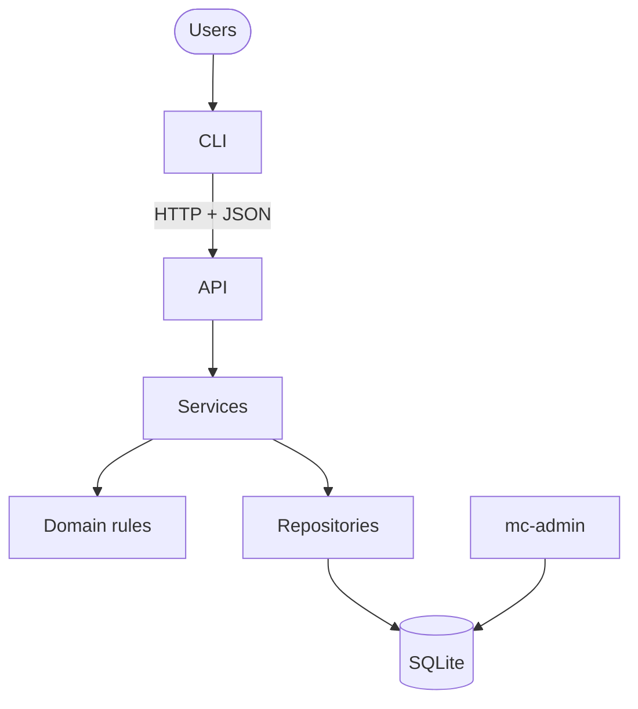
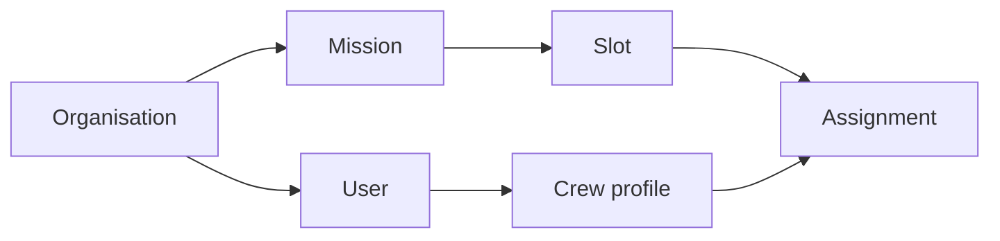
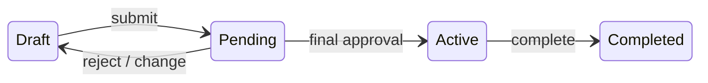
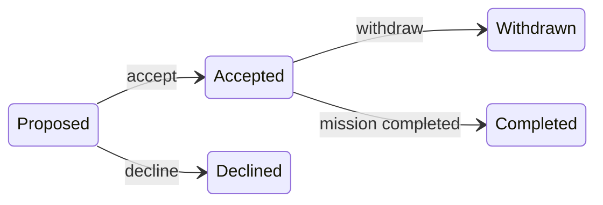
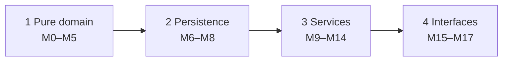

# Subagent (01): Build M10 crew in worktree

Source: `agent-aa996384c39d4b468.jsonl` · 2026-10-12 00:33:26 UTC → 2026-10-12 00:40:50 UTC

Rendered from the raw JSONL without editing message content. Tool results and thinking are collapsed; expand them to read.


---

### 👤 User · 2026-10-12 00:33:26 UTC

You are implementing module **M10 (crew service)** of the Mission Control project, in a dedicated git worktree. Two other agents are building M9 and M11 in parallel in their own worktrees.

**Work ONLY in:** `/Users/pritanbarai/Desktop/JOBS/mutinex_mission_control/.worktrees/m10-crew` (branch `m10-crew`, based on main `b7ecbba`).
- Use absolute paths, or `cd` into that directory for every command.
- NEVER touch the main checkout `/Users/pritanbarai/Desktop/JOBS/mutinex_mission_control` or the other worktrees.
- Do NOT commit, and do NOT run any git command that changes state (no add, commit, stash, rebase, checkout, reset, merge). `git status` and `git diff` are fine.
- Do NOT add dependencies.

**Read first** (inside the worktree):
- `CLAUDE.md`;
- `docs/prd.md` §3, §5.1 (definitions), §5.3 (P2–P6), §5.7 (visibility table, V2), §8 (AC-16, AC-22 to AC-24);
- `docs/technical-design.md` §2, §4 (Permissions, status codes), §5 (cross-cutting rules, skill changes), §7, §9 (Phase 3 rows and Waves), §10;
- `docs/phase-reviews.md` "Carried forward".
- Then study:
  - `src/mission_control/services/context.py` (ServiceContext, found, check, authorize_view gives 404);
  - `src/mission_control/domain/` (permissions.py, eligibility.py `invalidated_by_skill_change`, dates.py, errors.py, events.py, records.py);
  - `src/mission_control/infra/repositories/` (crew.py, facts.py `active_assignments` / `commitments`, skills.py, users.py, base.py);
  - `tests/builders.py` and `tests/integration/conftest.py` (`seeded_db`).

**FILE OWNERSHIP**
- You may create or edit:
  - `src/mission_control/services/crew.py`;
  - `src/mission_control/infra/repositories/crew.py`;
  - new test files for M10 (e.g. `tests/integration/test_crew_service.py`).
- Shared files you may only APPEND to, in a section with a comment `# M10 crew`:
  - `src/mission_control/domain/events.py`;
  - `tests/unit/domain/test_events.py` (expected set);
  - design §7 code tables (only if you introduce a code).
- Everything else is read-only, including `facts.py`, `missions.py`, `users.py`, `skills.py`, `base.py`, `context.py`, `domain/*` (except events.py) and `schema.sql`.
- If you need a change elsewhere, STOP that part and describe it in your report.

**WHAT TO BUILD** (`services/crew.py`): use-case functions taking a `ServiceContext` first, following the design's shape:
1. authorize (or `authorize_view` for reads, so refusals become 404 per TR-10);
2. load through `ctx.repos`;
3. check domain rules;
4. inside `with ctx.write():`, write and audit (`ctx.audit(Event.X, ...)`, with names in `data`).

Cover:
- **View crew:**
  - list: Directors and Leads;
  - view one profile: Directors and Leads see anyone; crew only themselves; others are 404 (VIEW_CREW).
  - the view includes skills (with names) and unavailability. **Unavailability reasons appear only to Directors and to the person themselves**; Leads see busy dates without reasons (AC-24, VIEW_UNAVAILABILITY_REASON).
  - define a small view record for this, e.g. in services/crew.py.
- **Assignment history** (VIEW_ASSIGNMENT_HISTORY; V2): summaries, including missions the person has left. Crew only see their own; others are 404.
- **Personal details** (P4, AC-16): display name and optional bio, self only (EDIT_OWN_PROFILE gives not_owner otherwise).
- **Unavailability** (P4–P6): add and remove, self only.
  - Dates validated via `DateRange`: end ≥ start; past dates are allowed.
  - Adding is refused if it overlaps one of the person's accepted assignments on an unfinished mission (P6). The refusal names the mission; use `facts.commitments`. Use the existing `overlap` code if it fits, as design §7 has it at top level and as a problem code.
  - Removing someone else's entry, or another org's, is not found.
- **Skill levels** (P2, P3, AC-23): set (1–5) or remove, by a Lead or Director, never on themselves (SET_SKILL_LEVEL gives self_skill_edit).
  - The skill must be in the caller's catalogue (other org's or missing gives NotFound).
  - A change that would break an accepted assignment on an **Active** mission is refused with `invalidates_active_assignment` (use `domain.eligibility.invalidated_by_skill_change` and `facts.active_assignments`).
  - Changes affecting only Draft or Pending assignments are allowed.

Permissions use `domain/permissions.py` actions with the required Context fields (target_user_id is the profile's user id, not the crew profile id; watch for that mix-up). Refusals:
- Forbidden (403) for visible resources;
- NotFound (404) for missing, other-org or hidden;
- RuleViolation (409) for rules (`RuleViolation.of(problem)` for single-reason codes).

Messages are natural sentences from explicit phrases, naming the people and missions involved.

**CONVENTIONS:**
- No PRD IDs in `src/` (fine in tests).
- Every write inside `ctx.write()`.
- The shared `Event` enum for audit.
- `-> Generator[T]` for context managers.
- Never use `httpx`.
- Frozen dataclasses; type hints.
- Any new repository SQL uses named binding `org_id = :org` (guard test; no `?`).

**NEW CODES:** if you need an error or problem code not in §7, implement it. Append it to §7 under a `M10 crew` note, and list it in your report as **needing the user's approval**.

**WORKFLOW**
1. Tests first. Write failing tests named after PRD IDs (e.g. `test_ac24_lead_sees_fays_busy_dates_without_the_reason`, `test_p6_unavailability_over_an_accepted_assignment_is_refused`). See them fail, then implement. Use `seeded_db` (Fay has Medical leave 5–8 Mar 2027; Hana is on the Active Telescope mission needing EVA 3; Ben is crew; Ana is a Lead with a profile).
2. Run the full suite and lint in the worktree:
   - `cd .worktrees/m10-crew && uv run pytest -W error -o addopts="" -q`;
   - `uv run ruff check src tests`;
   - `uv run ruff format --check src tests`.
3. **Real verification:** a script against a fresh seeded database, acting as Lee, Ruth, Ben, Ana and Hana. Print the outcomes and messages for the main paths and refusals. Use port 8010 if you start a server.
4. **Read-only review** of your diff (`git -C <worktree> diff main` plus untracked files). List the findings; don't fix them silently.

**FINAL REPORT:**
- files changed;
- use-case functions and what each enforces, with PRD IDs;
- tests, with before (failing) and after counts;
- full-suite and ruff results;
- trimmed real-run output;
- review findings;
- new events and codes (codes flagged for approval);
- changes needed in files you don't own;
- PRD gaps.

<details>
<summary>⚙️ System/meta message · 2026-10-12 00:33:26 UTC</summary>

```
<system-reminder>
Your final report is delivered through SubagentHandback: when your work is complete, call SubagentHandback({message: <your full report>}). The call ends your run, so make it your last step. Only a SubagentHandback call reaches your caller as your result; plain text you write at the end is not delivered.
</system-reminder>
```

</details>

**🔧 Bash**

*Inspect worktree state and layout*

```bash
cd /Users/pritanbarai/Desktop/JOBS/mutinex_mission_control/.worktrees/m10-crew && git status && git log --oneline -3 && cat CLAUDE.md && ls -R src tests | head -100
```

<details>
<summary>↳ Result</summary>

```
On branch m10-crew
nothing to commit, working tree clean
b7ecbba refactor: split repositories into per-area modules
8ccb5c3 feat(sf): service foundation for Phase 3
aafba33 docs: phase review for Phase 2 (M6–M8)
# Mission Control

Multi-tenant mission planning API and CLI. Read these before doing any work. They are the source of truth, so don't copy their content here.

- [`docs/brief.md`](docs/brief.md): the assessment brief
- [`docs/prd.md`](docs/prd.md): **behaviour**. What the system does, its rules, acceptance criteria and seed scenarios.
- [`docs/technical-design.md`](docs/technical-design.md): **structure**. Architecture, schema, API, CLI, the delivery plan (§9) and the implementation guidelines (§10).

If the PRD and the design conflict, or are silent on something, stop and ask. Never invent behaviour.

## Workflow (every module)

1. **One approved module at a time.** Work only on the module from design §9 that I have approved. Don't start anything else.
2. **Tests first.** Write failing tests that reference the PRD IDs, then implement. Run the full suite and lint: `uv run pytest` and `uv run ruff check`.
3. **Real verification.** Exercise the behaviour for real, for example with a REPL call, an HTTP request or a CLI command. Show the actual output. A passing test run alone isn't verification.
4. **Read-only review.** Review the full diff against the PRD and design §10 without editing. Report findings, and fix them only once I agree.
5. **Stop for approval.** Summarise what changed, the test and verification results, and the review findings, and propose a commit message. **Don't commit, and don't start the next module, until I approve.**

## Waves (parallel modules in worktrees)

When I approve a wave of independent modules (design §9), build them in parallel and keep reviews small:

1. **One worktree per module.** Run `git worktree add .worktrees/<module> -b <module> main`, then `uv sync` inside it. Each agent edits only its own worktree and doesn't commit.
2. **Same workflow per module.** Steps 2 to 4 above still apply, inside the worktree.
3. **Review one branch at a time.** Show me only that module's diff against `main` (`git -C .worktrees/<module> diff main`, including new files), with its results.
4. **After I approve that module:**
   - commit on its branch;
   - rebase onto `main` if `main` has moved, and re-run its tests;
   - fast-forward `main`;
   - run the full suite on `main`;
   - remove the worktree and branch.

   Only then present the next branch.

Never push, add dependencies, change the schema, or add endpoints, error codes or CLI commands outside the design without asking first.
src:
mission_control

src/mission_control:
__init__.py
__pycache__
api
domain
infra
seed
services

src/mission_control/__pycache__:
__init__.cpython-312.pyc

src/mission_control/api:
__init__.py
__pycache__
app.py

src/mission_control/api/__pycache__:
__init__.cpython-312.pyc
app.cpython-312.pyc

src/mission_control/domain:
__init__.py
__pycache__
approvals.py
dates.py
eligibility.py
enums.py
errors.py
events.py
lifecycle.py
matching.py
passwords.py
permissions.py
records.py

src/mission_control/domain/__pycache__:
__init__.cpython-312.pyc
approvals.cpython-312.pyc
dates.cpython-312.pyc
eligibility.cpython-312.pyc
enums.cpython-312.pyc
errors.cpython-312.pyc
events.cpython-312.pyc
lifecycle.cpython-312.pyc
matching.cpython-312.pyc
passwords.cpython-312.pyc
permissions.cpython-312.pyc
records.cpython-312.pyc

src/mission_control/infra:
__init__.py
__pycache__
db.py
repositories
schema.sql
security.py

src/mission_control/infra/__pycache__:
__init__.cpython-312.pyc
db.cpython-312.pyc
security.cpython-312.pyc

src/mission_control/infra/repositories:
__init__.py
__pycache__
approvals.py
assignments.py
audit.py
base.py
crew.py
facts.py
missions.py
models.py
organisations.py
skills.py
users.py

src/mission_control/infra/repositories/__pycache__:
__init__.cpython-312.pyc
approvals.cpython-312.pyc
assignments.cpython-312.pyc
audit.cpython-312.pyc
base.cpython-312.pyc
crew.cpython-312.pyc
facts.cpython-312.pyc
missions.cpython-312.pyc
models.cpython-312.pyc
organisations.cpython-312.pyc
skills.cpython-312.pyc
users.cpython-312.pyc

src/mission_control/seed:
__init__.py
__pycache__
data.py
loader.py
```

</details>

**🔧 Bash**

*List services/tests and doc headings*

```bash
cd /Users/pritanbarai/Desktop/JOBS/mutinex_mission_control/.worktrees/m10-crew && ls src/mission_control/services tests tests/* && wc -l docs/*.md && grep -n "^#" docs/prd.md
```

<details>
<summary>↳ Result</summary>

```
tests/builders.py
tests/conftest.py

src/mission_control/services:
__init__.py
__pycache__
auth.py
context.py

tests:
__pycache__
api
builders.py
conftest.py
integration
unit

tests/__pycache__:
builders.cpython-312.pyc
conftest.cpython-312-pytest-9.1.1.pyc

tests/api:
__pycache__
test_health.py

tests/integration:
__pycache__
conftest.py
test_auth.py
test_db.py
test_facts.py
test_repositories.py
test_repository_sql.py
test_repository_writes.py
test_schema_constraints.py
test_seed.py
test_service_context.py

tests/unit:
domain
      76 docs/brief.md
     104 docs/phase-reviews.md
     338 docs/prd.md
     847 docs/technical-design.md
    1365 total
1:# Mission Control — Product Requirements (v1)
7:## 1. Problem and goals
20:## 2. Requirements from the brief
33:## 3. Users and roles
45:## 4. Main workflows (all available through the CLI)
60:## 5. Business rules
62:### 5.1 Definitions
73:### 5.2 Tenancy and identity
79:### 5.3 People and skills
100:### 5.4 Missions and lifecycle
133:### 5.5 Approval
141:### 5.6 Assignments
155:### 5.7 Visibility and audit
169:## 6. Auto-matching
197:## 7. CLI requirements
204:## 8. Acceptance criteria
257:## 9. Seed data and scenarios
261:### 9.1 Aurora Space Agency (N = 2)
289:### 9.2 Helix Orbital (N = 1)
297:### 9.3 Scenarios
312:## 10. Test plan
325:## 11. Out of scope
```

</details>

**🔧 Bash**

*Read the PRD*

```bash
cd /Users/pritanbarai/Desktop/JOBS/mutinex_mission_control/.worktrees/m10-crew && cat docs/prd.md
```

<details>
<summary>↳ Result</summary>

````
# Mission Control — Product Requirements (v1)

**Status:** Agreed · **Source of truth:** [`brief.md`](brief.md) · **Next:** technical design (frameworks, schema, API and CLI design)

Rules tagged **[B]** come from the brief. Everything untagged is a product decision made while resolving the brief's open questions.

## 1. Problem and goals

Crew assignment is manual and error-prone. Leads cross-reference skills, availability and existing commitments by hand. **[B]** Mission Control is a multi-tenant B2B platform for managing missions and crew, with an auto-matcher that suggests crew. **[B]**

v1 succeeds when:

1. A Lead can take a mission from requirements to an active, confirmed roster entirely through the CLI.
2. Matcher suggestions never break a hard rule and are deterministic.
3. The system enforces the approval rules.
4. No read or write can reach another organisation's data.

**How we'll know:** every acceptance criterion in §8 passes as an automated test against the seed data in §9.

## 2. Requirements from the brief

- R1: Organisations are tenants. All data is scoped to one organisation and never leaks across tenants.
- R2: Three roles: Director, Mission Lead, Crew Member.
- R3: Leads can't approve their own missions.
- R4: Missions have requirements, a timeline, and a lifecycle with approval before going active.
- R5: Crew have skill profiles, availability and assignment history.
- R6: Assignments connect crew to missions, and crew respond to them.
- R7: An auto-matcher suggests crew based on skills, availability and workload.
- R8: Organisations differ in crew size, skill taxonomy and approval process.
- R9: A multi-tenant API, plus a CLI for the main workflows. CLI usability is assessed.
- R10: Runs locally with seed data.

## 3. Users and roles

| Role | Responsibilities |
|---|---|
| **Director** | Manages users, roles, crew profiles, the skill catalogue and the approval setting. Creates missions for a Lead. Approves or rejects missions. Reassigns owners. Sees everything in their organisation. |
| **Mission Lead** | Owns missions. Defines slots, runs the matcher, proposes crew, submits. Maintains other people's skill levels. Reads all missions and crew profiles. |
| **Crew Member** | Manages own personal details and unavailability. Accepts, declines or withdraws from assignments. Sees only their own data and the missions they're on. |

- Each user belongs to exactly one organisation. The organisation is taken from the user's identity, never from the request.
- Each user has exactly one role, which controls permissions.
- Taking part in missions depends on a separate **crew profile**. Every Crew Member has one, and Leads and Directors may have one too.

## 4. Main workflows (all available through the CLI)

1. **Sign in** with email and password, and change your own password. See what needs attention: pending assignments, approvals waiting on me, my missions.
2. **Director admin:** manage users and roles, crew profiles, the skill catalogue, and the number of approvals required.
3. **Lead or Director:** set crew skill levels (1–5).
4. **Crew profile holder:** maintain personal details and unavailability.
5. **Create a mission:** name, dates, and role slots with required skills.
6. **Owning Lead:** run the matcher, review the suggested roster, apply it or propose crew by hand.
7. **Crew:** accept or decline proposals, and withdraw if needed.
8. **Owning Lead:** submit a fully accepted roster for approval.
9. **Eligible Directors:** approve or reject. The final approval activates the mission.
10. **Owning Lead or Director:** complete or cancel a mission.
11. **Director:** reassign a mission's owning Lead.
12. **View history:** mission history and crew assignment history.

## 5. Business rules

### 5.1 Definitions

| Term | Meaning |
|---|---|
| **Open assignment** | An assignment that is Proposed or Accepted. |
| **Open places** | A slot's headcount minus its open assignments. |
| **Mission-days** | The number of days from the start date to the end date, counting both. |
| **Overlap** | Two date ranges overlap if they share at least one calendar day. Dates have no time and no time zone. |
| **Eligible (crew for a slot)** | The person is active, has a crew profile, and has every required skill at or above its minimum level. They have no unavailability overlapping the mission, and no accepted assignment on another non-final mission that overlaps it. |
| **Eligible approver** | An active Director who did not create the mission and is not on its roster. |

### 5.2 Tenancy and identity

- **T1** Every record belongs to one organisation. Every read and write is limited to the caller's organisation. **[B]**
- **T2** Naming a resource from another organisation gives the same response as naming one that doesn't exist ("not found").
- **T3** Organisations are created only through seed data or an operator command. There is no self-service signup.

### 5.3 People and skills

- **P1** Each organisation has its own flat skill catalogue, managed by Directors. Skills with the same name in different organisations are unrelated.
  - Directors can rename a skill. Its identity stays the same.
  - Directors can delete a skill only if no crew skill or slot requirement uses it.
- **P2** Proficiency is an integer from 1 to 5.
- **P3** Leads and Directors set and remove skill levels. **Nobody can change their own levels.**
  - A skill change is allowed even if it makes someone ineligible for an assignment on a Draft or Pending mission. Eligibility is checked again at acceptance, submission and approval.
  - A skill change that would make someone ineligible for their assignment on an Active mission is refused.
- **P4** Crew profile holders manage their own personal details and unavailability. Nobody else edits them. Personal details are a display name and an optional bio.
- **P5** Crew are available by default. Unavailability is a date range with a reason.
- **P6** A crew member can't record unavailability that overlaps one of their accepted assignments.
- **P7** Users are deactivated, never deleted. Deactivated users can't sign in, aren't eligible for matching, and keep their history. Deactivation is refused while the user:
  - has open assignments; or
  - owns non-final missions. The same applies to changing a mission owner's role away from Lead. Their missions must be reassigned first.
- **P8** An organisation must always have at least one active Director.
- **P9** Crew profiles survive role changes and can't be deleted. Changing a user's role to Crew Member gives them a profile if they don't already have one.
- **P10** Directors set a new user's initial password. Users change their own password by entering their current one. There's no email or password-recovery flow.
  - Passwords must be at least 15 characters. Passphrases are welcome, and uppercase letters, numbers and symbols aren't required.
  - Changing a password ends all of that user's sessions, including the one used to change it.

### 5.4 Missions and lifecycle

- **M1** A mission has a name, a date range, one owning Lead and a separately recorded creator.
  - Leads create missions for themselves. Directors create them on behalf of a Lead.
  - Only Mission Leads can own missions.
  - Directors can transfer ownership of a non-final mission to another active Lead in the same organisation. If the mission is Pending, it returns to Draft and its approvals are cleared.
- **M2** A mission has one or more slots. Each slot has a name, a headcount of at least 1, and at least one required skill with a minimum level. Dates may be in the past, but the end date must be on or after the start date. The same rule applies to unavailability.
- **M3** Only the owning Lead can edit a mission, propose or remove crew, apply matcher results, or submit.

```
         submit                N-th approval                complete
 Draft ─────────▶ Pending ───────────────────▶ Active ─────────────▶ Completed
   ▲              Approval
   └── reject (reason) / any change ──┘
 Draft | Pending Approval | Active ──cancel (reason)──▶ Cancelled
```

| Transition | Who | Conditions and effects |
|---|---|---|
| Draft → Pending Approval | Owning Lead | All of these must hold: every slot is full, every assignment is Accepted, every rostered crew member is still eligible, and there are at least N eligible approvers. Otherwise the submission is refused with a list of the problems. |
| Pending → Active | The N-th distinct eligible approver | The roster is checked again at each approval. If the check fails, the approval is refused and the mission stays Pending, unchanged. |
| Pending → Draft | Eligible Director (reject) or system | A rejection needs a reason. Any change to dates, slots, roster or owner, including a crew withdrawal, also sends the mission back to Draft. Approvals are cleared, and remaining accepted assignments stay accepted. |
| Active → Completed | Owning Lead or Director | Accepted assignments become Completed. |
| Any non-final → Cancelled | Owning Lead or any Director | Reason required. Open assignments become Cancelled. |

- **M4** Draft missions can have unfilled places and unanswered proposals.
- **M5** Once a mission is Active, its dates, requirements and roster are frozen. Only completion or cancellation are allowed.
- **M6** Dates never trigger transitions on their own. There is no scheduler.
- **M7** An edit is refused if it would invalidate an open assignment. The response lists the affected crew, and the Lead must remove them first. Crew are never removed automatically. Edits that invalidate an assignment are:
  - removing a slot that has open assignments;
  - lowering a slot's headcount below its open assignments;
  - changing dates or requirements so that an assigned person is no longer eligible.

### 5.5 Approval

- **A1** Each organisation sets the number of approvals required (N ≥ 1). The approvals must come from N distinct eligible approvers.
  - N is fixed for a mission when it's submitted. Later changes to the setting don't affect a round already in progress.
  - An approval already given still counts if that Director is later deactivated or demoted.
- **A2** Leads can't approve anything, which satisfies R3. **[B]** A Director can't approve a mission they created or are rostered on.
- **A3** Each Director approves a round at most once. A single rejection ends the round.

### 5.6 Assignments

```
Proposed ──accept──▶ Accepted ──withdraw (reason)──▶ Withdrawn
   ├──decline──▶ Declined   └──removed by Lead──▶ Removed
   └──retracted by Lead──▶ Removed
Accepted ──mission completed──▶ Completed;  open ──mission cancelled──▶ Cancelled
```

- **S1** The owning Lead can propose only eligible crew. A person can hold at most one open assignment per mission. A slot can't have more open assignments than its headcount. A Lead can propose themselves, but they must be eligible and must accept like anyone else.
- **S2** Crew can accept only while the mission is in Draft and they're still eligible. Accepted assignments block overlapping dates. Proposals don't block anything.
- **S3** Declining takes an optional reason. Withdrawing needs a reason and is allowed only in Draft or Pending Approval.
- **S4** Every assignment needs the crew member's acceptance. Crew can't be placed on a mission directly.

### 5.7 Visibility and audit

| | Crew | Lead | Director |
|---|---|---|---|
| Own profile, skills, availability, assignments | ✓ | ✓ | ✓ |
| Missions they're on, with teammates' names and slots | ✓ | ✓ | ✓ |
| Other crew members' profiles, skills, busy/free dates | ✗ | ✓ | ✓ |
| Other people's *reasons* for unavailability | ✗ | ✗ | ✓ |
| All missions in the organisation | ✗ | read (edit own) | read |
| Users, catalogue management, organisation settings | ✗ | read catalogue | manage |

- **V1** Every state change, approval, rejection and assignment response is recorded with who did it, when, and any reason. Anyone who can see the mission can see this history.
- **V2** Former assignees see a summary of the mission in their own assignment history. They don't get full access to the mission unless their role allows it. Former assignees are people whose assignment was declined, withdrawn, removed or cancelled.

## 6. Auto-matching

The matcher only advises. It suggests crew for a Draft mission's open places and changes nothing. The owner or a Director can preview a suggestion. When the owning Lead applies it, it creates Proposed assignments, which crew still have to accept.

**Candidates.** Active crew profiles in the mission's organisation only. Crew who already have an open assignment on this mission, or who declined or withdrew from it, are left out.

**Workload.** The total mission-days of a crew member's accepted assignments on missions that are not Completed, leaving out the mission being matched.

**Algorithm**

1. **Filter.** For each slot with open places, keep the candidates who are eligible (§5.1).
2. **Pick the most constrained slot.** Choose the slot with the fewest remaining eligible candidates. Ties go to the slot listed first.
3. **Fill one place in that slot.** Rank candidates by:
   1. lowest workload;
   2. then highest proficiency, meaning the sum of their levels across the slot's required skills;
   3. then stable identifier, ascending.
4. **Remove the chosen person** from every other slot's candidates.
5. **Repeat** from step 2 until every place is filled or has no candidates left.

**Output.** A suggested roster with no one in two slots. Places without a candidate are marked **unfilled**. The same inputs always give the same output.

**Why:**
- Filling the most constrained slot first stops a versatile person from being spent on a slot that's easy to fill.
- Ranking by lowest workload spreads missions across crew.
- Proficiency only breaks ties, because everyone left already meets the requirement.

**Known limitation:** this is a greedy heuristic. It can occasionally leave a place unfilled when a complete roster exists. That's acceptable for an advisory tool, and the Lead can still propose by hand.

## 7. CLI requirements

- **C1** Every workflow in §4 can be carried out from the CLI. **[B]**
- **C2** Refusals explain why in domain terms, for example "Gus has an accepted assignment on *Station Reboost* overlapping 1–2 Mar". Where possible they also say what to do next.
- **C3** Output is readable by people by default, with a machine-readable option for scripts and tests.
- **C4** Actions that send a mission back to Draft, or cancel it, warn before running.

## 8. Acceptance criteria

Each criterion starts from a fresh seed. Scenario numbers (S-) refer to §9.3.

**Mission workflow**

- **AC-1** The golden path (S1) ends Completed, and every transition appears in the history with who did it and when.
- **AC-2** Submission is refused while any place is unfilled or any proposal is unanswered. The refusal lists them.
- **AC-3** Approvals before the N-th leave the mission Pending. The N-th approval makes it Active.
- **AC-4** Changing the dates, slots or roster of a Pending mission sends it back to Draft and clears its approvals. So does a crew withdrawal (S5).
- **AC-5** On an Active mission, edits, proposals, removals and withdrawals are refused. Completion and cancellation succeed.
- **AC-6** Cancelling needs a reason. The owning Lead or any Director can cancel, and any other Lead is refused. Open assignments become Cancelled.
- **AC-7** Only the owning Lead can edit, propose, apply or submit. After a Director reassigns the owner, the new owner can and the previous owner can't.

**Approval restrictions**

- **AC-8** The mission's creator can't approve it. In S1, Ruth is refused.
- **AC-9** Leads and Crew can't approve or reject.
- **AC-10** A Director can't approve the same round twice. Rejecting needs a reason and clears earlier approvals (S6).
- **AC-11** A Director rostered on a mission can't approve it.
- **AC-12** Submission is refused when there are fewer than N eligible approvers, not counting the creator or rostered Directors (S7).
- **AC-13** In Helix (N = 1), a single approval makes the mission Active (S8).

**Overlaps and availability**

- **AC-14** Proposing someone who is unavailable, or who has an overlapping accepted assignment, is refused. In S4, both Fay and Gus are refused.
- **AC-15** Overlapping proposals are allowed. Accepting one that overlaps an accepted assignment is refused, and the refusal names the conflicting mission (S4, Chen).
- **AC-16** Recording unavailability that overlaps an accepted assignment is refused.
- **AC-17** Two ranges that share only a boundary day overlap.

**Matching**

- **AC-18** S2 gives exactly the expected roster on every run.
- **AC-19** S3 marks Geologist as unfilled. S3b shows a new accepted assignment changing the suggestion.
- **AC-20** Workload counts only accepted assignments on missions that aren't Completed. Chen's workload is 5, not 35.
- **AC-21** The suggestion never puts one person in two slots. It never includes anyone who is ineligible, from another organisation, or already excluded from this mission.
- **AC-22** Running the matcher changes nothing. Applying it creates Proposed assignments.

**Roles and visibility**

- **AC-23** Ana can't change her own skill levels, but Lee can change hers. Ben can't edit skills, but he can edit his personal details and unavailability.
- **AC-24** Lee sees Fay as busy 5–8 Mar but doesn't see the reason. Ruth sees the reason. Ben can't view Fay's profile, and his mission list shows only missions he's on.
- **AC-25** Leads can't manage users, the catalogue or the approval setting.
- **AC-26** Deactivating someone with open assignments is refused. A deactivated user can't sign in. The last active Director can't be deactivated or demoted.

**Tenant isolation (S9)**

- **AC-27** Requesting another organisation's mission, crew member, user, skill or assignment by ID gives the same response as an ID that doesn't exist.
- **AC-28** Every list contains only the caller's organisation's records.
- **AC-29** Any write that references another organisation's ID fails as "not found", and neither organisation's data changes.
- **AC-30** Approving or rejecting another organisation's mission fails as "not found".
- **AC-31** Helix's Kai (Piloting 5, no commitments) is never suggested for an Aurora mission.

## 9. Seed data and scenarios

The table order of people is their stable-identifier order. All dates are in 2027 unless stated.

### 9.1 Aurora Space Agency (N = 2)

| Person | Role | Crew skills | Commitments (workload) |
|---|---|---|---|
| Ruth Adeyemi | Director | — | — |
| Marco Bianchi | Director | Flight Medicine 4 | Medical Study, accepted (4) |
| Ingrid Holm | Director | — | — |
| Lee Park | Lead | — | — |
| Nora Quinn | Lead | — | — |
| Ana Okafor | Lead | Piloting 5, Leadership 4, Systems Eng 4 | none (0) |
| Ben Ito | Crew | Systems Eng 4, EVA 3 | Deep Space Comms, accepted (20) |
| Chen Wu | Crew | Systems Eng 3 | Telescope (5). Mars Analog Completed, so it doesn't count |
| Dana Reyes | Crew | EVA 4 | Telescope (5) |
| Eli Novak | Crew | EVA 4, Piloting 4, Leadership 2 | Telescope (5) |
| Fay Moreau | Crew | Piloting 4, Leadership 4 | Unavailable 5–8 Mar (Medical) |
| Gus Patel | Crew | Systems Eng 5 | Station Reboost, accepted (6) |
| Hana Sato | Crew | EVA 3, Geology 2 | Telescope (5) |

| Mission | Owner / creator | Dates | State | Slots → crew |
|---|---|---|---|---|
| Lunar Gateway Resupply | Lee / Ruth | 1–10 Mar | Draft | Flight Engineer ×1 (Sys Eng ≥3) · Mission Specialist ×1 (EVA ≥3) · Commander ×1 (Piloting ≥4, Leadership ≥3) — no crew |
| Asteroid Survey | Nora | 5–12 Mar | Draft | Pilot ×1 (Piloting ≥4) · Geologist ×1 (Geology ≥4) — no crew |
| Station Reboost | Nora | 25 Feb – 2 Mar | Draft | Engineer ×2 (Sys Eng ≥3) — Gus accepted, 1 open place |
| Lunar Surface Medical Study | Nora / Ruth | 15–18 Mar | Draft | Flight Surgeon ×1 (Flight Medicine ≥4) — Marco accepted |
| Orbital Telescope Service | Lee | 10–14 Jan | Active | Engineer ×1 — Chen · EVA Specialist ×3 (EVA ≥3) — Dana, Eli, Hana |
| Deep Space Comms Upgrade | Nora | 1–20 Apr | Pending (Marco approved) | Engineer ×1 (Sys Eng ≥3) — Ben |
| Mars Analog Habitat | Lee | 1–30 May 2026 | Completed | Engineer ×1 — Chen |

### 9.2 Helix Orbital (N = 1)

People: Sam Rivera (Director), Priya Nair (Lead), and Crew Kai Tanaka (Piloting 5), Lena Fischer (Payload Integration 4), Omar Haddad (Field Medicine 4) and Tess Moreno (Life Support 3). Helix has its own catalogue, including a separate "Piloting" skill.

| Mission | Owner | Dates | State | Slots → crew |
|---|---|---|---|---|
| Payload Demo 1 | Priya | 1–3 Feb | Draft | Payload Specialist ×1 (Payload Int ≥3) — Lena accepted · Medic ×1 (Field Medicine ≥3) — Omar accepted |

### 9.3 Scenarios

| # | Steps | Expected outcome |
|---|---|---|
| **S1** | Lee matches and applies *Lunar Gateway Resupply* → Ana, Chen and Dana accept → Lee submits → Ruth approves → Marco approves → Ingrid approves → Lee completes | Proposed crew are Ana, Chen and Dana. Ruth is refused as creator. After Marco the mission is Pending (1/2). After Ingrid it's **Active**. Completing makes the assignments Completed. |
| **S2** | Match *Lunar Gateway Resupply* | Eligible crew: Commander {Ana}, because Fay is unavailable and Eli's Leadership is too low. Flight Engineer {Ana, Ben, Chen}, because Gus has an overlap. Specialist {Ben, Dana, Eli, Hana}. **Commander → Ana** (most constrained). **Flight Engineer → Chen** (workload 5 vs Ben's 20). **Specialist → Dana** (four-way workload tie at 5; Hana loses on proficiency; Dana beats Eli on ID). Filling the slots in listed order would have spent Ana on Flight Engineer and left Commander unfilled. |
| **S3** | Match *Asteroid Survey* | Geologist **unfilled** (Hana's Geology is only 2). Pilot → Ana (workload 0 vs Eli's 5; Fay unavailable). |
| **S3b** | S1 up to acceptance, then match *Asteroid Survey* | Ana is blocked by her overlapping accepted assignment, so Pilot → Eli. Geologist still unfilled. |
| **S4** | Lee proposes Gus and Fay for *Gateway*. Nora proposes Chen for *Station Reboost* and Lee proposes Chen for *Gateway*. Chen accepts *Station Reboost*, then *Gateway*. | Gus refused (overlap). Fay refused (unavailable). Both Chen proposals succeed. Chen's second acceptance is refused, naming *Station Reboost*. |
| **S5** | Ben withdraws from *Deep Space Comms* without a reason, then with one. Hana withdraws from *Telescope*. | Ben's first attempt is refused. The second succeeds: the mission returns to Draft and Marco's approval is cleared. Hana is refused because *Telescope* is Active. |
| **S6** | Marco approves *Deep Space Comms* again. Ingrid rejects it without a reason, then with one. | Marco is refused. Ingrid's first attempt is refused. The second sends the mission to Draft and clears approvals. |
| **S7** | Nora submits *Lunar Surface Medical Study* | Refused. Ruth created it and Marco is rostered, which leaves 1 eligible approver (Ingrid) when 2 are needed. |
| **S8** | Priya submits *Payload Demo 1* and Sam approves | **Active** after one approval. |
| **S9** | Each role in each organisation tries to read, list, write and approve the other organisation's resources, and matches an Aurora Piloting slot | Every attempt fails as "not found" and nothing changes. Lists show only the caller's organisation. Kai never appears. |

## 10. Test plan

Every acceptance criterion maps to at least one automated test.

| Level | Covers |
|---|---|
| Unit: matcher (pure function) | Eligibility, workload, most-constrained-first, each tie-break, no person in two slots, unfilled places, determinism. Includes S2, S3 and a small hand-built case per rule. |
| Unit: lifecycle and rules | Every allowed transition and a sample of disallowed ones. Approver eligibility and the N count. Revert-to-Draft clearing approvals. The Active freeze. Overlap at boundary days. |
| API: permissions | A role × action table, checking each role is allowed or refused as expected. |
| API: tenant isolation | Every endpoint, for reads, lists and writes, tried with the other organisation's IDs. A route-inventory test makes any new endpoint fail CI until it's added to this sweep. |
| API: scenarios | S1 and S3b–S8 against a freshly seeded database. |
| CLI end to end | S1 and S4 run through the real CLI, checking machine-readable output and the wording of refusals. |

## 11. Out of scope

- Web UI.
- Self-service organisation signup, users in more than one organisation, SSO.
- Password recovery and email flows. Deleting crew profiles.
- Delivering notifications. The CLI's "needs attention" views replace them.
- Certifications, skill expiry, skill verification, skill hierarchies.
- Recurring availability, scheduling finer than a day, rest periods between missions.
- Conditional or multi-stage approvals.
- Assigning crew without their acceptance, response deadlines.
- Matcher extras: preferred skills, experience scoring, configurable weights, near-miss and exclusion lists, suggestions to relax requirements, LLM matching.
- Date-driven transitions. Roster changes once a mission is Active.
- Equipment and resource constraints. Keep slot requirements extensible so these can be added later.
- Billing, bulk import.
````

</details>

**🔧 Bash**

*Design doc headings*

```bash
cd /Users/pritanbarai/Desktop/JOBS/mutinex_mission_control/.worktrees/m10-crew && grep -n "^#" docs/technical-design.md
```

<details>
<summary>↳ Result</summary>

```
1:# Mission Control — Technical Design (v1)
24:## 1. Summary
43:## 2. Architecture
95:## 3. Data model
130:## 4. Security and tenancy
132:### Authentication
141:### Permissions
169:### Tenant isolation
181:## 5. Lifecycle
183:### Mission
205:### Assignment
228:### Cross-cutting rules
240:## 6. Matching
308:## 7. API
316:#### Auth and me
325:#### Organisation, users and skills (Directors)
335:#### Crew
345:#### Missions
358:#### Assignments
365:#### Errors
406:## 8. CLI
420:# Everyone
425:# Leads
431:# Directors
440:## 9. Delivery plan
504:## 10. Guidelines for implementing agents
506:### Source of truth
511:### The loop for each module
520:### Working in waves (worktrees)
529:### Architecture rules (never break these)
537:### Coding conventions
543:### Testing conventions
548:### Stop and ask before
556:## 11. Setup and testing
581:## Appendix A: Schema SQL
592:### Organisations, users and sessions
630:### Crew, skills and availability
684:### Missions, slots and requirements
738:### Assignments, approvals and audit
811:## Appendix B: Trade-offs and considerations
815:### B.1 Key decisions
832:### B.2 Risks
842:### B.3 Scaling path (not in v1)
```

</details>

**🔧 Bash**

*Read design §1-§5*

```bash
cd /Users/pritanbarai/Desktop/JOBS/mutinex_mission_control/.worktrees/m10-crew && sed -n 1,240p docs/technical-design.md
```

**🔧 Bash**

*Read design §7-§10, crew schema and phase reviews*

```bash
cd /Users/pritanbarai/Desktop/JOBS/mutinex_mission_control/.worktrees/m10-crew && sed -n 308,560p docs/technical-design.md && sed -n 630,684p docs/technical-design.md && cat docs/phase-reviews.md
```

<details>
<summary>↳ Result</summary>

````
# Mission Control — Technical Design (v1)

> **Status:** Agreed · **Implements:** [`prd.md`](prd.md) · **Audience:** the engineering team and the coding agents implementing v1
>
> The PRD defines *what* the system does. This document defines *how* we build it, *why* we chose this approach, and *in what order* we deliver it. IDs such as P3, M7 or AC-15 refer to the PRD.

**Contents**
1. [Summary](#1-summary)
2. [Architecture](#2-architecture)
3. [Data model](#3-data-model)
4. [Security and tenancy](#4-security-and-tenancy)
5. [Lifecycle](#5-lifecycle)
6. [Matching](#6-matching)
7. [API](#7-api)
8. [CLI](#8-cli)
9. [Delivery plan](#9-delivery-plan)
10. [Guidelines for implementing agents](#10-guidelines-for-implementing-agents)
11. [Setup and testing](#11-setup-and-testing)
- [Appendix A: Schema SQL](#appendix-a-schema-sql)
- [Appendix B: Trade-offs and considerations](#appendix-b-trade-offs-and-considerations)

---

## 1. Summary

**What we're building.** A multi-tenant API and CLI for planning space missions:
- organisations manage crew and their skills;
- Leads define missions and get crew suggestions from a deterministic matcher;
- Directors approve missions before they go active.

**Design principles**

1. **Business rules live in one place.** All rules are pure functions in `domain/`, so they're easy to test and shared by every entry point.
2. **Tenant isolation in depth.** Identity, queries, database constraints and tests each block cross-tenant access independently.
3. **The CLI is just a client.** It uses the same API as any other client, so the API is the only place behaviour is enforced.
4. **Simple to run, simple to reason about.** One process, one SQLite file, no background jobs.
5. **Test-first.** Every module begins with failing tests derived from PRD acceptance criteria.

**Non-goals for v1:** web UI, horizontal scaling, notifications, background scheduling, SSO, migrations tooling. See [Appendix B](#appendix-b-trade-offs-and-considerations) for the trade-offs and what we'd change at scale.

---

## 2. Architecture

**Stack:** Python 3.12 · FastAPI + Pydantic v2 · SQLite through stdlib `sqlite3` · argon2-cffi · Typer + httpx2 · uv, pytest, ruff

**Dependency policy:** don't use `httpx` anywhere, including tests. Use `httpx2`, which Starlette's `TestClient` now expects.

Why SQLite, hand-written SQL, and a CLI that goes through the API: [TR-1](#tr-1), [TR-2](#tr-2), [TR-4](#tr-4).



| Layer | Folder | Responsibility | May depend on |
|---|---|---|---|
| CLI | `cli/` | Commands, output, prompts | API over HTTP only |
| API | `api/` | Validate input, resolve `Actor`, call a service, map errors | services |
| Services | `services/` | One use case = one transaction + audit | domain, infra |
| Domain | `domain/` | Every business rule, pure (no I/O) | nothing |
| Infra | `infra/` | Connections, schema, scoped repositories, security | domain types |

**How a request flows** (example: `mc missions submit 12`)

1. The CLI sends `POST /api/v1/missions/12/submit` with the bearer token.
2. The API resolves the token to an `Actor` (user, organisation, role) and calls `services.missions.submit(actor, 12)`.
3. The service opens `BEGIN IMMEDIATE` and loads the mission through `Repos(conn, actor.org_id)`.
4. `domain.lifecycle.check_submit(...)` returns a list of problems. If the list is empty, the service writes the new status and an audit event, then commits.
5. The API returns `200` with the mission, or `409` with every problem. The CLI prints one bullet per problem and exits with code `1`.

<details><summary>Folder layout</summary>

```
src/mission_control/
  domain/    dates  enums  errors  eligibility  matching  lifecycle  approvals  permissions  passwords  records
  infra/     db  schema.sql  security  repositories/
  services/  auth  admin  crew  missions  assignments  approvals  matching  audit  inbox
  api/       app  deps  errors  schemas/  routers/
  cli/       main  client  config  render  resolve  commands/
  seed/      data  loader
  admin_cli.py        # mc-admin: init-db, seed, create-org
tests/  unit/  integration/  api/  cli/  builders.py  conftest.py
```
</details>

---

## 3. Data model

The core entities are below. Skills, unavailability, approvals, tokens and the audit log hang off these. All 13 tables are in [Appendix A](#appendix-a-schema-sql).



**Tenant safety.** Every tenant table has `org_id` and `UNIQUE (org_id, id)`. Every reference between tenant rows includes `org_id`, so the database itself rejects links across organisations. Why a shared database: [TR-3](#tr-3).

| Enforced by the database | Enforced by services |
|---|---|
| Value ranges and valid dates | Eligibility and overlaps |
| Cross-organisation links rejected | Open places |
| One open assignment per person per mission | State transitions |
| A slot belongs to its mission | Permissions and the owner's role |
| Reasons for withdrawals and rejections | At least one requirement per slot |
| Append-only audit log; used skills can't be deleted | |

**Modelling choices**
- **Approval rounds.** Submit sets `round += 1` and saves N in `approvals_required`. Only approvals in the current round count, and none are ever deleted ([TR-9](#tr-9)).
- **Soft-deleted slots.** `removed_at` keeps the history of past assignments.
- **Nothing derived is stored.** Workload, eligibility, open places and the roster are computed when needed ([TR-7](#tr-7)).
- **Integer IDs** keep CLI commands short ([TR-12](#tr-12)).
- **History survives renames.** Audit `data` keeps the names that applied at the time.
- **"On a mission"** means holding an open or completed assignment. Any other status gives summary access only (V2).

---

## 4. Security and tenancy

### Authentication

| | |
|---|---|
| Token | 32 random bytes. Only the SHA-256 hash is stored. 12-hour expiry. |
| Every request | Token → valid? → user active? → `Actor(user_id, org_id, role, crew_profile_id)`. Nothing is cached, so role changes apply immediately. |
| Revocation | Logout revokes that token. Deactivation or a password change revokes every token. Opaque tokens make this immediate ([TR-5](#tr-5)). |
| Passwords | Argon2id. At least 15 characters. No character-type rules. |

### Permissions

Each **role** sets the baseline:

| Role | Can | Can't |
|---|---|---|
| **Director** | Run the organisation: users, roles, skills, approval setting. See everything. Approve, transfer, complete and cancel missions. | Edit mission details, since that's the owner's job |
| **Lead** | Create and run their own missions. Rate other people's skills. See all crew and missions. | Approve anything. Touch missions they don't own. |
| **Crew** | Manage their own profile and availability. Respond to their own assignments. | See other crew, or missions they aren't on |

On top of the role, **relationship rules** make the decisions that matter:

| Rule | Effect | PRD |
|---|---|---|
| **Owner only** | Only the mission's owner edits it, proposes crew, applies the matcher or submits | M3 |
| **Not yourself** | Nobody sets their own skill levels | P3 |
| **Eligible approver** | A Director can't approve a mission they created or are on | A2 |
| **Self only** | Only you edit your details and availability. Only you, and Directors, see your unavailability reasons. | P4, §5.7 |
| **Visibility** | Crew only see missions they're on. Former assignees see a summary. | V2 |

**Enforcement.** `domain/permissions.authorize(actor, action, ctx)` is the single entry point. The complete action × role table is the parametrized test for this module, and that test is the source of truth.

| Status | When |
|---|---|
| **401** | Authentication failed |
| **404** | Missing, another organisation's, or not visible. All three look identical ([TR-10](#tr-10)). |
| **403** | Visible, but you're not allowed to do this |

### Tenant isolation

1. **Identity.** `org_id` comes only from the token, never from the request.
2. **Repositories.** `Repos(conn, org_id)` scopes every query. Another organisation's ID behaves as missing.
3. **Database.** Composite `(org_id, id)` foreign keys.
4. **Tests.**
   - An SQL lint checks every query mentions `org_id`.
   - A route inventory makes sure no endpoint is left out of the isolation tests.
   - A cross-organisation sweep compares database snapshots before and after.

---

## 5. Lifecycle

### Mission



Any state before Completed can also be **cancelled**.

| Action | Who | Must be true | Effect |
|---|---|---|---|
| submit | owner | Slots full, all accepted, roster eligible, eligible approvers ≥ N | `round += 1`, N saved |
| approve | eligible Director | Hasn't decided this round. Roster eligible. | Active once N is reached. **If a check fails, nothing is written.** |
| reject | eligible Director | Reason given | → Draft |
| transfer | Director | New owner is an active Lead | Pending → Draft. Active stays Active. |
| complete | owner or Director | Mission is Active | Accepted assignments → completed |
| cancel | owner or Director | Reason given | Open assignments → cancelled |

### Assignment



The owner can also **remove** an open assignment. Cancelling the mission **cancels** every open assignment.

| Action | Who | Mission must be | Notes |
|---|---|---|---|
| propose | owner | Draft or Pending* | Person eligible, place open, not already on this mission |
| accept | crew member | Draft | Still eligible. An overlap names the conflicting mission. |
| decline | crew member | Draft | Reason optional |
| withdraw | crew member | Draft or Pending* | Reason required |
| remove | owner | Draft or Pending* | |

\* Sends a Pending mission back to Draft.

### Cross-cutting rules

| Rule | How it's implemented |
|---|---|
| **Back to Draft** | Every mutating service calls `touch_for_change()` first. Draft → no change. Pending → Draft. Active → `mission_frozen`. Final → `mission_final`. |
| **Edits can't break assignments (M7)** | `invalidated_by()` checks slot removal, headcount, requirements and dates → `invalidates_assignments` |
| **Skill changes (P3)** | Allowed. Refused only if they'd break an **Active** assignment → `invalidates_active_assignment` |
| **Audit** | Written in the same transaction as the change. Refused actions write nothing. |
| **Transactions** | One connection per request. `foreign_keys=ON`. `busy_timeout=5000`. `BEGIN IMMEDIATE` *before* checks. Roll back on error. Lock timeout → 503 `busy`. ([TR-11](#tr-11)) |

---

## 6. Matching
````

</details>

<details>
<summary>↳ Result</summary>

````
## 7. API

**Conventions**
- REST and JSON, under `/api/v1`.
- Authentication with the header `Authorization: Bearer <token>`.
- Lifecycle changes are explicit `POST` commands, for example `/submit`. They are never `PATCH status`, because each one has its own guards and audit event ([TR-8](#tr-8)).
- List endpoints return only what the caller is allowed to see.

#### Auth and me
| Method | Path | Purpose |
|---|---|---|
| POST | `/auth/login` | Exchange email and password for a token |
| POST | `/auth/logout` | Revoke the current token |
| GET | `/me` | Current user, role and crew profile |
| POST | `/me/password` | Change password (revokes all sessions) |
| GET | `/me/inbox` | Things waiting on me |

#### Organisation, users and skills (Directors)
| Method | Path | Purpose |
|---|---|---|
| GET · PATCH | `/org` | View settings, or set the required approvals |
| GET · POST | `/users` | List users, or create one with an initial password |
| PATCH | `/users/{id}` | Change role or deactivate |
| POST | `/users/{id}/crew-profile` | Give a user a crew profile |
| GET · POST | `/skills` | List skills (Leads too), or add one |
| PATCH · DELETE | `/skills/{id}` | Rename, or delete if unused |

#### Crew
| Method | Path | Purpose |
|---|---|---|
| GET | `/crew` · `/crew/{id}` | List or view profiles |
| PATCH | `/crew/{id}` | Edit own display name and bio |
| PUT · DELETE | `/crew/{id}/skills/{skill_id}` | Set or remove a skill level |
| GET · POST | `/crew/{id}/unavailability` | List or add own unavailability |
| DELETE | `/crew/{id}/unavailability/{uid}` | Remove own unavailability |
| GET | `/crew/{id}/assignments` | Assignment history (summaries) |

#### Missions
| Method | Path | Purpose |
|---|---|---|
| GET · POST | `/missions` | List visible missions, or create one with slots |
| GET · PATCH | `/missions/{id}` | View, or edit name and dates |
| POST | `/missions/{id}/slots` | Add a slot |
| PATCH · DELETE | `/missions/{id}/slots/{sid}` | Edit or remove a slot |
| GET | `/missions/{id}/history` | Audit trail |
| POST | `/missions/{id}/submit` · `approve` · `reject` · `complete` · `cancel` | Lifecycle commands |
| POST | `/missions/{id}/owner` | Transfer ownership |
| GET | `/missions/{id}/match` | Preview suggested roster |
| POST | `/missions/{id}/match/apply` | Create proposals from the suggestion |

#### Assignments
| Method | Path | Purpose |
|---|---|---|
| POST | `/missions/{id}/assignments` | Propose a crew member for a slot |
| GET | `/assignments` | My assignments |
| POST | `/assignments/{id}/accept` · `decline` · `withdraw` · `remove` | Respond or remove |

#### Errors

Every error has the same shape, for every status code (401, 403, 404, 409, 422, 503). `problems` is always present and always has at least one entry, so clients only ever handle one format. A rule or state conflict (409) lists **every** problem at once. A permission refusal (403) lists its single reason, because only one applies and the actor can't fix it themselves. Each problem names the record involved:

```json
{
  "error": {
    "code": "rule_violation",
    "message": "Mission can't be submitted",
    "problems": [
      { "code": "slot_unfilled", "message": "Commander: 1 of 1 place unfilled", "refs": { "slot_id": 12 } }
    ]
  }
}
```

| HTTP | Meaning | Codes |
|---|---|---|
| 401 | Not authenticated | `invalid_credentials` `unauthenticated` |
| 403 | Not allowed | `role_forbidden` `not_owner` `approver_is_creator` `approver_is_rostered` `self_skill_edit` `wrong_current_password` |
| 404 | Not found or not visible | `not_found` |
| 409 | Conflicts with state or a rule | **State:** `mission_frozen` `mission_final` `invalid_transition` `already_decided`<br>**Rules:** `rule_violation` `overlap` `unavailable` `insufficient_approvers` `invalidates_assignments` `invalidates_active_assignment`<br>**Admin:** `has_open_assignments` `owns_open_missions` `last_director` `skill_in_use` |
| 422 | Invalid input | `validation_error` `password_too_short` |
| 503 | Database busy, retry | `busy` |

**Problem codes.** These appear inside `problems` and explain each refusal. Adding one means updating this table in the same change.

| Code | Raised when | Typical `refs` |
|---|---|---|
| `inactive` | The person is deactivated | `crew_profile_id`, `slot_id` |
| `skill_below_minimum` | A required skill is missing or below the minimum | `crew_profile_id`, `slot_id`, `skill_id` |
| `unavailable` | Unavailability overlaps the mission's dates | `crew_profile_id`, `slot_id` |
| `overlap` | An accepted assignment on another mission overlaps (the message names that mission) | `crew_profile_id`, `mission_id`, `mission_name` |
| `slot_has_open_assignments` | Removing a slot that still has crew | `assignment_id`, `crew_profile_id`, `slot_id` |
| `headcount_below_open_assignments` | Lowering headcount below the assigned crew (the message names them) | `slot_id`, `crew_profile_ids` |
| `invalidates_active_assignment` | A skill change would break an assignment on an Active mission | `mission_id`, `skill_id` |
| `slot_unfilled` | Submitting with empty places | `slot_id` |
| `proposal_unanswered` | Submitting while a proposal is still waiting for a reply (the message names the person and slot) | `assignment_id`, `slot_id`, `crew_profile_id` |

---

## 8. CLI

| Concern | Behaviour |
|---|---|
| Client | An `httpx2` wrapper passed into commands, so tests use `TestClient` and need no server |
| Auth | Token stored in `~/.config/mission-control/credentials.json` (mode 0600). Cleared on logout, password change or 401. |
| References | Missions and assignments by ID. People by email. Skills by name. Slots by name or position. |
| Passwords | Hidden prompt only, never a flag. Asked twice when setting one. |
| Output | Plain tables. No meaning carried by colour alone. `--json` for scripts. |
| Errors | The message, then one bullet per problem, then a hint for known codes |
| Exit codes | `0` OK · `1` refused · `2` usage · `3` authentication · `4` unreachable or busy |
| Confirmations | Changing a Pending mission, or cancelling, asks first. `--yes` skips the prompt. |

```bash
# Everyone
mc login | logout | whoami | password | inbox
mc me show | update | unavailable add|list|remove
mc assignments list [--pending] | accept ID | decline ID | withdraw ID --reason R

# Leads
mc missions create --name N --start D --end D --slot "Commander:1:Piloting>=4,Leadership>=3"
mc missions edit | slot add|edit|remove | match ID [--apply]
mc missions propose ID --slot S --crew EMAIL | remove-crew ID ASSIGNMENT | submit ID
mc crew list | show | history | set-skill EMAIL SKILL LEVEL | unset-skill EMAIL SKILL

# Directors
mc missions approve ID | reject ID --reason R | transfer ID --owner EMAIL
mc missions complete ID | cancel ID --reason R | list | show | history
mc users list | add | set-role | deactivate | enable-crew
mc skills list | add | rename | remove          mc org show | set-approvals N
```

---

## 9. Delivery plan

We deliver in four phases. Each phase ends in something that can be demonstrated and tested.



| Phase | Milestone (what you can show) |
|---|---|
| 1. Pure domain | Matcher reproduces S2 and S3; lifecycle and permission tables pass, with no database involved |
| 2. Persistence | Seeded database matches PRD §9; tenant-scoped queries; login works |
| 3. Services | Every scenario passes at the service level (S1, S3b–S8) |
| 4. Interfaces | Full golden path (S1) through the real CLI; isolation sweep passes; README smoke test passes |

| # | Module | Write these tests first |
|---|---|---|
| **Phase 1** | | |
| M0 | Skeleton | `/health` returns 200 |
| M1 | dates | Boundary-day overlap (AC-17) · mission-days · end ≥ start |
| M2 | eligibility, passwords | Each ineligibility reason · workload (AC-20) · M7 and P3 checks · 14 characters rejected, 15 accepted |
| M3 | matching | S2, S3 · each tie-break · most-constrained first · unfilled · determinism |
| M4 | lifecycle, approvals | All submit problems at once (AC-2) · quorum uses saved N · approver rules (AC-8, 11, 12) · failed approval writes nothing |
| M5 | permissions | Full action × role table |
| **Phase 2** | | |
| M6 | schema | Pragmas · rollback · constraints · composite foreign keys |
| M7 | repos, seed | Seed matches PRD §9 · scoped `get` · V2 visibility · SQL lint |
| M8 | auth | Login · inactive user · expiry · every revocation path · role read fresh |
| **Phase 3** | | |
| SF | service foundation | Service context (actor + `Repos` + transaction + audit) · `RuleViolation` carrying problems · refused view becomes not-found · fact loaders building `CandidateFacts` / `RosterEntry` / `AssignmentFact` / `ActiveAssignment` from the database · the repository writes Wave 1 needs |
| M9 | admin | P1, P7–P10 · last Director (AC-25, 26) |
| M10 | crew | Self-only edits (AC-16) · skill rules (AC-23) · reasons hidden (AC-24) |
| M11 | missions | M7 · back to Draft (AC-4) · Active freeze · transfer (AC-7) |
| M12 | assignments | Propose (AC-14) · overlap on accept (AC-15) · withdraw (S5) · cascades |
| M13 | approvals | S1, S6, S7, S8 · audit trail (AC-1) |
| M14 | matching service | Preview writes nothing (AC-22) · apply · isolation (AC-31) · S3b |
| **Phase 4** | | |
| M15 | API | Error mapping: **every** error body has a non-empty `problems` list, 403/404/401/422/503 included · permissions over HTTP · isolation sweep (S9) · scenarios |
| M16 | CLI | Reference resolution · `--slot` parser · prompts · exit codes · S1, S4 |
| M17 | README | Smoke-test the README commands |

**Waves.** Independent modules may be built at the same time, each in its own git worktree ([§10](#working-in-waves-worktrees)), and then reviewed and committed one at a time. Phase 3 runs as:

```
SF service foundation (on main)
  → Wave 1: M9 admin ∥ M10 crew ∥ M11 missions
  → M12 assignments
  → Wave 3: M13 approvals ∥ M14 matching service
```

SF comes first so the waves share one service context and one set of fact loaders instead of each writing their own. Earlier pairs that were independent: M3 ∥ M4, M5 ∥ M6.

**Definition of done (every module)**
- [ ] Tests were written first, and each test name includes the PRD ID it covers.
- [ ] `uv run pytest` and `uv run ruff check` both pass on the whole repo.
- [ ] No layer-boundary violations ([§10](#10-guidelines-for-implementing-agents)).
- [ ] Any new endpoint is added to the isolation sweep.
- [ ] The module was verified by actually running it, and the output was shown, not just the test results.
- [ ] A read-only review of the diff was done and its findings reported.
- [ ] A commit was **proposed**, and made only after the user approved it.

---

## 10. Guidelines for implementing agents

### Source of truth
1. The **PRD** decides behaviour. **This document** decides structure. Code follows both.
2. **Don't invent behaviour.** If the PRD is silent or contradicts this document, stop and ask. Don't guess, and don't "improve" the rule.
3. Work on **one module at a time**, in the order in [§9](#9-delivery-plan). Start a module only when the user has approved it, and never before its dependencies are done.

### The loop for each module
1. Read the module's row in §9 and every PRD ID it references.
2. Write failing tests. Name them after the rule, for example `test_ac15_accept_overlap_names_conflicting_mission`.
3. Write the smallest implementation that makes them pass.
4. Refactor, then run the **full** suite and `ruff`.
5. Verify the behaviour by running it for real (a REPL call, a request, or a CLI command), and show the output.
6. Do a read-only review of the diff, and report findings without editing anything.
7. Propose a commit message, such as `feat(m12): assignment propose/accept/withdraw`. **Don't commit, and don't start the next module, until the user approves.**

### Working in waves (worktrees)
- **Approval:** a wave starts only when the user approves every module in it. The modules must not depend on each other.
- **Isolation:** each module gets its own worktree and branch, `.worktrees/<module>` on branch `<module>` (e.g. `m9-admin`), created from the current `main`. The agent works only inside it and runs `uv sync` and the tests there.
- **Agents don't commit.** Each leaves its changes uncommitted and reports the usual package: tests first, real run, read-only review.
- **Review is one branch at a time.** The user reviews only that module's diff against `main`.
- **Merge:** after approval, the lead commits on the branch, rebases it onto `main` if `main` has moved (re-running its tests), fast-forwards `main`, and runs the full suite on `main` before the next review.
- **Ports:** a real run that starts a server uses port `8000 + module number` (e.g. M11 uses 8011).
- **Clean-up:** remove the worktree and branch once merged.

### Architecture rules (never break these)
- `domain/` imports nothing from `infra/`, `services/`, `api/` or `sqlite3`.
- All SQL lives in `infra/repositories/`, and every query filters on `org_id`.
- `org_id` comes only from the `Actor`. Never read it from request input.
- Every mutating service calls `touch_for_change()` first, and writes an audit event in the same transaction.
- Writes open `BEGIN IMMEDIATE` **before** running checks.
- Errors use the codes in [§7](#7-api). Adding a code means updating that table in the same change.

### Coding conventions
- Type hints everywhere. Frozen dataclasses for domain records. No module-level mutable state.
- `date` objects in the domain, ISO strings only at the database and API edges. Timestamps are UTC.
- Use PRD vocabulary in names: `open_places`, `eligible_approver`, `workload`.
- Keep routers thin: validate, call one service, return.

### Testing conventions
- Use the `seeded_db` fixture for PRD scenarios, and `tests/builders.py` for edge cases.
- Every test gets its own database. No network calls. No reliance on the current date: pass dates in.
- Never weaken or delete a test to make it pass. If a test looks wrong, raise it.

### Stop and ask before
- adding a dependency;
- changing the schema (and if you do, update [Appendix A](#appendix-a-schema-sql) as well);
- adding an endpoint, error code or CLI command that isn't in this document;
- any case where the PRD looks ambiguous or a PRD scenario's expected outcome seems wrong.

---

## 11. Setup and testing

```bash
uv sync
uv run mc-admin seed --reset      # load PRD §9 data
### Crew, skills and availability

```sql
CREATE TABLE crew_profiles (
  id           INTEGER PRIMARY KEY,                             -- stable identifier for matcher ties
  org_id       INTEGER NOT NULL,
  user_id      INTEGER NOT NULL UNIQUE,                         -- at most one profile per user (P9)
  display_name TEXT    NOT NULL CHECK (length(trim(display_name)) > 0),   -- P4
  bio          TEXT,
  created_at   TEXT    NOT NULL DEFAULT (<now>),
  updated_at   TEXT    NOT NULL DEFAULT (<now>),
  UNIQUE (org_id, id),
  FOREIGN KEY (org_id, user_id) REFERENCES users(org_id, id)
) STRICT;

CREATE TABLE skills (
  id         INTEGER PRIMARY KEY,                               -- stable across renames (P1)
  org_id     INTEGER NOT NULL REFERENCES organisations(id),
  name       TEXT    NOT NULL CHECK (length(trim(name)) > 0),
  category   TEXT,
  created_at TEXT    NOT NULL DEFAULT (<now>),
  UNIQUE (org_id, id),
  UNIQUE (org_id, name COLLATE NOCASE)
) STRICT;

CREATE TABLE crew_skills (
  org_id          INTEGER NOT NULL,
  crew_profile_id INTEGER NOT NULL,
  skill_id        INTEGER NOT NULL,
  level           INTEGER NOT NULL CHECK (level BETWEEN 1 AND 5),   -- P2
  updated_by_id   INTEGER NOT NULL,
  updated_at      TEXT    NOT NULL DEFAULT (<now>),
  PRIMARY KEY (crew_profile_id, skill_id),
  FOREIGN KEY (org_id, crew_profile_id) REFERENCES crew_profiles(org_id, id),
  FOREIGN KEY (org_id, skill_id)        REFERENCES skills(org_id, id),   -- RESTRICT blocks deleting used skills
  FOREIGN KEY (org_id, updated_by_id)   REFERENCES users(org_id, id)
) STRICT;
CREATE INDEX crew_skills_skill ON crew_skills(skill_id);

CREATE TABLE unavailability (
  id              INTEGER PRIMARY KEY,
  org_id          INTEGER NOT NULL,
  crew_profile_id INTEGER NOT NULL,
  start_date      TEXT    NOT NULL CHECK (date(start_date) IS start_date),
  end_date        TEXT    NOT NULL CHECK (date(end_date) IS end_date),
  reason          TEXT    NOT NULL CHECK (length(trim(reason)) > 0),   -- P5
  created_at      TEXT    NOT NULL DEFAULT (<now>),
  CHECK (end_date >= start_date),                                         -- M2
  UNIQUE (org_id, id),
  FOREIGN KEY (org_id, crew_profile_id) REFERENCES crew_profiles(org_id, id)
) STRICT;
CREATE INDEX unavailability_profile ON unavailability(crew_profile_id, start_date);
```

### Missions, slots and requirements
# Mission Control: Phase Reviews

How the implementation diverged from the agreed plan (the [PRD](prd.md) and [technical design](technical-design.md) as of `dc0e41d`), and why. A section is added at the end of each phase. The PRD and design themselves are kept current.

---

## Phase 1: Pure domain (M0–M5)

`a70f07d` → `867ece8` · 458 tests · all domain rules, no database

**Headline:** the plan held. No PRD behaviour changed. Every divergence below was approved and written back into the design.

### Where we diverged

| Change | Why |
|---|---|
| **`httpx` replaced by `httpx2`** | Starlette's test client deprecated `httpx`, and the user flagged it as a supply-chain risk |
| **Records carry names**, not just IDs | Refusals must name the person, skill and conflicting mission ("Gus has an accepted assignment on Station Reboost…") |
| **One shared `Action` enum** | Lifecycle and permissions had separate enums with overlapping values, so mixing them up half-worked |
| **Four error codes added**: `invalid_transition`, `proposal_unanswered`, plus a table of problem codes | The design had no code for wrong-state actions or unanswered proposals |
| **Every error has a `problems` list**, for every status | One error shape for clients. Listing several reasons on a 403 wasn't worth the complexity. |
| **Commits need approval** | The user wanted to review every module before it's committed or the next one starts |

### Key decisions

- **Permissions:** we kept our own ~150-line module instead of a library (Casbin, Oso, Cerbos, OpenFGA). The rules are small, we need our own codes and messages anyway, and it avoids adding dependencies.
- **Messages:** written as explicit phrases, never generated from names. PRD IDs appear only in tests.

### Phase-end review

A read-only subagent reviewed M0–M5, and fixes were applied by parallel subagents. Codes and messages were checked byte-for-byte before and after, across 14,740 outcomes.

- **Fixed (High):**
  - forgetting permission context *allowed* the action, so a Lead could edit their own skills; it now fails closed;
  - the back-to-Draft rule was coded twice; it now lives in one `touch_for_change()`.
- **Fixed (Medium/Low):**
  - duplicated approver rule;
  - mutable `refs` and tables;
  - two records for one concept;
  - copied test builders, now in `tests/builders.py`;
  - weak tests.
- **Recorded instead of changed:** multiple 403 reasons, handled by the consistent error body in M15.

### Carried forward

- **M7:** seed crew in PRD §9 order. The ID is the matcher's final tie-break.
- **M10–M15:**
  - a refused *view* returns 404;
  - services always pass the context each action requires;
  - changes go through `touch_for_change()`.
- **M13:** test that an approval still counts after its Director leaves.
- **M15:** consistent error body. Validation errors map to 422.
- **M16:** friendlier date formatting in the CLI.

---

## Phase 2: Persistence (M6–M8)

`09439f4` → review fixes · 656 tests · schema, repositories, seed, auth

**Headline:** the persistence layer matches the design. Every tenant query is scoped, the database itself refuses cross-tenant links, and login is safe against account probing. The phase-end review found no live data leak, but it did find patterns that Phase 3 would have copied, and those are fixed.

### Where we diverged

| Change | Why |
|---|---|
| **Repository queries bind the org by name** (`org_id = :org`); positional `?` is banned by a guard test | With positional binding, a query written `WHERE id = ? AND org_id = ?` would silently return another tenant's rows |
| **Argon2 runs outside the write lock**, then a cheap re-check happens inside it | Each hash takes ~40 ms, and failed logins were blocking every writer. The rule "re-check under the lock" still holds. |
| **Login costs the same for unknown emails** (a dummy hash is verified) | Otherwise response time reveals which accounts exist, even with identical messages |
| **One timestamp format**: `utc_timestamp()`, UTC, 3-digit ms | The original helper dropped time zones and disagreed with the schema's own format |
| **Seed ids fixed**, with crew profile id = user id | Keeps the matcher's final tie-break in PRD table order, and lets tests and the seed share ids |
| **Shared audit event names** (`Event` enum) | Services and the seed must write identical names, or mission history breaks |

### Key decisions

- **Seed assumptions** (PRD §9 is silent): the Telescope and Mars Analog Engineer slots need Systems Engineering ≥ 3, and both missions were approved by Marco and Ingrid.
- **Tests:** they use cheap Argon2 settings, and tests marked `real_argon2` keep the production settings.
- **Phase 3 runs in waves:** each module is built in its own git worktree, then reviewed and committed one at a time. A small **service foundation (SF)** comes first, so modules share one service context and one set of fact loaders.

### Phase-end review

A read-only subagent reviewed M6–M8, and three fix agents with separate file ownership applied every finding. Before-and-after outputs were compared, and they were identical apart from the approved timestamp precision.

- **Fixed (High):**
  - named org binding with a stricter guard;
  - Argon2 moved out of the write lock.
- **Fixed (Medium):**
  - `read_tx` committed on error;
  - a dual-mode session revoke;
  - the time-zone-blind timestamps;
  - two definitions of "on the mission", now one `rostered_user_ids()`;
  - a timing-sensitive lock test;
  - seed duplication.
- **Fixed (Low):** test-only wrappers and tests that passed for the wrong reason.

### Carried forward

- **SF / M9–M14:**
  - use `Event` names, `utc_timestamp()` and `rostered_user_ids()`;
  - mission visibility for crew is a 404 through the repository;
  - deactivation calls `security.revoke_user_tokens` inside its own transaction.
- **M15:** build the dummy hash at startup. Wire the `MC_DATABASE_PATH` and `MC_DB_BUSY_TIMEOUT_MS` settings.
- **M17:** `mc-admin seed` hashes the demo passphrase (`orbital launch window`).
- **Out of scope:** deleting expired session tokens.
````

</details>

**🔧 Bash**

*Read context, permissions, errors, events*

```bash
cd /Users/pritanbarai/Desktop/JOBS/mutinex_mission_control/.worktrees/m10-crew/src/mission_control && cat services/context.py services/__init__.py domain/permissions.py domain/errors.py domain/events.py
```

<details>
<summary>↳ Result</summary>

```
"""What every use case runs with: who is acting, their organisation's repositories, the time,
one transaction and its audit trail.

A use case follows one shape: load through `ctx.repos`, check with domain rules, then write and
audit inside `with ctx.write():`. Refusals raise `Forbidden`, `NotFound` or `RuleViolation`.
"""

import sqlite3
from collections.abc import Generator, Sequence
from contextlib import contextmanager
from datetime import UTC, datetime

from mission_control.domain.errors import Forbidden, NotFound, Problem, RuleViolation
from mission_control.domain.events import Event
from mission_control.domain.permissions import NO_CONTEXT, Action, Actor, Context, authorize
from mission_control.infra.db import read_tx, write_tx
from mission_control.infra.repositories import Repos


class ServiceContext:
    def __init__(self, conn: sqlite3.Connection, actor: Actor, now: datetime | None = None):
        if now is not None and now.tzinfo is None:
            raise ValueError("now must be timezone-aware")
        self.conn = conn
        self.actor = actor
        self.now = (now or datetime.now(UTC)).astimezone(UTC)
        self.repos = Repos(conn, actor.org_id)

    @contextmanager
    def write(self) -> Generator[Repos]:
        """One write transaction: the lock is taken before any check inside the block, and
        everything, audit included, commits together or not at all."""
        with write_tx(self.conn):
            yield self.repos

    @contextmanager
    def read(self) -> Generator[Repos]:
        """Several reads against one consistent snapshot."""
        with read_tx(self.conn):
            yield self.repos

    def audit(self, event: Event, **fields: object) -> None:
        """Record an event as the acting user. Only inside `write()`, so it commits with the
        change it describes."""
        if not self.conn.in_transaction:
            raise RuntimeError("audit events are written inside ctx.write()")
        self.repos.audit.record(self.actor.user_id, event, **fields)  # type: ignore[arg-type]

    def authorize(self, action: Action, context: Context = NO_CONTEXT) -> None:
        """For a resource the actor can see: refusal is Forbidden (403)."""
        authorize(self.actor, action, context)

    def authorize_view(self, action: Action, context: Context, what: str) -> None:
        """For looking at something: a refusal is reported as NotFound (404), so the response
        never reveals that it exists."""
        try:
            authorize(self.actor, action, context)
        except Forbidden as refused:
            raise NotFound(what) from refused


def found[T](value: T | None, what: str) -> T:
    """The loaded record, or NotFound if the repository returned None."""
    if value is None:
        raise NotFound(what)
    return value


def check(problems: Sequence[Problem], message: str) -> None:
    """Raise every problem at once as a RuleViolation; do nothing if there are none."""
    if problems:
        raise RuleViolation(message, problems)
"""Who may do what. `authorize` is the single entry point; it raises Forbidden with a code.

Each action combines a role check with, where needed, a relationship check: owner of the
mission, the person themselves, the mission's creator, or someone on its roster.
"""

from collections.abc import Mapping
from dataclasses import dataclass
from types import MappingProxyType

from mission_control.domain.approvals import conflict_problems
from mission_control.domain.enums import Action, Role
from mission_control.domain.errors import Forbidden


@dataclass(frozen=True)
class Actor:
    user_id: int
    org_id: int
    role: Role
    crew_profile_id: int | None


@dataclass(frozen=True)
class Context:
    """Facts about the target that the relationship rules need. Unused fields stay None.

    None means "not supplied", which differs from an empty roster ("nobody rostered"). An action
    whose rule needs a field refuses to run without it rather than treating it as a mismatch.
    """

    owner_id: int | None = None  # the mission's owning Lead
    created_by_id: int | None = None  # who created the mission
    target_user_id: int | None = None  # whose profile, skills or assignment this is
    rostered_user_ids: frozenset[int] | None = None


D, L, C = Role.DIRECTOR, Role.LEAD, Role.CREW
ALL = frozenset(Role)

# Which roles may attempt each action at all. Relationship rules below narrow this further.
ROLES: Mapping[Action, frozenset[Role]] = MappingProxyType(
    {
        Action.MANAGE_ORG: frozenset({D}),
        Action.MANAGE_SKILLS: frozenset({D}),
        Action.LIST_SKILLS: frozenset({D, L}),
        Action.CHANGE_OWN_PASSWORD: ALL,
        Action.VIEW_CREW: ALL,
        Action.VIEW_ASSIGNMENT_HISTORY: ALL,
        Action.VIEW_UNAVAILABILITY_REASON: ALL,
        Action.EDIT_OWN_PROFILE: ALL,
        Action.SET_SKILL_LEVEL: frozenset({D, L}),
        Action.VIEW_MISSION: ALL,
        Action.CREATE_MISSION: frozenset({D, L}),
        Action.EDIT_MISSION: frozenset({L}),
        Action.PROPOSE_CREW: frozenset({L}),
        Action.REMOVE_CREW: frozenset({L}),
        Action.APPLY_MATCH: frozenset({L}),
        Action.SUBMIT: frozenset({L}),
        Action.PREVIEW_MATCH: frozenset({D, L}),
        Action.COMPLETE: frozenset({D, L}),
        Action.CANCEL: frozenset({D, L}),
        Action.TRANSFER: frozenset({D}),
        Action.APPROVE: frozenset({D}),
        Action.REJECT: frozenset({D}),
        Action.ACCEPT: ALL,
        Action.DECLINE: ALL,
        Action.WITHDRAW: ALL,
    }
)

_OWNER_ONLY = frozenset(
    {
        Action.EDIT_MISSION,
        Action.PROPOSE_CREW,
        Action.REMOVE_CREW,
        Action.APPLY_MATCH,
        Action.SUBMIT,
    }
)
_OWNER_OR_DIRECTOR = frozenset({Action.PREVIEW_MATCH, Action.COMPLETE, Action.CANCEL})
# Crew may only see their own record; Leads and Directors may see anyone's.
_CREW_SELF_ONLY = frozenset({Action.VIEW_CREW, Action.VIEW_ASSIGNMENT_HISTORY})
# Only the person themselves, whatever their role.
_SELF_ONLY = frozenset({Action.EDIT_OWN_PROFILE, Action.ACCEPT, Action.DECLINE, Action.WITHDRAW})

_OWNER = ("owner_id",)
_TARGET = ("target_user_id",)
# The Context fields each relationship rule reads. Leaving one out is a caller bug, not a refusal.
_REQUIRED_CONTEXT: Mapping[Action, tuple[str, ...]] = MappingProxyType(
    {
        Action.EDIT_MISSION: _OWNER,
        Action.PROPOSE_CREW: _OWNER,
        Action.REMOVE_CREW: _OWNER,
        Action.APPLY_MATCH: _OWNER,
        Action.SUBMIT: _OWNER,
        Action.PREVIEW_MATCH: _OWNER,
        Action.COMPLETE: _OWNER,
        Action.CANCEL: _OWNER,
        Action.CREATE_MISSION: _OWNER,
        Action.SET_SKILL_LEVEL: _TARGET,
        Action.EDIT_OWN_PROFILE: _TARGET,
        Action.ACCEPT: _TARGET,
        Action.DECLINE: _TARGET,
        Action.WITHDRAW: _TARGET,
        Action.VIEW_CREW: _TARGET,
        Action.VIEW_ASSIGNMENT_HISTORY: _TARGET,
        Action.VIEW_UNAVAILABILITY_REASON: _TARGET,
        Action.APPROVE: ("created_by_id", "rostered_user_ids"),
        Action.REJECT: ("created_by_id", "rostered_user_ids"),
        Action.VIEW_MISSION: ("rostered_user_ids",),
    }
)


# Messages. Phrases are written out so every refusal reads as a natural sentence.

_ROLE_PLURAL: Mapping[Role, str] = MappingProxyType({D: "Directors", L: "Leads", C: "Crew"})

# Completes "<Role plural> can't ...".
ROLE_PHRASE: Mapping[Action, str] = MappingProxyType(
    {
        Action.MANAGE_ORG: "manage the organisation",
        Action.MANAGE_SKILLS: "manage the skill catalogue",
        Action.LIST_SKILLS: "view the skill catalogue",
        Action.CHANGE_OWN_PASSWORD: "change their password",
        Action.VIEW_CREW: "view crew profiles",
        Action.VIEW_ASSIGNMENT_HISTORY: "view assignment history",
        Action.VIEW_UNAVAILABILITY_REASON: "see unavailability reasons",
        Action.EDIT_OWN_PROFILE: "edit profiles",
        Action.SET_SKILL_LEVEL: "change skill levels",
        Action.VIEW_MISSION: "view missions",
        Action.CREATE_MISSION: "create missions",
        Action.EDIT_MISSION: "edit missions",
        Action.PROPOSE_CREW: "propose crew",
        Action.REMOVE_CREW: "remove crew",
        Action.APPLY_MATCH: "apply matcher suggestions",
        Action.SUBMIT: "submit missions",
        Action.PREVIEW_MATCH: "preview matcher suggestions",
        Action.COMPLETE: "complete missions",
        Action.CANCEL: "cancel missions",
        Action.TRANSFER: "transfer mission ownership",
        Action.APPROVE: "approve missions",
        Action.REJECT: "reject missions",
        Action.ACCEPT: "accept assignments",
        Action.DECLINE: "decline assignments",
        Action.WITHDRAW: "withdraw from assignments",
    }
)

# Completes "Only the mission's owner can ..." / "Only the owner or a Director can ...".
_MISSION_PHRASE: Mapping[Action, str] = MappingProxyType(
    {
        Action.EDIT_MISSION: "edit this mission",
        Action.PROPOSE_CREW: "propose crew for this mission",
        Action.REMOVE_CREW: "remove crew from this mission",
        Action.APPLY_MATCH: "apply matcher suggestions to this mission",
        Action.SUBMIT: "submit this mission",
        Action.PREVIEW_MATCH: "preview matching for this mission",
        Action.COMPLETE: "complete this mission",
        Action.CANCEL: "cancel this mission",
    }
)

_RESPOND_ONLY_TO_OWN = "You can only respond to your own assignments"
_SELF_ONLY_MESSAGE: Mapping[Action, str] = MappingProxyType(
    {
        Action.VIEW_CREW: "Crew can only view their own profile",
        Action.VIEW_ASSIGNMENT_HISTORY: "Crew can only view their own assignment history",
        Action.EDIT_OWN_PROFILE: "You can only edit your own profile and availability",
        Action.ACCEPT: _RESPOND_ONLY_TO_OWN,
        Action.DECLINE: _RESPOND_ONLY_TO_OWN,
        Action.WITHDRAW: _RESPOND_ONLY_TO_OWN,
    }
)


NO_CONTEXT = Context()


def authorize(actor: Actor, action: Action, ctx: Context = NO_CONTEXT) -> None:
    if actor.role not in ROLES[action]:
        raise Forbidden("role_forbidden", f"{_ROLE_PLURAL[actor.role]} can't {ROLE_PHRASE[action]}")

    missing = [name for name in _REQUIRED_CONTEXT.get(action, ()) if getattr(ctx, name) is None]
    if missing:
        raise ValueError(f"{action.value} needs context field(s): {', '.join(missing)}")

    rostered = ctx.rostered_user_ids or frozenset()
    is_self = ctx.target_user_id == actor.user_id
    is_owner = ctx.owner_id == actor.user_id

    if action in _OWNER_ONLY and not is_owner:
        raise Forbidden("not_owner", f"Only the mission's owner can {_MISSION_PHRASE[action]}")

    if action in _OWNER_OR_DIRECTOR and actor.role != D and not is_owner:
        raise Forbidden("not_owner", f"Only the owner or a Director can {_MISSION_PHRASE[action]}")

    if action == Action.CREATE_MISSION and actor.role == L and not is_owner:
        raise Forbidden("not_owner", "Leads can only create missions they own")

    if action in _CREW_SELF_ONLY and actor.role == C and not is_self:
        raise Forbidden("role_forbidden", _SELF_ONLY_MESSAGE[action])

    if action == Action.VIEW_UNAVAILABILITY_REASON and actor.role != D and not is_self:
        raise Forbidden(
            "role_forbidden", "Only Directors can see other people's unavailability reasons"
        )

    if action == Action.VIEW_MISSION and actor.role == C and actor.user_id not in rostered:
        raise Forbidden("role_forbidden", "Crew can only view missions they're on")

    if action in _SELF_ONLY and not is_self:
        raise Forbidden("not_owner", _SELF_ONLY_MESSAGE[action])

    if action == Action.SET_SKILL_LEVEL and is_self:
        raise Forbidden("self_skill_edit", "You can't change your own skill levels")

    if action in (Action.APPROVE, Action.REJECT):
        # Creator and roster rules are shared with the approval module. "Already decided" is a
        # state conflict, not a permission, so it's checked by the service, not here.
        problems = conflict_problems(actor.user_id, ctx.created_by_id, rostered)
        if problems:
            raise Forbidden(problems[0].code, problems[0].message)


def can(actor: Actor, action: Action, ctx: Context = NO_CONTEXT) -> bool:
    try:
        authorize(actor, action, ctx)
    except Forbidden:
        return False
    return True
from collections.abc import Mapping, Sequence
from dataclasses import dataclass, field
from types import MappingProxyType


@dataclass(frozen=True)
class Problem:
    """One reason an action can't go ahead. `refs` names the records involved. It is copied
    into a read-only mapping, so no two problems share it and it can't be changed later."""

    code: str
    message: str
    refs: Mapping[str, int | str | list[int]] = field(default_factory=dict)

    def __post_init__(self) -> None:
        object.__setattr__(self, "refs", MappingProxyType(dict(self.refs)))


class Forbidden(Exception):
    """The actor can see the resource but isn't allowed to do this."""

    def __init__(self, code: str, message: str) -> None:
        super().__init__(message)
        self.code = code
        self.message = message


class Unauthenticated(Exception):
    """No valid identity: bad credentials, or a missing, expired or revoked session."""

    def __init__(self, code: str, message: str) -> None:
        super().__init__(message)
        self.code = code
        self.message = message


class NotFound(Exception):
    """Missing, belonging to another organisation, or not visible to the actor. All three look
    the same, so a response never reveals that something exists."""

    code = "not_found"

    def __init__(self, what: str) -> None:
        self.message = f"{what} not found"
        super().__init__(self.message)


class RuleViolation(Exception):
    """A change conflicts with the rules or the current state. Carries every problem at once."""

    def __init__(self, message: str, problems: Sequence[Problem], code: str = "rule_violation"):
        if not problems:
            raise ValueError("a RuleViolation needs at least one problem")
        super().__init__(message)
        self.code = code
        self.message = message
        self.problems = tuple(problems)

    @classmethod
    def of(cls, problem: Problem) -> "RuleViolation":
        """A refusal with a single reason takes that reason's code and message."""
        return cls(problem.message, [problem], code=problem.code)
"""Audit event names. Every audit event is recorded under one of these names, so a mission's
history reads the same whichever code path wrote it."""

from enum import StrEnum


class Event(StrEnum):
    MISSION_CREATED = "mission.created"
    MISSION_SUBMITTED = "mission.submitted"
    MISSION_APPROVED = "mission.approved"
    MISSION_ACTIVATED = "mission.activated"
    MISSION_COMPLETED = "mission.completed"
    USER_PASSWORD_CHANGED = "user.password_changed"
```

</details>

**🔧 Bash**

*Read eligibility, dates, records, enums*

```bash
cd /Users/pritanbarai/Desktop/JOBS/mutinex_mission_control/.worktrees/m10-crew/src/mission_control && cat domain/eligibility.py domain/dates.py domain/records.py domain/enums.py
```

<details>
<summary>↳ Result</summary>

```
"""Who can fill a slot, how loaded they are, and which edits would break existing assignments."""

from collections.abc import Iterable, Sequence
from dataclasses import dataclass

from mission_control.domain.dates import DateRange
from mission_control.domain.enums import AssignmentStatus, MissionStatus
from mission_control.domain.errors import Problem
from mission_control.domain.records import (
    ActiveAssignment,
    AssignmentFact,
    CandidateFacts,
    Requirement,
    RosterEntry,
    SlotSpec,
)


def _span(window: DateRange) -> str:
    return f"{window.start.isoformat()} to {window.end.isoformat()}"


def ineligibility_reasons(
    person: CandidateFacts, slot: SlotSpec, window: DateRange
) -> list[Problem]:
    """Every reason `person` can't fill `slot` for `window`. Empty means eligible."""
    problems: list[Problem] = []
    ref = {"crew_profile_id": person.crew_profile_id, "slot_id": slot.id}

    if not person.active:
        problems.append(Problem("inactive", f"{person.name} is deactivated", ref))

    problems.extend(_skill_shortfalls(person, slot.requirements, ref))
    problems.extend(_availability_conflicts(person, window, ref))
    return problems


def is_eligible(person: CandidateFacts, slot: SlotSpec, window: DateRange) -> bool:
    return not ineligibility_reasons(person, slot, window)


def _availability_conflicts(
    person: CandidateFacts, window: DateRange, ref: dict[str, int | str]
) -> list[Problem]:
    """Unavailability or accepted assignments elsewhere that overlap `window`."""
    problems = []
    for blocked in person.unavailable:
        if blocked.overlaps(window):
            problems.append(
                Problem("unavailable", f"{person.name} is unavailable {_span(blocked)}", ref)
            )
    for other in person.accepted_elsewhere:
        if other.window.overlaps(window):
            shared = DateRange(
                max(other.window.start, window.start), min(other.window.end, window.end)
            )
            problems.append(
                Problem(
                    "overlap",
                    f"{person.name} has an accepted assignment on {other.mission_name} "
                    f"overlapping {_span(shared)}",
                    {**ref, "mission_id": other.mission_id, "mission_name": other.mission_name},
                )
            )
    return problems


def _skill_shortfalls(
    person: CandidateFacts, requirements: Iterable[Requirement], ref: dict[str, int | str]
) -> list[Problem]:
    problems = []
    for r in requirements:
        level = person.skills.get(r.skill_id)
        if level is None or level < r.min_level:
            have = (
                f"doesn't have {r.skill_name}" if level is None else (f"has {r.skill_name} {level}")
            )
            problems.append(
                Problem(
                    "skill_below_minimum",
                    f"{person.name} {have} (needs {r.min_level})",
                    {**ref, "skill_id": r.skill_id},
                )
            )
    return problems


# Workload


def workload(assignments: Iterable[AssignmentFact], excluding_mission_id: int | None) -> int:
    """Mission-days of accepted assignments on missions that aren't completed."""
    return sum(
        a.window.mission_days
        for a in assignments
        if a.assignment_status == AssignmentStatus.ACCEPTED
        and a.mission_status != MissionStatus.COMPLETED
        and a.mission_id != excluding_mission_id
    )


# Edits that would invalidate open assignments


@dataclass(frozen=True)
class SlotRemoval:
    slot_id: int


@dataclass(frozen=True)
class SlotEdit:
    slot_id: int
    headcount: int | None = None
    requirements: tuple[Requirement, ...] | None = None


@dataclass(frozen=True)
class DatesEdit:
    window: DateRange


MissionEditKind = SlotRemoval | SlotEdit | DatesEdit


def invalidated_by(edit: MissionEditKind, roster: Sequence[RosterEntry]) -> list[Problem]:
    """Every open assignment the edit would break. Empty means the edit is safe."""
    if isinstance(edit, DatesEdit):
        return [
            _in_slot(e, p)
            for e in roster
            for p in _availability_conflicts(e.crew, edit.window, _refs(e))
        ]

    in_slot = [e for e in roster if e.slot.id == edit.slot_id]

    if isinstance(edit, SlotRemoval):
        return [
            Problem(
                "slot_has_open_assignments",
                f"{e.slot.name}: {e.crew.name} is still assigned",
                _refs(e),
            )
            for e in in_slot
        ]

    problems: list[Problem] = []
    if edit.headcount is not None and edit.headcount < len(in_slot):
        names = _join_names([e.crew.name for e in in_slot])
        problems.append(
            Problem(
                "headcount_below_open_assignments",
                f"{in_slot[0].slot.name}: {names} are assigned, more than the new headcount "
                f"of {edit.headcount}",
                {
                    "slot_id": edit.slot_id,
                    "crew_profile_ids": [e.crew.crew_profile_id for e in in_slot],
                },
            )
        )
    if edit.requirements is not None:
        for e in in_slot:
            problems.extend(
                _in_slot(e, p) for p in _skill_shortfalls(e.crew, edit.requirements, _refs(e))
            )
    return problems


def _join_names(names: list[str]) -> str:
    return names[0] if len(names) == 1 else ", ".join(names[:-1]) + " and " + names[-1]


def _refs(e: RosterEntry) -> dict[str, int | str]:
    """The records every problem about this assignment names."""
    return {
        "assignment_id": e.assignment_id,
        "crew_profile_id": e.crew.crew_profile_id,
        "slot_id": e.slot.id,
    }


def _in_slot(e: RosterEntry, p: Problem) -> Problem:
    """`p` with the slot's name in front of its message."""
    return Problem(p.code, f"{e.slot.name}: {p.message}", p.refs)


# Skill changes against Active assignments


def invalidated_by_skill_change(
    person_name: str,
    skill_id: int,
    new_level: int | None,
    active_assignments: Sequence[ActiveAssignment],
) -> list[Problem]:
    """A skill change is refused only if it breaks an assignment on an Active mission.
    `new_level=None` means the skill is being removed."""
    problems = []
    for a in active_assignments:
        for r in a.requirements:
            if r.skill_id == skill_id and (new_level or 0) < r.min_level:
                problems.append(
                    Problem(
                        "invalidates_active_assignment",
                        f"{person_name} needs {r.skill_name} {r.min_level} as {a.slot_name} "
                        f"on active mission {a.mission_name}",
                        {"mission_id": a.mission_id, "skill_id": skill_id},
                    )
                )
    return problems
"""Calendar date ranges. Dates have no time or time zone; both ends are inclusive."""

from dataclasses import dataclass
from datetime import date


class InvalidDateRange(ValueError):
    """The end date is before the start date."""


@dataclass(frozen=True)
class DateRange:
    start: date
    end: date

    def __post_init__(self) -> None:
        if self.end < self.start:
            raise InvalidDateRange(
                f"end date {self.end.isoformat()} is before start date {self.start.isoformat()}"
            )

    def overlaps(self, other: "DateRange") -> bool:
        """True if the ranges share at least one calendar day, including a boundary day."""
        return self.start <= other.end and other.start <= self.end

    @property
    def mission_days(self) -> int:
        """Days from start to end, counting both."""
        return (self.end - self.start).days + 1
"""Plain facts the domain rules work on. Services build these from the database."""

from collections.abc import Mapping
from dataclasses import dataclass

from mission_control.domain.dates import DateRange
from mission_control.domain.enums import AssignmentStatus, MissionStatus


@dataclass(frozen=True)
class Requirement:
    skill_id: int
    skill_name: str
    min_level: int


@dataclass(frozen=True)
class SlotSpec:
    id: int
    position: int
    name: str
    open_places: int
    requirements: tuple[Requirement, ...]


@dataclass(frozen=True)
class Commitment:
    """An accepted assignment on another non-final mission."""

    mission_id: int
    mission_name: str
    window: DateRange


@dataclass(frozen=True)
class CandidateFacts:
    crew_profile_id: int
    name: str
    active: bool
    skills: Mapping[int, int]  # skill_id -> level
    unavailable: tuple[DateRange, ...]
    accepted_elsewhere: tuple[Commitment, ...]
    workload: int


@dataclass(frozen=True)
class RosterEntry:
    """A proposed or accepted assignment on the mission being checked, edited or submitted.
    `crew.accepted_elsewhere` must exclude this mission."""

    assignment_id: int
    slot: SlotSpec
    crew: CandidateFacts
    status: AssignmentStatus


@dataclass(frozen=True)
class AssignmentFact:
    """One of a person's assignments, as counted towards their workload."""

    mission_id: int
    mission_status: MissionStatus
    assignment_status: AssignmentStatus
    window: DateRange


@dataclass(frozen=True)
class ActiveAssignment:
    """An accepted assignment on an Active mission."""

    mission_id: int
    mission_name: str
    slot_name: str
    requirements: tuple[Requirement, ...]
from enum import StrEnum


class MissionStatus(StrEnum):
    DRAFT = "draft"
    PENDING_APPROVAL = "pending_approval"
    ACTIVE = "active"
    COMPLETED = "completed"
    CANCELLED = "cancelled"


class AssignmentStatus(StrEnum):
    PROPOSED = "proposed"
    ACCEPTED = "accepted"
    DECLINED = "declined"
    WITHDRAWN = "withdrawn"
    REMOVED = "removed"
    COMPLETED = "completed"
    CANCELLED = "cancelled"


class Role(StrEnum):
    DIRECTOR = "director"
    LEAD = "lead"
    CREW = "crew"


class Action(StrEnum):
    """Everything a user can attempt. The lifecycle and permission modules share this one enum,
    so a mission or assignment action means the same member everywhere."""

    # Mission transitions
    SUBMIT = "submit"
    APPROVE = "approve"
    REJECT = "reject"
    TRANSFER = "transfer"  # hand the mission to another Lead
    COMPLETE = "complete"
    CANCEL = "cancel"
    EDIT_MISSION = "edit_mission"  # any change to dates, slots or requirements
    # Assignment actions
    PROPOSE_CREW = "propose_crew"
    REMOVE_CREW = "remove_crew"
    ACCEPT = "accept"
    DECLINE = "decline"
    WITHDRAW = "withdraw"
    # Administration, profiles and viewing
    MANAGE_ORG = "manage_org"  # settings, users, roles, initial passwords, crew profiles
    MANAGE_SKILLS = "manage_skills"
    LIST_SKILLS = "list_skills"
    CHANGE_OWN_PASSWORD = "change_own_password"
    VIEW_CREW = "view_crew"
    VIEW_ASSIGNMENT_HISTORY = "view_assignment_history"
    VIEW_UNAVAILABILITY_REASON = "view_unavailability_reason"
    EDIT_OWN_PROFILE = "edit_own_profile"  # personal details and unavailability
    SET_SKILL_LEVEL = "set_skill_level"
    VIEW_MISSION = "view_mission"  # includes its history
    CREATE_MISSION = "create_mission"
    APPLY_MATCH = "apply_match"
    PREVIEW_MATCH = "preview_match"
```

</details>

**🔧 Bash**

*Read repositories init, base, crew, facts*

```bash
cd /Users/pritanbarai/Desktop/JOBS/mutinex_mission_control/.worktrees/m10-crew/src/mission_control/infra/repositories && cat __init__.py base.py crew.py facts.py
```

<details>
<summary>↳ Result</summary>

```
"""Tenant-scoped data access. All SQL lives here, and every statement filters on org_id.

Parameters are bound by name and the caller's org is always `:org`, so a statement reads
`org_id = :org` wherever the filter sits; placeholder order can't bind another tenant's id.

Build one `Repos(conn, org_id)` per request from the authenticated actor's organisation.
Looking up another organisation's id returns None, exactly like a missing id.
"""

import sqlite3

from mission_control.infra.repositories.approvals import ApprovalRepo
from mission_control.infra.repositories.assignments import AssignmentRepo
from mission_control.infra.repositories.audit import AuditRepo
from mission_control.infra.repositories.crew import CrewRepo
from mission_control.infra.repositories.facts import FactsRepo
from mission_control.infra.repositories.missions import MissionRepo
from mission_control.infra.repositories.organisations import OrganisationRepo
from mission_control.infra.repositories.skills import SkillRepo
from mission_control.infra.repositories.users import UserRepo

__all__ = [
    "ApprovalRepo",
    "AssignmentRepo",
    "AuditRepo",
    "CrewRepo",
    "FactsRepo",
    "MissionRepo",
    "OrganisationRepo",
    "Repos",
    "SkillRepo",
    "UserRepo",
]


class Repos:
    """All repositories for one organisation, built from the authenticated actor."""

    def __init__(self, conn: sqlite3.Connection, org_id: int) -> None:
        self.org_id = org_id
        self.organisation = OrganisationRepo(conn, org_id)
        self.users = UserRepo(conn, org_id)
        self.crew = CrewRepo(conn, org_id)
        self.skills = SkillRepo(conn, org_id)
        self.missions = MissionRepo(conn, org_id)
        self.assignments = AssignmentRepo(conn, org_id)
        self.approvals = ApprovalRepo(conn, org_id)
        self.audit = AuditRepo(conn, org_id)
        self.facts = FactsRepo(conn, org_id)
"""Shared plumbing for the tenant-scoped repositories. The caller's org is always bound by
name as `:org`, so a statement reads `org_id = :org` wherever the filter sits."""

import sqlite3
from collections.abc import Iterable
from datetime import date

from mission_control.domain.dates import DateRange
from mission_control.domain.enums import AssignmentStatus, MissionStatus

# A crew member is "on" a mission while they hold an open or completed assignment on it.
ON_MISSION = (AssignmentStatus.PROPOSED, AssignmentStatus.ACCEPTED, AssignmentStatus.COMPLETED)
OPEN = (AssignmentStatus.PROPOSED, AssignmentStatus.ACCEPTED)
FINAL = (MissionStatus.COMPLETED, MissionStatus.CANCELLED)
# The current UTC time in the same format as the schema's column defaults.
NOW = "strftime('%Y-%m-%dT%H:%M:%fZ','now')"


def in_list(prefix: str, values: Iterable[object]) -> tuple[str, dict[str, object]]:
    """Named placeholders for an IN list: (":s0, :s1", {"s0": ..., "s1": ...})."""
    params = {f"{prefix}{i}": v for i, v in enumerate(values)}
    return ", ".join(f":{name}" for name in params), params


def window(row: sqlite3.Row) -> DateRange:
    return DateRange(date.fromisoformat(row["start_date"]), date.fromisoformat(row["end_date"]))


class Scoped:
    def __init__(self, conn: sqlite3.Connection, org_id: int) -> None:
        self._conn = conn
        self._org = org_id

    def _params(self, params: dict[str, object]) -> dict[str, object]:
        if "org" in params:
            raise ValueError("`org` is bound from the repository, not passed in")
        return {"org": self._org, **params}

    def _one(self, sql: str, **params: object) -> sqlite3.Row | None:
        return self._conn.execute(sql, self._params(params)).fetchone()

    def _all(self, sql: str, **params: object) -> list[sqlite3.Row]:
        return self._conn.execute(sql, self._params(params)).fetchall()

    def _exec(self, sql: str, **params: object) -> sqlite3.Cursor:
        return self._conn.execute(sql, self._params(params))
"""Crew profiles: details, skills, unavailability and assignment history."""

from __future__ import annotations

import sqlite3

from mission_control.domain.dates import DateRange
from mission_control.domain.enums import AssignmentStatus, MissionStatus
from mission_control.infra.repositories.assignments import assignment_from_row
from mission_control.infra.repositories.base import NOW, OPEN, Scoped, in_list, window
from mission_control.infra.repositories.models import (
    Assignment,
    AssignmentSummary,
    CrewProfile,
    Unavailability,
)


class CrewRepo(Scoped):
    def get(self, crew_profile_id: int) -> CrewProfile | None:
        r = self._one(
            "SELECT * FROM crew_profiles WHERE org_id = :org AND id = :id", id=crew_profile_id
        )
        return _crew(r) if r else None

    def by_user(self, user_id: int) -> CrewProfile | None:
        r = self._one(
            "SELECT * FROM crew_profiles WHERE org_id = :org AND user_id = :user_id",
            user_id=user_id,
        )
        return _crew(r) if r else None

    def list(self) -> list[CrewProfile]:
        return [
            _crew(r)
            for r in self._all("SELECT * FROM crew_profiles WHERE org_id = :org ORDER BY id")
        ]

    def skills(self, crew_profile_id: int) -> dict[int, int]:
        rows = self._all(
            "SELECT skill_id, level FROM crew_skills"
            " WHERE org_id = :org AND crew_profile_id = :crew_profile_id",
            crew_profile_id=crew_profile_id,
        )
        return {r["skill_id"]: r["level"] for r in rows}

    def unavailability(self, crew_profile_id: int) -> list[Unavailability]:
        rows = self._all(
            "SELECT * FROM unavailability"
            " WHERE org_id = :org AND crew_profile_id = :crew_profile_id ORDER BY start_date, id",
            crew_profile_id=crew_profile_id,
        )
        return [Unavailability(r["id"], r["crew_profile_id"], window(r), r["reason"]) for r in rows]

    def create(self, user_id: int, display_name: str, bio: str | None = None) -> CrewProfile:
        cur = self._exec(
            "INSERT INTO crew_profiles(org_id, user_id, display_name, bio)"
            " VALUES (:org, :user_id, :display_name, :bio)",
            user_id=user_id,
            display_name=display_name,
            bio=bio,
        )
        created = self.get(cur.lastrowid)
        assert created is not None
        return created

    def update(self, crew_profile_id: int, display_name: str, bio: str | None) -> bool:
        return (
            self._exec(
                f"UPDATE crew_profiles SET display_name = :display_name, bio = :bio,"
                f" updated_at = {NOW} WHERE org_id = :org AND id = :id",
                display_name=display_name,
                bio=bio,
                id=crew_profile_id,
            ).rowcount
            == 1
        )

    def open_assignments(self, crew_profile_id: int) -> list[Assignment]:
        statuses, params = in_list("s", OPEN)
        rows = self._all(
            f"SELECT * FROM assignments WHERE org_id = :org AND crew_profile_id = :crew_profile_id"
            f" AND status IN ({statuses}) ORDER BY id",
            crew_profile_id=crew_profile_id,
            **params,
        )
        return [assignment_from_row(r) for r in rows]

    def add_unavailability(
        self, crew_profile_id: int, window: DateRange, reason: str
    ) -> Unavailability:
        cur = self._exec(
            "INSERT INTO unavailability(org_id, crew_profile_id, start_date, end_date, reason)"
            " VALUES (:org, :crew_profile_id, :start, :end, :reason)",
            crew_profile_id=crew_profile_id,
            start=window.start.isoformat(),
            end=window.end.isoformat(),
            reason=reason,
        )
        return Unavailability(cur.lastrowid, crew_profile_id, window, reason)

    def remove_unavailability(self, crew_profile_id: int, unavailability_id: int) -> bool:
        return (
            self._exec(
                "DELETE FROM unavailability WHERE org_id = :org AND id = :id"
                " AND crew_profile_id = :crew_profile_id",
                id=unavailability_id,
                crew_profile_id=crew_profile_id,
            ).rowcount
            == 1
        )

    def set_skill(self, crew_profile_id: int, skill_id: int, level: int, updated_by: int) -> None:
        """Set a skill level, adding it or changing it, and record who set it."""
        self._exec(
            f"""INSERT INTO crew_skills(org_id, crew_profile_id, skill_id, level, updated_by_id)
                VALUES (:org, :crew_profile_id, :skill_id, :level, :updated_by)
                ON CONFLICT (crew_profile_id, skill_id) DO UPDATE SET
                level = excluded.level, updated_by_id = excluded.updated_by_id,
                updated_at = {NOW} WHERE crew_skills.org_id = :org""",
            crew_profile_id=crew_profile_id,
            skill_id=skill_id,
            level=level,
            updated_by=updated_by,
        )

    def remove_skill(self, crew_profile_id: int, skill_id: int) -> bool:
        return (
            self._exec(
                "DELETE FROM crew_skills WHERE org_id = :org AND crew_profile_id = :crew_profile_id"
                " AND skill_id = :skill_id",
                crew_profile_id=crew_profile_id,
                skill_id=skill_id,
            ).rowcount
            == 1
        )

    def history(self, crew_profile_id: int) -> list[AssignmentSummary]:
        """Every assignment the person has held, including ones they've left. Newest first."""
        rows = self._all(
            """SELECT a.id, a.mission_id, m.name AS mission_name, m.start_date, m.end_date,
                      m.status AS mission_status, s.name AS slot_name, a.status, a.reason
               FROM assignments a
               JOIN missions m ON m.org_id = a.org_id AND m.id = a.mission_id
               JOIN slots s ON s.org_id = a.org_id AND s.id = a.slot_id
               WHERE a.org_id = :org AND a.crew_profile_id = :crew_profile_id
               ORDER BY m.start_date DESC, a.id DESC""",
            crew_profile_id=crew_profile_id,
        )
        return [
            AssignmentSummary(
                r["id"],
                r["mission_id"],
                r["mission_name"],
                window(r),
                MissionStatus(r["mission_status"]),
                r["slot_name"],
                AssignmentStatus(r["status"]),
                r["reason"],
            )
            for r in rows
        ]


def _crew(r: sqlite3.Row) -> CrewProfile:
    return CrewProfile(r["id"], r["org_id"], r["user_id"], r["display_name"], r["bio"])
"""Build the domain's input records from the database: slot specs, candidate facts, rosters,
workload facts and active assignments. Each loader uses one query per kind of fact."""

from __future__ import annotations

from collections.abc import Iterable

from mission_control.domain.eligibility import workload
from mission_control.domain.enums import AssignmentStatus, MissionStatus
from mission_control.domain.records import (
    ActiveAssignment,
    AssignmentFact,
    CandidateFacts,
    Commitment,
    Requirement,
    RosterEntry,
    SlotSpec,
)
from mission_control.infra.repositories.base import FINAL, OPEN, Scoped, in_list, window


class FactsRepo(Scoped):
    def slot_specs(self, mission_id: int) -> list[SlotSpec]:
        """Live slots in listed order. open_places = headcount minus open assignments."""
        open_statuses, open_params = in_list("o", OPEN)
        rows = self._all(
            f"""SELECT s.id, s.position, s.name, s.headcount,
                       (SELECT count(*) FROM assignments a
                        WHERE a.org_id = s.org_id AND a.slot_id = s.id
                        AND a.status IN ({open_statuses})) AS open_count
                FROM slots s WHERE s.org_id = :org AND s.mission_id = :mission_id
                AND s.removed_at IS NULL ORDER BY s.position""",
            mission_id=mission_id,
            **open_params,
        )
        reqs = self._requirements(mission_id)
        return [
            SlotSpec(
                r["id"],
                r["position"],
                r["name"],
                r["headcount"] - r["open_count"],
                tuple(reqs.get(r["id"], ())),
            )
            for r in rows
        ]

    def _requirements(self, mission_id: int) -> dict[int, list[Requirement]]:
        rows = self._all(
            """SELECT r.slot_id, r.skill_id, k.name, r.min_level FROM slot_requirements r
               JOIN skills k ON k.org_id = r.org_id AND k.id = r.skill_id
               JOIN slots s ON s.org_id = r.org_id AND s.id = r.slot_id
               WHERE r.org_id = :org AND s.mission_id = :mission_id
               ORDER BY r.slot_id, r.skill_id""",
            mission_id=mission_id,
        )
        reqs: dict[int, list[Requirement]] = {}
        for r in rows:
            reqs.setdefault(r["slot_id"], []).append(
                Requirement(r["skill_id"], r["name"], r["min_level"])
            )
        return reqs

    def candidates(
        self, excluding_mission_id: int | None, crew_profile_ids: Iterable[int] | None = None
    ) -> list[CandidateFacts]:
        """Facts for every crew profile in the org (or just those listed), as seen from one
        mission: commitments and workload leave that mission out."""
        ids = None if crew_profile_ids is None else tuple(crew_profile_ids)
        if ids == ():
            return []
        id_filter, id_params = "", {}
        if ids is not None:
            placeholders, id_params = in_list("p", ids)
            id_filter = f" AND p.id IN ({placeholders})"

        profiles = self._all(
            f"""SELECT p.id, p.display_name, u.is_active FROM crew_profiles p
                JOIN users u ON u.org_id = p.org_id AND u.id = p.user_id
                WHERE p.org_id = :org{id_filter} ORDER BY p.id""",
            **id_params,
        )
        if not profiles:
            return []
        wanted = [r["id"] for r in profiles]
        skills = self._by_profile(
            "SELECT crew_profile_id, skill_id, level FROM crew_skills WHERE org_id = :org", wanted
        )
        blocked = self._by_profile(
            "SELECT crew_profile_id, start_date, end_date FROM unavailability WHERE org_id = :org",
            wanted,
            order="start_date, id",
        )
        accepted = self._accepted(wanted)

        facts = []
        for p in profiles:
            mine = accepted.get(p["id"], [])
            facts.append(
                CandidateFacts(
                    crew_profile_id=p["id"],
                    name=p["display_name"],
                    active=bool(p["is_active"]),
                    skills={r["skill_id"]: r["level"] for r in skills.get(p["id"], [])},
                    unavailable=tuple(window(r) for r in blocked.get(p["id"], [])),
                    accepted_elsewhere=tuple(
                        Commitment(r["mission_id"], r["mission_name"], window(r))
                        for r in mine
                        if r["mission_status"] not in FINAL
                        and r["mission_id"] != excluding_mission_id
                    ),
                    workload=workload([_fact(r) for r in mine], excluding_mission_id),
                )
            )
        return facts

    def candidate(
        self, crew_profile_id: int, excluding_mission_id: int | None
    ) -> CandidateFacts | None:
        found = self.candidates(excluding_mission_id, crew_profile_ids=[crew_profile_id])
        return found[0] if found else None

    def _by_profile(self, sql: str, profile_ids: list[int], order: str = "rowid") -> dict:
        ids, params = in_list("p", profile_ids)
        rows = self._all(f"{sql} AND crew_profile_id IN ({ids}) ORDER BY {order}", **params)
        grouped: dict[int, list] = {}
        for r in rows:
            grouped.setdefault(r["crew_profile_id"], []).append(r)
        return grouped

    def _accepted(self, profile_ids: list[int]) -> dict:
        """Accepted assignments of these crew, with their missions, oldest mission first."""
        ids, params = in_list("p", profile_ids)
        rows = self._all(
            f"""SELECT a.crew_profile_id, a.status, m.id AS mission_id, m.name AS mission_name,
                       m.status AS mission_status, m.start_date, m.end_date
                FROM assignments a JOIN missions m ON m.org_id = a.org_id AND m.id = a.mission_id
                WHERE a.org_id = :org AND a.status = :accepted AND a.crew_profile_id IN ({ids})
                ORDER BY m.start_date, m.id""",
            accepted=AssignmentStatus.ACCEPTED,
            **params,
        )
        grouped: dict[int, list] = {}
        for r in rows:
            grouped.setdefault(r["crew_profile_id"], []).append(r)
        return grouped

    def commitments(self, crew_profile_id: int) -> list[Commitment]:
        """Accepted assignments on missions that aren't finished, e.g. to check new
        unavailability against."""
        facts = self.candidate(crew_profile_id, excluding_mission_id=None)
        return list(facts.accepted_elsewhere) if facts else []

    def roster(self, mission_id: int) -> list[RosterEntry]:
        """Open assignments on the mission, each with its slot spec and the crew member's facts
        as seen from this mission."""
        open_statuses, params = in_list("o", OPEN)
        rows = self._all(
            f"SELECT id, slot_id, crew_profile_id, status FROM assignments"
            f" WHERE org_id = :org AND mission_id = :mission_id AND status IN ({open_statuses})"
            f" ORDER BY id",
            mission_id=mission_id,
            **params,
        )
        if not rows:
            return []
        specs = {s.id: s for s in self.slot_specs(mission_id)}
        crew = {
            c.crew_profile_id: c
            for c in self.candidates(
                mission_id, crew_profile_ids={r["crew_profile_id"] for r in rows}
            )
        }
        return [
            RosterEntry(
                r["id"],
                specs[r["slot_id"]],
                crew[r["crew_profile_id"]],
                AssignmentStatus(r["status"]),
            )
            for r in rows
            if r["slot_id"] in specs
        ]

    def assignment_facts(self, crew_profile_id: int) -> list[AssignmentFact]:
        rows = self._all(
            """SELECT a.status, m.id AS mission_id, m.status AS mission_status, m.start_date,
                      m.end_date
               FROM assignments a JOIN missions m ON m.org_id = a.org_id AND m.id = a.mission_id
               WHERE a.org_id = :org AND a.crew_profile_id = :crew_profile_id ORDER BY a.id""",
            crew_profile_id=crew_profile_id,
        )
        return [_fact(r) for r in rows]

    def active_assignments(self, crew_profile_id: int) -> list[ActiveAssignment]:
        """Accepted assignments on Active missions, with their slot's requirements."""
        rows = self._all(
            """SELECT m.id AS mission_id, m.name AS mission_name, s.id AS slot_id,
                      s.name AS slot_name
               FROM assignments a
               JOIN missions m ON m.org_id = a.org_id AND m.id = a.mission_id
               JOIN slots s ON s.org_id = a.org_id AND s.id = a.slot_id
               WHERE a.org_id = :org AND a.crew_profile_id = :crew_profile_id
               AND a.status = :accepted AND m.status = :active ORDER BY a.id""",
            crew_profile_id=crew_profile_id,
            accepted=AssignmentStatus.ACCEPTED,
            active=MissionStatus.ACTIVE,
        )
        result = []
        for r in rows:
            reqs = self._requirements(r["mission_id"]).get(r["slot_id"], [])
            result.append(
                ActiveAssignment(r["mission_id"], r["mission_name"], r["slot_name"], tuple(reqs))
            )
        return result


def _fact(r) -> AssignmentFact:
    return AssignmentFact(
        r["mission_id"],
        MissionStatus(r["mission_status"]),
        AssignmentStatus(r["status"]),
        window(r),
    )
```

</details>

**🔧 Bash**

*Read models, skills, users, audit repos*

```bash
cd /Users/pritanbarai/Desktop/JOBS/mutinex_mission_control/.worktrees/m10-crew/src/mission_control/infra/repositories && cat models.py skills.py users.py audit.py
```

<details>
<summary>↳ Result</summary>

```
"""What the repositories return. Plain frozen records; no database types leak out."""

from dataclasses import dataclass

from mission_control.domain.dates import DateRange
from mission_control.domain.enums import AssignmentStatus, MissionStatus, Role
from mission_control.domain.records import Requirement


@dataclass(frozen=True)
class Organisation:
    id: int
    name: str
    slug: str
    required_approvals: int


@dataclass(frozen=True)
class User:
    """Never carries the password hash; only the security module reads that."""

    id: int
    org_id: int
    email: str
    name: str
    role: Role
    is_active: bool


@dataclass(frozen=True)
class CrewProfile:
    id: int
    org_id: int
    user_id: int
    display_name: str
    bio: str | None


@dataclass(frozen=True)
class Skill:
    id: int
    org_id: int
    name: str
    category: str | None


@dataclass(frozen=True)
class Unavailability:
    id: int
    crew_profile_id: int
    window: DateRange
    reason: str


@dataclass(frozen=True)
class Mission:
    id: int
    org_id: int
    name: str
    window: DateRange
    status: MissionStatus
    owner_id: int
    created_by_id: int
    approval_round: int
    approvals_required: int | None


@dataclass(frozen=True)
class Slot:
    id: int
    mission_id: int
    name: str
    headcount: int
    position: int
    requirements: tuple[Requirement, ...]


@dataclass(frozen=True)
class Assignment:
    id: int
    mission_id: int
    slot_id: int
    crew_profile_id: int
    status: AssignmentStatus
    reason: str | None


@dataclass(frozen=True)
class Approval:
    id: int
    mission_id: int
    round: int
    director_id: int
    decision: str
    reason: str | None


@dataclass(frozen=True)
class AssignmentSummary:
    """One line of a crew member's history, readable even after they've left the mission."""

    assignment_id: int
    mission_id: int
    mission_name: str
    window: DateRange
    mission_status: MissionStatus
    slot_name: str
    status: AssignmentStatus
    reason: str | None
"""The organisation's skill catalogue."""

from __future__ import annotations

import sqlite3

from mission_control.infra.repositories.base import Scoped
from mission_control.infra.repositories.models import Skill


class SkillRepo(Scoped):
    def get(self, skill_id: int) -> Skill | None:
        r = self._one("SELECT * FROM skills WHERE org_id = :org AND id = :id", id=skill_id)
        return _skill(r) if r else None

    def by_name(self, name: str) -> Skill | None:
        r = self._one(
            "SELECT * FROM skills WHERE org_id = :org AND name = :name COLLATE NOCASE", name=name
        )
        return _skill(r) if r else None

    def list(self) -> list[Skill]:
        return [
            _skill(r)
            for r in self._all(
                "SELECT * FROM skills WHERE org_id = :org ORDER BY name COLLATE NOCASE"
            )
        ]

    def create(self, name: str, category: str | None = None) -> Skill:
        cur = self._exec(
            "INSERT INTO skills(org_id, name, category) VALUES (:org, :name, :category)",
            name=name,
            category=category,
        )
        created = self.get(cur.lastrowid)
        assert created is not None
        return created

    def update(self, skill_id: int, name: str, category: str | None) -> bool:
        """Rename or recategorise. The id stays the same, so levels and requirements follow."""
        return (
            self._exec(
                "UPDATE skills SET name = :name, category = :category"
                " WHERE org_id = :org AND id = :id",
                name=name,
                category=category,
                id=skill_id,
            ).rowcount
            == 1
        )

    def is_in_use(self, skill_id: int) -> bool:
        r = self._one(
            """SELECT EXISTS (SELECT 1 FROM crew_skills WHERE org_id = :org AND skill_id = :id)
                   OR EXISTS (SELECT 1 FROM slot_requirements WHERE org_id = :org
                              AND skill_id = :id)""",
            id=skill_id,
        )
        return bool(r[0])

    def delete(self, skill_id: int) -> bool:
        return (
            self._exec("DELETE FROM skills WHERE org_id = :org AND id = :id", id=skill_id).rowcount
            == 1
        )


def _skill(r: sqlite3.Row) -> Skill:
    return Skill(r["id"], r["org_id"], r["name"], r["category"])
"""Users of one organisation. Records never carry the password hash."""

from __future__ import annotations

import sqlite3

from mission_control.domain.enums import Role
from mission_control.infra.repositories.base import NOW, Scoped
from mission_control.infra.repositories.models import User


class UserRepo(Scoped):
    _COLUMNS = "id, org_id, email, name, role, is_active"

    def get(self, user_id: int) -> User | None:
        r = self._one(
            f"SELECT {self._COLUMNS} FROM users WHERE org_id = :org AND id = :id", id=user_id
        )
        return _user(r) if r else None

    def list(self) -> list[User]:
        rows = self._all(f"SELECT {self._COLUMNS} FROM users WHERE org_id = :org ORDER BY id")
        return [_user(r) for r in rows]

    def create(self, email: str, name: str, role: Role, password_hash: str) -> User:
        cur = self._exec(
            "INSERT INTO users(org_id, email, name, role, password_hash)"
            " VALUES (:org, :email, :name, :role, :password_hash)",
            email=email,
            name=name,
            role=role,
            password_hash=password_hash,
        )
        created = self.get(cur.lastrowid)
        assert created is not None
        return created

    def set_role(self, user_id: int, role: Role) -> bool:
        return (
            self._exec(
                f"UPDATE users SET role = :role, updated_at = {NOW}"
                " WHERE org_id = :org AND id = :id",
                role=role,
                id=user_id,
            ).rowcount
            == 1
        )

    def set_active(self, user_id: int, active: bool) -> bool:
        return (
            self._exec(
                f"UPDATE users SET is_active = :active, updated_at = {NOW}"
                " WHERE org_id = :org AND id = :id",
                active=int(active),
                id=user_id,
            ).rowcount
            == 1
        )

    def count_active_directors(self) -> int:
        r = self._one(
            "SELECT count(*) FROM users WHERE org_id = :org AND role = :director AND is_active = 1",
            director=Role.DIRECTOR,
        )
        return r[0]


def _user(r: sqlite3.Row) -> User:
    return User(r["id"], r["org_id"], r["email"], r["name"], Role(r["role"]), bool(r["is_active"]))
"""The append-only audit trail."""

from __future__ import annotations

import json
from collections.abc import Mapping

from mission_control.infra.repositories.base import Scoped


class AuditRepo(Scoped):
    def record(
        self,
        actor_id: int,
        event: str,
        *,
        mission_id: int | None = None,
        assignment_id: int | None = None,
        crew_profile_id: int | None = None,
        from_status: str | None = None,
        to_status: str | None = None,
        reason: str | None = None,
        data: Mapping[str, object] | None = None,
    ) -> None:
        """Append one event. `data` should hold the names involved at the time."""
        self._exec(
            "INSERT INTO audit_events(org_id, actor_id, event, mission_id, assignment_id,"
            " crew_profile_id, from_status, to_status, reason, data)"
            " VALUES (:org, :actor_id, :event, :mission_id, :assignment_id,"
            " :crew_profile_id, :from_status, :to_status, :reason, :data)",
            actor_id=actor_id,
            event=event,
            mission_id=mission_id,
            assignment_id=assignment_id,
            crew_profile_id=crew_profile_id,
            from_status=from_status,
            to_status=to_status,
            reason=reason,
            data=json.dumps(dict(data or {})),
        )
```

</details>

**🔧 Bash**

*Read auth service, fixtures, builders, tests*

```bash
cd /Users/pritanbarai/Desktop/JOBS/mutinex_mission_control/.worktrees/m10-crew && cat src/mission_control/services/auth.py tests/integration/conftest.py tests/conftest.py tests/builders.py tests/integration/test_service_context.py tests/unit/domain/test_events.py; ls tests/unit/domain
```

<details>
<summary>↳ Result</summary>

```
"""Logging in and out, resolving a request's token to an Actor, and changing passwords."""

import sqlite3
from dataclasses import dataclass
from datetime import UTC, datetime, timedelta

from mission_control.domain.enums import Role
from mission_control.domain.errors import Forbidden, Unauthenticated
from mission_control.domain.events import Event
from mission_control.domain.passwords import validate_password
from mission_control.domain.permissions import Actor
from mission_control.infra import security
from mission_control.infra.db import read_tx, write_tx
from mission_control.infra.repositories import Repos
from mission_control.infra.repositories.models import User

SESSION_LIFETIME = timedelta(hours=12)

_BAD_LOGIN = Unauthenticated("invalid_credentials", "Email or password is incorrect")


@dataclass(frozen=True)
class Session:
    token: str  # shown to the client once; only its hash is stored
    expires_at: datetime
    user: User


def _now(now: datetime | None) -> datetime:
    return now or datetime.now(UTC)


def login(
    conn: sqlite3.Connection,
    email: str,
    password: str,
    *,
    now: datetime | None = None,
    lifetime: timedelta = SESSION_LIFETIME,
) -> Session:
    """Unknown email, wrong password and deactivated user all get the same refusal, so the
    response never reveals which accounts exist."""
    now = _now(now)
    # Argon2 is slow, so it runs before the write lock is taken; the transaction then checks
    # that nothing changed since the verify.
    found = security.find_login(conn, email)
    if found is None:
        security.verify_password(security.dummy_hash(), password)  # same cost as a real check
        raise _BAD_LOGIN
    verified_hash = found["password_hash"]
    if not security.verify_password(verified_hash, password):
        raise _BAD_LOGIN
    if not found["is_active"]:
        raise _BAD_LOGIN
    upgraded_hash = (
        security.hash_password(password) if security.needs_rehash(verified_hash) else None
    )
    token = security.new_token()
    expires = now + lifetime
    with write_tx(conn):
        current = security.login_state(conn, found["id"])
        if current is None or current["password_hash"] != verified_hash:
            raise _BAD_LOGIN
        if not current["is_active"]:
            raise _BAD_LOGIN
        if upgraded_hash is not None:
            security.set_password_hash(conn, found["id"], upgraded_hash)
        security.store_token(conn, found["id"], security.hash_token(token), now, expires)
        user = Repos(conn, found["org_id"]).users.get(found["id"])
    assert user is not None
    return Session(token=token, expires_at=expires, user=user)


def authenticate(
    conn: sqlite3.Connection, token: str | None, *, now: datetime | None = None
) -> Actor:
    """Resolve a bearer token to the current Actor. Nothing is cached: role and active status
    are read on every call, so changes apply to the very next request."""
    if not token:
        raise _session_error()
    with read_tx(conn):
        row = security.find_session(conn, security.hash_token(token), _now(now))
    if row is None:
        raise _session_error()
    return Actor(
        user_id=row["id"],
        org_id=row["org_id"],
        role=Role(row["role"]),
        crew_profile_id=row["crew_profile_id"],
    )


def logout(conn: sqlite3.Connection, token: str, *, now: datetime | None = None) -> None:
    with write_tx(conn):
        security.revoke_token(conn, security.hash_token(token), _now(now))


def revoke_all_sessions(
    conn: sqlite3.Connection, user_id: int, *, now: datetime | None = None
) -> None:
    """End every session of a user, in its own write transaction.

    A service making a larger change (such as deactivating a user) doesn't call this: it calls
    security.revoke_user_tokens inside its own write_tx, next to its audit write."""
    with write_tx(conn):
        security.revoke_user_tokens(conn, user_id, _now(now))


def change_password(
    conn: sqlite3.Connection,
    actor: Actor,
    current_password: str,
    new_password: str,
    *,
    now: datetime | None = None,
) -> None:
    """Needs the current password. Every session ends, including the one used to change it."""
    validate_password(new_password)
    now = _now(now)
    # Argon2 runs before the write lock is taken; the transaction then checks that the stored
    # hash is still the one the current password was verified against.
    verified_hash = security.password_hash_of(conn, actor.user_id)
    if not security.verify_password(verified_hash, current_password):
        raise _wrong_current_password()
    new_hash = security.hash_password(new_password)
    with write_tx(conn):
        if security.password_hash_of(conn, actor.user_id) != verified_hash:
            raise _wrong_current_password()
        security.set_password_hash(conn, actor.user_id, new_hash)
        security.revoke_user_tokens(conn, actor.user_id, now)
        Repos(conn, actor.org_id).audit.record(actor.user_id, Event.USER_PASSWORD_CHANGED)


def _wrong_current_password() -> Forbidden:
    return Forbidden("wrong_current_password", "Your current password is incorrect")


def _session_error() -> Unauthenticated:
    return Unauthenticated(
        "unauthenticated", "Your session has expired or isn't valid; log in again"
    )
import pytest

from mission_control.infra.db import connect, init_db


@pytest.fixture
def db_path(tmp_path):
    return tmp_path / "mission_control.db"


@pytest.fixture
def conn(db_path):
    """A fresh, initialised database file per test."""
    c = connect(db_path)
    init_db(c)
    yield c
    c.close()


@pytest.fixture
def seeded_db(conn):
    """A fresh database loaded with the PRD §9 seed."""
    from mission_control.seed.loader import load_seed

    load_seed(conn, password_hash="test-hash")
    return conn
"""Shared test setup.

- Puts this directory on sys.path so tests can `import builders`.
- Swaps in cheap Argon2 settings for speed. Tests marked `real_argon2` keep the production
  settings, so those stay covered.
"""

import sys
from pathlib import Path

import pytest
from argon2 import PasswordHasher

_TESTS_DIR = str(Path(__file__).resolve().parent)
if _TESTS_DIR not in sys.path:
    sys.path.insert(0, _TESTS_DIR)

_CHEAP_HASHER = PasswordHasher(time_cost=1, memory_cost=8, parallelism=1)


def pytest_configure(config):
    config.addinivalue_line("markers", "real_argon2: use production Argon2 settings")


@pytest.fixture(autouse=True)
def _cheap_argon2(request, monkeypatch):
    if request.node.get_closest_marker("real_argon2") is None:
        from mission_control.infra import security

        monkeypatch.setattr(security, "_hasher", _CHEAP_HASHER)
"""Small builders and PRD §9.1 Aurora seed records for focused domain tests.

Builders only fill in defaults. Records are frozen dataclasses, so the module-level
constants below can be shared between tests. Build variations with the builders or
`dataclasses.replace`, never by mutating a constant.
"""

from collections.abc import Iterable, Mapping
from datetime import date
from types import MappingProxyType

from mission_control.domain.dates import DateRange
from mission_control.domain.enums import AssignmentStatus
from mission_control.domain.records import (
    CandidateFacts,
    Commitment,
    Requirement,
    RosterEntry,
    SlotSpec,
)

# --- Dates --------------------------------------------------------------------------------


def date_range(start: str, end: str) -> DateRange:
    """A DateRange from two ISO dates, both inclusive."""
    return DateRange(date.fromisoformat(start), date.fromisoformat(end))


# --- Aurora skill catalogue (PRD §9.1) ----------------------------------------------------

PILOTING, LEADERSHIP, SYS_ENG, EVA, GEOLOGY, FLIGHT_MEDICINE = 1, 2, 3, 4, 5, 6
SKILL_NAMES: Mapping[int, str] = MappingProxyType(
    {
        PILOTING: "Piloting",
        LEADERSHIP: "Leadership",
        SYS_ENG: "Systems Eng",
        EVA: "EVA",
        GEOLOGY: "Geology",
        FLIGHT_MEDICINE: "Flight Medicine",
    }
)


# --- Record builders ----------------------------------------------------------------------


def req(skill_id: int, min_level: int) -> Requirement:
    return Requirement(skill_id, SKILL_NAMES[skill_id], min_level)


def slot(
    *requirements: Requirement,
    id: int = 10,
    position: int = 1,
    name: str = "Commander",
    open_places: int = 1,
) -> SlotSpec:
    return SlotSpec(
        id=id,
        position=position,
        name=name,
        open_places=open_places,
        requirements=tuple(requirements),
    )


def crew(
    name: str = "Test Crew",
    id: int = 1,
    active: bool = True,
    skills: Mapping[int, int] | None = None,
    unavailable: Iterable[DateRange] = (),
    accepted_elsewhere: Iterable[Commitment] = (),
    workload: int = 0,
) -> CandidateFacts:
    return CandidateFacts(
        crew_profile_id=id,
        name=name,
        active=active,
        skills=skills or {},
        unavailable=tuple(unavailable),
        accepted_elsewhere=tuple(accepted_elsewhere),
        workload=workload,
    )


def commitment(mission_id: int, mission_name: str, start: str, end: str) -> Commitment:
    return Commitment(mission_id, mission_name, date_range(start, end))


def roster_entry(
    crew: CandidateFacts,
    slot: SlotSpec,
    id: int = 100,
    status: AssignmentStatus = AssignmentStatus.ACCEPTED,
) -> RosterEntry:
    return RosterEntry(assignment_id=id, slot=slot, crew=crew, status=status)


# --- Aurora seed crew (PRD §9.1) ----------------------------------------------------------

STATION_REBOOST = commitment(3, "Station Reboost", "2027-02-25", "2027-03-02")

# IDs follow the PRD §9 table order (the stable identifier used for the last tie-break).
ANA = crew("Ana", 6, skills={PILOTING: 5, LEADERSHIP: 4, SYS_ENG: 4}, workload=0)
BEN = crew("Ben", 7, skills={SYS_ENG: 4, EVA: 3}, workload=20)
CHEN = crew("Chen", 8, skills={SYS_ENG: 3}, workload=5)
DANA = crew("Dana", 9, skills={EVA: 4}, workload=5)
ELI = crew("Eli", 10, skills={EVA: 4, PILOTING: 4, LEADERSHIP: 2}, workload=5)
FAY = crew(
    "Fay",
    11,
    skills={PILOTING: 4, LEADERSHIP: 4},
    unavailable=[date_range("2027-03-05", "2027-03-08")],
)
GUS = crew("Gus", 12, skills={SYS_ENG: 5}, workload=6, accepted_elsewhere=[STATION_REBOOST])
HANA = crew("Hana", 13, skills={EVA: 3, GEOLOGY: 2}, workload=5)
AURORA_CREW = (ANA, BEN, CHEN, DANA, ELI, FAY, GUS, HANA)

# --- Aurora seed missions (PRD §9.1) ------------------------------------------------------

# Lunar Gateway Resupply, 1–10 Mar 2027. Slots listed Flight Engineer first, as in the PRD.
GATEWAY_WINDOW = date_range("2027-03-01", "2027-03-10")
FLIGHT_ENGINEER = slot(req(SYS_ENG, 3), id=21, position=1, name="Flight Engineer")
SPECIALIST = slot(req(EVA, 3), id=22, position=2, name="Mission Specialist")
COMMANDER = slot(req(PILOTING, 4), req(LEADERSHIP, 3), id=23, position=3, name="Commander")
GATEWAY_SLOTS = (FLIGHT_ENGINEER, SPECIALIST, COMMANDER)

# Asteroid Survey, 5–12 Mar 2027.
ASTEROID_WINDOW = date_range("2027-03-05", "2027-03-12")
PILOT = slot(req(PILOTING, 4), id=31, position=1, name="Pilot")
GEOLOGIST = slot(req(GEOLOGY, 4), id=32, position=2, name="Geologist")
ASTEROID_SLOTS = (PILOT, GEOLOGIST)


# --- Database builders (focused fixtures for integration tests) ---------------------------
# Thin INSERT helpers with defaults. Each returns the new row's id.


def make_org(conn, name="Test Org", slug=None, required_approvals=1) -> int:
    cur = conn.execute(
        "INSERT INTO organisations(name, slug, required_approvals) VALUES (?, ?, ?)",
        (name, slug or name.lower().replace(" ", "-"), required_approvals),
    )
    return cur.lastrowid


def make_user(conn, org_id, name="Test User", role="crew", email=None, is_active=True) -> int:
    cur = conn.execute(
        "INSERT INTO users(org_id, email, name, role, password_hash, is_active)"
        " VALUES (?, ?, ?, ?, 'test-hash', ?)",
        (
            org_id,
            email or f"{name.lower().replace(' ', '.')}.{org_id}@test.example",
            name,
            role,
            int(is_active),
        ),
    )
    return cur.lastrowid


def make_crew_profile(conn, org_id, user_id, display_name="Test Crew") -> int:
    cur = conn.execute(
        "INSERT INTO crew_profiles(org_id, user_id, display_name) VALUES (?, ?, ?)",
        (org_id, user_id, display_name),
    )
    return cur.lastrowid


def make_mission(
    conn,
    org_id,
    owner_id,
    created_by_id=None,
    name="Test Mission",
    start="2027-06-01",
    end="2027-06-05",
    status="draft",
    approvals_required=None,
    approval_round=0,
) -> int:
    cur = conn.execute(
        "INSERT INTO missions(org_id, name, start_date, end_date, status, owner_id,"
        " created_by_id, approval_round, approvals_required) VALUES (?, ?, ?, ?, ?, ?, ?, ?, ?)",
        (
            org_id,
            name,
            start,
            end,
            status,
            owner_id,
            created_by_id or owner_id,
            approval_round,
            approvals_required,
        ),
    )
    return cur.lastrowid


def make_slot(conn, org_id, mission_id, name="Engineer", headcount=1, position=1) -> int:
    cur = conn.execute(
        "INSERT INTO slots(org_id, mission_id, name, headcount, position) VALUES (?, ?, ?, ?, ?)",
        (org_id, mission_id, name, headcount, position),
    )
    return cur.lastrowid


def make_assignment(
    conn,
    org_id,
    mission_id,
    slot_id,
    crew_profile_id,
    proposed_by_id,
    status="proposed",
    reason=None,
) -> int:
    cur = conn.execute(
        "INSERT INTO assignments(org_id, mission_id, slot_id, crew_profile_id, proposed_by_id,"
        " status, reason) VALUES (?, ?, ?, ?, ?, ?, ?)",
        (org_id, mission_id, slot_id, crew_profile_id, proposed_by_id, status, reason),
    )
    return cur.lastrowid
"""SF: the service context every use case runs in (design §2, §4)."""

from datetime import UTC, datetime, timedelta, timezone

import pytest

from mission_control.domain.enums import Role
from mission_control.domain.errors import Forbidden, NotFound, Problem, RuleViolation
from mission_control.domain.events import Event
from mission_control.domain.permissions import Action, Actor, Context
from mission_control.services.context import ServiceContext, check, found

NOW = datetime(2027, 1, 5, 9, 0, tzinfo=UTC)
LEE = Actor(user_id=4, org_id=1, role=Role.LEAD, crew_profile_id=None)
BEN = Actor(user_id=7, org_id=1, role=Role.CREW, crew_profile_id=7)


def audit_count(conn):
    return conn.execute("SELECT count(*) FROM audit_events").fetchone()[0]


def test_context_is_scoped_to_the_actors_organisation(seeded_db):
    ctx = ServiceContext(seeded_db, LEE, now=NOW)
    assert ctx.repos.org_id == 1
    assert ctx.repos.missions.get(8) is None  # Helix mission


def test_now_must_be_timezone_aware_and_is_kept_in_utc(seeded_db):
    with pytest.raises(ValueError):
        ServiceContext(seeded_db, LEE, now=datetime(2027, 1, 5, 9, 0))
    ctx = ServiceContext(
        seeded_db, LEE, now=datetime(2027, 1, 5, 19, tzinfo=timezone(timedelta(hours=10)))
    )
    assert ctx.now == NOW


def test_now_defaults_to_the_current_utc_time(seeded_db):
    ctx = ServiceContext(seeded_db, LEE)
    assert ctx.now.tzinfo is not None
    assert abs((datetime.now(UTC) - ctx.now).total_seconds()) < 5


def test_write_commits_the_change_and_its_audit_together(seeded_db):
    ctx = ServiceContext(seeded_db, LEE, now=NOW)
    before = audit_count(seeded_db)
    with ctx.write():
        ctx.audit(Event.MISSION_CREATED, mission_id=1, data={"mission_name": "x"})
    assert audit_count(seeded_db) == before + 1
    actor_id, event = seeded_db.execute(
        "SELECT actor_id, event FROM audit_events ORDER BY id DESC LIMIT 1"
    ).fetchone()
    assert (actor_id, event) == (LEE.user_id, "mission.created")


def test_a_refused_write_leaves_no_audit_behind(seeded_db):
    ctx = ServiceContext(seeded_db, LEE, now=NOW)
    before = audit_count(seeded_db)
    with pytest.raises(RuleViolation):
        with ctx.write():
            ctx.audit(Event.MISSION_CREATED, mission_id=1)
            check([Problem("slot_unfilled", "Commander: 1 place unfilled")], "Can't submit")
    assert audit_count(seeded_db) == before


def test_audit_outside_a_write_transaction_is_a_programming_error(seeded_db):
    with pytest.raises(RuntimeError):
        ServiceContext(seeded_db, LEE, now=NOW).audit(Event.MISSION_CREATED, mission_id=1)


def test_authorize_raises_forbidden_for_a_visible_resource(seeded_db):
    ctx = ServiceContext(seeded_db, LEE, now=NOW)
    with pytest.raises(Forbidden) as err:
        ctx.authorize(Action.MANAGE_ORG)
    assert err.value.code == "role_forbidden"


def test_a_refused_view_is_reported_as_not_found(seeded_db):
    ctx = ServiceContext(seeded_db, BEN, now=NOW)
    with pytest.raises(NotFound) as err:
        ctx.authorize_view(Action.VIEW_CREW, Context(target_user_id=11), "Crew member")
    assert (err.value.code, err.value.message) == ("not_found", "Crew member not found")


def test_an_allowed_view_passes(seeded_db):
    ServiceContext(seeded_db, BEN, now=NOW).authorize_view(
        Action.VIEW_CREW, Context(target_user_id=BEN.user_id), "Crew member"
    )


def test_found_returns_the_value_or_raises_not_found():
    assert found(5, "Mission") == 5
    with pytest.raises(NotFound, match="Mission not found"):
        found(None, "Mission")


def test_check_passes_with_no_problems_and_raises_every_problem_otherwise():
    check([], "fine")
    problems = [Problem("a", "first"), Problem("b", "second")]
    with pytest.raises(RuleViolation) as err:
        check(problems, "Mission can't be submitted")
    assert err.value.problems == tuple(problems)
from mission_control.domain.events import Event


def test_event_names_are_the_stored_audit_strings():
    assert {e.name: e.value for e in Event} == {
        "MISSION_CREATED": "mission.created",
        "MISSION_SUBMITTED": "mission.submitted",
        "MISSION_APPROVED": "mission.approved",
        "MISSION_ACTIVATED": "mission.activated",
        "MISSION_COMPLETED": "mission.completed",
        "USER_PASSWORD_CHANGED": "user.password_changed",
    }
__pycache__
test_approvals.py
test_dates.py
test_eligibility.py
test_errors.py
test_events.py
test_lifecycle.py
test_matching.py
test_passwords.py
test_permissions.py
```

</details>

**🔧 Bash**

*Read seed data*

```bash
cd /Users/pritanbarai/Desktop/JOBS/mutinex_mission_control/.worktrees/m10-crew && cat src/mission_control/seed/data.py | head -250; grep -n "unavail\|audit" src/mission_control/seed/loader.py | head -30
```

<details>
<summary>↳ Result</summary>

```
"""Demo data for two organisations. Shared by `mc-admin seed` and the tests.

Ids are fixed and follow the people and mission tables in the PRD, so a crew profile's id
equals its user's id. The matcher's final tie-break is the crew profile id.
"""

from collections.abc import Mapping
from types import MappingProxyType as _ro
from typing import NamedTuple

DEMO_PASSWORD = "orbital launch window"  # every seeded user; at least 15 characters


class Organisation(NamedTuple):
    id: int
    name: str
    slug: str
    required_approvals: int


class User(NamedTuple):
    id: int
    org_id: int
    name: str
    role: str
    has_crew_profile: bool


class Skill(NamedTuple):
    id: int
    org_id: int
    name: str


class Unavailability(NamedTuple):
    crew_id: int
    start: str
    end: str
    reason: str


class Slot(NamedTuple):
    name: str
    headcount: int
    requirements: Mapping[int, int]  # skill id: min level
    crew: tuple[tuple[int, str], ...]  # (crew id, assignment status)


class Mission(NamedTuple):
    id: int
    org_id: int
    name: str
    owner_id: int
    creator_id: int
    start: str
    end: str
    status: str
    approvers: tuple[int, ...]  # director ids, round 1
    slots: tuple[Slot, ...]


ORGANISATIONS = (
    Organisation(1, "Aurora Space Agency", "aurora", 2),
    Organisation(2, "Helix Orbital", "helix", 1),
)

USERS = (
    # id, org, name, role, has crew profile
    User(1, 1, "Ruth Adeyemi", "director", False),
    User(2, 1, "Marco Bianchi", "director", True),
    User(3, 1, "Ingrid Holm", "director", False),
    User(4, 1, "Lee Park", "lead", False),
    User(5, 1, "Nora Quinn", "lead", False),
    User(6, 1, "Ana Okafor", "lead", True),
    User(7, 1, "Ben Ito", "crew", True),
    User(8, 1, "Chen Wu", "crew", True),
    User(9, 1, "Dana Reyes", "crew", True),
    User(10, 1, "Eli Novak", "crew", True),
    User(11, 1, "Fay Moreau", "crew", True),
    User(12, 1, "Gus Patel", "crew", True),
    User(13, 1, "Hana Sato", "crew", True),
    User(14, 2, "Sam Rivera", "director", False),
    User(15, 2, "Priya Nair", "lead", False),
    User(16, 2, "Kai Tanaka", "crew", True),
    User(17, 2, "Lena Fischer", "crew", True),
    User(18, 2, "Omar Haddad", "crew", True),
    User(19, 2, "Tess Moreno", "crew", True),
)

SKILLS = (
    # id, org, name
    Skill(1, 1, "Piloting"),
    Skill(2, 1, "Leadership"),
    Skill(3, 1, "Systems Engineering"),
    Skill(4, 1, "EVA"),
    Skill(5, 1, "Geology"),
    Skill(6, 1, "Flight Medicine"),
    Skill(7, 2, "Piloting"),
    Skill(8, 2, "Payload Integration"),
    Skill(9, 2, "Life Support"),
    Skill(10, 2, "Field Medicine"),
)

CREW_SKILLS = _ro(
    {
        # crew profile (= user) id: {skill id: level}
        2: _ro({6: 4}),
        6: _ro({1: 5, 2: 4, 3: 4}),
        7: _ro({3: 4, 4: 3}),
        8: _ro({3: 3}),
        9: _ro({4: 4}),
        10: _ro({4: 4, 1: 4, 2: 2}),
        11: _ro({1: 4, 2: 4}),
        12: _ro({3: 5}),
        13: _ro({4: 3, 5: 2}),
        16: _ro({7: 5}),
        17: _ro({8: 4}),
        18: _ro({10: 4}),
        19: _ro({9: 3}),
    }
)

UNAVAILABILITY = (Unavailability(11, "2027-03-05", "2027-03-08", "Medical"),)

# Each mission: id, org, name, owner, creator, start, end, status, approvals (director ids,
# round 1), and slots with their requirements and (crew id, assignment status) pairs.
MISSIONS = (
    Mission(
        1,
        1,
        "Lunar Gateway Resupply",
        4,
        1,
        "2027-03-01",
        "2027-03-10",
        "draft",
        (),
        (
            Slot("Flight Engineer", 1, _ro({3: 3}), ()),
            Slot("Mission Specialist", 1, _ro({4: 3}), ()),
            Slot("Commander", 1, _ro({1: 4, 2: 3}), ()),
        ),
    ),
    Mission(
        2,
        1,
        "Asteroid Survey",
        5,
        5,
        "2027-03-05",
        "2027-03-12",
        "draft",
        (),
        (
            Slot("Pilot", 1, _ro({1: 4}), ()),
            Slot("Geologist", 1, _ro({5: 4}), ()),
        ),
    ),
    Mission(
        3,
        1,
        "Station Reboost",
        5,
        5,
        "2027-02-25",
        "2027-03-02",
        "draft",
        (),
        (Slot("Engineer", 2, _ro({3: 3}), ((12, "accepted"),)),),
    ),
    Mission(
        4,
        1,
        "Lunar Surface Medical Study",
        5,
        1,
        "2027-03-15",
        "2027-03-18",
        "draft",
        (),
        (Slot("Flight Surgeon", 1, _ro({6: 4}), ((2, "accepted"),)),),
    ),
    Mission(
        5,
        1,
        "Orbital Telescope Service",
        4,
        4,
        "2027-01-10",
        "2027-01-14",
        "active",
        (2, 3),
        (
            Slot("Engineer", 1, _ro({3: 3}), ((8, "accepted"),)),
            Slot(
                "EVA Specialist",
                3,
                _ro({4: 3}),
                ((9, "accepted"), (10, "accepted"), (13, "accepted")),
            ),
        ),
    ),
    Mission(
        6,
        1,
        "Deep Space Comms Upgrade",
        5,
        5,
        "2027-04-01",
        "2027-04-20",
        "pending_approval",
        (2,),
        (Slot("Engineer", 1, _ro({3: 3}), ((7, "accepted"),)),),
    ),
    Mission(
        7,
        1,
        "Mars Analog Habitat",
        4,
        4,
        "2026-05-01",
        "2026-05-30",
        "completed",
        (2, 3),
        (Slot("Engineer", 1, _ro({3: 3}), ((8, "completed"),)),),
    ),
    Mission(
        8,
        2,
        "Payload Demo 1",
        15,
        15,
        "2027-02-01",
        "2027-02-03",
        "draft",
        (),
        (
            Slot("Payload Specialist", 1, _ro({8: 3}), ((17, "accepted"),)),
            Slot("Medic", 1, _ro({10: 3}), ((18, "accepted"),)),
        ),
    ),
)
3:Missions are written straight into their seeded states, with the approvals and audit events
67:                "INSERT INTO unavailability(org_id, crew_profile_id, start_date, end_date, reason)"
79:    audit = Repos(conn, org.id).audit
98:    audit.record(
124:        audit.record(
138:        audit.record(director_id, Event.MISSION_APPROVED, mission_id=m.id, data=seeded)
140:        audit.record(
149:        audit.record(
```

</details>

**🔧 Bash**

*Read seed loader and SQL guard test*

```bash
cd /Users/pritanbarai/Desktop/JOBS/mutinex_mission_control/.worktrees/m10-crew && sed -n 30,160p src/mission_control/seed/loader.py; cat tests/integration/test_repository_sql.py | head -60
```

<details>
<summary>↳ Result</summary>

```
    users = [u for u in data.USERS if u.org_id == org.id]
    for user in users:
        email = f"{user.name.split()[0].lower()}@{org.slug}.example"
        q(
            "INSERT INTO users(id, org_id, email, name, role, password_hash)"
            " VALUES (?, ?, ?, ?, ?, ?)",
            (user.id, org.id, email, user.name, user.role, password_hash),
        )
    for user in users:
        if user.has_crew_profile:
            q(
                "INSERT INTO crew_profiles(id, org_id, user_id, display_name) VALUES (?, ?, ?, ?)",
                (user.id, org.id, user.id, user.name.split()[0]),
            )

    for skill in data.SKILLS:
        if skill.org_id == org.id:
            q(
                "INSERT INTO skills(id, org_id, name) VALUES (?, ?, ?)",
                (skill.id, org.id, skill.name),
            )

    director = next(u.id for u in users if u.role == "director")
    profile_ids = {u.id for u in users if u.has_crew_profile}
    for crew_id, levels in data.CREW_SKILLS.items():
        if crew_id in profile_ids:
            for skill_id, level in levels.items():
                q(
                    "INSERT INTO crew_skills(org_id, crew_profile_id, skill_id, level,"
                    " updated_by_id) VALUES (?, ?, ?, ?, ?)",
                    (org.id, crew_id, skill_id, level, director),
                )

    for absence in data.UNAVAILABILITY:
        if absence.crew_id in profile_ids:
            q(
                "INSERT INTO unavailability(org_id, crew_profile_id, start_date, end_date, reason)"
                " VALUES (?, ?, ?, ?, ?)",
                (org.id, absence.crew_id, absence.start, absence.end, absence.reason),
            )

    for mission in data.MISSIONS:
        if mission.org_id == org.id:
            _load_mission(conn, org, mission)


def _load_mission(conn: sqlite3.Connection, org: data.Organisation, m: data.Mission) -> None:
    q = conn.execute
    audit = Repos(conn, org.id).audit
    seeded = {"mission_name": m.name, "seeded": True}
    submitted = m.status != "draft"
    q(
        "INSERT INTO missions(id, org_id, name, start_date, end_date, status, owner_id,"
        " created_by_id, approval_round, approvals_required) VALUES (?, ?, ?, ?, ?, ?, ?, ?, ?, ?)",
        (
            m.id,
            org.id,
            m.name,
            m.start,
            m.end,
            m.status,
            m.owner_id,
            m.creator_id,
            1 if submitted else 0,
            org.required_approvals if submitted else None,
        ),
    )
    audit.record(
        m.creator_id, Event.MISSION_CREATED, mission_id=m.id, to_status="draft", data=seeded
    )

    for position, slot in enumerate(m.slots, start=1):
        slot_id = q(
            "INSERT INTO slots(org_id, mission_id, name, headcount, position)"
            " VALUES (?, ?, ?, ?, ?)",
            (org.id, m.id, slot.name, slot.headcount, position),
        ).lastrowid
        for skill_id, min_level in slot.requirements.items():
            q(
                "INSERT INTO slot_requirements(org_id, slot_id, skill_id, min_level)"
                " VALUES (?, ?, ?, ?)",
                (org.id, slot_id, skill_id, min_level),
            )
        for crew_id, assignment_status in slot.crew:
            q(
                "INSERT INTO assignments(org_id, mission_id, slot_id, crew_profile_id,"
                " proposed_by_id, status) VALUES (?, ?, ?, ?, ?, ?)",
                (org.id, m.id, slot_id, crew_id, m.owner_id, assignment_status),
            )

    # Audit events in the order they would really have happened: submit, each approval, then
    # activation (made by the final approval) and completion (by the owner).
    if submitted:
        audit.record(
            m.owner_id,
            Event.MISSION_SUBMITTED,
            mission_id=m.id,
            from_status="draft",
            to_status="pending_approval",
            data=seeded,
        )
    for director_id in m.approvers:
        q(
            "INSERT INTO approvals(org_id, mission_id, round, director_id, decision)"
            " VALUES (?, ?, 1, ?, 'approve')",
            (org.id, m.id, director_id),
        )
        audit.record(director_id, Event.MISSION_APPROVED, mission_id=m.id, data=seeded)
    if m.status in ("active", "completed"):
        audit.record(
            m.approvers[-1],
            Event.MISSION_ACTIVATED,
            mission_id=m.id,
            from_status="pending_approval",
            to_status="active",
            data=seeded,
        )
    if m.status == "completed":
        audit.record(
            m.owner_id,
            Event.MISSION_COMPLETED,
            mission_id=m.id,
            from_status="active",
            to_status="completed",
            data=seeded,
        )
"""Guard test (design §4): every SQL statement in infra/repositories filters on the caller's org,
bound by name as `org_id = :org`, and no statement uses positional `?` placeholders."""

import ast
import re
from pathlib import Path

import pytest

REPOS = Path(__file__).resolve().parents[2] / "src/mission_control/infra/repositories"
SQL = re.compile(r"^\s*(SELECT|INSERT|UPDATE|DELETE|WITH)\b", re.I)

# The org filter, written exactly as `org_id = :org`, optionally alias-qualified (`m.org_id`).
ORG_FILTER = re.compile(r"(?<![\w.])(?:\w+\.)?org_id = :org\b")
# The organisations table is the tenant itself: its own id is the caller's org, so a statement
# on it must be scoped by `WHERE id = :org` (reads and the settings update alike).
TENANT_LOOKUP = re.compile(r"\borganisations\b[^;]*\bWHERE id = :org\b")
# An INSERT has no WHERE: it must write the org as its first column, from the named :org value.
ORG_INSERT = re.compile(r"^\s*INSERT INTO \w+\s*\(\s*org_id\s*,[^)]*\)\s*VALUES\s*\(\s*:org\s*,")
POSITIONAL = re.compile(r"\?")


def problems(sql: str) -> list[str]:
    """Why a repository statement is unsafe; empty when it is scoped and bound by name."""
    found = []
    if POSITIONAL.search(sql):
        found.append("positional ? placeholder")
    if not (ORG_FILTER.search(sql) or TENANT_LOOKUP.search(sql) or ORG_INSERT.search(sql)):
        found.append("no `org_id = :org` filter")
    return found


def sql_strings():
    """Every SQL literal in the package. An f-string is read as one statement: its literal
    parts are joined and each interpolation is shown as {...}."""
    for path in sorted(REPOS.glob("*.py")):
        tree = ast.parse(path.read_text())
        inside_fstrings = set()
        for node in ast.walk(tree):
            if isinstance(node, ast.JoinedStr):
                parts = []
                for value in node.values:
                    inside_fstrings.add(id(value))
                    is_text = isinstance(value, ast.Constant)
                    parts.append(value.value if is_text else "{...}")
                text = "".join(parts)
                if SQL.match(text):
                    yield path.name, node.lineno, text
        for node in ast.walk(tree):
            if (
                isinstance(node, ast.Constant)
                and isinstance(node.value, str)
                and id(node) not in inside_fstrings
                and SQL.match(node.value)
            ):
                yield path.name, node.lineno, node.value


def test_repositories_contain_sql():
    found = list(sql_strings())
```

</details>

**🔧 Bash**

*Read passwords, db, pyproject*

```bash
cd /Users/pritanbarai/Desktop/JOBS/mutinex_mission_control/.worktrees/m10-crew && cat src/mission_control/domain/passwords.py; sed -n 1,80p src/mission_control/infra/db.py; cat pyproject.toml
```

<details>
<summary>↳ Result</summary>

```
MIN_PASSWORD_LENGTH = 15


class PasswordTooShort(ValueError):
    pass


def validate_password(password: str) -> None:
    """Length is the only rule: no character-type requirements, so passphrases work."""
    if len(password) < MIN_PASSWORD_LENGTH:
        raise PasswordTooShort(f"password must be at least {MIN_PASSWORD_LENGTH} characters")
"""SQLite connections, schema setup and transactions.

Every connection enforces foreign keys and waits a bounded time for locks. Writes take the
database write lock *before* any checks run, so check-then-write rules can't race.
"""

import sqlite3
from collections.abc import Generator
from contextlib import contextmanager
from datetime import UTC, datetime
from importlib.resources import files
from pathlib import Path

SCHEMA_VERSION = 1
SCHEMA_SQL = files("mission_control.infra").joinpath("schema.sql").read_text()
MIN_SQLITE_VERSION = (3, 37, 0)  # STRICT tables


class UnsupportedSQLite(RuntimeError):
    pass


class DatabaseBusy(Exception):
    """Another writer held the lock for longer than the busy timeout."""


def check_sqlite_version(version: tuple[int, int, int] = sqlite3.sqlite_version_info) -> None:
    if version < MIN_SQLITE_VERSION:
        need = ".".join(map(str, MIN_SQLITE_VERSION))
        have = ".".join(map(str, version))
        raise UnsupportedSQLite(f"SQLite {need} or later is required, found {have}")


def connect(path: str | Path, *, busy_timeout_ms: int = 5000) -> sqlite3.Connection:
    """One connection per request. Python never opens transactions implicitly
    (isolation_level=None); the connection may be used from FastAPI's worker threads, but never
    by two requests at once."""
    conn = sqlite3.connect(path, isolation_level=None, check_same_thread=False)
    conn.row_factory = sqlite3.Row
    conn.execute("PRAGMA foreign_keys = ON")
    conn.execute(f"PRAGMA busy_timeout = {int(busy_timeout_ms)}")
    return conn


def init_db(conn: sqlite3.Connection) -> None:
    """Create the schema on an empty database; do nothing if it's already current."""
    check_sqlite_version()
    version = conn.execute("PRAGMA user_version").fetchone()[0]
    if version == SCHEMA_VERSION:
        return
    if version != 0:
        raise RuntimeError(
            f"database schema version {version} is not supported (expected {SCHEMA_VERSION})"
        )
    conn.executescript(f"BEGIN;\n{SCHEMA_SQL}\nCOMMIT;")
    conn.execute("PRAGMA journal_mode = WAL")


def utc_timestamp(moment: datetime) -> str:
    """A time as stored in the database: UTC with millisecond precision, in the same format the
    schema's defaults write, so stored values compare correctly as text. Naive times are refused,
    because their time zone is unknown."""
    if moment.tzinfo is None or moment.utcoffset() is None:
        raise ValueError("a timestamp needs a time zone")
    utc = moment.astimezone(UTC)
    return f"{utc:%Y-%m-%dT%H:%M:%S}.{utc.microsecond // 1000:03d}Z"


def _is_locked(error: sqlite3.OperationalError) -> bool:
    return "locked" in str(error) or "busy" in str(error)


@contextmanager
def write_tx(conn: sqlite3.Connection) -> Generator[sqlite3.Connection]:
    """Run a block in one write transaction: commit on success, roll back on any error.

    BEGIN IMMEDIATE takes the write lock up front, so the checks inside the block see the same
    data the writes will change. If the lock isn't free within the busy timeout, DatabaseBusy.
    """
    try:
[project]
name = "mission-control"
version = "0.1.0"
description = "Multi-tenant mission planning API and CLI"
requires-python = ">=3.12,<3.13"
dependencies = [
    "argon2-cffi>=25.1.0",
    "fastapi>=0.115",
    "uvicorn>=0.30",
]

[project.scripts]
mc-server = "mission_control.api.app:main"

[dependency-groups]
dev = [
    "httpx2>=2.13",
    "pytest>=8",
    "ruff>=0.6",
]

[build-system]
requires = ["hatchling"]
build-backend = "hatchling.build"

[tool.hatch.build.targets.wheel]
packages = ["src/mission_control"]

[tool.pytest.ini_options]
testpaths = ["tests"]
addopts = "-q"

[tool.ruff]
line-length = 100
target-version = "py312"
src = ["src", "tests"]
extend-exclude = ["docs"]

[tool.ruff.lint]
select = ["E", "F", "I", "B", "UP"]
```

</details>

**🔧 Bash**

*Run baseline suite and read tx helpers*

```bash
cd /Users/pritanbarai/Desktop/JOBS/mutinex_mission_control/.worktrees/m10-crew && ls .venv >/dev/null 2>&1 && echo venv-ok; uv run pytest -W error -o addopts="" -q 2>&1 | tail -3; sed -n 80,140p src/mission_control/infra/db.py
```

<details>
<summary>↳ Result</summary>

```
venv-ok
........................................................................ [ 90%]
....................................................................     [100%]
716 passed in 2.66s
    try:
        conn.execute("BEGIN IMMEDIATE")
    except sqlite3.OperationalError as e:
        if _is_locked(e):
            raise DatabaseBusy("the database is busy; try again") from e
        raise
    try:
        yield conn
    except BaseException:
        conn.execute("ROLLBACK")
        raise
    try:
        conn.execute("COMMIT")
    except sqlite3.OperationalError as e:
        conn.execute("ROLLBACK")
        if _is_locked(e):
            raise DatabaseBusy("the database is busy; try again") from e
        raise


@contextmanager
def read_tx(conn: sqlite3.Connection) -> Generator[sqlite3.Connection]:
    """Run several reads against one consistent snapshot. Ends with COMMIT on success and
    ROLLBACK on any error, so nothing written by a failing block is kept and the original error
    always reaches the caller."""
    conn.execute("BEGIN")
    try:
        yield conn
    except BaseException:
        if conn.in_transaction:
            conn.execute("ROLLBACK")
        raise
    if conn.in_transaction:
        conn.execute("COMMIT")
```

</details>

**🔧 Bash**

*Check existing permission and repo tests*

```bash
cd /Users/pritanbarai/Desktop/JOBS/mutinex_mission_control/.worktrees/m10-crew && grep -n "VIEW_CREW\|SET_SKILL\|EDIT_OWN\|UNAVAIL" tests/unit/domain/test_permissions.py | head -20; grep -rn "crew" tests/integration/test_repository_writes.py | head -20
```

<details>
<summary>↳ Result</summary>

```
34:    (Action.VIEW_CREW, SELF, "ok", "ok", "ok"),
35:    (Action.VIEW_CREW, NOT_SELF, "ok", "ok", R),
38:    (Action.VIEW_UNAVAILABILITY_REASON, SELF, "ok", "ok", "ok"),
39:    (Action.VIEW_UNAVAILABILITY_REASON, NOT_SELF, "ok", R, R),
40:    (Action.EDIT_OWN_PROFILE, SELF, "ok", "ok", "ok"),
41:    (Action.EDIT_OWN_PROFILE, NOT_SELF, NO, NO, NO),
42:    (Action.SET_SKILL_LEVEL, NOT_SELF, "ok", "ok", R),
43:    (Action.SET_SKILL_LEVEL, SELF, "self_skill_edit", "self_skill_edit", R),
114:        authorize(ana, Action.SET_SKILL_LEVEL, Context(target_user_id=6))
115:    authorize(lee, Action.SET_SKILL_LEVEL, Context(target_user_id=6))
145:    (C, Action.SET_SKILL_LEVEL, NOT_SELF, "Crew can't change skill levels"),
160:    (C, Action.VIEW_CREW, NOT_SELF, "Crew can only view their own profile"),
169:        Action.VIEW_UNAVAILABILITY_REASON,
174:    (L, Action.EDIT_OWN_PROFILE, NOT_SELF, "You can only edit your own profile and availability"),
176:    (L, Action.SET_SKILL_LEVEL, SELF, "You can't change your own skill levels"),
205:    (Action.SET_SKILL_LEVEL, L, "target_user_id"),
206:    (Action.EDIT_OWN_PROFILE, C, "target_user_id"),
210:    (Action.VIEW_CREW, D, "target_user_id"),
212:    (Action.VIEW_UNAVAILABILITY_REASON, D, "target_user_id"),
232:        can(lead, Action.SET_SKILL_LEVEL)
tests/integration/test_repository_writes.py:1:"""SF: the repository writes Wave 1 (admin, crew, missions) needs. Every write is scoped."""
tests/integration/test_repository_writes.py:81:# --- Crew profiles, skills and unavailability (admin + crew) ------------------------------
tests/integration/test_repository_writes.py:84:def test_create_crew_profile(aurora):
tests/integration/test_repository_writes.py:85:    lee = aurora.crew.create(4, "Lee")
tests/integration/test_repository_writes.py:87:    assert aurora.crew.by_user(4) == lee
tests/integration/test_repository_writes.py:90:def test_update_crew_profile_details_is_scoped(aurora, helix):
tests/integration/test_repository_writes.py:91:    assert aurora.crew.update(7, display_name="Benjamin", bio="EVA nerd") is True
tests/integration/test_repository_writes.py:92:    assert (aurora.crew.get(7).display_name, aurora.crew.get(7).bio) == ("Benjamin", "EVA nerd")
tests/integration/test_repository_writes.py:93:    assert helix.crew.update(7, display_name="Hijack", bio=None) is False
tests/integration/test_repository_writes.py:96:def test_open_assignments_of_a_crew_member(aurora):
tests/integration/test_repository_writes.py:97:    assert [(a.mission_id, a.status) for a in aurora.crew.open_assignments(8)] == [
tests/integration/test_repository_writes.py:100:    assert aurora.crew.open_assignments(11) == []
tests/integration/test_repository_writes.py:104:    added = aurora.crew.add_unavailability(7, window("2027-05-01", "2027-05-03"), "Training")
tests/integration/test_repository_writes.py:106:    assert added in aurora.crew.unavailability(7)
tests/integration/test_repository_writes.py:107:    assert helix.crew.remove_unavailability(7, added.id) is False
tests/integration/test_repository_writes.py:108:    assert aurora.crew.remove_unavailability(8, added.id) is False  # not Chen's
tests/integration/test_repository_writes.py:109:    assert aurora.crew.remove_unavailability(7, added.id) is True
tests/integration/test_repository_writes.py:110:    assert aurora.crew.unavailability(7) == []
tests/integration/test_repository_writes.py:114:    aurora.crew.set_skill(7, skill_id=5, level=2, updated_by=4)
tests/integration/test_repository_writes.py:115:    assert aurora.crew.skills(7)[5] == 2
```

</details>

**🔧 Write**

```json
{
  "file_path": "/Users/pritanbarai/Desktop/JOBS/mutinex_mission_control/.worktrees/m10-crew/tests/integration/test_crew_service.py",
  "content": "\"\"\"M10: the crew service. Viewing profiles and history, personal details, unavailability and\nskill levels (PRD P2–P6, §5.7, V2, AC-16, AC-23, AC-24, AC-27–AC-29).\n\nSeed ids (PRD §9): a crew profile's id equals its user's id. Ruth 1 · Marco 2 · Lee 4 · Ana 6 ·\nBen 7 · Chen 8 · Fay 11 · Gus 12 · Hana 13 · Sam 14 (Helix) · Kai 16 (Helix).\nSkills: Piloting 1 · Leadership 2 · Systems Engineering 3 · EVA 4 · Geology 5 · Helix Piloting 7.\n\"\"\"\n\nimport json\nfrom datetime import UTC, date, datetime\n\nimport pytest\nfrom builders import make_assignment, make_crew_profile, make_user\n\nfrom mission_control.domain.dates import InvalidDateRange\nfrom mission_control.domain.enums import AssignmentStatus, MissionStatus, Role\nfrom mission_control.domain.errors import Forbidden, NotFound, RuleViolation\nfrom mission_control.domain.permissions import Actor\nfrom mission_control.services import crew\nfrom mission_control.services.context import ServiceContext\n\nNOW = datetime(2027, 1, 5, 9, 0, tzinfo=UTC)\n\nRUTH = Actor(user_id=1, org_id=1, role=Role.DIRECTOR, crew_profile_id=None)\nLEE = Actor(user_id=4, org_id=1, role=Role.LEAD, crew_profile_id=None)\nANA = Actor(user_id=6, org_id=1, role=Role.LEAD, crew_profile_id=6)\nBEN = Actor(user_id=7, org_id=1, role=Role.CREW, crew_profile_id=7)\nFAY = Actor(user_id=11, org_id=1, role=Role.CREW, crew_profile_id=11)\nHANA = Actor(user_id=13, org_id=1, role=Role.CREW, crew_profile_id=13)\nSAM = Actor(user_id=14, org_id=2, role=Role.DIRECTOR, crew_profile_id=None)\nKAI = Actor(user_id=16, org_id=2, role=Role.CREW, crew_profile_id=16)\n\nPILOTING, LEADERSHIP, SYS_ENG, EVA, GEOLOGY, HELIX_PILOTING = 1, 2, 3, 4, 5, 7\nFAY_LEAVE = 1  # Fay's seeded Medical leave, 5–8 Mar 2027\n\n\ndef as_(conn, actor):\n    return ServiceContext(conn, actor, now=NOW)\n\n\ndef audit_count(conn):\n    return conn.execute(\"SELECT count(*) FROM audit_events\").fetchone()[0]\n\n\ndef last_audit(conn):\n    row = conn.execute(\n        \"SELECT actor_id, event, crew_profile_id, reason, data FROM audit_events\"\n        \" ORDER BY id DESC LIMIT 1\"\n    ).fetchone()\n    return row[\"actor_id\"], row[\"event\"], row[\"crew_profile_id\"], row[\"reason\"], json.loads(\n        row[\"data\"]\n    )\n\n\ndef snapshot(conn):\n    \"\"\"Everything the crew service can change, to prove a refusal changed nothing.\"\"\"\n    return [\n        conn.execute(f\"SELECT * FROM {table} ORDER BY rowid\").fetchall()\n        for table in (\"crew_profiles\", \"crew_skills\", \"unavailability\", \"audit_events\")\n    ]\n\n\ndef unchanged(conn, before):\n    return [list(map(tuple, t)) for t in snapshot(conn)] == [list(map(tuple, t)) for t in before]\n\n\n# --- Viewing profiles (§5.7, AC-24) -------------------------------------------------------\n\n\ndef test_ac24_lead_sees_fays_busy_dates_without_the_reason(seeded_db):\n    fay = crew.view_crew(as_(seeded_db, LEE), 11)\n    assert [(u.window.start, u.window.end) for u in fay.unavailability] == [\n        (date(2027, 3, 5), date(2027, 3, 8))\n    ]\n    assert [u.reason for u in fay.unavailability] == [None]\n\n\ndef test_ac24_director_ruth_sees_fays_unavailability_reason(seeded_db):\n    fay = crew.view_crew(as_(seeded_db, RUTH), 11)\n    assert [u.reason for u in fay.unavailability] == [\"Medical\"]\n\n\ndef test_ac24_fay_sees_her_own_reason(seeded_db):\n    fay = crew.view_crew(as_(seeded_db, FAY), 11)\n    assert [u.reason for u in fay.unavailability] == [\"Medical\"]\n\n\ndef test_ac24_ben_cannot_view_fays_profile(seeded_db):\n    with pytest.raises(NotFound) as err:\n        crew.view_crew(as_(seeded_db, BEN), 11)\n    assert err.value.message == \"Crew member not found\"\n\n\ndef test_ac24_ben_can_view_his_own_profile(seeded_db):\n    assert crew.view_crew(as_(seeded_db, BEN), 7).name == \"Ben\"\n\n\ndef test_crew_view_includes_skills_with_names_and_personal_details(seeded_db):\n    ben = crew.view_crew(as_(seeded_db, LEE), 7)\n    assert (ben.crew_profile_id, ben.user_id, ben.name, ben.email, ben.active, ben.bio) == (\n        7,\n        7,\n        \"Ben\",\n        \"ben@aurora.example\",\n        True,\n        None,\n    )\n    assert [(s.skill_id, s.skill_name, s.level) for s in ben.skills] == [\n        (EVA, \"EVA\", 3),\n        (SYS_ENG, \"Systems Engineering\", 4),\n    ]\n    assert ben.unavailability == ()\n\n\ndef test_ac27_another_organisations_profile_is_not_found(seeded_db):\n    with pytest.raises(NotFound):\n        crew.view_crew(as_(seeded_db, LEE), 16)  # Kai, Helix\n    with pytest.raises(NotFound):\n        crew.view_crew(as_(seeded_db, SAM), 11)  # Fay, Aurora\n\n\ndef test_ac28_lead_lists_every_profile_in_their_organisation_only(seeded_db):\n    listed = crew.list_crew(as_(seeded_db, LEE))\n    assert [c.crew_profile_id for c in listed] == [2, 6, 7, 8, 9, 10, 11, 12, 13]\n\n\ndef test_ac24_crew_list_hides_reasons_from_leads_and_shows_them_to_directors(seeded_db):\n    def fays_reasons(actor):\n        listed = crew.list_crew(as_(seeded_db, actor))\n        fay = next(c for c in listed if c.crew_profile_id == 11)\n        return [u.reason for u in fay.unavailability]\n\n    assert fays_reasons(LEE) == [None]\n    assert fays_reasons(RUTH) == [\"Medical\"]\n\n\ndef test_ac24_crew_member_list_contains_only_themselves(seeded_db):\n    assert [c.crew_profile_id for c in crew.list_crew(as_(seeded_db, BEN))] == [7]\n\n\ndef test_ac24_lead_lists_fays_busy_dates_without_the_reason(seeded_db):\n    entries = crew.list_unavailability(as_(seeded_db, LEE), 11)\n    assert [(u.id, u.window.start, u.reason) for u in entries] == [\n        (FAY_LEAVE, date(2027, 3, 5), None)\n    ]\n    assert [u.reason for u in crew.list_unavailability(as_(seeded_db, FAY), 11)] == [\"Medical\"]\n\n\ndef test_ac24_ben_cannot_list_fays_unavailability(seeded_db):\n    with pytest.raises(NotFound):\n        crew.list_unavailability(as_(seeded_db, BEN), 11)\n\n\n# --- Assignment history (V2) --------------------------------------------------------------\n\n\ndef test_v2_history_includes_missions_the_person_has_left(seeded_db):\n    seeded_db.execute(\n        \"UPDATE assignments SET status = 'withdrawn', reason = 'Family' WHERE crew_profile_id = 7\"\n    )\n    history = crew.assignment_history(as_(seeded_db, BEN), 7)\n    assert [(h.mission_name, h.status, h.reason) for h in history] == [\n        (\"Deep Space Comms Upgrade\", AssignmentStatus.WITHDRAWN, \"Family\")\n    ]\n\n\ndef test_v2_history_lists_every_assignment_newest_first(seeded_db):\n    history = crew.assignment_history(as_(seeded_db, LEE), 8)  # Chen\n    assert [(h.mission_name, h.mission_status, h.slot_name, h.status) for h in history] == [\n        (\n            \"Orbital Telescope Service\",\n            MissionStatus.ACTIVE,\n            \"Engineer\",\n            AssignmentStatus.ACCEPTED,\n        ),\n        (\"Mars Analog Habitat\", MissionStatus.COMPLETED, \"Engineer\", AssignmentStatus.COMPLETED),\n    ]\n\n\ndef test_v2_crew_cannot_view_someone_elses_history(seeded_db):\n    with pytest.raises(NotFound):\n        crew.assignment_history(as_(seeded_db, BEN), 8)\n\n\ndef test_ac27_history_of_another_organisations_crew_is_not_found(seeded_db):\n    with pytest.raises(NotFound):\n        crew.assignment_history(as_(seeded_db, RUTH), 17)  # Lena, Helix\n\n\n# --- Personal details (P4, AC-16, AC-23) --------------------------------------------------\n\n\ndef test_ac23_ben_edits_his_personal_details(seeded_db):\n    updated = crew.update_details(as_(seeded_db, BEN), 7, display_name=\"Benji\", bio=\"EVA nerd\")\n    assert (updated.display_name, updated.bio) == (\"Benji\", \"EVA nerd\")\n    assert crew.view_crew(as_(seeded_db, LEE), 7).name == \"Benji\"\n    actor, event, profile, _, data = last_audit(seeded_db)\n    assert (actor, event, profile) == (7, \"crew.details_updated\", 7)\n    assert data == {\"crew_name\": \"Benji\", \"previous_name\": \"Ben\"}\n\n\ndef test_p4_display_name_is_kept_when_only_the_bio_changes_and_bio_can_be_cleared(seeded_db):\n    ctx = as_(seeded_db, ANA)  # a Lead with a crew profile\n    assert crew.update_details(ctx, 6, bio=\"Test pilot\").display_name == \"Ana\"\n    cleared = crew.update_details(ctx, 6, bio=\"\")\n    assert (cleared.display_name, cleared.bio) == (\"Ana\", None)\n\n\ndef test_p4_display_name_cant_be_blank(seeded_db):\n    before = snapshot(seeded_db)\n    with pytest.raises(crew.InvalidInput, match=\"Display name\"):\n        crew.update_details(as_(seeded_db, BEN), 7, display_name=\"   \")\n    assert unchanged(seeded_db, before)\n\n\n@pytest.mark.parametrize(\"actor\", [LEE, RUTH], ids=[\"lead\", \"director\"])\ndef test_p4_nobody_else_edits_personal_details(seeded_db, actor):\n    before = snapshot(seeded_db)\n    with pytest.raises(Forbidden) as err:\n        crew.update_details(as_(seeded_db, actor), 11, display_name=\"Hijack\")\n    assert (err.value.code, err.value.message) == (\n        \"not_owner\",\n        \"You can only edit your own profile and availability\",\n    )\n    assert unchanged(seeded_db, before)\n\n\ndef test_p4_crew_editing_another_profile_gets_not_found(seeded_db):\n    with pytest.raises(NotFound):\n        crew.update_details(as_(seeded_db, BEN), 11, display_name=\"Hijack\")\n\n\ndef test_ac29_editing_another_organisations_profile_is_not_found(seeded_db):\n    before = snapshot(seeded_db)\n    with pytest.raises(NotFound):\n        crew.update_details(as_(seeded_db, KAI), 11, display_name=\"Hijack\")\n    assert unchanged(seeded_db, before)\n\n\ndef test_p4_self_check_uses_the_profiles_user_not_the_profile_id(seeded_db):\n    # Two new crew whose profile ids are swapped relative to their user ids.\n    first = make_user(seeded_db, 1, \"First Person\")\n    second = make_user(seeded_db, 1, \"Second Person\")\n    second_profile = make_crew_profile(seeded_db, 1, second, \"Second\")\n    first_profile = make_crew_profile(seeded_db, 1, first, \"First\")\n    assert (first_profile, second_profile) == (second, first)\n    me = Actor(user_id=first, org_id=1, role=Role.CREW, crew_profile_id=first_profile)\n\n    assert crew.update_details(as_(seeded_db, me), first_profile, bio=\"Mine\").bio == \"Mine\"\n    with pytest.raises(NotFound):\n        crew.update_details(as_(seeded_db, me), second_profile, bio=\"Not mine\")\n\n\n# --- Unavailability (P4–P6, AC-16, AC-17) -------------------------------------------------\n\n\ndef test_ac23_ben_adds_unavailability(seeded_db):\n    added = crew.add_unavailability(\n        as_(seeded_db, BEN), 7, date(2027, 6, 1), date(2027, 6, 3), \"Training\"\n    )\n    assert (added.window.start, added.window.end, added.reason) == (\n        date(2027, 6, 1),\n        date(2027, 6, 3),\n        \"Training\",\n    )\n    assert [u.id for u in crew.list_unavailability(as_(seeded_db, BEN), 7)] == [added.id]\n    actor, event, profile, reason, data = last_audit(seeded_db)\n    assert (actor, event, profile, reason) == (7, \"crew.unavailability_added\", 7, \"Training\")\n    assert data == {\"crew_name\": \"Ben\", \"start_date\": \"2027-06-01\", \"end_date\": \"2027-06-03\"}\n\n\ndef test_m2_unavailability_may_be_in_the_past(seeded_db):\n    added = crew.add_unavailability(\n        as_(seeded_db, FAY), 11, date(2020, 1, 1), date(2020, 1, 1), \"Old leave\"\n    )\n    assert added.window.mission_days == 1\n\n\ndef test_m2_unavailability_end_before_start_is_invalid(seeded_db):\n    before = snapshot(seeded_db)\n    with pytest.raises(InvalidDateRange):\n        crew.add_unavailability(as_(seeded_db, BEN), 7, date(2027, 6, 3), date(2027, 6, 1), \"X\")\n    assert unchanged(seeded_db, before)\n\n\ndef test_p5_unavailability_needs_a_reason(seeded_db):\n    with pytest.raises(crew.InvalidInput, match=\"reason\"):\n        crew.add_unavailability(as_(seeded_db, BEN), 7, date(2027, 6, 1), date(2027, 6, 3), \" \")\n\n\ndef test_p6_unavailability_over_an_accepted_assignment_is_refused(seeded_db):\n    # Ben is accepted on Deep Space Comms Upgrade (1–20 Apr); 20 Apr is a shared boundary day.\n    before = snapshot(seeded_db)\n    with pytest.raises(RuleViolation) as err:\n        crew.add_unavailability(\n            as_(seeded_db, BEN), 7, date(2027, 4, 20), date(2027, 4, 25), \"Holiday\"\n        )\n    assert err.value.code == \"overlap\"\n    assert err.value.message == (\n        \"Ben has an accepted assignment on Deep Space Comms Upgrade overlapping \"\n        \"2027-04-20 to 2027-04-20\"\n    )\n    [problem] = err.value.problems\n    assert problem.code == \"overlap\"\n    assert dict(problem.refs) == {\n        \"crew_profile_id\": 7,\n        \"mission_id\": 6,\n        \"mission_name\": \"Deep Space Comms Upgrade\",\n    }\n    assert unchanged(seeded_db, before)\n\n\ndef test_ac16_hana_cant_be_unavailable_during_the_active_telescope_mission(seeded_db):\n    with pytest.raises(RuleViolation) as err:\n        crew.add_unavailability(\n            as_(seeded_db, HANA), 13, date(2027, 1, 1), date(2027, 1, 10), \"Leave\"\n        )\n    assert \"Orbital Telescope Service\" in err.value.message\n\n\ndef test_ac16_every_overlapping_assignment_is_listed(seeded_db):\n    # Chen accepted on Station Reboost (25 Feb – 2 Mar) as well as the Telescope (10–14 Jan).\n    make_assignment(seeded_db, 1, 3, _slot_id(seeded_db, 3, \"Engineer\"), 8, 5, \"accepted\")\n    with pytest.raises(RuleViolation) as err:\n        crew.add_unavailability(\n            as_(seeded_db, crew_actor(8)), 8, date(2027, 1, 1), date(2027, 3, 31), \"Sabbatical\"\n        )\n    assert err.value.code == \"overlap\"\n    assert [p.refs[\"mission_name\"] for p in err.value.problems] == [\n        \"Orbital Telescope Service\",\n        \"Station Reboost\",\n    ]\n    assert err.value.message == \"Chen has accepted assignments overlapping those dates\"\n\n\ndef test_p6_proposals_and_finished_missions_dont_block_unavailability(seeded_db):\n    # Ben proposed (not accepted) on Lunar Gateway Resupply, 1–10 Mar.\n    make_assignment(seeded_db, 1, 1, _slot_id(seeded_db, 1, \"Flight Engineer\"), 7, 4)\n    crew.add_unavailability(as_(seeded_db, BEN), 7, date(2027, 3, 2), date(2027, 3, 3), \"Course\")\n    # Chen's Mars Analog Habitat (May 2026) is Completed.\n    crew.add_unavailability(\n        as_(seeded_db, crew_actor(8)), 8, date(2026, 5, 10), date(2026, 5, 12), \"Late note\"\n    )\n\n\n@pytest.mark.parametrize(\"actor\", [LEE, RUTH], ids=[\"lead\", \"director\"])\ndef test_p4_nobody_else_records_unavailability(seeded_db, actor):\n    before = snapshot(seeded_db)\n    with pytest.raises(Forbidden) as err:\n        crew.add_unavailability(\n            as_(seeded_db, actor), 11, date(2027, 6, 1), date(2027, 6, 2), \"Booked\"\n        )\n    assert err.value.code == \"not_owner\"\n    assert unchanged(seeded_db, before)\n\n\ndef test_p4_crew_recording_unavailability_for_another_gets_not_found(seeded_db):\n    with pytest.raises(NotFound):\n        crew.add_unavailability(as_(seeded_db, BEN), 11, date(2027, 6, 1), date(2027, 6, 2), \"X\")\n\n\ndef test_p4_fay_removes_her_own_unavailability(seeded_db):\n    crew.remove_unavailability(as_(seeded_db, FAY), 11, FAY_LEAVE)\n    assert crew.list_unavailability(as_(seeded_db, FAY), 11) == []\n    actor, event, profile, _, data = last_audit(seeded_db)\n    assert (actor, event, profile) == (11, \"crew.unavailability_removed\", 11)\n    assert data == {\"crew_name\": \"Fay\", \"start_date\": \"2027-03-05\", \"end_date\": \"2027-03-08\"}\n\n\ndef test_p4_removing_someone_elses_entry_is_not_found(seeded_db):\n    before = snapshot(seeded_db)\n    with pytest.raises(NotFound) as err:\n        crew.remove_unavailability(as_(seeded_db, BEN), 7, FAY_LEAVE)  # Fay's, under Ben\n    assert err.value.message == \"Unavailability not found\"\n    with pytest.raises(NotFound):\n        crew.remove_unavailability(as_(seeded_db, BEN), 11, FAY_LEAVE)  # Fay's profile\n    assert unchanged(seeded_db, before)\n\n\ndef test_p4_lead_cannot_remove_fays_unavailability(seeded_db):\n    with pytest.raises(Forbidden) as err:\n        crew.remove_unavailability(as_(seeded_db, LEE), 11, FAY_LEAVE)\n    assert err.value.code == \"not_owner\"\n\n\ndef test_ac29_removing_another_organisations_unavailability_is_not_found(seeded_db):\n    before = snapshot(seeded_db)\n    with pytest.raises(NotFound):\n        crew.remove_unavailability(as_(seeded_db, KAI), 16, FAY_LEAVE)\n    with pytest.raises(NotFound):\n        crew.remove_unavailability(as_(seeded_db, SAM), 11, FAY_LEAVE)\n    assert unchanged(seeded_db, before)\n\n\n# --- Skill levels (P2, P3, AC-23) ---------------------------------------------------------\n\n\ndef test_ac23_ana_cant_change_her_own_skill_levels(seeded_db):\n    before = snapshot(seeded_db)\n    for attempt in (\n        lambda ctx: crew.set_skill_level(ctx, 6, PILOTING, 3),\n        lambda ctx: crew.remove_skill_level(ctx, 6, PILOTING),\n    ):\n        with pytest.raises(Forbidden) as err:\n            attempt(as_(seeded_db, ANA))\n        assert (err.value.code, err.value.message) == (\n            \"self_skill_edit\",\n            \"You can't change your own skill levels\",\n        )\n    assert unchanged(seeded_db, before)\n\n\ndef test_ac23_lee_can_change_anas_skill_levels(seeded_db):\n    level = crew.set_skill_level(as_(seeded_db, LEE), 6, PILOTING, 3)\n    assert (level.skill_id, level.skill_name, level.level) == (PILOTING, \"Piloting\", 3)\n    assert seeded_db.execute(\n        \"SELECT level, updated_by_id FROM crew_skills WHERE crew_profile_id = 6 AND skill_id = 1\"\n    ).fetchone() == (3, 4)\n    actor, event, profile, _, data = last_audit(seeded_db)\n    assert (actor, event, profile) == (4, \"crew.skill_set\", 6)\n    assert data == {\"crew_name\": \"Ana\", \"skill_name\": \"Piloting\", \"level\": 3, \"previous_level\": 5}\n\n\ndef test_ac23_ben_cant_edit_skills(seeded_db):\n    before = snapshot(seeded_db)\n    with pytest.raises(Forbidden) as err:\n        crew.set_skill_level(as_(seeded_db, BEN), 7, EVA, 5)\n    assert (err.value.code, err.value.message) == (\n        \"role_forbidden\",\n        \"Crew can't change skill levels\",\n    )\n    with pytest.raises(NotFound):  # Fay's profile isn't visible to him\n        crew.set_skill_level(as_(seeded_db, BEN), 11, EVA, 5)\n    assert unchanged(seeded_db, before)\n\n\ndef test_p3_director_adds_a_new_skill_level(seeded_db):\n    crew.set_skill_level(as_(seeded_db, RUTH), 11, EVA, 2)\n    assert crew.view_crew(as_(seeded_db, RUTH), 11).skills[0].skill_name == \"EVA\"\n    assert last_audit(seeded_db)[4][\"previous_level\"] is None\n\n\ndef test_p3_lead_removes_a_skill_level(seeded_db):\n    crew.remove_skill_level(as_(seeded_db, LEE), 7, EVA)\n    assert [s.skill_id for s in crew.view_crew(as_(seeded_db, LEE), 7).skills] == [SYS_ENG]\n    actor, event, profile, _, data = last_audit(seeded_db)\n    assert (actor, event, profile) == (4, \"crew.skill_removed\", 7)\n    assert data == {\"crew_name\": \"Ben\", \"skill_name\": \"EVA\", \"previous_level\": 3}\n\n\n@pytest.mark.parametrize(\"level\", [0, 6])\ndef test_p2_proficiency_is_from_1_to_5(seeded_db, level):\n    with pytest.raises(crew.InvalidInput, match=\"between 1 and 5\"):\n        crew.set_skill_level(as_(seeded_db, LEE), 7, EVA, level)\n\n\ndef test_p3_change_affecting_only_a_pending_assignment_is_allowed(seeded_db):\n    # Ben's Deep Space Comms Engineer slot (Pending) needs Systems Engineering 3.\n    crew.set_skill_level(as_(seeded_db, LEE), 7, SYS_ENG, 1)\n    assert seeded_db.execute(\"SELECT status FROM missions WHERE id = 6\").fetchone()[0] == (\n        \"pending_approval\"\n    )\n\n\ndef test_p3_change_affecting_only_a_draft_assignment_is_allowed(seeded_db):\n    crew.remove_skill_level(as_(seeded_db, LEE), 12, SYS_ENG)  # Gus, Station Reboost (Draft)\n\n\ndef test_p3_skill_change_breaking_an_active_assignment_is_refused(seeded_db):\n    before = snapshot(seeded_db)\n    with pytest.raises(RuleViolation) as err:\n        crew.set_skill_level(as_(seeded_db, LEE), 13, EVA, 2)  # Hana, Telescope needs EVA 3\n    assert err.value.code == \"invalidates_active_assignment\"\n    assert err.value.message == (\n        \"Hana needs EVA 3 as EVA Specialist on active mission Orbital Telescope Service\"\n    )\n    assert [dict(p.refs) for p in err.value.problems] == [{\"mission_id\": 5, \"skill_id\": EVA}]\n    assert unchanged(seeded_db, before)\n\n\ndef test_p3_removing_a_skill_an_active_assignment_needs_is_refused(seeded_db):\n    before = snapshot(seeded_db)\n    with pytest.raises(RuleViolation) as err:\n        crew.remove_skill_level(as_(seeded_db, RUTH), 13, EVA)\n    assert err.value.code == \"invalidates_active_assignment\"\n    assert unchanged(seeded_db, before)\n\n\ndef test_p3_changes_that_keep_an_active_assignment_valid_are_allowed(seeded_db):\n    crew.set_skill_level(as_(seeded_db, LEE), 13, EVA, 4)  # raising\n    crew.set_skill_level(as_(seeded_db, LEE), 13, GEOLOGY, 1)  # not required on the Telescope\n\n\ndef test_ac29_a_skill_from_another_organisations_catalogue_is_not_found(seeded_db):\n    before = snapshot(seeded_db)\n    with pytest.raises(NotFound) as err:\n        crew.set_skill_level(as_(seeded_db, LEE), 11, HELIX_PILOTING, 3)\n    assert err.value.message == \"Skill not found\"\n    with pytest.raises(NotFound):\n        crew.set_skill_level(as_(seeded_db, LEE), 11, 999, 3)\n    assert unchanged(seeded_db, before)\n\n\ndef test_ac29_setting_skills_on_another_organisations_crew_is_not_found(seeded_db):\n    before = snapshot(seeded_db)\n    with pytest.raises(NotFound):\n        crew.set_skill_level(as_(seeded_db, LEE), 16, PILOTING, 3)  # Kai\n    with pytest.raises(NotFound):\n        crew.remove_skill_level(as_(seeded_db, SAM), 6, PILOTING)  # Ana\n    assert unchanged(seeded_db, before)\n\n\ndef test_p3_removing_a_skill_the_person_doesnt_have_is_not_found(seeded_db):\n    with pytest.raises(NotFound) as err:\n        crew.remove_skill_level(as_(seeded_db, LEE), 11, EVA)\n    assert err.value.message == \"Skill level not found\"\n\n\ndef test_p3_self_check_uses_the_profiles_user_not_the_profile_id(seeded_db):\n    # A Lead whose crew profile id equals another person's user id, and the reverse.\n    lead = make_user(seeded_db, 1, \"Lead Person\", role=\"lead\")\n    other = make_user(seeded_db, 1, \"Other Person\")\n    other_profile = make_crew_profile(seeded_db, 1, other, \"Other\")\n    lead_profile = make_crew_profile(seeded_db, 1, lead, \"Lead\")\n    assert (lead_profile, other_profile) == (other, lead)\n    me = Actor(user_id=lead, org_id=1, role=Role.LEAD, crew_profile_id=lead_profile)\n\n    with pytest.raises(Forbidden) as err:\n        crew.set_skill_level(as_(seeded_db, me), lead_profile, EVA, 3)\n    assert err.value.code == \"self_skill_edit\"\n    assert crew.set_skill_level(as_(seeded_db, me), other_profile, EVA, 3).level == 3\n\n\n# --- Helpers ------------------------------------------------------------------------------\n\n\ndef crew_actor(user_id: int) -> Actor:\n    return Actor(user_id=user_id, org_id=1, role=Role.CREW, crew_profile_id=user_id)\n\n\ndef _slot_id(conn, mission_id: int, name: str) -> int:\n    return conn.execute(\n        \"SELECT id FROM slots WHERE mission_id = ? AND name = ?\", (mission_id, name)\n    ).fetchone()[0]\n"
}
```

<details>
<summary>↳ Result</summary>

```
File created successfully at: /Users/pritanbarai/Desktop/JOBS/mutinex_mission_control/.worktrees/m10-crew/tests/integration/test_crew_service.py (file state is current in your context — no need to Read it back)
```

</details>

<details>
<summary>📎 File attached: .worktrees/m10-crew/CLAUDE.md</summary>

```
{
  "path": "/Users/pritanbarai/Desktop/JOBS/mutinex_mission_control/.worktrees/m10-crew/CLAUDE.md",
  "type": "Project",
  "content": "# Mission Control\n\nMulti-tenant mission planning API and CLI. Read these before doing any work. They are the source of truth, so don't copy their content here.\n\n- [`docs/brief.md`](docs/brief.md): the assessment brief\n- [`docs/prd.md`](docs/prd.md): **behaviour**. What the system does, its rules, acceptance criteria and seed scenarios.\n- [`docs/technical-design.md`](docs/technical-design.md): **structure**. Architecture, schema, API, CLI, the delivery plan (§9) and the implementation guidelines (§10).\n\nIf the PRD and the design conflict, or are silent on something, stop and ask. Never invent behaviour.\n\n## Workflow (every module)\n\n1. **One approved module at a time.** Work only on the module from design §9 that I have approved. Don't start anything else.\n2. **Tests first.** Write failing tests that reference the PRD IDs, then implement. Run the full suite and lint: `uv run pytest` and `uv run ruff check`.\n3. **Real verification.** Exercise the behaviour for real, for example with a REPL call, an HTTP request or a CLI command. Show the actual output. A passing test run alone isn't verification.\n4. **Read-only review.** Review the full diff against the PRD and design §10 without editing. Report findings, and fix them only once I agree.\n5. **Stop for approval.** Summarise what changed, the test and verification results, and the review findings, and propose a commit message. **Don't commit, and don't start the next module, until I approve.**\n\n## Waves (parallel modules in worktrees)\n\nWhen I approve a wave of independent modules (design §9), build them in parallel and keep reviews small:\n\n1. **One worktree per module.** Run `git worktree add .worktrees/<module> -b <module> main`, then `uv sync` inside it. Each agent edits only its own worktree and doesn't commit.\n2. **Same workflow per module.** Steps 2 to 4 above still apply, inside the worktree.\n3. **Review one branch at a time.** Show me only that module's diff against `main` (`git -C .worktrees/<module> diff main`, including new files), with its results.\n4. **After I approve that module:**\n   - commit on its branch;\n   - rebase onto `main` if `main` has moved, and re-run its tests;\n   - fast-forward `main`;\n   - run the full suite on `main`;\n   - remove the worktree and branch.\n\n   Only then present the next branch.\n\nNever push, add dependencies, change the schema, or add endpoints, error codes or CLI commands outside the design without asking first.\n",
  "contentDiffersFromDisk": false
}
```

</details>

**🔧 Bash**

*Update events test and run new tests (expect failures)*

```bash
cd /Users/pritanbarai/Desktop/JOBS/mutinex_mission_control/.worktrees/m10-crew && python3 - <<'EOF'
p='tests/unit/domain/test_events.py'
s=open(p).read()
s=s.replace('''        "USER_PASSWORD_CHANGED": "user.password_changed",
    }''','''        "USER_PASSWORD_CHANGED": "user.password_changed",
        # M10 crew
        "CREW_DETAILS_UPDATED": "crew.details_updated",
        "CREW_UNAVAILABILITY_ADDED": "crew.unavailability_added",
        "CREW_UNAVAILABILITY_REMOVED": "crew.unavailability_removed",
        "CREW_SKILL_SET": "crew.skill_set",
        "CREW_SKILL_REMOVED": "crew.skill_removed",
    }''')
open(p,'w').write(s)
EOF
uv run pytest -W error -o addopts="" -q tests/integration/test_crew_service.py tests/unit/domain/test_events.py 2>&1 | tail -5
```

<details>
<summary>↳ Result</summary>

```
E   ImportError: cannot import name 'crew' from 'mission_control.services' (/Users/pritanbarai/Desktop/JOBS/mutinex_mission_control/.worktrees/m10-crew/src/mission_control/services/__init__.py)
=========================== short test summary info ============================
ERROR tests/integration/test_crew_service.py
!!!!!!!!!!!!!!!!!!!! Interrupted: 1 error during collection !!!!!!!!!!!!!!!!!!!!
1 error in 0.11s
```

</details>

**🔧 Bash**

*Stub the service and run tests to record failures*

```bash
cd /Users/pritanbarai/Desktop/JOBS/mutinex_mission_control/.worktrees/m10-crew && cat > src/mission_control/services/crew.py <<'EOF'
"""Stub so the M10 tests collect and fail one by one."""


class InvalidInput(ValueError):
    pass


def _todo(*args, **kwargs):
    raise NotImplementedError


list_crew = view_crew = list_unavailability = assignment_history = _todo
update_details = add_unavailability = remove_unavailability = _todo
set_skill_level = remove_skill_level = _todo
EOF
uv run pytest -W error -o addopts="" -q tests/integration/test_crew_service.py tests/unit/domain/test_events.py 2>&1 | tail -3
```

<details>
<summary>↳ Result</summary>

```
FAILED tests/integration/test_crew_service.py::test_p3_self_check_uses_the_profiles_user_not_the_profile_id
FAILED tests/unit/domain/test_events.py::test_event_names_are_the_stored_audit_strings
56 failed in 1.00s
```

</details>

**🔧 Bash**

*Append M10 events to the Event enum*

```bash
cd /Users/pritanbarai/Desktop/JOBS/mutinex_mission_control/.worktrees/m10-crew && cat >> src/mission_control/domain/events.py <<'EOF'
    # M10 crew
    CREW_DETAILS_UPDATED = "crew.details_updated"
    CREW_UNAVAILABILITY_ADDED = "crew.unavailability_added"
    CREW_UNAVAILABILITY_REMOVED = "crew.unavailability_removed"
    CREW_SKILL_SET = "crew.skill_set"
    CREW_SKILL_REMOVED = "crew.skill_removed"
EOF
tail -9 src/mission_control/domain/events.py
```

<details>
<summary>↳ Result</summary>

```
    MISSION_ACTIVATED = "mission.activated"
    MISSION_COMPLETED = "mission.completed"
    USER_PASSWORD_CHANGED = "user.password_changed"
    # M10 crew
    CREW_DETAILS_UPDATED = "crew.details_updated"
    CREW_UNAVAILABILITY_ADDED = "crew.unavailability_added"
    CREW_UNAVAILABILITY_REMOVED = "crew.unavailability_removed"
    CREW_SKILL_SET = "crew.skill_set"
    CREW_SKILL_REMOVED = "crew.skill_removed"
```

</details>

**🔧 Write**

```json
{
  "file_path": "/Users/pritanbarai/Desktop/JOBS/mutinex_mission_control/.worktrees/m10-crew/src/mission_control/services/crew.py",
  "content": "\"\"\"Crew profiles: viewing people, their skills, availability and assignment history; editing\nyour own personal details and unavailability; and setting other people's skill levels.\n\nWho sees what:\n- Directors and Leads see every profile; crew see only their own. A profile the caller can't\n  see is reported as not found.\n- Unavailability dates are visible with the profile, but the reasons only to Directors and to\n  the person themselves.\n\"\"\"\n\nfrom collections.abc import Mapping, Sequence\nfrom dataclasses import dataclass\nfrom datetime import date\n\nfrom mission_control.domain.dates import DateRange\nfrom mission_control.domain.eligibility import invalidated_by_skill_change\nfrom mission_control.domain.errors import Problem, RuleViolation\nfrom mission_control.domain.events import Event\nfrom mission_control.domain.permissions import Action, Context, can\nfrom mission_control.infra.repositories import Repos\nfrom mission_control.infra.repositories.models import (\n    AssignmentSummary,\n    CrewProfile,\n    Unavailability,\n    User,\n)\nfrom mission_control.services.context import ServiceContext, found\n\nMIN_LEVEL, MAX_LEVEL = 1, 5\n\n_CREW_MEMBER = \"Crew member\"\n\n\nclass InvalidInput(ValueError):\n    \"\"\"A value the caller supplied is malformed: a blank name or reason, or a skill level out\n    of range.\"\"\"\n\n    code = \"validation_error\"\n\n\n@dataclass(frozen=True)\nclass SkillLevel:\n    skill_id: int\n    skill_name: str\n    level: int\n\n\n@dataclass(frozen=True)\nclass UnavailabilityView:\n    \"\"\"A period someone is unavailable. `reason` is None when the viewer may not see it.\"\"\"\n\n    id: int\n    window: DateRange\n    reason: str | None\n\n\n@dataclass(frozen=True)\nclass CrewView:\n    \"\"\"A crew profile as the caller may see it.\"\"\"\n\n    crew_profile_id: int\n    user_id: int\n    name: str\n    email: str\n    active: bool\n    bio: str | None\n    skills: tuple[SkillLevel, ...]  # by skill name\n    unavailability: tuple[UnavailabilityView, ...]  # by start date\n\n\n# Viewing\n\n\ndef list_crew(ctx: ServiceContext) -> list[CrewView]:\n    \"\"\"Every profile the caller may see: all of them for Directors and Leads, only their own\n    for crew.\"\"\"\n    with ctx.read() as repos:\n        users = {u.id: u for u in repos.users.list()}\n        skill_names = _skill_names(repos)\n        return [\n            _view(ctx, repos, profile, users[profile.user_id], skill_names)\n            for profile in repos.crew.list()\n            if can(ctx.actor, Action.VIEW_CREW, _about(profile))\n        ]\n\n\ndef view_crew(ctx: ServiceContext, crew_profile_id: int) -> CrewView:\n    with ctx.read() as repos:\n        profile = _visible_profile(ctx, crew_profile_id, Action.VIEW_CREW)\n        user = found(repos.users.get(profile.user_id), _CREW_MEMBER)\n        return _view(ctx, repos, profile, user, _skill_names(repos))\n\n\ndef list_unavailability(ctx: ServiceContext, crew_profile_id: int) -> list[UnavailabilityView]:\n    with ctx.read() as repos:\n        profile = _visible_profile(ctx, crew_profile_id, Action.VIEW_CREW)\n        return list(_unavailability(ctx, repos, profile))\n\n\ndef assignment_history(ctx: ServiceContext, crew_profile_id: int) -> list[AssignmentSummary]:\n    \"\"\"Every assignment the person has held, newest first, including missions they've left.\n    Each is a summary: it doesn't give access to the mission itself.\"\"\"\n    with ctx.read() as repos:\n        profile = _visible_profile(ctx, crew_profile_id, Action.VIEW_ASSIGNMENT_HISTORY)\n        return repos.crew.history(profile.id)\n\n\n# Personal details and unavailability: the person themselves only\n\n\ndef update_details(\n    ctx: ServiceContext,\n    crew_profile_id: int,\n    *,\n    display_name: str | None = None,\n    bio: str | None = None,\n) -> CrewProfile:\n    \"\"\"Change your display name and bio. A value left as None stays as it is; a blank bio\n    clears it.\"\"\"\n    new_name = None if display_name is None else display_name.strip()\n    if new_name == \"\":\n        raise InvalidInput(\"Display name can't be blank\")\n    with ctx.write() as repos:\n        profile = _own_profile(ctx, crew_profile_id)\n        name = profile.display_name if new_name is None else new_name\n        new_bio = profile.bio if bio is None else (bio.strip() or None)\n        repos.crew.update(profile.id, name, new_bio)\n        ctx.audit(\n            Event.CREW_DETAILS_UPDATED,\n            crew_profile_id=profile.id,\n            data={\"crew_name\": name, \"previous_name\": profile.display_name},\n        )\n        return found(repos.crew.get(profile.id), _CREW_MEMBER)\n\n\ndef add_unavailability(\n    ctx: ServiceContext, crew_profile_id: int, start: date, end: date, reason: str\n) -> Unavailability:\n    \"\"\"Record a period you're unavailable. Past dates are allowed. Refused if it overlaps one\n    of your accepted assignments on a mission that isn't finished.\"\"\"\n    window = DateRange(start, end)\n    reason = reason.strip()\n    if not reason:\n        raise InvalidInput(\"Unavailability needs a reason\")\n    with ctx.write() as repos:\n        profile = _own_profile(ctx, crew_profile_id)\n        clashes = [\n            _overlap(profile, c.mission_id, c.mission_name, c.window, window)\n            for c in repos.facts.commitments(profile.id)\n            if c.window.overlaps(window)\n        ]\n        _refuse(\n            clashes,\n            \"overlap\",\n            f\"{profile.display_name} has accepted assignments overlapping those dates\",\n        )\n        added = repos.crew.add_unavailability(profile.id, window, reason)\n        ctx.audit(\n            Event.CREW_UNAVAILABILITY_ADDED,\n            crew_profile_id=profile.id,\n            reason=reason,\n            data=_period(profile, window),\n        )\n        return added\n\n\ndef remove_unavailability(ctx: ServiceContext, crew_profile_id: int, unavailability_id: int) -> None:\n    with ctx.write() as repos:\n        profile = _own_profile(ctx, crew_profile_id)\n        entry = found(\n            next((u for u in repos.crew.unavailability(profile.id) if u.id == unavailability_id), None),\n            \"Unavailability\",\n        )\n        repos.crew.remove_unavailability(profile.id, entry.id)\n        ctx.audit(\n            Event.CREW_UNAVAILABILITY_REMOVED,\n            crew_profile_id=profile.id,\n            data=_period(profile, entry.window),\n        )\n\n\n# Skill levels: Leads and Directors, never on themselves\n\n\ndef set_skill_level(\n    ctx: ServiceContext, crew_profile_id: int, skill_id: int, level: int\n) -> SkillLevel:\n    \"\"\"Add or change someone's level in one of the organisation's skills. Refused if it would\n    leave them short of a requirement on an Active mission they're on.\"\"\"\n    if not MIN_LEVEL <= level <= MAX_LEVEL:\n        raise InvalidInput(f\"Skill level must be between {MIN_LEVEL} and {MAX_LEVEL}\")\n    with ctx.write() as repos:\n        profile, skill_name, previous = _skill_target(ctx, repos, crew_profile_id, skill_id)\n        _refuse_if_active_assignment_breaks(repos, profile, skill_id, skill_name, level)\n        repos.crew.set_skill(profile.id, skill_id, level, updated_by=ctx.actor.user_id)\n        ctx.audit(\n            Event.CREW_SKILL_SET,\n            crew_profile_id=profile.id,\n            data={\n                \"crew_name\": profile.display_name,\n                \"skill_name\": skill_name,\n                \"level\": level,\n                \"previous_level\": previous,\n            },\n        )\n        return SkillLevel(skill_id, skill_name, level)\n\n\ndef remove_skill_level(ctx: ServiceContext, crew_profile_id: int, skill_id: int) -> None:\n    with ctx.write() as repos:\n        profile, skill_name, previous = _skill_target(ctx, repos, crew_profile_id, skill_id)\n        found(previous, \"Skill level\")\n        _refuse_if_active_assignment_breaks(repos, profile, skill_id, skill_name, None)\n        repos.crew.remove_skill(profile.id, skill_id)\n        ctx.audit(\n            Event.CREW_SKILL_REMOVED,\n            crew_profile_id=profile.id,\n            data={\n                \"crew_name\": profile.display_name,\n                \"skill_name\": skill_name,\n                \"previous_level\": previous,\n            },\n        )\n\n\n# Helpers\n\n\ndef _about(profile: CrewProfile) -> Context:\n    \"\"\"Permission context for a profile: the person is its user, not the profile id.\"\"\"\n    return Context(target_user_id=profile.user_id)\n\n\ndef _visible_profile(ctx: ServiceContext, crew_profile_id: int, action: Action) -> CrewProfile:\n    \"\"\"The profile, or NotFound if it's missing, another organisation's, or hidden from the\n    caller.\"\"\"\n    profile = found(ctx.repos.crew.get(crew_profile_id), _CREW_MEMBER)\n    ctx.authorize_view(action, _about(profile), _CREW_MEMBER)\n    return profile\n\n\ndef _own_profile(ctx: ServiceContext, crew_profile_id: int) -> CrewProfile:\n    \"\"\"The caller's own profile. Someone else's they can see is Forbidden.\"\"\"\n    profile = _visible_profile(ctx, crew_profile_id, Action.VIEW_CREW)\n    ctx.authorize(Action.EDIT_OWN_PROFILE, _about(profile))\n    return profile\n\n\ndef _skill_target(\n    ctx: ServiceContext, repos: Repos, crew_profile_id: int, skill_id: int\n) -> tuple[CrewProfile, str, int | None]:\n    \"\"\"The profile whose level is changing, the skill's name, and the current level.\"\"\"\n    profile = _visible_profile(ctx, crew_profile_id, Action.VIEW_CREW)\n    ctx.authorize(Action.SET_SKILL_LEVEL, _about(profile))\n    skill = found(repos.skills.get(skill_id), \"Skill\")\n    return profile, skill.name, repos.crew.skills(profile.id).get(skill_id)\n\n\ndef _refuse_if_active_assignment_breaks(\n    repos: Repos, profile: CrewProfile, skill_id: int, skill_name: str, level: int | None\n) -> None:\n    broken = invalidated_by_skill_change(\n        profile.display_name, skill_id, level, repos.facts.active_assignments(profile.id)\n    )\n    _refuse(\n        broken,\n        \"invalidates_active_assignment\",\n        f\"Changing {profile.display_name}'s {skill_name} level would break their assignments \"\n        f\"on active missions\",\n    )\n\n\ndef _refuse(problems: Sequence[Problem], code: str, several: str) -> None:\n    \"\"\"Raise a RuleViolation if there are problems: a single one gives its own code and message;\n    several share `code` and the summary `several`.\"\"\"\n    if len(problems) == 1:\n        raise RuleViolation.of(problems[0])\n    if problems:\n        raise RuleViolation(several, problems, code=code)\n\n\ndef _overlap(\n    profile: CrewProfile, mission_id: int, mission_name: str, busy: DateRange, wanted: DateRange\n) -> Problem:\n    shared = DateRange(max(busy.start, wanted.start), min(busy.end, wanted.end))\n    return Problem(\n        \"overlap\",\n        f\"{profile.display_name} has an accepted assignment on {mission_name} overlapping \"\n        f\"{shared.start.isoformat()} to {shared.end.isoformat()}\",\n        {\"crew_profile_id\": profile.id, \"mission_id\": mission_id, \"mission_name\": mission_name},\n    )\n\n\ndef _period(profile: CrewProfile, window: DateRange) -> dict[str, str]:\n    return {\n        \"crew_name\": profile.display_name,\n        \"start_date\": window.start.isoformat(),\n        \"end_date\": window.end.isoformat(),\n    }\n\n\ndef _skill_names(repos: Repos) -> dict[int, str]:\n    return {s.id: s.name for s in repos.skills.list()}\n\n\ndef _view(\n    ctx: ServiceContext,\n    repos: Repos,\n    profile: CrewProfile,\n    user: User,\n    skill_names: Mapping[int, str],\n) -> CrewView:\n    skills = sorted(\n        (SkillLevel(skill_id, skill_names[skill_id], level)\n         for skill_id, level in repos.crew.skills(profile.id).items()),\n        key=lambda s: (s.skill_name.casefold(), s.skill_id),\n    )\n    return CrewView(\n        crew_profile_id=profile.id,\n        user_id=profile.user_id,\n        name=profile.display_name,\n        email=user.email,\n        active=user.is_active,\n        bio=profile.bio,\n        skills=tuple(skills),\n        unavailability=_unavailability(ctx, repos, profile),\n    )\n\n\ndef _unavailability(\n    ctx: ServiceContext, repos: Repos, profile: CrewProfile\n) -> tuple[UnavailabilityView, ...]:\n    \"\"\"Dates for anyone who can see the profile; reasons only for Directors and the person.\"\"\"\n    show_reason = can(ctx.actor, Action.VIEW_UNAVAILABILITY_REASON, _about(profile))\n    return tuple(\n        UnavailabilityView(u.id, u.window, u.reason if show_reason else None)\n        for u in repos.crew.unavailability(profile.id)\n    )\n"
}
```

<details>
<summary>↳ Result</summary>

```
The file /Users/pritanbarai/Desktop/JOBS/mutinex_mission_control/.worktrees/m10-crew/src/mission_control/services/crew.py has been updated successfully. (file state is current in your context — no need to Read it back)
```

</details>

**🔧 Bash**

*Format and run the M10 tests*

```bash
cd /Users/pritanbarai/Desktop/JOBS/mutinex_mission_control/.worktrees/m10-crew && uv run ruff format src/mission_control/services/crew.py tests/integration/test_crew_service.py && uv run pytest -W error -o addopts="" -q tests/integration/test_crew_service.py tests/unit/domain/test_events.py 2>&1 | tail -30
```

<details>
<summary>↳ Result</summary>

```
2 files reformatted
........................................F...............                 [100%]
=================================== FAILURES ===================================
__________________ test_ac23_lee_can_change_anas_skill_levels __________________

seeded_db = <sqlite3.Connection object at 0x106f1e7a0>

    def test_ac23_lee_can_change_anas_skill_levels(seeded_db):
        level = crew.set_skill_level(as_(seeded_db, LEE), 6, PILOTING, 3)
        assert (level.skill_id, level.skill_name, level.level) == (PILOTING, "Piloting", 3)
>       assert seeded_db.execute(
            "SELECT level, updated_by_id FROM crew_skills WHERE crew_profile_id = 6 AND skill_id = 1"
        ).fetchone() == (3, 4)
E       assert <sqlite3.Row ...t 0x10710e6b0> == (3, 4)
E         
E         Use -v to get more diff

tests/integration/test_crew_service.py:420: AssertionError
=========================== short test summary info ============================
FAILED tests/integration/test_crew_service.py::test_ac23_lee_can_change_anas_skill_levels
1 failed, 55 passed in 0.55s
[This command modified 2 files you've previously read: .worktrees/m10-crew/src/mission_control/services/crew.py, .worktrees/m10-crew/tests/integration/test_crew_service.py. Call Read before editing.]
```

</details>

<details>
<summary>✏️ User edited None</summary>

```

```

</details>

<details>
<summary>✏️ User edited None</summary>

```

```

</details>

### 🤖 Claude · 2026-10-12 00:38:43 UTC

Test bug (sqlite3.Row vs tuple); fixing the assertion.

**🔧 Bash**

*Locate the failing assertion*

```bash
cd /Users/pritanbarai/Desktop/JOBS/mutinex_mission_control/.worktrees/m10-crew && grep -n "assert seeded_db.execute" -A3 tests/integration/test_crew_service.py
```

<details>
<summary>↳ Result</summary>

```
420:    assert seeded_db.execute(
421-        "SELECT level, updated_by_id FROM crew_skills WHERE crew_profile_id = 6 AND skill_id = 1"
422-    ).fetchone() == (3, 4)
423-    actor, event, profile, _, data = last_audit(seeded_db)
--
464:    assert seeded_db.execute("SELECT status FROM missions WHERE id = 6").fetchone()[0] == (
465-        "pending_approval"
466-    )
467-
```

</details>

**🔧 Bash**

*Fix assertion; run full suite and lint*

```bash
cd /Users/pritanbarai/Desktop/JOBS/mutinex_mission_control/.worktrees/m10-crew && python3 - <<'EOF'
p='tests/integration/test_crew_service.py'
s=open(p).read()
s=s.replace('''    assert seeded_db.execute(
        "SELECT level, updated_by_id FROM crew_skills WHERE crew_profile_id = 6 AND skill_id = 1"
    ).fetchone() == (3, 4)''','''    stored = seeded_db.execute(
        "SELECT level, updated_by_id FROM crew_skills WHERE crew_profile_id = 6 AND skill_id = 1"
    ).fetchone()
    assert tuple(stored) == (3, 4)''')
open(p,'w').write(s)
EOF
uv run pytest -W error -o addopts="" -q 2>&1 | tail -2; uv run ruff check src tests; uv run ruff format --check src tests
```

<details>
<summary>↳ Result</summary>

```
...................................................                      [100%]
771 passed in 2.85s
I001 [*] Import block is un-sorted or un-formatted
  --> tests/integration/test_crew_service.py:9:1
   |
 7 |   """
 8 |
 9 | / import json
10 | | from datetime import UTC, date, datetime
11 | |
12 | | import pytest
13 | | from builders import make_assignment, make_crew_profile, make_user
14 | |
15 | | from mission_control.domain.dates import InvalidDateRange
16 | | from mission_control.domain.enums import AssignmentStatus, MissionStatus, Role
17 | | from mission_control.domain.errors import Forbidden, NotFound, RuleViolation
18 | | from mission_control.domain.permissions import Actor
19 | | from mission_control.services import crew
20 | | from mission_control.services.context import ServiceContext
   | |___________________________________________________________^
21 |
22 |   NOW = datetime(2027, 1, 5, 9, 0, tzinfo=UTC)
   |
help: Organize imports
   |
12 | import pytest
13 +
14 | from builders import make_assignment, make_crew_profile, make_user
   -
15 | from mission_control.domain.dates import InvalidDateRange
   |

Found 1 error.
[*] 1 fixable with `--fix`.
60 files already formatted
[This command modified 1 file you've previously read: .worktrees/m10-crew/tests/integration/test_crew_service.py. Call Read before editing.]
```

</details>

**🔧 Bash**

*See how other tests import builders*

```bash
cd /Users/pritanbarai/Desktop/JOBS/mutinex_mission_control/.worktrees/m10-crew && grep -rn -B2 -A1 "^from builders" tests | head -20
```

<details>
<summary>↳ Result</summary>

```
tests/unit/domain/test_lifecycle.py-1-import pytest
tests/unit/domain/test_lifecycle.py-2-
tests/unit/domain/test_lifecycle.py:3:from builders import EVA, crew, date_range, req, roster_entry, slot
tests/unit/domain/test_lifecycle.py-4-from mission_control.domain import lifecycle, permissions
tests/unit/domain/test_dates.py-3-import pytest
tests/unit/domain/test_dates.py-4-
tests/unit/domain/test_dates.py:5:from builders import date_range
tests/unit/domain/test_dates.py-6-from mission_control.domain.dates import InvalidDateRange
tests/unit/domain/test_matching.py-2-from dataclasses import replace
tests/unit/domain/test_matching.py-3-
tests/unit/domain/test_matching.py:4:from builders import (
tests/unit/domain/test_matching.py-5-    ANA,
tests/unit/domain/test_eligibility.py-4-import pytest
tests/unit/domain/test_eligibility.py-5-
tests/unit/domain/test_eligibility.py:6:from builders import (
tests/unit/domain/test_eligibility.py-7-    ANA,
--
tests/unit/domain/test_eligibility.py-23-    slot,
tests/unit/domain/test_eligibility.py-24-)
tests/unit/domain/test_eligibility.py:25:from builders import GATEWAY_WINDOW as GATEWAY
```

</details>

**🔧 Bash**

*Fix import order and re-run lint and suite*

```bash
cd /Users/pritanbarai/Desktop/JOBS/mutinex_mission_control/.worktrees/m10-crew && uv run ruff check --fix tests/integration/test_crew_service.py && uv run ruff check src tests && uv run ruff format --check src tests && uv run pytest -W error -o addopts="" -q 2>&1 | tail -1
```

<details>
<summary>↳ Result</summary>

```
Found 1 error (1 fixed, 0 remaining).
All checks passed!
60 files already formatted
771 passed in 2.79s
[This command modified 1 file you've previously read: .worktrees/m10-crew/tests/integration/test_crew_service.py. Call Read before editing.]
```

</details>

**🔧 Bash**

*Check load_seed signature*

```bash
cd /Users/pritanbarai/Desktop/JOBS/mutinex_mission_control/.worktrees/m10-crew && sed -n 1,29p src/mission_control/seed/loader.py
```

<details>
<summary>↳ Result</summary>

```
"""Load the demo data into an empty database, in one transaction.

Missions are written straight into their seeded states, with the approvals and audit events
that would have produced them.
"""

import sqlite3

from mission_control.domain.events import Event
from mission_control.infra.db import write_tx
from mission_control.infra.repositories import Repos
from mission_control.seed import data


def load_seed(conn: sqlite3.Connection, password_hash: str) -> None:
    """`password_hash` is stored for every user; the caller hashes `data.DEMO_PASSWORD`."""
    with write_tx(conn):
        if conn.execute("SELECT count(*) FROM organisations").fetchone()[0]:
            raise RuntimeError("the database is not empty; reset it before seeding")
        for org in data.ORGANISATIONS:
            _load_org(conn, org, password_hash)


def _load_org(conn: sqlite3.Connection, org: data.Organisation, password_hash: str) -> None:
    q = conn.execute
    q(
        "INSERT INTO organisations(id, name, slug, required_approvals) VALUES (?, ?, ?, ?)",
        (org.id, org.name, org.slug, org.required_approvals),
    )
```

</details>

**🔧 Bash**

*Run real verification against a fresh seeded DB*

```bash
mkdir -p /tmp/m10-verify && rm -f /tmp/m10-verify/mc.db* && cat > /tmp/m10-verify/verify.py <<'EOF'
"""M10 real run: fresh seeded database, real logins, crew service calls."""
import sys
from datetime import date

from mission_control.domain.errors import Forbidden, NotFound, RuleViolation
from mission_control.infra import security
from mission_control.infra.db import connect, init_db
from mission_control.seed.data import DEMO_PASSWORD
from mission_control.seed.loader import load_seed
from mission_control.services import auth, crew
from mission_control.services.context import ServiceContext

conn = connect(sys.argv[1])
init_db(conn)
load_seed(conn, security.hash_password(DEMO_PASSWORD))


def ctx(name):
    s = auth.login(conn, f"{name}@aurora.example", DEMO_PASSWORD)
    return ServiceContext(conn, auth.authenticate(conn, s.token))


def run(label, fn):
    try:
        out = fn()
        print(f"OK      {label}: {out}")
    except (Forbidden, NotFound, RuleViolation, ValueError) as e:
        code = getattr(e, "code", type(e).__name__)
        print(f"REFUSED {label}: [{type(e).__name__} {code}] {e}")
        for p in getattr(e, "problems", ()):
            print(f"          - {p.code}: {p.message} {dict(p.refs)}")


lee, ruth, ben, ana, hana = (ctx(n) for n in ("lee", "ruth", "ben", "ana", "hana"))
fmt = lambda v: [(u.window.start.isoformat(), u.window.end.isoformat(), u.reason) for u in v.unavailability]

print("--- Viewing (AC-24)")
run("Lee views Fay's unavailability", lambda: fmt(crew.view_crew(lee, 11)))
run("Ruth views Fay's unavailability", lambda: fmt(crew.view_crew(ruth, 11)))
run("Ben views Fay's profile", lambda: crew.view_crew(ben, 11))
run("Ben views himself", lambda: (crew.view_crew(ben, 7).name, [(s.skill_name, s.level) for s in crew.view_crew(ben, 7).skills]))
run("Ben lists crew", lambda: [c.name for c in crew.list_crew(ben)])
run("Lee lists crew", lambda: [c.name for c in crew.list_crew(lee)])
print("--- History (V2)")
run("Lee views Chen's history", lambda: [(h.mission_name, h.status.value) for h in crew.assignment_history(lee, 8)])
run("Ben views Chen's history", lambda: crew.assignment_history(ben, 8))
print("--- Personal details (P4, AC-23)")
run("Ben renames himself", lambda: crew.update_details(ben, 7, display_name="Benji", bio="EVA fan"))
run("Lee edits Fay's details", lambda: crew.update_details(lee, 11, display_name="X"))
run("Ben edits Fay's details", lambda: crew.update_details(ben, 11, display_name="X"))
run("Ben blank name", lambda: crew.update_details(ben, 7, display_name="  "))
print("--- Unavailability (P5, P6, AC-16)")
run("Ben adds 1-3 Jun", lambda: crew.add_unavailability(ben, 7, date(2027, 6, 1), date(2027, 6, 3), "Training"))
run("Ben adds 20-25 Apr (Deep Space Comms)", lambda: crew.add_unavailability(ben, 7, date(2027, 4, 20), date(2027, 4, 25), "Holiday"))
run("Hana adds 1-10 Jan (Telescope, Active)", lambda: crew.add_unavailability(hana, 13, date(2027, 1, 1), date(2027, 1, 10), "Leave"))
run("Ben adds end before start", lambda: crew.add_unavailability(ben, 7, date(2027, 6, 3), date(2027, 6, 1), "X"))
run("Lee adds for Fay", lambda: crew.add_unavailability(lee, 11, date(2027, 6, 1), date(2027, 6, 2), "X"))
run("Ben removes Fay's entry 1 under his id", lambda: crew.remove_unavailability(ben, 7, 1))
run("Ruth removes Fay's entry 1", lambda: crew.remove_unavailability(ruth, 11, 1))
print("--- Skill levels (P2, P3, AC-23)")
run("Ana sets her own Piloting 3", lambda: crew.set_skill_level(ana, 6, 1, 3))
run("Lee sets Ana's Piloting 3", lambda: crew.set_skill_level(lee, 6, 1, 3))
run("Ben sets his own EVA 5", lambda: crew.set_skill_level(ben, 7, 4, 5))
run("Ben sets Fay's EVA 5", lambda: crew.set_skill_level(ben, 11, 4, 5))
run("Lee sets Ben's EVA 6", lambda: crew.set_skill_level(lee, 7, 4, 6))
run("Lee sets Fay's Helix Piloting (7)", lambda: crew.set_skill_level(lee, 11, 7, 3))
run("Lee sets Hana's EVA 2 (Telescope Active)", lambda: crew.set_skill_level(lee, 13, 4, 2))
run("Ruth removes Hana's EVA", lambda: crew.remove_skill_level(ruth, 13, 4))
run("Lee sets Ben's Sys Eng 1 (Deep Space Comms Pending)", lambda: crew.set_skill_level(lee, 7, 3, 1))
run("Lee views Helix Kai (16)", lambda: crew.view_crew(lee, 16))
print("--- Audit trail written by this run")
for r in conn.execute("SELECT actor_id, event, crew_profile_id, reason, data FROM audit_events WHERE event LIKE 'crew.%' ORDER BY id"):
    print("  ", tuple(r))
EOF
cd /Users/pritanbarai/Desktop/JOBS/mutinex_mission_control/.worktrees/m10-crew && uv run python /tmp/m10-verify/verify.py /tmp/m10-verify/mc.db
```

<details>
<summary>↳ Result (error)</summary>

```
Exit code 2
(eval):1: no matches found: /tmp/m10-verify/mc.db*
/Users/pritanbarai/Desktop/JOBS/mutinex_mission_control/.worktrees/m10-crew/.venv/bin/python: can't open file '/tmp/m10-verify/verify.py': [Errno 2] No such file or directory
```

</details>

**🔧 Bash**

*Create scratch directory for verification*

```bash
mkdir -p /tmp/m10-verify && rm -f /tmp/m10-verify/mc.db /tmp/m10-verify/mc.db-wal /tmp/m10-verify/mc.db-shm; ls -la /tmp/m10-verify
```

<details>
<summary>↳ Result</summary>

```
total 0
drwxr-xr-x   2 pritanbarai  wheel    64 Oct 12 11:39 .
drwxrwxrwt  45 root         wheel  1440 Oct 12 11:39 ..
```

</details>

**🔧 Write**

```json
{
  "file_path": "/tmp/m10-verify/verify.py",
  "content": "\"\"\"M10 real run: fresh seeded database, real logins, crew service calls.\"\"\"\n\nimport sys\nfrom datetime import date\n\nfrom mission_control.domain.errors import Forbidden, NotFound, RuleViolation\nfrom mission_control.infra import security\nfrom mission_control.infra.db import connect, init_db\nfrom mission_control.seed.data import DEMO_PASSWORD\nfrom mission_control.seed.loader import load_seed\nfrom mission_control.services import auth, crew\nfrom mission_control.services.context import ServiceContext\n\nconn = connect(sys.argv[1])\ninit_db(conn)\nload_seed(conn, security.hash_password(DEMO_PASSWORD))\n\n\ndef ctx(name):\n    s = auth.login(conn, f\"{name}@aurora.example\", DEMO_PASSWORD)\n    return ServiceContext(conn, auth.authenticate(conn, s.token))\n\n\ndef run(label, fn):\n    try:\n        out = fn()\n        print(f\"OK      {label}: {out}\")\n    except (Forbidden, NotFound, RuleViolation, ValueError) as e:\n        code = getattr(e, \"code\", \"-\")\n        print(f\"REFUSED {label}: [{type(e).__name__} {code}] {e}\")\n        for p in getattr(e, \"problems\", ()):\n            print(f\"          - {p.code}: {p.message} {dict(p.refs)}\")\n\n\nlee, ruth, ben, ana, hana = (ctx(n) for n in (\"lee\", \"ruth\", \"ben\", \"ana\", \"hana\"))\n\n\ndef fmt(v):\n    return [(u.window.start.isoformat(), u.window.end.isoformat(), u.reason) for u in v.unavailability]\n\n\ndef me(c, pid):\n    v = crew.view_crew(c, pid)\n    return v.name, v.bio, [(s.skill_name, s.level) for s in v.skills], fmt(v)\n\n\nprint(\"--- Viewing (AC-24)\")\nrun(\"Lee views Fay's unavailability\", lambda: fmt(crew.view_crew(lee, 11)))\nrun(\"Ruth views Fay's unavailability\", lambda: fmt(crew.view_crew(ruth, 11)))\nrun(\"Ben views Fay's profile\", lambda: crew.view_crew(ben, 11))\nrun(\"Ben views himself\", lambda: me(ben, 7))\nrun(\"Ben lists crew\", lambda: [c.name for c in crew.list_crew(ben)])\nrun(\"Lee lists crew\", lambda: [c.name for c in crew.list_crew(lee)])\nrun(\"Lee views Helix Kai (16)\", lambda: crew.view_crew(lee, 16))\nprint(\"--- History (V2)\")\nrun(\n    \"Lee views Chen's history\",\n    lambda: [(h.mission_name, h.status.value) for h in crew.assignment_history(lee, 8)],\n)\nrun(\"Ben views Chen's history\", lambda: crew.assignment_history(ben, 8))\nprint(\"--- Personal details (P4, AC-23)\")\nrun(\"Ben renames himself\", lambda: crew.update_details(ben, 7, display_name=\"Benji\", bio=\"EVA fan\"))\nrun(\"Lee edits Fay's details\", lambda: crew.update_details(lee, 11, display_name=\"X\"))\nrun(\"Ben edits Fay's details\", lambda: crew.update_details(ben, 11, display_name=\"X\"))\nrun(\"Ben blank name\", lambda: crew.update_details(ben, 7, display_name=\"  \"))\nprint(\"--- Unavailability (P5, P6, AC-16)\")\nrun(\n    \"Ben adds 1-3 Jun\",\n    lambda: crew.add_unavailability(ben, 7, date(2027, 6, 1), date(2027, 6, 3), \"Training\"),\n)\nrun(\n    \"Ben adds 20-25 Apr (Deep Space Comms 1-20 Apr)\",\n    lambda: crew.add_unavailability(ben, 7, date(2027, 4, 20), date(2027, 4, 25), \"Holiday\"),\n)\nrun(\n    \"Hana adds 1-10 Jan (Telescope, Active)\",\n    lambda: crew.add_unavailability(hana, 13, date(2027, 1, 1), date(2027, 1, 10), \"Leave\"),\n)\nrun(\n    \"Ben adds end before start\",\n    lambda: crew.add_unavailability(ben, 7, date(2027, 6, 3), date(2027, 6, 1), \"X\"),\n)\nrun(\n    \"Lee adds for Fay\",\n    lambda: crew.add_unavailability(lee, 11, date(2027, 6, 1), date(2027, 6, 2), \"X\"),\n)\nrun(\"Ben removes Fay's entry 1 under his id\", lambda: crew.remove_unavailability(ben, 7, 1))\nrun(\"Ruth removes Fay's entry 1\", lambda: crew.remove_unavailability(ruth, 11, 1))\nrun(\"Ben views himself after edits\", lambda: me(ben, 7))\nrun(\"Lee views Ben after edits\", lambda: me(lee, 7))\nprint(\"--- Skill levels (P2, P3, AC-23)\")\nrun(\"Ana sets her own Piloting 3\", lambda: crew.set_skill_level(ana, 6, 1, 3))\nrun(\"Lee sets Ana's Piloting 3\", lambda: crew.set_skill_level(lee, 6, 1, 3))\nrun(\"Ben sets his own EVA 5\", lambda: crew.set_skill_level(ben, 7, 4, 5))\nrun(\"Ben sets Fay's EVA 5\", lambda: crew.set_skill_level(ben, 11, 4, 5))\nrun(\"Lee sets Ben's EVA 6\", lambda: crew.set_skill_level(lee, 7, 4, 6))\nrun(\"Lee sets Fay's Helix Piloting (7)\", lambda: crew.set_skill_level(lee, 11, 7, 3))\nrun(\"Lee sets Hana's EVA 2 (Telescope Active)\", lambda: crew.set_skill_level(lee, 13, 4, 2))\nrun(\"Ruth removes Hana's EVA\", lambda: crew.remove_skill_level(ruth, 13, 4))\nrun(\n    \"Lee sets Ben's Sys Eng 1 (Deep Space Comms Pending)\",\n    lambda: crew.set_skill_level(lee, 7, 3, 1),\n)\nrun(\"Lee removes Fay's EVA (she has none)\", lambda: crew.remove_skill_level(lee, 11, 4))\nprint(\"--- Audit trail written by this run\")\nfor r in conn.execute(\n    \"SELECT actor_id, event, crew_profile_id, reason, data FROM audit_events\"\n    \" WHERE event LIKE 'crew.%' ORDER BY id\"\n):\n    print(\"  \", tuple(r))\n"
}
```

**🔧 Bash**

*Run real verification script*

```bash
cd /Users/pritanbarai/Desktop/JOBS/mutinex_mission_control/.worktrees/m10-crew && uv run python /tmp/m10-verify/verify.py /tmp/m10-verify/mc.db
```

<details>
<summary>↳ Result</summary>

```
File created successfully at: /tmp/m10-verify/verify.py (file state is current in your context — no need to Read it back)
```

</details>

<details>
<summary>↳ Result</summary>

```
--- Viewing (AC-24)
OK      Lee views Fay's unavailability: [('2027-03-05', '2027-03-08', None)]
OK      Ruth views Fay's unavailability: [('2027-03-05', '2027-03-08', 'Medical')]
REFUSED Ben views Fay's profile: [NotFound not_found] Crew member not found
OK      Ben views himself: ('Ben', None, [('EVA', 3), ('Systems Engineering', 4)], [])
OK      Ben lists crew: ['Ben']
OK      Lee lists crew: ['Marco', 'Ana', 'Ben', 'Chen', 'Dana', 'Eli', 'Fay', 'Gus', 'Hana']
REFUSED Lee views Helix Kai (16): [NotFound not_found] Crew member not found
--- History (V2)
OK      Lee views Chen's history: [('Orbital Telescope Service', 'accepted'), ('Mars Analog Habitat', 'completed')]
REFUSED Ben views Chen's history: [NotFound not_found] Crew member not found
--- Personal details (P4, AC-23)
OK      Ben renames himself: CrewProfile(id=7, org_id=1, user_id=7, display_name='Benji', bio='EVA fan')
REFUSED Lee edits Fay's details: [Forbidden not_owner] You can only edit your own profile and availability
REFUSED Ben edits Fay's details: [NotFound not_found] Crew member not found
REFUSED Ben blank name: [InvalidInput validation_error] Display name can't be blank
--- Unavailability (P5, P6, AC-16)
OK      Ben adds 1-3 Jun: Unavailability(id=2, crew_profile_id=7, window=DateRange(start=datetime.date(2027, 6, 1), end=datetime.date(2027, 6, 3)), reason='Training')
REFUSED Ben adds 20-25 Apr (Deep Space Comms 1-20 Apr): [RuleViolation overlap] Benji has an accepted assignment on Deep Space Comms Upgrade overlapping 2027-04-20 to 2027-04-20
          - overlap: Benji has an accepted assignment on Deep Space Comms Upgrade overlapping 2027-04-20 to 2027-04-20 {'crew_profile_id': 7, 'mission_id': 6, 'mission_name': 'Deep Space Comms Upgrade'}
REFUSED Hana adds 1-10 Jan (Telescope, Active): [RuleViolation overlap] Hana has an accepted assignment on Orbital Telescope Service overlapping 2027-01-10 to 2027-01-10
          - overlap: Hana has an accepted assignment on Orbital Telescope Service overlapping 2027-01-10 to 2027-01-10 {'crew_profile_id': 13, 'mission_id': 5, 'mission_name': 'Orbital Telescope Service'}
REFUSED Ben adds end before start: [InvalidDateRange -] end date 2027-06-01 is before start date 2027-06-03
REFUSED Lee adds for Fay: [Forbidden not_owner] You can only edit your own profile and availability
REFUSED Ben removes Fay's entry 1 under his id: [NotFound not_found] Unavailability not found
REFUSED Ruth removes Fay's entry 1: [Forbidden not_owner] You can only edit your own profile and availability
OK      Ben views himself after edits: ('Benji', 'EVA fan', [('EVA', 3), ('Systems Engineering', 4)], [('2027-06-01', '2027-06-03', 'Training')])
OK      Lee views Ben after edits: ('Benji', 'EVA fan', [('EVA', 3), ('Systems Engineering', 4)], [('2027-06-01', '2027-06-03', None)])
--- Skill levels (P2, P3, AC-23)
REFUSED Ana sets her own Piloting 3: [Forbidden self_skill_edit] You can't change your own skill levels
OK      Lee sets Ana's Piloting 3: SkillLevel(skill_id=1, skill_name='Piloting', level=3)
REFUSED Ben sets his own EVA 5: [Forbidden role_forbidden] Crew can't change skill levels
REFUSED Ben sets Fay's EVA 5: [NotFound not_found] Crew member not found
REFUSED Lee sets Ben's EVA 6: [InvalidInput validation_error] Skill level must be between 1 and 5
REFUSED Lee sets Fay's Helix Piloting (7): [NotFound not_found] Skill not found
REFUSED Lee sets Hana's EVA 2 (Telescope Active): [RuleViolation invalidates_active_assignment] Hana needs EVA 3 as EVA Specialist on active mission Orbital Telescope Service
          - invalidates_active_assignment: Hana needs EVA 3 as EVA Specialist on active mission Orbital Telescope Service {'mission_id': 5, 'skill_id': 4}
REFUSED Ruth removes Hana's EVA: [RuleViolation invalidates_active_assignment] Hana needs EVA 3 as EVA Specialist on active mission Orbital Telescope Service
          - invalidates_active_assignment: Hana needs EVA 3 as EVA Specialist on active mission Orbital Telescope Service {'mission_id': 5, 'skill_id': 4}
OK      Lee sets Ben's Sys Eng 1 (Deep Space Comms Pending): SkillLevel(skill_id=3, skill_name='Systems Engineering', level=1)
REFUSED Lee removes Fay's EVA (she has none): [NotFound not_found] Skill level not found
--- Audit trail written by this run
   (7, 'crew.details_updated', 7, None, '{"crew_name": "Benji", "previous_name": "Ben"}')
   (7, 'crew.unavailability_added', 7, 'Training', '{"crew_name": "Benji", "start_date": "2027-06-01", "end_date": "2027-06-03"}')
   (4, 'crew.skill_set', 6, None, '{"crew_name": "Ana", "skill_name": "Piloting", "level": 3, "previous_level": 5}')
   (4, 'crew.skill_set', 7, None, '{"crew_name": "Benji", "skill_name": "Systems Engineering", "level": 1, "previous_level": 4}')
```

</details>

**🔧 Bash**

*Review diff and check for PRD IDs in src*

```bash
cd /Users/pritanbarai/Desktop/JOBS/mutinex_mission_control/.worktrees/m10-crew && git status --short && git diff main --stat && git diff main && sed -n 120,175p src/mission_control/services/crew.py && grep -rn "AC-\|P[0-9]\b\|PRD" src/mission_control/services/crew.py
```

<details>
<summary>↳ Result</summary>

```
 M src/mission_control/domain/events.py
 M tests/unit/domain/test_events.py
?? src/mission_control/services/crew.py
?? tests/integration/test_crew_service.py
 src/mission_control/domain/events.py | 6 ++++++
 tests/unit/domain/test_events.py     | 6 ++++++
 2 files changed, 12 insertions(+)
diff --git a/src/mission_control/domain/events.py b/src/mission_control/domain/events.py
index e8ac43f..017a8b2 100644
--- a/src/mission_control/domain/events.py
+++ b/src/mission_control/domain/events.py
@@ -11,3 +11,9 @@ class Event(StrEnum):
     MISSION_ACTIVATED = "mission.activated"
     MISSION_COMPLETED = "mission.completed"
     USER_PASSWORD_CHANGED = "user.password_changed"
+    # M10 crew
+    CREW_DETAILS_UPDATED = "crew.details_updated"
+    CREW_UNAVAILABILITY_ADDED = "crew.unavailability_added"
+    CREW_UNAVAILABILITY_REMOVED = "crew.unavailability_removed"
+    CREW_SKILL_SET = "crew.skill_set"
+    CREW_SKILL_REMOVED = "crew.skill_removed"
diff --git a/tests/unit/domain/test_events.py b/tests/unit/domain/test_events.py
index 17ee13a..0206dfb 100644
--- a/tests/unit/domain/test_events.py
+++ b/tests/unit/domain/test_events.py
@@ -9,4 +9,10 @@ def test_event_names_are_the_stored_audit_strings():
         "MISSION_ACTIVATED": "mission.activated",
         "MISSION_COMPLETED": "mission.completed",
         "USER_PASSWORD_CHANGED": "user.password_changed",
+        # M10 crew
+        "CREW_DETAILS_UPDATED": "crew.details_updated",
+        "CREW_UNAVAILABILITY_ADDED": "crew.unavailability_added",
+        "CREW_UNAVAILABILITY_REMOVED": "crew.unavailability_removed",
+        "CREW_SKILL_SET": "crew.skill_set",
+        "CREW_SKILL_REMOVED": "crew.skill_removed",
     }
    new_name = None if display_name is None else display_name.strip()
    if new_name == "":
        raise InvalidInput("Display name can't be blank")
    with ctx.write() as repos:
        profile = _own_profile(ctx, crew_profile_id)
        name = profile.display_name if new_name is None else new_name
        new_bio = profile.bio if bio is None else (bio.strip() or None)
        repos.crew.update(profile.id, name, new_bio)
        ctx.audit(
            Event.CREW_DETAILS_UPDATED,
            crew_profile_id=profile.id,
            data={"crew_name": name, "previous_name": profile.display_name},
        )
        return found(repos.crew.get(profile.id), _CREW_MEMBER)


def add_unavailability(
    ctx: ServiceContext, crew_profile_id: int, start: date, end: date, reason: str
) -> Unavailability:
    """Record a period you're unavailable. Past dates are allowed. Refused if it overlaps one
    of your accepted assignments on a mission that isn't finished."""
    window = DateRange(start, end)
    reason = reason.strip()
    if not reason:
        raise InvalidInput("Unavailability needs a reason")
    with ctx.write() as repos:
        profile = _own_profile(ctx, crew_profile_id)
        clashes = [
            _overlap(profile, c.mission_id, c.mission_name, c.window, window)
            for c in repos.facts.commitments(profile.id)
            if c.window.overlaps(window)
        ]
        _refuse(
            clashes,
            "overlap",
            f"{profile.display_name} has accepted assignments overlapping those dates",
        )
        added = repos.crew.add_unavailability(profile.id, window, reason)
        ctx.audit(
            Event.CREW_UNAVAILABILITY_ADDED,
            crew_profile_id=profile.id,
            reason=reason,
            data=_period(profile, window),
        )
        return added


def remove_unavailability(
    ctx: ServiceContext, crew_profile_id: int, unavailability_id: int
) -> None:
    with ctx.write() as repos:
        profile = _own_profile(ctx, crew_profile_id)
        entry = found(
            next(
                (u for u in repos.crew.unavailability(profile.id) if u.id == unavailability_id),
                None,
```

</details>

**🔧 SubagentHandback**

````json
{
  "message": "## M10 crew service: report\n\nM10 is built in `/Users/pritanbarai/Desktop/JOBS/mutinex_mission_control/.worktrees/m10-crew`. Nothing is committed and no state-changing git command was run. The full suite passes (771 tests) and ruff is clean. I did not need any new error or problem codes.\n\n### Files changed\n- **New:** `src/mission_control/services/crew.py` (the service and its view records).\n- **New:** `tests/integration/test_crew_service.py` (55 tests).\n- **Appended under `# M10 crew`:** `src/mission_control/domain/events.py` gets 5 events, and `tests/unit/domain/test_events.py` gets the matching expected set.\n- `infra/repositories/crew.py` is unchanged. The existing methods were enough, so there is no new SQL.\n- Design §7 is unchanged.\n\n### Use-case functions (`services/crew.py`)\nReads run inside `ctx.read()`. Writes run entirely inside `ctx.write()`: loading, permission checks, rule checks, the write and the audit all happen after `BEGIN IMMEDIATE`. A refusal writes nothing. Every permission check uses `Context(target_user_id=profile.user_id)` (the profile's user, not the profile id), and two tests use swapped ids to prove it.\n\n| Function | What it enforces |\n|---|---|\n| `list_crew(ctx)` | Filters each profile through `can(VIEW_CREW)`: Directors and Leads see the whole org, crew see only themselves. Reasons are hidden per entry. (AC-24, AC-28) |\n| `view_crew(ctx, id)` | Returns a `CrewView`: id, user_id, name, email, active, bio, `skills` (as `SkillLevel` with names, sorted by name) and `unavailability` (as `UnavailabilityView` with id, window, reason). Missing, other-org or hidden profiles are 404 \"Crew member not found\". The reason is `None` unless `VIEW_UNAVAILABILITY_REASON` allows it (Directors and the person themselves). (§5.7, AC-24, AC-27) |\n| `list_unavailability(ctx, id)` | Same visibility and reason-hiding as `view_crew`. |\n| `assignment_history(ctx, id)` | `VIEW_ASSIGNMENT_HISTORY` through `authorize_view`. Returns every assignment newest first, including declined, withdrawn and removed ones. Crew asking about someone else get 404. (V2, R5) |\n| `update_details(ctx, id, *, display_name=None, bio=None)` | Order of checks: the profile must be visible (otherwise 404), then `EDIT_OWN_PROFILE` (otherwise 403 `not_owner`). `None` leaves a field unchanged, a blank bio clears it, and a blank name is `InvalidInput`. Event `crew.details_updated`. (P4, AC-16, AC-23) |\n| `add_unavailability(ctx, id, start, end, reason)` | Dates go through `DateRange` (end before start raises `InvalidDateRange`; past dates are allowed), and a reason is required. Overlaps are checked against `facts.commitments` (accepted assignments on unfinished missions, Active included). One clash gives `RuleViolation.of(overlap)` naming the mission and the shared days. Several clashes give `code=\"overlap\"` with every problem listed. Proposals and finished missions don't block. Event `crew.unavailability_added`. (P4–P6, AC-16, AC-17) |\n| `remove_unavailability(ctx, id, uid)` | Self only. An entry that isn't under your own profile, or belongs to another org, is 404 \"Unavailability not found\". Event `crew.unavailability_removed`. |\n| `set_skill_level(ctx, id, skill_id, level)` | Level must be 1–5 (`InvalidInput`). Order of checks: profile visible (otherwise 404), then `SET_SKILL_LEVEL` (crew get `role_forbidden`, yourself gets `self_skill_edit`), then the skill must be in the caller's catalogue (otherwise 404 \"Skill not found\"). It then runs `invalidated_by_skill_change` over `facts.active_assignments`, and a break gives `invalidates_active_assignment`. Draft and Pending missions are not affected and are not sent back to Draft. Event `crew.skill_set`, recording the level and previous level. (P2, P3, AC-23) |\n| `remove_skill_level(ctx, id, skill_id)` | Same checks as setting. Removing a skill the person doesn't have is 404 \"Skill level not found\". Event `crew.skill_removed`. |\n\n`InvalidInput(ValueError)` carries `code = \"validation_error\"`.\n\n### Tests\n- **Before (stub module):** 56 failed (55 crew tests plus the events test).\n- **After:** 56 of 56 pass.\n- **Full suite:** `uv run pytest -W error -o addopts=\"\" -q` gives 771 passed (716 baseline + 55).\n- **Lint:** `uv run ruff check src tests` reports \"All checks passed!\", and `uv run ruff format --check src tests` reports 60 files already formatted.\n\n### Real run (trimmed)\nI ran `/tmp/m10-verify/verify.py` against a fresh seeded database at `/tmp/m10-verify/mc.db`, with real logins as Lee, Ruth, Ben, Ana and Hana. No server was needed.\n```\nOK      Lee views Fay's unavailability: [('2027-03-05', '2027-03-08', None)]\nOK      Ruth views Fay's unavailability: [('2027-03-05', '2027-03-08', 'Medical')]\nREFUSED Ben views Fay's profile: [NotFound not_found] Crew member not found\nOK      Ben lists crew: ['Ben']\nOK      Lee lists crew: ['Marco', 'Ana', 'Ben', 'Chen', 'Dana', 'Eli', 'Fay', 'Gus', 'Hana']\nREFUSED Lee views Helix Kai (16): [NotFound not_found] Crew member not found\nOK      Lee views Chen's history: [('Orbital Telescope Service', 'accepted'), ('Mars Analog Habitat', 'completed')]\nOK      Ben renames himself: CrewProfile(... display_name='Benji', bio='EVA fan')\nREFUSED Lee edits Fay's details: [Forbidden not_owner] You can only edit your own profile and availability\nREFUSED Ben edits Fay's details: [NotFound not_found] Crew member not found\nREFUSED Ben adds 20-25 Apr: [RuleViolation overlap] Benji has an accepted assignment on Deep Space Comms Upgrade overlapping 2027-04-20 to 2027-04-20\nREFUSED Hana adds 1-10 Jan: [RuleViolation overlap] Hana has an accepted assignment on Orbital Telescope Service overlapping 2027-01-10 to 2027-01-10\nREFUSED Ben adds end before start: [InvalidDateRange] end date 2027-06-01 is before start date 2027-06-03\nREFUSED Ben removes Fay's entry 1 under his id: [NotFound not_found] Unavailability not found\nREFUSED Ruth removes Fay's entry 1: [Forbidden not_owner] You can only edit your own profile and availability\nOK      Lee views Ben after edits: (..., [('2027-06-01', '2027-06-03', None)])   # Ben himself sees 'Training'\nREFUSED Ana sets her own Piloting 3: [Forbidden self_skill_edit] You can't change your own skill levels\nOK      Lee sets Ana's Piloting 3: SkillLevel(skill_id=1, skill_name='Piloting', level=3)\nREFUSED Ben sets his own EVA 5: [Forbidden role_forbidden] Crew can't change skill levels\nREFUSED Ben sets Fay's EVA 5: [NotFound not_found] Crew member not found\nREFUSED Lee sets Ben's EVA 6: [InvalidInput validation_error] Skill level must be between 1 and 5\nREFUSED Lee sets Fay's Helix Piloting (7): [NotFound not_found] Skill not found\nREFUSED Lee sets Hana's EVA 2: [RuleViolation invalidates_active_assignment] Hana needs EVA 3 as EVA Specialist on active mission Orbital Telescope Service\nREFUSED Ruth removes Hana's EVA: [RuleViolation invalidates_active_assignment] (same message)\nOK      Lee sets Ben's Sys Eng 1 (Deep Space Comms Pending): SkillLevel(... level=1)\nAudit: (7,'crew.details_updated',7,None,{\"crew_name\":\"Benji\",\"previous_name\":\"Ben\"}) · (7,'crew.unavailability_added',7,'Training',{...dates}) · (4,'crew.skill_set',6,None,{\"crew_name\":\"Ana\",\"skill_name\":\"Piloting\",\"level\":3,\"previous_level\":5}) · ...\n```\n\n### Review findings (read-only; none fixed)\n1. **Decision to confirm: crew calling `list_crew`.** You said \"list: Directors and Leads\". I filter instead, so crew get a list containing only themselves, following design §7 (\"List endpoints return only what the caller is allowed to see\"). The alternative is a 403 for crew.\n2. **Decision to confirm: removing someone else's unavailability.** Lee or Ruth removing an entry on Fay's profile gets 403 `not_owner`, because the profile is visible to them, per TR-10 and the not_owner rule. Not found (404) applies when you can't see the profile (crew), when the entry isn't under your profile, or when it's another org's.\n3. **Decision to confirm: small choices the PRD doesn't cover.**\n   - Removing a skill level the person doesn't have is 404.\n   - Display name and reason are trimmed, and a blank bio clears it.\n   - Calling `update_details` with neither field still writes an update and an audit event.\n   - Skill levels can still be set on deactivated users.\n4. **Privacy.** The unavailability reason is stored in the audit `reason` column. These events have no `mission_id`, so mission history never shows them. A future audit viewer would need to apply the same reason rule.\n5. **Duplicated wording.** The overlap message repeats the phrasing of `domain/eligibility._availability_conflicts`. If one changes, the two drift apart.\n6. **Small cleanup.** `_overlap(...)` takes separate mission fields; it could take a `Commitment`.\n7. **Performance.** `list_crew` makes 2 queries per profile. That's fine for v1 sizes.\n8. **Wasted work.** `facts.commitments` builds a full `CandidateFacts` (skills, workload) just to get the commitments.\n9. **Validation order.** Input checks (422) run before the profile and permission checks, so a bad level aimed at a hidden profile gives 422 instead of 404. Nothing is revealed about whether the profile exists.\n10. **No `touch_for_change()` calls.** These aren't mission changes, and P3 says a skill change doesn't send a mission back to Draft.\n\n### New events and codes\n- **Events (appended):** `crew.details_updated`, `crew.unavailability_added`, `crew.unavailability_removed`, `crew.skill_set`, `crew.skill_removed`.\n- **Codes:** none new. I used the existing `overlap`, `invalidates_active_assignment`, `not_owner`, `self_skill_edit`, `role_forbidden`, `not_found` and `validation_error`. Nothing needs approval.\n\n### Changes needed in files I don't own\n- **A shared validation error.** `InvalidInput` lives in `services/crew.py`. M9 will likely need the same thing, so a shared `domain/errors.py` validation error (code `validation_error`) would be better.\n- **M15 error mapping:** M15 must map `InvalidInput` and `domain.dates.InvalidDateRange` to 422. It should not map every `ValueError`, because `authorize` raises `ValueError` for missing context, which is a programming error.\n\n### PRD gaps (need a decision)\n- Whether a crew member's crew list shows only themselves or is refused.\n- What removing a skill level the person doesn't have should do.\n- Whether skill levels can be edited for deactivated users.\n- Whether private unavailability reasons may be kept in the audit log.\n- Whether decline and withdrawal reasons in assignment history are visible to Leads. V1 suggests yes.\n\n### Proposed commit message\n`feat(m10): crew service — profiles, unavailability, skill levels`\n"
}
````

<details>
<summary>↳ Result</summary>

```
{"success":true,"message":"Report delivered to your caller."}
```

</details>
