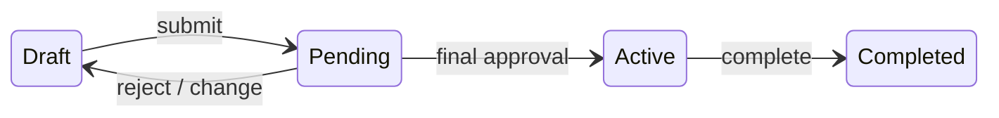
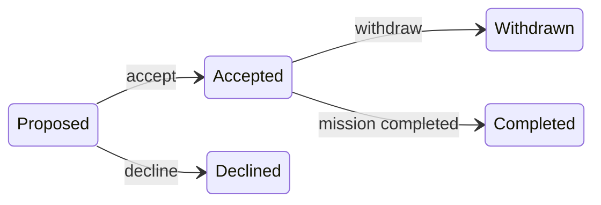

# Subagent (01): Apply approved M11 fixes on main

Source: `agent-ac62842806b59c674.jsonl` · 2026-10-12 02:26:52 UTC → 2026-10-12 02:35:06 UTC

Rendered from the raw JSONL without editing message content. Tool results and thinking are collapsed; expand them to read.


---

### 👤 User · 2026-10-12 02:26:52 UTC

You are applying user-approved fixes to module **M11 (missions service)** of the Mission Control project.

**Work in the main checkout:** `/Users/pritanbarai/Desktop/JOBS/mutinex_mission_control`. M11's original work is already **staged** there.
- **Leave your fixes UNSTAGED**, so the user can review the original (staged) and your fixes (unstaged) separately. Never run `git add`, `git commit`, `git stash`, `git reset`, `git checkout` or any other state-changing git command.
- `git diff` (unstaged) and `git diff --cached` are fine.
- Don't touch `.worktrees/`. No new dependencies.

**Read:** `CLAUDE.md`; `docs/prd.md` §5.4 (M1–M7, transition table) and §8; `docs/technical-design.md` §4, §5 and §7 (errors and problem codes; you'll edit §7 as described), §10. Then the code:
- `src/mission_control/services/missions.py` (staged, M11);
- `tests/integration/test_missions_service.py`;
- `src/mission_control/domain/errors.py`;
- `src/mission_control/domain/eligibility.py`;
- `src/mission_control/services/crew.py`;
- `src/mission_control/services/context.py`.

**Files you may edit:**
- `services/missions.py`, `tests/integration/test_missions_service.py`;
- `domain/errors.py` (the InvalidInput change only), `tests/unit/domain/test_errors.py`;
- `domain/records.py` (level constants);
- `services/crew.py` (only to import the moved constants);
- `docs/technical-design.md` §7 (rows and notes for codes, as below).

**Rules:**
- Tests first for every behaviour change: write or adjust the test, see it fail, then fix.
- Never weaken or delete a test without saying so in your report. A test whose expectation the user has changed (e.g. a 422 that becomes a 409) is updated, not deleted.
- No PRD IDs in `src/`. Messages are natural sentences.
- Run the full suite and lint at the end:
  - `uv run pytest -W error -o addopts="" -q`;
  - `uv run ruff check`;
  - `uv run ruff format --check`.

**APPROVED CHANGES** (from an independent review; the user said yes to all):

1. **Shared InvalidInput that can list every mistake.**
   - Extend `domain.errors.InvalidInput` to `InvalidInput(message: str, problems: Sequence[Problem] = ())`. When `problems` is empty it defaults to `(Problem("validation_error", message),)`.
   - Expose `.problems` (a tuple), keeping `.code == "validation_error"` and `.message`.
   - M9 and M10, which call `InvalidInput("...")`, must keep working unchanged.
   - Delete M11's local `InvalidInput` and use the shared one. Keep M11's "list every input mistake at once" behaviour: `.message` is the single problem's message, or "Some values aren't valid" when there are several.
   - Update the test import, and add unit tests in `test_errors.py` for the default and multi-problem forms.

2. **M7 refuses only problems the edit introduces.**
   - Today a date or requirement edit is refused for every availability or skill conflict under the new state, including conflicts that already existed. Example: Chen proposed on Gateway while having accepted Station Reboost; extending Gateway's end to 12 Mar is refused with "Chen would no longer be eligible" although he already wasn't.
   - The PRD says "so that an assigned person is **no longer** eligible".
   - In the service (`_refuse_if_invalidated`), evaluate the current state and the proposed state, and refuse only for (person, slot, reason) problems that are new. Prefer a small, clear service-level comparison over changing `domain/eligibility.py`.
   - Headcount and slot-removal checks are unaffected (they're about counts).
   - Tests:
     - the Chen/Gateway extension is now allowed;
     - a genuinely new conflict is still refused;
     - a requirement change after someone's skill was lowered earlier only refuses for new shortfalls.

3. **Permission before lookups** (TR-10: 404 only for what the caller can't see).
   - **create:** authorize `CREATE_MISSION` with `Context(owner_id=<raw owner id>)` BEFORE loading the owner user.
   - **transfer:** authorize `TRANSFER` before loading the new owner.
   - **add_slot / replace_requirements:** resolve skills AFTER authorize and `touch_for_change`.
   - Tests:
     - crew trying to create with owner 999 vs 3 get the same 403;
     - a non-owner Lead or an Active mission gets `not_owner` / `mission_frozen`, not "Skill not found", for an unknown skill.

4. **A Director creating without naming an owner** gets 422 `InvalidInput("Name the Lead who will own the mission")`, not 409 `owner_not_active_lead`.

5. **Removing the only slot, and transferring to the current owner, become 409.** Use `RuleViolation.of(Problem(...))` with new problem codes:
   - `mission_needs_a_slot`;
   - `already_owner`.

   Add both to the design §7 problem-code table with refs. Update the tests' expectations.

6. **Renaming a Pending mission no longer sends it back to Draft** (PRD M3 lists dates, slots, roster or owner, not the name).
   - A name-only change on Pending keeps it Pending and its approvals intact, and is still audited (`mission.updated`).
   - Renames on Active or final missions stay refused (mission_frozen / mission_final, per M5).
   - An edit changing name and dates together still reverts, because of the dates.
   - Tests for each.

7. **Duplicate slot names within a mission are refused** (409 `already_exists` with a `slot_id` ref, a case-insensitive comparison among live slots, on create, add_slot and update_slot). The §7 `already_exists` row already mentions slot names; check it reads right.

8. **`owner_not_active_lead` is approved.** It's already in §7 without the "awaiting approval" note; keep it.

**SMALL FIXES:**
- Input problems carry refs where a record is involved, e.g. `{"slot_id": ...}` for slot problems on `update_slot` / `replace_requirements`.
- Move `MIN_LEVEL, MAX_LEVEL = 1, 5` into `domain/records.py` (as skill-level constants), and import them in both `services/missions.py` and `services/crew.py`.
- Replace `assert window is not None` in production code with explicit handling.
- **Design §7:** there was an M11 note saying malformed values are 422 including "removing the only slot, transferring to the current owner". It was removed during merge. Add a short accurate note: malformed mission and slot values (blank name, headcount < 1, no required skill, level outside 1–5, end before start, no owner named by a Director) are 422 `validation_error`, listing every mistake at once.

**MISSING TESTS to add:**
- Active freeze (AC-5): renaming an Active mission is refused.
- Edits on a Cancelled mission give `mission_final`, for each edit kind.
- A refused M7 edit on a Pending mission leaves it Pending, with its approvals visible.
- A requirement refusal naming several people, and one naming a Proposed (not Accepted) person.
- AC-4: a slot rename on a Pending mission reverts it, and the `cause` is asserted in the revert audit for requirements and dates.
- `not_owner` for `update_slot`, `replace_requirements` and `remove_slot`.
- Crew not on the mission get 404 for the slot operations.
- AC-29: `replace_requirements` with another org's skill, and `remove_slot` with another org's slot, give NotFound.
- Strengthen `test_m1_only_directors_can_transfer_ownership`: assert the message for Sam ("Mission not found"), not just the code.

**REAL RUN:** a /tmp script on a fresh seeded database showing each change:
- the Chen/Gateway extension now allowed;
- 403 parity for crew;
- Director with no owner gives 422;
- removing the only slot gives 409 `mission_needs_a_slot`;
- transfer to the same owner gives 409 `already_owner`;
- Pending rename stays Pending;
- duplicate slot name gives 409 `already_exists`;
- a multi-mistake 422 lists every problem.

**REPORT:**
- per change, what you did (file:line);
- tests added or changed (and any expectation changed, with why);
- full-suite and ruff results;
- trimmed real-run output;
- anything you couldn't do or that needs the user.

<details>
<summary>⚙️ System/meta message · 2026-10-12 02:26:52 UTC</summary>

```
<system-reminder>
Your final report is delivered through SubagentHandback: when your work is complete, call SubagentHandback({message: <your full report>}). The call ends your run, so make it your last step. Only a SubagentHandback call reaches your caller as your result; plain text you write at the end is not delivered.
</system-reminder>
```

</details>

**🔧 Bash**

```bash
cat CLAUDE.md && git status --short && git diff --stat && git diff --cached --stat
```

<details>
<summary>↳ Result</summary>

```
# Mission Control

Multi-tenant mission planning API and CLI. Read these before doing any work. They are the source of truth, so don't copy their content here.

- [`docs/brief.md`](docs/brief.md): the assessment brief
- [`docs/prd.md`](docs/prd.md): **behaviour**. What the system does, its rules, acceptance criteria and seed scenarios.
- [`docs/technical-design.md`](docs/technical-design.md): **structure**. Architecture, schema, API, CLI, the delivery plan (§9) and the implementation guidelines (§10).

If the PRD and the design conflict, or are silent on something, stop and ask. Never invent behaviour.

## Workflow (every module)

1. **One approved module at a time.** Work only on the module from design §9 that I have approved. Don't start anything else.
2. **Tests first.** Write failing tests that reference the PRD IDs, then implement. Run the full suite and lint: `uv run pytest` and `uv run ruff check`.
3. **Real verification.** Exercise the behaviour for real, for example with a REPL call, an HTTP request or a CLI command. Show the actual output. A passing test run alone isn't verification.
4. **Read-only review.** Review the full diff against the PRD and design §10 without editing. Report findings, and fix them only once I agree.
5. **Stop for approval.** Summarise what changed, the test and verification results, and the review findings, and propose a commit message. **Don't commit, and don't start the next module, until I approve.**

## Waves (parallel modules in worktrees)

When I approve a wave of independent modules (design §9), build them in parallel and keep reviews small:

1. **One worktree per module.** Run `git worktree add .worktrees/<module> -b <module> main`, then `uv sync` inside it. Each agent edits only its own worktree and doesn't commit.
2. **Same workflow per module.** Steps 2 to 4 above still apply, inside the worktree.
3. **Review one branch at a time.** Show me only that module's diff against `main` (`git -C .worktrees/<module> diff main`, including new files), with its results.
4. **After I approve that module:**
   - commit on its branch;
   - rebase onto `main` if `main` has moved, and re-run its tests;
   - fast-forward `main`;
   - run the full suite on `main`;
   - remove the worktree and branch.

   Only then present the next branch.

Never push, add dependencies, change the schema, or add endpoints, error codes or CLI commands outside the design without asking first.
M  docs/technical-design.md
M  src/mission_control/domain/events.py
M  src/mission_control/infra/repositories/missions.py
A  src/mission_control/services/missions.py
A  tests/integration/test_missions_service.py
M  tests/unit/domain/test_events.py
 docs/technical-design.md                           |   3 +-
 src/mission_control/domain/events.py               |   8 +
 src/mission_control/infra/repositories/missions.py |  20 +
 src/mission_control/services/missions.py           | 672 ++++++++++++++++
 tests/integration/test_missions_service.py         | 894 +++++++++++++++++++++
 tests/unit/domain/test_events.py                   |   8 +
 6 files changed, 1604 insertions(+), 1 deletion(-)
```

</details>

**🔧 Bash**

```bash
grep -n "^#" docs/prd.md | head -80
```

<details>
<summary>↳ Result</summary>

```
1:# Mission Control — Product Requirements (v1)
7:## 1. Problem and goals
20:## 2. Requirements from the brief
33:## 3. Users and roles
45:## 4. Main workflows (all available through the CLI)
60:## 5. Business rules
62:### 5.1 Definitions
73:### 5.2 Tenancy and identity
79:### 5.3 People and skills
100:### 5.4 Missions and lifecycle
133:### 5.5 Approval
141:### 5.6 Assignments
155:### 5.7 Visibility and audit
169:## 6. Auto-matching
197:## 7. CLI requirements
204:## 8. Acceptance criteria
257:## 9. Seed data and scenarios
261:### 9.1 Aurora Space Agency (N = 2)
289:### 9.2 Helix Orbital (N = 1)
297:### 9.3 Scenarios
312:## 10. Test plan
325:## 11. Out of scope
```

</details>

**🔧 Bash**

```bash
sed -n 60,312p docs/prd.md
```

**🔧 Bash**

```bash
grep -n "^#" docs/technical-design.md
```

<details>
<summary>↳ Result</summary>

````
## 5. Business rules

### 5.1 Definitions

| Term | Meaning |
|---|---|
| **Open assignment** | An assignment that is Proposed or Accepted. |
| **Open places** | A slot's headcount minus its open assignments. |
| **Mission-days** | The number of days from the start date to the end date, counting both. |
| **Overlap** | Two date ranges overlap if they share at least one calendar day. Dates have no time and no time zone. |
| **Eligible (crew for a slot)** | The person is active, has a crew profile, and has every required skill at or above its minimum level. They have no unavailability overlapping the mission, and no accepted assignment on another non-final mission that overlaps it. |
| **Eligible approver** | An active Director who did not create the mission and is not on its roster. |

### 5.2 Tenancy and identity

- **T1** Every record belongs to one organisation. Every read and write is limited to the caller's organisation. **[B]**
- **T2** Naming a resource from another organisation gives the same response as naming one that doesn't exist ("not found").
- **T3** Organisations are created only through seed data or an operator command. There is no self-service signup.

### 5.3 People and skills

- **P1** Each organisation has its own flat skill catalogue, managed by Directors. Skills with the same name in different organisations are unrelated.
  - Directors can rename a skill. Its identity stays the same.
  - Directors can delete a skill only if no crew skill or slot requirement uses it.
- **P2** Proficiency is an integer from 1 to 5.
- **P3** Leads and Directors set and remove skill levels. **Nobody can change their own levels.**
  - A skill change is allowed even if it makes someone ineligible for an assignment on a Draft or Pending mission. Eligibility is checked again at acceptance, submission and approval.
  - A skill change that would make someone ineligible for their assignment on an Active mission is refused.
- **P4** Crew profile holders manage their own personal details and unavailability. Nobody else edits them. Personal details are a display name and an optional bio.
- **P5** Crew are available by default. Unavailability is a date range with a reason.
- **P6** A crew member can't record unavailability that overlaps one of their accepted assignments.
- **P7** Users are deactivated, never deleted. Deactivated users can't sign in, aren't eligible for matching, and keep their history. Deactivation is refused while the user:
  - has open assignments; or
  - owns non-final missions. The same applies to changing a mission owner's role away from Lead. Their missions must be reassigned first.
- **P8** An organisation must always have at least one active Director.
- **P9** Crew profiles survive role changes and can't be deleted. Changing a user's role to Crew Member gives them a profile if they don't already have one.
- **P10** Directors set a new user's initial password. Users change their own password by entering their current one. There's no email or password-recovery flow.
  - Passwords must be at least 15 characters. Passphrases are welcome, and uppercase letters, numbers and symbols aren't required.
  - Changing a password ends all of that user's sessions, including the one used to change it.

### 5.4 Missions and lifecycle

- **M1** A mission has a name, a date range, one owning Lead and a separately recorded creator.
  - Leads create missions for themselves. Directors create them on behalf of a Lead.
  - Only Mission Leads can own missions.
  - Directors can transfer ownership of a non-final mission to another active Lead in the same organisation. If the mission is Pending, it returns to Draft and its approvals are cleared.
- **M2** A mission has one or more slots. Each slot has a name, a headcount of at least 1, and at least one required skill with a minimum level. Dates may be in the past, but the end date must be on or after the start date. The same rule applies to unavailability.
- **M3** Only the owning Lead can edit a mission, propose or remove crew, apply matcher results, or submit.

```
         submit                N-th approval                complete
 Draft ─────────▶ Pending ───────────────────▶ Active ─────────────▶ Completed
   ▲              Approval
   └── reject (reason) / any change ──┘
 Draft | Pending Approval | Active ──cancel (reason)──▶ Cancelled
```

| Transition | Who | Conditions and effects |
|---|---|---|
| Draft → Pending Approval | Owning Lead | All of these must hold: every slot is full, every assignment is Accepted, every rostered crew member is still eligible, and there are at least N eligible approvers. Otherwise the submission is refused with a list of the problems. |
| Pending → Active | The N-th distinct eligible approver | The roster is checked again at each approval. If the check fails, the approval is refused and the mission stays Pending, unchanged. |
| Pending → Draft | Eligible Director (reject) or system | A rejection needs a reason. Any change to dates, slots, roster or owner, including a crew withdrawal, also sends the mission back to Draft. Approvals are cleared, and remaining accepted assignments stay accepted. |
| Active → Completed | Owning Lead or Director | Accepted assignments become Completed. |
| Any non-final → Cancelled | Owning Lead or any Director | Reason required. Open assignments become Cancelled. |

- **M4** Draft missions can have unfilled places and unanswered proposals.
- **M5** Once a mission is Active, its dates, requirements and roster are frozen. Only completion or cancellation are allowed.
- **M6** Dates never trigger transitions on their own. There is no scheduler.
- **M7** An edit is refused if it would invalidate an open assignment. The response lists the affected crew, and the Lead must remove them first. Crew are never removed automatically. Edits that invalidate an assignment are:
  - removing a slot that has open assignments;
  - lowering a slot's headcount below its open assignments;
  - changing dates or requirements so that an assigned person is no longer eligible.

### 5.5 Approval

- **A1** Each organisation sets the number of approvals required (N ≥ 1). The approvals must come from N distinct eligible approvers.
  - N is fixed for a mission when it's submitted. Later changes to the setting don't affect a round already in progress.
  - An approval already given still counts if that Director is later deactivated or demoted.
- **A2** Leads can't approve anything, which satisfies R3. **[B]** A Director can't approve a mission they created or are rostered on.
- **A3** Each Director approves a round at most once. A single rejection ends the round.

### 5.6 Assignments

```
Proposed ──accept──▶ Accepted ──withdraw (reason)──▶ Withdrawn
   ├──decline──▶ Declined   └──removed by Lead──▶ Removed
   └──retracted by Lead──▶ Removed
Accepted ──mission completed──▶ Completed;  open ──mission cancelled──▶ Cancelled
```

- **S1** The owning Lead can propose only eligible crew. A person can hold at most one open assignment per mission. A slot can't have more open assignments than its headcount. A Lead can propose themselves, but they must be eligible and must accept like anyone else.
- **S2** Crew can accept only while the mission is in Draft and they're still eligible. Accepted assignments block overlapping dates. Proposals don't block anything.
- **S3** Declining takes an optional reason. Withdrawing needs a reason and is allowed only in Draft or Pending Approval.
- **S4** Every assignment needs the crew member's acceptance. Crew can't be placed on a mission directly.

### 5.7 Visibility and audit

| | Crew | Lead | Director |
|---|---|---|---|
| Own profile, skills, availability, assignments | ✓ | ✓ | ✓ |
| Missions they're on, with teammates' names and slots | ✓ | ✓ | ✓ |
| Other crew members' profiles, skills, busy/free dates | ✗ | ✓ | ✓ |
| Other people's *reasons* for unavailability | ✗ | ✗ | ✓ |
| All missions in the organisation | ✗ | read (edit own) | read |
| Users, catalogue management, organisation settings | ✗ | read catalogue | manage |

- **V1** Every state change, approval, rejection and assignment response is recorded with who did it, when, and any reason. Anyone who can see the mission can see this history.
- **V2** Former assignees see a summary of the mission in their own assignment history. They don't get full access to the mission unless their role allows it. Former assignees are people whose assignment was declined, withdrawn, removed or cancelled.

## 6. Auto-matching

The matcher only advises. It suggests crew for a Draft mission's open places and changes nothing. The owner or a Director can preview a suggestion. When the owning Lead applies it, it creates Proposed assignments, which crew still have to accept.

**Candidates.** Active crew profiles in the mission's organisation only. Crew who already have an open assignment on this mission, or who declined or withdrew from it, are left out.

**Workload.** The total mission-days of a crew member's accepted assignments on missions that are not Completed, leaving out the mission being matched.

**Algorithm**

1. **Filter.** For each slot with open places, keep the candidates who are eligible (§5.1).
2. **Pick the most constrained slot.** Choose the slot with the fewest remaining eligible candidates. Ties go to the slot listed first.
3. **Fill one place in that slot.** Rank candidates by:
   1. lowest workload;
   2. then highest proficiency, meaning the sum of their levels across the slot's required skills;
   3. then stable identifier, ascending.
4. **Remove the chosen person** from every other slot's candidates.
5. **Repeat** from step 2 until every place is filled or has no candidates left.

**Output.** A suggested roster with no one in two slots. Places without a candidate are marked **unfilled**. The same inputs always give the same output.

**Why:**
- Filling the most constrained slot first stops a versatile person from being spent on a slot that's easy to fill.
- Ranking by lowest workload spreads missions across crew.
- Proficiency only breaks ties, because everyone left already meets the requirement.

**Known limitation:** this is a greedy heuristic. It can occasionally leave a place unfilled when a complete roster exists. That's acceptable for an advisory tool, and the Lead can still propose by hand.

## 7. CLI requirements

- **C1** Every workflow in §4 can be carried out from the CLI. **[B]**
- **C2** Refusals explain why in domain terms, for example "Gus has an accepted assignment on *Station Reboost* overlapping 1–2 Mar". Where possible they also say what to do next.
- **C3** Output is readable by people by default, with a machine-readable option for scripts and tests.
- **C4** Actions that send a mission back to Draft, or cancel it, warn before running.

## 8. Acceptance criteria

Each criterion starts from a fresh seed. Scenario numbers (S-) refer to §9.3.

**Mission workflow**

- **AC-1** The golden path (S1) ends Completed, and every transition appears in the history with who did it and when.
- **AC-2** Submission is refused while any place is unfilled or any proposal is unanswered. The refusal lists them.
- **AC-3** Approvals before the N-th leave the mission Pending. The N-th approval makes it Active.
- **AC-4** Changing the dates, slots or roster of a Pending mission sends it back to Draft and clears its approvals. So does a crew withdrawal (S5).
- **AC-5** On an Active mission, edits, proposals, removals and withdrawals are refused. Completion and cancellation succeed.
- **AC-6** Cancelling needs a reason. The owning Lead or any Director can cancel, and any other Lead is refused. Open assignments become Cancelled.
- **AC-7** Only the owning Lead can edit, propose, apply or submit. After a Director reassigns the owner, the new owner can and the previous owner can't.

**Approval restrictions**

- **AC-8** The mission's creator can't approve it. In S1, Ruth is refused.
- **AC-9** Leads and Crew can't approve or reject.
- **AC-10** A Director can't approve the same round twice. Rejecting needs a reason and clears earlier approvals (S6).
- **AC-11** A Director rostered on a mission can't approve it.
- **AC-12** Submission is refused when there are fewer than N eligible approvers, not counting the creator or rostered Directors (S7).
- **AC-13** In Helix (N = 1), a single approval makes the mission Active (S8).

**Overlaps and availability**

- **AC-14** Proposing someone who is unavailable, or who has an overlapping accepted assignment, is refused. In S4, both Fay and Gus are refused.
- **AC-15** Overlapping proposals are allowed. Accepting one that overlaps an accepted assignment is refused, and the refusal names the conflicting mission (S4, Chen).
- **AC-16** Recording unavailability that overlaps an accepted assignment is refused.
- **AC-17** Two ranges that share only a boundary day overlap.

**Matching**

- **AC-18** S2 gives exactly the expected roster on every run.
- **AC-19** S3 marks Geologist as unfilled. S3b shows a new accepted assignment changing the suggestion.
- **AC-20** Workload counts only accepted assignments on missions that aren't Completed. Chen's workload is 5, not 35.
- **AC-21** The suggestion never puts one person in two slots. It never includes anyone who is ineligible, from another organisation, or already excluded from this mission.
- **AC-22** Running the matcher changes nothing. Applying it creates Proposed assignments.

**Roles and visibility**

- **AC-23** Ana can't change her own skill levels, but Lee can change hers. Ben can't edit skills, but he can edit his personal details and unavailability.
- **AC-24** Lee sees Fay as busy 5–8 Mar but doesn't see the reason. Ruth sees the reason. Ben can't view Fay's profile, and his mission list shows only missions he's on.
- **AC-25** Leads can't manage users, the catalogue or the approval setting.
- **AC-26** Deactivating someone with open assignments is refused. A deactivated user can't sign in. The last active Director can't be deactivated or demoted.

**Tenant isolation (S9)**

- **AC-27** Requesting another organisation's mission, crew member, user, skill or assignment by ID gives the same response as an ID that doesn't exist.
- **AC-28** Every list contains only the caller's organisation's records.
- **AC-29** Any write that references another organisation's ID fails as "not found", and neither organisation's data changes.
- **AC-30** Approving or rejecting another organisation's mission fails as "not found".
- **AC-31** Helix's Kai (Piloting 5, no commitments) is never suggested for an Aurora mission.

## 9. Seed data and scenarios

The table order of people is their stable-identifier order. All dates are in 2027 unless stated.

### 9.1 Aurora Space Agency (N = 2)

| Person | Role | Crew skills | Commitments (workload) |
|---|---|---|---|
| Ruth Adeyemi | Director | — | — |
| Marco Bianchi | Director | Flight Medicine 4 | Medical Study, accepted (4) |
| Ingrid Holm | Director | — | — |
| Lee Park | Lead | — | — |
| Nora Quinn | Lead | — | — |
| Ana Okafor | Lead | Piloting 5, Leadership 4, Systems Eng 4 | none (0) |
| Ben Ito | Crew | Systems Eng 4, EVA 3 | Deep Space Comms, accepted (20) |
| Chen Wu | Crew | Systems Eng 3 | Telescope (5). Mars Analog Completed, so it doesn't count |
| Dana Reyes | Crew | EVA 4 | Telescope (5) |
| Eli Novak | Crew | EVA 4, Piloting 4, Leadership 2 | Telescope (5) |
| Fay Moreau | Crew | Piloting 4, Leadership 4 | Unavailable 5–8 Mar (Medical) |
| Gus Patel | Crew | Systems Eng 5 | Station Reboost, accepted (6) |
| Hana Sato | Crew | EVA 3, Geology 2 | Telescope (5) |

| Mission | Owner / creator | Dates | State | Slots → crew |
|---|---|---|---|---|
| Lunar Gateway Resupply | Lee / Ruth | 1–10 Mar | Draft | Flight Engineer ×1 (Sys Eng ≥3) · Mission Specialist ×1 (EVA ≥3) · Commander ×1 (Piloting ≥4, Leadership ≥3) — no crew |
| Asteroid Survey | Nora | 5–12 Mar | Draft | Pilot ×1 (Piloting ≥4) · Geologist ×1 (Geology ≥4) — no crew |
| Station Reboost | Nora | 25 Feb – 2 Mar | Draft | Engineer ×2 (Sys Eng ≥3) — Gus accepted, 1 open place |
| Lunar Surface Medical Study | Nora / Ruth | 15–18 Mar | Draft | Flight Surgeon ×1 (Flight Medicine ≥4) — Marco accepted |
| Orbital Telescope Service | Lee | 10–14 Jan | Active | Engineer ×1 — Chen · EVA Specialist ×3 (EVA ≥3) — Dana, Eli, Hana |
| Deep Space Comms Upgrade | Nora | 1–20 Apr | Pending (Marco approved) | Engineer ×1 (Sys Eng ≥3) — Ben |
| Mars Analog Habitat | Lee | 1–30 May 2026 | Completed | Engineer ×1 — Chen |

### 9.2 Helix Orbital (N = 1)

People: Sam Rivera (Director), Priya Nair (Lead), and Crew Kai Tanaka (Piloting 5), Lena Fischer (Payload Integration 4), Omar Haddad (Field Medicine 4) and Tess Moreno (Life Support 3). Helix has its own catalogue, including a separate "Piloting" skill.

| Mission | Owner | Dates | State | Slots → crew |
|---|---|---|---|---|
| Payload Demo 1 | Priya | 1–3 Feb | Draft | Payload Specialist ×1 (Payload Int ≥3) — Lena accepted · Medic ×1 (Field Medicine ≥3) — Omar accepted |

### 9.3 Scenarios

| # | Steps | Expected outcome |
|---|---|---|
| **S1** | Lee matches and applies *Lunar Gateway Resupply* → Ana, Chen and Dana accept → Lee submits → Ruth approves → Marco approves → Ingrid approves → Lee completes | Proposed crew are Ana, Chen and Dana. Ruth is refused as creator. After Marco the mission is Pending (1/2). After Ingrid it's **Active**. Completing makes the assignments Completed. |
| **S2** | Match *Lunar Gateway Resupply* | Eligible crew: Commander {Ana}, because Fay is unavailable and Eli's Leadership is too low. Flight Engineer {Ana, Ben, Chen}, because Gus has an overlap. Specialist {Ben, Dana, Eli, Hana}. **Commander → Ana** (most constrained). **Flight Engineer → Chen** (workload 5 vs Ben's 20). **Specialist → Dana** (four-way workload tie at 5; Hana loses on proficiency; Dana beats Eli on ID). Filling the slots in listed order would have spent Ana on Flight Engineer and left Commander unfilled. |
| **S3** | Match *Asteroid Survey* | Geologist **unfilled** (Hana's Geology is only 2). Pilot → Ana (workload 0 vs Eli's 5; Fay unavailable). |
| **S3b** | S1 up to acceptance, then match *Asteroid Survey* | Ana is blocked by her overlapping accepted assignment, so Pilot → Eli. Geologist still unfilled. |
| **S4** | Lee proposes Gus and Fay for *Gateway*. Nora proposes Chen for *Station Reboost* and Lee proposes Chen for *Gateway*. Chen accepts *Station Reboost*, then *Gateway*. | Gus refused (overlap). Fay refused (unavailable). Both Chen proposals succeed. Chen's second acceptance is refused, naming *Station Reboost*. |
| **S5** | Ben withdraws from *Deep Space Comms* without a reason, then with one. Hana withdraws from *Telescope*. | Ben's first attempt is refused. The second succeeds: the mission returns to Draft and Marco's approval is cleared. Hana is refused because *Telescope* is Active. |
| **S6** | Marco approves *Deep Space Comms* again. Ingrid rejects it without a reason, then with one. | Marco is refused. Ingrid's first attempt is refused. The second sends the mission to Draft and clears approvals. |
| **S7** | Nora submits *Lunar Surface Medical Study* | Refused. Ruth created it and Marco is rostered, which leaves 1 eligible approver (Ingrid) when 2 are needed. |
| **S8** | Priya submits *Payload Demo 1* and Sam approves | **Active** after one approval. |
| **S9** | Each role in each organisation tries to read, list, write and approve the other organisation's resources, and matches an Aurora Piloting slot | Every attempt fails as "not found" and nothing changes. Lists show only the caller's organisation. Kai never appears. |

## 10. Test plan
````

</details>

<details>
<summary>↳ Result</summary>

```
1:# Mission Control — Technical Design (v1)
24:## 1. Summary
43:## 2. Architecture
95:## 3. Data model
130:## 4. Security and tenancy
132:### Authentication
141:### Permissions
169:### Tenant isolation
181:## 5. Lifecycle
183:### Mission
205:### Assignment
228:### Cross-cutting rules
240:## 6. Matching
308:## 7. API
316:#### Auth and me
325:#### Organisation, users and skills (Directors)
335:#### Crew
345:#### Missions
358:#### Assignments
365:#### Errors
408:## 8. CLI
422:# Everyone
427:# Leads
433:# Directors
442:## 9. Delivery plan
506:## 10. Guidelines for implementing agents
508:### Source of truth
513:### The loop for each module
522:### Working in waves (worktrees)
531:### Architecture rules (never break these)
539:### Coding conventions
545:### Testing conventions
550:### Stop and ask before
558:## 11. Setup and testing
583:## Appendix A: Schema SQL
594:### Organisations, users and sessions
632:### Crew, skills and availability
686:### Missions, slots and requirements
740:### Assignments, approvals and audit
813:## Appendix B: Trade-offs and considerations
817:### B.1 Key decisions
835:### B.2 Risks
845:### B.3 Scaling path (not in v1)
```

</details>

**🔧 Bash**

```bash
sed -n 130,240p docs/technical-design.md && sed -n 308,408p docs/technical-design.md && sed -n 506,558p docs/technical-design.md
```

<details>
<summary>↳ Result</summary>

````
## 4. Security and tenancy

### Authentication

| | |
|---|---|
| Token | 32 random bytes. Only the SHA-256 hash is stored. 12-hour expiry. |
| Every request | Token → valid? → user active? → `Actor(user_id, org_id, role, crew_profile_id)`. Nothing is cached, so role changes apply immediately. |
| Revocation | Logout revokes that token. Deactivation or a password change revokes every token. Opaque tokens make this immediate ([TR-5](#tr-5)). |
| Passwords | Argon2id. At least 15 characters. No character-type rules. |

### Permissions

Each **role** sets the baseline:

| Role | Can | Can't |
|---|---|---|
| **Director** | Run the organisation: users, roles, skills, approval setting. See everything. Approve, transfer, complete and cancel missions. | Edit mission details, since that's the owner's job |
| **Lead** | Create and run their own missions. Rate other people's skills. See all crew and missions. | Approve anything. Touch missions they don't own. |
| **Crew** | Manage their own profile and availability. Respond to their own assignments. | See other crew, or missions they aren't on |

On top of the role, **relationship rules** make the decisions that matter:

| Rule | Effect | PRD |
|---|---|---|
| **Owner only** | Only the mission's owner edits it, proposes crew, applies the matcher or submits | M3 |
| **Not yourself** | Nobody sets their own skill levels | P3 |
| **Eligible approver** | A Director can't approve a mission they created or are on | A2 |
| **Self only** | Only you edit your details and availability. Only you, and Directors, see your unavailability reasons. | P4, §5.7 |
| **Visibility** | Crew only see missions they're on. Former assignees see a summary. | V2 |

**Enforcement.** `domain/permissions.authorize(actor, action, ctx)` is the single entry point. The complete action × role table is the parametrized test for this module, and that test is the source of truth.

| Status | When |
|---|---|
| **401** | Authentication failed |
| **404** | Missing, another organisation's, or not visible. All three look identical ([TR-10](#tr-10)). |
| **403** | Visible, but you're not allowed to do this |

### Tenant isolation

1. **Identity.** `org_id` comes only from the token, never from the request.
2. **Repositories.** `Repos(conn, org_id)` scopes every query. Another organisation's ID behaves as missing.
3. **Database.** Composite `(org_id, id)` foreign keys.
4. **Tests.**
   - An SQL lint checks every query mentions `org_id`.
   - A route inventory makes sure no endpoint is left out of the isolation tests.
   - A cross-organisation sweep compares database snapshots before and after.

---

## 5. Lifecycle

### Mission



Any state before Completed can also be **cancelled**.

| Action | Who | Must be true | Effect |
|---|---|---|---|
| submit | owner | Slots full, all accepted, roster eligible, eligible approvers ≥ N | `round += 1`, N saved |
| approve | eligible Director | Hasn't decided this round. Roster eligible. | Active once N is reached. **If a check fails, nothing is written.** |
| reject | eligible Director | Reason given | → Draft |
| transfer | Director | New owner is an active Lead | Pending → Draft. Active stays Active. |
| complete | owner or Director | Mission is Active | Accepted assignments → completed |
| cancel | owner or Director | Reason given | Open assignments → cancelled |

### Assignment



The owner can also **remove** an open assignment. Cancelling the mission **cancels** every open assignment.

| Action | Who | Mission must be | Notes |
|---|---|---|---|
| propose | owner | Draft or Pending* | Person eligible, place open, not already on this mission |
| accept | crew member | Draft | Still eligible. An overlap names the conflicting mission. |
| decline | crew member | Draft | Reason optional |
| withdraw | crew member | Draft or Pending* | Reason required |
| remove | owner | Draft or Pending* | |

\* Sends a Pending mission back to Draft.

### Cross-cutting rules

| Rule | How it's implemented |
|---|---|
| **Back to Draft** | Every mutating service calls `touch_for_change()` first. Draft → no change. Pending → Draft. Active → `mission_frozen`. Final → `mission_final`. |
| **Edits can't break assignments (M7)** | `invalidated_by()` checks slot removal, headcount, requirements and dates → `invalidates_assignments` |
| **Skill changes (P3)** | Allowed. Refused only if they'd break an **Active** assignment → `invalidates_active_assignment` |
| **Audit** | Written in the same transaction as the change. Refused actions write nothing. |
| **Transactions** | One connection per request. `foreign_keys=ON`. `busy_timeout=5000`. `BEGIN IMMEDIATE` *before* checks. Roll back on error. Lock timeout → 503 `busy`. ([TR-11](#tr-11)) |

---

## 6. Matching
## 7. API

**Conventions**
- REST and JSON, under `/api/v1`.
- Authentication with the header `Authorization: Bearer <token>`.
- Lifecycle changes are explicit `POST` commands, for example `/submit`. They are never `PATCH status`, because each one has its own guards and audit event ([TR-8](#tr-8)).
- List endpoints return only what the caller is allowed to see.

#### Auth and me
| Method | Path | Purpose |
|---|---|---|
| POST | `/auth/login` | Exchange email and password for a token |
| POST | `/auth/logout` | Revoke the current token |
| GET | `/me` | Current user, role and crew profile |
| POST | `/me/password` | Change password (revokes all sessions) |
| GET | `/me/inbox` | Things waiting on me |

#### Organisation, users and skills (Directors)
| Method | Path | Purpose |
|---|---|---|
| GET · PATCH | `/org` | View settings, or set the required approvals |
| GET · POST | `/users` | List users, or create one with an initial password |
| PATCH | `/users/{id}` | Change role or deactivate |
| POST | `/users/{id}/crew-profile` | Give a user a crew profile |
| GET · POST | `/skills` | List skills (Leads too), or add one |
| PATCH · DELETE | `/skills/{id}` | Rename, or delete if unused |

#### Crew
| Method | Path | Purpose |
|---|---|---|
| GET | `/crew` · `/crew/{id}` | List or view profiles |
| PATCH | `/crew/{id}` | Edit own display name and bio |
| PUT · DELETE | `/crew/{id}/skills/{skill_id}` | Set or remove a skill level |
| GET · POST | `/crew/{id}/unavailability` | List or add own unavailability |
| DELETE | `/crew/{id}/unavailability/{uid}` | Remove own unavailability |
| GET | `/crew/{id}/assignments` | Assignment history (summaries) |

#### Missions
| Method | Path | Purpose |
|---|---|---|
| GET · POST | `/missions` | List visible missions, or create one with slots |
| GET · PATCH | `/missions/{id}` | View, or edit name and dates |
| POST | `/missions/{id}/slots` | Add a slot |
| PATCH · DELETE | `/missions/{id}/slots/{sid}` | Edit or remove a slot |
| GET | `/missions/{id}/history` | Audit trail |
| POST | `/missions/{id}/submit` · `approve` · `reject` · `complete` · `cancel` | Lifecycle commands |
| POST | `/missions/{id}/owner` | Transfer ownership |
| GET | `/missions/{id}/match` | Preview suggested roster |
| POST | `/missions/{id}/match/apply` | Create proposals from the suggestion |

#### Assignments
| Method | Path | Purpose |
|---|---|---|
| POST | `/missions/{id}/assignments` | Propose a crew member for a slot |
| GET | `/assignments` | My assignments |
| POST | `/assignments/{id}/accept` · `decline` · `withdraw` · `remove` | Respond or remove |

#### Errors

Every error has the same shape, for every status code (401, 403, 404, 409, 422, 503). `problems` is always present and always has at least one entry, so clients only ever handle one format. A rule or state conflict (409) lists **every** problem at once. A permission refusal (403) lists its single reason, because only one applies and the actor can't fix it themselves. Each problem names the record involved:

```json
{
  "error": {
    "code": "rule_violation",
    "message": "Mission can't be submitted",
    "problems": [
      { "code": "slot_unfilled", "message": "Commander: 1 of 1 place unfilled", "refs": { "slot_id": 12 } }
    ]
  }
}
```

| HTTP | Meaning | Codes |
|---|---|---|
| 401 | Not authenticated | `invalid_credentials` `unauthenticated` |
| 403 | Not allowed | `role_forbidden` `not_owner` `approver_is_creator` `approver_is_rostered` `self_skill_edit` `wrong_current_password` |
| 404 | Not found or not visible | `not_found` |
| 409 | Conflicts with state or a rule | **State:** `mission_frozen` `mission_final` `invalid_transition` `already_decided`<br>**Rules:** `rule_violation` `overlap` `unavailable` `insufficient_approvers` `invalidates_assignments` `invalidates_active_assignment`<br>**Admin:** `has_open_assignments` `owns_open_missions` `last_director` `skill_in_use` |
| 422 | Invalid input | `validation_error` `password_too_short` |
| 503 | Database busy, retry | `busy` |

**Problem codes.** These appear inside `problems` and explain each refusal. Adding one means updating this table in the same change.

| Code | Raised when | Typical `refs` |
|---|---|---|
| `inactive` | The person is deactivated | `crew_profile_id`, `slot_id` |
| `skill_below_minimum` | A required skill is missing or below the minimum | `crew_profile_id`, `slot_id`, `skill_id` |
| `unavailable` | Unavailability overlaps the mission's dates | `crew_profile_id`, `slot_id` |
| `overlap` | An accepted assignment on another mission overlaps (the message names that mission) | `crew_profile_id`, `mission_id`, `mission_name` |
| `slot_has_open_assignments` | Removing a slot that still has crew | `assignment_id`, `crew_profile_id`, `slot_id` |
| `headcount_below_open_assignments` | Lowering headcount below the assigned crew (the message names them) | `slot_id`, `crew_profile_ids` |
| `invalidates_active_assignment` | A skill change would break an assignment on an Active mission | `mission_id`, `skill_id` |
| `slot_unfilled` | Submitting with empty places | `slot_id` |
| `proposal_unanswered` | Submitting while a proposal is still waiting for a reply (the message names the person and slot) | `assignment_id`, `slot_id`, `crew_profile_id` |
| `already_exists` | Inside a 409 `rule_violation`: the email address is already in use (anywhere on the platform, since login is by email alone; see [TR-13](#tr-13)), a skill name is already in the catalogue (ignoring case), the user already has a crew profile, or a mission already has a slot with that name | `email`; `skill_id`; `user_id`, `crew_profile_id`; `slot_id` |
| `owner_not_active_lead` | The owner named for a new mission, or for a transfer, isn't a Mission Lead or is deactivated (inside a 409 `rule_violation`) | `user_id` |

---

## 8. CLI
## 10. Guidelines for implementing agents

### Source of truth
1. The **PRD** decides behaviour. **This document** decides structure. Code follows both.
2. **Don't invent behaviour.** If the PRD is silent or contradicts this document, stop and ask. Don't guess, and don't "improve" the rule.
3. Work on **one module at a time**, in the order in [§9](#9-delivery-plan). Start a module only when the user has approved it, and never before its dependencies are done.

### The loop for each module
1. Read the module's row in §9 and every PRD ID it references.
2. Write failing tests. Name them after the rule, for example `test_ac15_accept_overlap_names_conflicting_mission`.
3. Write the smallest implementation that makes them pass.
4. Refactor, then run the **full** suite and `ruff`.
5. Verify the behaviour by running it for real (a REPL call, a request, or a CLI command), and show the output.
6. Do a read-only review of the diff, and report findings without editing anything.
7. Propose a commit message, such as `feat(m12): assignment propose/accept/withdraw`. **Don't commit, and don't start the next module, until the user approves.**

### Working in waves (worktrees)
- **Approval:** a wave starts only when the user approves every module in it. The modules must not depend on each other.
- **Isolation:** each module gets its own worktree and branch, `.worktrees/<module>` on branch `<module>` (e.g. `m9-admin`), created from the current `main`. The agent works only inside it and runs `uv sync` and the tests there.
- **Agents don't commit.** Each leaves its changes uncommitted and reports the usual package: tests first, real run, read-only review.
- **Review is one branch at a time.** The user reviews only that module's diff against `main`.
- **Merge:** after approval, the lead commits on the branch, rebases it onto `main` if `main` has moved (re-running its tests), fast-forwards `main`, and runs the full suite on `main` before the next review.
- **Ports:** a real run that starts a server uses port `8000 + module number` (e.g. M11 uses 8011).
- **Clean-up:** remove the worktree and branch once merged.

### Architecture rules (never break these)
- `domain/` imports nothing from `infra/`, `services/`, `api/` or `sqlite3`.
- All SQL lives in `infra/repositories/`, and every query filters on `org_id`.
- `org_id` comes only from the `Actor`. Never read it from request input.
- Every mutating service calls `touch_for_change()` first, and writes an audit event in the same transaction.
- Writes open `BEGIN IMMEDIATE` **before** running checks.
- Errors use the codes in [§7](#7-api). Adding a code means updating that table in the same change.

### Coding conventions
- Type hints everywhere. Frozen dataclasses for domain records. No module-level mutable state.
- `date` objects in the domain, ISO strings only at the database and API edges. Timestamps are UTC.
- Use PRD vocabulary in names: `open_places`, `eligible_approver`, `workload`.
- Keep routers thin: validate, call one service, return.

### Testing conventions
- Use the `seeded_db` fixture for PRD scenarios, and `tests/builders.py` for edge cases.
- Every test gets its own database. No network calls. No reliance on the current date: pass dates in.
- Never weaken or delete a test to make it pass. If a test looks wrong, raise it.

### Stop and ask before
- adding a dependency;
- changing the schema (and if you do, update [Appendix A](#appendix-a-schema-sql) as well);
- adding an endpoint, error code or CLI command that isn't in this document;
- any case where the PRD looks ambiguous or a PRD scenario's expected outcome seems wrong.

---

## 11. Setup and testing
````

</details>

**🔧 Bash**

```bash
cat -n src/mission_control/services/missions.py
```

<details>
<summary>↳ Result</summary>

```
     1	"""Missions: viewing them, creating them, editing their name, dates and slots, and handing them
     2	to another Lead.
     3	
     4	Every change follows one order inside a single write transaction: find what's named (missing,
     5	hidden or another organisation's is NotFound), check permission (Forbidden), check the mission's
     6	state with `touch_for_change` (StateConflict), check the input (InvalidInput), check the rules
     7	(RuleViolation), then write and audit. A Pending mission that is changed goes back to Draft and
     8	its approval round stops counting; that return is audited with the change that caused it.
     9	"""
    10	
    11	from collections.abc import Callable, Mapping, Sequence
    12	from dataclasses import dataclass, field
    13	from datetime import date
    14	from types import MappingProxyType
    15	
    16	from mission_control.domain.dates import DateRange, InvalidDateRange
    17	from mission_control.domain.eligibility import (
    18	    DatesEdit,
    19	    MissionEditKind,
    20	    SlotEdit,
    21	    SlotRemoval,
    22	    invalidated_by,
    23	)
    24	from mission_control.domain.enums import Action, AssignmentStatus, MissionStatus, Role
    25	from mission_control.domain.errors import Problem, RuleViolation
    26	from mission_control.domain.events import Event
    27	from mission_control.domain.lifecycle import (
    28	    StateConflict,
    29	    mission_status_after,
    30	    state_problem,
    31	    touch_for_change,
    32	)
    33	from mission_control.domain.permissions import Context
    34	from mission_control.domain.records import Requirement
    35	from mission_control.infra.repositories import Repos
    36	from mission_control.infra.repositories.models import Mission, Slot, User
    37	from mission_control.services.context import ServiceContext, found
    38	
    39	MIN_LEVEL, MAX_LEVEL = 1, 5
    40	_OPEN = frozenset({AssignmentStatus.PROPOSED, AssignmentStatus.ACCEPTED})
    41	# States reached through the current approval round, so its approvals are the live ones. A Draft
    42	# mission's round was rejected or voided by a change, so its approvals no longer count.
    43	_ROUND_IS_LIVE = frozenset(
    44	    {MissionStatus.PENDING_APPROVAL, MissionStatus.ACTIVE, MissionStatus.COMPLETED}
    45	)
    46	
    47	
    48	# Input and output records
    49	
    50	
    51	class InvalidInput(ValueError):
    52	    """The values given can't make a valid mission or slot, e.g. a headcount of 0. Every problem
    53	    is listed at once. Reported as `validation_error` (422)."""
    54	
    55	    code = "validation_error"
    56	
    57	    def __init__(self, problems: Sequence[Problem]) -> None:
    58	        if not problems:
    59	            raise ValueError("InvalidInput needs at least one problem")
    60	        self.problems = tuple(problems)
    61	        self.message = (
    62	            self.problems[0].message if len(self.problems) == 1 else "Some values aren't valid"
    63	        )
    64	        super().__init__(self.message)
    65	
    66	
    67	@dataclass(frozen=True)
    68	class SlotInput:
    69	    """A slot as given by the caller. `requirements` maps skill id to minimum level."""
    70	
    71	    name: str
    72	    headcount: int
    73	    requirements: Mapping[int, int] = field(default_factory=dict)
    74	
    75	    def __post_init__(self) -> None:
    76	        object.__setattr__(self, "requirements", MappingProxyType(dict(self.requirements)))
    77	
    78	
    79	@dataclass(frozen=True)
    80	class SlotView:
    81	    id: int
    82	    position: int
    83	    name: str
    84	    headcount: int
    85	    open_places: int
    86	    requirements: tuple[Requirement, ...]
    87	
    88	
    89	@dataclass(frozen=True)
    90	class AssignmentView:
    91	    id: int
    92	    slot_id: int
    93	    slot_name: str
    94	    crew_profile_id: int
    95	    crew_name: str
    96	    status: AssignmentStatus
    97	    reason: str | None
    98	
    99	
   100	@dataclass(frozen=True)
   101	class ApprovalView:
   102	    director_id: int
   103	    director_name: str
   104	    decision: str
   105	    reason: str | None
   106	
   107	
   108	@dataclass(frozen=True)
   109	class MissionView:
   110	    """A mission as its viewers see it: live slots in listed order, every assignment it has had,
   111	    and the approvals of its current round (none while it's in Draft or cancelled)."""
   112	
   113	    mission: Mission
   114	    owner_name: str
   115	    created_by_name: str
   116	    slots: tuple[SlotView, ...]
   117	    assignments: tuple[AssignmentView, ...]
   118	    approvals: tuple[ApprovalView, ...]
   119	
   120	
   121	# Viewing
   122	
   123	
   124	def list_missions(ctx: ServiceContext) -> list[Mission]:
   125	    """Directors and Leads see every mission in their organisation; crew see the missions
   126	    they're on."""
   127	    return ctx.repos.missions.list_visible(ctx.actor)
   128	
   129	
   130	def get_mission(ctx: ServiceContext, mission_id: int) -> MissionView:
   131	    """A mission the actor can't see is reported as not found, exactly like a missing one."""
   132	    with ctx.read() as repos:
   133	        mission = _visible(ctx, repos, mission_id)
   134	        ctx.authorize_view(Action.VIEW_MISSION, _context(repos, mission), "Mission")
   135	        return _view(repos, mission)
   136	
   137	
   138	# Creating
   139	
   140	
   141	def create_mission(
   142	    ctx: ServiceContext,
   143	    *,
   144	    name: str,
   145	    start: date,
   146	    end: date,
   147	    slots: Sequence[SlotInput],
   148	    owner_id: int | None = None,
   149	) -> MissionView:
   150	    """A new Draft mission with its slots. A Lead creates missions for themselves; a Director
   151	    names the Lead who will own it. The creator is recorded separately."""
   152	    owner_id = ctx.actor.user_id if owner_id is None else owner_id
   153	    with ctx.write() as repos:
   154	        owner = found(repos.users.get(owner_id), "User")
   155	        requirements = [_resolve(repos, s.requirements) for s in slots]
   156	        ctx.authorize(Action.CREATE_MISSION, Context(owner_id=owner.id))
   157	        problems = _name_problems(name)
   158	        window, date_problems = _window(start, end)
   159	        problems += date_problems
   160	        if not slots:
   161	            problems.append(_invalid("The mission needs at least one slot"))
   162	        for s in slots:
   163	            problems += _slot_problems(_label(s.name), s.name, s.headcount, s.requirements)
   164	        _refuse_input(problems)
   165	        assert window is not None
   166	        _require_owner(owner)
   167	
   168	        mission = repos.missions.create(name.strip(), window, owner.id, ctx.actor.user_id)
   169	        for s, reqs in zip(slots, requirements, strict=True):
   170	            repos.missions.add_slot(mission.id, s.name.strip(), s.headcount, _levels(reqs))
   171	        ctx.audit(
   172	            Event.MISSION_CREATED,
   173	            mission_id=mission.id,
   174	            to_status=MissionStatus.DRAFT,
   175	            data={
   176	                "mission_name": mission.name,
   177	                "owner_id": owner.id,
   178	                "owner_name": owner.name,
   179	                "start_date": window.start.isoformat(),
   180	                "end_date": window.end.isoformat(),
   181	                "slots": [
   182	                    {
   183	                        "slot_name": s.name.strip(),
   184	                        "headcount": s.headcount,
   185	                        "requirements": _requirement_data(reqs),
   186	                    }
   187	                    for s, reqs in zip(slots, requirements, strict=True)
   188	                ],
   189	            },
   190	        )
   191	        return _view(repos, mission)
   192	
   193	
   194	# Editing name and dates
   195	
   196	
   197	def update_mission(
   198	    ctx: ServiceContext,
   199	    mission_id: int,
   200	    *,
   201	    name: str | None = None,
   202	    start: date | None = None,
   203	    end: date | None = None,
   204	) -> MissionView:
   205	    """Rename or move the mission. Only its owner can. New dates are refused if anyone on the
   206	    roster would no longer be eligible."""
   207	    with ctx.write() as repos:
   208	        mission = _visible(ctx, repos, mission_id)
   209	        ctx.authorize(Action.EDIT_MISSION, _context(repos, mission))
   210	        status = touch_for_change(mission.status)
   211	        problems = _name_problems(name) if name is not None else []
   212	        window, date_problems = _window(
   213	            mission.window.start if start is None else start,
   214	            mission.window.end if end is None else end,
   215	        )
   216	        _refuse_input(problems + date_problems)
   217	        assert window is not None
   218	        new_name = name.strip() if name is not None else mission.name
   219	
   220	        changes: dict[str, list[str]] = {}
   221	        if new_name != mission.name:
   222	            changes["name"] = [mission.name, new_name]
   223	        for key, old, new in (
   224	            ("start_date", mission.window.start, window.start),
   225	            ("end_date", mission.window.end, window.end),
   226	        ):
   227	            if old != new:
   228	                changes[key] = [old.isoformat(), new.isoformat()]
   229	        if not changes:
   230	            return _view(repos, mission)
   231	        if window != mission.window:
   232	            _refuse_if_invalidated(
   233	                repos,
   234	                mission,
   235	                DatesEdit(window),
   236	                lambda names: (
   237	                    f"Can't change the dates of {mission.name}: {_join(names)} would no "
   238	                    "longer be eligible. Remove them from the mission first."
   239	                ),
   240	            )
   241	
   242	        repos.missions.update(mission.id, new_name, window)
   243	        _record_change(
   244	            ctx,
   245	            repos,
   246	            mission,
   247	            status,
   248	            Event.MISSION_UPDATED,
   249	            {"mission_name": new_name, "changes": changes},
   250	        )
   251	        return _view(repos, _reload(repos, mission))
   252	
   253	
   254	# Slots
   255	
   256	
   257	def add_slot(ctx: ServiceContext, mission_id: int, slot: SlotInput) -> MissionView:
   258	    """A new slot after the mission's last one. Only the owner can add one."""
   259	    with ctx.write() as repos:
   260	        mission = _visible(ctx, repos, mission_id)
   261	        requirements = _resolve(repos, slot.requirements)
   262	        ctx.authorize(Action.EDIT_MISSION, _context(repos, mission))
   263	        status = touch_for_change(mission.status)
   264	        _refuse_input(
   265	            _slot_problems(_label(slot.name), slot.name, slot.headcount, slot.requirements)
   266	        )
   267	
   268	        added = repos.missions.add_slot(
   269	            mission.id, slot.name.strip(), slot.headcount, _levels(requirements)
   270	        )
   271	        _record_change(
   272	            ctx,
   273	            repos,
   274	            mission,
   275	            status,
   276	            Event.SLOT_ADDED,
   277	            {
   278	                "mission_name": mission.name,
   279	                "slot_id": added.id,
   280	                "slot_name": added.name,
   281	                "headcount": added.headcount,
   282	                "requirements": _requirement_data(requirements),
   283	            },
   284	        )
   285	        return _view(repos, _reload(repos, mission))
   286	
   287	
   288	def update_slot(
   289	    ctx: ServiceContext,
   290	    mission_id: int,
   291	    slot_id: int,
   292	    *,
   293	    name: str | None = None,
   294	    headcount: int | None = None,
   295	) -> MissionView:
   296	    """Rename a slot or change its headcount. A headcount below the crew already assigned to the
   297	    slot is refused, naming them."""
   298	    with ctx.write() as repos:
   299	        mission = _visible(ctx, repos, mission_id)
   300	        slot = _slot_of(repos, mission, slot_id)
   301	        ctx.authorize(Action.EDIT_MISSION, _context(repos, mission))
   302	        status = touch_for_change(mission.status)
   303	        label = name.strip() if name is not None and name.strip() else slot.name
   304	        _refuse_input(_slot_problems(label, name, headcount, None))
   305	        new_name = name.strip() if name is not None else slot.name
   306	        new_headcount = headcount if headcount is not None else slot.headcount
   307	
   308	        changes: dict[str, list[object]] = {}
   309	        if new_name != slot.name:
   310	            changes["name"] = [slot.name, new_name]
   311	        if new_headcount != slot.headcount:
   312	            changes["headcount"] = [slot.headcount, new_headcount]
   313	        if not changes:
   314	            return _view(repos, mission)
   315	        _refuse_if_invalidated(
   316	            repos,
   317	            mission,
   318	            SlotEdit(slot.id, headcount=new_headcount),
   319	            lambda names: (
   320	                f"Can't lower the headcount of {slot.name} on {mission.name}: "
   321	                f"{_join(names)} {_are(names)} assigned. Remove crew from the slot first."
   322	            ),
   323	        )
   324	
   325	        repos.missions.update_slot(slot.id, new_name, new_headcount)
   326	        _record_change(
   327	            ctx,
   328	            repos,
   329	            mission,
   330	            status,
   331	            Event.SLOT_UPDATED,
   332	            {
   333	                "mission_name": mission.name,
   334	                "slot_id": slot.id,
   335	                "slot_name": new_name,
   336	                "changes": changes,
   337	            },
   338	        )
   339	        return _view(repos, _reload(repos, mission))
   340	
   341	
   342	def replace_requirements(
   343	    ctx: ServiceContext, mission_id: int, slot_id: int, requirements: Mapping[int, int]
   344	) -> MissionView:
   345	    """Replace every required skill of a slot ({skill id: minimum level}). Refused if anyone
   346	    assigned to the slot would no longer meet them."""
   347	    with ctx.write() as repos:
   348	        mission = _visible(ctx, repos, mission_id)
   349	        slot = _slot_of(repos, mission, slot_id)
   350	        new = _resolve(repos, requirements)
   351	        ctx.authorize(Action.EDIT_MISSION, _context(repos, mission))
   352	        status = touch_for_change(mission.status)
   353	        _refuse_input(_slot_problems(slot.name, None, None, requirements))
   354	
   355	        if _levels(new) == _levels(slot.requirements):
   356	            return _view(repos, mission)
   357	        _refuse_if_invalidated(
   358	            repos,
   359	            mission,
   360	            SlotEdit(slot.id, requirements=new),
   361	            lambda names: (
   362	                f"Can't change the requirements of {slot.name} on {mission.name}: "
   363	                f"{_join(names)} would no longer be eligible. Remove them from the mission first."
   364	            ),
   365	        )
   366	
   367	        repos.missions.replace_requirements(slot.id, _levels(new))
   368	        _record_change(
   369	            ctx,
   370	            repos,
   371	            mission,
   372	            status,
   373	            Event.SLOT_REQUIREMENTS_CHANGED,
   374	            {
   375	                "mission_name": mission.name,
   376	                "slot_id": slot.id,
   377	                "slot_name": slot.name,
   378	                "requirements": _requirement_data(new),
   379	                "previous_requirements": _requirement_data(slot.requirements),
   380	            },
   381	        )
   382	        return _view(repos, _reload(repos, mission))
   383	
   384	
   385	def remove_slot(ctx: ServiceContext, mission_id: int, slot_id: int) -> MissionView:
   386	    """Remove a slot. Its past assignments keep their history. Refused while anyone is assigned
   387	    to it, or if it's the mission's only slot."""
   388	    with ctx.write() as repos:
   389	        mission = _visible(ctx, repos, mission_id)
   390	        slot = _slot_of(repos, mission, slot_id)
   391	        ctx.authorize(Action.EDIT_MISSION, _context(repos, mission))
   392	        status = touch_for_change(mission.status)
   393	        if len(repos.missions.slots(mission.id)) == 1:
   394	            _refuse_input(
   395	                [_invalid(f"Can't remove {slot.name}: {mission.name} needs at least one slot")]
   396	            )
   397	        _refuse_if_invalidated(
   398	            repos,
   399	            mission,
   400	            SlotRemoval(slot.id),
   401	            lambda names: (
   402	                f"Can't remove {slot.name} from {mission.name} while {_join(names)} "
   403	                f"{_are(names)} assigned to it. Remove them from the mission first."
   404	            ),
   405	        )
   406	
   407	        repos.missions.remove_slot(slot.id)
   408	        _record_change(
   409	            ctx,
   410	            repos,
   411	            mission,
   412	            status,
   413	            Event.SLOT_REMOVED,
   414	            {"mission_name": mission.name, "slot_id": slot.id, "slot_name": slot.name},
   415	        )
   416	        return _view(repos, _reload(repos, mission))
   417	
   418	
   419	# Transferring ownership
   420	
   421	
   422	def transfer_ownership(ctx: ServiceContext, mission_id: int, new_owner_id: int) -> MissionView:
   423	    """Directors hand a mission that isn't finished to another active Lead. A Pending mission
   424	    goes back to Draft; an Active one stays Active, since its roster doesn't change."""
   425	    with ctx.write() as repos:
   426	        mission = _visible(ctx, repos, mission_id)
   427	        new_owner = found(repos.users.get(new_owner_id), "User")
   428	        ctx.authorize(Action.TRANSFER, _context(repos, mission))
   429	        problem = state_problem(mission.status, Action.TRANSFER)
   430	        if problem is not None:
   431	            raise StateConflict(problem)
   432	        if new_owner.id == mission.owner_id:
   433	            _refuse_input([_invalid(f"{new_owner.name} already owns {mission.name}")])
   434	        _require_owner(new_owner)
   435	        status = mission_status_after(mission.status, Action.TRANSFER)
   436	        old_owner = found(repos.users.get(mission.owner_id), "User")
   437	
   438	        repos.missions.set_owner(mission.id, new_owner.id)
   439	        _record_change(
   440	            ctx,
   441	            repos,
   442	            mission,
   443	            status,
   444	            Event.MISSION_TRANSFERRED,
   445	            {
   446	                "mission_name": mission.name,
   447	                "from_owner_id": old_owner.id,
   448	                "from_owner_name": old_owner.name,
   449	                "to_owner_id": new_owner.id,
   450	                "to_owner_name": new_owner.name,
   451	            },
   452	        )
   453	        return _view(repos, _reload(repos, mission))
   454	
   455	
   456	# Loading
   457	
   458	
   459	def _visible(ctx: ServiceContext, repos: Repos, mission_id: int) -> Mission:
   460	    return found(repos.missions.get_visible(ctx.actor, mission_id), "Mission")
   461	
   462	
   463	def _reload(repos: Repos, mission: Mission) -> Mission:
   464	    return found(repos.missions.get(mission.id), "Mission")
   465	
   466	
   467	def _context(repos: Repos, mission: Mission) -> Context:
   468	    """Everything the permission rules may ask about a mission."""
   469	    return Context(
   470	        owner_id=mission.owner_id,
   471	        created_by_id=mission.created_by_id,
   472	        rostered_user_ids=repos.missions.rostered_user_ids(mission.id),
   473	    )
   474	
   475	
   476	def _slot_of(repos: Repos, mission: Mission, slot_id: int) -> Slot:
   477	    """A live slot of this mission; any other slot id is not found."""
   478	    slot = repos.missions.get_slot(slot_id)
   479	    if slot is None or slot.mission_id != mission.id:
   480	        return found(None, "Slot")
   481	    return slot
   482	
   483	
   484	def _resolve(repos: Repos, levels: Mapping[int, int]) -> tuple[Requirement, ...]:
   485	    """Requirements with their skill names. A skill outside the catalogue is not found."""
   486	    return tuple(
   487	        Requirement(skill_id, found(repos.skills.get(skill_id), "Skill").name, level)
   488	        for skill_id, level in levels.items()
   489	    )
   490	
   491	
   492	def _view(repos: Repos, mission: Mission) -> MissionView:
   493	    assignments = repos.missions.assignments(mission.id)
   494	    crew_names = repos.missions.assignee_names(mission.id)
   495	    slot_names = repos.missions.slot_names(mission.id)
   496	    approvals = (
   497	        repos.approvals.for_round(mission.id, mission.approval_round)
   498	        if mission.status in _ROUND_IS_LIVE
   499	        else []
   500	    )
   501	    return MissionView(
   502	        mission=mission,
   503	        owner_name=_user_name(repos, mission.owner_id),
   504	        created_by_name=_user_name(repos, mission.created_by_id),
   505	        slots=tuple(
   506	            SlotView(
   507	                s.id,
   508	                s.position,
   509	                s.name,
   510	                s.headcount,
   511	                s.headcount
   512	                - sum(1 for a in assignments if a.slot_id == s.id and a.status in _OPEN),
   513	                s.requirements,
   514	            )
   515	            for s in repos.missions.slots(mission.id)
   516	        ),
   517	        assignments=tuple(
   518	            AssignmentView(
   519	                a.id,
   520	                a.slot_id,
   521	                slot_names[a.slot_id],
   522	                a.crew_profile_id,
   523	                crew_names[a.crew_profile_id],
   524	                a.status,
   525	                a.reason,
   526	            )
   527	            for a in assignments
   528	        ),
   529	        approvals=tuple(
   530	            ApprovalView(a.director_id, _user_name(repos, a.director_id), a.decision, a.reason)
   531	            for a in approvals
   532	        ),
   533	    )
   534	
   535	
   536	def _user_name(repos: Repos, user_id: int) -> str:
   537	    return found(repos.users.get(user_id), "User").name
   538	
   539	
   540	# Rules
   541	
   542	
   543	def _require_owner(user: User) -> None:
   544	    """Only an active Mission Lead can own a mission."""
   545	    if user.role != Role.LEAD:
   546	        message = f"{user.name} can't own a mission: only Mission Leads can"
   547	    elif not user.is_active:
   548	        message = f"{user.name} can't own a mission because they're deactivated"
   549	    else:
   550	        return
   551	    raise RuleViolation(message, [Problem("owner_not_active_lead", message, {"user_id": user.id})])
   552	
   553	
   554	def _refuse_if_invalidated(
   555	    repos: Repos, mission: Mission, edit: MissionEditKind, message: Callable[[list[str]], str]
   556	) -> None:
   557	    """Refuse an edit that would break open assignments. `message` gets the names of everyone
   558	    affected, in roster order."""
   559	    roster = repos.facts.roster(mission.id)
   560	    problems = invalidated_by(edit, roster)
   561	    if not problems:
   562	        return
   563	    names = {e.crew.crew_profile_id: e.crew.name for e in roster}
   564	    affected: list[int] = []
   565	    for p in problems:
   566	        ids = p.refs.get("crew_profile_ids") or [p.refs["crew_profile_id"]]
   567	        affected += [i for i in ids if isinstance(i, int) and i not in affected]
   568	    raise RuleViolation(
   569	        message([names[i] for i in affected]), problems, code="invalidates_assignments"
   570	    )
   571	
   572	
   573	def _record_change(
   574	    ctx: ServiceContext,
   575	    repos: Repos,
   576	    mission: Mission,
   577	    status: MissionStatus,
   578	    event: Event,
   579	    data: Mapping[str, object],
   580	) -> None:
   581	    """Apply the status `touch_for_change` (or the transfer rule) gave, then audit the change
   582	    and, if a Pending mission went back to Draft, that return with its cause."""
   583	    if status != mission.status:
   584	        repos.missions.set_status(mission.id, status)
   585	    ctx.audit(event, mission_id=mission.id, data=data)
   586	    if status != mission.status:
   587	        ctx.audit(
   588	            Event.MISSION_RETURNED_TO_DRAFT,
   589	            mission_id=mission.id,
   590	            from_status=mission.status,
   591	            to_status=status,
   592	            data={"mission_name": data["mission_name"], "cause": event.value},
   593	        )
   594	
   595	
   596	# Input checks
   597	
   598	
   599	def _invalid(message: str) -> Problem:
   600	    return Problem("validation_error", message)
   601	
   602	
   603	def _refuse_input(problems: Sequence[Problem]) -> None:
   604	    if problems:
   605	        raise InvalidInput(problems)
   606	
   607	
   608	def _name_problems(name: str) -> list[Problem]:
   609	    return [] if name.strip() else [_invalid("The mission needs a name")]
   610	
   611	
   612	def _window(start: date, end: date) -> tuple[DateRange | None, list[Problem]]:
   613	    try:
   614	        return DateRange(start, end), []
   615	    except InvalidDateRange:
   616	        return None, [
   617	            _invalid(f"The end date {end.isoformat()} is before the start date {start.isoformat()}")
   618	        ]
   619	
   620	
   621	def _label(name: str) -> str:
   622	    """How a slot is named in a message, even if its name is blank."""
   623	    return name.strip() or "A slot"
   624	
   625	
   626	def _slot_problems(
   627	    label: str,
   628	    name: str | None,
   629	    headcount: int | None,
   630	    requirements: Mapping[int, int] | None,
   631	) -> list[Problem]:
   632	    """What's wrong with a slot's given values. None means the value isn't being set."""
   633	    problems = []
   634	    if name is not None and not name.strip():
   635	        problems.append(_invalid("Every slot needs a name"))
   636	    if headcount is not None and headcount < 1:
   637	        problems.append(_invalid(f"{label} needs a headcount of at least 1"))
   638	    if requirements is not None:
   639	        if not requirements:
   640	            problems.append(_invalid(f"{label} needs at least one required skill"))
   641	        for level in requirements.values():
   642	            if not MIN_LEVEL <= level <= MAX_LEVEL:
   643	                problems.append(
   644	                    _invalid(
   645	                        f"{label}: a minimum skill level must be from {MIN_LEVEL} to "
   646	                        f"{MAX_LEVEL}, not {level}"
   647	                    )
   648	                )
   649	    return problems
   650	
   651	
   652	# Formatting
   653	
   654	
   655	def _levels(requirements: Sequence[Requirement]) -> dict[int, int]:
   656	    return {r.skill_id: r.min_level for r in requirements}
   657	
   658	
   659	def _requirement_data(requirements: Sequence[Requirement]) -> list[dict[str, object]]:
   660	    """Requirements for an audit event, with the skill names at the time."""
   661	    return [
   662	        {"skill_id": r.skill_id, "skill_name": r.skill_name, "min_level": r.min_level}
   663	        for r in requirements
   664	    ]
   665	
   666	
   667	def _join(names: Sequence[str]) -> str:
   668	    return names[0] if len(names) == 1 else ", ".join(names[:-1]) + " and " + names[-1]
   669	
   670	
   671	def _are(names: Sequence[str]) -> str:
   672	    return "is" if len(names) == 1 else "are"
```

</details>

**🔧 Bash**

```bash
cat -n src/mission_control/domain/errors.py src/mission_control/domain/eligibility.py
```

**🔧 Bash**

```bash
cat -n src/mission_control/services/context.py src/mission_control/domain/records.py && grep -n "MIN_LEVEL\|MAX_LEVEL\|import" src/mission_control/services/crew.py && cat tests/unit/domain/test_errors.py
```

<details>
<summary>↳ Result</summary>

```
     1	from collections.abc import Mapping, Sequence
     2	from dataclasses import dataclass, field
     3	from types import MappingProxyType
     4	
     5	
     6	@dataclass(frozen=True)
     7	class Problem:
     8	    """One reason an action can't go ahead. `refs` names the records involved. It is copied
     9	    into a read-only mapping, so no two problems share it and it can't be changed later."""
    10	
    11	    code: str
    12	    message: str
    13	    refs: Mapping[str, int | str | list[int]] = field(default_factory=dict)
    14	
    15	    def __post_init__(self) -> None:
    16	        object.__setattr__(self, "refs", MappingProxyType(dict(self.refs)))
    17	
    18	
    19	class Forbidden(Exception):
    20	    """The actor can see the resource but isn't allowed to do this."""
    21	
    22	    def __init__(self, code: str, message: str) -> None:
    23	        super().__init__(message)
    24	        self.code = code
    25	        self.message = message
    26	
    27	
    28	class Unauthenticated(Exception):
    29	    """No valid identity: bad credentials, or a missing, expired or revoked session."""
    30	
    31	    def __init__(self, code: str, message: str) -> None:
    32	        super().__init__(message)
    33	        self.code = code
    34	        self.message = message
    35	
    36	
    37	class NotFound(Exception):
    38	    """Missing, belonging to another organisation, or not visible to the actor. All three look
    39	    the same, so a response never reveals that something exists."""
    40	
    41	    code = "not_found"
    42	
    43	    def __init__(self, what: str) -> None:
    44	        self.message = f"{what} not found"
    45	        super().__init__(self.message)
    46	
    47	
    48	class RuleViolation(Exception):
    49	    """A change conflicts with the rules or the current state. Carries every problem at once."""
    50	
    51	    def __init__(self, message: str, problems: Sequence[Problem], code: str = "rule_violation"):
    52	        if not problems:
    53	            raise ValueError("a RuleViolation needs at least one problem")
    54	        super().__init__(message)
    55	        self.code = code
    56	        self.message = message
    57	        self.problems = tuple(problems)
    58	
    59	    @classmethod
    60	    def of(cls, problem: Problem) -> "RuleViolation":
    61	        """A refusal with a single reason takes that reason's code and message."""
    62	        return cls(problem.message, [problem], code=problem.code)
    63	
    64	
    65	class InvalidInput(ValueError):
    66	    """A value the caller supplied is malformed, e.g. a blank name or a level out of range.
    67	    Answered as 422. Distinct from plain ValueError, which also signals programming errors."""
    68	
    69	    code = "validation_error"
    70	
    71	    def __init__(self, message: str) -> None:
    72	        super().__init__(message)
    73	        self.message = message
     1	"""Who can fill a slot, how loaded they are, and which edits would break existing assignments."""
     2	
     3	from collections.abc import Iterable, Sequence
     4	from dataclasses import dataclass
     5	
     6	from mission_control.domain.dates import DateRange
     7	from mission_control.domain.enums import AssignmentStatus, MissionStatus
     8	from mission_control.domain.errors import Problem
     9	from mission_control.domain.records import (
    10	    ActiveAssignment,
    11	    AssignmentFact,
    12	    CandidateFacts,
    13	    Requirement,
    14	    RosterEntry,
    15	    SlotSpec,
    16	)
    17	
    18	
    19	def _span(window: DateRange) -> str:
    20	    return f"{window.start.isoformat()} to {window.end.isoformat()}"
    21	
    22	
    23	def ineligibility_reasons(
    24	    person: CandidateFacts, slot: SlotSpec, window: DateRange
    25	) -> list[Problem]:
    26	    """Every reason `person` can't fill `slot` for `window`. Empty means eligible."""
    27	    problems: list[Problem] = []
    28	    ref = {"crew_profile_id": person.crew_profile_id, "slot_id": slot.id}
    29	
    30	    if not person.active:
    31	        problems.append(Problem("inactive", f"{person.name} is deactivated", ref))
    32	
    33	    problems.extend(_skill_shortfalls(person, slot.requirements, ref))
    34	    problems.extend(_availability_conflicts(person, window, ref))
    35	    return problems
    36	
    37	
    38	def is_eligible(person: CandidateFacts, slot: SlotSpec, window: DateRange) -> bool:
    39	    return not ineligibility_reasons(person, slot, window)
    40	
    41	
    42	def _availability_conflicts(
    43	    person: CandidateFacts, window: DateRange, ref: dict[str, int | str]
    44	) -> list[Problem]:
    45	    """Unavailability or accepted assignments elsewhere that overlap `window`."""
    46	    problems = []
    47	    for blocked in person.unavailable:
    48	        if blocked.overlaps(window):
    49	            problems.append(
    50	                Problem("unavailable", f"{person.name} is unavailable {_span(blocked)}", ref)
    51	            )
    52	    for other in person.accepted_elsewhere:
    53	        if other.window.overlaps(window):
    54	            shared = DateRange(
    55	                max(other.window.start, window.start), min(other.window.end, window.end)
    56	            )
    57	            problems.append(
    58	                Problem(
    59	                    "overlap",
    60	                    f"{person.name} has an accepted assignment on {other.mission_name} "
    61	                    f"overlapping {_span(shared)}",
    62	                    {**ref, "mission_id": other.mission_id, "mission_name": other.mission_name},
    63	                )
    64	            )
    65	    return problems
    66	
    67	
    68	def _skill_shortfalls(
    69	    person: CandidateFacts, requirements: Iterable[Requirement], ref: dict[str, int | str]
    70	) -> list[Problem]:
    71	    problems = []
    72	    for r in requirements:
    73	        level = person.skills.get(r.skill_id)
    74	        if level is None or level < r.min_level:
    75	            have = (
    76	                f"doesn't have {r.skill_name}" if level is None else (f"has {r.skill_name} {level}")
    77	            )
    78	            problems.append(
    79	                Problem(
    80	                    "skill_below_minimum",
    81	                    f"{person.name} {have} (needs {r.min_level})",
    82	                    {**ref, "skill_id": r.skill_id},
    83	                )
    84	            )
    85	    return problems
    86	
    87	
    88	# Workload
    89	
    90	
    91	def workload(assignments: Iterable[AssignmentFact], excluding_mission_id: int | None) -> int:
    92	    """Mission-days of accepted assignments on missions that aren't completed."""
    93	    return sum(
    94	        a.window.mission_days
    95	        for a in assignments
    96	        if a.assignment_status == AssignmentStatus.ACCEPTED
    97	        and a.mission_status != MissionStatus.COMPLETED
    98	        and a.mission_id != excluding_mission_id
    99	    )
   100	
   101	
   102	# Edits that would invalidate open assignments
   103	
   104	
   105	@dataclass(frozen=True)
   106	class SlotRemoval:
   107	    slot_id: int
   108	
   109	
   110	@dataclass(frozen=True)
   111	class SlotEdit:
   112	    slot_id: int
   113	    headcount: int | None = None
   114	    requirements: tuple[Requirement, ...] | None = None
   115	
   116	
   117	@dataclass(frozen=True)
   118	class DatesEdit:
   119	    window: DateRange
   120	
   121	
   122	MissionEditKind = SlotRemoval | SlotEdit | DatesEdit
   123	
   124	
   125	def invalidated_by(edit: MissionEditKind, roster: Sequence[RosterEntry]) -> list[Problem]:
   126	    """Every open assignment the edit would break. Empty means the edit is safe."""
   127	    if isinstance(edit, DatesEdit):
   128	        return [
   129	            _in_slot(e, p)
   130	            for e in roster
   131	            for p in _availability_conflicts(e.crew, edit.window, _refs(e))
   132	        ]
   133	
   134	    in_slot = [e for e in roster if e.slot.id == edit.slot_id]
   135	
   136	    if isinstance(edit, SlotRemoval):
   137	        return [
   138	            Problem(
   139	                "slot_has_open_assignments",
   140	                f"{e.slot.name}: {e.crew.name} is still assigned",
   141	                _refs(e),
   142	            )
   143	            for e in in_slot
   144	        ]
   145	
   146	    problems: list[Problem] = []
   147	    if edit.headcount is not None and edit.headcount < len(in_slot):
   148	        names = _join_names([e.crew.name for e in in_slot])
   149	        problems.append(
   150	            Problem(
   151	                "headcount_below_open_assignments",
   152	                f"{in_slot[0].slot.name}: {names} are assigned, more than the new headcount "
   153	                f"of {edit.headcount}",
   154	                {
   155	                    "slot_id": edit.slot_id,
   156	                    "crew_profile_ids": [e.crew.crew_profile_id for e in in_slot],
   157	                },
   158	            )
   159	        )
   160	    if edit.requirements is not None:
   161	        for e in in_slot:
   162	            problems.extend(
   163	                _in_slot(e, p) for p in _skill_shortfalls(e.crew, edit.requirements, _refs(e))
   164	            )
   165	    return problems
   166	
   167	
   168	def _join_names(names: list[str]) -> str:
   169	    return names[0] if len(names) == 1 else ", ".join(names[:-1]) + " and " + names[-1]
   170	
   171	
   172	def _refs(e: RosterEntry) -> dict[str, int | str]:
   173	    """The records every problem about this assignment names."""
   174	    return {
   175	        "assignment_id": e.assignment_id,
   176	        "crew_profile_id": e.crew.crew_profile_id,
   177	        "slot_id": e.slot.id,
   178	    }
   179	
   180	
   181	def _in_slot(e: RosterEntry, p: Problem) -> Problem:
   182	    """`p` with the slot's name in front of its message."""
   183	    return Problem(p.code, f"{e.slot.name}: {p.message}", p.refs)
   184	
   185	
   186	# Skill changes against Active assignments
   187	
   188	
   189	def invalidated_by_skill_change(
   190	    person_name: str,
   191	    skill_id: int,
   192	    new_level: int | None,
   193	    active_assignments: Sequence[ActiveAssignment],
   194	) -> list[Problem]:
   195	    """A skill change is refused only if it breaks an assignment on an Active mission.
   196	    `new_level=None` means the skill is being removed."""
   197	    problems = []
   198	    for a in active_assignments:
   199	        for r in a.requirements:
   200	            if r.skill_id == skill_id and (new_level or 0) < r.min_level:
   201	                problems.append(
   202	                    Problem(
   203	                        "invalidates_active_assignment",
   204	                        f"{person_name} needs {r.skill_name} {r.min_level} as {a.slot_name} "
   205	                        f"on active mission {a.mission_name}",
   206	                        {"mission_id": a.mission_id, "skill_id": skill_id},
   207	                    )
   208	                )
   209	    return problems
```

</details>

<details>
<summary>↳ Result</summary>

```
     1	"""What every use case runs with: who is acting, their organisation's repositories, the time,
     2	one transaction and its audit trail.
     3	
     4	A use case follows one shape: load through `ctx.repos`, check with domain rules, then write and
     5	audit inside `with ctx.write():`. Refusals raise `Forbidden`, `NotFound` or `RuleViolation`.
     6	"""
     7	
     8	import sqlite3
     9	from collections.abc import Generator, Sequence
    10	from contextlib import contextmanager
    11	from datetime import UTC, datetime
    12	
    13	from mission_control.domain.errors import Forbidden, NotFound, Problem, RuleViolation
    14	from mission_control.domain.events import Event
    15	from mission_control.domain.permissions import NO_CONTEXT, Action, Actor, Context, authorize
    16	from mission_control.infra.db import read_tx, write_tx
    17	from mission_control.infra.repositories import Repos
    18	
    19	
    20	class ServiceContext:
    21	    def __init__(self, conn: sqlite3.Connection, actor: Actor, now: datetime | None = None):
    22	        if now is not None and now.tzinfo is None:
    23	            raise ValueError("now must be timezone-aware")
    24	        self.conn = conn
    25	        self.actor = actor
    26	        self.now = (now or datetime.now(UTC)).astimezone(UTC)
    27	        self.repos = Repos(conn, actor.org_id)
    28	
    29	    @contextmanager
    30	    def write(self) -> Generator[Repos]:
    31	        """One write transaction: the lock is taken before any check inside the block, and
    32	        everything, audit included, commits together or not at all."""
    33	        with write_tx(self.conn):
    34	            yield self.repos
    35	
    36	    @contextmanager
    37	    def read(self) -> Generator[Repos]:
    38	        """Several reads against one consistent snapshot."""
    39	        with read_tx(self.conn):
    40	            yield self.repos
    41	
    42	    def audit(self, event: Event, **fields: object) -> None:
    43	        """Record an event as the acting user. Only inside `write()`, so it commits with the
    44	        change it describes."""
    45	        if not self.conn.in_transaction:
    46	            raise RuntimeError("audit events are written inside ctx.write()")
    47	        self.repos.audit.record(self.actor.user_id, event, **fields)  # type: ignore[arg-type]
    48	
    49	    def authorize(self, action: Action, context: Context = NO_CONTEXT) -> None:
    50	        """For a resource the actor can see: refusal is Forbidden (403)."""
    51	        authorize(self.actor, action, context)
    52	
    53	    def authorize_view(self, action: Action, context: Context, what: str) -> None:
    54	        """For looking at something: a refusal is reported as NotFound (404), so the response
    55	        never reveals that it exists."""
    56	        try:
    57	            authorize(self.actor, action, context)
    58	        except Forbidden as refused:
    59	            raise NotFound(what) from refused
    60	
    61	
    62	def found[T](value: T | None, what: str) -> T:
    63	    """The loaded record, or NotFound if the repository returned None."""
    64	    if value is None:
    65	        raise NotFound(what)
    66	    return value
    67	
    68	
    69	def check(problems: Sequence[Problem], message: str) -> None:
    70	    """Raise every problem at once as a RuleViolation; do nothing if there are none."""
    71	    if problems:
    72	        raise RuleViolation(message, problems)
     1	"""Plain facts the domain rules work on. Services build these from the database."""
     2	
     3	from collections.abc import Mapping
     4	from dataclasses import dataclass
     5	
     6	from mission_control.domain.dates import DateRange
     7	from mission_control.domain.enums import AssignmentStatus, MissionStatus
     8	
     9	
    10	@dataclass(frozen=True)
    11	class Requirement:
    12	    skill_id: int
    13	    skill_name: str
    14	    min_level: int
    15	
    16	
    17	@dataclass(frozen=True)
    18	class SlotSpec:
    19	    id: int
    20	    position: int
    21	    name: str
    22	    open_places: int
    23	    requirements: tuple[Requirement, ...]
    24	
    25	
    26	@dataclass(frozen=True)
    27	class Commitment:
    28	    """An accepted assignment on another non-final mission."""
    29	
    30	    mission_id: int
    31	    mission_name: str
    32	    window: DateRange
    33	
    34	
    35	@dataclass(frozen=True)
    36	class CandidateFacts:
    37	    crew_profile_id: int
    38	    name: str
    39	    active: bool
    40	    skills: Mapping[int, int]  # skill_id -> level
    41	    unavailable: tuple[DateRange, ...]
    42	    accepted_elsewhere: tuple[Commitment, ...]
    43	    workload: int
    44	
    45	
    46	@dataclass(frozen=True)
    47	class RosterEntry:
    48	    """A proposed or accepted assignment on the mission being checked, edited or submitted.
    49	    `crew.accepted_elsewhere` must exclude this mission."""
    50	
    51	    assignment_id: int
    52	    slot: SlotSpec
    53	    crew: CandidateFacts
    54	    status: AssignmentStatus
    55	
    56	
    57	@dataclass(frozen=True)
    58	class AssignmentFact:
    59	    """One of a person's assignments, as counted towards their workload."""
    60	
    61	    mission_id: int
    62	    mission_status: MissionStatus
    63	    assignment_status: AssignmentStatus
    64	    window: DateRange
    65	
    66	
    67	@dataclass(frozen=True)
    68	class ActiveAssignment:
    69	    """An accepted assignment on an Active mission."""
    70	
    71	    mission_id: int
    72	    mission_name: str
    73	    slot_name: str
    74	    requirements: tuple[Requirement, ...]
11:from collections.abc import Mapping, Sequence
12:from dataclasses import dataclass
13:from datetime import date
15:from mission_control.domain.dates import DateRange
16:from mission_control.domain.eligibility import invalidated_by_skill_change
17:from mission_control.domain.errors import InvalidInput, Problem, RuleViolation
18:from mission_control.domain.events import Event
19:from mission_control.domain.permissions import Action, Context, can
20:from mission_control.infra.repositories import Repos
21:from mission_control.infra.repositories.models import (
27:from mission_control.services.context import ServiceContext, found
29:MIN_LEVEL, MAX_LEVEL = 1, 5
190:    if not MIN_LEVEL <= level <= MAX_LEVEL:
191:        raise InvalidInput(f"Skill level must be between {MIN_LEVEL} and {MAX_LEVEL}")
import pytest

from mission_control.domain.enums import MissionStatus
from mission_control.domain.errors import NotFound, Problem, RuleViolation
from mission_control.domain.lifecycle import StateConflict, touch_for_change


def test_rule_violation_carries_every_problem():
    problems = [
        Problem("slot_unfilled", "Commander: 1 place unfilled"),
        Problem("proposal_unanswered", "Specialist: Dana hasn't responded"),
    ]
    err = RuleViolation("Mission can't be submitted", problems)
    assert err.code == "rule_violation"
    assert err.message == "Mission can't be submitted"
    assert err.problems == tuple(problems)


def test_rule_violation_needs_at_least_one_problem():
    with pytest.raises(ValueError):
        RuleViolation("Nothing wrong", [])


def test_a_single_problem_becomes_a_rule_violation_with_its_own_code():
    p = Problem("overlap", "Gus has an accepted assignment on Station Reboost")
    err = RuleViolation.of(p)
    assert (err.code, err.message, err.problems) == ("overlap", p.message, (p,))


def test_state_conflict_is_a_rule_violation_that_keeps_its_problem():
    with pytest.raises(RuleViolation) as err:
        touch_for_change(MissionStatus.ACTIVE)
    assert isinstance(err.value, StateConflict)
    assert err.value.code == "mission_frozen"
    assert err.value.problem.message == "Can't edit an active mission"
    assert err.value.problems == (err.value.problem,)


def test_not_found_has_one_code_and_a_message_naming_the_thing():
    err = NotFound("Mission")
    assert (err.code, err.message) == ("not_found", "Mission not found")


def test_invalid_input_is_a_value_error_with_the_validation_code():
    from mission_control.domain.errors import InvalidInput

    err = InvalidInput("Skill level must be between 1 and 5")
    assert isinstance(err, ValueError)
    assert (err.code, err.message) == ("validation_error", "Skill level must be between 1 and 5")
```

</details>

**🔧 Bash**

```bash
cat -n tests/integration/test_missions_service.py
```

<details>
<summary>↳ Result</summary>

```
<persisted-output>
Output too large (40.9KB). Full output saved to: /Users/pritanbarai/.claude/projects/-Users-pritanbarai-Desktop-JOBS-mutinex-mission-control/3156d64e-bc59-4d21-acca-c4a1b10263cf/tool-results/b1bwutz23.txt

Preview (first 2KB):
     1	"""M11: the missions service. Viewing, creating and editing missions and their slots, and
     2	transferring ownership (PRD M1–M3, M5, M7, §5.7, AC-4, AC-5, AC-7, AC-24, AC-27, AC-29)."""
     3	
     4	import json
     5	from datetime import UTC, date, datetime
     6	
     7	import pytest
     8	
     9	from builders import make_assignment
    10	from mission_control.domain.enums import AssignmentStatus, MissionStatus, Role
    11	from mission_control.domain.errors import Forbidden, NotFound, RuleViolation
    12	from mission_control.domain.lifecycle import StateConflict
    13	from mission_control.domain.permissions import Actor
    14	from mission_control.services import missions
    15	from mission_control.services.context import ServiceContext
    16	from mission_control.services.missions import InvalidInput, SlotInput
    17	
    18	NOW = datetime(2027, 1, 5, 9, 0, tzinfo=UTC)
    19	
    20	RUTH = Actor(1, 1, Role.DIRECTOR, None)
    21	MARCO = Actor(2, 1, Role.DIRECTOR, 2)
    22	INGRID = Actor(3, 1, Role.DIRECTOR, None)
    23	LEE = Actor(4, 1, Role.LEAD, None)
    24	NORA = Actor(5, 1, Role.LEAD, None)
    25	ANA = Actor(6, 1, Role.LEAD, 6)
    26	BEN = Actor(7, 1, Role.CREW, 7)
    27	CHEN = Actor(8, 1, Role.CREW, 8)
    28	SAM = Actor(14, 2, Role.DIRECTOR, None)
    29	PRIYA = Actor(15, 2, Role.LEAD, None)
    30	
    31	# Seeded missions
    32	GATEWAY, ASTEROID, REBOOST, MEDICAL, TELESCOPE, COMMS, MARS, PAYLOAD = range(1, 9)
    33	# Seeded slots
    34	FLIGHT_ENGINEER, SPECIALIST, COMMANDER, PILOT, GEOLOGIST, REBOOST_ENGINEER = range(1, 7)
    35	TELESCOPE_ENGINEER, COMMS_ENGINEER = 8, 10
    36	# Aurora skills
    37	PILOTING, LEADERSHIP, SYS_ENG, EVA, GEOLOGY, FLIGHT_MEDICINE = range(1, 7)
    38	HELIX_PILOTING = 7
    39	
    40	
    41	def svc(conn, actor):
    42	    return ServiceContext(conn, actor, now=NOW)
    43	
    44	
    45	def d(iso):
    46	    return date.fromisoformat(iso)
    47	
    48	
    49	def snapshot(conn):
...
</persisted-output>
```

</details>

**🔧 Read**

```json
{
  "file_path": "/Users/pritanbarai/Desktop/JOBS/mutinex_mission_control/tests/integration/test_missions_service.py",
  "offset": 49,
  "allow_large": true
}
```

<details>
<summary>↳ Result</summary>

```
49	def snapshot(conn):
50	    """Everything a missions use case can change."""
51	    return {
52	        table: [tuple(r) for r in conn.execute(f"SELECT * FROM {table} ORDER BY rowid")]
53	        for table in ("missions", "slots", "slot_requirements", "audit_events", "approvals")
54	    }
55	
56	
57	def events(conn, mission_id):
58	    rows = conn.execute(
59	        "SELECT actor_id, event, from_status, to_status, data FROM audit_events"
60	        " WHERE mission_id = ? ORDER BY id",
61	        (mission_id,),
62	    ).fetchall()
63	    return [(r[0], r[1], r[2], r[3], json.loads(r[4])) for r in rows]
64	
65	
66	def last_events(conn, mission_id, n):
67	    return events(conn, mission_id)[-n:]
68	
69	
70	def status_of(conn, mission_id):
71	    return conn.execute("SELECT status FROM missions WHERE id = ?", (mission_id,)).fetchone()[0]
72	
73	
74	def propose_chen_for_reboost(conn):
75	    """Chen proposed as Station Reboost's second Engineer (Gus is already accepted)."""
76	    return make_assignment(conn, 1, REBOOST, REBOOST_ENGINEER, 8, 5, status="proposed")
77	
78	
79	def engineer(name="Engineer", headcount=1, **requirements):
80	    return SlotInput(name, headcount, requirements or {SYS_ENG: 3})
81	
82	
83	# --- View (§5.7, TR-10) -------------------------------------------------------------------
84	
85	
86	def test_s57_directors_and_leads_list_every_mission_in_their_org(seeded_db):
87	    for actor in (RUTH, LEE):
88	        assert [m.id for m in missions.list_missions(svc(seeded_db, actor))] == [
89	            MARS,
90	            TELESCOPE,
91	            REBOOST,
92	            GATEWAY,
93	            ASTEROID,
94	            MEDICAL,
95	            COMMS,
96	        ]
97	
98	
99	def test_ac24_crew_mission_list_shows_only_missions_they_are_on(seeded_db):
100	    assert [m.id for m in missions.list_missions(svc(seeded_db, BEN))] == [COMMS]
101	    assert [m.id for m in missions.list_missions(svc(seeded_db, CHEN))] == [MARS, TELESCOPE]
102	
103	
104	def test_ac28_mission_list_contains_only_the_callers_org(seeded_db):
105	    assert [m.id for m in missions.list_missions(svc(seeded_db, PRIYA))] == [PAYLOAD]
106	
107	
108	def test_s57_view_has_slots_requirements_assignments_and_the_current_rounds_approvals(seeded_db):
109	    view = missions.get_mission(svc(seeded_db, RUTH), COMMS)
110	    assert (view.mission.name, view.mission.status) == (
111	        "Deep Space Comms Upgrade",
112	        MissionStatus.PENDING_APPROVAL,
113	    )
114	    assert (view.owner_name, view.created_by_name) == ("Nora Quinn", "Nora Quinn")
115	    [slot] = view.slots
116	    assert (slot.id, slot.name, slot.headcount, slot.open_places) == (
117	        COMMS_ENGINEER,
118	        "Engineer",
119	        1,
120	        0,
121	    )
122	    assert [(r.skill_name, r.min_level) for r in slot.requirements] == [("Systems Engineering", 3)]
123	    assert [(a.crew_name, a.slot_name, a.status) for a in view.assignments] == [
124	        ("Ben", "Engineer", AssignmentStatus.ACCEPTED)
125	    ]
126	    assert [(a.director_name, a.decision) for a in view.approvals] == [("Marco Bianchi", "approve")]
127	
128	
129	def test_s57_view_of_a_draft_mission_lists_open_places_and_no_approvals(seeded_db):
130	    view = missions.get_mission(svc(seeded_db, LEE), REBOOST)
131	    assert [(s.name, s.headcount, s.open_places) for s in view.slots] == [("Engineer", 2, 1)]
132	    assert view.approvals == ()
133	    assert (view.owner_name, view.created_by_name) == ("Nora Quinn", "Nora Quinn")
134	
135	
136	def test_ac24_crew_on_a_mission_see_their_teammates_names_and_slots(seeded_db):
137	    view = missions.get_mission(svc(seeded_db, CHEN), TELESCOPE)
138	    assert [(a.crew_name, a.slot_name) for a in view.assignments] == [
139	        ("Chen", "Engineer"),
140	        ("Dana", "EVA Specialist"),
141	        ("Eli", "EVA Specialist"),
142	        ("Hana", "EVA Specialist"),
143	    ]
144	
145	
146	def test_tr10_crew_viewing_a_mission_they_are_not_on_get_not_found(seeded_db):
147	    with pytest.raises(NotFound) as err:
148	        missions.get_mission(svc(seeded_db, BEN), GATEWAY)
149	    assert err.value.message == "Mission not found"
150	
151	
152	def test_v2_a_former_assignee_can_no_longer_view_the_mission(seeded_db):
153	    seeded_db.execute(
154	        "UPDATE assignments SET status = 'withdrawn', reason = 'Family' WHERE mission_id = ?",
155	        (COMMS,),
156	    )
157	    with pytest.raises(NotFound):
158	        missions.get_mission(svc(seeded_db, BEN), COMMS)
159	
160	
161	@pytest.mark.parametrize("mission_id", [PAYLOAD, 999])
162	def test_ac27_another_orgs_mission_looks_the_same_as_a_missing_one(seeded_db, mission_id):
163	    with pytest.raises(NotFound) as err:
164	        missions.get_mission(svc(seeded_db, LEE), mission_id)
165	    assert err.value.message == "Mission not found"
166	
167	
168	# --- Create (M1, M2) ----------------------------------------------------------------------
169	
170	
171	def test_m1_a_lead_creates_a_draft_mission_for_themselves(seeded_db):
172	    view = missions.create_mission(
173	        svc(seeded_db, LEE),
174	        name="Lunar Relay",
175	        start=d("2027-07-01"),
176	        end=d("2027-07-04"),
177	        slots=[
178	            SlotInput("Commander", 1, {PILOTING: 4, LEADERSHIP: 3}),
179	            SlotInput("Engineer", 2, {SYS_ENG: 3}),
180	        ],
181	    )
182	    m = view.mission
183	    assert (m.name, m.status, m.owner_id, m.created_by_id) == (
184	        "Lunar Relay",
185	        MissionStatus.DRAFT,
186	        LEE.user_id,
187	        LEE.user_id,
188	    )
189	    assert (m.window.start, m.window.end) == (d("2027-07-01"), d("2027-07-04"))
190	    assert [(s.position, s.name, s.headcount, s.open_places) for s in view.slots] == [
191	        (1, "Commander", 1, 1),
192	        (2, "Engineer", 2, 2),
193	    ]
194	    assert [(r.skill_name, r.min_level) for r in view.slots[0].requirements] == [
195	        ("Piloting", 4),
196	        ("Leadership", 3),
197	    ]
198	    [(actor, event, _, to_status, data)] = events(seeded_db, m.id)
199	    assert (actor, event, to_status) == (LEE.user_id, "mission.created", "draft")
200	    assert data["mission_name"] == "Lunar Relay"
201	    assert data["owner_name"] == "Lee Park"
202	    assert [s["slot_name"] for s in data["slots"]] == ["Commander", "Engineer"]
203	
204	
205	def test_m1_a_director_creates_a_mission_for_a_lead_and_is_recorded_as_its_creator(seeded_db):
206	    view = missions.create_mission(
207	        svc(seeded_db, RUTH),
208	        name="Lunar Relay",
209	        start=d("2027-07-01"),
210	        end=d("2027-07-04"),
211	        slots=[engineer()],
212	        owner_id=NORA.user_id,
213	    )
214	    assert (view.mission.owner_id, view.mission.created_by_id) == (NORA.user_id, RUTH.user_id)
215	    assert (view.owner_name, view.created_by_name) == ("Nora Quinn", "Ruth Adeyemi")
216	    [(actor, event, *_)] = events(seeded_db, view.mission.id)
217	    assert (actor, event) == (RUTH.user_id, "mission.created")
218	
219	
220	def test_m1_a_lead_cannot_create_a_mission_for_another_lead(seeded_db):
221	    before = snapshot(seeded_db)
222	    with pytest.raises(Forbidden) as err:
223	        missions.create_mission(
224	            svc(seeded_db, LEE),
225	            name="Lunar Relay",
226	            start=d("2027-07-01"),
227	            end=d("2027-07-04"),
228	            slots=[engineer()],
229	            owner_id=NORA.user_id,
230	        )
231	    assert err.value.code == "not_owner"
232	    assert snapshot(seeded_db) == before
233	
234	
235	def test_m1_crew_cannot_create_missions(seeded_db):
236	    with pytest.raises(Forbidden) as err:
237	        missions.create_mission(
238	            svc(seeded_db, BEN),
239	            name="Lunar Relay",
240	            start=d("2027-07-01"),
241	            end=d("2027-07-04"),
242	            slots=[engineer()],
243	        )
244	    assert (err.value.code, err.value.message) == ("role_forbidden", "Crew can't create missions")
245	
246	
247	def deactivate(conn, user_id):
248	    conn.execute("UPDATE users SET is_active = 0 WHERE id = ?", (user_id,))
249	
250	
251	@pytest.mark.parametrize(
252	    ("owner_id", "message"),
253	    [
254	        (7, "Ben Ito can't own a mission: only Mission Leads can"),
255	        (3, "Ingrid Holm can't own a mission: only Mission Leads can"),
256	        (6, "Ana Okafor can't own a mission because they're deactivated"),
257	    ],
258	)
259	def test_m1_only_an_active_lead_can_own_a_new_mission(seeded_db, owner_id, message):
260	    deactivate(seeded_db, 6)
261	    before = snapshot(seeded_db)
262	    with pytest.raises(RuleViolation) as err:
263	        missions.create_mission(
264	            svc(seeded_db, RUTH),
265	            name="Lunar Relay",
266	            start=d("2027-07-01"),
267	            end=d("2027-07-04"),
268	            slots=[engineer()],
269	            owner_id=owner_id,
270	        )
271	    assert err.value.code == "rule_violation"
272	    [problem] = err.value.problems
273	    assert (problem.code, problem.message, dict(problem.refs)) == (
274	        "owner_not_active_lead",
275	        message,
276	        {"user_id": owner_id},
277	    )
278	    assert snapshot(seeded_db) == before
279	
280	
281	def test_m1_a_director_without_a_named_lead_cannot_own_the_mission_themselves(seeded_db):
282	    with pytest.raises(RuleViolation) as err:
283	        missions.create_mission(
284	            svc(seeded_db, RUTH),
285	            name="Lunar Relay",
286	            start=d("2027-07-01"),
287	            end=d("2027-07-04"),
288	            slots=[engineer()],
289	        )
290	    assert err.value.problems[0].message == (
291	        "Ruth Adeyemi can't own a mission: only Mission Leads can"
292	    )
293	
294	
295	def test_ac29_an_owner_from_another_org_is_not_found(seeded_db):
296	    before = snapshot(seeded_db)
297	    with pytest.raises(NotFound) as err:
298	        missions.create_mission(
299	            svc(seeded_db, RUTH),
300	            name="Lunar Relay",
301	            start=d("2027-07-01"),
302	            end=d("2027-07-04"),
303	            slots=[engineer()],
304	            owner_id=PRIYA.user_id,
305	        )
306	    assert err.value.message == "User not found"
307	    assert snapshot(seeded_db) == before
308	
309	
310	def test_ac29_a_skill_from_another_orgs_catalogue_is_not_found(seeded_db):
311	    before = snapshot(seeded_db)
312	    with pytest.raises(NotFound) as err:
313	        missions.create_mission(
314	            svc(seeded_db, LEE),
315	            name="Lunar Relay",
316	            start=d("2027-07-01"),
317	            end=d("2027-07-04"),
318	            slots=[SlotInput("Pilot", 1, {HELIX_PILOTING: 4})],
319	        )
320	    assert err.value.message == "Skill not found"
321	    assert snapshot(seeded_db) == before
322	
323	
324	@pytest.mark.parametrize(
325	    ("start", "end"), [("2020-01-01", "2020-01-03"), ("2027-07-01", "2027-07-01")]
326	)
327	def test_m2_dates_may_be_in_the_past_and_a_mission_may_last_one_day(seeded_db, start, end):
328	    view = missions.create_mission(
329	        svc(seeded_db, LEE), name="Retro", start=d(start), end=d(end), slots=[engineer()]
330	    )
331	    assert view.mission.window.start == d(start)
332	
333	
334	def create_invalid(conn, **overrides):
335	    args = {
336	        "name": "Lunar Relay",
337	        "start": d("2027-07-01"),
338	        "end": d("2027-07-04"),
339	        "slots": [engineer()],
340	    } | overrides
341	    before = snapshot(conn)
342	    with pytest.raises(InvalidInput) as err:
343	        missions.create_mission(svc(conn, LEE), **args)
344	    assert snapshot(conn) == before
345	    assert err.value.code == "validation_error"
346	    return err.value
347	
348	
349	def test_m2_the_end_date_cannot_be_before_the_start_date(seeded_db):
350	    err = create_invalid(seeded_db, start=d("2027-07-04"), end=d("2027-07-01"))
351	    assert [p.message for p in err.problems] == [
352	        "The end date 2027-07-01 is before the start date 2027-07-04"
353	    ]
354	
355	
356	def test_m2_a_mission_needs_a_name(seeded_db):
357	    err = create_invalid(seeded_db, name="  ")
358	    assert [p.message for p in err.problems] == ["The mission needs a name"]
359	
360	
361	def test_m2_a_mission_needs_at_least_one_slot(seeded_db):
362	    err = create_invalid(seeded_db, slots=[])
363	    assert [p.message for p in err.problems] == ["The mission needs at least one slot"]
364	
365	
366	@pytest.mark.parametrize(
367	    ("slot", "message"),
368	    [
369	        (SlotInput("Engineer", 0, {SYS_ENG: 3}), "Engineer needs a headcount of at least 1"),
370	        (SlotInput("Engineer", 1, {}), "Engineer needs at least one required skill"),
371	        (
372	            SlotInput("Engineer", 1, {SYS_ENG: 0}),
373	            "Engineer: a minimum skill level must be from 1 to 5, not 0",
374	        ),
375	        (
376	            SlotInput("Engineer", 1, {SYS_ENG: 6}),
377	            "Engineer: a minimum skill level must be from 1 to 5, not 6",
378	        ),
379	        (SlotInput(" ", 1, {SYS_ENG: 3}), "Every slot needs a name"),
380	    ],
381	)
382	def test_m2_each_slot_needs_a_name_a_headcount_and_a_required_skill(seeded_db, slot, message):
383	    err = create_invalid(seeded_db, slots=[slot])
384	    assert [(p.code, p.message) for p in err.problems] == [("validation_error", message)]
385	
386	
387	def test_m2_every_input_problem_is_listed_at_once(seeded_db):
388	    err = create_invalid(
389	        seeded_db,
390	        name="",
391	        slots=[SlotInput("Engineer", 0, {SYS_ENG: 3}), SlotInput("Pilot", 1, {})],
392	    )
393	    assert [p.message for p in err.problems] == [
394	        "The mission needs a name",
395	        "Engineer needs a headcount of at least 1",
396	        "Pilot needs at least one required skill",
397	    ]
398	
399	
400	# --- Edit name and dates (M3, M5, M7, AC-4, AC-5) -----------------------------------------
401	
402	
403	def test_m3_the_owner_renames_and_moves_a_draft_mission(seeded_db):
404	    view = missions.update_mission(
405	        svc(seeded_db, LEE),
406	        GATEWAY,
407	        name="Gateway Resupply II",
408	        start=d("2027-03-02"),
409	        end=d("2027-03-09"),
410	    )
411	    assert (view.mission.name, view.mission.status) == ("Gateway Resupply II", MissionStatus.DRAFT)
412	    assert (view.mission.window.start, view.mission.window.end) == (
413	        d("2027-03-02"),
414	        d("2027-03-09"),
415	    )
416	    [(actor, event, _, _, data)] = last_events(seeded_db, GATEWAY, 1)
417	    assert (actor, event) == (LEE.user_id, "mission.updated")
418	    assert data["mission_name"] == "Gateway Resupply II"
419	    assert data["changes"] == {
420	        "name": ["Lunar Gateway Resupply", "Gateway Resupply II"],
421	        "start_date": ["2027-03-01", "2027-03-02"],
422	        "end_date": ["2027-03-10", "2027-03-09"],
423	    }
424	
425	
426	def test_m3_only_the_start_or_end_date_can_be_given(seeded_db):
427	    view = missions.update_mission(svc(seeded_db, LEE), GATEWAY, end=d("2027-03-12"))
428	    assert (view.mission.window.start, view.mission.window.end) == (
429	        d("2027-03-01"),
430	        d("2027-03-12"),
431	    )
432	
433	
434	def test_m2_an_edit_cannot_put_the_end_before_the_start(seeded_db):
435	    before = snapshot(seeded_db)
436	    with pytest.raises(InvalidInput) as err:
437	        missions.update_mission(svc(seeded_db, LEE), GATEWAY, start=d("2027-03-11"))
438	    assert err.value.problems[0].message == (
439	        "The end date 2027-03-10 is before the start date 2027-03-11"
440	    )
441	    assert snapshot(seeded_db) == before
442	
443	
444	@pytest.mark.parametrize(
445	    ("actor", "mission_id", "error", "code"),
446	    [
447	        (NORA, GATEWAY, Forbidden, "not_owner"),  # another Lead
448	        (RUTH, GATEWAY, Forbidden, "role_forbidden"),  # Directors don't edit mission details
449	        (BEN, COMMS, Forbidden, "role_forbidden"),  # crew on the mission
450	        (BEN, GATEWAY, NotFound, "not_found"),  # crew not on the mission can't see it
451	        (PRIYA, GATEWAY, NotFound, "not_found"),  # another org
452	    ],
453	)
454	def test_m3_ac7_only_the_owning_lead_can_edit_a_mission(seeded_db, actor, mission_id, error, code):
455	    before = snapshot(seeded_db)
456	    with pytest.raises(error) as err:
457	        missions.update_mission(svc(seeded_db, actor), mission_id, name="Renamed")
458	    assert err.value.code == code
459	    assert snapshot(seeded_db) == before
460	
461	
462	def test_ac4_editing_a_pending_mission_returns_it_to_draft_and_clears_its_approvals(seeded_db):
463	    view = missions.update_mission(svc(seeded_db, NORA), COMMS, end=d("2027-04-21"))
464	    assert view.mission.status == MissionStatus.DRAFT
465	    assert view.approvals == ()
466	    # Approvals are never deleted: Marco's stays in round 1, which no longer counts.
467	    rows = seeded_db.execute(
468	        "SELECT round, director_id FROM approvals WHERE mission_id = ?", (COMMS,)
469	    ).fetchall()
470	    assert [tuple(r) for r in rows] == [(1, MARCO.user_id)]
471	    assert [e[:4] for e in last_events(seeded_db, COMMS, 2)] == [
472	        (NORA.user_id, "mission.updated", None, None),
473	        (NORA.user_id, "mission.returned_to_draft", "pending_approval", "draft"),
474	    ]
475	    revert = last_events(seeded_db, COMMS, 1)[0][4]
476	    assert revert == {"mission_name": "Deep Space Comms Upgrade", "cause": "mission.updated"}
477	    # Remaining accepted assignments stay accepted.
478	    assert [a.status for a in view.assignments] == [AssignmentStatus.ACCEPTED]
479	
480	
481	def test_ac4_renaming_a_pending_mission_also_returns_it_to_draft(seeded_db):
482	    missions.update_mission(svc(seeded_db, NORA), COMMS, name="Deep Space Comms Upgrade II")
483	    assert status_of(seeded_db, COMMS) == "draft"
484	
485	
486	def test_ac4_an_edit_that_changes_nothing_leaves_a_pending_mission_alone(seeded_db):
487	    before = snapshot(seeded_db)
488	    view = missions.update_mission(
489	        svc(seeded_db, NORA), COMMS, name="Deep Space Comms Upgrade", start=d("2027-04-01")
490	    )
491	    assert view.mission.status == MissionStatus.PENDING_APPROVAL
492	    assert snapshot(seeded_db) == before
493	
494	
495	def test_ac5_m5_an_active_missions_details_are_frozen(seeded_db):
496	    before = snapshot(seeded_db)
497	    with pytest.raises(StateConflict) as err:
498	        missions.update_mission(svc(seeded_db, LEE), TELESCOPE, end=d("2027-01-15"))
499	    assert (err.value.code, err.value.message) == (
500	        "mission_frozen",
501	        "Can't edit an active mission",
502	    )
503	    assert snapshot(seeded_db) == before
504	
505	
506	def test_m5_a_completed_mission_cannot_be_edited_either(seeded_db):
507	    with pytest.raises(StateConflict) as err:
508	        missions.update_mission(svc(seeded_db, LEE), MARS, name="Mars Analog II")
509	    assert (err.value.code, err.value.message) == (
510	        "mission_final",
511	        "Can't edit a mission that's completed",
512	    )
513	
514	
515	def test_m7_a_date_change_that_breaks_open_assignments_is_refused_naming_everyone(seeded_db):
516	    propose_chen_for_reboost(seeded_db)  # Chen is on Telescope, 10–14 Jan
517	    seeded_db.execute(
518	        "INSERT INTO unavailability(org_id, crew_profile_id, start_date, end_date, reason)"
519	        " VALUES (1, 12, '2027-03-05', '2027-03-06', 'Training')"
520	    )
521	    before = snapshot(seeded_db)
522	    with pytest.raises(RuleViolation) as err:
523	        missions.update_mission(
524	            svc(seeded_db, NORA), REBOOST, start=d("2027-01-12"), end=d("2027-03-06")
525	        )
526	    assert err.value.code == "invalidates_assignments"
527	    assert err.value.message == (
528	        "Can't change the dates of Station Reboost: Gus and Chen would no longer be "
529	        "eligible. Remove them from the mission first."
530	    )
531	    assert [(p.code, p.message, p.refs["crew_profile_id"]) for p in err.value.problems] == [
532	        ("unavailable", "Engineer: Gus is unavailable 2027-03-05 to 2027-03-06", 12),
533	        (
534	            "overlap",
535	            "Engineer: Chen has an accepted assignment on Orbital Telescope Service "
536	            "overlapping 2027-01-12 to 2027-01-14",
537	            8,
538	        ),
539	    ]
540	    assert snapshot(seeded_db) == before
541	
542	
543	def test_m7_a_date_change_that_keeps_the_crew_eligible_is_allowed(seeded_db):
544	    view = missions.update_mission(svc(seeded_db, NORA), REBOOST, start=d("2027-02-20"))
545	    assert view.mission.window.start == d("2027-02-20")
546	
547	
548	# --- Slots (M2, M3, M5, M7, AC-4, AC-5) ---------------------------------------------------
549	
550	
551	def test_m2_the_owner_adds_a_slot_after_the_last_one(seeded_db):
552	    view = missions.add_slot(
553	        svc(seeded_db, LEE), GATEWAY, SlotInput("Medic", 1, {FLIGHT_MEDICINE: 3})
554	    )
555	    assert [(s.position, s.name) for s in view.slots][-1] == (4, "Medic")
556	    assert view.mission.status == MissionStatus.DRAFT
557	    [(actor, event, _, _, data)] = last_events(seeded_db, GATEWAY, 1)
558	    assert (actor, event) == (LEE.user_id, "slot.added")
559	    assert data["mission_name"] == "Lunar Gateway Resupply"
560	    assert data["slot_name"] == "Medic"
561	    assert data["headcount"] == 1
562	    assert data["requirements"] == [
563	        {"skill_id": FLIGHT_MEDICINE, "skill_name": "Flight Medicine", "min_level": 3}
564	    ]
565	
566	
567	def test_ac4_adding_a_slot_to_a_pending_mission_returns_it_to_draft(seeded_db):
568	    view = missions.add_slot(svc(seeded_db, NORA), COMMS, engineer("Backup Engineer"))
569	    assert view.mission.status == MissionStatus.DRAFT
570	    assert view.approvals == ()
571	    assert [e[1] for e in last_events(seeded_db, COMMS, 2)] == [
572	        "slot.added",
573	        "mission.returned_to_draft",
574	    ]
575	    assert last_events(seeded_db, COMMS, 1)[0][4]["cause"] == "slot.added"
576	
577	
578	def test_ac5_a_slot_cannot_be_added_to_an_active_mission(seeded_db):
579	    before = snapshot(seeded_db)
580	    with pytest.raises(StateConflict) as err:
581	        missions.add_slot(svc(seeded_db, LEE), TELESCOPE, engineer("Backup Engineer"))
582	    assert err.value.code == "mission_frozen"
583	    assert snapshot(seeded_db) == before
584	
585	
586	def test_m3_only_the_owner_can_add_a_slot(seeded_db):
587	    with pytest.raises(Forbidden) as err:
588	        missions.add_slot(svc(seeded_db, LEE), COMMS, engineer())
589	    assert (err.value.code, err.value.message) == (
590	        "not_owner",
591	        "Only the mission's owner can edit this mission",
592	    )
593	
594	
595	def test_m2_a_new_slot_is_validated(seeded_db):
596	    before = snapshot(seeded_db)
597	    with pytest.raises(InvalidInput):
598	        missions.add_slot(svc(seeded_db, LEE), GATEWAY, SlotInput("Medic", 1, {}))
599	    assert snapshot(seeded_db) == before
600	
601	
602	def test_ac29_a_new_slot_cannot_require_another_orgs_skill(seeded_db):
603	    before = snapshot(seeded_db)
604	    with pytest.raises(NotFound):
605	        missions.add_slot(svc(seeded_db, LEE), GATEWAY, SlotInput("Pilot", 1, {HELIX_PILOTING: 3}))
606	    assert snapshot(seeded_db) == before
607	
608	
609	def test_m3_the_owner_renames_a_slot_and_changes_its_headcount(seeded_db):
610	    view = missions.update_slot(
611	        svc(seeded_db, LEE), GATEWAY, COMMANDER, name="Mission Commander", headcount=2
612	    )
613	    assert [(s.name, s.headcount, s.open_places) for s in view.slots][-1] == (
614	        "Mission Commander",
615	        2,
616	        2,
617	    )
618	    [(_, event, _, _, data)] = last_events(seeded_db, GATEWAY, 1)
619	    assert event == "slot.updated"
620	    assert data["slot_id"] == COMMANDER
621	    assert data["changes"] == {"name": ["Commander", "Mission Commander"], "headcount": [1, 2]}
622	
623	
624	def test_m7_lowering_headcount_below_assigned_crew_is_refused(seeded_db):
625	    propose_chen_for_reboost(seeded_db)
626	    before = snapshot(seeded_db)
627	    with pytest.raises(RuleViolation) as err:
628	        missions.update_slot(svc(seeded_db, NORA), REBOOST, REBOOST_ENGINEER, headcount=1)
629	    assert err.value.code == "invalidates_assignments"
630	    assert err.value.message == (
631	        "Can't lower the headcount of Engineer on Station Reboost: Gus and Chen are assigned. "
632	        "Remove crew from the slot first."
633	    )
634	    [problem] = err.value.problems
635	    assert problem.code == "headcount_below_open_assignments"
636	    assert problem.message == (
637	        "Engineer: Gus and Chen are assigned, more than the new headcount of 1"
638	    )
639	    assert problem.refs["crew_profile_ids"] == [12, 8]
640	    assert snapshot(seeded_db) == before
641	
642	
643	def test_m7_lowering_headcount_to_the_number_of_assigned_crew_is_allowed(seeded_db):
644	    view = missions.update_slot(svc(seeded_db, NORA), REBOOST, REBOOST_ENGINEER, headcount=1)
645	    assert [(s.headcount, s.open_places) for s in view.slots] == [(1, 0)]
646	
647	
648	def test_ac4_raising_headcount_on_a_pending_mission_returns_it_to_draft(seeded_db):
649	    view = missions.update_slot(svc(seeded_db, NORA), COMMS, COMMS_ENGINEER, headcount=2)
650	    assert view.mission.status == MissionStatus.DRAFT
651	    assert last_events(seeded_db, COMMS, 1)[0][4]["cause"] == "slot.updated"
652	
653	
654	def test_m2_an_edited_slot_still_needs_a_name_and_a_headcount_of_at_least_one(seeded_db):
655	    with pytest.raises(InvalidInput) as err:
656	        missions.update_slot(svc(seeded_db, LEE), GATEWAY, COMMANDER, name="", headcount=0)
657	    assert [p.message for p in err.value.problems] == [
658	        "Every slot needs a name",
659	        "Commander needs a headcount of at least 1",
660	    ]
661	
662	
663	@pytest.mark.parametrize("slot_id", [PILOT, 12, 999])  # another mission's, another org's, none
664	def test_t2_ac29_a_slot_that_is_not_on_the_mission_is_not_found(seeded_db, slot_id):
665	    with pytest.raises(NotFound) as err:
666	        missions.update_slot(svc(seeded_db, LEE), GATEWAY, slot_id, headcount=2)
667	    assert err.value.message == "Slot not found"
668	
669	
670	def test_m2_m3_the_owner_replaces_a_slots_requirements(seeded_db):
671	    view = missions.replace_requirements(
672	        svc(seeded_db, LEE), GATEWAY, COMMANDER, {PILOTING: 5, LEADERSHIP: 4}
673	    )
674	    commander = next(s for s in view.slots if s.id == COMMANDER)
675	    assert [(r.skill_name, r.min_level) for r in commander.requirements] == [
676	        ("Piloting", 5),
677	        ("Leadership", 4),
678	    ]
679	    [(_, event, _, _, data)] = last_events(seeded_db, GATEWAY, 1)
680	    assert event == "slot.requirements_changed"
681	    assert data["slot_name"] == "Commander"
682	    assert data["requirements"] == [
683	        {"skill_id": PILOTING, "skill_name": "Piloting", "min_level": 5},
684	        {"skill_id": LEADERSHIP, "skill_name": "Leadership", "min_level": 4},
685	    ]
686	    assert data["previous_requirements"] == [
687	        {"skill_id": PILOTING, "skill_name": "Piloting", "min_level": 4},
688	        {"skill_id": LEADERSHIP, "skill_name": "Leadership", "min_level": 3},
689	    ]
690	
691	
692	def test_m7_a_requirement_change_that_breaks_an_assignee_is_refused(seeded_db):
693	    before = snapshot(seeded_db)
694	    with pytest.raises(RuleViolation) as err:
695	        missions.replace_requirements(
696	            svc(seeded_db, NORA), REBOOST, REBOOST_ENGINEER, {SYS_ENG: 3, EVA: 1}
697	        )
698	    assert err.value.code == "invalidates_assignments"
699	    assert err.value.message == (
700	        "Can't change the requirements of Engineer on Station Reboost: Gus would no longer be "
701	        "eligible. Remove them from the mission first."
702	    )
703	    assert [(p.code, p.message) for p in err.value.problems] == [
704	        ("skill_below_minimum", "Engineer: Gus doesn't have EVA (needs 1)")
705	    ]
706	    assert snapshot(seeded_db) == before
707	
708	
709	def test_m2_a_slot_must_keep_at_least_one_requirement(seeded_db):
710	    with pytest.raises(InvalidInput) as err:
711	        missions.replace_requirements(svc(seeded_db, LEE), GATEWAY, COMMANDER, {})
712	    assert [p.message for p in err.value.problems] == [
713	        "Commander needs at least one required skill"
714	    ]
715	
716	
717	def test_ac4_changing_requirements_on_a_pending_mission_returns_it_to_draft(seeded_db):
718	    view = missions.replace_requirements(svc(seeded_db, NORA), COMMS, COMMS_ENGINEER, {SYS_ENG: 4})
719	    assert view.mission.status == MissionStatus.DRAFT
720	
721	
722	def test_m2_m3_the_owner_removes_an_empty_slot_softly(seeded_db):
723	    view = missions.remove_slot(svc(seeded_db, LEE), GATEWAY, COMMANDER)
724	    assert [s.name for s in view.slots] == ["Flight Engineer", "Mission Specialist"]
725	    removed_at = seeded_db.execute(
726	        "SELECT removed_at FROM slots WHERE id = ?", (COMMANDER,)
727	    ).fetchone()[0]
728	    assert removed_at is not None  # soft delete
729	    [(_, event, _, _, data)] = last_events(seeded_db, GATEWAY, 1)
730	    assert (event, data["slot_name"], data["slot_id"]) == ("slot.removed", "Commander", COMMANDER)
731	    with pytest.raises(NotFound):
732	        missions.remove_slot(svc(seeded_db, LEE), GATEWAY, COMMANDER)
733	
734	
735	def test_m7_removing_a_slot_with_open_assignments_is_refused(seeded_db):
736	    missions.add_slot(svc(seeded_db, NORA), REBOOST, engineer("Backup Engineer"))
737	    before = snapshot(seeded_db)
738	    with pytest.raises(RuleViolation) as err:
739	        missions.remove_slot(svc(seeded_db, NORA), REBOOST, REBOOST_ENGINEER)
740	    assert err.value.code == "invalidates_assignments"
741	    assert err.value.message == (
742	        "Can't remove Engineer from Station Reboost while Gus is assigned to it. "
743	        "Remove them from the mission first."
744	    )
745	    assert [(p.code, p.message) for p in err.value.problems] == [
746	        ("slot_has_open_assignments", "Engineer: Gus is still assigned")
747	    ]
748	    assert snapshot(seeded_db) == before
749	
750	
751	def test_m2_a_missions_last_slot_cannot_be_removed(seeded_db):
752	    missions.remove_slot(svc(seeded_db, NORA), ASTEROID, GEOLOGIST)
753	    with pytest.raises(InvalidInput) as err:
754	        missions.remove_slot(svc(seeded_db, NORA), ASTEROID, PILOT)
755	    assert [p.message for p in err.value.problems] == [
756	        "Can't remove Pilot: Asteroid Survey needs at least one slot"
757	    ]
758	
759	
760	def test_ac4_removing_a_slot_from_a_pending_mission_returns_it_to_draft(seeded_db):
761	    missions.add_slot(svc(seeded_db, NORA), COMMS, engineer("Backup Engineer"))  # now Draft
762	    seeded_db.execute("UPDATE missions SET status = 'pending_approval' WHERE id = ?", (COMMS,))
763	    backup = missions.get_mission(svc(seeded_db, NORA), COMMS).slots[-1].id
764	    view = missions.remove_slot(svc(seeded_db, NORA), COMMS, backup)
765	    assert view.mission.status == MissionStatus.DRAFT
766	    assert last_events(seeded_db, COMMS, 1)[0][4]["cause"] == "slot.removed"
767	
768	
769	@pytest.mark.parametrize(
770	    "change",
771	    [
772	        lambda c: missions.update_slot(c, TELESCOPE, TELESCOPE_ENGINEER, headcount=2),
773	        lambda c: missions.replace_requirements(c, TELESCOPE, TELESCOPE_ENGINEER, {SYS_ENG: 2}),
774	        lambda c: missions.remove_slot(c, TELESCOPE, TELESCOPE_ENGINEER),
775	    ],
776	)
777	def test_ac5_an_active_missions_slots_are_frozen(seeded_db, change):
778	    before = snapshot(seeded_db)
779	    with pytest.raises(StateConflict) as err:
780	        change(svc(seeded_db, LEE))
781	    assert err.value.code == "mission_frozen"
782	    assert snapshot(seeded_db) == before
783	
784	
785	# --- Transfer ownership (M1, AC-7) --------------------------------------------------------
786	
787	
788	def test_ac7_after_transfer_the_new_owner_can_edit_and_the_old_cannot(seeded_db):
789	    view = missions.transfer_ownership(svc(seeded_db, RUTH), GATEWAY, NORA.user_id)
790	    assert (view.mission.owner_id, view.owner_name) == (NORA.user_id, "Nora Quinn")
791	    assert view.mission.created_by_id == RUTH.user_id  # the creator is unchanged
792	    assert view.mission.status == MissionStatus.DRAFT
793	    [(actor, event, _, _, data)] = last_events(seeded_db, GATEWAY, 1)
794	    assert (actor, event) == (RUTH.user_id, "mission.transferred")
795	    assert data == {
796	        "mission_name": "Lunar Gateway Resupply",
797	        "from_owner_id": LEE.user_id,
798	        "from_owner_name": "Lee Park",
799	        "to_owner_id": NORA.user_id,
800	        "to_owner_name": "Nora Quinn",
801	    }
802	
803	    missions.update_mission(svc(seeded_db, NORA), GATEWAY, name="Gateway (Nora)")
804	    with pytest.raises(Forbidden) as err:
805	        missions.update_mission(svc(seeded_db, LEE), GATEWAY, name="Gateway (Lee)")
806	    assert err.value.code == "not_owner"
807	    with pytest.raises(Forbidden):
808	        missions.add_slot(svc(seeded_db, LEE), GATEWAY, engineer())
809	
810	
811	def test_m1_transferring_a_pending_mission_returns_it_to_draft_and_clears_approvals(seeded_db):
812	    view = missions.transfer_ownership(svc(seeded_db, RUTH), COMMS, LEE.user_id)
813	    assert view.mission.status == MissionStatus.DRAFT
814	    assert view.approvals == ()
815	    assert [e[:4] for e in last_events(seeded_db, COMMS, 2)] == [
816	        (RUTH.user_id, "mission.transferred", None, None),
817	        (RUTH.user_id, "mission.returned_to_draft", "pending_approval", "draft"),
818	    ]
819	    assert last_events(seeded_db, COMMS, 1)[0][4]["cause"] == "mission.transferred"
820	
821	
822	def test_m1_transferring_an_active_mission_keeps_it_active(seeded_db):
823	    view = missions.transfer_ownership(svc(seeded_db, INGRID), TELESCOPE, NORA.user_id)
824	    assert (view.mission.status, view.mission.owner_id) == (MissionStatus.ACTIVE, NORA.user_id)
825	    assert [e[1] for e in last_events(seeded_db, TELESCOPE, 1)] == ["mission.transferred"]
826	
827	
828	@pytest.mark.parametrize(
829	    ("mission_id", "message"),
830	    [
831	        (MARS, "Can't transfer a mission that's completed"),
832	        (GATEWAY, "Can't transfer a mission that's cancelled"),
833	    ],
834	)
835	def test_m1_a_final_mission_cannot_be_transferred(seeded_db, mission_id, message):
836	    seeded_db.execute("UPDATE missions SET status = 'cancelled' WHERE id = ?", (GATEWAY,))
837	    before = snapshot(seeded_db)
838	    with pytest.raises(StateConflict) as err:
839	        missions.transfer_ownership(svc(seeded_db, RUTH), mission_id, NORA.user_id)
840	    assert (err.value.code, err.value.message) == ("mission_final", message)
841	    assert snapshot(seeded_db) == before
842	
843	
844	@pytest.mark.parametrize(
845	    ("actor", "mission_id", "error", "code"),
846	    [
847	        (LEE, GATEWAY, Forbidden, "role_forbidden"),  # even the owner
848	        (NORA, GATEWAY, Forbidden, "role_forbidden"),
849	        (BEN, COMMS, Forbidden, "role_forbidden"),  # crew on the mission
850	        (BEN, GATEWAY, NotFound, "not_found"),  # crew not on it
851	        (SAM, GATEWAY, NotFound, "not_found"),  # another org's Director
852	    ],
853	)
854	def test_m1_only_directors_can_transfer_ownership(seeded_db, actor, mission_id, error, code):
855	    before = snapshot(seeded_db)
856	    with pytest.raises(error) as err:
857	        missions.transfer_ownership(svc(seeded_db, actor), mission_id, ANA.user_id)
858	    assert err.value.code == code
859	    assert snapshot(seeded_db) == before
860	
861	
862	@pytest.mark.parametrize(
863	    ("owner_id", "message"),
864	    [
865	        (7, "Ben Ito can't own a mission: only Mission Leads can"),
866	        (3, "Ingrid Holm can't own a mission: only Mission Leads can"),
867	        (6, "Ana Okafor can't own a mission because they're deactivated"),
868	    ],
869	)
870	def test_m1_the_new_owner_must_be_an_active_lead(seeded_db, owner_id, message):
871	    deactivate(seeded_db, 6)
872	    before = snapshot(seeded_db)
873	    with pytest.raises(RuleViolation) as err:
874	        missions.transfer_ownership(svc(seeded_db, RUTH), COMMS, owner_id)
875	    assert [(p.code, p.message) for p in err.value.problems] == [("owner_not_active_lead", message)]
876	    assert snapshot(seeded_db) == before
877	
878	
879	def test_ac29_transferring_to_another_orgs_lead_is_not_found(seeded_db):
880	    before = snapshot(seeded_db)
881	    with pytest.raises(NotFound) as err:
882	        missions.transfer_ownership(svc(seeded_db, RUTH), GATEWAY, PRIYA.user_id)
883	    assert err.value.message == "User not found"
884	    assert snapshot(seeded_db) == before
885	
886	
887	def test_m1_transferring_to_the_current_owner_is_invalid(seeded_db):
888	    before = snapshot(seeded_db)
889	    with pytest.raises(InvalidInput) as err:
890	        missions.transfer_ownership(svc(seeded_db, RUTH), COMMS, NORA.user_id)
891	    assert [p.message for p in err.value.problems] == [
892	        "Nora Quinn already owns Deep Space Comms Upgrade"
893	    ]
894	    assert snapshot(seeded_db) == before
895
```

</details>

**🔧 Bash**

```bash
cat src/mission_control/domain/permissions.py | head -200; grep -rn "InvalidInput" src tests --include=*.py | grep -v "services/missions.py\|test_missions_service"
```

<details>
<summary>↳ Result</summary>

```
"""Who may do what. `authorize` is the single entry point; it raises Forbidden with a code.

Each action combines a role check with, where needed, a relationship check: owner of the
mission, the person themselves, the mission's creator, or someone on its roster.
"""

from collections.abc import Mapping
from dataclasses import dataclass
from types import MappingProxyType

from mission_control.domain.approvals import conflict_problems
from mission_control.domain.enums import Action, Role
from mission_control.domain.errors import Forbidden


@dataclass(frozen=True)
class Actor:
    user_id: int
    org_id: int
    role: Role
    crew_profile_id: int | None


@dataclass(frozen=True)
class Context:
    """Facts about the target that the relationship rules need. Unused fields stay None.

    None means "not supplied", which differs from an empty roster ("nobody rostered"). An action
    whose rule needs a field refuses to run without it rather than treating it as a mismatch.
    """

    owner_id: int | None = None  # the mission's owning Lead
    created_by_id: int | None = None  # who created the mission
    target_user_id: int | None = None  # whose profile, skills or assignment this is
    rostered_user_ids: frozenset[int] | None = None


D, L, C = Role.DIRECTOR, Role.LEAD, Role.CREW
ALL = frozenset(Role)

# Which roles may attempt each action at all. Relationship rules below narrow this further.
ROLES: Mapping[Action, frozenset[Role]] = MappingProxyType(
    {
        Action.MANAGE_ORG: frozenset({D}),
        Action.MANAGE_SKILLS: frozenset({D}),
        Action.LIST_SKILLS: frozenset({D, L}),
        Action.CHANGE_OWN_PASSWORD: ALL,
        Action.VIEW_CREW: ALL,
        Action.VIEW_ASSIGNMENT_HISTORY: ALL,
        Action.VIEW_UNAVAILABILITY_REASON: ALL,
        Action.EDIT_OWN_PROFILE: ALL,
        Action.SET_SKILL_LEVEL: frozenset({D, L}),
        Action.VIEW_MISSION: ALL,
        Action.CREATE_MISSION: frozenset({D, L}),
        Action.EDIT_MISSION: frozenset({L}),
        Action.PROPOSE_CREW: frozenset({L}),
        Action.REMOVE_CREW: frozenset({L}),
        Action.APPLY_MATCH: frozenset({L}),
        Action.SUBMIT: frozenset({L}),
        Action.PREVIEW_MATCH: frozenset({D, L}),
        Action.COMPLETE: frozenset({D, L}),
        Action.CANCEL: frozenset({D, L}),
        Action.TRANSFER: frozenset({D}),
        Action.APPROVE: frozenset({D}),
        Action.REJECT: frozenset({D}),
        Action.ACCEPT: ALL,
        Action.DECLINE: ALL,
        Action.WITHDRAW: ALL,
    }
)

_OWNER_ONLY = frozenset(
    {
        Action.EDIT_MISSION,
        Action.PROPOSE_CREW,
        Action.REMOVE_CREW,
        Action.APPLY_MATCH,
        Action.SUBMIT,
    }
)
_OWNER_OR_DIRECTOR = frozenset({Action.PREVIEW_MATCH, Action.COMPLETE, Action.CANCEL})
# Crew may only see their own record; Leads and Directors may see anyone's.
_CREW_SELF_ONLY = frozenset({Action.VIEW_CREW, Action.VIEW_ASSIGNMENT_HISTORY})
# Only the person themselves, whatever their role.
_SELF_ONLY = frozenset({Action.EDIT_OWN_PROFILE, Action.ACCEPT, Action.DECLINE, Action.WITHDRAW})

_OWNER = ("owner_id",)
_TARGET = ("target_user_id",)
# The Context fields each relationship rule reads. Leaving one out is a caller bug, not a refusal.
_REQUIRED_CONTEXT: Mapping[Action, tuple[str, ...]] = MappingProxyType(
    {
        Action.EDIT_MISSION: _OWNER,
        Action.PROPOSE_CREW: _OWNER,
        Action.REMOVE_CREW: _OWNER,
        Action.APPLY_MATCH: _OWNER,
        Action.SUBMIT: _OWNER,
        Action.PREVIEW_MATCH: _OWNER,
        Action.COMPLETE: _OWNER,
        Action.CANCEL: _OWNER,
        Action.CREATE_MISSION: _OWNER,
        Action.SET_SKILL_LEVEL: _TARGET,
        Action.EDIT_OWN_PROFILE: _TARGET,
        Action.ACCEPT: _TARGET,
        Action.DECLINE: _TARGET,
        Action.WITHDRAW: _TARGET,
        Action.VIEW_CREW: _TARGET,
        Action.VIEW_ASSIGNMENT_HISTORY: _TARGET,
        Action.VIEW_UNAVAILABILITY_REASON: _TARGET,
        Action.APPROVE: ("created_by_id", "rostered_user_ids"),
        Action.REJECT: ("created_by_id", "rostered_user_ids"),
        Action.VIEW_MISSION: ("rostered_user_ids",),
    }
)


# Messages. Phrases are written out so every refusal reads as a natural sentence.

_ROLE_PLURAL: Mapping[Role, str] = MappingProxyType({D: "Directors", L: "Leads", C: "Crew"})

# Completes "<Role plural> can't ...".
ROLE_PHRASE: Mapping[Action, str] = MappingProxyType(
    {
        Action.MANAGE_ORG: "manage the organisation",
        Action.MANAGE_SKILLS: "manage the skill catalogue",
        Action.LIST_SKILLS: "view the skill catalogue",
        Action.CHANGE_OWN_PASSWORD: "change their password",
        Action.VIEW_CREW: "view crew profiles",
        Action.VIEW_ASSIGNMENT_HISTORY: "view assignment history",
        Action.VIEW_UNAVAILABILITY_REASON: "see unavailability reasons",
        Action.EDIT_OWN_PROFILE: "edit profiles",
        Action.SET_SKILL_LEVEL: "change skill levels",
        Action.VIEW_MISSION: "view missions",
        Action.CREATE_MISSION: "create missions",
        Action.EDIT_MISSION: "edit missions",
        Action.PROPOSE_CREW: "propose crew",
        Action.REMOVE_CREW: "remove crew",
        Action.APPLY_MATCH: "apply matcher suggestions",
        Action.SUBMIT: "submit missions",
        Action.PREVIEW_MATCH: "preview matcher suggestions",
        Action.COMPLETE: "complete missions",
        Action.CANCEL: "cancel missions",
        Action.TRANSFER: "transfer mission ownership",
        Action.APPROVE: "approve missions",
        Action.REJECT: "reject missions",
        Action.ACCEPT: "accept assignments",
        Action.DECLINE: "decline assignments",
        Action.WITHDRAW: "withdraw from assignments",
    }
)

# Completes "Only the mission's owner can ..." / "Only the owner or a Director can ...".
_MISSION_PHRASE: Mapping[Action, str] = MappingProxyType(
    {
        Action.EDIT_MISSION: "edit this mission",
        Action.PROPOSE_CREW: "propose crew for this mission",
        Action.REMOVE_CREW: "remove crew from this mission",
        Action.APPLY_MATCH: "apply matcher suggestions to this mission",
        Action.SUBMIT: "submit this mission",
        Action.PREVIEW_MATCH: "preview matching for this mission",
        Action.COMPLETE: "complete this mission",
        Action.CANCEL: "cancel this mission",
    }
)

_RESPOND_ONLY_TO_OWN = "You can only respond to your own assignments"
_SELF_ONLY_MESSAGE: Mapping[Action, str] = MappingProxyType(
    {
        Action.VIEW_CREW: "Crew can only view their own profile",
        Action.VIEW_ASSIGNMENT_HISTORY: "Crew can only view their own assignment history",
        Action.EDIT_OWN_PROFILE: "You can only edit your own profile and availability",
        Action.ACCEPT: _RESPOND_ONLY_TO_OWN,
        Action.DECLINE: _RESPOND_ONLY_TO_OWN,
        Action.WITHDRAW: _RESPOND_ONLY_TO_OWN,
    }
)


NO_CONTEXT = Context()


def authorize(actor: Actor, action: Action, ctx: Context = NO_CONTEXT) -> None:
    if actor.role not in ROLES[action]:
        raise Forbidden("role_forbidden", f"{_ROLE_PLURAL[actor.role]} can't {ROLE_PHRASE[action]}")

    missing = [name for name in _REQUIRED_CONTEXT.get(action, ()) if getattr(ctx, name) is None]
    if missing:
        raise ValueError(f"{action.value} needs context field(s): {', '.join(missing)}")

    rostered = ctx.rostered_user_ids or frozenset()
    is_self = ctx.target_user_id == actor.user_id
    is_owner = ctx.owner_id == actor.user_id

    if action in _OWNER_ONLY and not is_owner:
        raise Forbidden("not_owner", f"Only the mission's owner can {_MISSION_PHRASE[action]}")

    if action in _OWNER_OR_DIRECTOR and actor.role != D and not is_owner:
        raise Forbidden("not_owner", f"Only the owner or a Director can {_MISSION_PHRASE[action]}")

    if action == Action.CREATE_MISSION and actor.role == L and not is_owner:
        raise Forbidden("not_owner", "Leads can only create missions they own")
(eval):1: no matches found: --include=*.py
```

</details>

**🔧 Bash**

```bash
grep -rn "RuleViolation.of\|RuleViolation(" src | grep -v "^src/mission_control/domain/errors.py"; ls src/mission_control/api 2>/dev/null; grep -rn "def roster" -A40 src/mission_control/infra/repositories/*.py | head -80; grep -n "class Slot\b\|class Slot(" -A12 src/mission_control/infra/repositories/models.py
```

<details>
<summary>↳ Result</summary>

```
src/mission_control/services/crew.py:277:        raise RuleViolation.of(problems[0])
src/mission_control/services/crew.py:279:        raise RuleViolation(several, problems, code=code)
src/mission_control/services/missions.py:551:    raise RuleViolation(message, [Problem("owner_not_active_lead", message, {"user_id": user.id})])
src/mission_control/services/missions.py:568:    raise RuleViolation(
src/mission_control/services/admin.py:86:            raise RuleViolation(message, [Problem("already_exists", message, {"email": email})])
src/mission_control/services/admin.py:110:            raise RuleViolation(
src/mission_control/services/admin.py:317:            raise RuleViolation.of(
src/mission_control/services/admin.py:334:    return RuleViolation(message, [Problem("already_exists", message, {"skill_id": existing.id})])
src/mission_control/services/admin.py:343:        raise RuleViolation.of(problems[0])
src/mission_control/services/admin.py:345:        raise RuleViolation(message, problems)
src/mission_control/services/context.py:72:        raise RuleViolation(message, problems)
__init__.py
__pycache__
app.py
src/mission_control/infra/repositories/facts.py:154:    def roster(self, mission_id: int) -> list[RosterEntry]:
src/mission_control/infra/repositories/facts.py-155-        """Open assignments on the mission, each with its slot spec and the crew member's facts
src/mission_control/infra/repositories/facts.py-156-        as seen from this mission."""
src/mission_control/infra/repositories/facts.py-157-        open_statuses, params = in_list("o", OPEN)
src/mission_control/infra/repositories/facts.py-158-        rows = self._all(
src/mission_control/infra/repositories/facts.py-159-            f"SELECT id, slot_id, crew_profile_id, status FROM assignments"
src/mission_control/infra/repositories/facts.py-160-            f" WHERE org_id = :org AND mission_id = :mission_id AND status IN ({open_statuses})"
src/mission_control/infra/repositories/facts.py-161-            f" ORDER BY id",
src/mission_control/infra/repositories/facts.py-162-            mission_id=mission_id,
src/mission_control/infra/repositories/facts.py-163-            **params,
src/mission_control/infra/repositories/facts.py-164-        )
src/mission_control/infra/repositories/facts.py-165-        if not rows:
src/mission_control/infra/repositories/facts.py-166-            return []
src/mission_control/infra/repositories/facts.py-167-        specs = {s.id: s for s in self.slot_specs(mission_id)}
src/mission_control/infra/repositories/facts.py-168-        crew = {
src/mission_control/infra/repositories/facts.py-169-            c.crew_profile_id: c
src/mission_control/infra/repositories/facts.py-170-            for c in self.candidates(
src/mission_control/infra/repositories/facts.py-171-                mission_id, crew_profile_ids={r["crew_profile_id"] for r in rows}
src/mission_control/infra/repositories/facts.py-172-            )
src/mission_control/infra/repositories/facts.py-173-        }
src/mission_control/infra/repositories/facts.py-174-        return [
src/mission_control/infra/repositories/facts.py-175-            RosterEntry(
src/mission_control/infra/repositories/facts.py-176-                r["id"],
src/mission_control/infra/repositories/facts.py-177-                specs[r["slot_id"]],
src/mission_control/infra/repositories/facts.py-178-                crew[r["crew_profile_id"]],
src/mission_control/infra/repositories/facts.py-179-                AssignmentStatus(r["status"]),
src/mission_control/infra/repositories/facts.py-180-            )
src/mission_control/infra/repositories/facts.py-181-            for r in rows
src/mission_control/infra/repositories/facts.py-182-            if r["slot_id"] in specs
src/mission_control/infra/repositories/facts.py-183-        ]
src/mission_control/infra/repositories/facts.py-184-
src/mission_control/infra/repositories/facts.py-185-    def assignment_facts(self, crew_profile_id: int) -> list[AssignmentFact]:
src/mission_control/infra/repositories/facts.py-186-        rows = self._all(
src/mission_control/infra/repositories/facts.py-187-            """SELECT a.status, m.id AS mission_id, m.status AS mission_status, m.start_date,
src/mission_control/infra/repositories/facts.py-188-                      m.end_date
src/mission_control/infra/repositories/facts.py-189-               FROM assignments a JOIN missions m ON m.org_id = a.org_id AND m.id = a.mission_id
src/mission_control/infra/repositories/facts.py-190-               WHERE a.org_id = :org AND a.crew_profile_id = :crew_profile_id ORDER BY a.id""",
src/mission_control/infra/repositories/facts.py-191-            crew_profile_id=crew_profile_id,
src/mission_control/infra/repositories/facts.py-192-        )
src/mission_control/infra/repositories/facts.py-193-        return [_fact(r) for r in rows]
src/mission_control/infra/repositories/facts.py-194-
src/mission_control/infra/repositories/missions.py:44:    def rostered_user_ids(self, mission_id: int) -> frozenset[int]:
src/mission_control/infra/repositories/missions.py-45-        """User ids of the crew on the mission: those holding an open or completed assignment."""
src/mission_control/infra/repositories/missions.py-46-        statuses, params = in_list("s", ON_MISSION)
src/mission_control/infra/repositories/missions.py-47-        rows = self._all(
src/mission_control/infra/repositories/missions.py-48-            f"""SELECT DISTINCT u.id FROM assignments a
src/mission_control/infra/repositories/missions.py-49-                JOIN crew_profiles c ON c.org_id = a.org_id AND c.id = a.crew_profile_id
src/mission_control/infra/repositories/missions.py-50-                JOIN users u ON u.org_id = c.org_id AND u.id = c.user_id
src/mission_control/infra/repositories/missions.py-51-                WHERE a.org_id = :org AND a.mission_id = :mission_id
src/mission_control/infra/repositories/missions.py-52-                AND a.status IN ({statuses})""",
src/mission_control/infra/repositories/missions.py-53-            mission_id=mission_id,
src/mission_control/infra/repositories/missions.py-54-            **params,
src/mission_control/infra/repositories/missions.py-55-        )
src/mission_control/infra/repositories/missions.py-56-        return frozenset(r["id"] for r in rows)
src/mission_control/infra/repositories/missions.py-57-
src/mission_control/infra/repositories/missions.py-58-    def list_visible(self, actor: Actor) -> list[Mission]:
src/mission_control/infra/repositories/missions.py-59-        """Directors and Leads see every mission; crew see only the missions they're on."""
src/mission_control/infra/repositories/missions.py-60-        self._check_actor(actor)
src/mission_control/infra/repositories/missions.py-61-        if actor.role != Role.CREW:
src/mission_control/infra/repositories/missions.py-62-            return self.list()
src/mission_control/infra/repositories/missions.py-63-        if actor.crew_profile_id is None:
src/mission_control/infra/repositories/missions.py-64-            return []
src/mission_control/infra/repositories/missions.py-65-        on_mission, params = _crew_on_mission(actor.crew_profile_id)
src/mission_control/infra/repositories/missions.py-66-        rows = self._all(
src/mission_control/infra/repositories/missions.py-67-            f"SELECT * FROM missions m WHERE m.org_id = :org AND {on_mission}"
src/mission_control/infra/repositories/missions.py-68-            " ORDER BY m.start_date, m.id",
src/mission_control/infra/repositories/missions.py-69-            **params,
src/mission_control/infra/repositories/missions.py-70-        )
src/mission_control/infra/repositories/missions.py-71-        return [_mission(r) for r in rows]
src/mission_control/infra/repositories/missions.py-72-
src/mission_control/infra/repositories/missions.py-73-    def get_visible(self, actor: Actor, mission_id: int) -> Mission | None:
src/mission_control/infra/repositories/missions.py-74-        """The mission if the actor may see it; None if it's missing or hidden from them."""
src/mission_control/infra/repositories/missions.py-75-        self._check_actor(actor)
src/mission_control/infra/repositories/missions.py-76-        if actor.role != Role.CREW:
src/mission_control/infra/repositories/missions.py-77-            return self.get(mission_id)
src/mission_control/infra/repositories/missions.py-78-        if actor.crew_profile_id is None:
src/mission_control/infra/repositories/missions.py-79-            return None
src/mission_control/infra/repositories/missions.py-80-        on_mission, params = _crew_on_mission(actor.crew_profile_id)
src/mission_control/infra/repositories/missions.py-81-        r = self._one(
src/mission_control/infra/repositories/missions.py-82-            f"SELECT * FROM missions m WHERE m.org_id = :org AND m.id = :id AND {on_mission}",
69:class Slot:
70-    id: int
71-    mission_id: int
72-    name: str
73-    headcount: int
74-    position: int
75-    requirements: tuple[Requirement, ...]
76-
77-
78-@dataclass(frozen=True)
79-class Assignment:
80-    id: int
81-    mission_id: int
```

</details>

**🔧 Bash**

```bash
sed -n 300,346p src/mission_control/services/admin.py; sed -n 265,282p src/mission_control/services/crew.py; grep -n "InvalidInput\|RuleViolation\|status_code\|409\|422" src/mission_control/api/app.py | head -30
```

<details>
<summary>↳ Result</summary>

```
def delete_skill(ctx: ServiceContext, skill_id: int) -> None:
    """Only a skill that no crew member has and no slot requires can be deleted."""
    ctx.authorize(Action.MANAGE_SKILLS)
    with ctx.write() as repos:
        skill = found(repos.skills.get(skill_id), "Skill")
        holders = repos.skills.holders(skill.id)
        slots = repos.skills.required_by(skill.id)
        if holders or slots:
            reasons = []
            if holders:
                has = "has" if len(holders) == 1 else "have"
                reasons.append(f"{_join(h.name for h in holders)} {has} it")
            if slots:
                requires = "requires" if len(slots) == 1 else "require"
                uses = _join(f"{s.mission_name} ({s.slot_name})" for s in slots)
                reasons.append(f"{uses} {requires} it")
            raise RuleViolation.of(
                Problem(
                    "skill_in_use",
                    f"{skill.name} can't be deleted because {' and '.join(reasons)}",
                    {
                        "skill_id": skill.id,
                        "crew_profile_ids": [h.crew_profile_id for h in holders],
                        "mission_ids": list(dict.fromkeys(s.mission_id for s in slots)),
                    },
                )
            )
        repos.skills.delete(skill.id)
        ctx.audit(Event.SKILL_DELETED, data={"skill_id": skill.id, "skill_name": skill.name})


def _name_taken(existing: Skill) -> RuleViolation:
    message = f"The catalogue already has a skill called {existing.name}"
    return RuleViolation(message, [Problem("already_exists", message, {"skill_id": existing.id})])


# --- Helpers ------------------------------------------------------------------------------


def _refuse(problems: Sequence[Problem], message: str) -> None:
    """A single reason is raised under its own code; several are listed together."""
    if len(problems) == 1:
        raise RuleViolation.of(problems[0])
    if problems:
        raise RuleViolation(message, problems)

    _refuse(
        broken,
        "invalidates_active_assignment",
        f"Changing {profile.display_name}'s {skill_name} level would break their assignments "
        f"on active missions",
    )


def _refuse(problems: Sequence[Problem], code: str, several: str) -> None:
    """Raise a RuleViolation if there are problems: a single one gives its own code and message;
    several share `code` and the summary `several`."""
    if len(problems) == 1:
        raise RuleViolation.of(problems[0])
    if problems:
        raise RuleViolation(several, problems, code=code)


def _overlap(
```

</details>

**🔧 Bash**

```bash
grep -n "CREATE TABLE slots" -A14 docs/technical-design.md; grep -n "def slots\|def get_slot\|def slot_names" -A10 src/mission_control/infra/repositories/missions.py | head -40; git diff --cached docs/technical-design.md
```

<details>
<summary>↳ Result</summary>

```
712:CREATE TABLE slots (
713-  id         INTEGER PRIMARY KEY,
714-  org_id     INTEGER NOT NULL,
715-  mission_id INTEGER NOT NULL,
716-  name       TEXT    NOT NULL CHECK (length(trim(name)) > 0),
717-  headcount  INTEGER NOT NULL CHECK (headcount >= 1),           -- M2
718-  position   INTEGER NOT NULL CHECK (position >= 1),            -- matcher tie-break: listed order
719-  removed_at TEXT,                                               -- soft delete keeps past assignments' history
720-  UNIQUE (org_id, id),
721-  UNIQUE (org_id, mission_id, id),                               -- lets assignments prove slot ∈ mission
722-  FOREIGN KEY (org_id, mission_id) REFERENCES missions(org_id, id)
723-) STRICT;
724-CREATE UNIQUE INDEX slots_live_position ON slots(mission_id, position) WHERE removed_at IS NULL;
725-
726-CREATE TABLE slot_requirements (
147:    def get_slot(self, slot_id: int) -> Slot | None:
148-        """A live slot by id, with its requirements."""
149-        r = self._one(
150-            "SELECT mission_id FROM slots WHERE org_id = :org AND id = :id AND removed_at IS NULL",
151-            id=slot_id,
152-        )
153-        if r is None:
154-            return None
155-        return next(s for s in self.slots(r["mission_id"]) if s.id == slot_id)
156-
157-    def add_slot(
--
225:    def slots(self, mission_id: int) -> list[Slot]:
226-        """Live slots in listed order, each with its requirements."""
227-        slot_rows = self._all(
228-            "SELECT * FROM slots WHERE org_id = :org AND mission_id = :mission_id"
229-            " AND removed_at IS NULL ORDER BY position",
230-            mission_id=mission_id,
231-        )
232-        req_rows = self._all(
233-            """SELECT r.slot_id, r.skill_id, k.name, r.min_level FROM slot_requirements r
234-               JOIN skills k ON k.org_id = r.org_id AND k.id = r.skill_id
235-               JOIN slots s ON s.org_id = r.org_id AND s.id = r.slot_id
--
283:    def slot_names(self, mission_id: int) -> dict[int, str]:
284-        """Names of every slot the mission has had, removed ones included, so past assignments
285-        still show the slot they were in."""
286-        rows = self._all(
287-            "SELECT id, name FROM slots WHERE org_id = :org AND mission_id = :mission_id",
288-            mission_id=mission_id,
289-        )
290-        return {r["id"]: r["name"] for r in rows}
291-
292-
293-def _crew_on_mission(crew_profile_id: int) -> tuple[str, dict[str, object]]:
diff --git a/docs/technical-design.md b/docs/technical-design.md
index 4b28491..c1d7b8c 100644
--- a/docs/technical-design.md
+++ b/docs/technical-design.md
@@ -400,7 +400,8 @@ Every error has the same shape, for every status code (401, 403, 404, 409, 422,
 | `invalidates_active_assignment` | A skill change would break an assignment on an Active mission | `mission_id`, `skill_id` |
 | `slot_unfilled` | Submitting with empty places | `slot_id` |
 | `proposal_unanswered` | Submitting while a proposal is still waiting for a reply (the message names the person and slot) | `assignment_id`, `slot_id`, `crew_profile_id` |
-| `already_exists` | Inside a 409 `rule_violation`: the email address is already in use (anywhere on the platform, since login is by email alone; see [TR-13](#tr-13)), a skill name is already in the catalogue (ignoring case), or the user already has a crew profile | `email`; `skill_id`; `user_id`, `crew_profile_id` |
+| `already_exists` | Inside a 409 `rule_violation`: the email address is already in use (anywhere on the platform, since login is by email alone; see [TR-13](#tr-13)), a skill name is already in the catalogue (ignoring case), the user already has a crew profile, or a mission already has a slot with that name | `email`; `skill_id`; `user_id`, `crew_profile_id`; `slot_id` |
+| `owner_not_active_lead` | The owner named for a new mission, or for a transfer, isn't a Mission Lead or is deactivated (inside a 409 `rule_violation`) | `user_id` |
 
 ---
```

</details>

**🔧 Bash**

```bash
cat src/mission_control/domain/lifecycle.py; cat tests/conftest.py | head -60; ls tests tests/integration
```

<details>
<summary>↳ Result</summary>

```
"""Mission and assignment state machines, and the checks a mission must pass to be submitted."""

from collections.abc import Mapping, Sequence
from types import MappingProxyType

from mission_control.domain.dates import DateRange
from mission_control.domain.eligibility import ineligibility_reasons
from mission_control.domain.enums import Action, AssignmentStatus, MissionStatus
from mission_control.domain.errors import Problem, RuleViolation
from mission_control.domain.records import RosterEntry, SlotSpec

M = MissionStatus
A = AssignmentStatus

FINAL = frozenset({M.COMPLETED, M.CANCELLED})


# The states each mission action may start from. Its keys are the mission actions.
MISSION_ALLOWED_FROM: Mapping[Action, frozenset[MissionStatus]] = MappingProxyType(
    {
        Action.SUBMIT: frozenset({M.DRAFT}),
        Action.APPROVE: frozenset({M.PENDING_APPROVAL}),
        Action.REJECT: frozenset({M.PENDING_APPROVAL}),
        Action.TRANSFER: frozenset({M.DRAFT, M.PENDING_APPROVAL, M.ACTIVE}),
        Action.COMPLETE: frozenset({M.ACTIVE}),
        Action.CANCEL: frozenset({M.DRAFT, M.PENDING_APPROVAL, M.ACTIVE}),
        Action.EDIT_MISSION: frozenset({M.DRAFT, M.PENDING_APPROVAL}),
    }
)

# How each mission action reads after "Can't ...", e.g. "Can't approve a mission in draft".
_MISSION_VERB: Mapping[Action, str] = MappingProxyType(
    {
        Action.SUBMIT: "submit",
        Action.APPROVE: "approve",
        Action.REJECT: "reject",
        Action.TRANSFER: "transfer",
        Action.COMPLETE: "complete",
        Action.CANCEL: "cancel",
        Action.EDIT_MISSION: "edit",
    }
)


# How each state reads after "a mission ...", e.g. "Can't approve a mission in draft".
_STATE_PHRASE: Mapping[MissionStatus, str] = MappingProxyType(
    {
        M.DRAFT: "in draft",
        M.PENDING_APPROVAL: "pending approval",
        M.COMPLETED: "that's completed",
        M.CANCELLED: "that's cancelled",
    }
)


def _wrong_state(status: MissionStatus, doing: str) -> Problem:
    """`doing` is the start of the sentence, e.g. "approve" or "withdraw from"."""
    if status == M.ACTIVE:
        return Problem("mission_frozen", f"Can't {doing} an active mission")
    code = "mission_final" if status in FINAL else "invalid_transition"
    return Problem(code, f"Can't {doing} a mission {_STATE_PHRASE[status]}")


class StateConflict(RuleViolation):
    """The mission's state doesn't allow the change. `problem` says why; its code and message
    become the refusal's own."""

    def __init__(self, problem: Problem) -> None:
        super().__init__(problem.message, [problem], code=problem.code)
        self.problem = problem


def _after_change(status: MissionStatus) -> MissionStatus:
    """A change to a pending mission voids its approval round; otherwise status holds."""
    return M.DRAFT if status == M.PENDING_APPROVAL else status


def touch_for_change(status: MissionStatus) -> MissionStatus:
    """The mission's status once a change to it is made. Every mutating service calls this
    first. Draft stays Draft and Pending goes back to Draft; an Active or finished mission
    can't be changed, so this raises `StateConflict`."""
    if status not in MISSION_ALLOWED_FROM[Action.EDIT_MISSION]:
        raise StateConflict(_wrong_state(status, _MISSION_VERB[Action.EDIT_MISSION]))
    return _after_change(status)


def _require_mission_action(action: Action) -> None:
    if action not in MISSION_ALLOWED_FROM:
        raise ValueError(f"{action!r} is not a mission action; use the assignment functions")


def state_problem(status: MissionStatus, action: Action) -> Problem | None:
    """Why mission `action` isn't allowed from `status`, or None if it is. Raises ValueError
    for an action that isn't a mission action."""
    _require_mission_action(action)
    if status in MISSION_ALLOWED_FROM[action]:
        return None
    return _wrong_state(status, _MISSION_VERB[action])


def mission_status_after(
    status: MissionStatus, action: Action, *, reaches_quorum: bool = False
) -> MissionStatus:
    """The mission's status once `action` succeeds. Check `state_problem` first."""
    if state_problem(status, action) is not None:
        raise ValueError(f"{_MISSION_VERB[action]} is not allowed from {status.value}")
    match action:
        case Action.SUBMIT:
            return M.PENDING_APPROVAL
        case Action.APPROVE:
            return M.ACTIVE if reaches_quorum else M.PENDING_APPROVAL
        case Action.REJECT:
            return M.DRAFT
        case Action.COMPLETE:
            return M.COMPLETED
        case Action.CANCEL:
            return M.CANCELLED
        case Action.EDIT_MISSION | Action.TRANSFER:
            return _after_change(status)


# Assignments


# action -> (assignment states it may start from, mission states it's allowed in). Its keys
# are the assignment actions. PROPOSE_CREW creates the assignment, so it has no starting state.
_ASSIGNMENT_RULES: Mapping[
    Action, tuple[frozenset[AssignmentStatus] | None, frozenset[MissionStatus]]
] = MappingProxyType(
    {
        Action.PROPOSE_CREW: (None, frozenset({M.DRAFT, M.PENDING_APPROVAL})),
        Action.ACCEPT: (frozenset({A.PROPOSED}), frozenset({M.DRAFT})),
        Action.DECLINE: (frozenset({A.PROPOSED}), frozenset({M.DRAFT})),
        Action.WITHDRAW: (
            frozenset({A.ACCEPTED}),
            frozenset({M.DRAFT, M.PENDING_APPROVAL}),
        ),
        Action.REMOVE_CREW: (
            frozenset({A.PROPOSED, A.ACCEPTED}),
            frozenset({M.DRAFT, M.PENDING_APPROVAL}),
        ),
    }
)

_ASSIGNMENT_RESULT: Mapping[Action, AssignmentStatus] = MappingProxyType(
    {
        Action.PROPOSE_CREW: A.PROPOSED,
        Action.ACCEPT: A.ACCEPTED,
        Action.DECLINE: A.DECLINED,
        Action.WITHDRAW: A.WITHDRAWN,
        Action.REMOVE_CREW: A.REMOVED,
    }
)

# How each assignment action reads before "a mission ...".
_ASSIGNMENT_PHRASE: Mapping[Action, str] = MappingProxyType(
    {
        Action.PROPOSE_CREW: "propose crew for",
        Action.ACCEPT: "accept a proposal on",
        Action.DECLINE: "decline a proposal on",
        Action.WITHDRAW: "withdraw from",
        Action.REMOVE_CREW: "remove crew from",
    }
)

# Actions that change the roster, and so send a pending mission back to Draft.
_ROSTER_CHANGES = frozenset({Action.PROPOSE_CREW, Action.WITHDRAW, Action.REMOVE_CREW})

# How each assignment action reads before "an assignment ...".
_ASSIGNMENT_VERB: Mapping[Action, str] = MappingProxyType(
    {
        Action.PROPOSE_CREW: "propose",
        Action.ACCEPT: "accept",
        Action.DECLINE: "decline",
        Action.WITHDRAW: "withdraw",
        Action.REMOVE_CREW: "remove",
    }
)


def _require_assignment_action(action: Action) -> None:
    if action not in _ASSIGNMENT_RULES:
        raise ValueError(f"{action!r} is not an assignment action; use the mission functions")


def assignment_problem(
    action: Action, current: AssignmentStatus | None, mission: MissionStatus
) -> Problem | None:
    """Why assignment `action` isn't allowed, or None. Mission state is checked before
    assignment state. Raises ValueError for an action that isn't an assignment action."""
    _require_assignment_action(action)
    from_states, mission_states = _ASSIGNMENT_RULES[action]
    if mission not in mission_states:
        return _wrong_state(mission, _ASSIGNMENT_PHRASE[action])
    if from_states is not None and current not in from_states:
        label = current.value if current else "missing"
        return Problem(
            "invalid_transition", f"Can't {_ASSIGNMENT_VERB[action]} an assignment that is {label}"
        )
    return None


def assignment_status_after(action: Action) -> AssignmentStatus:
    _require_assignment_action(action)
    return _ASSIGNMENT_RESULT[action]


def mission_status_after_assignment_action(mission: MissionStatus, action: Action) -> MissionStatus:
    _require_assignment_action(action)
    return _after_change(mission) if action in _ROSTER_CHANGES else mission


def cascade(mission_final_status: MissionStatus, assignment: AssignmentStatus) -> AssignmentStatus:
    """What an assignment becomes when its mission completes or is cancelled."""
    if mission_final_status == M.COMPLETED and assignment == A.ACCEPTED:
        return A.COMPLETED
    if mission_final_status == M.CANCELLED and assignment in (A.PROPOSED, A.ACCEPTED):
        return A.CANCELLED
    return assignment


# Submit guard


def roster_problems(roster: Sequence[RosterEntry], window: DateRange) -> list[Problem]:
    """Accepted crew who are no longer eligible, e.g. after a skill change. Checked at submit
    and again at every approval."""
    return [
        p
        for e in roster
        if e.status == A.ACCEPTED
        for p in ineligibility_reasons(e.crew, e.slot, window)
    ]


def check_submit(
    slots: Sequence[SlotSpec],
    roster: Sequence[RosterEntry],
    window: DateRange,
    eligible_approvers: int,
    approvals_required: int,
) -> list[Problem]:
    """Everything stopping a Draft mission being submitted, all at once. `slots[i].open_places`
    is headcount minus open assignments.

    The order is part of the contract, and callers show problems in it: unfilled places (in
    slot order), then unanswered proposals, then accepted crew who are no longer eligible (in
    roster order), then too few eligible approvers."""
    problems: list[Problem] = []
    for s in slots:
        if s.open_places > 0:
            problems.append(
                Problem(
                    "slot_unfilled",
                    f"{s.name}: {s.open_places} place{'s' if s.open_places > 1 else ''} unfilled",
                    {"slot_id": s.id},
                )
            )
    for e in roster:
        if e.status == A.PROPOSED:
            problems.append(
                Problem(
                    "proposal_unanswered",
                    f"{e.slot.name}: {e.crew.name} hasn't responded to the proposal",
                    {
                        "assignment_id": e.assignment_id,
                        "slot_id": e.slot.id,
                        "crew_profile_id": e.crew.crew_profile_id,
                    },
                )
            )
    problems.extend(roster_problems(roster, window))
    if eligible_approvers < approvals_required:
        problems.append(
            Problem(
                "insufficient_approvers",
                f"{eligible_approvers} eligible approver{'s' if eligible_approvers != 1 else ''}, "
                f"{approvals_required} required",
            )
        )
    return problems
"""Shared test setup.

- Puts this directory on sys.path so tests can `import builders`.
- Swaps in cheap Argon2 settings for speed. Tests marked `real_argon2` keep the production
  settings, so those stay covered.
"""

import sys
from pathlib import Path

import pytest
from argon2 import PasswordHasher

_TESTS_DIR = str(Path(__file__).resolve().parent)
if _TESTS_DIR not in sys.path:
    sys.path.insert(0, _TESTS_DIR)

_CHEAP_HASHER = PasswordHasher(time_cost=1, memory_cost=8, parallelism=1)


def pytest_configure(config):
    config.addinivalue_line("markers", "real_argon2: use production Argon2 settings")


@pytest.fixture(autouse=True)
def _cheap_argon2(request, monkeypatch):
    if request.node.get_closest_marker("real_argon2") is None:
        from mission_control.infra import security

        monkeypatch.setattr(security, "_hasher", _CHEAP_HASHER)
tests:
__pycache__
api
builders.py
conftest.py
integration
unit

tests/integration:
__pycache__
conftest.py
test_admin_service.py
test_auth.py
test_crew_service.py
test_db.py
test_facts.py
test_missions_service.py
test_repositories.py
test_repository_sql.py
test_repository_writes.py
test_schema_constraints.py
test_seed.py
test_service_context.py
```

</details>

**🔧 Bash**

```bash
uv run pytest -W error -o addopts="" -q 2>&1 | tail -3; sed -n 1,80p src/mission_control/services/crew.py | sed -n 1,40p; grep -n "seed\|chen\|Chen" tests/integration/conftest.py | head
```

<details>
<summary>↳ Result</summary>

```
........................................................................ [ 97%]
.........................                                                [100%]
961 passed in 4.49s
"""Crew profiles: viewing people, their skills, availability and assignment history; editing
your own personal details and unavailability; and setting other people's skill levels.

Who sees what:
- Directors and Leads see every profile; crew see only their own. A profile the caller can't
  see is reported as not found.
- Unavailability dates are visible with the profile, but the reasons only to Directors and to
  the person themselves.
"""

from collections.abc import Mapping, Sequence
from dataclasses import dataclass
from datetime import date

from mission_control.domain.dates import DateRange
from mission_control.domain.eligibility import invalidated_by_skill_change
from mission_control.domain.errors import InvalidInput, Problem, RuleViolation
from mission_control.domain.events import Event
from mission_control.domain.permissions import Action, Context, can
from mission_control.infra.repositories import Repos
from mission_control.infra.repositories.models import (
    AssignmentSummary,
    CrewProfile,
    Unavailability,
    User,
)
from mission_control.services.context import ServiceContext, found

MIN_LEVEL, MAX_LEVEL = 1, 5

_CREW_MEMBER = "Crew member"


@dataclass(frozen=True)
class SkillLevel:
    skill_id: int
    skill_name: str
    level: int


21:def seeded_db(conn):
22:    """A fresh database loaded with the PRD §9 seed."""
23:    from mission_control.seed.loader import load_seed
25:    load_seed(conn, password_hash="test-hash")
```

</details>

### 🤖 Claude · 2026-10-12 02:28:31 UTC

Baseline is green (961). Starting with the tests for change 1.

**🔧 Bash**

```bash
cat >> tests/unit/domain/test_errors.py <<'EOF'


def test_invalid_input_with_only_a_message_has_that_message_as_its_one_problem():
    from mission_control.domain.errors import InvalidInput

    err = InvalidInput("The mission needs a name")
    assert err.problems == (Problem("validation_error", "The mission needs a name"),)


def test_invalid_input_can_list_every_mistake_at_once():
    from mission_control.domain.errors import InvalidInput

    problems = [
        Problem("validation_error", "The mission needs a name"),
        Problem("validation_error", "Engineer needs a headcount of at least 1", {"slot_id": 3}),
    ]
    err = InvalidInput("Some values aren't valid", problems)
    assert (err.code, err.message, str(err)) == (
        "validation_error",
        "Some values aren't valid",
        "Some values aren't valid",
    )
    assert err.problems == tuple(problems)
    assert isinstance(err.problems, tuple)
EOF
uv run pytest -W error -o addopts="" -q tests/unit/domain/test_errors.py 2>&1 | tail -3
```

<details>
<summary>↳ Result</summary>

```
FAILED tests/unit/domain/test_errors.py::test_invalid_input_with_only_a_message_has_that_message_as_its_one_problem
FAILED tests/unit/domain/test_errors.py::test_invalid_input_can_list_every_mistake_at_once
2 failed, 6 passed in 0.04s
```

</details>

**🔧 Edit**

```json
{
  "replace_all": false,
  "file_path": "/Users/pritanbarai/Desktop/JOBS/mutinex_mission_control/src/mission_control/domain/errors.py",
  "old_string": "class InvalidInput(ValueError):\n    \"\"\"A value the caller supplied is malformed, e.g. a blank name or a level out of range.\n    Answered as 422. Distinct from plain ValueError, which also signals programming errors.\"\"\"\n\n    code = \"validation_error\"\n\n    def __init__(self, message: str) -> None:\n        super().__init__(message)\n        self.message = message",
  "new_string": "class InvalidInput(ValueError):\n    \"\"\"A value the caller supplied is malformed, e.g. a blank name or a level out of range.\n    Answered as 422. Distinct from plain ValueError, which also signals programming errors.\n\n    `problems` lists every mistake at once; given none, the message is the only one.\"\"\"\n\n    code = \"validation_error\"\n\n    def __init__(self, message: str, problems: Sequence[Problem] = ()) -> None:\n        super().__init__(message)\n        self.message = message\n        self.problems = tuple(problems) or (Problem(self.code, message),)"
}
```

**🔧 Bash**

```bash
uv run pytest -W error -o addopts="" -q tests/unit/domain/test_errors.py 2>&1 | tail -1
```

<details>
<summary>↳ Result</summary>

```
The file /Users/pritanbarai/Desktop/JOBS/mutinex_mission_control/src/mission_control/domain/errors.py has been updated successfully.
```

</details>

<details>
<summary>↳ Result</summary>

```
8 passed in 0.02s
```

</details>

**🔧 Bash**

```bash
grep -n "def make_assignment" -A25 tests/builders.py; grep -n "crew_skills\|INSERT INTO" src/mission_control/seed/*.py | head -20; ls src/mission_control/seed
```

<details>
<summary>↳ Result</summary>

```
210:def make_assignment(
211-    conn,
212-    org_id,
213-    mission_id,
214-    slot_id,
215-    crew_profile_id,
216-    proposed_by_id,
217-    status="proposed",
218-    reason=None,
219-) -> int:
220-    cur = conn.execute(
221-        "INSERT INTO assignments(org_id, mission_id, slot_id, crew_profile_id, proposed_by_id,"
222-        " status, reason) VALUES (?, ?, ?, ?, ?, ?, ?)",
223-        (org_id, mission_id, slot_id, crew_profile_id, proposed_by_id, status, reason),
224-    )
225-    return cur.lastrowid
src/mission_control/seed/loader.py:27:        "INSERT INTO organisations(id, name, slug, required_approvals) VALUES (?, ?, ?, ?)",
src/mission_control/seed/loader.py:35:            "INSERT INTO users(id, org_id, email, name, role, password_hash)"
src/mission_control/seed/loader.py:42:                "INSERT INTO crew_profiles(id, org_id, user_id, display_name) VALUES (?, ?, ?, ?)",
src/mission_control/seed/loader.py:49:                "INSERT INTO skills(id, org_id, name) VALUES (?, ?, ?)",
src/mission_control/seed/loader.py:59:                    "INSERT INTO crew_skills(org_id, crew_profile_id, skill_id, level,"
src/mission_control/seed/loader.py:67:                "INSERT INTO unavailability(org_id, crew_profile_id, start_date, end_date, reason)"
src/mission_control/seed/loader.py:83:        "INSERT INTO missions(id, org_id, name, start_date, end_date, status, owner_id,"
src/mission_control/seed/loader.py:104:            "INSERT INTO slots(org_id, mission_id, name, headcount, position)"
src/mission_control/seed/loader.py:110:                "INSERT INTO slot_requirements(org_id, slot_id, skill_id, min_level)"
src/mission_control/seed/loader.py:116:                "INSERT INTO assignments(org_id, mission_id, slot_id, crew_profile_id,"
src/mission_control/seed/loader.py:134:            "INSERT INTO approvals(org_id, mission_id, round, director_id, decision)"
__init__.py
__pycache__
data.py
loader.py
```

</details>

### 🤖 Claude · 2026-10-12 02:29:26 UTC

Now the integration tests. First the imports and change-1 expectations.

**🔧 Bash**

```bash
python3 - <<'EOF'
p='tests/integration/test_missions_service.py'
s=open(p).read()
s=s.replace("""from mission_control.domain.errors import Forbidden, NotFound, RuleViolation
""","""from mission_control.domain.errors import Forbidden, InvalidInput, NotFound, RuleViolation
""",1)
s=s.replace("""from mission_control.services.missions import InvalidInput, SlotInput
""","""from mission_control.services.missions import SlotInput
""",1)
open(p,'w').write(s)
EOF
```

<details>
<summary>↳ Result</summary>

```
(Bash completed with no output)
```

</details>

### 🤖 Claude · 2026-10-12 02:29:31 UTC

Now the create-section tests (changes 1, 3, 4, 7).

**🔧 Edit**

```json
{
  "replace_all": false,
  "file_path": "/Users/pritanbarai/Desktop/JOBS/mutinex_mission_control/tests/integration/test_missions_service.py",
  "old_string": "def test_m1_a_director_without_a_named_lead_cannot_own_the_mission_themselves(seeded_db):\n    with pytest.raises(RuleViolation) as err:\n        missions.create_mission(\n            svc(seeded_db, RUTH),\n            name=\"Lunar Relay\",\n            start=d(\"2027-07-01\"),\n            end=d(\"2027-07-04\"),\n            slots=[engineer()],\n        )\n    assert err.value.problems[0].message == (\n        \"Ruth Adeyemi can't own a mission: only Mission Leads can\"\n    )",
  "new_string": "def test_m1_a_director_must_name_the_lead_who_will_own_the_mission(seeded_db):\n    before = snapshot(seeded_db)\n    with pytest.raises(InvalidInput) as err:\n        missions.create_mission(\n            svc(seeded_db, RUTH),\n            name=\"Lunar Relay\",\n            start=d(\"2027-07-01\"),\n            end=d(\"2027-07-04\"),\n            slots=[engineer()],\n        )\n    assert (err.value.code, err.value.message) == (\n        \"validation_error\",\n        \"Name the Lead who will own the mission\",\n    )\n    assert [p.message for p in err.value.problems] == [\"Name the Lead who will own the mission\"]\n    assert snapshot(seeded_db) == before\n\n\ndef test_m1_a_missing_owner_is_listed_with_the_directors_other_mistakes(seeded_db):\n    with pytest.raises(InvalidInput) as err:\n        missions.create_mission(\n            svc(seeded_db, RUTH),\n            name=\" \",\n            start=d(\"2027-07-01\"),\n            end=d(\"2027-07-04\"),\n            slots=[engineer()],\n        )\n    assert err.value.message == \"Some values aren't valid\"\n    assert [p.message for p in err.value.problems] == [\n        \"The mission needs a name\",\n        \"Name the Lead who will own the mission\",\n    ]\n\n\n@pytest.mark.parametrize(\n    (\"actor\", \"code\", \"message\"),\n    [\n        (BEN, \"role_forbidden\", \"Crew can't create missions\"),\n        (LEE, \"not_owner\", \"Leads can only create missions they own\"),\n    ],\n)\ndef test_tr10_a_refused_creator_gets_the_same_403_whether_or_not_the_owner_exists(\n    seeded_db, actor, code, message\n):\n    \"\"\"Permission is checked before the named owner is looked up, so a refusal never reveals\n    whether that user exists.\"\"\"\n    for owner_id in (999, INGRID.user_id, PRIYA.user_id):\n        with pytest.raises(Forbidden) as err:\n            missions.create_mission(\n                svc(seeded_db, actor),\n                name=\"Lunar Relay\",\n                start=d(\"2027-07-01\"),\n                end=d(\"2027-07-04\"),\n                slots=[engineer()],\n                owner_id=owner_id,\n            )\n        assert (err.value.code, err.value.message) == (code, message)\n\n\ndef test_tr10_crew_naming_an_unknown_skill_are_refused_before_it_is_looked_up(seeded_db):\n    with pytest.raises(Forbidden) as err:\n        missions.create_mission(\n            svc(seeded_db, BEN),\n            name=\"Lunar Relay\",\n            start=d(\"2027-07-01\"),\n            end=d(\"2027-07-04\"),\n            slots=[SlotInput(\"Pilot\", 1, {999: 3})],\n        )\n    assert err.value.code == \"role_forbidden\""
}
```

**🔧 Edit**

```json
{
  "replace_all": false,
  "file_path": "/Users/pritanbarai/Desktop/JOBS/mutinex_mission_control/tests/integration/test_missions_service.py",
  "old_string": "def test_m2_a_mission_needs_a_name(seeded_db):\n    err = create_invalid(seeded_db, name=\"  \")\n    assert [p.message for p in err.problems] == [\"The mission needs a name\"]",
  "new_string": "def test_m2_a_mission_needs_a_name(seeded_db):\n    err = create_invalid(seeded_db, name=\"  \")\n    assert [p.message for p in err.problems] == [\"The mission needs a name\"]\n    assert err.message == \"The mission needs a name\""
}
```

**🔧 Edit**

```json
{
  "replace_all": false,
  "file_path": "/Users/pritanbarai/Desktop/JOBS/mutinex_mission_control/tests/integration/test_missions_service.py",
  "old_string": "    assert [p.message for p in err.problems] == [\n        \"The mission needs a name\",\n        \"Engineer needs a headcount of at least 1\",\n        \"Pilot needs at least one required skill\",\n    ]\n",
  "new_string": "    assert err.message == \"Some values aren't valid\"\n    assert [p.message for p in err.problems] == [\n        \"The mission needs a name\",\n        \"Engineer needs a headcount of at least 1\",\n        \"Pilot needs at least one required skill\",\n    ]\n\n\ndef create_duplicate(conn, slots):\n    before = snapshot(conn)\n    with pytest.raises(RuleViolation) as err:\n        missions.create_mission(\n            svc(conn, LEE), name=\"Lunar Relay\", start=d(\"2027-07-01\"), end=d(\"2027-07-04\"), slots=slots\n        )\n    assert snapshot(conn) == before\n    assert err.value.code == \"rule_violation\"\n    return err.value\n\n\ndef test_m2_a_new_mission_cannot_have_two_slots_with_the_same_name(seeded_db):\n    err = create_duplicate(\n        seeded_db, [engineer(\"Engineer\"), engineer(\"Pilot\"), engineer(\" engineer \", headcount=2)]\n    )\n    assert err.message == \"More than one slot is called Engineer\"\n    assert [(p.code, p.message, dict(p.refs)) for p in err.problems] == [\n        (\"already_exists\", \"More than one slot is called Engineer\", {})\n    ]\n\n\ndef test_m2_every_repeated_slot_name_is_listed_at_once(seeded_db):\n    err = create_duplicate(\n        seeded_db,\n        [engineer(\"Engineer\"), engineer(\"Pilot\"), engineer(\"ENGINEER\"), engineer(\"pilot\")],\n    )\n    assert err.message == \"Some slots share a name\"\n    assert [p.message for p in err.problems] == [\n        \"More than one slot is called Engineer\",\n        \"More than one slot is called Pilot\",\n    ]\n"
}
```

<details>
<summary>↳ Result</summary>

```
The file /Users/pritanbarai/Desktop/JOBS/mutinex_mission_control/tests/integration/test_missions_service.py has been updated successfully. (note: the file had been modified on disk since you last read it — the edit applied cleanly, but the file contains other changes not in your context. Read it before edits that depend on surrounding content.)
```

</details>

<details>
<summary>↳ Result</summary>

```
The file /Users/pritanbarai/Desktop/JOBS/mutinex_mission_control/tests/integration/test_missions_service.py has been updated successfully.
```

</details>

<details>
<summary>↳ Result</summary>

```
The file /Users/pritanbarai/Desktop/JOBS/mutinex_mission_control/tests/integration/test_missions_service.py has been updated successfully.
```

</details>

### 🤖 Claude · 2026-10-12 02:29:50 UTC

Now the name/dates edit section (changes 2 and 6, plus the AC-5 / Cancelled tests).

**🔧 Edit**

```json
{
  "replace_all": false,
  "file_path": "/Users/pritanbarai/Desktop/JOBS/mutinex_mission_control/tests/integration/test_missions_service.py",
  "old_string": "def test_ac4_renaming_a_pending_mission_also_returns_it_to_draft(seeded_db):\n    missions.update_mission(svc(seeded_db, NORA), COMMS, name=\"Deep Space Comms Upgrade II\")\n    assert status_of(seeded_db, COMMS) == \"draft\"",
  "new_string": "def test_m3_renaming_a_pending_mission_keeps_it_pending_with_its_approvals(seeded_db):\n    \"\"\"Only changes to dates, slots, roster or owner send a Pending mission back to Draft.\"\"\"\n    view = missions.update_mission(svc(seeded_db, NORA), COMMS, name=\"Deep Space Comms Upgrade II\")\n    assert (view.mission.name, view.mission.status) == (\n        \"Deep Space Comms Upgrade II\",\n        MissionStatus.PENDING_APPROVAL,\n    )\n    assert [(a.director_name, a.decision) for a in view.approvals] == [(\"Marco Bianchi\", \"approve\")]\n    [(actor, event, from_status, to_status, data)] = last_events(seeded_db, COMMS, 1)\n    assert (actor, event, from_status, to_status) == (NORA.user_id, \"mission.updated\", None, None)\n    assert data == {\n        \"mission_name\": \"Deep Space Comms Upgrade II\",\n        \"changes\": {\"name\": [\"Deep Space Comms Upgrade\", \"Deep Space Comms Upgrade II\"]},\n    }\n\n\ndef test_ac4_renaming_and_moving_a_pending_mission_returns_it_to_draft(seeded_db):\n    view = missions.update_mission(\n        svc(seeded_db, NORA), COMMS, name=\"Deep Space Comms Upgrade II\", end=d(\"2027-04-21\")\n    )\n    assert view.mission.status == MissionStatus.DRAFT\n    assert view.approvals == ()\n    assert [e[1] for e in last_events(seeded_db, COMMS, 2)] == [\n        \"mission.updated\",\n        \"mission.returned_to_draft\",\n    ]\n    assert last_events(seeded_db, COMMS, 1)[0][4][\"cause\"] == \"mission.updated\"\n\n\ndef test_ac5_m5_an_active_mission_cannot_be_renamed(seeded_db):\n    before = snapshot(seeded_db)\n    with pytest.raises(StateConflict) as err:\n        missions.update_mission(svc(seeded_db, LEE), TELESCOPE, name=\"Telescope II\")\n    assert (err.value.code, err.value.message) == (\n        \"mission_frozen\",\n        \"Can't edit an active mission\",\n    )\n    assert snapshot(seeded_db) == before"
}
```

**🔧 Edit**

```json
{
  "replace_all": false,
  "file_path": "/Users/pritanbarai/Desktop/JOBS/mutinex_mission_control/tests/integration/test_missions_service.py",
  "old_string": "def test_m7_a_date_change_that_keeps_the_crew_eligible_is_allowed(seeded_db):\n    view = missions.update_mission(svc(seeded_db, NORA), REBOOST, start=d(\"2027-02-20\"))\n    assert view.mission.window.start == d(\"2027-02-20\")",
  "new_string": "def test_m7_a_date_change_that_keeps_the_crew_eligible_is_allowed(seeded_db):\n    view = missions.update_mission(svc(seeded_db, NORA), REBOOST, start=d(\"2027-02-20\"))\n    assert view.mission.window.start == d(\"2027-02-20\")\n\n\ndef chen_on_reboost_and_proposed_for_gateway(conn):\n    \"\"\"Chen accepted Station Reboost (25 Feb – 2 Mar) and is proposed on Gateway (1–10 Mar), so\n    he already isn't eligible for Gateway: the two overlap on 1–2 Mar.\"\"\"\n    make_assignment(conn, 1, REBOOST, REBOOST_ENGINEER, 8, NORA.user_id, status=\"accepted\")\n    make_assignment(conn, 1, GATEWAY, FLIGHT_ENGINEER, 8, LEE.user_id, status=\"proposed\")\n\n\ndef test_m7_a_date_change_is_not_refused_for_a_conflict_that_already_existed(seeded_db):\n    chen_on_reboost_and_proposed_for_gateway(seeded_db)\n    view = missions.update_mission(svc(seeded_db, LEE), GATEWAY, end=d(\"2027-03-12\"))\n    assert view.mission.window.end == d(\"2027-03-12\")\n\n\ndef test_m7_a_date_change_is_refused_only_for_the_conflicts_it_introduces(seeded_db):\n    chen_on_reboost_and_proposed_for_gateway(seeded_db)\n    seeded_db.execute(\n        \"INSERT INTO unavailability(org_id, crew_profile_id, start_date, end_date, reason)\"\n        \" VALUES (1, 8, '2027-03-11', '2027-03-12', 'Training')\"\n    )\n    before = snapshot(seeded_db)\n    with pytest.raises(RuleViolation) as err:\n        missions.update_mission(svc(seeded_db, LEE), GATEWAY, end=d(\"2027-03-12\"))\n    assert err.value.code == \"invalidates_assignments\"\n    assert err.value.message == (\n        \"Can't change the dates of Lunar Gateway Resupply: Chen would no longer be eligible. \"\n        \"Remove them from the mission first.\"\n    )\n    # The Station Reboost overlap was there before the edit, so it isn't listed.\n    assert [(p.code, p.message) for p in err.value.problems] == [\n        (\"unavailable\", \"Flight Engineer: Chen is unavailable 2027-03-11 to 2027-03-12\")\n    ]\n    assert snapshot(seeded_db) == before\n\n\ndef test_m7_a_date_change_into_another_accepted_mission_is_refused(seeded_db):\n    chen_on_reboost_and_proposed_for_gateway(seeded_db)  # Chen is also on Telescope, 10–14 Jan\n    with pytest.raises(RuleViolation) as err:\n        missions.update_mission(svc(seeded_db, LEE), GATEWAY, start=d(\"2027-01-14\"))\n    assert [(p.code, p.refs[\"mission_name\"]) for p in err.value.problems] == [\n        (\"overlap\", \"Orbital Telescope Service\")\n    ]"
}
```

<details>
<summary>↳ Result</summary>

```
The file /Users/pritanbarai/Desktop/JOBS/mutinex_mission_control/tests/integration/test_missions_service.py has been updated successfully.
```

</details>

<details>
<summary>↳ Result</summary>

```
The file /Users/pritanbarai/Desktop/JOBS/mutinex_mission_control/tests/integration/test_missions_service.py has been updated successfully.
```

</details>

### 🤖 Claude · 2026-10-12 02:30:10 UTC

Now the slot-section tests.

**🔧 Edit**

```json
{
  "replace_all": false,
  "file_path": "/Users/pritanbarai/Desktop/JOBS/mutinex_mission_control/tests/integration/test_missions_service.py",
  "old_string": "def test_m2_a_new_slot_is_validated(seeded_db):",
  "new_string": "@pytest.mark.parametrize(\n    (\"actor\", \"mission_id\", \"code\"),\n    [(LEE, COMMS, \"not_owner\"), (LEE, TELESCOPE, \"mission_frozen\")],\n)\n@pytest.mark.parametrize(\"skill_id\", [999, HELIX_PILOTING])\ndef test_tr10_permission_and_state_are_checked_before_the_skills_are_looked_up(\n    seeded_db, actor, mission_id, code, skill_id\n):\n    for change in (\n        lambda c: missions.add_slot(c, mission_id, SlotInput(\"Pilot\", 1, {skill_id: 3})),\n        lambda c: missions.replace_requirements(\n            c, mission_id, missions.get_mission(c, mission_id).slots[0].id, {skill_id: 3}\n        ),\n    ):\n        with pytest.raises((Forbidden, StateConflict)) as err:\n            change(svc(seeded_db, actor))\n        assert err.value.code == code\n\n\ndef test_m2_a_mission_cannot_have_two_slots_with_the_same_name(seeded_db):\n    before = snapshot(seeded_db)\n    with pytest.raises(RuleViolation) as err:\n        missions.add_slot(svc(seeded_db, LEE), GATEWAY, engineer(\" flight ENGINEER \"))\n    assert err.value.code == \"rule_violation\"\n    assert err.value.message == \"Lunar Gateway Resupply already has a slot called Flight Engineer\"\n    assert [(p.code, p.message, dict(p.refs)) for p in err.value.problems] == [\n        (\n            \"already_exists\",\n            \"Lunar Gateway Resupply already has a slot called Flight Engineer\",\n            {\"slot_id\": FLIGHT_ENGINEER},\n        )\n    ]\n    assert snapshot(seeded_db) == before\n\n\ndef test_m2_a_removed_slots_name_can_be_used_again(seeded_db):\n    missions.remove_slot(svc(seeded_db, LEE), GATEWAY, COMMANDER)\n    view = missions.add_slot(svc(seeded_db, LEE), GATEWAY, SlotInput(\"Commander\", 1, {PILOTING: 4}))\n    assert [s.name for s in view.slots] == [\"Flight Engineer\", \"Mission Specialist\", \"Commander\"]\n\n\ndef test_m2_a_new_slot_is_validated(seeded_db):"
}
```

**🔧 Edit**

```json
{
  "replace_all": false,
  "file_path": "/Users/pritanbarai/Desktop/JOBS/mutinex_mission_control/tests/integration/test_missions_service.py",
  "old_string": "def test_ac4_raising_headcount_on_a_pending_mission_returns_it_to_draft(seeded_db):\n    view = missions.update_slot(svc(seeded_db, NORA), COMMS, COMMS_ENGINEER, headcount=2)\n    assert view.mission.status == MissionStatus.DRAFT\n    assert last_events(seeded_db, COMMS, 1)[0][4][\"cause\"] == \"slot.updated\"\n\n\ndef test_m2_an_edited_slot_still_needs_a_name_and_a_headcount_of_at_least_one(seeded_db):\n    with pytest.raises(InvalidInput) as err:\n        missions.update_slot(svc(seeded_db, LEE), GATEWAY, COMMANDER, name=\"\", headcount=0)\n    assert [p.message for p in err.value.problems] == [\n        \"Every slot needs a name\",\n        \"Commander needs a headcount of at least 1\",\n    ]",
  "new_string": "def test_ac4_raising_headcount_on_a_pending_mission_returns_it_to_draft(seeded_db):\n    view = missions.update_slot(svc(seeded_db, NORA), COMMS, COMMS_ENGINEER, headcount=2)\n    assert view.mission.status == MissionStatus.DRAFT\n    assert last_events(seeded_db, COMMS, 1)[0][4][\"cause\"] == \"slot.updated\"\n\n\ndef test_ac4_renaming_a_slot_on_a_pending_mission_returns_it_to_draft(seeded_db):\n    view = missions.update_slot(svc(seeded_db, NORA), COMMS, COMMS_ENGINEER, name=\"Comms Engineer\")\n    assert view.mission.status == MissionStatus.DRAFT\n    assert view.approvals == ()\n    assert [e[1] for e in last_events(seeded_db, COMMS, 2)] == [\n        \"slot.updated\",\n        \"mission.returned_to_draft\",\n    ]\n    assert last_events(seeded_db, COMMS, 1)[0][4][\"cause\"] == \"slot.updated\"\n\n\ndef test_m2_an_edited_slot_still_needs_a_name_and_a_headcount_of_at_least_one(seeded_db):\n    with pytest.raises(InvalidInput) as err:\n        missions.update_slot(svc(seeded_db, LEE), GATEWAY, COMMANDER, name=\"\", headcount=0)\n    assert err.value.message == \"Some values aren't valid\"\n    assert [(p.message, dict(p.refs)) for p in err.value.problems] == [\n        (\"Every slot needs a name\", {\"slot_id\": COMMANDER}),\n        (\"Commander needs a headcount of at least 1\", {\"slot_id\": COMMANDER}),\n    ]\n\n\ndef test_m2_a_slot_cannot_be_renamed_to_another_slots_name(seeded_db):\n    before = snapshot(seeded_db)\n    with pytest.raises(RuleViolation) as err:\n        missions.update_slot(svc(seeded_db, LEE), GATEWAY, COMMANDER, name=\"mission specialist\")\n    assert [(p.code, p.message, dict(p.refs)) for p in err.value.problems] == [\n        (\n            \"already_exists\",\n            \"Lunar Gateway Resupply already has a slot called Mission Specialist\",\n            {\"slot_id\": SPECIALIST},\n        )\n    ]\n    assert snapshot(seeded_db) == before\n\n\ndef test_m2_a_slot_can_change_the_case_of_its_own_name(seeded_db):\n    view = missions.update_slot(svc(seeded_db, LEE), GATEWAY, COMMANDER, name=\"COMMANDER\")\n    assert view.slots[-1].name == \"COMMANDER\""
}
```

**🔧 Edit**

```json
{
  "replace_all": false,
  "file_path": "/Users/pritanbarai/Desktop/JOBS/mutinex_mission_control/tests/integration/test_missions_service.py",
  "old_string": "    assert [(p.code, p.message) for p in err.value.problems] == [\n        (\"skill_below_minimum\", \"Engineer: Gus doesn't have EVA (needs 1)\")\n    ]\n    assert snapshot(seeded_db) == before\n\n\ndef test_m2_a_slot_must_keep_at_least_one_requirement(seeded_db):\n    with pytest.raises(InvalidInput) as err:\n        missions.replace_requirements(svc(seeded_db, LEE), GATEWAY, COMMANDER, {})\n    assert [p.message for p in err.value.problems] == [\n        \"Commander needs at least one required skill\"\n    ]\n\n\ndef test_ac4_changing_requirements_on_a_pending_mission_returns_it_to_draft(seeded_db):\n    view = missions.replace_requirements(svc(seeded_db, NORA), COMMS, COMMS_ENGINEER, {SYS_ENG: 4})\n    assert view.mission.status == MissionStatus.DRAFT",
  "new_string": "    assert [(p.code, p.message) for p in err.value.problems] == [\n        (\"skill_below_minimum\", \"Engineer: Gus doesn't have EVA (needs 1)\")\n    ]\n    assert snapshot(seeded_db) == before\n\n\ndef test_m7_a_requirement_refusal_names_everyone_it_breaks_including_proposed_crew(seeded_db):\n    propose_chen_for_reboost(seeded_db)\n    with pytest.raises(RuleViolation) as err:\n        missions.replace_requirements(\n            svc(seeded_db, NORA), REBOOST, REBOOST_ENGINEER, {SYS_ENG: 3, EVA: 1}\n        )\n    assert err.value.message == (\n        \"Can't change the requirements of Engineer on Station Reboost: Gus and Chen would no \"\n        \"longer be eligible. Remove them from the mission first.\"\n    )\n    assert [(p.message, p.refs[\"crew_profile_id\"]) for p in err.value.problems] == [\n        (\"Engineer: Gus doesn't have EVA (needs 1)\", 12),\n        (\"Engineer: Chen doesn't have EVA (needs 1)\", 8),\n    ]\n\n\ndef test_m7_a_requirement_refusal_names_a_crew_member_who_is_only_proposed(seeded_db):\n    propose_chen_for_reboost(seeded_db)  # Chen has Systems Engineering 3, Gus 5\n    with pytest.raises(RuleViolation) as err:\n        missions.replace_requirements(svc(seeded_db, NORA), REBOOST, REBOOST_ENGINEER, {SYS_ENG: 4})\n    assert err.value.message == (\n        \"Can't change the requirements of Engineer on Station Reboost: Chen would no longer be \"\n        \"eligible. Remove them from the mission first.\"\n    )\n    assert [(p.code, p.message) for p in err.value.problems] == [\n        (\"skill_below_minimum\", \"Engineer: Chen has Systems Engineering 3 (needs 4)\")\n    ]\n\n\ndef lower_chens_systems_engineering(conn):\n    \"\"\"P3 allows lowering a skill that makes someone ineligible on a Draft mission.\"\"\"\n    conn.execute(\n        \"UPDATE crew_skills SET level = 2 WHERE crew_profile_id = 8 AND skill_id = ?\", (SYS_ENG,)\n    )\n\n\ndef test_m7_after_a_skill_was_lowered_a_requirement_change_refuses_only_new_shortfalls(seeded_db):\n    propose_chen_for_reboost(seeded_db)\n    lower_chens_systems_engineering(seeded_db)\n    before = snapshot(seeded_db)\n    with pytest.raises(RuleViolation) as err:\n        missions.replace_requirements(\n            svc(seeded_db, NORA), REBOOST, REBOOST_ENGINEER, {SYS_ENG: 3, EVA: 1}\n        )\n    # Chen's Systems Engineering 2 already fell short of 3, so only EVA is listed for him.\n    assert [(p.message, p.refs[\"crew_profile_id\"]) for p in err.value.problems] == [\n        (\"Engineer: Gus doesn't have EVA (needs 1)\", 12),\n        (\"Engineer: Chen doesn't have EVA (needs 1)\", 8),\n    ]\n    assert snapshot(seeded_db) == before\n\n\ndef test_m7_after_a_skill_was_lowered_an_existing_shortfall_does_not_block_a_change(seeded_db):\n    propose_chen_for_reboost(seeded_db)\n    lower_chens_systems_engineering(seeded_db)\n    view = missions.replace_requirements(\n        svc(seeded_db, NORA), REBOOST, REBOOST_ENGINEER, {SYS_ENG: 4}\n    )\n    assert [(r.skill_id, r.min_level) for r in view.slots[0].requirements] == [(SYS_ENG, 4)]\n\n\ndef test_m7_a_refused_edit_leaves_a_pending_mission_pending_with_its_approvals(seeded_db):\n    before = snapshot(seeded_db)\n    with pytest.raises(RuleViolation) as err:\n        missions.replace_requirements(svc(seeded_db, NORA), COMMS, COMMS_ENGINEER, {SYS_ENG: 5})\n    assert err.value.code == \"invalidates_assignments\"\n    assert snapshot(seeded_db) == before\n    view = missions.get_mission(svc(seeded_db, NORA), COMMS)\n    assert view.mission.status == MissionStatus.PENDING_APPROVAL\n    assert [(a.director_name, a.decision) for a in view.approvals] == [(\"Marco Bianchi\", \"approve\")]\n\n\ndef test_m2_a_slot_must_keep_at_least_one_requirement(seeded_db):\n    with pytest.raises(InvalidInput) as err:\n        missions.replace_requirements(svc(seeded_db, LEE), GATEWAY, COMMANDER, {})\n    assert [(p.message, dict(p.refs)) for p in err.value.problems] == [\n        (\"Commander needs at least one required skill\", {\"slot_id\": COMMANDER})\n    ]\n    assert err.value.message == \"Commander needs at least one required skill\"\n\n\ndef test_ac29_requirements_cannot_name_another_orgs_skill(seeded_db):\n    before = snapshot(seeded_db)\n    with pytest.raises(NotFound) as err:\n        missions.replace_requirements(\n            svc(seeded_db, LEE), GATEWAY, COMMANDER, {HELIX_PILOTING: 4}\n        )\n    assert err.value.message == \"Skill not found\"\n    assert snapshot(seeded_db) == before\n\n\ndef test_ac4_changing_requirements_on_a_pending_mission_returns_it_to_draft(seeded_db):\n    view = missions.replace_requirements(svc(seeded_db, NORA), COMMS, COMMS_ENGINEER, {SYS_ENG: 4})\n    assert view.mission.status == MissionStatus.DRAFT\n    assert view.approvals == ()\n    assert [e[1] for e in last_events(seeded_db, COMMS, 2)] == [\n        \"slot.requirements_changed\",\n        \"mission.returned_to_draft\",\n    ]\n    assert last_events(seeded_db, COMMS, 1)[0][4] == {\n        \"mission_name\": \"Deep Space Comms Upgrade\",\n        \"cause\": \"slot.requirements_changed\",\n    }"
}
```

<details>
<summary>↳ Result</summary>

```
The file /Users/pritanbarai/Desktop/JOBS/mutinex_mission_control/tests/integration/test_missions_service.py has been updated successfully.
```

</details>

<details>
<summary>↳ Result</summary>

```
The file /Users/pritanbarai/Desktop/JOBS/mutinex_mission_control/tests/integration/test_missions_service.py has been updated successfully.
```

</details>

<details>
<summary>↳ Result</summary>

```
The file /Users/pritanbarai/Desktop/JOBS/mutinex_mission_control/tests/integration/test_missions_service.py has been updated successfully.
```

</details>

**🔧 Edit**

```json
{
  "replace_all": false,
  "file_path": "/Users/pritanbarai/Desktop/JOBS/mutinex_mission_control/tests/integration/test_missions_service.py",
  "old_string": "def test_m2_a_missions_last_slot_cannot_be_removed(seeded_db):\n    missions.remove_slot(svc(seeded_db, NORA), ASTEROID, GEOLOGIST)\n    with pytest.raises(InvalidInput) as err:\n        missions.remove_slot(svc(seeded_db, NORA), ASTEROID, PILOT)\n    assert [p.message for p in err.value.problems] == [\n        \"Can't remove Pilot: Asteroid Survey needs at least one slot\"\n    ]",
  "new_string": "def test_m2_a_missions_last_slot_cannot_be_removed(seeded_db):\n    missions.remove_slot(svc(seeded_db, NORA), ASTEROID, GEOLOGIST)\n    before = snapshot(seeded_db)\n    with pytest.raises(RuleViolation) as err:\n        missions.remove_slot(svc(seeded_db, NORA), ASTEROID, PILOT)\n    message = \"Can't remove Pilot: Asteroid Survey needs at least one slot\"\n    assert (err.value.code, err.value.message) == (\"mission_needs_a_slot\", message)\n    assert [(p.code, p.message, dict(p.refs)) for p in err.value.problems] == [\n        (\"mission_needs_a_slot\", message, {\"slot_id\": PILOT})\n    ]\n    assert snapshot(seeded_db) == before\n\n\ndef test_ac29_another_orgs_slot_cannot_be_removed(seeded_db):\n    before = snapshot(seeded_db)\n    with pytest.raises(NotFound) as err:\n        missions.remove_slot(svc(seeded_db, LEE), GATEWAY, 12)  # Payload Demo 1's slot\n    assert err.value.message == \"Slot not found\"\n    assert snapshot(seeded_db) == before\n\n\nSLOT_CHANGES = {\n    \"update_slot\": lambda c, m, s: missions.update_slot(c, m, s, name=\"Renamed\"),\n    \"replace_requirements\": lambda c, m, s: missions.replace_requirements(c, m, s, {SYS_ENG: 2}),\n    \"remove_slot\": lambda c, m, s: missions.remove_slot(c, m, s),\n}\n\n\n@pytest.mark.parametrize(\"change\", SLOT_CHANGES.values(), ids=SLOT_CHANGES.keys())\ndef test_m3_ac7_only_the_owner_can_change_a_slot(seeded_db, change):\n    missions.add_slot(svc(seeded_db, NORA), REBOOST, engineer(\"Backup Engineer\"))\n    backup = missions.get_mission(svc(seeded_db, NORA), REBOOST).slots[-1].id\n    before = snapshot(seeded_db)\n    with pytest.raises(Forbidden) as err:\n        change(svc(seeded_db, LEE), REBOOST, backup)\n    assert (err.value.code, err.value.message) == (\n        \"not_owner\",\n        \"Only the mission's owner can edit this mission\",\n    )\n    assert snapshot(seeded_db) == before\n\n\nSLOT_OPERATIONS = {\n    \"add_slot\": lambda c: missions.add_slot(c, GATEWAY, engineer(\"Backup Engineer\")),\n    **{name: (lambda c, f=f: f(c, GATEWAY, COMMANDER)) for name, f in SLOT_CHANGES.items()},\n}\n\n\n@pytest.mark.parametrize(\"operation\", SLOT_OPERATIONS.values(), ids=SLOT_OPERATIONS.keys())\ndef test_tr10_crew_not_on_the_mission_get_not_found_for_its_slots(seeded_db, operation):\n    before = snapshot(seeded_db)\n    with pytest.raises(NotFound) as err:\n        operation(svc(seeded_db, BEN))\n    assert err.value.message == \"Mission not found\"\n    assert snapshot(seeded_db) == before\n\n\nMISSION_EDITS = {\n    \"update_mission\": lambda c: missions.update_mission(c, GATEWAY, name=\"Renamed\"),\n    **SLOT_OPERATIONS,\n}\n\n\n@pytest.mark.parametrize(\"edit\", MISSION_EDITS.values(), ids=MISSION_EDITS.keys())\ndef test_m5_a_cancelled_mission_cannot_be_edited(seeded_db, edit):\n    seeded_db.execute(\"UPDATE missions SET status = 'cancelled' WHERE id = ?\", (GATEWAY,))\n    before = snapshot(seeded_db)\n    with pytest.raises(StateConflict) as err:\n        edit(svc(seeded_db, LEE))\n    assert (err.value.code, err.value.message) == (\n        \"mission_final\",\n        \"Can't edit a mission that's cancelled\",\n    )\n    assert snapshot(seeded_db) == before"
}
```

<details>
<summary>↳ Result</summary>

```
The file /Users/pritanbarai/Desktop/JOBS/mutinex_mission_control/tests/integration/test_missions_service.py has been updated successfully.
```

</details>

### 🤖 Claude · 2026-10-12 02:31:01 UTC

Now the transfer section.

**🔧 Bash**

```bash
python3 - <<'EOF'
p='tests/integration/test_missions_service.py'
s=open(p).read()
old='''@pytest.mark.parametrize(
    ("actor", "mission_id", "error", "code"),
    [
        (LEE, GATEWAY, Forbidden, "role_forbidden"),  # even the owner
        (NORA, GATEWAY, Forbidden, "role_forbidden"),
        (BEN, COMMS, Forbidden, "role_forbidden"),  # crew on the mission
        (BEN, GATEWAY, NotFound, "not_found"),  # crew not on it
        (SAM, GATEWAY, NotFound, "not_found"),  # another org's Director
    ],
)
def test_m1_only_directors_can_transfer_ownership(seeded_db, actor, mission_id, error, code):
    before = snapshot(seeded_db)
    with pytest.raises(error) as err:
        missions.transfer_ownership(svc(seeded_db, actor), mission_id, ANA.user_id)
    assert err.value.code == code
    assert snapshot(seeded_db) == before
'''
new='''@pytest.mark.parametrize(
    ("actor", "mission_id", "error", "code", "message"),
    [
        (LEE, GATEWAY, Forbidden, "role_forbidden", "Leads can't transfer mission ownership"),
        (NORA, GATEWAY, Forbidden, "role_forbidden", "Leads can't transfer mission ownership"),
        (BEN, COMMS, Forbidden, "role_forbidden", "Crew can't transfer mission ownership"),
        (BEN, GATEWAY, NotFound, "not_found", "Mission not found"),  # crew not on it
        (SAM, GATEWAY, NotFound, "not_found", "Mission not found"),  # another org's Director
    ],
)
def test_m1_only_directors_can_transfer_ownership(
    seeded_db, actor, mission_id, error, code, message
):
    before = snapshot(seeded_db)
    with pytest.raises(error) as err:
        missions.transfer_ownership(svc(seeded_db, actor), mission_id, ANA.user_id)
    assert (err.value.code, err.value.message) == (code, message)
    assert snapshot(seeded_db) == before


@pytest.mark.parametrize("new_owner_id", [999, PRIYA.user_id, NORA.user_id])
def test_tr10_a_refused_transfer_gets_the_same_403_whether_or_not_the_new_owner_exists(
    seeded_db, new_owner_id
):
    with pytest.raises(Forbidden) as err:
        missions.transfer_ownership(svc(seeded_db, LEE), GATEWAY, new_owner_id)
    assert (err.value.code, err.value.message) == (
        "role_forbidden",
        "Leads can't transfer mission ownership",
    )
'''
assert old in s
s=s.replace(old,new,1)
old2='''def test_m1_transferring_to_the_current_owner_is_invalid(seeded_db):
    before = snapshot(seeded_db)
    with pytest.raises(InvalidInput) as err:
        missions.transfer_ownership(svc(seeded_db, RUTH), COMMS, NORA.user_id)
    assert [p.message for p in err.value.problems] == [
        "Nora Quinn already owns Deep Space Comms Upgrade"
    ]
    assert snapshot(seeded_db) == before
'''
new2='''def test_m1_transferring_to_the_current_owner_is_refused(seeded_db):
    before = snapshot(seeded_db)
    with pytest.raises(RuleViolation) as err:
        missions.transfer_ownership(svc(seeded_db, RUTH), COMMS, NORA.user_id)
    message = "Nora Quinn already owns Deep Space Comms Upgrade"
    assert (err.value.code, err.value.message) == ("already_owner", message)
    assert [(p.code, p.message, dict(p.refs)) for p in err.value.problems] == [
        ("already_owner", message, {"user_id": NORA.user_id})
    ]
    assert snapshot(seeded_db) == before
'''
assert old2 in s
s=s.replace(old2,new2,1)
open(p,'w').write(s)
EOF
uv run pytest -W error -o addopts="" -q tests/integration/test_missions_service.py 2>&1 | grep -E "FAILED|ERROR|passed|failed"
```

<details>
<summary>↳ Result</summary>

```
FAILED tests/integration/test_missions_service.py::test_m1_a_director_must_name_the_lead_who_will_own_the_mission
FAILED tests/integration/test_missions_service.py::test_m1_a_missing_owner_is_listed_with_the_directors_other_mistakes
FAILED tests/integration/test_missions_service.py::test_tr10_a_refused_creator_gets_the_same_403_whether_or_not_the_owner_exists[actor0-role_forbidden-Crew can't create missions]
FAILED tests/integration/test_missions_service.py::test_tr10_a_refused_creator_gets_the_same_403_whether_or_not_the_owner_exists[actor1-not_owner-Leads can only create missions they own]
FAILED tests/integration/test_missions_service.py::test_tr10_crew_naming_an_unknown_skill_are_refused_before_it_is_looked_up
FAILED tests/integration/test_missions_service.py::test_m2_the_end_date_cannot_be_before_the_start_date
FAILED tests/integration/test_missions_service.py::test_m2_a_mission_needs_a_name
FAILED tests/integration/test_missions_service.py::test_m2_a_mission_needs_at_least_one_slot
FAILED tests/integration/test_missions_service.py::test_m2_each_slot_needs_a_name_a_headcount_and_a_required_skill[slot0-Engineer needs a headcount of at least 1]
FAILED tests/integration/test_missions_service.py::test_m2_each_slot_needs_a_name_a_headcount_and_a_required_skill[slot1-Engineer needs at least one required skill]
FAILED tests/integration/test_missions_service.py::test_m2_each_slot_needs_a_name_a_headcount_and_a_required_skill[slot2-Engineer: a minimum skill level must be from 1 to 5, not 0]
FAILED tests/integration/test_missions_service.py::test_m2_each_slot_needs_a_name_a_headcount_and_a_required_skill[slot3-Engineer: a minimum skill level must be from 1 to 5, not 6]
FAILED tests/integration/test_missions_service.py::test_m2_each_slot_needs_a_name_a_headcount_and_a_required_skill[slot4-Every slot needs a name]
FAILED tests/integration/test_missions_service.py::test_m2_every_input_problem_is_listed_at_once
FAILED tests/integration/test_missions_service.py::test_m2_a_new_mission_cannot_have_two_slots_with_the_same_name
FAILED tests/integration/test_missions_service.py::test_m2_every_repeated_slot_name_is_listed_at_once
FAILED tests/integration/test_missions_service.py::test_m2_an_edit_cannot_put_the_end_before_the_start
FAILED tests/integration/test_missions_service.py::test_m3_renaming_a_pending_mission_keeps_it_pending_with_its_approvals
FAILED tests/integration/test_missions_service.py::test_m7_a_date_change_is_not_refused_for_a_conflict_that_already_existed
FAILED tests/integration/test_missions_service.py::test_m7_a_date_change_is_refused_only_for_the_conflicts_it_introduces
FAILED tests/integration/test_missions_service.py::test_m7_a_date_change_into_another_accepted_mission_is_refused
FAILED tests/integration/test_missions_service.py::test_tr10_permission_and_state_are_checked_before_the_skills_are_looked_up[999-actor0-6-not_owner]
FAILED tests/integration/test_missions_service.py::test_tr10_permission_and_state_are_checked_before_the_skills_are_looked_up[999-actor1-5-mission_frozen]
FAILED tests/integration/test_missions_service.py::test_tr10_permission_and_state_are_checked_before_the_skills_are_looked_up[7-actor0-6-not_owner]
FAILED tests/integration/test_missions_service.py::test_tr10_permission_and_state_are_checked_before_the_skills_are_looked_up[7-actor1-5-mission_frozen]
FAILED tests/integration/test_missions_service.py::test_m2_a_mission_cannot_have_two_slots_with_the_same_name
FAILED tests/integration/test_missions_service.py::test_m2_a_new_slot_is_validated
FAILED tests/integration/test_missions_service.py::test_m2_an_edited_slot_still_needs_a_name_and_a_headcount_of_at_least_one
FAILED tests/integration/test_missions_service.py::test_m2_a_slot_cannot_be_renamed_to_another_slots_name
FAILED tests/integration/test_missions_service.py::test_m7_after_a_skill_was_lowered_a_requirement_change_refuses_only_new_shortfalls
FAILED tests/integration/test_missions_service.py::test_m7_after_a_skill_was_lowered_an_existing_shortfall_does_not_block_a_change
FAILED tests/integration/test_missions_service.py::test_m2_a_slot_must_keep_at_least_one_requirement
FAILED tests/integration/test_missions_service.py::test_m2_a_missions_last_slot_cannot_be_removed
FAILED tests/integration/test_missions_service.py::test_tr10_a_refused_transfer_gets_the_same_403_whether_or_not_the_new_owner_exists[999]
FAILED tests/integration/test_missions_service.py::test_tr10_a_refused_transfer_gets_the_same_403_whether_or_not_the_new_owner_exists[15]
FAILED tests/integration/test_missions_service.py::test_m1_transferring_to_the_current_owner_is_refused
36 failed, 92 passed in 1.89s
```

</details>

<details>
<summary>✏️ User edited None</summary>

```

```

</details>

### 🤖 Claude · 2026-10-12 02:31:18 UTC

Failing as expected (most fail on the shared InvalidInput class). Now implementing. First the level constants.

**🔧 Bash**

```bash
python3 - <<'EOF'
p='src/mission_control/domain/records.py'
s=open(p).read()
s=s.replace('''from mission_control.domain.enums import AssignmentStatus, MissionStatus

''','''from mission_control.domain.enums import AssignmentStatus, MissionStatus

# The range of a skill level, held or required (P2).
MIN_LEVEL, MAX_LEVEL = 1, 5

''',1)
open(p,'w').write(s)
p='src/mission_control/services/crew.py'
s=open(p).read()
s=s.replace('''from mission_control.domain.permissions import Action, Context, can
''','''from mission_control.domain.permissions import Action, Context, can
from mission_control.domain.records import MAX_LEVEL, MIN_LEVEL
''',1)
s=s.replace('''MIN_LEVEL, MAX_LEVEL = 1, 5

''','',1)
open(p,'w').write(s)
EOF
grep -rn "P2\b\|PRD\|M7\|AC-" src/mission_control/domain/records.py src/mission_control/domain/*.py | head
```

<details>
<summary>↳ Result</summary>

```
src/mission_control/domain/records.py:9:# The range of a skill level, held or required (P2).
src/mission_control/domain/records.py:9:# The range of a skill level, held or required (P2).
```

</details>

### 🤖 Claude · 2026-10-12 02:31:23 UTC

No PRD IDs in `src/`, so I'll drop that.

**🔧 Bash**

```bash
sed -i '' 's/^# The range of a skill level, held or required (P2)\.$/# The range of a skill level, whether held by a person or required by a slot./' src/mission_control/domain/records.py && sed -n 1,14p src/mission_control/domain/records.py && grep -rn "MIN_LEVEL\|MAX_LEVEL" src tests | grep -v "services/missions.py"
```

<details>
<summary>↳ Result</summary>

```
"""Plain facts the domain rules work on. Services build these from the database."""

from collections.abc import Mapping
from dataclasses import dataclass

from mission_control.domain.dates import DateRange
from mission_control.domain.enums import AssignmentStatus, MissionStatus

# The range of a skill level, whether held by a person or required by a slot.
MIN_LEVEL, MAX_LEVEL = 1, 5


@dataclass(frozen=True)
class Requirement:
src/mission_control/domain/records.py:10:MIN_LEVEL, MAX_LEVEL = 1, 5
src/mission_control/services/crew.py:20:from mission_control.domain.records import MAX_LEVEL, MIN_LEVEL
src/mission_control/services/crew.py:189:    if not MIN_LEVEL <= level <= MAX_LEVEL:
src/mission_control/services/crew.py:190:        raise InvalidInput(f"Skill level must be between {MIN_LEVEL} and {MAX_LEVEL}")
```

</details>

**🔧 Bash**

```bash
cat pyproject.toml | sed -n 1,80p; sed -n 1,40p src/mission_control/domain/dates.py
```

<details>
<summary>↳ Result</summary>

```
[project]
name = "mission-control"
version = "0.1.0"
description = "Multi-tenant mission planning API and CLI"
requires-python = ">=3.12,<3.13"
dependencies = [
    "argon2-cffi>=25.1.0",
    "fastapi>=0.115",
    "uvicorn>=0.30",
]

[project.scripts]
mc-server = "mission_control.api.app:main"

[dependency-groups]
dev = [
    "httpx2>=2.13",
    "pytest>=8",
    "ruff>=0.6",
]

[build-system]
requires = ["hatchling"]
build-backend = "hatchling.build"

[tool.hatch.build.targets.wheel]
packages = ["src/mission_control"]

[tool.pytest.ini_options]
testpaths = ["tests"]
addopts = "-q"

[tool.ruff]
line-length = 100
target-version = "py312"
src = ["src", "tests"]
extend-exclude = ["docs", ".claude"]

[tool.ruff.lint]
select = ["E", "F", "I", "B", "UP"]
"""Calendar date ranges. Dates have no time or time zone; both ends are inclusive."""

from dataclasses import dataclass
from datetime import date


class InvalidDateRange(ValueError):
    """The end date is before the start date."""


@dataclass(frozen=True)
class DateRange:
    start: date
    end: date

    def __post_init__(self) -> None:
        if self.end < self.start:
            raise InvalidDateRange(
                f"end date {self.end.isoformat()} is before start date {self.start.isoformat()}"
            )

    def overlaps(self, other: "DateRange") -> bool:
        """True if the ranges share at least one calendar day, including a boundary day."""
        return self.start <= other.end and other.start <= self.end

    @property
    def mission_days(self) -> int:
        """Days from start to end, counting both."""
        return (self.end - self.start).days + 1
```

</details>

### 🤖 Claude · 2026-10-12 02:32:11 UTC

Now the service. I'll rewrite the affected parts of `services/missions.py`.

**🔧 Bash**

```bash
python3 - <<'EOF'
p='src/mission_control/services/missions.py'
s=open(p).read()
def rep(old,new):
    global s
    assert s.count(old)==1, old[:80]
    s=s.replace(old,new)

rep('''Every change follows one order inside a single write transaction: find what's named (missing,
hidden or another organisation's is NotFound), check permission (Forbidden), check the mission's
state with `touch_for_change` (StateConflict), check the input (InvalidInput), check the rules
(RuleViolation), then write and audit. A Pending mission that is changed goes back to Draft and
its approval round stops counting; that return is audited with the change that caused it.
"""''','''Every change follows one order inside a single write transaction: find the mission and its slot
(missing, hidden or another organisation's is NotFound), check permission (Forbidden), check the
mission's state with `touch_for_change` (StateConflict), find the other records named, such as
the owner or the skills (NotFound), check the input (InvalidInput, listing every mistake), check
the rules (RuleViolation), then write and audit. Permission comes before those other lookups, so
a refused caller can't learn whether a user or skill exists.

A Pending mission whose dates, slots or owner change goes back to Draft and its approval round
stops counting; that return is audited with the change that caused it. A new name alone leaves
it Pending.
"""''')
rep('''from mission_control.domain.dates import DateRange, InvalidDateRange
''','''from mission_control.domain.dates import DateRange
''')
rep('''from mission_control.domain.errors import Problem, RuleViolation
''','''from mission_control.domain.errors import InvalidInput, Problem, RuleViolation
''')
rep('''from mission_control.domain.records import Requirement
''','''from mission_control.domain.records import MAX_LEVEL, MIN_LEVEL, Requirement
''')
rep('''MIN_LEVEL, MAX_LEVEL = 1, 5
_OPEN''','''_OPEN''')
rep('''class InvalidInput(ValueError):
    """The values given can't make a valid mission or slot, e.g. a headcount of 0. Every problem
    is listed at once. Reported as `validation_error` (422)."""

    code = "validation_error"

    def __init__(self, problems: Sequence[Problem]) -> None:
        if not problems:
            raise ValueError("InvalidInput needs at least one problem")
        self.problems = tuple(problems)
        self.message = (
            self.problems[0].message if len(self.problems) == 1 else "Some values aren't valid"
        )
        super().__init__(self.message)


''','')

# create
rep('''    """A new Draft mission with its slots. A Lead creates missions for themselves; a Director
    names the Lead who will own it. The creator is recorded separately."""
    owner_id = ctx.actor.user_id if owner_id is None else owner_id
    with ctx.write() as repos:
        owner = found(repos.users.get(owner_id), "User")
        requirements = [_resolve(repos, s.requirements) for s in slots]
        ctx.authorize(Action.CREATE_MISSION, Context(owner_id=owner.id))
        problems = _name_problems(name)
        window, date_problems = _window(start, end)
        problems += date_problems
        if not slots:
            problems.append(_invalid("The mission needs at least one slot"))
        for s in slots:
            problems += _slot_problems(_label(s.name), s.name, s.headcount, s.requirements)
        _refuse_input(problems)
        assert window is not None
        _require_owner(owner)
''','''    """A new Draft mission with its slots. A Lead creates missions for themselves; a Director
    names the Lead who will own it. The creator is recorded separately."""
    if owner_id is None and ctx.actor.role != Role.DIRECTOR:
        owner_id = ctx.actor.user_id
    with ctx.write() as repos:
        # The id as given: the permission rules compare it with the actor before anyone is looked
        # up. A Director who names nobody passes this check and is asked to name a Lead below.
        ctx.authorize(
            Action.CREATE_MISSION,
            Context(owner_id=ctx.actor.user_id if owner_id is None else owner_id),
        )
        owner = None if owner_id is None else found(repos.users.get(owner_id), "User")
        requirements = [_resolve(repos, s.requirements) for s in slots]
        problems = _name_problems(name) + _date_problems(start, end)
        if owner is None:
            problems.append(_invalid("Name the Lead who will own the mission"))
        if not slots:
            problems.append(_invalid("The mission needs at least one slot"))
        for s in slots:
            problems += _slot_problems(_label(s.name), s.name, s.headcount, s.requirements)
        if problems or owner is None:
            raise _invalid_input(problems)
        window = DateRange(start, end)
        _refuse_repeated_names(slots)
        _require_owner(owner)
''')

# update_mission
rep('''    """Rename or move the mission. Only its owner can. New dates are refused if anyone on the
    roster would no longer be eligible."""
    with ctx.write() as repos:
        mission = _visible(ctx, repos, mission_id)
        ctx.authorize(Action.EDIT_MISSION, _context(repos, mission))
        status = touch_for_change(mission.status)
        problems = _name_problems(name) if name is not None else []
        window, date_problems = _window(
            mission.window.start if start is None else start,
            mission.window.end if end is None else end,
        )
        _refuse_input(problems + date_problems)
        assert window is not None
        new_name = name.strip() if name is not None else mission.name
''','''    """Rename or move the mission. Only its owner can. New dates are refused if they would make
    anyone on the roster no longer eligible. A Pending mission goes back to Draft if its dates
    change, but not for a new name alone."""
    with ctx.write() as repos:
        mission = _visible(ctx, repos, mission_id)
        ctx.authorize(Action.EDIT_MISSION, _context(repos, mission))
        status = touch_for_change(mission.status)
        new_start = mission.window.start if start is None else start
        new_end = mission.window.end if end is None else end
        problems = _name_problems(name) if name is not None else []
        _refuse_input(problems + _date_problems(new_start, new_end))
        window = DateRange(new_start, new_end)
        new_name = name.strip() if name is not None else mission.name
''')
rep('''        if not changes:
            return _view(repos, mission)
        if window != mission.window:
            _refuse_if_invalidated(
                repos,
                mission,
                DatesEdit(window),
                lambda names: (
                    f"Can't change the dates of {mission.name}: {_join(names)} would no "
                    "longer be eligible. Remove them from the mission first."
                ),
            )
''','''        if not changes:
            return _view(repos, mission)
        if window == mission.window:
            status = mission.status  # a new name alone keeps the approval round going
        else:
            _refuse_if_invalidated(
                repos,
                mission,
                DatesEdit(window),
                lambda names: (
                    f"Can't change the dates of {mission.name}: {_join(names)} would no "
                    "longer be eligible. Remove them from the mission first."
                ),
                before=DatesEdit(mission.window),
            )
''')

# add_slot
rep('''        mission = _visible(ctx, repos, mission_id)
        requirements = _resolve(repos, slot.requirements)
        ctx.authorize(Action.EDIT_MISSION, _context(repos, mission))
        status = touch_for_change(mission.status)
        _refuse_input(
            _slot_problems(_label(slot.name), slot.name, slot.headcount, slot.requirements)
        )
''','''        mission = _visible(ctx, repos, mission_id)
        ctx.authorize(Action.EDIT_MISSION, _context(repos, mission))
        status = touch_for_change(mission.status)
        requirements = _resolve(repos, slot.requirements)
        _refuse_input(
            _slot_problems(_label(slot.name), slot.name, slot.headcount, slot.requirements)
        )
        _refuse_taken_name(mission, repos.missions.slots(mission.id), slot.name)
''')

# update_slot
rep('''        label = name.strip() if name is not None and name.strip() else slot.name
        _refuse_input(_slot_problems(label, name, headcount, None))
''','''        label = name.strip() if name is not None and name.strip() else slot.name
        _refuse_input(_slot_problems(label, name, headcount, None, {"slot_id": slot.id}))
''')
rep('''        if not changes:
            return _view(repos, mission)
        _refuse_if_invalidated(
            repos,
            mission,
            SlotEdit(slot.id, headcount=new_headcount),''','''        if not changes:
            return _view(repos, mission)
        _refuse_taken_name(mission, repos.missions.slots(mission.id), new_name, slot.id)
        _refuse_if_invalidated(
            repos,
            mission,
            SlotEdit(slot.id, headcount=new_headcount),''')

# replace_requirements
rep('''    """Replace every required skill of a slot ({skill id: minimum level}). Refused if anyone
    assigned to the slot would no longer meet them."""
    with ctx.write() as repos:
        mission = _visible(ctx, repos, mission_id)
        slot = _slot_of(repos, mission, slot_id)
        new = _resolve(repos, requirements)
        ctx.authorize(Action.EDIT_MISSION, _context(repos, mission))
        status = touch_for_change(mission.status)
        _refuse_input(_slot_problems(slot.name, None, None, requirements))
''','''    """Replace every required skill of a slot ({skill id: minimum level}). Refused if anyone
    assigned to the slot would no longer meet them; a shortfall they already had doesn't count."""
    with ctx.write() as repos:
        mission = _visible(ctx, repos, mission_id)
        slot = _slot_of(repos, mission, slot_id)
        ctx.authorize(Action.EDIT_MISSION, _context(repos, mission))
        status = touch_for_change(mission.status)
        new = _resolve(repos, requirements)
        _refuse_input(_slot_problems(slot.name, None, None, requirements, {"slot_id": slot.id}))
''')
rep('''                f"{_join(names)} would no longer be eligible. Remove them from the mission first."
            ),
        )
''','''                f"{_join(names)} would no longer be eligible. Remove them from the mission first."
            ),
            before=SlotEdit(slot.id, requirements=slot.requirements),
        )
''')

# remove_slot
rep('''        if len(repos.missions.slots(mission.id)) == 1:
            _refuse_input(
                [_invalid(f"Can't remove {slot.name}: {mission.name} needs at least one slot")]
            )
''','''        if len(repos.missions.slots(mission.id)) == 1:
            raise RuleViolation.of(
                Problem(
                    "mission_needs_a_slot",
                    f"Can't remove {slot.name}: {mission.name} needs at least one slot",
                    {"slot_id": slot.id},
                )
            )
''')

# transfer
rep('''        mission = _visible(ctx, repos, mission_id)
        new_owner = found(repos.users.get(new_owner_id), "User")
        ctx.authorize(Action.TRANSFER, _context(repos, mission))
        problem = state_problem(mission.status, Action.TRANSFER)
        if problem is not None:
            raise StateConflict(problem)
        if new_owner.id == mission.owner_id:
            _refuse_input([_invalid(f"{new_owner.name} already owns {mission.name}")])
        _require_owner(new_owner)
''','''        mission = _visible(ctx, repos, mission_id)
        ctx.authorize(Action.TRANSFER, _context(repos, mission))
        problem = state_problem(mission.status, Action.TRANSFER)
        if problem is not None:
            raise StateConflict(problem)
        new_owner = found(repos.users.get(new_owner_id), "User")
        if new_owner.id == mission.owner_id:
            raise RuleViolation.of(
                Problem(
                    "already_owner",
                    f"{new_owner.name} already owns {mission.name}",
                    {"user_id": new_owner.id},
                )
            )
        _require_owner(new_owner)
''')

# rules helpers
rep('''def _refuse_if_invalidated(
    repos: Repos, mission: Mission, edit: MissionEditKind, message: Callable[[list[str]], str]
) -> None:
    """Refuse an edit that would break open assignments. `message` gets the names of everyone
    affected, in roster order."""
    roster = repos.facts.roster(mission.id)
    problems = invalidated_by(edit, roster)
    if not problems:
        return
''','''def _refuse_taken_name(
    mission: Mission, slots: Sequence[Slot], name: str, slot_id: int | None = None
) -> None:
    """A mission's live slots have different names, ignoring case. `slot_id` is the slot being
    renamed, which may keep its own name."""
    taken = next(
        (s for s in slots if s.id != slot_id and _same_name(s.name, name)),
        None,
    )
    if taken is not None:
        message = f"{mission.name} already has a slot called {taken.name}"
        raise RuleViolation(message, [Problem("already_exists", message, {"slot_id": taken.id})])


def _refuse_repeated_names(slots: Sequence[SlotInput]) -> None:
    """A new mission's slots have different names, ignoring case. Every repeated name is listed."""
    repeated: list[str] = []
    for i, s in enumerate(slots):
        first = next(o.name.strip() for o in slots[: i + 1] if _same_name(o.name, s.name))
        if any(_same_name(o.name, s.name) for o in slots[:i]) and first not in repeated:
            repeated.append(first)
    problems = [
        Problem("already_exists", f"More than one slot is called {name}") for name in repeated
    ]
    if problems:
        message = problems[0].message if len(problems) == 1 else "Some slots share a name"
        raise RuleViolation(message, problems)


def _same_name(a: str, b: str) -> bool:
    return a.strip().casefold() == b.strip().casefold()


# What identifies a conflict's cause, so the same conflict is recognised before and after an
# edit: an overlap by the other mission and a shortfall by the skill, since the overlapping days
# and the level needed can move. An unavailability's message names its own period, which no
# mission edit changes.
_CAUSE_REF = MappingProxyType({"overlap": "mission_id", "skill_below_minimum": "skill_id"})


def _conflict(p: Problem) -> tuple[object, ...]:
    """Who, in which slot, and why."""
    cause = _CAUSE_REF.get(p.code)
    return (
        p.code,
        p.refs.get("crew_profile_id"),
        p.refs.get("slot_id"),
        p.refs[cause] if cause is not None else p.message,
    )


def _refuse_if_invalidated(
    repos: Repos,
    mission: Mission,
    edit: MissionEditKind,
    message: Callable[[list[str]], str],
    *,
    before: MissionEditKind | None = None,
) -> None:
    """Refuse an edit that would break open assignments. `message` gets the names of everyone
    affected, in roster order.

    `before` describes the mission as it is now, in the same terms as `edit`. Conflicts it
    already has don't count, so the edit is refused only for people it would make no longer
    eligible."""
    roster = repos.facts.roster(mission.id)
    problems = invalidated_by(edit, roster)
    if before is not None and problems:
        existing = {_conflict(p) for p in invalidated_by(before, roster)}
        problems = [p for p in problems if _conflict(p) not in existing]
    if not problems:
        return
''')

# input helpers
rep('''def _invalid(message: str) -> Problem:
    return Problem("validation_error", message)


def _refuse_input(problems: Sequence[Problem]) -> None:
    if problems:
        raise InvalidInput(problems)


def _name_problems(name: str) -> list[Problem]:
    return [] if name.strip() else [_invalid("The mission needs a name")]


def _window(start: date, end: date) -> tuple[DateRange | None, list[Problem]]:
    try:
        return DateRange(start, end), []
    except InvalidDateRange:
        return None, [
            _invalid(f"The end date {end.isoformat()} is before the start date {start.isoformat()}")
        ]
''','''def _invalid(message: str, refs: Mapping[str, int] | None = None) -> Problem:
    return Problem("validation_error", message, refs or {})


def _invalid_input(problems: Sequence[Problem]) -> InvalidInput:
    """Every mistake at once; the message is the only one's, or a summary of several."""
    message = problems[0].message if len(problems) == 1 else "Some values aren't valid"
    return InvalidInput(message, problems)


def _refuse_input(problems: Sequence[Problem]) -> None:
    if problems:
        raise _invalid_input(problems)


def _name_problems(name: str) -> list[Problem]:
    return [] if name.strip() else [_invalid("The mission needs a name")]


def _date_problems(start: date, end: date) -> list[Problem]:
    if end >= start:
        return []
    return [
        _invalid(f"The end date {end.isoformat()} is before the start date {start.isoformat()}")
    ]
''')
rep('''    headcount: int | None,
    requirements: Mapping[int, int] | None,
) -> list[Problem]:
    """What's wrong with a slot's given values. None means the value isn't being set."""
    problems = []
    if name is not None and not name.strip():
        problems.append(_invalid("Every slot needs a name"))
    if headcount is not None and headcount < 1:
        problems.append(_invalid(f"{label} needs a headcount of at least 1"))
    if requirements is not None:
        if not requirements:
            problems.append(_invalid(f"{label} needs at least one required skill"))
        for level in requirements.values():
            if not MIN_LEVEL <= level <= MAX_LEVEL:
                problems.append(
                    _invalid(
                        f"{label}: a minimum skill level must be from {MIN_LEVEL} to "
                        f"{MAX_LEVEL}, not {level}"
                    )
                )
    return problems''','''    headcount: int | None,
    requirements: Mapping[int, int] | None,
    refs: Mapping[str, int] | None = None,
) -> list[Problem]:
    """What's wrong with a slot's given values. None means the value isn't being set. `refs`
    names the slot, if it already exists."""
    problems = []
    if name is not None and not name.strip():
        problems.append(_invalid("Every slot needs a name", refs))
    if headcount is not None and headcount < 1:
        problems.append(_invalid(f"{label} needs a headcount of at least 1", refs))
    if requirements is not None:
        if not requirements:
            problems.append(_invalid(f"{label} needs at least one required skill", refs))
        for level in requirements.values():
            if not MIN_LEVEL <= level <= MAX_LEVEL:
                problems.append(
                    _invalid(
                        f"{label}: a minimum skill level must be from {MIN_LEVEL} to "
                        f"{MAX_LEVEL}, not {level}",
                        refs,
                    )
                )
    return problems''')
open(p,'w').write(s)
EOF
uv run pytest -W error -o addopts="" -q tests/integration/test_missions_service.py 2>&1 | grep -E "FAILED|ERROR|passed|failed|Error" | head -30
```

<details>
<summary>↳ Result</summary>

```
128 passed in 1.04s
```

</details>

<details>
<summary>✏️ User edited None</summary>

```

```

</details>

### 🤖 Claude · 2026-10-12 02:33:05 UTC

All 128 pass. Let me simplify the repeated-name helper, which came out convoluted.

**🔧 Edit**

```json
{
  "replace_all": false,
  "file_path": "/Users/pritanbarai/Desktop/JOBS/mutinex_mission_control/src/mission_control/services/missions.py",
  "old_string": "    repeated: list[str] = []\n    for i, s in enumerate(slots):\n        first = next(o.name.strip() for o in slots[: i + 1] if _same_name(o.name, s.name))\n        if any(_same_name(o.name, s.name) for o in slots[:i]) and first not in repeated:\n            repeated.append(first)\n    problems = [",
  "new_string": "    first_spelling: dict[str, str] = {}\n    repeated: list[str] = []\n    for s in slots:\n        key = _name_key(s.name)\n        if key not in first_spelling:\n            first_spelling[key] = s.name.strip()\n        elif first_spelling[key] not in repeated:\n            repeated.append(first_spelling[key])\n    problems = ["
}
```

**🔧 Edit**

```json
{
  "replace_all": false,
  "file_path": "/Users/pritanbarai/Desktop/JOBS/mutinex_mission_control/src/mission_control/services/missions.py",
  "old_string": "    taken = next(\n        (s for s in slots if s.id != slot_id and _same_name(s.name, name)),\n        None,\n    )",
  "new_string": "    taken = next(\n        (s for s in slots if s.id != slot_id and _name_key(s.name) == _name_key(name)), None\n    )"
}
```

**🔧 Edit**

```json
{
  "replace_all": false,
  "file_path": "/Users/pritanbarai/Desktop/JOBS/mutinex_mission_control/src/mission_control/services/missions.py",
  "old_string": "def _same_name(a: str, b: str) -> bool:\n    return a.strip().casefold() == b.strip().casefold()",
  "new_string": "def _name_key(name: str) -> str:\n    \"\"\"Slot names are compared ignoring case and surrounding spaces.\"\"\"\n    return name.strip().casefold()"
}
```

**🔧 Bash**

```bash
uv run pytest -W error -o addopts="" -q 2>&1 | tail -2; uv run ruff check; uv run ruff format --check
```

<details>
<summary>↳ Result</summary>

```
The file /Users/pritanbarai/Desktop/JOBS/mutinex_mission_control/src/mission_control/services/missions.py has been updated successfully.
```

</details>

<details>
<summary>↳ Result</summary>

```
The file /Users/pritanbarai/Desktop/JOBS/mutinex_mission_control/src/mission_control/services/missions.py has been updated successfully.
```

</details>

<details>
<summary>↳ Result</summary>

```
The file /Users/pritanbarai/Desktop/JOBS/mutinex_mission_control/src/mission_control/services/missions.py has been updated successfully.
```

</details>

<details>
<summary>↳ Result (error)</summary>

```
Exit code 1
.....................................................................    [100%]
1005 passed in 5.03s
E501 Line too long (103 > 100)
   --> tests/integration/test_missions_service.py:463:101
    |
461 |     with pytest.raises(RuleViolation) as err:
462 |         missions.create_mission(
463 |             svc(conn, LEE), name="Lunar Relay", start=d("2027-07-01"), end=d("2027-07-04"), slots=slots
    |                                                                                                     ^^^
464 |         )
465 |     assert snapshot(conn) == before
    |

Found 1 error.
unformatted: File would be reformatted
    --> tests/integration/test_missions_service.py:463:28
     |
462  |         missions.create_mission(
     -             svc(conn, LEE), name="Lunar Relay", start=d("2027-07-01"), end=d("2027-07-04"), slots=slots
463  +             svc(conn, LEE),
464  +             name="Lunar Relay",
465  +             start=d("2027-07-01"),
466  +             end=d("2027-07-04"),
467  +             slots=slots,
468  |         )
--------------------------------------------------------------------------------
1038 |     with pytest.raises(NotFound) as err:
     -         missions.replace_requirements(
     -             svc(seeded_db, LEE), GATEWAY, COMMANDER, {HELIX_PILOTING: 4}
     -         )
1039 +         missions.replace_requirements(svc(seeded_db, LEE), GATEWAY, COMMANDER, {HELIX_PILOTING: 4})
1040 |     assert err.value.message == "Skill not found"
     |

1 file would be reformatted, 66 files already formatted
```

</details>

**🔧 Bash**

```bash
uv run ruff format tests/integration/test_missions_service.py && uv run ruff check && uv run ruff format --check
```

<details>
<summary>↳ Result</summary>

```
1 file reformatted
All checks passed!
67 files already formatted
[This command modified 1 file you've previously read: tests/integration/test_missions_service.py. Call Read before editing.]
```

</details>

### 🤖 Claude · 2026-10-12 02:33:24 UTC

Now design §7.

**🔧 Bash**

```bash
grep -n "| 409 |\|| 422 |\|already_exists\|owner_not_active_lead\|Problem codes" docs/technical-design.md
```

<details>
<summary>↳ Result</summary>

```
386:| 409 | Conflicts with state or a rule | **State:** `mission_frozen` `mission_final` `invalid_transition` `already_decided`<br>**Rules:** `rule_violation` `overlap` `unavailable` `insufficient_approvers` `invalidates_assignments` `invalidates_active_assignment`<br>**Admin:** `has_open_assignments` `owns_open_missions` `last_director` `skill_in_use` |
387:| 422 | Invalid input | `validation_error` `password_too_short` |
390:**Problem codes.** These appear inside `problems` and explain each refusal. Adding one means updating this table in the same change.
403:| `already_exists` | Inside a 409 `rule_violation`: the email address is already in use (anywhere on the platform, since login is by email alone; see [TR-13](#tr-13)), a skill name is already in the catalogue (ignoring case), the user already has a crew profile, or a mission already has a slot with that name | `email`; `skill_id`; `user_id`, `crew_profile_id`; `slot_id` |
404:| `owner_not_active_lead` | The owner named for a new mission, or for a transfer, isn't a Mission Lead or is deactivated (inside a 409 `rule_violation`) | `user_id` |
```

</details>

**🔧 Bash**

```bash
python3 - <<'EOF'
p='docs/technical-design.md'
s=open(p).read()
def rep(old,new):
    global s
    assert s.count(old)==1, old[:60]
    s=s.replace(old,new)
rep("**Rules:** `rule_violation` `overlap` `unavailable` `insufficient_approvers` `invalidates_assignments` `invalidates_active_assignment`<br>",
    "**Rules:** `rule_violation` `overlap` `unavailable` `insufficient_approvers` `invalidates_assignments` `invalidates_active_assignment` `mission_needs_a_slot` `already_owner`<br>")
rep("| 422 | Invalid input | `validation_error` `password_too_short` |\n",
    "| 422 | Invalid input | `validation_error` `password_too_short` |\n\n"
    "Malformed mission and slot values are 422 `validation_error`, and every mistake is listed at once: a blank mission or slot name, a headcount below 1, a slot with no required skill, a minimum level outside 1–5, an end date before the start date, or a Director creating a mission without naming its owner.\n")
rep("the user already has a crew profile, or a mission already has a slot with that name | `email`; `skill_id`; `user_id`, `crew_profile_id`; `slot_id` |\n",
    "the user already has a crew profile, or a mission already has a live slot with that name (ignoring case; a new mission's slots are also checked against each other, and have no `slot_id` yet) | `email`; `skill_id`; `user_id`, `crew_profile_id`; `slot_id` |\n")
rep("| `owner_not_active_lead` | The owner named for a new mission, or for a transfer, isn't a Mission Lead or is deactivated (inside a 409 `rule_violation`) | `user_id` |\n",
    "| `owner_not_active_lead` | The owner named for a new mission, or for a transfer, isn't a Mission Lead or is deactivated (inside a 409 `rule_violation`) | `user_id` |\n"
    "| `mission_needs_a_slot` | Removing a mission's only slot (also the 409's own code) | `slot_id` |\n"
    "| `already_owner` | Transferring a mission to the Lead who already owns it (also the 409's own code) | `user_id` |\n")
open(p,'w').write(s)
EOF
git diff docs/technical-design.md
```

<details>
<summary>↳ Result</summary>

```
diff --git a/docs/technical-design.md b/docs/technical-design.md
index c1d7b8c..272076c 100644
--- a/docs/technical-design.md
+++ b/docs/technical-design.md
@@ -383,8 +383,10 @@ Every error has the same shape, for every status code (401, 403, 404, 409, 422,
 | 401 | Not authenticated | `invalid_credentials` `unauthenticated` |
 | 403 | Not allowed | `role_forbidden` `not_owner` `approver_is_creator` `approver_is_rostered` `self_skill_edit` `wrong_current_password` |
 | 404 | Not found or not visible | `not_found` |
-| 409 | Conflicts with state or a rule | **State:** `mission_frozen` `mission_final` `invalid_transition` `already_decided`<br>**Rules:** `rule_violation` `overlap` `unavailable` `insufficient_approvers` `invalidates_assignments` `invalidates_active_assignment`<br>**Admin:** `has_open_assignments` `owns_open_missions` `last_director` `skill_in_use` |
+| 409 | Conflicts with state or a rule | **State:** `mission_frozen` `mission_final` `invalid_transition` `already_decided`<br>**Rules:** `rule_violation` `overlap` `unavailable` `insufficient_approvers` `invalidates_assignments` `invalidates_active_assignment` `mission_needs_a_slot` `already_owner`<br>**Admin:** `has_open_assignments` `owns_open_missions` `last_director` `skill_in_use` |
 | 422 | Invalid input | `validation_error` `password_too_short` |
+
+Malformed mission and slot values are 422 `validation_error`, and every mistake is listed at once: a blank mission or slot name, a headcount below 1, a slot with no required skill, a minimum level outside 1–5, an end date before the start date, or a Director creating a mission without naming its owner.
 | 503 | Database busy, retry | `busy` |
 
 **Problem codes.** These appear inside `problems` and explain each refusal. Adding one means updating this table in the same change.
@@ -400,8 +402,10 @@ Every error has the same shape, for every status code (401, 403, 404, 409, 422,
 | `invalidates_active_assignment` | A skill change would break an assignment on an Active mission | `mission_id`, `skill_id` |
 | `slot_unfilled` | Submitting with empty places | `slot_id` |
 | `proposal_unanswered` | Submitting while a proposal is still waiting for a reply (the message names the person and slot) | `assignment_id`, `slot_id`, `crew_profile_id` |
-| `already_exists` | Inside a 409 `rule_violation`: the email address is already in use (anywhere on the platform, since login is by email alone; see [TR-13](#tr-13)), a skill name is already in the catalogue (ignoring case), the user already has a crew profile, or a mission already has a slot with that name | `email`; `skill_id`; `user_id`, `crew_profile_id`; `slot_id` |
+| `already_exists` | Inside a 409 `rule_violation`: the email address is already in use (anywhere on the platform, since login is by email alone; see [TR-13](#tr-13)), a skill name is already in the catalogue (ignoring case), the user already has a crew profile, or a mission already has a live slot with that name (ignoring case; a new mission's slots are also checked against each other, and have no `slot_id` yet) | `email`; `skill_id`; `user_id`, `crew_profile_id`; `slot_id` |
 | `owner_not_active_lead` | The owner named for a new mission, or for a transfer, isn't a Mission Lead or is deactivated (inside a 409 `rule_violation`) | `user_id` |
+| `mission_needs_a_slot` | Removing a mission's only slot (also the 409's own code) | `slot_id` |
+| `already_owner` | Transferring a mission to the Lead who already owns it (also the 409's own code) | `user_id` |
 
 ---
```

</details>

<details>
<summary>✏️ User edited None</summary>

```

```

</details>

### 🤖 Claude · 2026-10-12 02:33:37 UTC

Oops, the 422 note broke the table (the 503 row follows). Moving it below the table.

**🔧 Bash**

```bash
python3 - <<'EOF'
p='docs/technical-design.md'
s=open(p).read()
note="Malformed mission and slot values are 422 `validation_error`, and every mistake is listed at once: a blank mission or slot name, a headcount below 1, a slot with no required skill, a minimum level outside 1–5, an end date before the start date, or a Director creating a mission without naming its owner.\n"
old="| 422 | Invalid input | `validation_error` `password_too_short` |\n\n"+note+"| 503 | Database busy, retry | `busy` |\n"
assert s.count(old)==1
s=s.replace(old,"| 422 | Invalid input | `validation_error` `password_too_short` |\n| 503 | Database busy, retry | `busy` |\n\n"+note)
open(p,'w').write(s)
EOF
sed -n 380,394p docs/technical-design.md
```

<details>
<summary>↳ Result</summary>

```
| HTTP | Meaning | Codes |
|---|---|---|
| 401 | Not authenticated | `invalid_credentials` `unauthenticated` |
| 403 | Not allowed | `role_forbidden` `not_owner` `approver_is_creator` `approver_is_rostered` `self_skill_edit` `wrong_current_password` |
| 404 | Not found or not visible | `not_found` |
| 409 | Conflicts with state or a rule | **State:** `mission_frozen` `mission_final` `invalid_transition` `already_decided`<br>**Rules:** `rule_violation` `overlap` `unavailable` `insufficient_approvers` `invalidates_assignments` `invalidates_active_assignment` `mission_needs_a_slot` `already_owner`<br>**Admin:** `has_open_assignments` `owns_open_missions` `last_director` `skill_in_use` |
| 422 | Invalid input | `validation_error` `password_too_short` |
| 503 | Database busy, retry | `busy` |

Malformed mission and slot values are 422 `validation_error`, and every mistake is listed at once: a blank mission or slot name, a headcount below 1, a slot with no required skill, a minimum level outside 1–5, an end date before the start date, or a Director creating a mission without naming its owner.

**Problem codes.** These appear inside `problems` and explain each refusal. Adding one means updating this table in the same change.

| Code | Raised when | Typical `refs` |
```

</details>

### 🤖 Claude · 2026-10-12 02:33:42 UTC

Now a look at the full unstaged diff of the service.

**🔧 Bash**

```bash
git diff src/ | head -500
```

<details>
<summary>↳ Result</summary>

```
diff --git a/src/mission_control/domain/errors.py b/src/mission_control/domain/errors.py
index e4cd086..c979303 100644
--- a/src/mission_control/domain/errors.py
+++ b/src/mission_control/domain/errors.py
@@ -64,10 +64,13 @@ class RuleViolation(Exception):
 
 class InvalidInput(ValueError):
     """A value the caller supplied is malformed, e.g. a blank name or a level out of range.
-    Answered as 422. Distinct from plain ValueError, which also signals programming errors."""
+    Answered as 422. Distinct from plain ValueError, which also signals programming errors.
+
+    `problems` lists every mistake at once; given none, the message is the only one."""
 
     code = "validation_error"
 
-    def __init__(self, message: str) -> None:
+    def __init__(self, message: str, problems: Sequence[Problem] = ()) -> None:
         super().__init__(message)
         self.message = message
+        self.problems = tuple(problems) or (Problem(self.code, message),)
diff --git a/src/mission_control/domain/records.py b/src/mission_control/domain/records.py
index 1095cbe..2124fbd 100644
--- a/src/mission_control/domain/records.py
+++ b/src/mission_control/domain/records.py
@@ -6,6 +6,9 @@ from dataclasses import dataclass
 from mission_control.domain.dates import DateRange
 from mission_control.domain.enums import AssignmentStatus, MissionStatus
 
+# The range of a skill level, whether held by a person or required by a slot.
+MIN_LEVEL, MAX_LEVEL = 1, 5
+
 
 @dataclass(frozen=True)
 class Requirement:
diff --git a/src/mission_control/infra/repositories/base.py b/src/mission_control/infra/repositories/base.py
index 69228fd..e0bf961 100644
--- a/src/mission_control/infra/repositories/base.py
+++ b/src/mission_control/infra/repositories/base.py
@@ -44,3 +44,8 @@ class Scoped:
 
     def _exec(self, sql: str, **params: object) -> sqlite3.Cursor:
         return self._conn.execute(sql, self._params(params))
+
+    def _changed(self, sql: str, **params: object) -> bool:
+        """Run an UPDATE or DELETE aimed at one row; True if it changed that row. False means
+        the row is missing or belongs to another organisation."""
+        return self._exec(sql, **params).rowcount == 1
diff --git a/src/mission_control/infra/repositories/missions.py b/src/mission_control/infra/repositories/missions.py
index ec8574e..c3264cf 100644
--- a/src/mission_control/infra/repositories/missions.py
+++ b/src/mission_control/infra/repositories/missions.py
@@ -1,35 +1,32 @@
-"""Missions, their slots and requirements, and who can see them."""
+"""Missions and who can see them.
+
+`MissionRepo` is reached as `repos.missions`. It also carries a mission's slots
+(`mission_slots.py`) and its crew and assignments (`mission_crew.py`), so every mission query is
+one attribute away.
+
+Visibility for crew is decided here: Directors and Leads see every mission in their organisation,
+while crew see only the missions they're on. A mission a crew member isn't on is reported as
+missing, exactly like an unknown id, so callers answer 404. Permissions' VIEW_MISSION is the
+matching rule for services that have already loaded the mission.
+"""
 
 from __future__ import annotations
 
 import sqlite3
-from collections.abc import Iterable, Mapping
 
 from mission_control.domain.dates import DateRange
-from mission_control.domain.enums import AssignmentStatus, MissionStatus, Role
+from mission_control.domain.enums import MissionStatus, Role
 from mission_control.domain.permissions import Actor
-from mission_control.domain.records import Requirement
-from mission_control.infra.repositories.assignments import assignment_from_row
-from mission_control.infra.repositories.base import (
-    FINAL,
-    NOW,
-    ON_MISSION,
-    Scoped,
-    in_list,
-    window,
-)
-from mission_control.infra.repositories.models import Assignment, Mission, Slot
+from mission_control.infra.repositories.base import FINAL, NOW, in_list, window
+from mission_control.infra.repositories.mission_crew import MissionCrew, crew_is_on_mission
+from mission_control.infra.repositories.mission_slots import MissionSlots
+from mission_control.infra.repositories.models import Mission
 
+_ORDER = "ORDER BY start_date, id"
 
-class MissionRepo(Scoped):
-    """Missions and their parts.
 
-    Mission visibility for crew is decided here: Directors and Leads see every mission in their
-    organisation, while crew see only the missions they're on (see `rostered_user_ids`). A
-    mission a crew member isn't on is reported as missing, exactly like an unknown id, so callers
-    answer 404. Permissions' VIEW_MISSION is the matching rule for services that have already
-    loaded the mission.
-    """
+class MissionRepo(MissionSlots, MissionCrew):
+    # Reading
 
     def get(self, mission_id: int) -> Mission | None:
         r = self._one("SELECT * FROM missions WHERE org_id = :org AND id = :id", id=mission_id)
@@ -37,23 +34,21 @@ class MissionRepo(Scoped):
 
     def list(self) -> list[Mission]:
         return [
-            _mission(r)
-            for r in self._all("SELECT * FROM missions WHERE org_id = :org ORDER BY start_date, id")
+            _mission(r) for r in self._all(f"SELECT * FROM missions WHERE org_id = :org {_ORDER}")
         ]
 
-    def rostered_user_ids(self, mission_id: int) -> frozenset[int]:
-        """User ids of the crew on the mission: those holding an open or completed assignment."""
-        statuses, params = in_list("s", ON_MISSION)
+    def non_final_owned_by(self, user_id: int) -> list[Mission]:
+        """Missions this user owns that aren't completed or cancelled."""
+        placeholders, params = in_list("f", FINAL)
         rows = self._all(
-            f"""SELECT DISTINCT u.id FROM assignments a
-                JOIN crew_profiles c ON c.org_id = a.org_id AND c.id = a.crew_profile_id
-                JOIN users u ON u.org_id = c.org_id AND u.id = c.user_id
-                WHERE a.org_id = :org AND a.mission_id = :mission_id
-                AND a.status IN ({statuses})""",
-            mission_id=mission_id,
+            f"SELECT * FROM missions WHERE org_id = :org AND owner_id = :owner"
+            f" AND status NOT IN ({placeholders}) {_ORDER}",
+            owner=user_id,
             **params,
         )
-        return frozenset(r["id"] for r in rows)
+        return [_mission(r) for r in rows]
+
+    # Visibility
 
     def list_visible(self, actor: Actor) -> list[Mission]:
         """Directors and Leads see every mission; crew see only the missions they're on."""
@@ -62,7 +57,7 @@ class MissionRepo(Scoped):
             return self.list()
         if actor.crew_profile_id is None:
             return []
-        on_mission, params = _crew_on_mission(actor.crew_profile_id)
+        on_mission, params = crew_is_on_mission(actor.crew_profile_id)
         rows = self._all(
             f"SELECT * FROM missions m WHERE m.org_id = :org AND {on_mission}"
             " ORDER BY m.start_date, m.id",
@@ -77,7 +72,7 @@ class MissionRepo(Scoped):
             return self.get(mission_id)
         if actor.crew_profile_id is None:
             return None
-        on_mission, params = _crew_on_mission(actor.crew_profile_id)
+        on_mission, params = crew_is_on_mission(actor.crew_profile_id)
         r = self._one(
             f"SELECT * FROM missions m WHERE m.org_id = :org AND m.id = :id AND {on_mission}",
             id=mission_id,
@@ -85,15 +80,13 @@ class MissionRepo(Scoped):
         )
         return _mission(r) if r else None
 
-    def non_final_owned_by(self, user_id: int) -> list[Mission]:
-        finals, params = in_list("f", FINAL)
-        rows = self._all(
-            f"SELECT * FROM missions WHERE org_id = :org AND owner_id = :owner"
-            f" AND status NOT IN ({finals}) ORDER BY start_date, id",
-            owner=user_id,
-            **params,
-        )
-        return [_mission(r) for r in rows]
+    def _check_actor(self, actor: Actor) -> None:
+        if actor.org_id != self._org:
+            raise ValueError(
+                f"actor belongs to org {actor.org_id}, but these repositories are for {self._org}"
+            )
+
+    # Writing
 
     def create(self, name: str, window: DateRange, owner_id: int, created_by_id: int) -> Mission:
         cur = self._exec(
@@ -110,196 +103,30 @@ class MissionRepo(Scoped):
         return created
 
     def update(self, mission_id: int, name: str, window: DateRange) -> bool:
-        return (
-            self._exec(
-                f"UPDATE missions SET name = :name, start_date = :start, end_date = :end,"
-                f" updated_at = {NOW} WHERE org_id = :org AND id = :id",
-                name=name,
-                start=window.start.isoformat(),
-                end=window.end.isoformat(),
-                id=mission_id,
-            ).rowcount
-            == 1
+        return self._changed(
+            f"UPDATE missions SET name = :name, start_date = :start, end_date = :end,"
+            f" updated_at = {NOW} WHERE org_id = :org AND id = :id",
+            name=name,
+            start=window.start.isoformat(),
+            end=window.end.isoformat(),
+            id=mission_id,
         )
 
     def set_status(self, mission_id: int, status: MissionStatus) -> bool:
-        return (
-            self._exec(
-                f"UPDATE missions SET status = :status, updated_at = {NOW}"
-                " WHERE org_id = :org AND id = :id",
-                status=status,
-                id=mission_id,
-            ).rowcount
-            == 1
+        return self._changed(
+            f"UPDATE missions SET status = :status, updated_at = {NOW}"
+            " WHERE org_id = :org AND id = :id",
+            status=status,
+            id=mission_id,
         )
 
     def set_owner(self, mission_id: int, owner_id: int) -> bool:
-        return (
-            self._exec(
-                f"UPDATE missions SET owner_id = :owner, updated_at = {NOW}"
-                " WHERE org_id = :org AND id = :id",
-                owner=owner_id,
-                id=mission_id,
-            ).rowcount
-            == 1
-        )
-
-    def get_slot(self, slot_id: int) -> Slot | None:
-        """A live slot by id, with its requirements."""
-        r = self._one(
-            "SELECT mission_id FROM slots WHERE org_id = :org AND id = :id AND removed_at IS NULL",
-            id=slot_id,
-        )
-        if r is None:
-            return None
-        return next(s for s in self.slots(r["mission_id"]) if s.id == slot_id)
-
-    def add_slot(
-        self, mission_id: int, name: str, headcount: int, requirements: Mapping[int, int]
-    ) -> Slot:
-        """Append a slot after the last live one, with its {skill_id: min_level}."""
-        cur = self._exec(
-            """INSERT INTO slots(org_id, mission_id, name, headcount, position)
-               VALUES (:org, :mission_id, :name, :headcount,
-                       (SELECT coalesce(max(position), 0) + 1 FROM slots
-                        WHERE org_id = :org AND mission_id = :mission_id
-                        AND removed_at IS NULL))""",
-            mission_id=mission_id,
-            name=name,
-            headcount=headcount,
-        )
-        self._insert_requirements(cur.lastrowid, requirements)
-        created = self.get_slot(cur.lastrowid)
-        assert created is not None
-        return created
-
-    def update_slot(self, slot_id: int, name: str, headcount: int) -> bool:
-        return (
-            self._exec(
-                "UPDATE slots SET name = :name, headcount = :headcount"
-                " WHERE org_id = :org AND id = :id AND removed_at IS NULL",
-                name=name,
-                headcount=headcount,
-                id=slot_id,
-            ).rowcount
-            == 1
-        )
-
-    def replace_requirements(self, slot_id: int, requirements: Mapping[int, int]) -> bool:
-        if self.get_slot(slot_id) is None:
-            return False
-        self._exec(
-            "DELETE FROM slot_requirements WHERE org_id = :org AND slot_id = :slot_id",
-            slot_id=slot_id,
-        )
-        self._insert_requirements(slot_id, requirements)
-        return True
-
-    def _insert_requirements(self, slot_id: int, requirements: Mapping[int, int]) -> None:
-        for skill_id, min_level in requirements.items():
-            self._exec(
-                "INSERT INTO slot_requirements(org_id, slot_id, skill_id, min_level)"
-                " VALUES (:org, :slot_id, :skill_id, :min_level)",
-                slot_id=slot_id,
-                skill_id=skill_id,
-                min_level=min_level,
-            )
-
-    def remove_slot(self, slot_id: int) -> bool:
-        """Soft delete: the slot disappears but its past assignments keep their history."""
-        return (
-            self._exec(
-                f"UPDATE slots SET removed_at = {NOW}"
-                " WHERE org_id = :org AND id = :id AND removed_at IS NULL",
-                id=slot_id,
-            ).rowcount
-            == 1
-        )
-
-    def _check_actor(self, actor: Actor) -> None:
-        if actor.org_id != self._org:
-            raise ValueError(
-                f"actor belongs to org {actor.org_id}, but these repositories are for {self._org}"
-            )
-
-    def slots(self, mission_id: int) -> list[Slot]:
-        """Live slots in listed order, each with its requirements."""
-        slot_rows = self._all(
-            "SELECT * FROM slots WHERE org_id = :org AND mission_id = :mission_id"
-            " AND removed_at IS NULL ORDER BY position",
-            mission_id=mission_id,
-        )
-        req_rows = self._all(
-            """SELECT r.slot_id, r.skill_id, k.name, r.min_level FROM slot_requirements r
-               JOIN skills k ON k.org_id = r.org_id AND k.id = r.skill_id
-               JOIN slots s ON s.org_id = r.org_id AND s.id = r.slot_id
-               WHERE r.org_id = :org AND s.mission_id = :mission_id
-               ORDER BY r.slot_id, r.skill_id""",
-            mission_id=mission_id,
-        )
-        reqs: dict[int, list[Requirement]] = {}
-        for r in req_rows:
-            reqs.setdefault(r["slot_id"], []).append(
-                Requirement(r["skill_id"], r["name"], r["min_level"])
-            )
-        return [
-            Slot(
-                s["id"],
-                s["mission_id"],
-                s["name"],
-                s["headcount"],
-                s["position"],
-                tuple(reqs.get(s["id"], ())),
-            )
-            for s in slot_rows
-        ]
-
-    def assignments(
-        self, mission_id: int, statuses: Iterable[AssignmentStatus] | None = None
-    ) -> list[Assignment]:
-        wanted = tuple(statuses) if statuses is not None else tuple(AssignmentStatus)
-        if not wanted:
-            return []
-        statuses, params = in_list("s", wanted)
-        rows = self._all(
-            f"SELECT * FROM assignments WHERE org_id = :org AND mission_id = :mission_id"
-            f" AND status IN ({statuses}) ORDER BY id",
-            mission_id=mission_id,
-            **params,
-        )
-        return [assignment_from_row(r) for r in rows]
-
-    def assignee_names(self, mission_id: int) -> dict[int, str]:
-        """Display names of everyone who has held an assignment on the mission, by crew profile
-        id, so a mission's assignments can be shown with names."""
-        rows = self._all(
-            """SELECT DISTINCT c.id, c.display_name FROM assignments a
-               JOIN crew_profiles c ON c.org_id = a.org_id AND c.id = a.crew_profile_id
-               WHERE a.org_id = :org AND a.mission_id = :mission_id""",
-            mission_id=mission_id,
-        )
-        return {r["id"]: r["display_name"] for r in rows}
-
-    def slot_names(self, mission_id: int) -> dict[int, str]:
-        """Names of every slot the mission has had, removed ones included, so past assignments
-        still show the slot they were in."""
-        rows = self._all(
-            "SELECT id, name FROM slots WHERE org_id = :org AND mission_id = :mission_id",
-            mission_id=mission_id,
+        return self._changed(
+            f"UPDATE missions SET owner_id = :owner, updated_at = {NOW}"
+            " WHERE org_id = :org AND id = :id",
+            owner=owner_id,
+            id=mission_id,
         )
-        return {r["id"]: r["name"] for r in rows}
-
-
-def _crew_on_mission(crew_profile_id: int) -> tuple[str, dict[str, object]]:
-    """A condition on mission `m`: the crew member holds an open or completed assignment on it.
-    It joins on m.org_id, so the enclosing query's `m.org_id = :org` scopes it too."""
-    statuses, params = in_list("s", ON_MISSION)
-    clause = (
-        "EXISTS (SELECT 1 FROM assignments a WHERE a.org_id = m.org_id"
-        " AND a.mission_id = m.id AND a.crew_profile_id = :crew_profile_id"
-        f" AND a.status IN ({statuses}))"
-    )
-    return clause, {"crew_profile_id": crew_profile_id, **params}
 
 
 def _mission(r: sqlite3.Row) -> Mission:
diff --git a/src/mission_control/services/crew.py b/src/mission_control/services/crew.py
index d98e294..04601d2 100644
--- a/src/mission_control/services/crew.py
+++ b/src/mission_control/services/crew.py
@@ -17,6 +17,7 @@ from mission_control.domain.eligibility import invalidated_by_skill_change
 from mission_control.domain.errors import InvalidInput, Problem, RuleViolation
 from mission_control.domain.events import Event
 from mission_control.domain.permissions import Action, Context, can
+from mission_control.domain.records import MAX_LEVEL, MIN_LEVEL
 from mission_control.infra.repositories import Repos
 from mission_control.infra.repositories.models import (
     AssignmentSummary,
@@ -26,8 +27,6 @@ from mission_control.infra.repositories.models import (
 )
 from mission_control.services.context import ServiceContext, found
 
-MIN_LEVEL, MAX_LEVEL = 1, 5
-
 _CREW_MEMBER = "Crew member"
 
 
diff --git a/src/mission_control/services/missions.py b/src/mission_control/services/missions.py
index 9e8aef7..a5570bb 100644
--- a/src/mission_control/services/missions.py
+++ b/src/mission_control/services/missions.py
@@ -1,11 +1,16 @@
 """Missions: viewing them, creating them, editing their name, dates and slots, and handing them
 to another Lead.
 
-Every change follows one order inside a single write transaction: find what's named (missing,
-hidden or another organisation's is NotFound), check permission (Forbidden), check the mission's
-state with `touch_for_change` (StateConflict), check the input (InvalidInput), check the rules
-(RuleViolation), then write and audit. A Pending mission that is changed goes back to Draft and
-its approval round stops counting; that return is audited with the change that caused it.
+Every change follows one order inside a single write transaction: find the mission and its slot
+(missing, hidden or another organisation's is NotFound), check permission (Forbidden), check the
+mission's state with `touch_for_change` (StateConflict), find the other records named, such as
+the owner or the skills (NotFound), check the input (InvalidInput, listing every mistake), check
+the rules (RuleViolation), then write and audit. Permission comes before those other lookups, so
+a refused caller can't learn whether a user or skill exists.
+
+A Pending mission whose dates, slots or owner change goes back to Draft and its approval round
+stops counting; that return is audited with the change that caused it. A new name alone leaves
+it Pending.
 """
 
 from collections.abc import Callable, Mapping, Sequence
@@ -13,7 +18,7 @@ from dataclasses import dataclass, field
 from datetime import date
 from types import MappingProxyType
 
-from mission_control.domain.dates import DateRange, InvalidDateRange
+from mission_control.domain.dates import DateRange
 from mission_control.domain.eligibility import (
     DatesEdit,
     MissionEditKind,
@@ -22,7 +27,7 @@ from mission_control.domain.eligibility import (
     invalidated_by,
 )
 from mission_control.domain.enums import Action, AssignmentStatus, MissionStatus, Role
-from mission_control.domain.errors import Problem, RuleViolation
+from mission_control.domain.errors import InvalidInput, Problem, RuleViolation
 from mission_control.domain.events import Event
 from mission_control.domain.lifecycle import (
     StateConflict,
@@ -31,12 +36,11 @@ from mission_control.domain.lifecycle import (
     touch_for_change,
 )
 from mission_control.domain.permissions import Context
-from mission_control.domain.records import Requirement
+from mission_control.domain.records import MAX_LEVEL, MIN_LEVEL, Requirement
 from mission_control.infra.repositories import Repos
 from mission_control.infra.repositories.models import Mission, Slot, User
 from mission_control.services.context import ServiceContext, found
 
-MIN_LEVEL, MAX_LEVEL = 1, 5
 _OPEN = frozenset({AssignmentStatus.PROPOSED, AssignmentStatus.ACCEPTED})
 # States reached through the current approval round, so its approvals are the live ones. A Draft
 # mission's round was rejected or voided by a change, so its approvals no longer count.
@@ -48,22 +52,6 @@ _ROUND_IS_LIVE = frozenset(
 # Input and output records
 
 
-class InvalidInput(ValueError):
-    """The values given can't make a valid mission or slot, e.g. a headcount of 0. Every problem
-    is listed at once. Reported as `validation_error` (422)."""
-
-    code = "validation_error"
-
-    def __init__(self, problems: Sequence[Problem]) -> None:
-        if not problems:
-            raise ValueError("InvalidInput needs at least one problem")
-        self.problems = tuple(problems)
-        self.message = (
-            self.problems[0].message if len(self.problems) == 1 else "Some values aren't valid"
-        )
-        super().__init__(self.message)
-
-
 @dataclass(frozen=True)
 class SlotInput:
     """A slot as given by the caller. `requirements` maps skill id to minimum level."""
@@ -149,20 +137,28 @@ def create_mission(
 ) -> MissionView:
     """A new Draft mission with its slots. A Lead creates missions for themselves; a Director
```

</details>

### 🤖 Claude · 2026-10-12 02:33:45 UTC

There are unstaged changes in `infra/repositories/` that I didn't make. Checking what else is changing in the working tree.

**🔧 Bash**

```bash
git status --short && git diff --stat
```

<details>
<summary>↳ Result</summary>

```
MM docs/technical-design.md
 M src/mission_control/domain/errors.py
M  src/mission_control/domain/events.py
 M src/mission_control/domain/records.py
 M src/mission_control/infra/repositories/base.py
MM src/mission_control/infra/repositories/missions.py
 M src/mission_control/services/crew.py
AM src/mission_control/services/missions.py
AM tests/integration/test_missions_service.py
 M tests/unit/domain/test_errors.py
M  tests/unit/domain/test_events.py
?? src/mission_control/infra/repositories/mission_crew.py
?? src/mission_control/infra/repositories/mission_slots.py
 docs/technical-design.md                           |   8 +-
 src/mission_control/domain/errors.py               |   7 +-
 src/mission_control/domain/records.py              |   3 +
 src/mission_control/infra/repositories/base.py     |   5 +
 src/mission_control/infra/repositories/missions.py | 283 +++---------
 src/mission_control/services/crew.py               |   3 +-
 src/mission_control/services/missions.py           | 221 +++++++---
 tests/integration/test_missions_service.py         | 477 +++++++++++++++++++--
 tests/unit/domain/test_errors.py                   |  24 ++
 9 files changed, 700 insertions(+), 331 deletions(-)
```

</details>

<details>
<summary>💭 Thinking</summary>

Since another party is concurrently refactoring the repository files, I'll leave those untouched and just note them in my report, then continue with the rest of my service diff.


</details>

**🔧 Bash**

```bash
git diff src/mission_control/services/missions.py | sed -n 95,600p
```

<details>
<summary>↳ Result</summary>

```
+            Context(owner_id=ctx.actor.user_id if owner_id is None else owner_id),
+        )
+        owner = None if owner_id is None else found(repos.users.get(owner_id), "User")
         requirements = [_resolve(repos, s.requirements) for s in slots]
-        ctx.authorize(Action.CREATE_MISSION, Context(owner_id=owner.id))
-        problems = _name_problems(name)
-        window, date_problems = _window(start, end)
-        problems += date_problems
+        problems = _name_problems(name) + _date_problems(start, end)
+        if owner is None:
+            problems.append(_invalid("Name the Lead who will own the mission"))
         if not slots:
             problems.append(_invalid("The mission needs at least one slot"))
         for s in slots:
             problems += _slot_problems(_label(s.name), s.name, s.headcount, s.requirements)
-        _refuse_input(problems)
-        assert window is not None
+        if problems or owner is None:
+            raise _invalid_input(problems)
+        window = DateRange(start, end)
+        _refuse_repeated_names(slots)
         _require_owner(owner)
 
         mission = repos.missions.create(name.strip(), window, owner.id, ctx.actor.user_id)
@@ -202,19 +198,18 @@ def update_mission(
     start: date | None = None,
     end: date | None = None,
 ) -> MissionView:
-    """Rename or move the mission. Only its owner can. New dates are refused if anyone on the
-    roster would no longer be eligible."""
+    """Rename or move the mission. Only its owner can. New dates are refused if they would make
+    anyone on the roster no longer eligible. A Pending mission goes back to Draft if its dates
+    change, but not for a new name alone."""
     with ctx.write() as repos:
         mission = _visible(ctx, repos, mission_id)
         ctx.authorize(Action.EDIT_MISSION, _context(repos, mission))
         status = touch_for_change(mission.status)
+        new_start = mission.window.start if start is None else start
+        new_end = mission.window.end if end is None else end
         problems = _name_problems(name) if name is not None else []
-        window, date_problems = _window(
-            mission.window.start if start is None else start,
-            mission.window.end if end is None else end,
-        )
-        _refuse_input(problems + date_problems)
-        assert window is not None
+        _refuse_input(problems + _date_problems(new_start, new_end))
+        window = DateRange(new_start, new_end)
         new_name = name.strip() if name is not None else mission.name
 
         changes: dict[str, list[str]] = {}
@@ -228,7 +223,9 @@ def update_mission(
                 changes[key] = [old.isoformat(), new.isoformat()]
         if not changes:
             return _view(repos, mission)
-        if window != mission.window:
+        if window == mission.window:
+            status = mission.status  # a new name alone keeps the approval round going
+        else:
             _refuse_if_invalidated(
                 repos,
                 mission,
@@ -237,6 +234,7 @@ def update_mission(
                     f"Can't change the dates of {mission.name}: {_join(names)} would no "
                     "longer be eligible. Remove them from the mission first."
                 ),
+                before=DatesEdit(mission.window),
             )
 
         repos.missions.update(mission.id, new_name, window)
@@ -258,12 +256,13 @@ def add_slot(ctx: ServiceContext, mission_id: int, slot: SlotInput) -> MissionVi
     """A new slot after the mission's last one. Only the owner can add one."""
     with ctx.write() as repos:
         mission = _visible(ctx, repos, mission_id)
-        requirements = _resolve(repos, slot.requirements)
         ctx.authorize(Action.EDIT_MISSION, _context(repos, mission))
         status = touch_for_change(mission.status)
+        requirements = _resolve(repos, slot.requirements)
         _refuse_input(
             _slot_problems(_label(slot.name), slot.name, slot.headcount, slot.requirements)
         )
+        _refuse_taken_name(mission, repos.missions.slots(mission.id), slot.name)
 
         added = repos.missions.add_slot(
             mission.id, slot.name.strip(), slot.headcount, _levels(requirements)
@@ -301,7 +300,7 @@ def update_slot(
         ctx.authorize(Action.EDIT_MISSION, _context(repos, mission))
         status = touch_for_change(mission.status)
         label = name.strip() if name is not None and name.strip() else slot.name
-        _refuse_input(_slot_problems(label, name, headcount, None))
+        _refuse_input(_slot_problems(label, name, headcount, None, {"slot_id": slot.id}))
         new_name = name.strip() if name is not None else slot.name
         new_headcount = headcount if headcount is not None else slot.headcount
 
@@ -312,6 +311,7 @@ def update_slot(
             changes["headcount"] = [slot.headcount, new_headcount]
         if not changes:
             return _view(repos, mission)
+        _refuse_taken_name(mission, repos.missions.slots(mission.id), new_name, slot.id)
         _refuse_if_invalidated(
             repos,
             mission,
@@ -343,14 +343,14 @@ def replace_requirements(
     ctx: ServiceContext, mission_id: int, slot_id: int, requirements: Mapping[int, int]
 ) -> MissionView:
     """Replace every required skill of a slot ({skill id: minimum level}). Refused if anyone
-    assigned to the slot would no longer meet them."""
+    assigned to the slot would no longer meet them; a shortfall they already had doesn't count."""
     with ctx.write() as repos:
         mission = _visible(ctx, repos, mission_id)
         slot = _slot_of(repos, mission, slot_id)
-        new = _resolve(repos, requirements)
         ctx.authorize(Action.EDIT_MISSION, _context(repos, mission))
         status = touch_for_change(mission.status)
-        _refuse_input(_slot_problems(slot.name, None, None, requirements))
+        new = _resolve(repos, requirements)
+        _refuse_input(_slot_problems(slot.name, None, None, requirements, {"slot_id": slot.id}))
 
         if _levels(new) == _levels(slot.requirements):
             return _view(repos, mission)
@@ -362,6 +362,7 @@ def replace_requirements(
                 f"Can't change the requirements of {slot.name} on {mission.name}: "
                 f"{_join(names)} would no longer be eligible. Remove them from the mission first."
             ),
+            before=SlotEdit(slot.id, requirements=slot.requirements),
         )
 
         repos.missions.replace_requirements(slot.id, _levels(new))
@@ -391,8 +392,12 @@ def remove_slot(ctx: ServiceContext, mission_id: int, slot_id: int) -> MissionVi
         ctx.authorize(Action.EDIT_MISSION, _context(repos, mission))
         status = touch_for_change(mission.status)
         if len(repos.missions.slots(mission.id)) == 1:
-            _refuse_input(
-                [_invalid(f"Can't remove {slot.name}: {mission.name} needs at least one slot")]
+            raise RuleViolation.of(
+                Problem(
+                    "mission_needs_a_slot",
+                    f"Can't remove {slot.name}: {mission.name} needs at least one slot",
+                    {"slot_id": slot.id},
+                )
             )
         _refuse_if_invalidated(
             repos,
@@ -424,13 +429,19 @@ def transfer_ownership(ctx: ServiceContext, mission_id: int, new_owner_id: int)
     goes back to Draft; an Active one stays Active, since its roster doesn't change."""
     with ctx.write() as repos:
         mission = _visible(ctx, repos, mission_id)
-        new_owner = found(repos.users.get(new_owner_id), "User")
         ctx.authorize(Action.TRANSFER, _context(repos, mission))
         problem = state_problem(mission.status, Action.TRANSFER)
         if problem is not None:
             raise StateConflict(problem)
+        new_owner = found(repos.users.get(new_owner_id), "User")
         if new_owner.id == mission.owner_id:
-            _refuse_input([_invalid(f"{new_owner.name} already owns {mission.name}")])
+            raise RuleViolation.of(
+                Problem(
+                    "already_owner",
+                    f"{new_owner.name} already owns {mission.name}",
+                    {"user_id": new_owner.id},
+                )
+            )
         _require_owner(new_owner)
         status = mission_status_after(mission.status, Action.TRANSFER)
         old_owner = found(repos.users.get(mission.owner_id), "User")
@@ -551,13 +562,79 @@ def _require_owner(user: User) -> None:
     raise RuleViolation(message, [Problem("owner_not_active_lead", message, {"user_id": user.id})])
 
 
+def _refuse_taken_name(
+    mission: Mission, slots: Sequence[Slot], name: str, slot_id: int | None = None
+) -> None:
+    """A mission's live slots have different names, ignoring case. `slot_id` is the slot being
+    renamed, which may keep its own name."""
+    taken = next(
+        (s for s in slots if s.id != slot_id and _name_key(s.name) == _name_key(name)), None
+    )
+    if taken is not None:
+        message = f"{mission.name} already has a slot called {taken.name}"
+        raise RuleViolation(message, [Problem("already_exists", message, {"slot_id": taken.id})])
+
+
+def _refuse_repeated_names(slots: Sequence[SlotInput]) -> None:
+    """A new mission's slots have different names, ignoring case. Every repeated name is listed."""
+    first_spelling: dict[str, str] = {}
+    repeated: list[str] = []
+    for s in slots:
+        key = _name_key(s.name)
+        if key not in first_spelling:
+            first_spelling[key] = s.name.strip()
+        elif first_spelling[key] not in repeated:
+            repeated.append(first_spelling[key])
+    problems = [
+        Problem("already_exists", f"More than one slot is called {name}") for name in repeated
+    ]
+    if problems:
+        message = problems[0].message if len(problems) == 1 else "Some slots share a name"
+        raise RuleViolation(message, problems)
+
+
+def _name_key(name: str) -> str:
+    """Slot names are compared ignoring case and surrounding spaces."""
+    return name.strip().casefold()
+
+
+# What identifies a conflict's cause, so the same conflict is recognised before and after an
+# edit: an overlap by the other mission and a shortfall by the skill, since the overlapping days
+# and the level needed can move. An unavailability's message names its own period, which no
+# mission edit changes.
+_CAUSE_REF = MappingProxyType({"overlap": "mission_id", "skill_below_minimum": "skill_id"})
+
+
+def _conflict(p: Problem) -> tuple[object, ...]:
+    """Who, in which slot, and why."""
+    cause = _CAUSE_REF.get(p.code)
+    return (
+        p.code,
+        p.refs.get("crew_profile_id"),
+        p.refs.get("slot_id"),
+        p.refs[cause] if cause is not None else p.message,
+    )
+
+
 def _refuse_if_invalidated(
-    repos: Repos, mission: Mission, edit: MissionEditKind, message: Callable[[list[str]], str]
+    repos: Repos,
+    mission: Mission,
+    edit: MissionEditKind,
+    message: Callable[[list[str]], str],
+    *,
+    before: MissionEditKind | None = None,
 ) -> None:
     """Refuse an edit that would break open assignments. `message` gets the names of everyone
-    affected, in roster order."""
+    affected, in roster order.
+
+    `before` describes the mission as it is now, in the same terms as `edit`. Conflicts it
+    already has don't count, so the edit is refused only for people it would make no longer
+    eligible."""
     roster = repos.facts.roster(mission.id)
     problems = invalidated_by(edit, roster)
+    if before is not None and problems:
+        existing = {_conflict(p) for p in invalidated_by(before, roster)}
+        problems = [p for p in problems if _conflict(p) not in existing]
     if not problems:
         return
     names = {e.crew.crew_profile_id: e.crew.name for e in roster}
@@ -596,26 +673,31 @@ def _record_change(
 # Input checks
 
 
-def _invalid(message: str) -> Problem:
-    return Problem("validation_error", message)
+def _invalid(message: str, refs: Mapping[str, int] | None = None) -> Problem:
+    return Problem("validation_error", message, refs or {})
+
+
+def _invalid_input(problems: Sequence[Problem]) -> InvalidInput:
+    """Every mistake at once; the message is the only one's, or a summary of several."""
+    message = problems[0].message if len(problems) == 1 else "Some values aren't valid"
+    return InvalidInput(message, problems)
 
 
 def _refuse_input(problems: Sequence[Problem]) -> None:
     if problems:
-        raise InvalidInput(problems)
+        raise _invalid_input(problems)
 
 
 def _name_problems(name: str) -> list[Problem]:
     return [] if name.strip() else [_invalid("The mission needs a name")]
 
 
-def _window(start: date, end: date) -> tuple[DateRange | None, list[Problem]]:
-    try:
-        return DateRange(start, end), []
-    except InvalidDateRange:
-        return None, [
-            _invalid(f"The end date {end.isoformat()} is before the start date {start.isoformat()}")
-        ]
+def _date_problems(start: date, end: date) -> list[Problem]:
+    if end >= start:
+        return []
+    return [
+        _invalid(f"The end date {end.isoformat()} is before the start date {start.isoformat()}")
+    ]
 
 
 def _label(name: str) -> str:
@@ -628,22 +710,25 @@ def _slot_problems(
     name: str | None,
     headcount: int | None,
     requirements: Mapping[int, int] | None,
+    refs: Mapping[str, int] | None = None,
 ) -> list[Problem]:
-    """What's wrong with a slot's given values. None means the value isn't being set."""
+    """What's wrong with a slot's given values. None means the value isn't being set. `refs`
+    names the slot, if it already exists."""
     problems = []
     if name is not None and not name.strip():
-        problems.append(_invalid("Every slot needs a name"))
+        problems.append(_invalid("Every slot needs a name", refs))
     if headcount is not None and headcount < 1:
-        problems.append(_invalid(f"{label} needs a headcount of at least 1"))
+        problems.append(_invalid(f"{label} needs a headcount of at least 1", refs))
     if requirements is not None:
         if not requirements:
-            problems.append(_invalid(f"{label} needs at least one required skill"))
+            problems.append(_invalid(f"{label} needs at least one required skill", refs))
         for level in requirements.values():
             if not MIN_LEVEL <= level <= MAX_LEVEL:
                 problems.append(
                     _invalid(
                         f"{label}: a minimum skill level must be from {MIN_LEVEL} to "
-                        f"{MAX_LEVEL}, not {level}"
+                        f"{MAX_LEVEL}, not {level}",
+                        refs,
                     )
                 )
     return problems
```

</details>

### 🤖 Claude · 2026-10-12 02:34:00 UTC

Diff looks right. Now the real run on a fresh seeded database. Checking how to build one.

**🔧 Bash**

```bash
cat tests/integration/conftest.py; grep -n "^def " src/mission_control/infra/db.py src/mission_control/seed/loader.py
```

<details>
<summary>↳ Result</summary>

```
import pytest

from mission_control.infra.db import connect, init_db


@pytest.fixture
def db_path(tmp_path):
    return tmp_path / "mission_control.db"


@pytest.fixture
def conn(db_path):
    """A fresh, initialised database file per test."""
    c = connect(db_path)
    init_db(c)
    yield c
    c.close()


@pytest.fixture
def seeded_db(conn):
    """A fresh database loaded with the PRD §9 seed."""
    from mission_control.seed.loader import load_seed

    load_seed(conn, password_hash="test-hash")
    return conn
src/mission_control/seed/loader.py:15:def load_seed(conn: sqlite3.Connection, password_hash: str) -> None:
src/mission_control/seed/loader.py:24:def _load_org(conn: sqlite3.Connection, org: data.Organisation, password_hash: str) -> None:
src/mission_control/seed/loader.py:77:def _load_mission(conn: sqlite3.Connection, org: data.Organisation, m: data.Mission) -> None:
src/mission_control/infra/db.py:27:def check_sqlite_version(version: tuple[int, int, int] = sqlite3.sqlite_version_info) -> None:
src/mission_control/infra/db.py:34:def connect(path: str | Path, *, busy_timeout_ms: int = 5000) -> sqlite3.Connection:
src/mission_control/infra/db.py:45:def init_db(conn: sqlite3.Connection) -> None:
src/mission_control/infra/db.py:59:def utc_timestamp(moment: datetime) -> str:
src/mission_control/infra/db.py:69:def _is_locked(error: sqlite3.OperationalError) -> bool:
src/mission_control/infra/db.py:74:def write_tx(conn: sqlite3.Connection) -> Generator[sqlite3.Connection]:
src/mission_control/infra/db.py:101:def read_tx(conn: sqlite3.Connection) -> Generator[sqlite3.Connection]:
```

</details>

**🔧 Bash**

```bash
mkdir -p /tmp/m11_fixes && cat > /tmp/m11_fixes/real_run.py <<'EOF'
"""M11 fixes, run for real against a fresh seeded database file."""

import os
import tempfile
from datetime import date

from mission_control.domain.enums import Role
from mission_control.domain.errors import Forbidden, InvalidInput, NotFound, RuleViolation
from mission_control.domain.permissions import Actor
from mission_control.infra.db import connect, init_db
from mission_control.seed.loader import load_seed
from mission_control.services import missions
from mission_control.services.context import ServiceContext
from mission_control.services.missions import SlotInput

path = os.path.join(tempfile.mkdtemp(), "mc.db")
conn = connect(path)
init_db(conn)
load_seed(conn, password_hash="x")

RUTH = Actor(1, 1, Role.DIRECTOR, None)
LEE = Actor(4, 1, Role.LEAD, None)
NORA = Actor(5, 1, Role.LEAD, None)
BEN = Actor(7, 1, Role.CREW, 7)
GATEWAY, ASTEROID, REBOOST, COMMS = 1, 2, 3, 6
SYS_ENG = 3


def c(actor):
    return ServiceContext(conn, actor)


def show(title, fn):
    print(f"\n== {title}")
    try:
        result = fn()
        if isinstance(result, missions.MissionView):
            m = result.mission
            print(f"OK  {m.name!r} {m.status.value} {m.window.start}..{m.window.end}")
            print(f"    slots={[s.name for s in result.slots]}")
            print(f"    approvals={[(a.director_name, a.decision) for a in result.approvals]}")
    except (Forbidden, NotFound) as e:
        print(f"{type(e).__name__} {e.code}: {e.message}")
    except (InvalidInput, RuleViolation) as e:
        print(f"{type(e).__name__} {e.code}: {e.message}")
        for p in e.problems:
            print(f"    - {p.code}: {p.message} {dict(p.refs)}")


# Setup as the assignments module would leave it: Chen (8) accepted on Station Reboost
# (25 Feb - 2 Mar) and proposed on Gateway (1-10 Mar).
with conn:
    conn.execute(
        "INSERT INTO assignments(org_id, mission_id, slot_id, crew_profile_id, proposed_by_id,"
        " status) VALUES (1, ?, 6, 8, 5, 'accepted'), (1, ?, 1, 8, 4, 'proposed')",
        (REBOOST, GATEWAY),
    )

show(
    "2. Lee extends Gateway to 12 Mar (Chen's Reboost overlap already existed)",
    lambda: missions.update_mission(c(LEE), GATEWAY, end=date(2027, 3, 12)),
)
show(
    "2. Lee moves Gateway's start to 14 Jan (new overlap with Telescope)",
    lambda: missions.update_mission(c(LEE), GATEWAY, start=date(2027, 1, 14)),
)
for owner in (999, 3):
    show(
        f"3. Ben (crew) creates a mission for owner {owner}",
        lambda owner=owner: missions.create_mission(
            c(BEN), name="X", start=date(2027, 7, 1), end=date(2027, 7, 2),
            slots=[SlotInput("Engineer", 1, {SYS_ENG: 3})], owner_id=owner,
        ),
    )
show(
    "3. Lee adds a slot needing unknown skill 999 to Nora's Comms",
    lambda: missions.add_slot(c(LEE), COMMS, SlotInput("Pilot", 1, {999: 3})),
)
show(
    "4. Ruth creates a mission without naming an owner",
    lambda: missions.create_mission(
        c(RUTH), name="Lunar Relay", start=date(2027, 7, 1), end=date(2027, 7, 2),
        slots=[SlotInput("Engineer", 1, {SYS_ENG: 3})],
    ),
)
missions.remove_slot(c(NORA), ASTEROID, 5)
show(
    "5. Nora removes Asteroid Survey's only remaining slot",
    lambda: missions.remove_slot(c(NORA), ASTEROID, 4),
)
show(
    "5. Ruth transfers Comms to Nora, its current owner",
    lambda: missions.transfer_ownership(c(RUTH), COMMS, NORA.user_id),
)
show(
    "6. Nora renames Pending Comms",
    lambda: missions.update_mission(c(NORA), COMMS, name="Deep Space Comms Upgrade II"),
)
print("    last audit:", conn.execute(
    "SELECT event, data FROM audit_events WHERE mission_id = ? ORDER BY id DESC LIMIT 1",
    (COMMS,),
).fetchone()[:])
show(
    "7. Lee adds a slot called ' flight ENGINEER ' to Gateway",
    lambda: missions.add_slot(c(LEE), GATEWAY, SlotInput(" flight ENGINEER ", 1, {SYS_ENG: 3})),
)
show(
    "1. Lee creates a mission with several mistakes",
    lambda: missions.create_mission(
        c(LEE), name=" ", start=date(2027, 7, 4), end=date(2027, 7, 1),
        slots=[SlotInput("Engineer", 0, {SYS_ENG: 6}), SlotInput("", 1, {})],
    ),
)
EOF
cd /Users/pritanbarai/Desktop/JOBS/mutinex_mission_control && uv run python /tmp/m11_fixes/real_run.py
```

<details>
<summary>↳ Result</summary>

```
== 2. Lee extends Gateway to 12 Mar (Chen's Reboost overlap already existed)
OK  'Lunar Gateway Resupply' draft 2027-03-01..2027-03-12
    slots=['Flight Engineer', 'Mission Specialist', 'Commander']
    approvals=[]

== 2. Lee moves Gateway's start to 14 Jan (new overlap with Telescope)
RuleViolation invalidates_assignments: Can't change the dates of Lunar Gateway Resupply: Chen would no longer be eligible. Remove them from the mission first.
    - overlap: Flight Engineer: Chen has an accepted assignment on Orbital Telescope Service overlapping 2027-01-14 to 2027-01-14 {'assignment_id': 12, 'crew_profile_id': 8, 'slot_id': 1, 'mission_id': 5, 'mission_name': 'Orbital Telescope Service'}

== 3. Ben (crew) creates a mission for owner 999
Forbidden role_forbidden: Crew can't create missions

== 3. Ben (crew) creates a mission for owner 3
Forbidden role_forbidden: Crew can't create missions

== 3. Lee adds a slot needing unknown skill 999 to Nora's Comms
Forbidden not_owner: Only the mission's owner can edit this mission

== 4. Ruth creates a mission without naming an owner
InvalidInput validation_error: Name the Lead who will own the mission
    - validation_error: Name the Lead who will own the mission {}

== 5. Nora removes Asteroid Survey's only remaining slot
RuleViolation mission_needs_a_slot: Can't remove Pilot: Asteroid Survey needs at least one slot
    - mission_needs_a_slot: Can't remove Pilot: Asteroid Survey needs at least one slot {'slot_id': 4}

== 5. Ruth transfers Comms to Nora, its current owner
RuleViolation already_owner: Nora Quinn already owns Deep Space Comms Upgrade
    - already_owner: Nora Quinn already owns Deep Space Comms Upgrade {'user_id': 5}

== 6. Nora renames Pending Comms
OK  'Deep Space Comms Upgrade II' pending_approval 2027-04-01..2027-04-20
    slots=['Engineer']
    approvals=[('Marco Bianchi', 'approve')]
    last audit: ('mission.updated', '{"mission_name": "Deep Space Comms Upgrade II", "changes": {"name": ["Deep Space Comms Upgrade", "Deep Space Comms Upgrade II"]}}')

== 7. Lee adds a slot called ' flight ENGINEER ' to Gateway
RuleViolation rule_violation: Lunar Gateway Resupply already has a slot called Flight Engineer
    - already_exists: Lunar Gateway Resupply already has a slot called Flight Engineer {'slot_id': 1}

== 1. Lee creates a mission with several mistakes
InvalidInput validation_error: Some values aren't valid
    - validation_error: The mission needs a name {}
    - validation_error: The end date 2027-07-01 is before the start date 2027-07-04 {}
    - validation_error: Engineer needs a headcount of at least 1 {}
    - validation_error: Engineer: a minimum skill level must be from 1 to 5, not 6 {}
    - validation_error: Every slot needs a name {}
    - validation_error: A slot needs at least one required skill {}
```

</details>

### 🤖 Claude · 2026-10-12 02:34:22 UTC

Everything behaves as intended. Running the final full suite and lint.

**🔧 Bash**

```bash
uv run pytest -W error -o addopts="" -q 2>&1 | tail -1; uv run ruff check; uv run ruff format --check; git status --short; grep -n "def test_" tests/integration/test_missions_service.py | wc -l; grep -n "M7\|PRD\|AC-\|TR-" src/mission_control/services/missions.py src/mission_control/domain/errors.py src/mission_control/domain/records.py
```

<details>
<summary>↳ Result</summary>

```
1005 passed in 4.79s
All checks passed!
67 files already formatted
MM docs/technical-design.md
 M src/mission_control/domain/errors.py
M  src/mission_control/domain/events.py
 M src/mission_control/domain/records.py
 M src/mission_control/infra/repositories/base.py
MM src/mission_control/infra/repositories/missions.py
 M src/mission_control/services/crew.py
AM src/mission_control/services/missions.py
AM tests/integration/test_missions_service.py
 M tests/unit/domain/test_errors.py
M  tests/unit/domain/test_events.py
?? src/mission_control/infra/repositories/mission_crew.py
?? src/mission_control/infra/repositories/mission_slots.py
      90
```

</details>

### 🤖 Claude · 2026-10-12 02:34:30 UTC

Getting line numbers for the report.

**🔧 Bash**

```bash
grep -n "def create_mission\|def update_mission\|def add_slot\|def update_slot\|def replace_requirements\|def remove_slot\|def transfer_ownership\|def _refuse_taken_name\|def _refuse_repeated_names\|_CAUSE_REF =\|def _conflict\|def _refuse_if_invalidated\|def _invalid_input\|def _date_problems\|status = mission.status\|mission_needs_a_slot\|already_owner\|Name the Lead\|Context(owner_id=ctx\|before=" src/mission_control/services/missions.py; grep -n "class InvalidInput\|self.problems = tuple(problems) or" src/mission_control/domain/errors.py
```

<details>
<summary>↳ Result</summary>

```
129:def create_mission(
147:            Context(owner_id=ctx.actor.user_id if owner_id is None else owner_id),
153:            problems.append(_invalid("Name the Lead who will own the mission"))
193:def update_mission(
227:            status = mission.status  # a new name alone keeps the approval round going
237:                before=DatesEdit(mission.window),
255:def add_slot(ctx: ServiceContext, mission_id: int, slot: SlotInput) -> MissionView:
287:def update_slot(
342:def replace_requirements(
365:            before=SlotEdit(slot.id, requirements=slot.requirements),
386:def remove_slot(ctx: ServiceContext, mission_id: int, slot_id: int) -> MissionView:
397:                    "mission_needs_a_slot",
427:def transfer_ownership(ctx: ServiceContext, mission_id: int, new_owner_id: int) -> MissionView:
440:                    "already_owner",
446:        status = mission_status_after(mission.status, Action.TRANSFER)
565:def _refuse_taken_name(
578:def _refuse_repeated_names(slots: Sequence[SlotInput]) -> None:
605:_CAUSE_REF = MappingProxyType({"overlap": "mission_id", "skill_below_minimum": "skill_id"})
608:def _conflict(p: Problem) -> tuple[object, ...]:
619:def _refuse_if_invalidated(
680:def _invalid_input(problems: Sequence[Problem]) -> InvalidInput:
695:def _date_problems(start: date, end: date) -> list[Problem]:
65:class InvalidInput(ValueError):
76:        self.problems = tuple(problems) or (Problem(self.code, message),)
```

</details>

**🔧 SubagentHandback**

````json
{
  "message": "All 8 approved changes, the small fixes and the missing tests are in. They are **unstaged** in the main checkout, and M11's original work is still staged as before. I ran no state-changing git commands and didn't touch `.worktrees/`.\n\n**Results:** `uv run pytest -W error -o addopts=\"\" -q` gives 1005 passed (the baseline was 961). `uv run ruff check` passes and `uv run ruff format --check` reports all 67 files formatted.\n\n**Needs your attention before review:** someone else is changing the working tree at the same time. Unstaged edits to `src/mission_control/infra/repositories/base.py` and `infra/repositories/missions.py` appeared, plus two new untracked files, `infra/repositories/mission_crew.py` and `mission_slots.py`. They look like a split of the missions repo. I didn't make them and didn't touch them, but the suite results above include them, and `git diff` will show them mixed in with my fixes.\n\n## What changed, per item (paths under `src/mission_control/`)\n\n1. **Shared InvalidInput.**\n   - `domain/errors.py:65-76`: now `InvalidInput(message, problems=())`. `.problems` is a tuple and defaults to `(Problem(\"validation_error\", message),)`. `.code` and `.message` are unchanged, and M9/M10's `InvalidInput(\"...\")` calls still work.\n   - M11's local class is deleted. `services/missions.py:680` `_invalid_input` builds the error: the message is the single problem's, or \"Some values aren't valid\" when there are several.\n\n2. **M7 refuses only problems the edit introduces.**\n   - `_refuse_if_invalidated` (`missions.py:619`) takes a new `before=` argument describing the mission as it is now. It drops any problem that already exists under that state.\n   - Problems are compared by `_conflict` / `_CAUSE_REF` (`:605-616`), keyed on code, person and slot plus the cause. The cause is the other mission for an overlap, the skill for a shortfall, and the period for an unavailability (taken from the message, which names it).\n   - Callers pass `before=DatesEdit(mission.window)` (`:237`) and `before=SlotEdit(slot.id, requirements=slot.requirements)` (`:365`). Headcount and slot-removal checks are unchanged, and `domain/eligibility.py` is untouched.\n\n3. **Permission before lookups.**\n   - create: authorizes with `Context(owner_id=<raw id>)` before loading the owner (`:147`).\n   - transfer: order is authorize, then state check, then load the new owner (`:427-446`).\n   - add_slot and replace_requirements resolve skills after `authorize` and `touch_for_change`.\n   - The module docstring now describes this order.\n\n4. **Director with no owner** gets 422 \"Name the Lead who will own the mission\" (`:153`), listed together with any other input mistakes.\n\n5. **Two new 409 codes**, both raised with `RuleViolation.of`: `mission_needs_a_slot` with refs `slot_id` (`:397`), and `already_owner` with refs `user_id` (`:440`).\n\n6. **Renaming a Pending mission keeps it Pending** (`:227`). `touch_for_change` is still called first, so Active and final missions are still refused. A rename alone keeps its status and is audited as `mission.updated`; a rename together with a date change still reverts to Draft.\n\n7. **Duplicate slot names**, compared case-insensitively among live slots.\n   - add_slot and update_slot: `_refuse_taken_name` (`:565`) raises a 409 `rule_violation` with problem `already_exists` and refs `{slot_id}` of the existing slot. A slot can change the case of its own name, and a removed slot's name can be reused.\n   - create: `_refuse_repeated_names` (`:578`) lists every repeated name. These problems have no `slot_id`, because the slots don't exist yet.\n\n**Small fixes:**\n- Input problems on update_slot and replace_requirements carry `{\"slot_id\": ...}`.\n- `MIN_LEVEL, MAX_LEVEL` moved to `domain/records.py:10`; both `services/missions.py` and `services/crew.py` import them from there.\n- The `assert window is not None` lines are gone: `_date_problems` (`:695`) checks the dates, and the `DateRange` is built only after input passes.\n\n**Design §7:**\n- Added `mission_needs_a_slot` and `already_owner` to the problem-code table.\n- The `already_exists` row now says \"live slot … ignoring case\", and notes that a new mission's slots are checked against each other.\n- Added a note after the status table: malformed mission and slot values are 422 `validation_error`, listing every mistake.\n- `owner_not_active_lead` is kept as it was.\n\n## Tests (`tests/integration/test_missions_service.py`, `tests/unit/domain/test_errors.py`)\n\nEvery behaviour change was written test-first and seen failing (36 failures) before I touched the code. No test was deleted or weakened.\n\n**Expectations changed at your request:**\n- `test_m1_a_director_without_a_named_lead…` is now `test_m1_a_director_must_name_the_lead_who_will_own_the_mission`: a 409 problem became a 422 InvalidInput (change 4).\n- `test_ac4_renaming_a_pending_mission_also_returns_it_to_draft` is now `test_m3_renaming_a_pending_mission_keeps_it_pending_with_its_approvals`: Draft became Pending, with approvals and audit asserted (change 6).\n- `test_m2_a_missions_last_slot_cannot_be_removed`: InvalidInput became 409 `mission_needs_a_slot`.\n- `test_m1_transferring_to_the_current_owner_is_invalid` is now `…_is_refused`: InvalidInput became 409 `already_owner`.\n\n**Strengthened:**\n- `test_m1_only_directors_can_transfer_ownership` now asserts every message, including \"Mission not found\" for Sam.\n- The multi-mistake and single-mistake tests now assert `.message`.\n- Slot input tests now assert `slot_id` refs.\n- The InvalidInput import now comes from `domain.errors`.\n\n**Added:**\n- `test_errors.py`: the default-problem form and the multi-problem form.\n- M7:\n  - the Chen/Gateway extension is now allowed;\n  - a new unavailability is refused, listing only the new problem;\n  - a move into Telescope is refused for that overlap only;\n  - several people named in one refusal;\n  - a Proposed-only person named;\n  - after Chen's skill was lowered, only new shortfalls refuse, and an existing shortfall doesn't block a change;\n  - a refused edit leaves a Pending mission Pending, with its approvals.\n- TR-10 parity:\n  - crew and a Lead get the same 403 for owners 999, 3 and Priya;\n  - a Lead transferring to 999, Priya or Nora gets the same 403;\n  - crew naming an unknown skill on create get 403;\n  - `not_owner` / `mission_frozen` before \"Skill not found\", for add_slot and replace_requirements, with skill 999 and with Helix's skill.\n- Rename and AC-5:\n  - name plus dates on Pending reverts;\n  - renaming an Active mission gives `mission_frozen`;\n  - every edit kind on a Cancelled mission gives `mission_final` (6 cases).\n- Duplicate names: on create (single and several), add_slot, update_slot, a case change on its own name, and reuse of a removed slot's name.\n- AC-4: a slot rename on Pending reverts, and the revert `cause` is asserted for requirements and dates.\n- `not_owner` for update_slot, replace_requirements and remove_slot; crew not on the mission get 404 for all four slot operations.\n- AC-29: replace_requirements with another org's skill, and remove_slot with another org's slot, give NotFound.\n- A Director's missing owner is listed together with other mistakes.\n\n## Real run (`/tmp/m11_fixes/real_run.py`, fresh seeded DB file; Chen's two assignments inserted by SQL because there is no assignments service yet), trimmed\n```\n2. Lee extends Gateway to 12 Mar           -> OK 'Lunar Gateway Resupply' draft 2027-03-01..2027-03-12\n2. Lee moves Gateway start to 14 Jan       -> RuleViolation invalidates_assignments: ... Chen would no longer be eligible ...\n     - overlap: Flight Engineer: Chen has an accepted assignment on Orbital Telescope Service overlapping 2027-01-14 to 2027-01-14\n3. Ben creates for owner 999 / for owner 3 -> Forbidden role_forbidden: Crew can't create missions   (identical)\n3. Lee adds slot w/ skill 999 to Comms     -> Forbidden not_owner: Only the mission's owner can edit this mission\n4. Ruth creates with no owner              -> InvalidInput validation_error: Name the Lead who will own the mission\n5. Remove Asteroid's only slot             -> RuleViolation mission_needs_a_slot: Can't remove Pilot: Asteroid Survey needs at least one slot {'slot_id': 4}\n5. Transfer Comms to Nora                  -> RuleViolation already_owner: Nora Quinn already owns Deep Space Comms Upgrade {'user_id': 5}\n6. Rename Pending Comms                    -> OK pending_approval, approvals=[('Marco Bianchi','approve')], audit mission.updated {changes: {name: [...]}}\n7. Add ' flight ENGINEER ' to Gateway      -> RuleViolation rule_violation / already_exists: ... already has a slot called Flight Engineer {'slot_id': 1}\n1. Multi-mistake create                    -> InvalidInput validation_error: Some values aren't valid\n     - The mission needs a name / The end date 2027-07-01 is before the start date 2027-07-04 / Engineer needs a headcount of at least 1 /\n       Engineer: a minimum skill level must be from 1 to 5, not 6 / Every slot needs a name / A slot needs at least one required skill\n```\n\n## Decisions for you\n- **409 status row in §7:** because `RuleViolation.of` makes `mission_needs_a_slot` and `already_owner` the error's own top-level code, I also added them to the 409 \"Rules\" codes row. This goes slightly beyond \"add to the problem-code table\"; say if you'd rather not list them there.\n- **Lead naming another org's user as owner:** with permission checked first, this is now 403 `not_owner`, the same as naming any other user. A literal reading of AC-29 expects 404, but the 403 reveals nothing about whether the user exists. This follows directly from approved change 3.\n- **Raising a minimum someone already falls short of:** M7 treats a shortfall in the same skill as the same problem. So if Chen's skill was lowered to 2 and the minimum goes from 3 to 4, the edit is allowed. This is tested; say if a higher minimum should count as new.\n- **Duplicate names on create** carry no `slot_id` ref, since the slots don't exist yet.\n- **Slot lookup order:** the slot is still looked up before the permission check. Anyone who can see the mission can see its slots, so I only moved the user and skill lookups."
}
````

<details>
<summary>↳ Result</summary>

```
{"success":true,"message":"Report delivered to your caller."}
```

</details>
