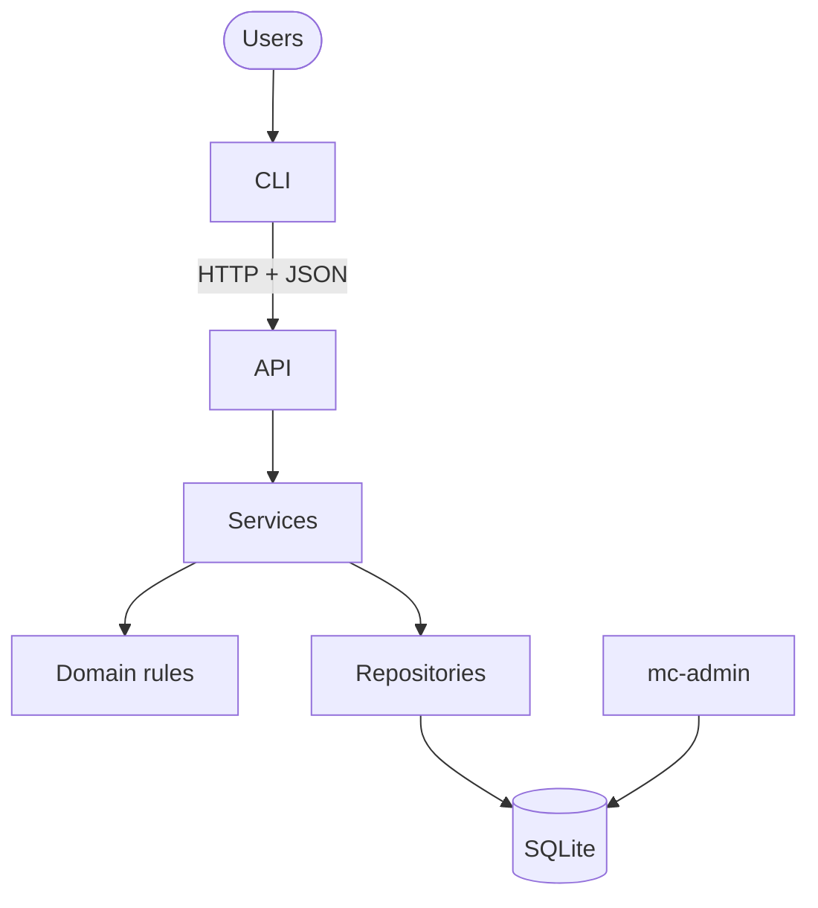
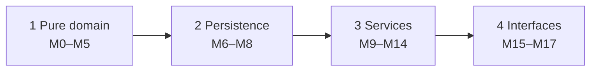

# Subagent (01): Review Phase 1 code quality

Source: `agent-ae9e4aae7a560e329.jsonl` · 2026-10-11 12:08:08 UTC → 2026-10-11 12:11:13 UTC

Rendered from the raw JSONL without editing message content. Tool results and thinking are collapsed; expand them to read.


---

### 👤 User · 2026-10-11 12:08:08 UTC

You are doing a READ-ONLY code-quality review of a Python project. Do NOT edit, create, delete or format any file, and do not run git commands that change state (no commit, add, stash, checkout, reset). You may read files, grep, and run `uv run pytest -q` and `uv run ruff check` to confirm things.

Repository: /Users/pritanbarai/Desktop/JOBS/mutinex_mission_control

Context:
- `docs/prd.md` defines behaviour (rule IDs like P3, M7, A2, AC-15). `docs/technical-design.md` defines structure: layering in §2, matching in §6, error/problem codes in §7, delivery plan in §9 and agent guidelines in §10. Read the relevant parts as needed.
- Phase 1 ("pure domain", modules M0–M5) is complete. Review exactly these files:
  - src/mission_control/api/app.py (M0 skeleton, /health)
  - src/mission_control/domain/{dates,enums,errors,records,eligibility,passwords,matching,lifecycle,approvals,permissions}.py
  - tests/api/test_health.py and tests/unit/domain/test_*.py
  - pyproject.toml
- Agreed conventions you must respect, not flag: the domain is pure (no I/O; imports only stdlib and other domain modules); frozen dataclasses; PRD IDs appear in test names and comments but NOT in src/; user-facing messages are natural sentences built from explicit phrase maps, never generated from enum names; `httpx` must never be used (`httpx2` only); refusals return every Problem at once; `not_owner` is deliberately reused for "not your profile/assignment"; `approver_problems` deliberately returns `role_forbidden` for non-Directors even though permissions.py also checks roles; reason-required checks are deliberately left to the API/DB layers.
- All behaviour in these modules has been approved. Recommendations must PRESERVE that behaviour: the same results, codes and message text.

Look for:
1. Duplication: logic or data repeated across modules, e.g. state sets, phrase maps, problem construction, test helpers/builders repeated across test files.
2. Unnecessary complexity: code that could be simpler with no loss.
3. Unclear naming: names that mislead or don't match PRD/design vocabulary.
4. Poor separation of concerns: rules in the wrong module, modules knowing too much about each other, circular-ish coupling (e.g. permissions importing approvals).
5. Brittle tests: tests coupled to incidental details (ordering, exact internals), tests that could pass for the wrong reason, missing assertions, magic numbers without meaning, over-mocking, or tests that would break on harmless refactors.
Also note any real bug you find, but this is mainly a quality review.

Rules for recommendations:
- Recommend ONLY changes with a concrete benefit (say what it is: fewer places to change, a bug class prevented, clearer API for M6–M17 consumers, etc.). Skip style nits and anything ruff already enforces.
- Each finding: priority (High / Medium / Low), category, file:line reference(s), what's wrong, the concrete recommended change, the benefit, and confirmation that it preserves approved behaviour (or why behaviour could change).
- Prioritise: High = likely to cause bugs or real pain in upcoming modules (services M9–M14, API M15, CLI M16); Medium = worthwhile clean-up; Low = optional.
- Be specific and verify claims by reading the code. Don't pad: if something is fine, leave it out. 5–12 well-founded findings beat 30 shallow ones.

Return your report as: a one-paragraph overall assessment, then the findings ordered by priority (High first), then a short "Things that are good and should stay as they are" list (max 5 bullets).

<details>
<summary>⚙️ System/meta message · 2026-10-11 12:08:08 UTC</summary>

```
<system-reminder>
Your final report is delivered through SubagentHandback: when your work is complete, call SubagentHandback({message: <your full report>}). The call ends your run, so make it your last step. Only a SubagentHandback call reaches your caller as your result; plain text you write at the end is not delivered.
</system-reminder>
```

</details>

**🔧 Bash**

*List file sizes and show config*

```bash
wc -l src/mission_control/api/app.py src/mission_control/domain/*.py tests/api/test_health.py tests/unit/domain/*.py pyproject.toml && cat pyproject.toml src/mission_control/api/app.py
```

<details>
<summary>↳ Result</summary>

```
      17 src/mission_control/api/app.py
       0 src/mission_control/domain/__init__.py
      52 src/mission_control/domain/approvals.py
      29 src/mission_control/domain/dates.py
     231 src/mission_control/domain/eligibility.py
      25 src/mission_control/domain/enums.py
      20 src/mission_control/domain/errors.py
     235 src/mission_control/domain/lifecycle.py
      86 src/mission_control/domain/matching.py
      11 src/mission_control/domain/passwords.py
     210 src/mission_control/domain/permissions.py
      42 src/mission_control/domain/records.py
      12 tests/api/test_health.py
     101 tests/unit/domain/test_approvals.py
      77 tests/unit/domain/test_dates.py
     364 tests/unit/domain/test_eligibility.py
     329 tests/unit/domain/test_lifecycle.py
     262 tests/unit/domain/test_matching.py
      38 tests/unit/domain/test_passwords.py
     180 tests/unit/domain/test_permissions.py
      39 pyproject.toml
    2360 total
[project]
name = "mission-control"
version = "0.1.0"
description = "Multi-tenant mission planning API and CLI"
requires-python = ">=3.12,<3.13"
dependencies = [
    "fastapi>=0.115",
    "uvicorn>=0.30",
]

[project.scripts]
mc-server = "mission_control.api.app:main"

[dependency-groups]
dev = [
    "httpx2>=2.13",
    "pytest>=8",
    "ruff>=0.6",
]

[build-system]
requires = ["hatchling"]
build-backend = "hatchling.build"

[tool.hatch.build.targets.wheel]
packages = ["src/mission_control"]

[tool.pytest.ini_options]
testpaths = ["tests"]
addopts = "-q"

[tool.ruff]
line-length = 100
target-version = "py312"
src = ["src", "tests"]
extend-exclude = ["docs"]

[tool.ruff.lint]
select = ["E", "F", "I", "B", "UP"]
from fastapi import FastAPI


def create_app() -> FastAPI:
    app = FastAPI(title="Mission Control")

    @app.get("/health")
    def health() -> dict[str, str]:
        return {"status": "ok"}

    return app


def main() -> None:
    import uvicorn

    uvicorn.run(create_app(), host="127.0.0.1", port=8000)
```

</details>

**🔧 Bash**

*Show small domain modules*

```bash
cd /Users/pritanbarai/Desktop/JOBS/mutinex_mission_control/src/mission_control/domain && for f in enums errors records dates passwords approvals matching; do echo "=== $f"; cat -n $f.py; done
```

**🔧 Bash**

*Show larger domain modules*

```bash
cd /Users/pritanbarai/Desktop/JOBS/mutinex_mission_control/src/mission_control/domain && for f in eligibility lifecycle permissions; do echo "=== $f"; cat -n $f.py; done
```

<details>
<summary>↳ Result</summary>

```
=== enums
     1	from enum import StrEnum
     2	
     3	
     4	class MissionStatus(StrEnum):
     5	    DRAFT = "draft"
     6	    PENDING_APPROVAL = "pending_approval"
     7	    ACTIVE = "active"
     8	    COMPLETED = "completed"
     9	    CANCELLED = "cancelled"
    10	
    11	
    12	class AssignmentStatus(StrEnum):
    13	    PROPOSED = "proposed"
    14	    ACCEPTED = "accepted"
    15	    DECLINED = "declined"
    16	    WITHDRAWN = "withdrawn"
    17	    REMOVED = "removed"
    18	    COMPLETED = "completed"
    19	    CANCELLED = "cancelled"
    20	
    21	
    22	class Role(StrEnum):
    23	    DIRECTOR = "director"
    24	    LEAD = "lead"
    25	    CREW = "crew"
=== errors
     1	from collections.abc import Mapping
     2	from dataclasses import dataclass, field
     3	
     4	
     5	@dataclass(frozen=True)
     6	class Problem:
     7	    """One reason an action can't go ahead. `refs` names the records involved."""
     8	
     9	    code: str
    10	    message: str
    11	    refs: Mapping[str, int | str | list[int]] = field(default_factory=dict)
    12	
    13	
    14	class Forbidden(Exception):
    15	    """The actor can see the resource but isn't allowed to do this."""
    16	
    17	    def __init__(self, code: str, message: str) -> None:
    18	        super().__init__(message)
    19	        self.code = code
    20	        self.message = message
=== records
     1	"""Plain facts the domain rules work on. Services build these from the database."""
     2	
     3	from collections.abc import Mapping
     4	from dataclasses import dataclass
     5	
     6	from mission_control.domain.dates import DateRange
     7	
     8	
     9	@dataclass(frozen=True)
    10	class Requirement:
    11	    skill_id: int
    12	    skill_name: str
    13	    min_level: int
    14	
    15	
    16	@dataclass(frozen=True)
    17	class SlotSpec:
    18	    id: int
    19	    position: int
    20	    name: str
    21	    open_places: int
    22	    requirements: tuple[Requirement, ...]
    23	
    24	
    25	@dataclass(frozen=True)
    26	class Commitment:
    27	    """An accepted assignment on another non-final mission."""
    28	
    29	    mission_id: int
    30	    mission_name: str
    31	    window: DateRange
    32	
    33	
    34	@dataclass(frozen=True)
    35	class CandidateFacts:
    36	    crew_profile_id: int
    37	    name: str
    38	    active: bool
    39	    skills: Mapping[int, int]  # skill_id -> level
    40	    unavailable: tuple[DateRange, ...]
    41	    accepted_elsewhere: tuple[Commitment, ...]
    42	    workload: int
=== dates
     1	"""Calendar date ranges. Dates have no time or time zone; both ends are inclusive."""
     2	
     3	from dataclasses import dataclass
     4	from datetime import date
     5	
     6	
     7	class InvalidDateRange(ValueError):
     8	    """The end date is before the start date."""
     9	
    10	
    11	@dataclass(frozen=True)
    12	class DateRange:
    13	    start: date
    14	    end: date
    15	
    16	    def __post_init__(self) -> None:
    17	        if self.end < self.start:
    18	            raise InvalidDateRange(
    19	                f"end date {self.end.isoformat()} is before start date {self.start.isoformat()}"
    20	            )
    21	
    22	    def overlaps(self, other: "DateRange") -> bool:
    23	        """True if the ranges share at least one calendar day, including a boundary day."""
    24	        return self.start <= other.end and other.start <= self.end
    25	
    26	    @property
    27	    def mission_days(self) -> int:
    28	        """Days from start to end, counting both."""
    29	        return (self.end - self.start).days + 1
=== passwords
     1	MIN_PASSWORD_LENGTH = 15
     2	
     3	
     4	class PasswordTooShort(ValueError):
     5	    pass
     6	
     7	
     8	def validate_password(password: str) -> None:
     9	    """Length is the only rule: no character-type requirements, so passphrases work."""
    10	    if len(password) < MIN_PASSWORD_LENGTH:
    11	        raise PasswordTooShort(f"password must be at least {MIN_PASSWORD_LENGTH} characters")
=== approvals
     1	"""Who may approve a mission, and when enough of them have."""
     2	
     3	from collections.abc import Iterable, Set
     4	from dataclasses import dataclass
     5	
     6	from mission_control.domain.errors import Problem
     7	
     8	
     9	@dataclass(frozen=True)
    10	class Approver:
    11	    user_id: int
    12	    is_director: bool
    13	    active: bool
    14	
    15	
    16	def approver_problems(
    17	    approver: Approver,
    18	    created_by_id: int | None,
    19	    rostered_user_ids: Set[int],
    20	    decided_this_round: Set[int],
    21	) -> list[Problem]:
    22	    """Every reason `approver` can't approve or reject this round. Empty means they can."""
    23	    if not approver.is_director:
    24	        return [Problem("role_forbidden", "Only Directors can approve or reject missions")]
    25	    problems = []
    26	    if approver.user_id == created_by_id:
    27	        problems.append(Problem("approver_is_creator", "You can't approve a mission you created"))
    28	    if approver.user_id in rostered_user_ids:
    29	        problems.append(Problem("approver_is_rostered", "You can't approve a mission you're on"))
    30	    if approver.user_id in decided_this_round:
    31	        problems.append(Problem("already_decided", "You've already decided this round of approval"))
    32	    return problems
    33	
    34	
    35	def count_eligible_approvers(
    36	    people: Iterable[Approver], created_by_id: int, rostered_user_ids: Set[int]
    37	) -> int:
    38	    """Active Directors who didn't create the mission and aren't on it."""
    39	    return sum(
    40	        1
    41	        for p in people
    42	        if p.is_director
    43	        and p.active
    44	        and p.user_id != created_by_id
    45	        and p.user_id not in rostered_user_ids
    46	    )
    47	
    48	
    49	def reaches_quorum(approvals_in_round: int, approvals_required: int) -> bool:
    50	    """`approvals_in_round` counts approvals recorded this round, including the new one.
    51	    `approvals_required` is the N saved at submit, not the organisation's current setting."""
    52	    return approvals_in_round >= approvals_required
=== matching
     1	"""Suggest crew for a mission's open places. Advisory only: nothing is written.
     2	
     3	1. Filter: find the eligible candidates for each slot.
     4	2. Pick the open slot with the fewest candidates (ties: position, then id).
     5	3. Pick the person with the lowest workload, then highest proficiency, then lowest id.
     6	4. Place them and remove them from every other slot's candidates.
     7	5. Repeat, recounting each time. Places with no candidates left are reported as unfilled.
     8	"""
     9	
    10	from collections.abc import Sequence
    11	from dataclasses import dataclass
    12	
    13	from mission_control.domain.dates import DateRange
    14	from mission_control.domain.eligibility import is_eligible
    15	from mission_control.domain.records import CandidateFacts, SlotSpec
    16	
    17	
    18	@dataclass(frozen=True)
    19	class Placement:
    20	    """One suggested person for one place in a slot."""
    21	
    22	    slot_id: int
    23	    crew_profile_id: int
    24	
    25	
    26	@dataclass(frozen=True)
    27	class Unfilled:
    28	    """Places in a slot that no eligible candidate was left to fill."""
    29	
    30	    slot_id: int
    31	    count: int
    32	
    33	
    34	@dataclass(frozen=True)
    35	class Suggestion:
    36	    placements: tuple[Placement, ...]  # in the order they were picked
    37	    unfilled: tuple[Unfilled, ...]  # in the order the gaps were found
    38	
    39	
    40	def suggest_roster(
    41	    slots: Sequence[SlotSpec], candidates: Sequence[CandidateFacts], window: DateRange
    42	) -> Suggestion:
    43	    by_id = {c.crew_profile_id: c for c in candidates}
    44	
    45	    # Step 1: who could fill each slot. Computed once, then shrunk as people are placed.
    46	    # Eligibility doesn't change during a run, only who is still free.
    47	    eligible: dict[int, set[int]] = {
    48	        s.id: {c.crew_profile_id for c in candidates if is_eligible(c, s, window)} for s in slots
    49	    }
    50	    # Places still to fill per slot. Slots that are already full start at 0 and are never picked.
    51	    remaining: dict[int, int] = {s.id: s.open_places for s in slots}
    52	
    53	    placements: list[Placement] = []
    54	    unfilled: list[Unfilled] = []
    55	
    56	    while open_slots := [s for s in slots if remaining[s.id] > 0]:
    57	        # Step 2: most constrained slot first. Recounted on every pass, because each placement
    58	        # can shrink other slots' candidate lists.
    59	        slot = min(open_slots, key=lambda s: (len(eligible[s.id]), s.position, s.id))
    60	
    61	        if not eligible[slot.id]:
    62	            # Nobody left who can fill this slot: report every remaining place as a gap and stop
    63	            # considering the slot.
    64	            unfilled.append(Unfilled(slot.id, remaining[slot.id]))
    65	            remaining[slot.id] = 0
    66	            continue
    67	
    68	        # Step 3: best person for this slot. Negating proficiency makes "higher is better" work
    69	        # with min(); the id at the end makes the ordering total.
    70	        person = min(
    71	            (by_id[i] for i in eligible[slot.id]),
    72	            key=lambda c: (c.workload, -proficiency(c, slot), c.crew_profile_id),
    73	        )
    74	
    75	        # Step 4: place them, and make sure they can't be picked for any other slot or place.
    76	        placements.append(Placement(slot.id, person.crew_profile_id))
    77	        remaining[slot.id] -= 1
    78	        for ids in eligible.values():
    79	            ids.discard(person.crew_profile_id)
    80	
    81	    return Suggestion(tuple(placements), tuple(unfilled))
    82	
    83	
    84	def proficiency(person: CandidateFacts, slot: SlotSpec) -> int:
    85	    """Sum of the person's levels in the slot's required skills. Other skills don't count."""
    86	    return sum(person.skills.get(r.skill_id, 0) for r in slot.requirements)
```

</details>

<details>
<summary>↳ Result</summary>

```
=== eligibility
     1	"""Who can fill a slot, how loaded they are, and which edits would break existing assignments."""
     2	
     3	from collections.abc import Iterable, Sequence
     4	from dataclasses import dataclass
     5	
     6	from mission_control.domain.dates import DateRange
     7	from mission_control.domain.enums import AssignmentStatus, MissionStatus
     8	from mission_control.domain.errors import Problem
     9	from mission_control.domain.records import CandidateFacts, Requirement, SlotSpec
    10	
    11	
    12	def _span(window: DateRange) -> str:
    13	    return f"{window.start.isoformat()} to {window.end.isoformat()}"
    14	
    15	
    16	def ineligibility_reasons(
    17	    person: CandidateFacts, slot: SlotSpec, window: DateRange
    18	) -> list[Problem]:
    19	    """Every reason `person` can't fill `slot` for `window`. Empty means eligible."""
    20	    problems: list[Problem] = []
    21	    ref = {"crew_profile_id": person.crew_profile_id, "slot_id": slot.id}
    22	
    23	    if not person.active:
    24	        problems.append(Problem("inactive", f"{person.name} is deactivated", ref))
    25	
    26	    problems.extend(_skill_shortfalls(person, slot.requirements, ref))
    27	    problems.extend(_availability_conflicts(person, window, ref))
    28	    return problems
    29	
    30	
    31	def is_eligible(person: CandidateFacts, slot: SlotSpec, window: DateRange) -> bool:
    32	    return not ineligibility_reasons(person, slot, window)
    33	
    34	
    35	def _availability_conflicts(
    36	    person: CandidateFacts, window: DateRange, ref: dict[str, int | str]
    37	) -> list[Problem]:
    38	    """Unavailability or accepted assignments elsewhere that overlap `window`."""
    39	    problems = []
    40	    for blocked in person.unavailable:
    41	        if blocked.overlaps(window):
    42	            problems.append(
    43	                Problem("unavailable", f"{person.name} is unavailable {_span(blocked)}", ref)
    44	            )
    45	    for other in person.accepted_elsewhere:
    46	        if other.window.overlaps(window):
    47	            shared = DateRange(
    48	                max(other.window.start, window.start), min(other.window.end, window.end)
    49	            )
    50	            problems.append(
    51	                Problem(
    52	                    "overlap",
    53	                    f"{person.name} has an accepted assignment on {other.mission_name} "
    54	                    f"overlapping {_span(shared)}",
    55	                    {**ref, "mission_id": other.mission_id, "mission_name": other.mission_name},
    56	                )
    57	            )
    58	    return problems
    59	
    60	
    61	def _skill_shortfalls(
    62	    person: CandidateFacts, requirements: Iterable[Requirement], ref: dict[str, int | str]
    63	) -> list[Problem]:
    64	    problems = []
    65	    for r in requirements:
    66	        level = person.skills.get(r.skill_id)
    67	        if level is None or level < r.min_level:
    68	            have = (
    69	                f"doesn't have {r.skill_name}" if level is None else (f"has {r.skill_name} {level}")
    70	            )
    71	            problems.append(
    72	                Problem(
    73	                    "skill_below_minimum",
    74	                    f"{person.name} {have} (needs {r.min_level})",
    75	                    {**ref, "skill_id": r.skill_id},
    76	                )
    77	            )
    78	    return problems
    79	
    80	
    81	# Workload
    82	
    83	
    84	@dataclass(frozen=True)
    85	class AssignmentFact:
    86	    mission_id: int
    87	    mission_status: MissionStatus
    88	    assignment_status: AssignmentStatus
    89	    window: DateRange
    90	
    91	
    92	def workload(assignments: Iterable[AssignmentFact], excluding_mission_id: int) -> int:
    93	    """Mission-days of accepted assignments on missions that aren't completed."""
    94	    return sum(
    95	        a.window.mission_days
    96	        for a in assignments
    97	        if a.assignment_status == AssignmentStatus.ACCEPTED
    98	        and a.mission_status != MissionStatus.COMPLETED
    99	        and a.mission_id != excluding_mission_id
   100	    )
   101	
   102	
   103	# Edits that would invalidate open assignments
   104	
   105	
   106	@dataclass(frozen=True)
   107	class OpenAssignment:
   108	    """A proposed or accepted assignment on the mission being edited."""
   109	
   110	    assignment_id: int
   111	    slot_id: int
   112	    slot_name: str
   113	    crew: CandidateFacts  # accepted_elsewhere must exclude the mission being edited
   114	
   115	
   116	@dataclass(frozen=True)
   117	class SlotRemoval:
   118	    slot_id: int
   119	
   120	
   121	@dataclass(frozen=True)
   122	class SlotEdit:
   123	    slot_id: int
   124	    headcount: int | None = None
   125	    requirements: tuple[Requirement, ...] | None = None
   126	
   127	
   128	@dataclass(frozen=True)
   129	class DatesEdit:
   130	    window: DateRange
   131	
   132	
   133	MissionEditKind = SlotRemoval | SlotEdit | DatesEdit
   134	
   135	
   136	def invalidated_by(
   137	    edit: MissionEditKind, open_assignments: Sequence[OpenAssignment]
   138	) -> list[Problem]:
   139	    """Every open assignment the edit would break. Empty means the edit is safe."""
   140	    if isinstance(edit, DatesEdit):
   141	        return [
   142	            _in_slot(a, p)
   143	            for a in open_assignments
   144	            for p in _availability_conflicts(a.crew, edit.window, _refs(a))
   145	        ]
   146	
   147	    in_slot = [a for a in open_assignments if a.slot_id == edit.slot_id]
   148	
   149	    if isinstance(edit, SlotRemoval):
   150	        return [
   151	            Problem(
   152	                "slot_has_open_assignments",
   153	                f"{a.slot_name}: {a.crew.name} is still assigned",
   154	                _refs(a),
   155	            )
   156	            for a in in_slot
   157	        ]
   158	
   159	    problems: list[Problem] = []
   160	    if edit.headcount is not None and edit.headcount < len(in_slot):
   161	        names = _join_names([a.crew.name for a in in_slot])
   162	        problems.append(
   163	            Problem(
   164	                "headcount_below_open_assignments",
   165	                f"{in_slot[0].slot_name}: {names} are assigned, more than the new headcount "
   166	                f"of {edit.headcount}",
   167	                {
   168	                    "slot_id": edit.slot_id,
   169	                    "crew_profile_ids": [a.crew.crew_profile_id for a in in_slot],
   170	                },
   171	            )
   172	        )
   173	    if edit.requirements is not None:
   174	        for a in in_slot:
   175	            ref = {"crew_profile_id": a.crew.crew_profile_id, "slot_id": a.slot_id}
   176	            problems.extend(
   177	                _in_slot(a, p) for p in _skill_shortfalls(a.crew, edit.requirements, ref)
   178	            )
   179	    return problems
   180	
   181	
   182	def _join_names(names: list[str]) -> str:
   183	    return names[0] if len(names) == 1 else ", ".join(names[:-1]) + " and " + names[-1]
   184	
   185	
   186	def _refs(a: OpenAssignment) -> dict[str, int | str]:
   187	    return {
   188	        "assignment_id": a.assignment_id,
   189	        "crew_profile_id": a.crew.crew_profile_id,
   190	        "slot_id": a.slot_id,
   191	    }
   192	
   193	
   194	def _in_slot(a: OpenAssignment, p: Problem) -> Problem:
   195	    return Problem(p.code, f"{a.slot_name}: {p.message}", {**p.refs, **_refs(a)})
   196	
   197	
   198	# Skill changes against Active assignments
   199	
   200	
   201	@dataclass(frozen=True)
   202	class ActiveAssignment:
   203	    """An accepted assignment on an Active mission."""
   204	
   205	    mission_id: int
   206	    mission_name: str
   207	    slot_name: str
   208	    requirements: tuple[Requirement, ...]
   209	
   210	
   211	def invalidated_by_skill_change(
   212	    person_name: str,
   213	    skill_id: int,
   214	    new_level: int | None,
   215	    active_assignments: Sequence[ActiveAssignment],
   216	) -> list[Problem]:
   217	    """A skill change is refused only if it breaks an assignment on an Active mission.
   218	    `new_level=None` means the skill is being removed."""
   219	    problems = []
   220	    for a in active_assignments:
   221	        for r in a.requirements:
   222	            if r.skill_id == skill_id and (new_level or 0) < r.min_level:
   223	                problems.append(
   224	                    Problem(
   225	                        "invalidates_active_assignment",
   226	                        f"{person_name} needs {r.skill_name} {r.min_level} as {a.slot_name} "
   227	                        f"on active mission {a.mission_name}",
   228	                        {"mission_id": a.mission_id, "skill_id": skill_id},
   229	                    )
   230	                )
   231	    return problems
=== lifecycle
     1	"""Mission and assignment state machines, and the checks a mission must pass to be submitted."""
     2	
     3	from collections.abc import Sequence
     4	from dataclasses import dataclass
     5	from enum import StrEnum
     6	
     7	from mission_control.domain.dates import DateRange
     8	from mission_control.domain.eligibility import ineligibility_reasons
     9	from mission_control.domain.enums import AssignmentStatus, MissionStatus
    10	from mission_control.domain.errors import Problem
    11	from mission_control.domain.records import CandidateFacts, SlotSpec
    12	
    13	M = MissionStatus
    14	A = AssignmentStatus
    15	
    16	FINAL = frozenset({M.COMPLETED, M.CANCELLED})
    17	
    18	
    19	class MissionAction(StrEnum):
    20	    SUBMIT = "submit"
    21	    APPROVE = "approve"
    22	    REJECT = "reject"
    23	    TRANSFER = "transfer"
    24	    COMPLETE = "complete"
    25	    CANCEL = "cancel"
    26	    EDIT = "edit"  # any change to dates, slots or requirements
    27	
    28	
    29	# The states each mission action may start from.
    30	MISSION_ALLOWED_FROM: dict[MissionAction, frozenset[MissionStatus]] = {
    31	    MissionAction.SUBMIT: frozenset({M.DRAFT}),
    32	    MissionAction.APPROVE: frozenset({M.PENDING_APPROVAL}),
    33	    MissionAction.REJECT: frozenset({M.PENDING_APPROVAL}),
    34	    MissionAction.TRANSFER: frozenset({M.DRAFT, M.PENDING_APPROVAL, M.ACTIVE}),
    35	    MissionAction.COMPLETE: frozenset({M.ACTIVE}),
    36	    MissionAction.CANCEL: frozenset({M.DRAFT, M.PENDING_APPROVAL, M.ACTIVE}),
    37	    MissionAction.EDIT: frozenset({M.DRAFT, M.PENDING_APPROVAL}),
    38	}
    39	
    40	
    41	# How each state reads after "a mission ...", e.g. "Can't approve a mission in draft".
    42	_STATE_PHRASE = {
    43	    M.DRAFT: "in draft",
    44	    M.PENDING_APPROVAL: "pending approval",
    45	    M.COMPLETED: "that's completed",
    46	    M.CANCELLED: "that's cancelled",
    47	}
    48	
    49	
    50	def _wrong_state(status: MissionStatus, doing: str) -> Problem:
    51	    """`doing` is the start of the sentence, e.g. "approve" or "withdraw from"."""
    52	    if status == M.ACTIVE:
    53	        return Problem("mission_frozen", f"Can't {doing} an active mission")
    54	    code = "mission_final" if status in FINAL else "invalid_transition"
    55	    return Problem(code, f"Can't {doing} a mission {_STATE_PHRASE[status]}")
    56	
    57	
    58	def state_problem(status: MissionStatus, action: MissionAction) -> Problem | None:
    59	    """Why `action` isn't allowed from `status`, or None if it is."""
    60	    if status in MISSION_ALLOWED_FROM[action]:
    61	        return None
    62	    return _wrong_state(status, action.value)
    63	
    64	
    65	def mission_status_after(
    66	    status: MissionStatus, action: MissionAction, *, reaches_quorum: bool = False
    67	) -> MissionStatus:
    68	    """The mission's status once `action` succeeds. Check `state_problem` first."""
    69	    if state_problem(status, action) is not None:
    70	        raise ValueError(f"{action.value} is not allowed from {status.value}")
    71	    match action:
    72	        case MissionAction.SUBMIT:
    73	            return M.PENDING_APPROVAL
    74	        case MissionAction.APPROVE:
    75	            return M.ACTIVE if reaches_quorum else M.PENDING_APPROVAL
    76	        case MissionAction.REJECT:
    77	            return M.DRAFT
    78	        case MissionAction.COMPLETE:
    79	            return M.COMPLETED
    80	        case MissionAction.CANCEL:
    81	            return M.CANCELLED
    82	        case MissionAction.EDIT | MissionAction.TRANSFER:
    83	            # A change to a pending mission voids its approval round; otherwise status holds.
    84	            return M.DRAFT if status == M.PENDING_APPROVAL else status
    85	
    86	
    87	# Assignments
    88	
    89	
    90	class AssignmentAction(StrEnum):
    91	    PROPOSE = "propose"
    92	    ACCEPT = "accept"
    93	    DECLINE = "decline"
    94	    WITHDRAW = "withdraw"
    95	    REMOVE = "remove"
    96	
    97	
    98	# action -> (assignment states it may start from, mission states it's allowed in).
    99	# PROPOSE creates the assignment, so it has no starting state.
   100	_ASSIGNMENT_RULES: dict[
   101	    AssignmentAction, tuple[frozenset[AssignmentStatus] | None, frozenset[MissionStatus]]
   102	] = {
   103	    AssignmentAction.PROPOSE: (None, frozenset({M.DRAFT, M.PENDING_APPROVAL})),
   104	    AssignmentAction.ACCEPT: (frozenset({A.PROPOSED}), frozenset({M.DRAFT})),
   105	    AssignmentAction.DECLINE: (frozenset({A.PROPOSED}), frozenset({M.DRAFT})),
   106	    AssignmentAction.WITHDRAW: (frozenset({A.ACCEPTED}), frozenset({M.DRAFT, M.PENDING_APPROVAL})),
   107	    AssignmentAction.REMOVE: (
   108	        frozenset({A.PROPOSED, A.ACCEPTED}),
   109	        frozenset({M.DRAFT, M.PENDING_APPROVAL}),
   110	    ),
   111	}
   112	
   113	_ASSIGNMENT_RESULT = {
   114	    AssignmentAction.PROPOSE: A.PROPOSED,
   115	    AssignmentAction.ACCEPT: A.ACCEPTED,
   116	    AssignmentAction.DECLINE: A.DECLINED,
   117	    AssignmentAction.WITHDRAW: A.WITHDRAWN,
   118	    AssignmentAction.REMOVE: A.REMOVED,
   119	}
   120	
   121	# How each assignment action reads before "a mission ...".
   122	_ASSIGNMENT_PHRASE = {
   123	    AssignmentAction.PROPOSE: "propose crew for",
   124	    AssignmentAction.ACCEPT: "accept a proposal on",
   125	    AssignmentAction.DECLINE: "decline a proposal on",
   126	    AssignmentAction.WITHDRAW: "withdraw from",
   127	    AssignmentAction.REMOVE: "remove crew from",
   128	}
   129	
   130	# Actions that change the roster, and so send a pending mission back to Draft.
   131	_ROSTER_CHANGES = frozenset(
   132	    {AssignmentAction.PROPOSE, AssignmentAction.WITHDRAW, AssignmentAction.REMOVE}
   133	)
   134	
   135	
   136	def assignment_problem(
   137	    action: AssignmentAction, current: AssignmentStatus | None, mission: MissionStatus
   138	) -> Problem | None:
   139	    """Why `action` isn't allowed, or None. Mission state is checked before assignment state."""
   140	    from_states, mission_states = _ASSIGNMENT_RULES[action]
   141	    if mission not in mission_states:
   142	        return _wrong_state(mission, _ASSIGNMENT_PHRASE[action])
   143	    if from_states is not None and current not in from_states:
   144	        label = current.value if current else "missing"
   145	        return Problem("invalid_transition", f"Can't {action.value} an assignment that is {label}")
   146	    return None
   147	
   148	
   149	def assignment_status_after(action: AssignmentAction) -> AssignmentStatus:
   150	    return _ASSIGNMENT_RESULT[action]
   151	
   152	
   153	def mission_status_after_assignment_action(
   154	    mission: MissionStatus, action: AssignmentAction
   155	) -> MissionStatus:
   156	    if action in _ROSTER_CHANGES and mission == M.PENDING_APPROVAL:
   157	        return M.DRAFT
   158	    return mission
   159	
   160	
   161	def cascade(mission_final_status: MissionStatus, assignment: AssignmentStatus) -> AssignmentStatus:
   162	    """What an assignment becomes when its mission completes or is cancelled."""
   163	    if mission_final_status == M.COMPLETED and assignment == A.ACCEPTED:
   164	        return A.COMPLETED
   165	    if mission_final_status == M.CANCELLED and assignment in (A.PROPOSED, A.ACCEPTED):
   166	        return A.CANCELLED
   167	    return assignment
   168	
   169	
   170	# Submit guard
   171	
   172	
   173	@dataclass(frozen=True)
   174	class RosterEntry:
   175	    """An open assignment on the mission being submitted."""
   176	
   177	    assignment_id: int
   178	    slot: SlotSpec
   179	    crew: CandidateFacts  # accepted_elsewhere must exclude this mission
   180	    status: AssignmentStatus  # proposed or accepted
   181	
   182	
   183	def roster_problems(roster: Sequence[RosterEntry], window: DateRange) -> list[Problem]:
   184	    """Accepted crew who are no longer eligible, e.g. after a skill change. Checked at submit
   185	    and again at every approval."""
   186	    return [
   187	        p
   188	        for e in roster
   189	        if e.status == A.ACCEPTED
   190	        for p in ineligibility_reasons(e.crew, e.slot, window)
   191	    ]
   192	
   193	
   194	def submit_problems(
   195	    slots: Sequence[SlotSpec],
   196	    roster: Sequence[RosterEntry],
   197	    window: DateRange,
   198	    eligible_approvers: int,
   199	    approvals_required: int,
   200	) -> list[Problem]:
   201	    """Everything stopping a Draft mission being submitted, all at once. `slots[i].open_places`
   202	    is headcount minus open assignments."""
   203	    problems: list[Problem] = []
   204	    for s in slots:
   205	        if s.open_places > 0:
   206	            problems.append(
   207	                Problem(
   208	                    "slot_unfilled",
   209	                    f"{s.name}: {s.open_places} place{'s' if s.open_places > 1 else ''} unfilled",
   210	                    {"slot_id": s.id},
   211	                )
   212	            )
   213	    for e in roster:
   214	        if e.status == A.PROPOSED:
   215	            problems.append(
   216	                Problem(
   217	                    "proposal_unanswered",
   218	                    f"{e.slot.name}: {e.crew.name} hasn't responded to the proposal",
   219	                    {
   220	                        "assignment_id": e.assignment_id,
   221	                        "slot_id": e.slot.id,
   222	                        "crew_profile_id": e.crew.crew_profile_id,
   223	                    },
   224	                )
   225	            )
   226	    problems.extend(roster_problems(roster, window))
   227	    if eligible_approvers < approvals_required:
   228	        problems.append(
   229	            Problem(
   230	                "insufficient_approvers",
   231	                f"{eligible_approvers} eligible approver{'s' if eligible_approvers != 1 else ''}, "
   232	                f"{approvals_required} required",
   233	            )
   234	        )
   235	    return problems
=== permissions
     1	"""Who may do what. `authorize` is the single entry point; it raises Forbidden with a code.
     2	
     3	Each action combines a role check with, where needed, a relationship check: owner of the
     4	mission, the person themselves, the mission's creator, or someone on its roster.
     5	"""
     6	
     7	from dataclasses import dataclass, field
     8	from enum import StrEnum
     9	
    10	from mission_control.domain.approvals import Approver, approver_problems
    11	from mission_control.domain.enums import Role
    12	from mission_control.domain.errors import Forbidden
    13	
    14	
    15	@dataclass(frozen=True)
    16	class Actor:
    17	    user_id: int
    18	    org_id: int
    19	    role: Role
    20	    crew_profile_id: int | None
    21	
    22	
    23	@dataclass(frozen=True)
    24	class Context:
    25	    """Facts about the target that the relationship rules need. Unused fields stay None."""
    26	
    27	    owner_id: int | None = None  # the mission's owning Lead
    28	    created_by_id: int | None = None  # who created the mission
    29	    target_user_id: int | None = None  # whose profile, skills or assignment this is
    30	    rostered_user_ids: frozenset[int] = field(default_factory=frozenset)
    31	
    32	
    33	class Action(StrEnum):
    34	    MANAGE_ORG = "manage_org"  # settings, users, roles, initial passwords, crew profiles
    35	    MANAGE_SKILLS = "manage_skills"
    36	    LIST_SKILLS = "list_skills"
    37	    CHANGE_OWN_PASSWORD = "change_own_password"
    38	    VIEW_CREW = "view_crew"
    39	    VIEW_ASSIGNMENT_HISTORY = "view_assignment_history"
    40	    VIEW_UNAVAILABILITY_REASON = "view_unavailability_reason"
    41	    EDIT_OWN_PROFILE = "edit_own_profile"  # personal details and unavailability
    42	    SET_SKILL_LEVEL = "set_skill_level"
    43	    VIEW_MISSION = "view_mission"  # includes its history
    44	    CREATE_MISSION = "create_mission"
    45	    EDIT_MISSION = "edit_mission"
    46	    PROPOSE_CREW = "propose_crew"
    47	    REMOVE_CREW = "remove_crew"
    48	    APPLY_MATCH = "apply_match"
    49	    SUBMIT = "submit"
    50	    PREVIEW_MATCH = "preview_match"
    51	    COMPLETE = "complete"
    52	    CANCEL = "cancel"
    53	    TRANSFER_OWNERSHIP = "transfer_ownership"
    54	    APPROVE = "approve"
    55	    REJECT = "reject"
    56	    RESPOND_TO_ASSIGNMENT = "respond_to_assignment"  # accept, decline, withdraw
    57	
    58	
    59	D, L, C = Role.DIRECTOR, Role.LEAD, Role.CREW
    60	ALL = frozenset(Role)
    61	
    62	# Which roles may attempt each action at all. Relationship rules below narrow this further.
    63	ROLES: dict[Action, frozenset[Role]] = {
    64	    Action.MANAGE_ORG: frozenset({D}),
    65	    Action.MANAGE_SKILLS: frozenset({D}),
    66	    Action.LIST_SKILLS: frozenset({D, L}),
    67	    Action.CHANGE_OWN_PASSWORD: ALL,
    68	    Action.VIEW_CREW: ALL,
    69	    Action.VIEW_ASSIGNMENT_HISTORY: ALL,
    70	    Action.VIEW_UNAVAILABILITY_REASON: ALL,
    71	    Action.EDIT_OWN_PROFILE: ALL,
    72	    Action.SET_SKILL_LEVEL: frozenset({D, L}),
    73	    Action.VIEW_MISSION: ALL,
    74	    Action.CREATE_MISSION: frozenset({D, L}),
    75	    Action.EDIT_MISSION: frozenset({L}),
    76	    Action.PROPOSE_CREW: frozenset({L}),
    77	    Action.REMOVE_CREW: frozenset({L}),
    78	    Action.APPLY_MATCH: frozenset({L}),
    79	    Action.SUBMIT: frozenset({L}),
    80	    Action.PREVIEW_MATCH: frozenset({D, L}),
    81	    Action.COMPLETE: frozenset({D, L}),
    82	    Action.CANCEL: frozenset({D, L}),
    83	    Action.TRANSFER_OWNERSHIP: frozenset({D}),
    84	    Action.APPROVE: frozenset({D}),
    85	    Action.REJECT: frozenset({D}),
    86	    Action.RESPOND_TO_ASSIGNMENT: ALL,
    87	}
    88	
    89	_OWNER_ONLY = {
    90	    Action.EDIT_MISSION,
    91	    Action.PROPOSE_CREW,
    92	    Action.REMOVE_CREW,
    93	    Action.APPLY_MATCH,
    94	    Action.SUBMIT,
    95	}
    96	_OWNER_OR_DIRECTOR = {Action.PREVIEW_MATCH, Action.COMPLETE, Action.CANCEL}
    97	# Crew may only see their own record; Leads and Directors may see anyone's.
    98	_CREW_SELF_ONLY = {Action.VIEW_CREW, Action.VIEW_ASSIGNMENT_HISTORY}
    99	
   100	
   101	# Messages. Phrases are written out so every refusal reads as a natural sentence.
   102	
   103	_ROLE_PLURAL = {D: "Directors", L: "Leads", C: "Crew"}
   104	
   105	# Completes "<Role plural> can't ...".
   106	ROLE_PHRASE: dict[Action, str] = {
   107	    Action.MANAGE_ORG: "manage the organisation",
   108	    Action.MANAGE_SKILLS: "manage the skill catalogue",
   109	    Action.LIST_SKILLS: "view the skill catalogue",
   110	    Action.CHANGE_OWN_PASSWORD: "change their password",
   111	    Action.VIEW_CREW: "view crew profiles",
   112	    Action.VIEW_ASSIGNMENT_HISTORY: "view assignment history",
   113	    Action.VIEW_UNAVAILABILITY_REASON: "see unavailability reasons",
   114	    Action.EDIT_OWN_PROFILE: "edit profiles",
   115	    Action.SET_SKILL_LEVEL: "change skill levels",
   116	    Action.VIEW_MISSION: "view missions",
   117	    Action.CREATE_MISSION: "create missions",
   118	    Action.EDIT_MISSION: "edit missions",
   119	    Action.PROPOSE_CREW: "propose crew",
   120	    Action.REMOVE_CREW: "remove crew",
   121	    Action.APPLY_MATCH: "apply matcher suggestions",
   122	    Action.SUBMIT: "submit missions",
   123	    Action.PREVIEW_MATCH: "preview matcher suggestions",
   124	    Action.COMPLETE: "complete missions",
   125	    Action.CANCEL: "cancel missions",
   126	    Action.TRANSFER_OWNERSHIP: "transfer mission ownership",
   127	    Action.APPROVE: "approve missions",
   128	    Action.REJECT: "reject missions",
   129	    Action.RESPOND_TO_ASSIGNMENT: "respond to assignments",
   130	}
   131	
   132	# Completes "Only the mission's owner can ..." / "Only the owner or a Director can ...".
   133	_MISSION_PHRASE = {
   134	    Action.EDIT_MISSION: "edit this mission",
   135	    Action.PROPOSE_CREW: "propose crew for this mission",
   136	    Action.REMOVE_CREW: "remove crew from this mission",
   137	    Action.APPLY_MATCH: "apply matcher suggestions to this mission",
   138	    Action.SUBMIT: "submit this mission",
   139	    Action.PREVIEW_MATCH: "preview matching for this mission",
   140	    Action.COMPLETE: "complete this mission",
   141	    Action.CANCEL: "cancel this mission",
   142	}
   143	
   144	_SELF_ONLY_MESSAGE = {
   145	    Action.VIEW_CREW: "Crew can only view their own profile",
   146	    Action.VIEW_ASSIGNMENT_HISTORY: "Crew can only view their own assignment history",
   147	    Action.EDIT_OWN_PROFILE: "You can only edit your own profile and availability",
   148	    Action.RESPOND_TO_ASSIGNMENT: "You can only respond to your own assignments",
   149	}
   150	
   151	
   152	NO_CONTEXT = Context()
   153	
   154	
   155	def authorize(actor: Actor, action: Action, ctx: Context = NO_CONTEXT) -> None:
   156	    if actor.role not in ROLES[action]:
   157	        raise Forbidden("role_forbidden", f"{_ROLE_PLURAL[actor.role]} can't {ROLE_PHRASE[action]}")
   158	
   159	    is_self = ctx.target_user_id == actor.user_id
   160	    is_owner = ctx.owner_id == actor.user_id
   161	
   162	    if action in _OWNER_ONLY and not is_owner:
   163	        raise Forbidden("not_owner", f"Only the mission's owner can {_MISSION_PHRASE[action]}")
   164	
   165	    if action in _OWNER_OR_DIRECTOR and actor.role != D and not is_owner:
   166	        raise Forbidden("not_owner", f"Only the owner or a Director can {_MISSION_PHRASE[action]}")
   167	
   168	    if action == Action.CREATE_MISSION and actor.role == L and not is_owner:
   169	        raise Forbidden("not_owner", "Leads can only create missions they own")
   170	
   171	    if action in _CREW_SELF_ONLY and actor.role == C and not is_self:
   172	        raise Forbidden("role_forbidden", _SELF_ONLY_MESSAGE[action])
   173	
   174	    if action == Action.VIEW_UNAVAILABILITY_REASON and actor.role != D and not is_self:
   175	        raise Forbidden(
   176	            "role_forbidden", "Only Directors can see other people's unavailability reasons"
   177	        )
   178	
   179	    if (
   180	        action == Action.VIEW_MISSION
   181	        and actor.role == C
   182	        and actor.user_id not in (ctx.rostered_user_ids)
   183	    ):
   184	        raise Forbidden("role_forbidden", "Crew can only view missions they're on")
   185	
   186	    if action in (Action.EDIT_OWN_PROFILE, Action.RESPOND_TO_ASSIGNMENT) and not is_self:
   187	        raise Forbidden("not_owner", _SELF_ONLY_MESSAGE[action])
   188	
   189	    if action == Action.SET_SKILL_LEVEL and is_self:
   190	        raise Forbidden("self_skill_edit", "You can't change your own skill levels")
   191	
   192	    if action in (Action.APPROVE, Action.REJECT):
   193	        # Creator and roster rules are shared with the approval module. "Already decided" is a
   194	        # state conflict, not a permission, so it's checked by the service, not here.
   195	        problems = approver_problems(
   196	            Approver(actor.user_id, is_director=True, active=True),
   197	            created_by_id=ctx.created_by_id,
   198	            rostered_user_ids=ctx.rostered_user_ids,
   199	            decided_this_round=set(),
   200	        )
   201	        if problems:
   202	            raise Forbidden(problems[0].code, problems[0].message)
   203	
   204	
   205	def can(actor: Actor, action: Action, ctx: Context = NO_CONTEXT) -> bool:
   206	    try:
   207	        authorize(actor, action, ctx)
   208	    except Forbidden:
   209	        return False
   210	    return True
```

</details>

**🔧 Bash**

*Show smaller test files*

```bash
cd /Users/pritanbarai/Desktop/JOBS/mutinex_mission_control/tests && cat -n api/test_health.py unit/domain/test_approvals.py unit/domain/test_dates.py unit/domain/test_passwords.py unit/domain/test_permissions.py; ls unit unit/domain; cat unit/conftest.py unit/domain/conftest.py conftest.py 2>/dev/null
```

<details>
<summary>↳ Result (error)</summary>

```
Exit code 1
     1	from fastapi.testclient import TestClient
     2	
     3	from mission_control.api.app import create_app
     4	
     5	
     6	def test_m0_health_returns_200_ok():
     7	    client = TestClient(create_app())
     8	
     9	    response = client.get("/health")
    10	
    11	    assert response.status_code == 200
    12	    assert response.json() == {"status": "ok"}
     1	from mission_control.domain.approvals import (
     2	    Approver,
     3	    approver_problems,
     4	    count_eligible_approvers,
     5	    reaches_quorum,
     6	)
     7	
     8	RUTH, MARCO, INGRID, LEE = 1, 2, 3, 4  # PRD §9.1 Aurora
     9	
    10	
    11	def director(user_id, active=True):
    12	    return Approver(user_id=user_id, is_director=True, active=active)
    13	
    14	
    15	DIRECTORS = [director(RUTH), director(MARCO), director(INGRID)]
    16	
    17	
    18	# --- Who may approve (A2, A3) -------------------------------------------------------------
    19	
    20	
    21	def test_eligible_director_has_no_problems():
    22	    assert (
    23	        approver_problems(
    24	            director(MARCO), created_by_id=RUTH, rostered_user_ids=set(), decided_this_round=set()
    25	        )
    26	        == []
    27	    )
    28	
    29	
    30	def test_ac8_creator_cannot_approve():
    31	    [p] = approver_problems(
    32	        director(RUTH), created_by_id=RUTH, rostered_user_ids=set(), decided_this_round=set()
    33	    )
    34	    assert p.code == "approver_is_creator"
    35	
    36	
    37	def test_ac11_rostered_director_cannot_approve():
    38	    [p] = approver_problems(
    39	        director(MARCO), created_by_id=RUTH, rostered_user_ids={MARCO}, decided_this_round=set()
    40	    )
    41	    assert p.code == "approver_is_rostered"
    42	
    43	
    44	def test_ac9_a_lead_cannot_approve():
    45	    lead = Approver(user_id=LEE, is_director=False, active=True)
    46	    [p] = approver_problems(
    47	        lead, created_by_id=RUTH, rostered_user_ids=set(), decided_this_round=set()
    48	    )
    49	    assert p.code == "role_forbidden"
    50	
    51	
    52	def test_ac10_a_director_cannot_decide_the_same_round_twice():
    53	    [p] = approver_problems(
    54	        director(MARCO), created_by_id=RUTH, rostered_user_ids=set(), decided_this_round={MARCO}
    55	    )
    56	    assert p.code == "already_decided"
    57	
    58	
    59	def test_every_approver_problem_is_reported_together():
    60	    codes = {
    61	        p.code
    62	        for p in approver_problems(
    63	            director(RUTH), created_by_id=RUTH, rostered_user_ids={RUTH}, decided_this_round={RUTH}
    64	        )
    65	    }
    66	    assert codes == {"approver_is_creator", "approver_is_rostered", "already_decided"}
    67	
    68	
    69	# --- Counting eligible approvers at submit (AC-12) ----------------------------------------
    70	
    71	
    72	def test_ac12_s7_creator_and_rostered_director_leave_one_eligible_approver():
    73	    # S7: Ruth created Lunar Surface Medical Study and Marco is rostered, leaving Ingrid only
    74	    assert count_eligible_approvers(DIRECTORS, created_by_id=RUTH, rostered_user_ids={MARCO}) == 1
    75	
    76	
    77	def test_inactive_directors_are_not_eligible_approvers():
    78	    directors = [director(RUTH), director(MARCO, active=False), director(INGRID)]
    79	    assert count_eligible_approvers(directors, created_by_id=99, rostered_user_ids=set()) == 2
    80	
    81	
    82	def test_non_directors_are_never_counted():
    83	    people = DIRECTORS + [Approver(user_id=LEE, is_director=False, active=True)]
    84	    assert count_eligible_approvers(people, created_by_id=99, rostered_user_ids=set()) == 3
    85	
    86	
    87	# --- Quorum (A1, AC-3) --------------------------------------------------------------------
    88	
    89	
    90	def test_ac3_quorum_reached_only_at_the_saved_n():
    91	    assert not reaches_quorum(approvals_in_round=1, approvals_required=2)
    92	    assert reaches_quorum(approvals_in_round=2, approvals_required=2)
    93	
    94	
    95	def test_ac13_single_approval_is_enough_when_n_is_one():
    96	    assert reaches_quorum(approvals_in_round=1, approvals_required=1)
    97	
    98	
    99	def test_a1_earlier_approvals_count_even_if_that_director_is_gone():
   100	    # The count comes from approvals recorded this round; who is still active doesn't matter.
   101	    assert reaches_quorum(approvals_in_round=2, approvals_required=2)
     1	from datetime import date
     2	
     3	import pytest
     4	
     5	from mission_control.domain.dates import DateRange, InvalidDateRange
     6	
     7	
     8	def r(start: str, end: str) -> DateRange:
     9	    return DateRange(date.fromisoformat(start), date.fromisoformat(end))
    10	
    11	
    12	# Overlap (PRD §5.1 "Overlap", AC-17)
    13	
    14	
    15	def test_ac17_ranges_sharing_only_a_boundary_day_overlap():
    16	    assert r("2027-02-25", "2027-03-01

... [7697 characters truncated] ...

 79	]
    80	
    81	CASES = [
    82	    pytest.param(action, ctx, role, expected, id=f"{action.value}-{role.value}-{i}")
    83	    for i, (action, ctx, *outcomes) in enumerate(TABLE)
    84	    for role, expected in zip((D, L, C), outcomes, strict=True)
    85	]
    86	
    87	
    88	@pytest.mark.parametrize("action, ctx, role, expected", CASES)
    89	def test_permission_table(action, ctx, role, expected):
    90	    actor = Actor(user_id=ME, org_id=10, role=role, crew_profile_id=50)
    91	    if expected == "ok":
    92	        authorize(actor, action, ctx)
    93	        assert can(actor, action, ctx)
    94	    else:
    95	        with pytest.raises(Forbidden) as err:
    96	            authorize(actor, action, ctx)
    97	        assert err.value.code == expected
    98	        assert not can(actor, action, ctx)
    99	
   100	
   101	def test_every_action_appears_in_the_table():
   102	    assert {row[0] for row in TABLE} == set(Action)
   103	
   104	
   105	def test_ac23_ana_cannot_change_her_own_skills_but_lee_can_change_hers():
   106	    ana = Actor(user_id=6, org_id=1, role=L, crew_profile_id=6)
   107	    lee = Actor(user_id=4, org_id=1, role=L, crew_profile_id=None)
   108	    with pytest.raises(Forbidden):
   109	        authorize(ana, Action.SET_SKILL_LEVEL, Context(target_user_id=6))
   110	    authorize(lee, Action.SET_SKILL_LEVEL, Context(target_user_id=6))
   111	
   112	
   113	def test_ac7_after_transfer_the_new_owner_can_edit_and_the_previous_owner_cannot():
   114	    lee = Actor(user_id=4, org_id=1, role=L, crew_profile_id=None)
   115	    nora = Actor(user_id=5, org_id=1, role=L, crew_profile_id=None)
   116	    after = Context(owner_id=nora.user_id, created_by_id=1)
   117	    authorize(nora, Action.EDIT_MISSION, after)
   118	    with pytest.raises(Forbidden) as err:
   119	        authorize(lee, Action.EDIT_MISSION, after)
   120	    assert err.value.code == "not_owner"
   121	
   122	
   123	def test_forbidden_carries_a_readable_message():
   124	    crew = Actor(user_id=ME, org_id=1, role=C, crew_profile_id=1)
   125	    with pytest.raises(Forbidden) as err:
   126	        authorize(crew, Action.MANAGE_ORG, NONE)
   127	    assert err.value.message
   128	
   129	
   130	# Regression: refusal messages read as natural sentences
   131	
   132	LEAD_OWNS_OTHER = Context(owner_id=OTHER, created_by_id=CREATOR)
   133	
   134	MESSAGES = [
   135	    (C, Action.SET_SKILL_LEVEL, NOT_SELF, "Crew can't change skill levels"),
   136	    (L, Action.MANAGE_ORG, NONE, "Leads can't manage the organisation"),
   137	    (D, Action.EDIT_MISSION, OWNER, "Directors can't edit missions"),
   138	    (L, Action.APPROVE, NOT_OWNER, "Leads can't approve missions"),
   139	    (C, Action.LIST_SKILLS, NONE, "Crew can't view the skill catalogue"),
   140	    (L, Action.EDIT_MISSION, LEAD_OWNS_OTHER, "Only the mission's owner can edit this mission"),
   141	    (L, Action.SUBMIT, LEAD_OWNS_OTHER, "Only the mission's owner can submit this mission"),
   142	    (L, Action.CANCEL, LEAD_OWNS_OTHER, "Only the owner or a Director can cancel this mission"),
   143	    (
   144	        L,
   145	        Action.PREVIEW_MATCH,
   146	        LEAD_OWNS_OTHER,
   147	        "Only the owner or a Director can preview matching for this mission",
   148	    ),
   149	    (L, Action.CREATE_MISSION, FOR_OTHER, "Leads can only create missions they own"),
   150	    (C, Action.VIEW_CREW, NOT_SELF, "Crew can only view their own profile"),
   151	    (
   152	        C,
   153	        Action.VIEW_ASSIGNMENT_HISTORY,
   154	        NOT_SELF,
   155	        "Crew can only view their own assignment history",
   156	    ),
   157	    (
   158	        L,
   159	        Action.VIEW_UNAVAILABILITY_REASON,
   160	        NOT_SELF,
   161	        "Only Directors can see other people's unavailability reasons",
   162	    ),
   163	    (C, Action.VIEW_MISSION, NOT_OWNER, "Crew can only view missions they're on"),
   164	    (L, Action.EDIT_OWN_PROFILE, NOT_SELF, "You can only edit your own profile and availability"),
   165	    (D, Action.RESPOND_TO_ASSIGNMENT, NOT_SELF, "You can only respond to your own assignments"),
   166	    (L, Action.SET_SKILL_LEVEL, SELF, "You can't change your own skill levels"),
   167	]
   168	
   169	
   170	@pytest.mark.parametrize("role, action, ctx, message", MESSAGES)
   171	def test_refusal_messages_read_naturally(role, action, ctx, message):
   172	    with pytest.raises(Forbidden) as err:
   173	        authorize(Actor(user_id=ME, org_id=1, role=role, crew_profile_id=1), action, ctx)
   174	    assert err.value.message == message
   175	
   176	
   177	def test_every_action_has_a_phrase_for_role_refusals():
   178	    from mission_control.domain.permissions import ROLE_PHRASE
   179	
   180	    assert set(ROLE_PHRASE) == set(Action)
unit:
domain

unit/domain:
__pycache__
test_approvals.py
test_dates.py
test_eligibility.py
test_lifecycle.py
test_matching.py
test_passwords.py
test_permissions.py
```

</details>

**🔧 Bash**

*Show truncated test sections*

```bash
cd /Users/pritanbarai/Desktop/JOBS/mutinex_mission_control/tests/unit/domain && sed -n 15,77p test_dates.py; cat -n test_passwords.py; sed -n 1,80p test_permissions.py
```

<details>
<summary>↳ Result</summary>

```
def test_ac17_ranges_sharing_only_a_boundary_day_overlap():
    assert r("2027-02-25", "2027-03-01").overlaps(r("2027-03-01", "2027-03-10"))
    assert r("2027-03-01", "2027-03-10").overlaps(r("2027-02-25", "2027-03-01"))


def test_overlap_when_one_range_contains_the_other():
    assert r("2027-03-01", "2027-03-31").overlaps(r("2027-03-05", "2027-03-08"))
    assert r("2027-03-05", "2027-03-08").overlaps(r("2027-03-01", "2027-03-31"))


def test_overlap_with_identical_single_day_ranges():
    assert r("2027-03-05", "2027-03-05").overlaps(r("2027-03-05", "2027-03-05"))


def test_adjacent_ranges_do_not_overlap():
    assert not r("2027-02-25", "2027-02-28").overlaps(r("2027-03-01", "2027-03-10"))
    assert not r("2027-03-01", "2027-03-10").overlaps(r("2027-02-25", "2027-02-28"))


def test_separate_ranges_do_not_overlap():
    assert not r("2027-01-10", "2027-01-14").overlaps(r("2027-03-01", "2027-03-10"))


# Mission-days (PRD §5.1 "Mission-days")


def test_mission_days_counts_both_start_and_end():
    # PRD §9: Lunar Gateway Resupply, 1–10 Mar = 10 mission-days
    assert r("2027-03-01", "2027-03-10").mission_days == 10


def test_mission_days_single_day_range_is_one():
    assert r("2027-03-05", "2027-03-05").mission_days == 1


def test_mission_days_across_month_boundary():
    # PRD §9: Station Reboost, 25 Feb – 2 Mar 2027 = 6 mission-days (Gus's workload)
    assert r("2027-02-25", "2027-03-02").mission_days == 6


# Validity (PRD M2)


def test_m2_end_before_start_is_rejected():
    with pytest.raises(InvalidDateRange):
        r("2027-03-10", "2027-03-01")


def test_m2_invalid_date_range_is_a_value_error():
    with pytest.raises(ValueError):
        r("2027-03-10", "2027-03-01")


def test_m2_past_dates_are_allowed():
    # PRD §9: Mars Analog Habitat, May 2026 (in the past) is a valid range
    past = r("2026-05-01", "2026-05-30")
    assert past.mission_days == 30


def test_date_range_is_immutable():
    rng = r("2027-03-01", "2027-03-10")
    with pytest.raises(AttributeError):
        rng.start = date(2027, 1, 1)  # type: ignore[misc]
     1	import pytest
     2	
     3	from mission_control.domain.passwords import (
     4	    MIN_PASSWORD_LENGTH,
     5	    PasswordTooShort,
     6	    validate_password,
     7	)
     8	
     9	
    10	def test_p10_minimum_length_is_15():
    11	    assert MIN_PASSWORD_LENGTH == 15
    12	
    13	
    14	def test_p10_14_characters_is_rejected():
    15	    with pytest.raises(PasswordTooShort):
    16	        validate_password("a" * 14)
    17	
    18	
    19	def test_p10_15_characters_is_accepted():
    20	    validate_password("a" * 15)
    21	
    22	
    23	def test_p10_all_lowercase_passphrase_with_spaces_is_accepted():
    24	    validate_password("correct horse battery staple")
    25	
    26	
    27	def test_p10_no_character_type_rules():
    28	    validate_password("aaaaaaaaaaaaaaaaaaaa")  # no uppercase, digits or symbols
    29	
    30	
    31	def test_p10_empty_password_is_rejected():
    32	    with pytest.raises(PasswordTooShort):
    33	        validate_password("")
    34	
    35	
    36	def test_p10_password_too_short_is_a_value_error():
    37	    with pytest.raises(ValueError):
    38	        validate_password("short")
"""The full action x role x relationship table. This test is the source of truth for who may do
what (design §4). Each row: action, the relationship being tested, and the outcome for
Director, Lead and Crew. "ok" means allowed; anything else is the expected Forbidden code."""

import pytest

from mission_control.domain.enums import Role
from mission_control.domain.errors import Forbidden
from mission_control.domain.permissions import Action, Actor, Context, authorize, can

ME, OTHER, CREATOR = 1, 2, 3
D, L, C = Role.DIRECTOR, Role.LEAD, Role.CREW

# Relationship contexts, all seen from the actor ME.
NONE = Context()
SELF = Context(target_user_id=ME)
NOT_SELF = Context(target_user_id=OTHER)
OWNER = Context(owner_id=ME, created_by_id=CREATOR)
NOT_OWNER = Context(owner_id=OTHER, created_by_id=CREATOR)
ON_MISSION = Context(owner_id=OTHER, created_by_id=CREATOR, rostered_user_ids=frozenset({ME}))
CREATED_BY_ME = Context(owner_id=OTHER, created_by_id=ME)
FOR_SELF = Context(owner_id=ME)
FOR_OTHER = Context(owner_id=OTHER)

R, NO = "role_forbidden", "not_owner"

TABLE = [
    # Administration
    (Action.MANAGE_ORG, NONE, "ok", R, R),
    (Action.MANAGE_SKILLS, NONE, "ok", R, R),
    (Action.LIST_SKILLS, NONE, "ok", "ok", R),
    (Action.CHANGE_OWN_PASSWORD, NONE, "ok", "ok", "ok"),
    # Crew profiles
    (Action.VIEW_CREW, SELF, "ok", "ok", "ok"),
    (Action.VIEW_CREW, NOT_SELF, "ok", "ok", R),
    (Action.VIEW_ASSIGNMENT_HISTORY, SELF, "ok", "ok", "ok"),
    (Action.VIEW_ASSIGNMENT_HISTORY, NOT_SELF, "ok", "ok", R),
    (Action.VIEW_UNAVAILABILITY_REASON, SELF, "ok", "ok", "ok"),
    (Action.VIEW_UNAVAILABILITY_REASON, NOT_SELF, "ok", R, R),
    (Action.EDIT_OWN_PROFILE, SELF, "ok", "ok", "ok"),
    (Action.EDIT_OWN_PROFILE, NOT_SELF, NO, NO, NO),
    (Action.SET_SKILL_LEVEL, NOT_SELF, "ok", "ok", R),
    (Action.SET_SKILL_LEVEL, SELF, "self_skill_edit", "self_skill_edit", R),
    # Missions: viewing
    (Action.VIEW_MISSION, NOT_OWNER, "ok", "ok", R),
    (Action.VIEW_MISSION, ON_MISSION, "ok", "ok", "ok"),
    # Missions: creating
    (Action.CREATE_MISSION, FOR_OTHER, "ok", NO, R),
    (Action.CREATE_MISSION, FOR_SELF, "ok", "ok", R),
    # Missions: owner-only work
    (Action.EDIT_MISSION, OWNER, R, "ok", R),
    (Action.EDIT_MISSION, NOT_OWNER, R, NO, R),
    (Action.PROPOSE_CREW, OWNER, R, "ok", R),
    (Action.PROPOSE_CREW, NOT_OWNER, R, NO, R),
    (Action.REMOVE_CREW, OWNER, R, "ok", R),
    (Action.REMOVE_CREW, NOT_OWNER, R, NO, R),
    (Action.APPLY_MATCH, OWNER, R, "ok", R),
    (Action.APPLY_MATCH, NOT_OWNER, R, NO, R),
    (Action.SUBMIT, OWNER, R, "ok", R),
    (Action.SUBMIT, NOT_OWNER, R, NO, R),
    # Missions: owner or Director
    (Action.PREVIEW_MATCH, OWNER, "ok", "ok", R),
    (Action.PREVIEW_MATCH, NOT_OWNER, "ok", NO, R),
    (Action.COMPLETE, OWNER, "ok", "ok", R),
    (Action.COMPLETE, NOT_OWNER, "ok", NO, R),
    (Action.CANCEL, OWNER, "ok", "ok", R),
    (Action.CANCEL, NOT_OWNER, "ok", NO, R),
    # Missions: Director only
    (Action.TRANSFER_OWNERSHIP, NOT_OWNER, "ok", R, R),
    (Action.APPROVE, NOT_OWNER, "ok", R, R),
    (Action.APPROVE, CREATED_BY_ME, "approver_is_creator", R, R),
    (Action.APPROVE, ON_MISSION, "approver_is_rostered", R, R),
    (Action.REJECT, NOT_OWNER, "ok", R, R),
    (Action.REJECT, CREATED_BY_ME, "approver_is_creator", R, R),
    (Action.REJECT, ON_MISSION, "approver_is_rostered", R, R),
    # Assignments: only the assignee responds
    (Action.RESPOND_TO_ASSIGNMENT, SELF, "ok", "ok", "ok"),
    (Action.RESPOND_TO_ASSIGNMENT, NOT_SELF, NO, NO, NO),
]
```

</details>

**🔧 Bash**

*Show eligibility tests*

```bash
cd /Users/pritanbarai/Desktop/JOBS/mutinex_mission_control/tests/unit/domain && cat -n test_eligibility.py
```

<details>
<summary>↳ Result</summary>

```
     1	from datetime import date
     2	
     3	from mission_control.domain.dates import DateRange
     4	from mission_control.domain.eligibility import (
     5	    ActiveAssignment,
     6	    AssignmentFact,
     7	    DatesEdit,
     8	    OpenAssignment,
     9	    SlotEdit,
    10	    SlotRemoval,
    11	    ineligibility_reasons,
    12	    invalidated_by,
    13	    invalidated_by_skill_change,
    14	    is_eligible,
    15	    workload,
    16	)
    17	from mission_control.domain.enums import AssignmentStatus, MissionStatus
    18	from mission_control.domain.records import CandidateFacts, Commitment, Requirement, SlotSpec
    19	
    20	# Skill ids and names used across tests (Aurora catalogue, PRD §9.1)
    21	PILOTING, LEADERSHIP, SYS_ENG, EVA = 1, 2, 3, 4
    22	NAMES = {PILOTING: "Piloting", LEADERSHIP: "Leadership", SYS_ENG: "Systems Eng", EVA: "EVA"}
    23	
    24	GATEWAY = DateRange(date(2027, 3, 1), date(2027, 3, 10))
    25	
    26	
    27	def req(skill_id: int, min_level: int) -> Requirement:
    28	    return Requirement(skill_id, NAMES[skill_id], min_level)
    29	
    30	
    31	def slot(*requirements: Requirement, name="Commander", id=10, open_places=1) -> SlotSpec:
    32	    return SlotSpec(
    33	        id=id, position=1, name=name, open_places=open_places, requirements=tuple(requirements)
    34	    )
    35	
    36	
    37	def crew(
    38	    name="Ana", id=1, active=True, skills=None, unavailable=(), accepted_elsewhere=(), workload=0
    39	) -> CandidateFacts:
    40	    return CandidateFacts(
    41	        crew_profile_id=id,
    42	        name=name,
    43	        active=active,
    44	        skills=skills or {},
    45	        unavailable=tuple(unavailable),
    46	        accepted_elsewhere=tuple(accepted_elsewhere),
    47	        workload=workload,
    48	    )
    49	
    50	
    51	def d(s: str) -> date:
    52	    return date.fromisoformat(s)
    53	
    54	
    55	COMMANDER = slot(req(PILOTING, 4), req(LEADERSHIP, 3))
    56	
    57	
    58	# Eligibility: one test per reason (PRD §5.1 "Eligible")
    59	
    60	
    61	def test_eligible_when_every_condition_holds():
    62	    ana = crew(skills={PILOTING: 5, LEADERSHIP: 4})
    63	    assert is_eligible(ana, COMMANDER, GATEWAY)
    64	    assert ineligibility_reasons(ana, COMMANDER, GATEWAY) == []
    65	
    66	
    67	def test_inactive_person_is_not_eligible():
    68	    ana = crew(active=False, skills={PILOTING: 5, LEADERSHIP: 4})
    69	    [problem] = ineligibility_reasons(ana, COMMANDER, GATEWAY)
    70	    assert problem.code == "inactive"
    71	    assert "Ana" in problem.message
    72	
    73	
    74	def test_skill_below_minimum_is_not_eligible():
    75	    # PRD S2: Eli has Leadership 2, Commander needs 3
    76	    eli = crew(name="Eli", skills={PILOTING: 4, LEADERSHIP: 2})
    77	    [problem] = ineligibility_reasons(eli, COMMANDER, GATEWAY)
    78	    assert problem.code == "skill_below_minimum"
    79	    assert "Eli" in problem.message and "Leadership" in problem.message
    80	    assert problem.refs["skill_id"] == LEADERSHIP
    81	
    82	
    83	def test_missing_skill_is_not_eligible():
    84	    dana = crew(name="Dana", skills={EVA: 4})
    85	    problems = ineligibility_reasons(dana, COMMANDER, GATEWAY)
    86	    assert {p.code for p in problems} == {"skill_below_minimum"}
    87	    assert {p.refs["skill_id"] for p in problems} == {PILOTING, LEADERSHIP}
    88	
    89	
    90	def test_skill_exactly_at_minimum_is_eligible():
    91	    assert is_eligible(crew(skills={PILOTING: 4, LEADERSHIP: 3}), COMMANDER, GATEWAY)
    92	
    93	
    94	def test_unavailability_overlapping_the_mission_is_not_eligible():
    95	    # PRD S2: Fay is unavailable 5–8 Mar
    96	    fay = crew(
    97	        name="Fay",
    98	        skills={PILOTING: 4, LEADERSHIP: 4},
    99	        unavailable=[DateRange(d("2027-03-05"), d("2027-03-08"))],
   100	    )
   101	    [problem] = ineligibility_reasons(fay, COMMANDER, GATEWAY)
   102	    assert problem.code == "unavailable"
   103	    assert "Fay" in problem.message
   104	
   105	
   106	def test_ac17_unavailability_on_the_boundary_day_is_not_eligible():
   107	    fay = crew(
   108	        name="Fay",
   109	        skills={PILOTING: 4, LEADERSHIP: 4},
   110	        unavailable=[DateRange(d("2027-03-10"), d("2027-03-12"))],
   111	    )
   112	    assert not is_eligible(fay, COMMANDER, GATEWAY)
   113	
   114	
   115	def test_overlapping_accepted_assignment_elsewhere_is_not_eligible_and_names_the_mission():
   116	    # PRD S2 / S4: Gus has accepted Station Reboost, 25 Feb – 2 Mar
   117	    reboost = Commitment(
   118	        mission_id=3,
   119	        mission_name="Station Reboost",
   120	        window=DateRange(d("2027-02-25"), d("2027-03-02")),
   121	    )
   122	    gus = crew(name="Gus", skills={SYS_ENG: 5}, accepted_elsewhere=[reboost])
   123	    [problem] = ineligibility_reasons(gus, slot(req(SYS_ENG, 3), name="Flight Engineer"), GATEWAY)
   124	    assert problem.code == "overlap"
   125	    assert "Gus" in problem.message and "Station Reboost" in problem.message
   126	    # the message gives the overlapping days (1–2 Mar), not the whole other mission
   127	    assert "2027-03-01" in problem.message and "2027-03-02" in problem.message
   128	    assert problem.refs["mission_id"] == 3
   129	
   130	
   131	def test_non_overlapping_commitments_do_not_block():
   132	    telescope = Commitment(
   133	        mission_id=5,
   134	        mission_name="Orbital Telescope Service",
   135	        window=DateRange(d("2027-01-10"), d("2027-01-14")),
   136	    )
   137	    chen = crew(
   138	        name="Chen",
   139	        skills={SYS_ENG: 3},
   140	        accepted_elsewhere=[telescope],
   141	        unavailable=[DateRange(d("2027-04-01"), d("2027-04-02"))],
   142	    )
   143	    assert is_eligible(chen, slot(req(SYS_ENG, 3)), GATEWAY)
   144	
   145	
   146	def test_all_reasons_are_reported_together():
   147	    reboost = Commitment(3, "Station Reboost", DateRange(d("2027-02-25"), d("2027-03-02")))
   148	    person = crew(
   149	        active=False,
   150	        skills={},
   151	        accepted_elsewhere=[reboost],
   152	        unavailable=[DateRange(d("2027-03-05"), d("2027-03-05"))],
   153	    )
   154	    codes = [p.code for p in ineligibility_reasons(person, slot(req(SYS_ENG, 3)), GATEWAY)]
   155	    assert sorted(codes) == ["inactive", "overlap", "skill_below_minimum", "unavailable"]
   156	
   157	
   158	# Workload (PRD §6, AC-20)
   159	
   160	
   161	def fact(
   162	    mission_id, days, mission_status=MissionStatus.ACTIVE, status=AssignmentStatus.ACCEPTED
   163	) -> AssignmentFact:
   164	    start = date(2027, 1, 1)
   165	    window = DateRange(start, date.fromordinal(start.toordinal() + days - 1))
   166	    return AssignmentFact(
   167	        mission_id=mission_id,
   168	        mission_status=mission_status,
   169	        assignment_status=status,
   170	        window=window,
   171	    )
   172	
   173	
   174	def test_ac20_chen_workload_counts_telescope_but_not_completed_mars_analog():
   175	    telescope = fact(5, 5, MissionStatus.ACTIVE)
   176	    mars_analog = fact(7, 30, MissionStatus.COMPLETED, AssignmentStatus.COMPLETED)
   177	    assert workload([telescope, mars_analog], excluding_mission_id=1) == 5
   178	
   179	
   180	def test_ac20_accepted_on_a_completed_mission_does_not_count():
   181	    assert workload([fact(7, 30, MissionStatus.COMPLETED)], excluding_mission_id=1) == 0
   182	
   183	
   184	def test_workload_counts_accepted_on_every_non_completed_mission_state():
   185	    facts = [
   186	        fact(2, 1, MissionStatus.DRAFT),
   187	        fact(3, 2, MissionStatus.PENDING_APPROVAL),
   188	        fact(4, 4, MissionStatus.ACTIVE),
   189	    ]
   190	    assert workload(facts, excluding_mission_id=99) == 7
   191	
   192	
   193	def test_workload_ignores_assignments_that_are_not_accepted():
   194	    facts = [fact(2, 3, status=s) for s in AssignmentStatus if s != AssignmentStatus.ACCEPTED]
   195	    assert workload(facts, excluding_mission_id=99) == 0
   196	
   197	
   198	def test_workload_excludes_the_mission_being_matched():
   199	    assert workload([fact(1, 10), fact(2, 5)], excluding_mission_id=1) == 5
   200	
   201	
   202	# Edits that would invalidate open assignments (PRD M7)
   203	
   204	
   205	def open_assignment(person: CandidateFacts, slot_spec: SlotSpec, id=100) -> OpenAssignment:
   206	    return OpenAssignment(
   207	        assignment_id=id, slot_id=slot_spec.id, slot_name=slot_spec.name, crew=person
   208	    )
   209	
   210	
   211	ANA = crew(skills={PILOTING: 5, LEADERSHIP: 4})
   212	
   213	
   214	def test_m7_removing_a_slot_with_open_assignments_is_refused():
   215	    [problem] = invalidated_by(SlotRemoval(slot_id=COMMANDER.id), [open_assignment(ANA, COMMANDER)])
   216	    assert problem.code == "slot_has_open_assignments"
   217	    assert "Ana" in problem.message and "Commander" in problem.message
   218	
   219	
   220	def test_m7_removing_a_slot_without_open_assignments_is_allowed():
   221	    other = slot(req(EVA, 3), name="Specialist", id=11)
   222	    assert invalidated_by(SlotRemoval(slot_id=other.id), [open_assignment(ANA, COMMANDER)]) == []
   223	
   224	
   225	def test_m7_lowering_headcount_below_open_assignments_is_refused():
   226	    engineers = slot(req(SYS_ENG, 3), name="Engineer", id=12, open_places=0)
   227	    gus, chen = (
   228	        crew(name="Gus", id=7, skills={SYS_ENG: 5}),
   229	        crew(name="Chen", id=3, skills={SYS_ENG: 3}),
   230	    )
   231	    assignments = [open_assignment(gus, engineers, 1), open_assignment(chen, engineers, 2)]
   232	    problems = invalidated_by(SlotEdit(slot_id=12, headcount=1), assignments)
   233	    assert [p.code for p in problems] == ["headcount_below_open_assignments"]
   234	    assert "Engineer" in problems[0].message
   235	
   236	
   237	def test_m7_lowering_headcount_to_exactly_the_open_assignments_is_allowed():
   238	    engineers = slot(req(SYS_ENG, 3), name="Engineer", id=12)
   239	    gus = crew(name="Gus", skills={SYS_ENG: 5})
   240	    assert (
   241	        invalidated_by(SlotEdit(slot_id=12, headcount=1), [open_assignment(gus, engineers)]) == []
   242	    )
   243	
   244	
   245	def test_m7_raising_requirements_above_an_assignees_level_is_refused():
   246	    edit = SlotEdit(slot_id=COMMANDER.id, requirements=(req(PILOTING, 4), req(LEADERSHIP, 5)))
   247	    [problem] = invalidated_by(edit, [open_assignment(ANA, COMMANDER)])
   248	    assert problem.code == "skill_below_minimum"
   249	    assert "Ana" in problem.message and "Commander" in problem.message
   250	
   251	
   252	def test_m7_requirement_edit_on_another_slot_does_not_affect_this_one():
   253	    edit = SlotEdit(slot_id=99, requirements=(req(LEADERSHIP, 5),))
   254	    assert invalidated_by(edit, [open_assignment(ANA, COMMANDER)]) == []
   255	
   256	
   257	def test_m7_moving_dates_onto_unavailability_is_refused():
   258	    fay = crew(
   259	        name="Fay",
   260	        skills={PILOTING: 4, LEADERSHIP: 4},
   261	        unavailable=[DateRange(d("2027-04-01"), d("2027-04-03"))],
   262	    )
   263	    edit = DatesEdit(window=DateRange(d("2027-03-30"), d("2027-04-05")))
   264	    [problem] = invalidated_by(edit, [open_assignment(fay, COMMANDER)])
   265	    assert problem.code == "unavailable"
   266	    assert "Fay" in problem.message and "Commander" in problem.message
   267	
   268	
   269	def test_m7_moving_dates_onto_another_accepted_assignment_is_refused():
   270	    comms = Commitment(6, "Deep Space Comms Upgrade", DateRange(d("2027-04-01"), d("2027-04-20")))
   271	    ben = crew(name="Ben", skills={SYS_ENG: 4}, accepted_elsewhere=[comms])
   272	    fe = slot(req(SYS_ENG, 3), name="Flight Engineer")
   273	    [problem] = invalidated_by(
   274	        DatesEdit(window=DateRange(d("2027-04-15"), d("2027-04-25"))), [open_assignment(ben, fe)]
   275	    )
   276	    assert problem.code == "overlap"
   277	    assert "Deep Space Comms Upgrade" in problem.message
   278	
   279	
   280	def test_m7_harmless_date_change_is_allowed():
   281	    edit = DatesEdit(window=DateRange(d("2027-03-02"), d("2027-03-11")))
   282	    assert invalidated_by(edit, [open_assignment(ANA, COMMANDER)]) == []
   283	
   284	
   285	def test_m7_every_affected_assignment_is_listed():
   286	    fe = slot(req(SYS_ENG, 3), name="Flight Engineer", id=11)
   287	    blocked = [DateRange(d("2027-05-01"), d("2027-05-02"))]
   288	    a = open_assignment(
   289	        crew(name="Ana", id=1, skills={PILOTING: 5, LEADERSHIP: 4}, unavailable=blocked),
   290	        COMMANDER,
   291	        1,
   292	    )
   293	    b = open_assignment(crew(name="Chen", id=3, skills={SYS_ENG: 3}, unavailable=blocked), fe, 2)
   294	    problems = invalidated_by(DatesEdit(window=DateRange(d("2027-05-01"), d("2027-05-05"))), [a, b])
   295	    assert [p.refs["assignment_id"] for p in problems] == [1, 2]
   296	
   297	
   298	# Skill changes against Active assignments (PRD P3)
   299	
   300	
   301	TELESCOPE_EVA = ActiveAssignment(
   302	    mission_id=5,
   303	    mission_name="Orbital Telescope Service",
   304	    slot_name="EVA Specialist",
   305	    requirements=(req(EVA, 3),),
   306	)
   307	
   308	
   309	def test_p3_lowering_a_skill_below_an_active_assignments_requirement_is_refused():
   310	    [problem] = invalidated_by_skill_change("Hana", EVA, 2, [TELESCOPE_EVA])
   311	    assert problem.code == "invalidates_active_assignment"
   312	    assert "Hana" in problem.message and "Orbital Telescope Service" in problem.message
   313	    assert problem.refs["mission_id"] == 5
   314	
   315	
   316	def test_p3_removing_a_skill_needed_by_an_active_assignment_is_refused():
   317	    assert invalidated_by_skill_change("Hana", EVA, None, [TELESCOPE_EVA])
   318	
   319	
   320	def test_p3_change_that_still_meets_the_requirement_is_allowed():
   321	    assert invalidated_by_skill_change("Hana", EVA, 3, [TELESCOPE_EVA]) == []
   322	
   323	
   324	def test_p3_change_to_a_skill_the_active_slot_does_not_require_is_allowed():
   325	    assert invalidated_by_skill_change("Hana", PILOTING, None, [TELESCOPE_EVA]) == []
   326	
   327	
   328	def test_p3_without_active_assignments_any_change_is_allowed():
   329	    # Draft and Pending assignments never block; the caller passes only Active ones
   330	    assert invalidated_by_skill_change("Hana", EVA, None, []) == []
   331	
   332	
   333	# Regression: M7 refusals must list the affected crew
   334	
   335	
   336	def test_m7_headcount_refusal_names_every_assigned_person():
   337	    engineers = slot(req(SYS_ENG, 3), name="Engineer", id=12)
   338	    gus = crew(name="Gus", id=7, skills={SYS_ENG: 5})
   339	    chen = crew(name="Chen", id=3, skills={SYS_ENG: 3})
   340	    [problem] = invalidated_by(
   341	        SlotEdit(slot_id=12, headcount=1),
   342	        [open_assignment(gus, engineers, 1), open_assignment(chen, engineers, 2)],
   343	    )
   344	    assert "Gus" in problem.message and "Chen" in problem.message
   345	    assert problem.refs["crew_profile_ids"] == [7, 3]
   346	
   347	
   348	# Regression: a dates edit only reports availability conflicts
   349	
   350	
   351	def test_m7_dates_edit_reports_only_unavailability_and_overlap():
   352	    # inactive, no skills, and unavailable on the new dates: only "unavailable" applies to a
   353	    # date change
   354	    person = crew(
   355	        name="Ivy",
   356	        active=False,
   357	        skills={},
   358	        unavailable=[DateRange(d("2027-04-01"), d("2027-04-01"))],
   359	    )
   360	    problems = invalidated_by(
   361	        DatesEdit(window=DateRange(d("2027-04-01"), d("2027-04-02"))),
   362	        [open_assignment(person, COMMANDER)],
   363	    )
   364	    assert [p.code for p in problems] == ["unavailable"]
```

</details>

**🔧 Bash**

*Show lifecycle tests*

```bash
cd /Users/pritanbarai/Desktop/JOBS/mutinex_mission_control/tests/unit/domain && cat -n test_lifecycle.py
```

**🔧 Bash**

*Show matching tests*

```bash
cd /Users/pritanbarai/Desktop/JOBS/mutinex_mission_control/tests/unit/domain && cat -n test_matching.py
```

<details>
<summary>↳ Result</summary>

```
     1	from datetime import date
     2	
     3	import pytest
     4	
     5	from mission_control.domain.dates import DateRange
     6	from mission_control.domain.enums import AssignmentStatus as A
     7	from mission_control.domain.enums import MissionStatus as M
     8	from mission_control.domain.lifecycle import (
     9	    AssignmentAction,
    10	    MissionAction,
    11	    RosterEntry,
    12	    assignment_problem,
    13	    assignment_status_after,
    14	    cascade,
    15	    mission_status_after,
    16	    mission_status_after_assignment_action,
    17	    state_problem,
    18	    submit_problems,
    19	)
    20	from mission_control.domain.records import CandidateFacts, Requirement, SlotSpec
    21	
    22	WINDOW = DateRange(date(2027, 3, 1), date(2027, 3, 10))
    23	EVA = Requirement(4, "EVA", 3)
    24	ALL_STATUSES = list(M)
    25	
    26	
    27	# --- Mission transition table -------------------------------------------------------------
    28	
    29	ALLOWED = {
    30	    MissionAction.SUBMIT: {M.DRAFT},
    31	    MissionAction.APPROVE: {M.PENDING_APPROVAL},
    32	    MissionAction.REJECT: {M.PENDING_APPROVAL},
    33	    MissionAction.TRANSFER: {M.DRAFT, M.PENDING_APPROVAL, M.ACTIVE},
    34	    MissionAction.COMPLETE: {M.ACTIVE},
    35	    MissionAction.CANCEL: {M.DRAFT, M.PENDING_APPROVAL, M.ACTIVE},
    36	    MissionAction.EDIT: {M.DRAFT, M.PENDING_APPROVAL},
    37	}
    38	
    39	
    40	@pytest.mark.parametrize("action", list(MissionAction))
    41	@pytest.mark.parametrize("status", ALL_STATUSES)
    42	def test_transition_table_allows_exactly_the_designed_states(action, status):
    43	    problem = state_problem(status, action)
    44	    if status in ALLOWED[action]:
    45	        assert problem is None
    46	    else:
    47	        assert problem is not None
    48	
    49	
    50	@pytest.mark.parametrize("action", list(MissionAction))
    51	@pytest.mark.parametrize("status", [M.COMPLETED, M.CANCELLED])
    52	def test_finished_missions_refuse_everything_with_mission_final(action, status):
    53	    assert state_problem(status, action).code == "mission_final"
    54	
    55	
    56	@pytest.mark.parametrize(
    57	    "action",
    58	    [MissionAction.EDIT, MissionAction.SUBMIT, MissionAction.APPROVE, MissionAction.REJECT],
    59	)
    60	def test_ac5_active_mission_refuses_changes_with_mission_frozen(action):
    61	    assert state_problem(M.ACTIVE, action).code == "mission_frozen"
    62	
    63	
    64	@pytest.mark.parametrize(
    65	    "action", [MissionAction.COMPLETE, MissionAction.CANCEL, MissionAction.TRANSFER]
    66	)
    67	def test_ac5_active_mission_still_allows_complete_cancel_and_transfer(action):
    68	    assert state_problem(M.ACTIVE, action) is None
    69	
    70	
    71	@pytest.mark.parametrize(
    72	    "status, action",
    73	    [
    74	        (M.DRAFT, MissionAction.APPROVE),
    75	        (M.DRAFT, MissionAction.REJECT),
    76	        (M.DRAFT, MissionAction.COMPLETE),
    77	        (M.PENDING_APPROVAL, MissionAction.SUBMIT),
    78	        (M.PENDING_APPROVAL, MissionAction.COMPLETE),
    79	    ],
    80	)
    81	def test_wrong_state_in_draft_or_pending_is_invalid_transition(status, action):
    82	    problem = state_problem(status, action)
    83	    assert problem.code == "invalid_transition"
    84	    assert status.value.replace("_", " ") in problem.message.lower()
    85	
    86	
    87	def test_submit_moves_draft_to_pending():
    88	    assert mission_status_after(M.DRAFT, MissionAction.SUBMIT) == M.PENDING_APPROVAL
    89	
    90	
    91	def test_ac3_approval_before_quorum_stays_pending_and_at_quorum_goes_active():
    92	    assert (
    93	        mission_status_after(M.PENDING_APPROVAL, MissionAction.APPROVE, reaches_quorum=False)
    94	        == M.PENDING_APPROVAL
    95	    )
    96	    assert (
    97	        mission_status_after(M.PENDING_APPROVAL, MissionAction.APPROVE, reaches_quorum=True)
    98	        == M.ACTIVE
    99	    )
   100	
   101	
   102	def test_reject_returns_to_draft():
   103	    assert mission_status_after(M.PENDING_APPROVAL, MissionAction.REJECT) == M.DRAFT
   104	
   105	
   106	def test_ac4_any_change_to_a_pending_mission_returns_it_to_draft():
   107	    assert mission_status_after(M.PENDING_APPROVAL, MissionAction.EDIT) == M.DRAFT
   108	    assert mission_status_after(M.DRAFT, MissionAction.EDIT) == M.DRAFT
   109	
   110	
   111	def test_m1_transfer_sends_pending_back_to_draft_but_leaves_draft_and_active_alone():
   112	    assert mission_status_after(M.PENDING_APPROVAL, MissionAction.TRANSFER) == M.DRAFT
   113	    assert mission_status_after(M.DRAFT, MissionAction.TRANSFER) == M.DRAFT
   114	    assert mission_status_after(M.ACTIVE, MissionAction.TRANSFER) == M.ACTIVE
   115	
   116	
   117	def test_complete_and_cancel_reach_final_states():
   118	    assert mission_status_after(M.ACTIVE, MissionAction.COMPLETE) == M.COMPLETED
   119	    for s in (M.DRAFT, M.PENDING_APPROVAL, M.ACTIVE):
   120	        assert mission_status_after(s, MissionAction.CANCEL) == M.CANCELLED
   121	
   122	
   123	def test_status_after_refuses_a_transition_the_table_does_not_allow():
   124	    with pytest.raises(ValueError):
   125	        mission_status_after(M.DRAFT, MissionAction.COMPLETE)
   126	
   127	
   128	# --- Assignment transitions ---------------------------------------------------------------
   129	
   130	ASSIGNMENT_CASES = [
   131	    # action, assignment status, allowed mission states
   132	    (AssignmentAction.PROPOSE, None, {M.DRAFT, M.PENDING_APPROVAL}),
   133	    (AssignmentAction.ACCEPT, A.PROPOSED, {M.DRAFT}),
   134	    (AssignmentAction.DECLINE, A.PROPOSED, {M.DRAFT}),
   135	    (AssignmentAction.WITHDRAW, A.ACCEPTED, {M.DRAFT, M.PENDING_APPROVAL}),
   136	    (AssignmentAction.REMOVE, A.PROPOSED, {M.DRAFT, M.PENDING_APPROVAL}),
   137	    (AssignmentAction.REMOVE, A.ACCEPTED, {M.DRAFT, M.PENDING_APPROVAL}),
   138	]
   139	
   140	
   141	@pytest.mark.parametrize("action, current, allowed", ASSIGNMENT_CASES)
   142	@pytest.mark.parametrize("mission", ALL_STATUSES)
   143	def test_assignment_actions_only_in_allowed_mission_states(action, current, allowed, mission):
   144	    problem = assignment_problem(action, current, mission)
   145	    assert (problem is None) == (mission in allowed)
   146	
   147	
   148	def test_ac5_active_mission_refuses_assignment_changes_with_mission_frozen():
   149	    for action, current, _ in ASSIGNMENT_CASES:
   150	        assert assignment_problem(action, current, M.ACTIVE).code == "mission_frozen"
   151	
   152	
   153	@pytest.mark.parametrize(
   154	    "action, current",
   155	    [
   156	        (AssignmentAction.ACCEPT, A.ACCEPTED),
   157	        (AssignmentAction.DECLINE, A.ACCEPTED),
   158	        (AssignmentAction.WITHDRAW, A.PROPOSED),
   159	        (AssignmentAction.REMOVE, A.DECLINED),
   160	        (AssignmentAction.ACCEPT, A.WITHDRAWN),
   161	    ],
   162	)
   163	def test_assignment_action_from_the_wrong_assignment_status_is_invalid(action, current):
   164	    assert assignment_problem(action, current, M.DRAFT).code == "invalid_transition"
   165	
   166	
   167	def test_assignment_status_after_each_action():
   168	    assert assignment_status_after(AssignmentAction.PROPOSE) == A.PROPOSED
   169	    assert assignment_status_after(AssignmentAction.ACCEPT) == A.ACCEPTED
   170	    assert assignment_status_after(AssignmentAction.DECLINE) == A.DECLINED
   171	    assert assignment_status_after(AssignmentAction.WITHDRAW) == A.WITHDRAWN
   172	    assert assignment_status_after(AssignmentAction.REMOVE) == A.REMOVED
   173	
   174	
   175	@pytest.mark.parametrize(
   176	    "action", [AssignmentAction.PROPOSE, AssignmentAction.WITHDRAW, AssignmentAction.REMOVE]
   177	)
   178	def test_ac4_roster_changes_send_a_pending_mission_back_to_draft(action):
   179	    assert mission_status_after_assignment_action(M.PENDING_APPROVAL, action) == M.DRAFT
   180	    assert mission_status_after_assignment_action(M.DRAFT, action) == M.DRAFT
   181	
   182	
   183	@pytest.mark.parametrize("action", [AssignmentAction.ACCEPT, AssignmentAction.DECLINE])
   184	def test_responding_to_a_proposal_does_not_change_the_mission(action):
   185	    assert mission_status_after_assignment_action(M.DRAFT, action) == M.DRAFT
   186	
   187	
   188	def test_cascade_on_complete_turns_accepted_into_completed():
   189	    assert cascade(M.COMPLETED, A.ACCEPTED) == A.COMPLETED
   190	
   191	
   192	def test_cascade_on_cancel_turns_open_assignments_into_cancelled():
   193	    assert cascade(M.CANCELLED, A.PROPOSED) == A.CANCELLED
   194	    assert cascade(M.CANCELLED, A.ACCEPTED) == A.CANCELLED
   195	
   196	
   197	def test_cascade_leaves_closed_assignments_alone():
   198	    for closed in (A.DECLINED, A.WITHDRAWN, A.REMOVED):
   199	        assert cascade(M.CANCELLED, closed) == closed
   200	        assert cascade(M.COMPLETED, closed) == closed
   201	
   202	
   203	# --- Submit guard (AC-2, AC-12) -----------------------------------------------------------
   204	
   205	
   206	def slot(id, name, open_places):
   207	    return SlotSpec(id=id, position=id, name=name, open_places=open_places, requirements=(EVA,))
   208	
   209	
   210	def entry(assignment_id, slot_spec, name, status=A.ACCEPTED, eva=4, unavailable=()):
   211	    crew = CandidateFacts(
   212	        crew_profile_id=assignment_id,
   213	        name=name,
   214	        active=True,
   215	        skills={EVA.skill_id: eva},
   216	        unavailable=tuple(unavailable),
   217	        accepted_elsewhere=(),
   218	        workload=0,
   219	    )
   220	    return RosterEntry(assignment_id=assignment_id, slot=slot_spec, crew=crew, status=status)
   221	
   222	
   223	def test_complete_accepted_roster_with_enough_approvers_can_be_submitted():
   224	    s = slot(1, "Specialist", 0)
   225	    assert (
   226	        submit_problems(
   227	            [s], [entry(1, s, "Dana")], WINDOW, eligible_approvers=2, approvals_required=2
   228	        )
   229	        == []
   230	    )
   231	
   232	
   233	def test_ac2_every_problem_is_reported_at_once():
   234	    commander = slot(1, "Commander", 1)  # nobody assigned yet
   235	    specialist = slot(2, "Specialist", 0)
   236	    roster = [
   237	        entry(1, specialist, "Dana", status=A.PROPOSED),
   238	        entry(2, specialist, "Hana", eva=2),
   239	    ]  # accepted but no longer qualifies
   240	    problems = submit_problems(
   241	        [commander, specialist], roster, WINDOW, eligible_approvers=1, approvals_required=2
   242	    )
   243	    codes = [p.code for p in problems]
   244	    assert codes == [
   245	        "slot_unfilled",
   246	        "proposal_unanswered",
   247	        "skill_below_minimum",
   248	        "insufficient_approvers",
   249	    ]
   250	
   251	
   252	def test_ac2_unfilled_place_message_names_the_slot_and_count():
   253	    [p] = submit_problems([slot(1, "Commander", 1)], [], WINDOW, 2, 2)
   254	    assert p.code == "slot_unfilled"
   255	    assert "Commander" in p.message and p.refs["slot_id"] == 1
   256	
   257	
   258	def test_ac2_unanswered_proposal_names_the_person_and_slot():
   259	    s = slot(1, "Specialist", 0)
   260	    [p] = submit_problems([s], [entry(7, s, "Dana", status=A.PROPOSED)], WINDOW, 2, 2)
   261	    assert p.code == "proposal_unanswered"
   262	    assert "Dana" in p.message and "Specialist" in p.message
   263	    assert p.refs["assignment_id"] == 7
   264	
   265	
   266	def test_roster_member_who_became_unavailable_blocks_submission():
   267	    s = slot(1, "Specialist", 0)
   268	    leave = [DateRange(date(2027, 3, 5), date(2027, 3, 6))]
   269	    [p] = submit_problems([s], [entry(1, s, "Fay", unavailable=leave)], WINDOW, 2, 2)
   270	    assert p.code == "unavailable"
   271	
   272	
   273	def test_ac12_too_few_eligible_approvers_blocks_submission():
   274	    s = slot(1, "Flight Surgeon", 0)
   275	    [p] = submit_problems(
   276	        [s], [entry(1, s, "Marco")], WINDOW, eligible_approvers=1, approvals_required=2
   277	    )
   278	    assert p.code == "insufficient_approvers"
   279	    assert "1" in p.message and "2" in p.message
   280	
   281	
   282	# Regression: refusal wording reads naturally
   283	
   284	
   285	@pytest.mark.parametrize(
   286	    "status, action, message",
   287	    [
   288	        (M.DRAFT, MissionAction.APPROVE, "Can't approve a mission in draft"),
   289	        (M.PENDING_APPROVAL, MissionAction.SUBMIT, "Can't submit a mission pending approval"),
   290	        (M.ACTIVE, MissionAction.EDIT, "Can't edit an active mission"),
   291	        (M.COMPLETED, MissionAction.CANCEL, "Can't cancel a mission that's completed"),
   292	    ],
   293	)
   294	def test_mission_refusal_wording(status, action, message):
   295	    assert state_problem(status, action).message == message
   296	
   297	
   298	@pytest.mark.parametrize(
   299	    "action, current, mission, message",
   300	    [
   301	        (AssignmentAction.WITHDRAW, A.ACCEPTED, M.ACTIVE, "Can't withdraw from an active mission"),
   302	        (
   303	            AssignmentAction.ACCEPT,
   304	            A.PROPOSED,
   305	            M.PENDING_APPROVAL,
   306	            "Can't accept a proposal on a mission pending approval",
   307	        ),
   308	        (
   309	            AssignmentAction.PROPOSE,
   310	            None,
   311	            M.COMPLETED,
   312	            "Can't propose crew for a mission that's completed",
   313	        ),
   314	        (
   315	            AssignmentAction.REMOVE,
   316	            A.ACCEPTED,
   317	            M.CANCELLED,
   318	            "Can't remove crew from a mission that's cancelled",
   319	        ),
   320	        (
   321	            AssignmentAction.DECLINE,
   322	            A.PROPOSED,
   323	            M.ACTIVE,
   324	            "Can't decline a proposal on an active mission",
   325	        ),
   326	    ],
   327	)
   328	def test_assignment_refusal_wording(action, current, mission, message):
   329	    assert assignment_problem(action, current, mission).message == message
```

</details>

<details>
<summary>↳ Result</summary>

```
     1	import random
     2	from datetime import date
     3	
     4	from mission_control.domain.dates import DateRange
     5	from mission_control.domain.eligibility import is_eligible
     6	from mission_control.domain.matching import Placement, Suggestion, Unfilled, suggest_roster
     7	from mission_control.domain.records import CandidateFacts, Commitment, Requirement, SlotSpec
     8	
     9	# --- PRD §9.1 Aurora seed, expressed as matcher inputs ------------------------------------
    10	
    11	PILOTING, LEADERSHIP, SYS_ENG, EVA, GEOLOGY = 1, 2, 3, 4, 5
    12	SKILL = {
    13	    PILOTING: "Piloting",
    14	    LEADERSHIP: "Leadership",
    15	    SYS_ENG: "Systems Eng",
    16	    EVA: "EVA",
    17	    GEOLOGY: "Geology",
    18	}
    19	
    20	
    21	def req(skill_id: int, min_level: int) -> Requirement:
    22	    return Requirement(skill_id, SKILL[skill_id], min_level)
    23	
    24	
    25	def rng(start: str, end: str) -> DateRange:
    26	    return DateRange(date.fromisoformat(start), date.fromisoformat(end))
    27	
    28	
    29	def person(id, name, skills, workload=0, unavailable=(), accepted_elsewhere=(), active=True):
    30	    return CandidateFacts(
    31	        crew_profile_id=id,
    32	        name=name,
    33	        active=active,
    34	        skills=skills,
    35	        unavailable=tuple(unavailable),
    36	        accepted_elsewhere=tuple(accepted_elsewhere),
    37	        workload=workload,
    38	    )
    39	
    40	
    41	STATION_REBOOST = Commitment(3, "Station Reboost", rng("2027-02-25", "2027-03-02"))
    42	
    43	# IDs follow the PRD §9 table order (the stable identifier used for the last tie-break).
    44	ANA = person(6, "Ana", {PILOTING: 5, LEADERSHIP: 4, SYS_ENG: 4}, workload=0)
    45	BEN = person(7, "Ben", {SYS_ENG: 4, EVA: 3}, workload=20)
    46	CHEN = person(8, "Chen", {SYS_ENG: 3}, workload=5)
    47	DANA = person(9, "Dana", {EVA: 4}, workload=5)
    48	ELI = person(10, "Eli", {EVA: 4, PILOTING: 4, LEADERSHIP: 2}, workload=5)
    49	FAY = person(11, "Fay", {PILOTING: 4, LEADERSHIP: 4}, unavailable=[rng("2027-03-05", "2027-03-08")])
    50	GUS = person(12, "Gus", {SYS_ENG: 5}, workload=6, accepted_elsewhere=[STATION_REBOOST])
    51	HANA = person(13, "Hana", {EVA: 3, GEOLOGY: 2}, workload=5)
    52	AURORA_CREW = [ANA, BEN, CHEN, DANA, ELI, FAY, GUS, HANA]
    53	
    54	# Lunar Gateway Resupply, 1–10 Mar 2027. Slots listed Flight Engineer first, as in the PRD.
    55	GATEWAY_WINDOW = rng("2027-03-01", "2027-03-10")
    56	FLIGHT_ENGINEER = SlotSpec(21, 1, "Flight Engineer", 1, (req(SYS_ENG, 3),))
    57	SPECIALIST = SlotSpec(22, 2, "Mission Specialist", 1, (req(EVA, 3),))
    58	COMMANDER = SlotSpec(23, 3, "Commander", 1, (req(PILOTING, 4), req(LEADERSHIP, 3)))
    59	GATEWAY_SLOTS = [FLIGHT_ENGINEER, SPECIALIST, COMMANDER]
    60	
    61	# Asteroid Survey, 5–12 Mar 2027.
    62	ASTEROID_WINDOW = rng("2027-03-05", "2027-03-12")
    63	PILOT = SlotSpec(31, 1, "Pilot", 1, (req(PILOTING, 4),))
    64	GEOLOGIST = SlotSpec(32, 2, "Geologist", 1, (req(GEOLOGY, 4),))
    65	ASTEROID_SLOTS = [PILOT, GEOLOGIST]
    66	
    67	
    68	def roster(s: Suggestion) -> dict[int, list[int]]:
    69	    """slot_id -> crew ids placed there, in pick order."""
    70	    out: dict[int, list[int]] = {}
    71	    for p in s.placements:
    72	        out.setdefault(p.slot_id, []).append(p.crew_profile_id)
    73	    return out
    74	
    75	
    76	# --- PRD scenarios -----------------------------------------------------------------------
    77	
    78	
    79	def test_s2_gateway_roster_is_ana_chen_dana():
    80	    s = suggest_roster(GATEWAY_SLOTS, AURORA_CREW, GATEWAY_WINDOW)
    81	    assert roster(s) == {
    82	        COMMANDER.id: [ANA.crew_profile_id],
    83	        FLIGHT_ENGINEER.id: [CHEN.crew_profile_id],
    84	        SPECIALIST.id: [DANA.crew_profile_id],
    85	    }
    86	    assert s.unfilled == ()
    87	
    88	
    89	def test_s2_commander_is_filled_first_because_it_is_most_constrained():
    90	    s = suggest_roster(GATEWAY_SLOTS, AURORA_CREW, GATEWAY_WINDOW)
    91	    assert s.placements[0] == Placement(COMMANDER.id, ANA.crew_profile_id)
    92	
    93	
    94	def test_s2_listed_order_would_have_left_commander_unfilled():
    95	    # The counterfactual from the PRD: filling Flight Engineer first gives it Ana (workload 0),
    96	    # and then nobody eligible is left for Commander. Most-constrained-first avoids this.
    97	    only_fe = suggest_roster([FLIGHT_ENGINEER], AURORA_CREW, GATEWAY_WINDOW)
    98	    assert only_fe.placements == (Placement(FLIGHT_ENGINEER.id, ANA.crew_profile_id),)
    99	    without_ana = [c for c in AURORA_CREW if c is not ANA]
   100	    assert suggest_roster([COMMANDER], without_ana, GATEWAY_WINDOW).unfilled == (
   101	        Unfilled(COMMANDER.id, 1),
   102	    )
   103	
   104	
   105	def test_ac18_s2_is_identical_on_every_run():
   106	    first = suggest_roster(GATEWAY_SLOTS, AURORA_CREW, GATEWAY_WINDOW)
   107	    for _ in range(20):
   108	        assert suggest_roster(GATEWAY_SLOTS, AURORA_CREW, GATEWAY_WINDOW) == first
   109	
   110	
   111	def test_ac18_input_order_does_not_change_the_result():
   112	    expected = suggest_roster(GATEWAY_SLOTS, AURORA_CREW, GATEWAY_WINDOW)
   113	    shuffler = random.Random(42)
   114	    for _ in range(20):
   115	        crew, slots = AURORA_CREW[:], GATEWAY_SLOTS[:]
   116	        shuffler.shuffle(crew)
   117	        shuffler.shuffle(slots)
   118	        assert suggest_roster(slots, crew, GATEWAY_WINDOW) == expected
   119	
   120	
   121	def test_ac19_s3_asteroid_survey_pilot_is_ana_and_geologist_unfilled():
   122	    s = suggest_roster(ASTEROID_SLOTS, AURORA_CREW, ASTEROID_WINDOW)
   123	    assert roster(s) == {PILOT.id: [ANA.crew_profile_id]}
   124	    assert s.unfilled == (Unfilled(GEOLOGIST.id, 1),)
   125	
   126	
   127	def test_ac19_s3b_ana_accepting_gateway_moves_pilot_to_eli():
   128	    gateway = Commitment(1, "Lunar Gateway Resupply", GATEWAY_WINDOW)
   129	    ana_committed = person(6, "Ana", ANA.skills, workload=10, accepted_elsewhere=[gateway])
   130	    crew = [ana_committed if c is ANA else c for c in AURORA_CREW]
   131	    s = suggest_roster(ASTEROID_SLOTS, crew, ASTEROID_WINDOW)
   132	    assert roster(s) == {PILOT.id: [ELI.crew_profile_id]}
   133	    assert s.unfilled == (Unfilled(GEOLOGIST.id, 1),)
   134	
   135	
   136	# --- Each tie-break on its own -----------------------------------------------------------
   137	
   138	ONE_SKILL = SlotSpec(1, 1, "Engineer", 1, (req(SYS_ENG, 3),))
   139	WINDOW = rng("2027-06-01", "2027-06-05")
   140	
   141	
   142	def test_lowest_workload_wins():
   143	    busy = person(1, "Busy", {SYS_ENG: 5}, workload=20)
   144	    free = person(2, "Free", {SYS_ENG: 3}, workload=5)
   145	    s = suggest_roster([ONE_SKILL], [busy, free], WINDOW)
   146	    assert s.placements == (Placement(1, 2),)
   147	
   148	
   149	def test_on_equal_workload_higher_proficiency_wins():
   150	    low = person(1, "Low", {SYS_ENG: 3}, workload=5)
   151	    high = person(2, "High", {SYS_ENG: 4}, workload=5)
   152	    assert suggest_roster([ONE_SKILL], [low, high], WINDOW).placements == (Placement(1, 2),)
   153	
   154	
   155	def test_proficiency_is_the_sum_across_the_slots_required_skills():
   156	    slot = SlotSpec(1, 1, "Commander", 1, (req(PILOTING, 4), req(LEADERSHIP, 3)))
   157	    a = person(1, "A", {PILOTING: 5, LEADERSHIP: 3})  # 8
   158	    b = person(2, "B", {PILOTING: 4, LEADERSHIP: 5})  # 9
   159	    assert suggest_roster([slot], [a, b], WINDOW).placements == (Placement(1, 2),)
   160	
   161	
   162	def test_skills_the_slot_does_not_require_do_not_count_towards_proficiency():
   163	    a = person(1, "A", {SYS_ENG: 4, EVA: 5, GEOLOGY: 5})
   164	    b = person(2, "B", {SYS_ENG: 5})
   165	    assert suggest_roster([ONE_SKILL], [a, b], WINDOW).placements == (Placement(1, 2),)
   166	
   167	
   168	def test_on_equal_workload_and_proficiency_lowest_id_wins():
   169	    later = person(9, "Later", {SYS_ENG: 4}, workload=5)
   170	    earlier = person(3, "Earlier", {SYS_ENG: 4}, workload=5)
   171	    assert suggest_roster([ONE_SKILL], [later, earlier], WINDOW).placements == (Placement(1, 3),)
   172	
   173	
   174	def test_slots_with_equal_candidate_counts_go_in_listed_position():
   175	    first = SlotSpec(7, 1, "First", 1, (req(SYS_ENG, 3),))
   176	    second = SlotSpec(5, 2, "Second", 1, (req(SYS_ENG, 3),))
   177	    a = person(1, "A", {SYS_ENG: 4})
   178	    b = person(2, "B", {SYS_ENG: 4})
   179	    s = suggest_roster([second, first], [a, b], WINDOW)
   180	    # "First" (position 1) picks before "Second", so it gets the better-ranked person (A)
   181	    assert s.placements == (Placement(7, 1), Placement(5, 2))
   182	
   183	
   184	def test_slots_with_equal_count_and_position_fall_back_to_slot_id():
   185	    a_slot = SlotSpec(8, 1, "A", 1, (req(SYS_ENG, 3),))
   186	    b_slot = SlotSpec(4, 1, "B", 1, (req(SYS_ENG, 3),))
   187	    x, y = person(1, "X", {SYS_ENG: 4}), person(2, "Y", {SYS_ENG: 4})
   188	    assert suggest_roster([a_slot, b_slot], [x, y], WINDOW).placements[0].slot_id == 4
   189	
   190	
   191	# --- Structural guarantees ---------------------------------------------------------------
   192	
   193	
   194	def test_ac21_nobody_is_placed_in_two_slots():
   195	    s = suggest_roster(GATEWAY_SLOTS, AURORA_CREW, GATEWAY_WINDOW)
   196	    ids = [p.crew_profile_id for p in s.placements]
   197	    assert len(ids) == len(set(ids))
   198	
   199	
   200	def test_ac21_every_placement_is_eligible_for_its_slot():
   201	    by_id = {c.crew_profile_id: c for c in AURORA_CREW}
   202	    slots = {sl.id: sl for sl in GATEWAY_SLOTS + ASTEROID_SLOTS}
   203	    for slot_list, window in [(GATEWAY_SLOTS, GATEWAY_WINDOW), (ASTEROID_SLOTS, ASTEROID_WINDOW)]:
   204	        for p in suggest_roster(slot_list, AURORA_CREW, window).placements:
   205	            assert is_eligible(by_id[p.crew_profile_id], slots[p.slot_id], window)
   206	
   207	
   208	def test_ac21_inactive_unavailable_and_overlapping_people_are_never_suggested():
   209	    s = suggest_roster(
   210	        GATEWAY_SLOTS + [SlotSpec(24, 4, "Extra", 5, (req(PILOTING, 1),))],
   211	        AURORA_CREW + [person(99, "Gone", {PILOTING: 5}, active=False)],
   212	        GATEWAY_WINDOW,
   213	    )
   214	    placed = {p.crew_profile_id for p in s.placements}
   215	    assert not placed & {FAY.crew_profile_id, GUS.crew_profile_id, 99}
   216	
   217	
   218	def test_multi_place_slot_takes_several_people_in_rank_order():
   219	    slot = SlotSpec(1, 1, "Engineer", 2, (req(SYS_ENG, 3),))
   220	    crew = [
   221	        person(1, "A", {SYS_ENG: 3}, workload=9),
   222	        person(2, "B", {SYS_ENG: 3}, workload=1),
   223	        person(3, "C", {SYS_ENG: 3}, workload=5),
   224	    ]
   225	    assert suggest_roster([slot], crew, WINDOW).placements == (Placement(1, 2), Placement(1, 3))
   226	
   227	
   228	def test_places_left_when_candidates_run_out_are_marked_unfilled():
   229	    slot = SlotSpec(1, 1, "Engineer", 3, (req(SYS_ENG, 3),))
   230	    s = suggest_roster([slot], [person(1, "A", {SYS_ENG: 3})], WINDOW)
   231	    assert s.placements == (Placement(1, 1),)
   232	    assert s.unfilled == (Unfilled(1, 2),)
   233	
   234	
   235	def test_slots_without_open_places_are_ignored():
   236	    full = SlotSpec(1, 1, "Engineer", 0, (req(SYS_ENG, 3),))
   237	    s = suggest_roster([full], [person(1, "A", {SYS_ENG: 3})], WINDOW)
   238	    assert s == Suggestion(placements=(), unfilled=())
   239	
   240	
   241	def test_no_slots_or_no_candidates_gives_an_empty_or_unfilled_suggestion():
   242	    assert suggest_roster([], AURORA_CREW, WINDOW) == Suggestion((), ())
   243	    assert suggest_roster([ONE_SKILL], [], WINDOW) == Suggestion((), (Unfilled(1, 1),))
   244	
   245	
   246	def test_candidate_counts_are_recounted_after_every_pick():
   247	    # Every slot starts with 2 candidates, so they would be filled in listed order X, Y, W if
   248	    # counts were only taken once:
   249	    #   X (2 places) gets A and B; Y then picks D over C (D has lower workload); W is left with
   250	    #   nobody, because its candidates were B and D.
   251	    # Recounting after each pick notices that once B is gone W has only D left (1 candidate)
   252	    # while Y still has C and D (2), so W picks D first and Y takes C. Every place is filled.
   253	    x = SlotSpec(1, 1, "X", 2, (req(SYS_ENG, 1),))  # candidates: A, B
   254	    y = SlotSpec(2, 2, "Y", 1, (req(EVA, 1),))  # candidates: C, D
   255	    w = SlotSpec(3, 3, "W", 1, (req(GEOLOGY, 1),))  # candidates: B, D
   256	    a = person(1, "A", {SYS_ENG: 1})
   257	    b = person(2, "B", {SYS_ENG: 1, GEOLOGY: 1})
   258	    c = person(3, "C", {EVA: 1}, workload=9)
   259	    d_ = person(4, "D", {EVA: 1, GEOLOGY: 1})
   260	    s = suggest_roster([x, y, w], [a, b, c, d_], WINDOW)
   261	    assert roster(s) == {1: [1, 2], 3: [4], 2: [3]}
   262	    assert s.unfilled == ()
```

</details>

**🔧 Bash**

*Outline design doc headings*

```bash
grep -n "^#" docs/technical-design.md | head -80; wc -l docs/*.md
```

<details>
<summary>↳ Result</summary>

```
1:# Mission Control — Technical Design (v1)
24:## 1. Summary
43:## 2. Architecture
95:## 3. Data model
130:## 4. Security and tenancy
132:### Authentication
141:### Permissions
169:### Tenant isolation
181:## 5. Lifecycle
183:### Mission
205:### Assignment
228:### Cross-cutting rules
240:## 6. Matching
305:## 7. API
313:#### Auth and me
322:#### Organisation, users and skills (Directors)
332:#### Crew
342:#### Missions
355:#### Assignments
362:#### Errors
403:## 8. CLI
417:# Everyone
422:# Leads
428:# Directors
437:## 9. Delivery plan
491:## 10. Guidelines for implementing agents
493:### Source of truth
498:### The loop for each module
507:### Architecture rules (never break these)
515:### Coding conventions
521:### Testing conventions
526:### Stop and ask before
534:## 11. Setup and testing
559:## Appendix A: Schema SQL
570:### Organisations, users and sessions
608:### Crew, skills and availability
662:### Missions, slots and requirements
716:### Assignments, approvals and audit
789:## Appendix B: Trade-offs and considerations
793:### B.1 Key decisions
810:### B.2 Risks
820:### B.3 Scaling path (not in v1)
      76 docs/brief.md
     338 docs/prd.md
     825 docs/technical-design.md
    1239 total
```

</details>

**🔧 Bash**

*Read relevant design doc sections*

```bash
sed -n 43,95p docs/technical-design.md; sed -n 141,168p docs/technical-design.md; sed -n 228,240p docs/technical-design.md; sed -n 362,402p docs/technical-design.md; sed -n 437,533p docs/technical-design.md
```

<details>
<summary>↳ Result</summary>

````
## 2. Architecture

**Stack:** Python 3.12 · FastAPI + Pydantic v2 · SQLite through stdlib `sqlite3` · argon2-cffi · Typer + httpx2 · uv, pytest, ruff

**Dependency policy:** don't use `httpx` anywhere, including tests. Use `httpx2`, which Starlette's `TestClient` now expects.

Why SQLite, hand-written SQL, and a CLI that goes through the API: [TR-1](#tr-1), [TR-2](#tr-2), [TR-4](#tr-4).



| Layer | Folder | Responsibility | May depend on |
|---|---|---|---|
| CLI | `cli/` | Commands, output, prompts | API over HTTP only |
| API | `api/` | Validate input, resolve `Actor`, call a service, map errors | services |
| Services | `services/` | One use case = one transaction + audit | domain, infra |
| Domain | `domain/` | Every business rule, pure (no I/O) | nothing |
| Infra | `infra/` | Connections, schema, scoped repositories, security | domain types |

**How a request flows** (example: `mc missions submit 12`)

1. The CLI sends `POST /api/v1/missions/12/submit` with the bearer token.
2. The API resolves the token to an `Actor` (user, organisation, role) and calls `services.missions.submit(actor, 12)`.
3. The service opens `BEGIN IMMEDIATE` and loads the mission through `Repos(conn, actor.org_id)`.
4. `domain.lifecycle.check_submit(...)` returns a list of problems. If the list is empty, the service writes the new status and an audit event, then commits.
5. The API returns `200` with the mission, or `409` with every problem. The CLI prints one bullet per problem and exits with code `1`.

<details><summary>Folder layout</summary>

```
src/mission_control/
  domain/    dates  enums  errors  eligibility  matching  lifecycle  approvals  permissions  passwords  records
  infra/     db  schema.sql  security  repositories/
  services/  auth  admin  crew  missions  assignments  approvals  matching  audit  inbox
  api/       app  deps  errors  schemas/  routers/
  cli/       main  client  config  render  resolve  commands/
  seed/      data  loader
  admin_cli.py        # mc-admin: init-db, seed, create-org
tests/  unit/  integration/  api/  cli/  builders.py  conftest.py
```
</details>

---

## 3. Data model
### Permissions

Each **role** sets the baseline:

| Role | Can | Can't |
|---|---|---|
| **Director** | Run the organisation: users, roles, skills, approval setting. See everything. Approve, transfer, complete and cancel missions. | Edit mission details, since that's the owner's job |
| **Lead** | Create and run their own missions. Rate other people's skills. See all crew and missions. | Approve anything. Touch missions they don't own. |
| **Crew** | Manage their own profile and availability. Respond to their own assignments. | See other crew, or missions they aren't on |

On top of the role, **relationship rules** make the decisions that matter:

| Rule | Effect | PRD |
|---|---|---|
| **Owner only** | Only the mission's owner edits it, proposes crew, applies the matcher or submits | M3 |
| **Not yourself** | Nobody sets their own skill levels | P3 |
| **Eligible approver** | A Director can't approve a mission they created or are on | A2 |
| **Self only** | Only you edit your details and availability. Only you, and Directors, see your unavailability reasons. | P4, §5.7 |
| **Visibility** | Crew only see missions they're on. Former assignees see a summary. | V2 |

**Enforcement.** `domain/permissions.authorize(actor, action, ctx)` is the single entry point. The complete action × role table is the parametrized test for this module, and that test is the source of truth.

| Status | When |
|---|---|
| **401** | Authentication failed |
| **404** | Missing, another organisation's, or not visible. All three look identical ([TR-10](#tr-10)). |
| **403** | Visible, but you're not allowed to do this |

### Cross-cutting rules

| Rule | How it's implemented |
|---|---|
| **Back to Draft** | Every mutating service calls `touch_for_change()` first. Draft → no change. Pending → Draft. Active → `mission_frozen`. Final → `mission_final`. |
| **Edits can't break assignments (M7)** | `invalidated_by()` checks slot removal, headcount, requirements and dates → `invalidates_assignments` |
| **Skill changes (P3)** | Allowed. Refused only if they'd break an **Active** assignment → `invalidates_active_assignment` |
| **Audit** | Written in the same transaction as the change. Refused actions write nothing. |
| **Transactions** | One connection per request. `foreign_keys=ON`. `busy_timeout=5000`. `BEGIN IMMEDIATE` *before* checks. Roll back on error. Lock timeout → 503 `busy`. ([TR-11](#tr-11)) |

---

## 6. Matching
#### Errors

Every error has the same shape. A refused action lists **every** problem at once, and each problem names the record involved:

```json
{
  "error": {
    "code": "rule_violation",
    "message": "Mission can't be submitted",
    "problems": [
      { "code": "slot_unfilled", "message": "Commander: 1 of 1 place unfilled", "refs": { "slot_id": 12 } }
    ]
  }
}
```

| HTTP | Meaning | Codes |
|---|---|---|
| 401 | Not authenticated | `invalid_credentials` `unauthenticated` |
| 403 | Not allowed | `role_forbidden` `not_owner` `approver_is_creator` `approver_is_rostered` `self_skill_edit` `wrong_current_password` |
| 404 | Not found or not visible | `not_found` |
| 409 | Conflicts with state or a rule | **State:** `mission_frozen` `mission_final` `invalid_transition` `already_decided`<br>**Rules:** `rule_violation` `overlap` `unavailable` `insufficient_approvers` `invalidates_assignments` `invalidates_active_assignment`<br>**Admin:** `has_open_assignments` `owns_open_missions` `last_director` `skill_in_use` |
| 422 | Invalid input | `validation_error` `password_too_short` |
| 503 | Database busy, retry | `busy` |

**Problem codes.** These appear inside `problems` and explain each refusal. Adding one means updating this table in the same change.

| Code | Raised when | Typical `refs` |
|---|---|---|
| `inactive` | The person is deactivated | `crew_profile_id`, `slot_id` |
| `skill_below_minimum` | A required skill is missing or below the minimum | `crew_profile_id`, `slot_id`, `skill_id` |
| `unavailable` | Unavailability overlaps the mission's dates | `crew_profile_id`, `slot_id` |
| `overlap` | An accepted assignment on another mission overlaps (the message names that mission) | `crew_profile_id`, `mission_id`, `mission_name` |
| `slot_has_open_assignments` | Removing a slot that still has crew | `assignment_id`, `crew_profile_id`, `slot_id` |
| `headcount_below_open_assignments` | Lowering headcount below the assigned crew (the message names them) | `slot_id`, `crew_profile_ids` |
| `invalidates_active_assignment` | A skill change would break an assignment on an Active mission | `mission_id`, `skill_id` |
| `slot_unfilled` | Submitting with empty places | `slot_id` |
| `proposal_unanswered` | Submitting while a proposal is still waiting for a reply (the message names the person and slot) | `assignment_id`, `slot_id`, `crew_profile_id` |

---

## 9. Delivery plan

We deliver in four phases. Each phase ends in something that can be demonstrated and tested.



| Phase | Milestone (what you can show) |
|---|---|
| 1. Pure domain | Matcher reproduces S2 and S3; lifecycle and permission tables pass, with no database involved |
| 2. Persistence | Seeded database matches PRD §9; tenant-scoped queries; login works |
| 3. Services | Every scenario passes at the service level (S1, S3b–S8) |
| 4. Interfaces | Full golden path (S1) through the real CLI; isolation sweep passes; README smoke test passes |

| # | Module | Write these tests first |
|---|---|---|
| **Phase 1** | | |
| M0 | Skeleton | `/health` returns 200 |
| M1 | dates | Boundary-day overlap (AC-17) · mission-days · end ≥ start |
| M2 | eligibility, passwords | Each ineligibility reason · workload (AC-20) · M7 and P3 checks · 14 characters rejected, 15 accepted |
| M3 | matching | S2, S3 · each tie-break · most-constrained first · unfilled · determinism |
| M4 | lifecycle, approvals | All submit problems at once (AC-2) · quorum uses saved N · approver rules (AC-8, 11, 12) · failed approval writes nothing |
| M5 | permissions | Full action × role table |
| **Phase 2** | | |
| M6 | schema | Pragmas · rollback · constraints · composite foreign keys |
| M7 | repos, seed | Seed matches PRD §9 · scoped `get` · V2 visibility · SQL lint |
| M8 | auth | Login · inactive user · expiry · every revocation path · role read fresh |
| **Phase 3** | | |
| M9 | admin | P1, P7–P10 · last Director (AC-25, 26) |
| M10 | crew | Self-only edits (AC-16) · skill rules (AC-23) · reasons hidden (AC-24) |
| M11 | missions | M7 · back to Draft (AC-4) · Active freeze · transfer (AC-7) |
| M12 | assignments | Propose (AC-14) · overlap on accept (AC-15) · withdraw (S5) · cascades |
| M13 | approvals | S1, S6, S7, S8 · audit trail (AC-1) |
| M14 | matching service | Preview writes nothing (AC-22) · apply · isolation (AC-31) · S3b |
| **Phase 4** | | |
| M15 | API | Error mapping · permissions over HTTP · isolation sweep (S9) · scenarios |
| M16 | CLI | Reference resolution · `--slot` parser · prompts · exit codes · S1, S4 |
| M17 | README | Smoke-test the README commands |

**Independent modules:** M3 ∥ M4 · M5 ∥ M6 · M10 ∥ M11. A team could split these; an agent still works on one approved module at a time.

**Definition of done (every module)**
- [ ] Tests were written first, and each test name includes the PRD ID it covers.
- [ ] `uv run pytest` and `uv run ruff check` both pass on the whole repo.
- [ ] No layer-boundary violations ([§10](#10-guidelines-for-implementing-agents)).
- [ ] Any new endpoint is added to the isolation sweep.
- [ ] The module was verified by actually running it, and the output was shown, not just the test results.
- [ ] A read-only review of the diff was done and its findings reported.
- [ ] A commit was **proposed**, and made only after the user approved it.

---

## 10. Guidelines for implementing agents

### Source of truth
1. The **PRD** decides behaviour. **This document** decides structure. Code follows both.
2. **Don't invent behaviour.** If the PRD is silent or contradicts this document, stop and ask. Don't guess, and don't "improve" the rule.
3. Work on **one module at a time**, in the order in [§9](#9-delivery-plan). Start a module only when the user has approved it, and never before its dependencies are done.

### The loop for each module
1. Read the module's row in §9 and every PRD ID it references.
2. Write failing tests. Name them after the rule, for example `test_ac15_accept_overlap_names_conflicting_mission`.
3. Write the smallest implementation that makes them pass.
4. Refactor, then run the **full** suite and `ruff`.
5. Verify the behaviour by running it for real (a REPL call, a request, or a CLI command), and show the output.
6. Do a read-only review of the diff, and report findings without editing anything.
7. Propose a commit message, such as `feat(m12): assignment propose/accept/withdraw`. **Don't commit, and don't start the next module, until the user approves.**

### Architecture rules (never break these)
- `domain/` imports nothing from `infra/`, `services/`, `api/` or `sqlite3`.
- All SQL lives in `infra/repositories/`, and every query filters on `org_id`.
- `org_id` comes only from the `Actor`. Never read it from request input.
- Every mutating service calls `touch_for_change()` first, and writes an audit event in the same transaction.
- Writes open `BEGIN IMMEDIATE` **before** running checks.
- Errors use the codes in [§7](#7-api). Adding a code means updating that table in the same change.

### Coding conventions
- Type hints everywhere. Frozen dataclasses for domain records. No module-level mutable state.
- `date` objects in the domain, ISO strings only at the database and API edges. Timestamps are UTC.
- Use PRD vocabulary in names: `open_places`, `eligible_approver`, `workload`.
- Keep routers thin: validate, call one service, return.

### Testing conventions
- Use the `seeded_db` fixture for PRD scenarios, and `tests/builders.py` for edge cases.
- Every test gets its own database. No network calls. No reliance on the current date: pass dates in.
- Never weaken or delete a test to make it pass. If a test looks wrong, raise it.

### Stop and ask before
- adding a dependency;
- changing the schema (and if you do, update [Appendix A](#appendix-a-schema-sql) as well);
- adding an endpoint, error code or CLI command that isn't in this document;
- any case where the PRD looks ambiguous or a PRD scenario's expected outcome seems wrong.

---
````

</details>

**🔧 Bash**

*Grep PRD and code for key terms*

```bash
grep -n -i "workload\|headcount\|M7\b\|\*\*M7\|A2\b\|\*\*A2" docs/prd.md | head -30; grep -rn "crew_profile_id" src/mission_control/domain/permissions.py; grep -rn "FINAL\|check_submit\|touch_for_change" src docs/technical-design.md | head
```

<details>
<summary>↳ Result</summary>

```
28:- R7: An auto-matcher suggests crew based on skills, availability and workload.
67:| **Open places** | A slot's headcount minus its open assignments. |
106:- **M2** A mission has one or more slots. Each slot has a name, a headcount of at least 1, and at least one required skill with a minimum level. Dates may be in the past, but the end date must be on or after the start date. The same rule applies to unavailability.
128:- **M7** An edit is refused if it would invalidate an open assignment. The response lists the affected crew, and the Lead must remove them first. Crew are never removed automatically. Edits that invalidate an assignment are:
130:  - lowering a slot's headcount below its open assignments;
138:- **A2** Leads can't approve anything, which satisfies R3. **[B]** A Director can't approve a mission they created or are rostered on.
150:- **S1** The owning Lead can propose only eligible crew. A person can hold at most one open assignment per mission. A slot can't have more open assignments than its headcount. A Lead can propose themselves, but they must be eligible and must accept like anyone else.
175:**Workload.** The total mission-days of a crew member's accepted assignments on missions that are not Completed, leaving out the mission being matched.
182:   1. lowest workload;
192:- Ranking by lowest workload spreads missions across crew.
238:- **AC-20** Workload counts only accepted assignments on missions that aren't Completed. Chen's workload is 5, not 35.
263:| Person | Role | Crew skills | Commitments (workload) |
302:| **S2** | Match *Lunar Gateway Resupply* | Eligible crew: Commander {Ana}, because Fay is unavailable and Eli's Leadership is too low. Flight Engineer {Ana, Ben, Chen}, because Gus has an overlap. Specialist {Ben, Dana, Eli, Hana}. **Commander → Ana** (most constrained). **Flight Engineer → Chen** (workload 5 vs Ben's 20). **Specialist → Dana** (four-way workload tie at 5; Hana loses on proficiency; Dana beats Eli on ID). Filling the slots in listed order would have spent Ana on Flight Engineer and left Commander unfilled. |
303:| **S3** | Match *Asteroid Survey* | Geologist **unfilled** (Hana's Geology is only 2). Pilot → Ana (workload 0 vs Eli's 5; Fay unavailable). |
318:| Unit: matcher (pure function) | Eligibility, workload, most-constrained-first, each tie-break, no person in two slots, unfilled places, determinism. Includes S2, S3 and a small hand-built case per rule. |
src/mission_control/domain/permissions.py:20:    crew_profile_id: int | None
src/mission_control/domain/lifecycle.py:16:FINAL = frozenset({M.COMPLETED, M.CANCELLED})
src/mission_control/domain/lifecycle.py:54:    code = "mission_final" if status in FINAL else "invalid_transition"
docs/technical-design.md:75:4. `domain.lifecycle.check_submit(...)` returns a list of problems. If the list is empty, the service writes the new status and an audit event, then commits.
docs/technical-design.md:232:| **Back to Draft** | Every mutating service calls `touch_for_change()` first. Draft → no change. Pending → Draft. Active → `mission_frozen`. Final → `mission_final`. |
docs/technical-design.md:511:- Every mutating service calls `touch_for_change()` first, and writes an audit event in the same transaction.
```

</details>

**🔧 Bash**

*Run tests, ruff and probe behaviours*

```bash
uv run pytest -q 2>&1 | tail -3; uv run ruff check 2>&1 | tail -2; uv run python -c "
from mission_control.domain.permissions import *
from mission_control.domain.enums import Role
a=Actor(1,1,Role.LEAD,1)
print('skill no ctx', can(a, Action.SET_SKILL_LEVEL))
d=Actor(1,1,Role.DIRECTOR,None)
print('approve no ctx', can(d, Action.APPROVE))
try: authorize(d, Action.APPROVE, Context(created_by_id=1, rostered_user_ids=frozenset({1})))
except Exception as e: print(e.code)
from mission_control.domain.eligibility import ineligibility_reasons
from mission_control.domain.records import *
from mission_control.domain.dates import DateRange
from datetime import date
w=DateRange(date(2027,1,1),date(2027,1,2))
c=CandidateFacts(1,'A',False,{},(w,),(),0)
ps=ineligibility_reasons(c, SlotSpec(1,1,'S',1,()), w)
print(ps[0].refs is ps[1].refs)
try: hash(ps[0])
except TypeError as e: print('hash', e)
"
```

<details>
<summary>↳ Result</summary>

```
........................................................................ [ 78%]
........................................................................ [ 98%]
.....                                                                    [100%]
All checks passed!
skill no ctx True
approve no ctx True
approver_is_creator
True
hash unhashable type: 'dict'
```

</details>

**🔧 Bash**

*Verify mappingproxy equality and enum cross-lookup*

```bash
uv run python -c "
from types import MappingProxyType as P
print(P({'a':[1]})=={'a':[1]})
from mission_control.domain.permissions import ROLES, Action
from mission_control.domain.lifecycle import MissionAction
print(Action.SUBMIT==MissionAction.SUBMIT, ROLES[MissionAction.SUBMIT])
try: ROLES[MissionAction.EDIT]
except KeyError as e: print('KeyError', e)
"
```

<details>
<summary>↳ Result</summary>

```
True
True frozenset({<Role.LEAD: 'lead'>})
KeyError <MissionAction.EDIT: 'edit'>
```

</details>

**🔧 SubagentHandback**

```json
{
  "message": "## Overall assessment\n\nPhase 1 is in good shape. The domain is pure, with no I/O and only stdlib and domain imports. Records are frozen dataclasses. Transition and permission tables are data-driven, and the matcher is short and deterministic. Tests are named by rule, are mostly behaviour-focused, and reproduce S2/S3. `uv run pytest -q` passes (all tests) and `uv run ruff check` is clean.\n\nThe real risks are at the seams that M9–M15 will build on:\n- **Fail-open defaults:** `permissions.Context` lets two relationship rules pass when the service forgets a field.\n- **Back-to-Draft has no single home:** the rule is split across two functions in `lifecycle`, with no `touch_for_change()` (design §5/§10 expects one), and `check_submit` (design §2) is called `submit_problems` in the code.\n- **Approver eligibility in three places:** the rule (A2) is coded three times, and `authorize()` fakes an `Approver` to reuse it.\n- **Two records for the same thing:** \"an open assignment on this mission\" has two different record types.\n- **Mutable refs:** `Problem.refs` dicts are shared between Problems and can be changed after creation.\n- **Copied test builders:** the same builders and Aurora constants are copied across test files, although design §2/§10 plans a `tests/builders.py`.\n\nEverything below keeps the approved codes and message text unless a finding says otherwise.\n\n## Findings\n\n### 1. High: Security / separation of concerns. Missing `Context` fields make two permission rules pass instead of refuse\n- **Where:** `src/mission_control/domain/permissions.py:23-30` (all fields default to None or empty), `:159-160`, `:189-190`, `:192-202`.\n- **What's wrong:** Most relationship checks refuse when context is missing. Missing `owner_id` gives `not_owner`, and a missing roster refuses Crew. Two do not:\n  - `SET_SKILL_LEVEL` with no `target_user_id` gives `is_self == False`, so it is **allowed**. A Lead could change their own skills (breaks P3/AC-23) if the M10 service forgets the field.\n  - `APPROVE`/`REJECT` with no `created_by_id` and an empty `rostered_user_ids` is **allowed** for any Director (breaks A2).\n  - I confirmed both: `can(lead, SET_SKILL_LEVEL)` returns True, and `can(director, APPROVE)` returns True.\n  - The permission table never tests these actions with `NONE`, so nothing catches it.\n- **Change:**\n  - Add a small `_REQUIRED_CONTEXT: Mapping[Action, tuple[str, ...]]`, e.g. `SET_SKILL_LEVEL: (\"target_user_id\",)`, `APPROVE/REJECT: (\"created_by_id\", \"rostered_user_ids\")`, plus the owner and self actions. `authorize` raises `ValueError` (a programming error, not a `Forbidden`) when a required field is None.\n  - Make `rostered_user_ids: frozenset[int] | None = None` so \"not supplied\" can be told apart from \"nobody rostered\".\n  - Add `NONE`-context rows or a dedicated test.\n- **Benefit:** closes a privilege-escalation bug class in M10 and M13 before any service exists.\n- **Behaviour:** unchanged for every correctly supplied context. All current table rows pass the fields these rules need. Only under-specified calls, which are bugs, would now raise.\n\n### 2. High: Duplication / naming. The Back-to-Draft rule is in two places, and design names don't match the code\n- **Where:** `src/mission_control/domain/lifecycle.py:82-84` (EDIT/TRANSFER: pending goes to draft), `:130-133` and `:153-158` (`_ROSTER_CHANGES`: pending goes to draft). Design `docs/technical-design.md:232,511` (`touch_for_change()`: Draft unchanged, Pending to Draft, Active gives `mission_frozen`, Final gives `mission_final`) and `:75` (`domain.lifecycle.check_submit`).\n- **What's wrong:**\n  - \"A change voids the approval round\" is written twice.\n  - Each mutating service (M11, M12, M14 apply) has to put it together itself: `state_problem(status, EDIT)` + `mission_status_after(status, EDIT)`, or `assignment_problem` + `mission_status_after_assignment_action`.\n  - The design tells agents to call `touch_for_change()`, which doesn't exist.\n  - The design's `check_submit` is `submit_problems` in the code.\n  - An agent following the design will invent a third copy.\n- **Change:**\n  - Add one `touch_for_change(status: MissionStatus) -> MissionStatus | Problem` in `lifecycle`, reusing `_wrong_state`.\n  - Make `mission_status_after` (EDIT/TRANSFER branch) and `mission_status_after_assignment_action` use one private `_after_change(status)`.\n  - Note: TRANSFER is allowed from Active and stays Active, so it must keep its own state check rather than call `touch_for_change`.\n  - Either rename `submit_problems` to `check_submit`, or update design §2.\n- **Benefit:** one place for AC-4, and the service code matches the design text.\n- **Behaviour:** preserved. Same statuses, same codes and messages from `_wrong_state`.\n\n### 3. Medium: Duplication / coupling. Approver eligibility (A2) is coded three ways, and permissions fakes an `Approver`\n- **Where:** `src/mission_control/domain/approvals.py:23-31` (`approver_problems`), `approvals.py:39-46` (`count_eligible_approvers` repeats director, not creator, not rostered), `permissions.py:10,195-200` (`Approver(actor.user_id, is_director=True, active=True)` plus an empty `decided_this_round`). `created_by_id` is typed `int | None` in one function and `int` in the other.\n- **Change:**\n  - Add `conflict_problems(user_id, created_by_id, rostered_user_ids) -> list[Problem]` to `approvals` (creator and rostered checks only).\n  - `approver_problems` becomes: role check, then `conflict_problems`, then `already_decided`.\n  - `count_eligible_approvers` becomes: `p.is_director and p.active and not conflict_problems(...)`.\n  - `authorize` calls `conflict_problems` directly instead of building a fake Approver with flags it ignores.\n  - Use one type for `created_by_id`.\n- **Benefit:** any future change to A2 happens in one place, and \"who may approve\" and \"who counts toward quorum\" can't drift apart. Permissions depends on a small, honest API instead of approvals internals.\n- **Behaviour:** preserved. Same codes, messages and order.\n\n### 4. Medium: Correctness against design §7. `authorize` drops the second approver problem\n- **Where:** `src/mission_control/domain/permissions.py:201-202`, `src/mission_control/domain/errors.py:14-20`.\n- **What's wrong:**\n  - A Director who both created the mission and is rostered on it only gets `approver_is_creator`. I confirmed this.\n  - Design §7 says \"A refused action lists every problem at once\", and `approver_problems` itself reports all of them (tested in `test_every_approver_problem_is_reported_together`).\n  - `Forbidden` can only carry one code.\n- **Change:** give `Forbidden` an optional `problems: tuple[Problem, ...]`. Keep `code`/`message` from the first problem. Pass all problems on the APPROVE/REJECT path. M15 maps `problems` into the error body.\n- **Benefit:** M15 gets one error shape for 403 and 409, and the \"all at once\" rule holds everywhere.\n- **Behaviour:** `code` and `message` are unchanged. The API output gains an extra problem, which is additive and visible, so it needs your sign-off.\n\n### 5. Medium: Bug class. `Problem.refs` dicts are shared and can be changed, and the tables have the same issue\n- **Where:**\n  - `src/mission_control/domain/errors.py:11`.\n  - `src/mission_control/domain/eligibility.py:21-27`: the same `ref` dict object goes into the `inactive` and `unavailable` Problems. I confirmed `ps[0].refs is ps[1].refs` is True.\n  - Also `Problem` is \"frozen\" but `hash()` raises `TypeError`.\n  - Public mutable tables: `permissions.ROLES`, `ROLE_PHRASE`, `lifecycle.MISSION_ALLOWED_FROM`, and the `_OWNER_ONLY`/`_OWNER_OR_DIRECTOR`/`_CREW_SELF_ONLY` sets. These conflict with design §10's \"No module-level mutable state\".\n- **What's wrong:** if M15 adds a key to one Problem's refs while serialising, it silently changes the other Problems. Any test or consumer can change a permission table at import time.\n- **Change:**\n  - In `Problem.__post_init__`, do `object.__setattr__(self, \"refs\", MappingProxyType(dict(self.refs)))`, or just copy the dict per Problem.\n  - Wrap the public tables in `MappingProxyType` and use `frozenset` for the sets.\n- **Benefit:** removes aliasing bugs and enforces the stated convention.\n- **Behaviour:** preserved. I confirmed `MappingProxyType({...}) == {...}` is True, so existing `== [...]`/`refs[...]` assertions still hold. Lists inside refs stay lists.\n\n### 6. Medium: Duplication / separation. Two records for \"an open assignment on this mission\", and records spread across modules\n- **Where:** `src/mission_control/domain/eligibility.py:106-113` (`OpenAssignment`: assignment_id, slot_id, slot_name, crew) and `src/mission_control/domain/lifecycle.py:173-180` (`RosterEntry`: assignment_id, slot, crew, status). Both repeat the same \"accepted_elsewhere must exclude this mission\" comment. Other input records live outside `records.py`: `AssignmentFact`, `ActiveAssignment`, `RosterEntry`.\n- **What's wrong:** the M11 edit and submit services will load the same rows and build two different shapes.\n- **Change:**\n  - Keep one record in `records.py`, e.g. `RosterEntry(assignment_id, slot: SlotSpec, crew, status)`.\n  - Let `invalidated_by` read `e.slot.id`/`e.slot.name`.\n  - Move `AssignmentFact`/`ActiveAssignment` next to it so repositories have one module of \"facts to build\".\n- **Benefit:** one repository builder instead of two, and one place to document the exclusion rule.\n- **Behaviour:** preserved. The messages use the same slot name and crew name.\n\n### 7. Medium: Test duplication. Builders and Aurora constants are copied across test files\n- **Where:**\n  - `tests/unit/domain/test_eligibility.py:20-52` (`PILOTING..EVA`, `NAMES`, `req`, `slot`, `crew`, `d`).\n  - `tests/unit/domain/test_matching.py:11-38` (the same skill ids under a different dict name `SKILL`, `req`, `person`, `rng`).\n  - `tests/unit/domain/test_lifecycle.py:23,206-220` (its own `EVA`, `slot`, `entry` building `CandidateFacts`).\n  - `tests/unit/domain/test_dates.py:8` (`r`).\n  - Ana is id 1 in eligibility tests, 6 in matching, and user 6 in permissions.\n- **What's wrong:** `CandidateFacts` is built by hand in three files.\n- **Change:** create the planned `tests/builders.py` (design §2 layout, §10 testing conventions) with `date_range()`, `req()`, `crew()`, `slot()`, `roster_entry()`, and one Aurora constant set with PRD §9 ids.\n- **Benefit:** when `CandidateFacts`/`SlotSpec` gain a field in M6–M14, one file changes instead of three. Aurora ids stay consistent with the seed (M7).\n- **Behaviour:** test-only.\n\n### 8. Low-Medium: Naming. `permissions.Action` overlaps `lifecycle.MissionAction` in values but not in names\n- **Where:** `src/mission_control/domain/permissions.py:33-56` and `src/mission_control/domain/lifecycle.py:19-27,90-95`.\n- **What's wrong:**\n  - Both are StrEnums sharing values `\"submit\"`, `\"approve\"`, `\"reject\"`, `\"complete\"`, `\"cancel\"`, but names differ elsewhere (`TRANSFER` vs `TRANSFER_OWNERSHIP`, `EDIT` vs `EDIT_MISSION`, and ACCEPT/DECLINE/WITHDRAW vs `RESPOND_TO_ASSIGNMENT`).\n  - Because StrEnums compare equal as strings, `ROLES[MissionAction.SUBMIT]` silently works, while `ROLES[MissionAction.EDIT]` raises `KeyError`. I confirmed both.\n  - A service that mixes them up can partly work.\n- **Change:** rename `permissions.Action` to `Permission`, a name that doesn't collide and makes clear it is a capability rather than a transition. Optionally document the mapping in the module docstring.\n- **Benefit:** fewer mix-ups in M11–M13 services, which import both enums.\n- **Behaviour:** preserved. The enum values and messages are unchanged.\n\n### 9. Low: Brittle or weak tests\n- `tests/unit/domain/test_approvals.py:99-101` `test_a1_earlier_approvals_count_even_if_that_director_is_gone` is a copy of the second assertion of `test_ac3` (`reaches_quorum(2, 2)`). It tests nothing about departed Directors, so it passes for the wrong reason. Rename it to describe what it checks (\"quorum takes recorded counts only\"), and add real A1 coverage in the M13 service tests. Don't delete it (§10 forbids deleting tests).\n- `tests/unit/domain/test_eligibility.py:174-177`: `fact(5, 5, ...)` makes mission_id equal days, so a bug summing `mission_id` would still give 5. Use keyword arguments and distinct numbers.\n- `tests/unit/domain/test_permissions.py:105-110`: Ana's `user_id=6` equals her `crew_profile_id=6`, and `target_user_id=6`. This hides a user-id vs profile-id mix-up, which M10 is exactly where it could happen. Use distinct ids.\n- `tests/unit/domain/test_permissions.py:123-127`: `assert err.value.message` is fully covered by the `MESSAGES` test. It can go or be folded in.\n- `tests/unit/domain/test_lifecycle.py:233-249`: asserts the exact order across problem categories. If that order is a contract (for CLI output), say so in `submit_problems`' docstring. If not, compare as a set.\n\n### 10. Low: Unnecessary complexity in `invalidated_by` refs\n- **Where:** `src/mission_control/domain/eligibility.py:144` passes `_refs(a)` into `_availability_conflicts`, then `_in_slot` (`:194-195`) merges `_refs(a)` in again. `:175-177` hand-builds part of `_refs(a)` and then merges the full set.\n- **Change:** always pass `_refs(a)` as the base ref, and make `_in_slot` only add the slot name to the message.\n- **Benefit:** a single source for refs and simpler code.\n- **Behaviour:** the resulting refs and messages are identical.\n\n## Things that are good and should stay as they are\n- The data-driven tables (`MISSION_ALLOWED_FROM`, `_ASSIGNMENT_RULES`, `ROLES`), with parametrized tests that check every action is covered (`test_every_action_appears_in_the_table`, `test_every_action_has_a_phrase_for_role_refusals`).\n- The explicit phrase maps (`_STATE_PHRASE`, `_ASSIGNMENT_PHRASE`, `ROLE_PHRASE`, `_MISSION_PHRASE`) and the regression tests that pin exact wording.\n- `matching.suggest_roster`: eligibility is computed once, sets shrink as people are placed, `min()` uses total-order keys, and the docstring lists the algorithm steps. Determinism tests shuffle both slots and crew.\n- `DateRange` validates in `__post_init__` and keeps boundary-day overlap in one method.\n- Ineligibility, submit and M7 checks return every Problem at once, each with structured refs, which matches design §7."
}
```

<details>
<summary>↳ Result</summary>

```
{"success":true,"message":"Report delivered to your caller."}
```

</details>
