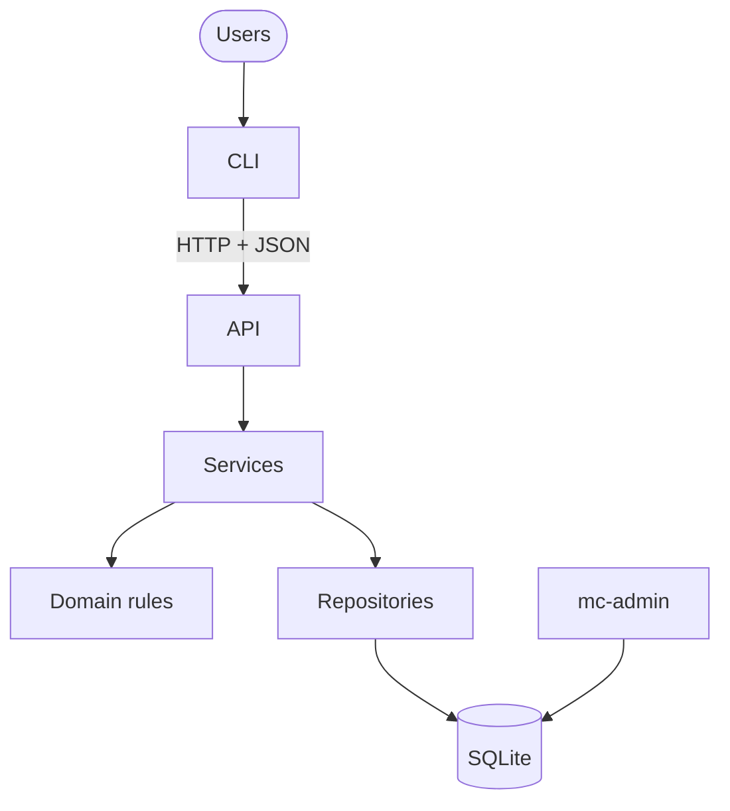
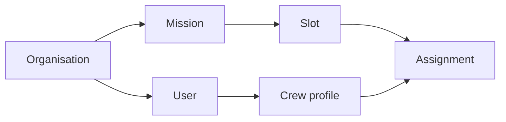
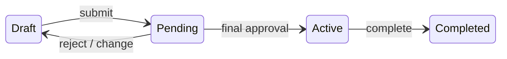
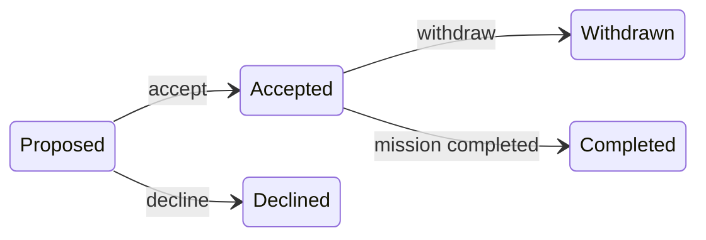

# Subagent (02): Phase 3 read-only review

Source: `agent-a6790d2ee34bbf29f.jsonl` · 2026-10-12 04:24:01 UTC → 2026-10-12 04:33:43 UTC

Rendered from the raw JSONL without editing message content. Tool results and thinking are collapsed; expand them to read.


---

### 👤 User · 2026-10-12 04:24:01 UTC

You are doing a **read-only phase-end review of Phase 3 (services: SF, M9–M14, plus the inbox service)** of the Mission Control project. **Do not edit, create, stage, commit or delete any file, and don't run git commands that change state.** You may read files, run `git log`/`git diff`/`git show`, and run `uv run pytest` / `uv run ruff check` (read-only).

Where: `/Users/pritanbarai/Desktop/JOBS/mutinex_mission_control/.worktrees/phase4` contains the complete current code (main plus uncommitted M14-apply, inbox and Phase 4 work). Phase 3 is the services layer: `src/mission_control/services/` (context.py, admin.py, crew.py, missions/ package, assignments.py, approvals.py, audit.py, matching.py, inbox.py), the repository additions in `src/mission_control/infra/repositories/`, the domain changes made during Phase 3 (`domain/errors.py`, `events.py`, `lifecycle.py`, `permissions.py`, `approvals.py`, `records.py`), and `tests/integration/`. Main's Phase 3 commits are `git log --oneline 171296f~3..HEAD` in the main checkout at `/Users/pritanbarai/Desktop/JOBS/mutinex_mission_control` (read only).

Sources of truth: `docs/prd.md` (behaviour), `docs/technical-design.md` (§4 security/tenancy, §5 lifecycle, §6 matching, §7 errors and problem codes, §10 guidelines), `CLAUDE.md`. Project conventions: 409 rule refusals always use code `rule_violation` with a summary message and the reasons as problems; state conflicts keep their own codes; permission before lookups of other referenced records; refused view → 404; every write in one `ctx.write()` with audit inside it; no PRD/AC/§ refs in `src/`; natural refusal wording.

Review for, in priority order:
1. **Correctness against the PRD** — any rule (P1–P10, M1–M7, A1–A3, S1–S4, V1–V2, AC-1…AC-31) implemented wrongly or missing at the service level; races (check-then-write outside the write transaction); refusals that write anything; tenant isolation holes (any query or lookup that could cross organisations, any foreign id that gives a different response from a missing one).
2. **Consistency** — the same thing done two ways across services (ordering of load/authorize/state/input/rules, refusal construction, audit data shape, helpers duplicated instead of shared).
3. **Design simplicity / refactor candidates** — code that is harder to follow than it needs to be, dead code, over-general helpers.
4. **Test gaps** — important rules without a test, or tests that would pass even if the rule broke.

Verify each finding by reading the code (and a quick REPL/pytest check where cheap) before reporting it; drop anything you can't confirm. Final message: findings ranked by severity (High / Medium / Low), each with file:line, what's wrong, a concrete failure scenario, and a suggested fix in one or two lines; then a short list of what's notably good. Keep it concise enough to paste into a phase-review document.

<details>
<summary>⚙️ System/meta message · 2026-10-12 04:24:01 UTC</summary>

```
<system-reminder>
Your final report is delivered through SubagentHandback: when your work is complete, call SubagentHandback({message: <your full report>}). The call ends your run, so make it your last step. Only a SubagentHandback call reaches your caller as your result; plain text you write at the end is not delivered.
</system-reminder>
```

</details>

**🔧 Bash**

```bash
git status --short | head -80 && ls -R src/mission_control/services src/mission_control/infra src/mission_control/domain tests/integration && wc -l src/mission_control/services/*.py src/mission_control/services/*/*.py src/mission_control/infra/repositories/*.py src/mission_control/domain/*.py
```

**🔧 Bash**

```bash
cd /Users/pritanbarai/Desktop/JOBS/mutinex_mission_control && git log --oneline 171296f~3..HEAD; wc -l docs/*.md
```

<details>
<summary>↳ Result</summary>

```
A  README.md
M  pyproject.toml
A  src/mission_control/admin_cli.py
M  src/mission_control/api/app.py
A  src/mission_control/api/deps.py
A  src/mission_control/api/errors.py
A  src/mission_control/api/routers/__init__.py
A  src/mission_control/api/routers/admin.py
A  src/mission_control/api/routers/assignments.py
A  src/mission_control/api/routers/auth.py
A  src/mission_control/api/routers/crew.py
A  src/mission_control/api/routers/missions.py
A  src/mission_control/api/schemas/__init__.py
A  src/mission_control/api/schemas/admin.py
A  src/mission_control/api/schemas/assignments.py
A  src/mission_control/api/schemas/auth.py
A  src/mission_control/api/schemas/common.py
A  src/mission_control/api/schemas/crew.py
A  src/mission_control/api/schemas/inbox.py
A  src/mission_control/api/schemas/matching.py
A  src/mission_control/api/schemas/missions.py
A  src/mission_control/cli/__init__.py
A  src/mission_control/cli/client.py
A  src/mission_control/cli/commands/__init__.py
A  src/mission_control/cli/commands/account.py
A  src/mission_control/cli/commands/admin.py
A  src/mission_control/cli/commands/assignments.py
A  src/mission_control/cli/commands/common.py
A  src/mission_control/cli/commands/crew.py
A  src/mission_control/cli/commands/me.py
A  src/mission_control/cli/commands/missions.py
A  src/mission_control/cli/config.py
A  src/mission_control/cli/env.py
A  src/mission_control/cli/errors.py
A  src/mission_control/cli/main.py
A  src/mission_control/cli/prompts.py
A  src/mission_control/cli/refusals.py
A  src/mission_control/cli/render.py
A  src/mission_control/cli/resolve.py
A  src/mission_control/cli/views.py
M  src/mission_control/domain/lifecycle.py
M  src/mission_control/domain/permissions.py
M  src/mission_control/infra/repositories/missions.py
A  src/mission_control/infra/settings.py
M  src/mission_control/services/assignments.py
M  src/mission_control/services/auth.py
A  src/mission_control/services/inbox.py
M  src/mission_control/services/matching.py
A  tests/api/conftest.py
A  tests/api/test_api_auth.py
A  tests/api/test_api_errors.py
A  tests/api/test_api_isolation.py
A  tests/api/test_api_lifecycle.py
A  tests/api/test_api_permissions.py
A  tests/api/test_api_resources.py
A  tests/api/test_api_scenarios.py
A  tests/cli/cli_fakes.py
A  tests/cli/conftest.py
A  tests/cli/test_admin_cli.py
A  tests/cli/test_cli_auth.py
A  tests/cli/test_cli_config.py
A  tests/cli/test_cli_errors.py
A  tests/cli/test_cli_match.py
A  tests/cli/test_cli_missions.py
A  tests/cli/test_cli_parsing.py
A  tests/cli/test_cli_people.py
A  tests/cli/test_cli_real_api.py
A  tests/cli/test_cli_render.py
A  tests/cli/test_cli_scenarios.py
A  tests/cli/test_readme_smoke.py
M  tests/integration/test_auth.py
A  tests/integration/test_inbox_service.py
M  tests/integration/test_matching_service.py
M  tests/unit/domain/test_lifecycle.py
M  tests/unit/domain/test_permissions.py
src/mission_control/domain:
__init__.py
__pycache__
approvals.py
dates.py
eligibility.py
enums.py
errors.py
events.py
lifecycle.py
matching.py
passwords.py
permissions.py
records.py

src/mission_control/domain/__pycache__:
__init__.cpython-312.pyc
approvals.cpython-312.pyc
dates.cpython-312.pyc
eligibility.cpython-312.pyc
enums.cpython-312.pyc
errors.cpython-312.pyc
events.cpython-312.pyc
lifecycle.cpython-312.pyc
matching.cpython-312.pyc
passwords.cpython-312.pyc
permissions.cpython-312.pyc
records.cpython-312.pyc

src/mission_control/infra:
__init__.py
__pycache__
db.py
repositories
schema.sql
security.py
settings.py

src/mission_control/infra/__pycache__:
__init__.cpython-312.pyc
db.cpython-312.pyc
security.cpython-312.pyc
settings.cpython-312.pyc

src/mission_control/infra/repositories:
__init__.py
__pycache__
approvals.py
assignments.py
audit.py
base.py
crew.py
facts.py
mission_crew.py
mission_slots.py
missions.py
models.py
organisations.py
skills.py
users.py

src/mission_control/infra/repositories/__pycache__:
__init__.cpython-312.pyc
approvals.cpython-312.pyc
assignments.cpython-312.pyc
audit.cpython-312.pyc
base.cpython-312.pyc
crew.cpython-312.pyc
facts.cpython-312.pyc
mission_crew.cpython-312.pyc
mission_slots.cpython-312.pyc
missions.cpython-312.pyc
models.cpython-312.pyc
organisations.cpython-312.pyc
skills.cpython-312.pyc
users.cpython-312.pyc

src/mission_control/services:
__init__.py
__pycache__
admin.py
approvals.py
assignments.py
audit.py
auth.py
context.py
crew.py
inbox.py
matching.py
missions

src/mission_control/services/__pycache__:
__init__.cpython-312.pyc
admin.cpython-312.pyc
approvals.cpython-312.pyc
assignments.cpython-312.pyc
audit.cpython-312.pyc
auth.cpython-312.pyc
context.cpython-312.pyc
crew.cpython-312.pyc
inbox.cpython-312.pyc
matching.cpython-312.pyc

src/mission_control/services/missions:
__init__.py
__pycache__
changes.py
inputs.py
lifecycle.py
loading.py
queries.py
rules.py
slots.py
views.py

src/mission_control/services/missions/__pycache__:
__init__.cpython-312.pyc
changes.cpython-312.pyc
inputs.cpython-312.pyc
lifecycle.cpython-312.pyc
loading.cpython-312.pyc
queries.cpython-312.pyc
rules.cpython-312.pyc
slots.cpython-312.pyc
views.cpython-312.pyc

tests/integration:
__pycache__
conftest.py
test_admin_service.py
test_approvals_service.py
test_assignment_writes.py
test_assignments_service.py
test_auth.py
test_crew_service.py
test_db.py
test_facts.py
test_inbox_service.py
test_matching_service.py
test_mission_end_service.py
test_mission_history.py
test_missions_service.py
test_repositories.py
test_repository_sql.py
test_repository_writes.py
test_schema_constraints.py
test_seed.py
test_service_context.py

tests/integration/__pycache__:
conftest.cpython-312-pytest-9.1.1.pyc
test_admin_service.cpython-312-pytest-9.1.1.pyc
test_approvals_service.cpython-312-pytest-9.1.1.pyc
test_assignment_writes.cpython-312-pytest-9.1.1.pyc
test_assignments_service.cpython-312-pytest-9.1.1.pyc
test_auth.cpython-312-pytest-9.1.1.pyc
test_crew_service.cpython-312-pytest-9.1.1.pyc
test_db.cpython-312-pytest-9.1.1.pyc
test_facts.cpython-312-pytest-9.1.1.pyc
test_inbox_service.cpython-312-pytest-9.1.1.pyc
test_matching_service.cpython-312-pytest-9.1.1.pyc
test_mission_end_service.cpython-312-pytest-9.1.1.pyc
test_mission_history.cpython-312-pytest-9.1.1.pyc
test_missions_service.cpython-312-pytest-9.1.1.pyc
test_repositories.cpython-312-pytest-9.1.1.pyc
test_repository_sql.cpython-312-pytest-9.1.1.pyc
test_repository_writes.cpython-312-pytest-9.1.1.pyc
test_schema_constraints.cpython-312-pytest-9.1.1.pyc
test_seed.cpython-312-pytest-9.1.1.pyc
test_service_context.cpython-312-pytest-9.1.1.pyc
       0 src/mission_control/services/__init__.py
     360 src/mission_control/services/admin.py
     179 src/mission_control/services/approvals.py
     364 src/mission_control/services/assignments.py
      14 src/mission_control/services/audit.py
     160 src/mission_control/services/auth.py
     105 src/mission_control/services/context.py
     328 src/mission_control/services/crew.py
     113 src/mission_control/services/inbox.py
     160 src/mission_control/services/matching.py
      62 src/mission_control/services/missions/__init__.py
     201 src/mission_control/services/missions/changes.py
      93 src/mission_control/services/missions/inputs.py
      62 src/mission_control/services/missions/lifecycle.py
      73 src/mission_control/services/missions/loading.py
      20 src/mission_control/services/missions/queries.py
     148 src/mission_control/services/missions/rules.py
     194 src/mission_control/services/missions/slots.py
     106 src/mission_control/services/missions/views.py
      49 src/mission_control/infra/repositories/__init__.py
      47 src/mission_control/infra/repositories/approvals.py
      57 src/mission_control/infra/repositories/assignments.py
      68 src/mission_control/infra/repositories/audit.py
      51 src/mission_control/infra/repositories/base.py
     166 src/mission_control/infra/repositories/crew.py
     224 src/mission_control/infra/repositories/facts.py
      71 src/mission_control/infra/repositories/mission_crew.py
     127 src/mission_control/infra/repositories/mission_slots.py
     162 src/mission_control/infra/repositories/missions.py
     128 src/mission_control/infra/repositories/models.py
      16 src/mission_control/infra/repositories/organisations.py
     117 src/mission_control/infra/repositories/skills.py
      69 src/mission_control/infra/repositories/users.py
       0 src/mission_control/domain/__init__.py
      60 src/mission_control/domain/approvals.py
      29 src/mission_control/domain/dates.py
     209 src/mission_control/domain/eligibility.py
      59 src/mission_control/domain/enums.py
      80 src/mission_control/domain/errors.py
      47 src/mission_control/domain/events.py
     290 src/mission_control/domain/lifecycle.py
      86 src/mission_control/domain/matching.py
      11 src/mission_control/domain/passwords.py
     232 src/mission_control/domain/permissions.py
      77 src/mission_control/domain/records.py
    5274 total
```

</details>

<details>
<summary>↳ Result</summary>

```
2b279fa docs: 409 convention and the inbox in design §7
5392748 refactor: rule refusals always use rule_violation, with the reasons as problems
234142c feat(m13): approval round, complete and cancel, mission history
8ae6b8c chore: add typer, rich and httpx2 as runtime dependencies for the CLI
91f3810 feat(m12): assignments service — propose, accept, decline, withdraw, remove, end-of-mission cascade
4e7152b feat(m14): matcher preview — suggest crew for a draft mission
39d7217 feat(m11): missions service — create, edit, slots, transfer (with review fixes)
8f204f0 refactor: split the missions repository into missions, slots and crew
171296f docs: start Phase 3 review (in progress)
a4a6005 chore: exclude .claude from ruff
b6bad6d feat(m9): admin service — org settings, users and roles, crew profiles, skill catalogue
       9 docs/backlog.md
      76 docs/brief.md
     193 docs/cli-ux.md
     169 docs/phase-reviews.md
     338 docs/prd.md
     873 docs/technical-design.md
    1658 total
```

</details>

### 🤖 Claude · 2026-10-12 04:24:08 UTC

Let me read the PRD and relevant design sections.

**🔧 Bash**

```bash
cat docs/prd.md
```

<details>
<summary>↳ Result</summary>

````
# Mission Control — Product Requirements (v1)

**Status:** Agreed · **Source of truth:** [`brief.md`](brief.md) · **Next:** technical design (frameworks, schema, API and CLI design)

Rules tagged **[B]** come from the brief. Everything untagged is a product decision made while resolving the brief's open questions.

## 1. Problem and goals

Crew assignment is manual and error-prone. Leads cross-reference skills, availability and existing commitments by hand. **[B]** Mission Control is a multi-tenant B2B platform for managing missions and crew, with an auto-matcher that suggests crew. **[B]**

v1 succeeds when:

1. A Lead can take a mission from requirements to an active, confirmed roster entirely through the CLI.
2. Matcher suggestions never break a hard rule and are deterministic.
3. The system enforces the approval rules.
4. No read or write can reach another organisation's data.

**How we'll know:** every acceptance criterion in §8 passes as an automated test against the seed data in §9.

## 2. Requirements from the brief

- R1: Organisations are tenants. All data is scoped to one organisation and never leaks across tenants.
- R2: Three roles: Director, Mission Lead, Crew Member.
- R3: Leads can't approve their own missions.
- R4: Missions have requirements, a timeline, and a lifecycle with approval before going active.
- R5: Crew have skill profiles, availability and assignment history.
- R6: Assignments connect crew to missions, and crew respond to them.
- R7: An auto-matcher suggests crew based on skills, availability and workload.
- R8: Organisations differ in crew size, skill taxonomy and approval process.
- R9: A multi-tenant API, plus a CLI for the main workflows. CLI usability is assessed.
- R10: Runs locally with seed data.

## 3. Users and roles

| Role | Responsibilities |
|---|---|
| **Director** | Manages users, roles, crew profiles, the skill catalogue and the approval setting. Creates missions for a Lead. Approves or rejects missions. Reassigns owners. Sees everything in their organisation. |
| **Mission Lead** | Owns missions. Defines slots, runs the matcher, proposes crew, submits. Maintains other people's skill levels. Reads all missions and crew profiles. |
| **Crew Member** | Manages own personal details and unavailability. Accepts, declines or withdraws from assignments. Sees only their own data and the missions they're on. |

- Each user belongs to exactly one organisation. The organisation is taken from the user's identity, never from the request.
- Each user has exactly one role, which controls permissions.
- Taking part in missions depends on a separate **crew profile**. Every Crew Member has one, and Leads and Directors may have one too.

## 4. Main workflows (all available through the CLI)

1. **Sign in** with email and password, and change your own password. See what needs attention: pending assignments, approvals waiting on me, my missions.
2. **Director admin:** manage users and roles, crew profiles, the skill catalogue, and the number of approvals required.
3. **Lead or Director:** set crew skill levels (1–5).
4. **Crew profile holder:** maintain personal details and unavailability.
5. **Create a mission:** name, dates, and role slots with required skills.
6. **Owning Lead:** run the matcher, review the suggested roster, apply it or propose crew by hand.
7. **Crew:** accept or decline proposals, and withdraw if needed.
8. **Owning Lead:** submit a fully accepted roster for approval.
9. **Eligible Directors:** approve or reject. The final approval activates the mission.
10. **Owning Lead or Director:** complete or cancel a mission.
11. **Director:** reassign a mission's owning Lead.
12. **View history:** mission history and crew assignment history.

## 5. Business rules

### 5.1 Definitions

| Term | Meaning |
|---|---|
| **Open assignment** | An assignment that is Proposed or Accepted. |
| **Open places** | A slot's headcount minus its open assignments. |
| **Mission-days** | The number of days from the start date to the end date, counting both. |
| **Overlap** | Two date ranges overlap if they share at least one calendar day. Dates have no time and no time zone. |
| **Eligible (crew for a slot)** | The person is active, has a crew profile, and has every required skill at or above its minimum level. They have no unavailability overlapping the mission, and no accepted assignment on another non-final mission that overlaps it. |
| **Eligible approver** | An active Director who did not create the mission and is not on its roster. |

### 5.2 Tenancy and identity

- **T1** Every record belongs to one organisation. Every read and write is limited to the caller's organisation. **[B]**
- **T2** Naming a resource from another organisation gives the same response as naming one that doesn't exist ("not found").
- **T3** Organisations are created only through seed data or an operator command. There is no self-service signup.

### 5.3 People and skills

- **P1** Each organisation has its own flat skill catalogue, managed by Directors. Skills with the same name in different organisations are unrelated.
  - Directors can rename a skill. Its identity stays the same.
  - Directors can delete a skill only if no crew skill or slot requirement uses it.
- **P2** Proficiency is an integer from 1 to 5.
- **P3** Leads and Directors set and remove skill levels. **Nobody can change their own levels.**
  - A skill change is allowed even if it makes someone ineligible for an assignment on a Draft or Pending mission. Eligibility is checked again at acceptance, submission and approval.
  - A skill change that would make someone ineligible for their assignment on an Active mission is refused.
- **P4** Crew profile holders manage their own personal details and unavailability. Nobody else edits them. Personal details are a display name and an optional bio.
- **P5** Crew are available by default. Unavailability is a date range with a reason.
- **P6** A crew member can't record unavailability that overlaps one of their accepted assignments.
- **P7** Users are deactivated, never deleted. Deactivated users can't sign in, aren't eligible for matching, and keep their history. Deactivation is refused while the user:
  - has open assignments; or
  - owns non-final missions. The same applies to changing a mission owner's role away from Lead. Their missions must be reassigned first.
- **P8** An organisation must always have at least one active Director.
- **P9** Crew profiles survive role changes and can't be deleted. Changing a user's role to Crew Member gives them a profile if they don't already have one.
- **P10** Directors set a new user's initial password. Users change their own password by entering their current one. There's no email or password-recovery flow.
  - Passwords must be at least 15 characters. Passphrases are welcome, and uppercase letters, numbers and symbols aren't required.
  - Changing a password ends all of that user's sessions, including the one used to change it.

### 5.4 Missions and lifecycle

- **M1** A mission has a name, a date range, one owning Lead and a separately recorded creator.
  - Leads create missions for themselves. Directors create them on behalf of a Lead.
  - Only Mission Leads can own missions.
  - Directors can transfer ownership of a non-final mission to another active Lead in the same organisation. If the mission is Pending, it returns to Draft and its approvals are cleared.
- **M2** A mission has one or more slots. Each slot has a name, a headcount of at least 1, and at least one required skill with a minimum level. Dates may be in the past, but the end date must be on or after the start date. The same rule applies to unavailability.
- **M3** Only the owning Lead can edit a mission, propose or remove crew, apply matcher results, or submit.

```
         submit                N-th approval                complete
 Draft ─────────▶ Pending ───────────────────▶ Active ─────────────▶ Completed
   ▲              Approval
   └── reject (reason) / any change ──┘
 Draft | Pending Approval | Active ──cancel (reason)──▶ Cancelled
```

| Transition | Who | Conditions and effects |
|---|---|---|
| Draft → Pending Approval | Owning Lead | All of these must hold: every slot is full, every assignment is Accepted, every rostered crew member is still eligible, and there are at least N eligible approvers. Otherwise the submission is refused with a list of the problems. |
| Pending → Active | The N-th distinct eligible approver | The roster is checked again at each approval. If the check fails, the approval is refused and the mission stays Pending, unchanged. |
| Pending → Draft | Eligible Director (reject) or system | A rejection needs a reason. Any change to dates, slots, roster or owner, including a crew withdrawal, also sends the mission back to Draft. Approvals are cleared, and remaining accepted assignments stay accepted. |
| Active → Completed | Owning Lead or Director | Accepted assignments become Completed. |
| Any non-final → Cancelled | Owning Lead or any Director | Reason required. Open assignments become Cancelled. |

- **M4** Draft missions can have unfilled places and unanswered proposals.
- **M5** Once a mission is Active, its dates, requirements and roster are frozen. Only completion or cancellation are allowed.
- **M6** Dates never trigger transitions on their own. There is no scheduler.
- **M7** An edit is refused if it would invalidate an open assignment. The response lists the affected crew, and the Lead must remove them first. Crew are never removed automatically. Edits that invalidate an assignment are:
  - removing a slot that has open assignments;
  - lowering a slot's headcount below its open assignments;
  - changing dates or requirements so that an assigned person is no longer eligible.

### 5.5 Approval

- **A1** Each organisation sets the number of approvals required (N ≥ 1). The approvals must come from N distinct eligible approvers.
  - N is fixed for a mission when it's submitted. Later changes to the setting don't affect a round already in progress.
  - An approval already given still counts if that Director is later deactivated or demoted.
- **A2** Leads can't approve anything, which satisfies R3. **[B]** A Director can't approve a mission they created or are rostered on.
- **A3** Each Director approves a round at most once. A single rejection ends the round.

### 5.6 Assignments

```
Proposed ──accept──▶ Accepted ──withdraw (reason)──▶ Withdrawn
   ├──decline──▶ Declined   └──removed by Lead──▶ Removed
   └──retracted by Lead──▶ Removed
Accepted ──mission completed──▶ Completed;  open ──mission cancelled──▶ Cancelled
```

- **S1** The owning Lead can propose only eligible crew. A person can hold at most one open assignment per mission. A slot can't have more open assignments than its headcount. A Lead can propose themselves, but they must be eligible and must accept like anyone else.
- **S2** Crew can accept only while the mission is in Draft and they're still eligible. Accepted assignments block overlapping dates. Proposals don't block anything.
- **S3** Declining takes an optional reason. Withdrawing needs a reason and is allowed only in Draft or Pending Approval.
- **S4** Every assignment needs the crew member's acceptance. Crew can't be placed on a mission directly.

### 5.7 Visibility and audit

| | Crew | Lead | Director |
|---|---|---|---|
| Own profile, skills, availability, assignments | ✓ | ✓ | ✓ |
| Missions they're on, with teammates' names and slots | ✓ | ✓ | ✓ |
| Other crew members' profiles, skills, busy/free dates | ✗ | ✓ | ✓ |
| Other people's *reasons* for unavailability | ✗ | ✗ | ✓ |
| All missions in the organisation | ✗ | read (edit own) | read |
| Users, catalogue management, organisation settings | ✗ | read catalogue | manage |

- **V1** Every state change, approval, rejection and assignment response is recorded with who did it, when, and any reason. Anyone who can see the mission can see this history.
- **V2** Former assignees see a summary of the mission in their own assignment history. They don't get full access to the mission unless their role allows it. Former assignees are people whose assignment was declined, withdrawn, removed or cancelled.

## 6. Auto-matching

The matcher only advises. It suggests crew for a Draft mission's open places and changes nothing. The owner or a Director can preview a suggestion. When the owning Lead applies it, it creates Proposed assignments, which crew still have to accept.

**Candidates.** Active crew profiles in the mission's organisation only. Crew who already have an open assignment on this mission, or who declined or withdrew from it, are left out.

**Workload.** The total mission-days of a crew member's accepted assignments on missions that are not Completed, leaving out the mission being matched.

**Algorithm**

1. **Filter.** For each slot with open places, keep the candidates who are eligible (§5.1).
2. **Pick the most constrained slot.** Choose the slot with the fewest remaining eligible candidates. Ties go to the slot listed first.
3. **Fill one place in that slot.** Rank candidates by:
   1. lowest workload;
   2. then highest proficiency, meaning the sum of their levels across the slot's required skills;
   3. then stable identifier, ascending.
4. **Remove the chosen person** from every other slot's candidates.
5. **Repeat** from step 2 until every place is filled or has no candidates left.

**Output.** A suggested roster with no one in two slots. Places without a candidate are marked **unfilled**. The same inputs always give the same output.

**Why:**
- Filling the most constrained slot first stops a versatile person from being spent on a slot that's easy to fill.
- Ranking by lowest workload spreads missions across crew.
- Proficiency only breaks ties, because everyone left already meets the requirement.

**Known limitation:** this is a greedy heuristic. It can occasionally leave a place unfilled when a complete roster exists. That's acceptable for an advisory tool, and the Lead can still propose by hand.

## 7. CLI requirements

- **C1** Every workflow in §4 can be carried out from the CLI. **[B]**
- **C2** Refusals explain why in domain terms, for example "Gus has an accepted assignment on *Station Reboost* overlapping 1–2 Mar". Where possible they also say what to do next.
- **C3** Output is readable by people by default, with a machine-readable option for scripts and tests.
- **C4** Actions that send a mission back to Draft, or cancel it, warn before running.

## 8. Acceptance criteria

Each criterion starts from a fresh seed. Scenario numbers (S-) refer to §9.3.

**Mission workflow**

- **AC-1** The golden path (S1) ends Completed, and every transition appears in the history with who did it and when.
- **AC-2** Submission is refused while any place is unfilled or any proposal is unanswered. The refusal lists them.
- **AC-3** Approvals before the N-th leave the mission Pending. The N-th approval makes it Active.
- **AC-4** Changing the dates, slots or roster of a Pending mission sends it back to Draft and clears its approvals. So does a crew withdrawal (S5).
- **AC-5** On an Active mission, edits, proposals, removals and withdrawals are refused. Completion and cancellation succeed.
- **AC-6** Cancelling needs a reason. The owning Lead or any Director can cancel, and any other Lead is refused. Open assignments become Cancelled.
- **AC-7** Only the owning Lead can edit, propose, apply or submit. After a Director reassigns the owner, the new owner can and the previous owner can't.

**Approval restrictions**

- **AC-8** The mission's creator can't approve it. In S1, Ruth is refused.
- **AC-9** Leads and Crew can't approve or reject.
- **AC-10** A Director can't approve the same round twice. Rejecting needs a reason and clears earlier approvals (S6).
- **AC-11** A Director rostered on a mission can't approve it.
- **AC-12** Submission is refused when there are fewer than N eligible approvers, not counting the creator or rostered Directors (S7).
- **AC-13** In Helix (N = 1), a single approval makes the mission Active (S8).

**Overlaps and availability**

- **AC-14** Proposing someone who is unavailable, or who has an overlapping accepted assignment, is refused. In S4, both Fay and Gus are refused.
- **AC-15** Overlapping proposals are allowed. Accepting one that overlaps an accepted assignment is refused, and the refusal names the conflicting mission (S4, Chen).
- **AC-16** Recording unavailability that overlaps an accepted assignment is refused.
- **AC-17** Two ranges that share only a boundary day overlap.

**Matching**

- **AC-18** S2 gives exactly the expected roster on every run.
- **AC-19** S3 marks Geologist as unfilled. S3b shows a new accepted assignment changing the suggestion.
- **AC-20** Workload counts only accepted assignments on missions that aren't Completed. Chen's workload is 5, not 35.
- **AC-21** The suggestion never puts one person in two slots. It never includes anyone who is ineligible, from another organisation, or already excluded from this mission.
- **AC-22** Running the matcher changes nothing. Applying it creates Proposed assignments.

**Roles and visibility**

- **AC-23** Ana can't change her own skill levels, but Lee can change hers. Ben can't edit skills, but he can edit his personal details and unavailability.
- **AC-24** Lee sees Fay as busy 5–8 Mar but doesn't see the reason. Ruth sees the reason. Ben can't view Fay's profile, and his mission list shows only missions he's on.
- **AC-25** Leads can't manage users, the catalogue or the approval setting.
- **AC-26** Deactivating someone with open assignments is refused. A deactivated user can't sign in. The last active Director can't be deactivated or demoted.

**Tenant isolation (S9)**

- **AC-27** Requesting another organisation's mission, crew member, user, skill or assignment by ID gives the same response as an ID that doesn't exist.
- **AC-28** Every list contains only the caller's organisation's records.
- **AC-29** Any write that references another organisation's ID fails as "not found", and neither organisation's data changes.
- **AC-30** Approving or rejecting another organisation's mission fails as "not found".
- **AC-31** Helix's Kai (Piloting 5, no commitments) is never suggested for an Aurora mission.

## 9. Seed data and scenarios

The table order of people is their stable-identifier order. All dates are in 2027 unless stated.

### 9.1 Aurora Space Agency (N = 2)

| Person | Role | Crew skills | Commitments (workload) |
|---|---|---|---|
| Ruth Adeyemi | Director | — | — |
| Marco Bianchi | Director | Flight Medicine 4 | Medical Study, accepted (4) |
| Ingrid Holm | Director | — | — |
| Lee Park | Lead | — | — |
| Nora Quinn | Lead | — | — |
| Ana Okafor | Lead | Piloting 5, Leadership 4, Systems Eng 4 | none (0) |
| Ben Ito | Crew | Systems Eng 4, EVA 3 | Deep Space Comms, accepted (20) |
| Chen Wu | Crew | Systems Eng 3 | Telescope (5). Mars Analog Completed, so it doesn't count |
| Dana Reyes | Crew | EVA 4 | Telescope (5) |
| Eli Novak | Crew | EVA 4, Piloting 4, Leadership 2 | Telescope (5) |
| Fay Moreau | Crew | Piloting 4, Leadership 4 | Unavailable 5–8 Mar (Medical) |
| Gus Patel | Crew | Systems Eng 5 | Station Reboost, accepted (6) |
| Hana Sato | Crew | EVA 3, Geology 2 | Telescope (5) |

| Mission | Owner / creator | Dates | State | Slots → crew |
|---|---|---|---|---|
| Lunar Gateway Resupply | Lee / Ruth | 1–10 Mar | Draft | Flight Engineer ×1 (Sys Eng ≥3) · Mission Specialist ×1 (EVA ≥3) · Commander ×1 (Piloting ≥4, Leadership ≥3) — no crew |
| Asteroid Survey | Nora | 5–12 Mar | Draft | Pilot ×1 (Piloting ≥4) · Geologist ×1 (Geology ≥4) — no crew |
| Station Reboost | Nora | 25 Feb – 2 Mar | Draft | Engineer ×2 (Sys Eng ≥3) — Gus accepted, 1 open place |
| Lunar Surface Medical Study | Nora / Ruth | 15–18 Mar | Draft | Flight Surgeon ×1 (Flight Medicine ≥4) — Marco accepted |
| Orbital Telescope Service | Lee | 10–14 Jan | Active | Engineer ×1 — Chen · EVA Specialist ×3 (EVA ≥3) — Dana, Eli, Hana |
| Deep Space Comms Upgrade | Nora | 1–20 Apr | Pending (Marco approved) | Engineer ×1 (Sys Eng ≥3) — Ben |
| Mars Analog Habitat | Lee | 1–30 May 2026 | Completed | Engineer ×1 — Chen |

### 9.2 Helix Orbital (N = 1)

People: Sam Rivera (Director), Priya Nair (Lead), and Crew Kai Tanaka (Piloting 5), Lena Fischer (Payload Integration 4), Omar Haddad (Field Medicine 4) and Tess Moreno (Life Support 3). Helix has its own catalogue, including a separate "Piloting" skill.

| Mission | Owner | Dates | State | Slots → crew |
|---|---|---|---|---|
| Payload Demo 1 | Priya | 1–3 Feb | Draft | Payload Specialist ×1 (Payload Int ≥3) — Lena accepted · Medic ×1 (Field Medicine ≥3) — Omar accepted |

### 9.3 Scenarios

| # | Steps | Expected outcome |
|---|---|---|
| **S1** | Lee matches and applies *Lunar Gateway Resupply* → Ana, Chen and Dana accept → Lee submits → Ruth approves → Marco approves → Ingrid approves → Lee completes | Proposed crew are Ana, Chen and Dana. Ruth is refused as creator. After Marco the mission is Pending (1/2). After Ingrid it's **Active**. Completing makes the assignments Completed. |
| **S2** | Match *Lunar Gateway Resupply* | Eligible crew: Commander {Ana}, because Fay is unavailable and Eli's Leadership is too low. Flight Engineer {Ana, Ben, Chen}, because Gus has an overlap. Specialist {Ben, Dana, Eli, Hana}. **Commander → Ana** (most constrained). **Flight Engineer → Chen** (workload 5 vs Ben's 20). **Specialist → Dana** (four-way workload tie at 5; Hana loses on proficiency; Dana beats Eli on ID). Filling the slots in listed order would have spent Ana on Flight Engineer and left Commander unfilled. |
| **S3** | Match *Asteroid Survey* | Geologist **unfilled** (Hana's Geology is only 2). Pilot → Ana (workload 0 vs Eli's 5; Fay unavailable). |
| **S3b** | S1 up to acceptance, then match *Asteroid Survey* | Ana is blocked by her overlapping accepted assignment, so Pilot → Eli. Geologist still unfilled. |
| **S4** | Lee proposes Gus and Fay for *Gateway*. Nora proposes Chen for *Station Reboost* and Lee proposes Chen for *Gateway*. Chen accepts *Station Reboost*, then *Gateway*. | Gus refused (overlap). Fay refused (unavailable). Both Chen proposals succeed. Chen's second acceptance is refused, naming *Station Reboost*. |
| **S5** | Ben withdraws from *Deep Space Comms* without a reason, then with one. Hana withdraws from *Telescope*. | Ben's first attempt is refused. The second succeeds: the mission returns to Draft and Marco's approval is cleared. Hana is refused because *Telescope* is Active. |
| **S6** | Marco approves *Deep Space Comms* again. Ingrid rejects it without a reason, then with one. | Marco is refused. Ingrid's first attempt is refused. The second sends the mission to Draft and clears approvals. |
| **S7** | Nora submits *Lunar Surface Medical Study* | Refused. Ruth created it and Marco is rostered, which leaves 1 eligible approver (Ingrid) when 2 are needed. |
| **S8** | Priya submits *Payload Demo 1* and Sam approves | **Active** after one approval. |
| **S9** | Each role in each organisation tries to read, list, write and approve the other organisation's resources, and matches an Aurora Piloting slot | Every attempt fails as "not found" and nothing changes. Lists show only the caller's organisation. Kai never appears. |

## 10. Test plan

Every acceptance criterion maps to at least one automated test.

| Level | Covers |
|---|---|
| Unit: matcher (pure function) | Eligibility, workload, most-constrained-first, each tie-break, no person in two slots, unfilled places, determinism. Includes S2, S3 and a small hand-built case per rule. |
| Unit: lifecycle and rules | Every allowed transition and a sample of disallowed ones. Approver eligibility and the N count. Revert-to-Draft clearing approvals. The Active freeze. Overlap at boundary days. |
| API: permissions | A role × action table, checking each role is allowed or refused as expected. |
| API: tenant isolation | Every endpoint, for reads, lists and writes, tried with the other organisation's IDs. A route-inventory test makes any new endpoint fail CI until it's added to this sweep. |
| API: scenarios | S1 and S3b–S8 against a freshly seeded database. |
| CLI end to end | S1 and S4 run through the real CLI, checking machine-readable output and the wording of refusals. |

## 11. Out of scope

- Web UI.
- Self-service organisation signup, users in more than one organisation, SSO.
- Password recovery and email flows. Deleting crew profiles. Reactivating deactivated users.
- Delivering notifications. The CLI's "needs attention" views replace them.
- Certifications, skill expiry, skill verification, skill hierarchies.
- Recurring availability, scheduling finer than a day, rest periods between missions.
- Conditional or multi-stage approvals.
- Assigning crew without their acceptance, response deadlines.
- Matcher extras: preferred skills, experience scoring, configurable weights, near-miss and exclusion lists, suggestions to relax requirements, LLM matching.
- Date-driven transitions. Roster changes once a mission is Active.
- Equipment and resource constraints. Keep slot requirements extensible so these can be added later.
- Billing, bulk import.
````

</details>

<details>
<summary>📎 File attached: CLAUDE.md</summary>

```
{
  "path": "/Users/pritanbarai/Desktop/JOBS/mutinex_mission_control/.worktrees/phase4/CLAUDE.md",
  "type": "Project",
  "content": "# Mission Control\n\nMulti-tenant mission planning API and CLI. Read these before doing any work. They are the source of truth, so don't copy their content here.\n\n- [`docs/brief.md`](docs/brief.md): the assessment brief\n- [`docs/prd.md`](docs/prd.md): **behaviour**. What the system does, its rules, acceptance criteria and seed scenarios.\n- [`docs/technical-design.md`](docs/technical-design.md): **structure**. Architecture, schema, API, CLI, the delivery plan (§9) and the implementation guidelines (§10).\n\nIf the PRD and the design conflict, or are silent on something, stop and ask. Never invent behaviour.\n\n## Workflow (every module)\n\n1. **One approved module at a time.** Work only on the module from design §9 that I have approved. Don't start anything else.\n2. **Tests first.** Write failing tests that reference the PRD IDs, then implement. Run the full suite and lint: `uv run pytest` and `uv run ruff check`.\n3. **Real verification.** Exercise the behaviour for real, for example with a REPL call, an HTTP request or a CLI command. Show the actual output. A passing test run alone isn't verification.\n4. **Read-only review.** Review the full diff against the PRD and design §10 without editing. Report findings, and fix them only once I agree.\n5. **Stop for approval.** Summarise what changed, the test and verification results, and the review findings, and propose a commit message. **Don't commit, and don't start the next module, until I approve.**\n\n## Waves (parallel modules in worktrees)\n\nWhen I approve a wave of independent modules (design §9), build them in parallel and keep reviews small:\n\n1. **One worktree per module.** Run `git worktree add .worktrees/<module> -b <module> main`, then `uv sync` inside it. Each agent edits only its own worktree and doesn't commit.\n2. **Same workflow per module.** Steps 2 to 4 above still apply, inside the worktree.\n3. **Review one branch at a time.** Show me only that module's diff against `main` (`git -C .worktrees/<module> diff main`, including new files), with its results.\n4. **After I approve that module:**\n   - commit on its branch;\n   - rebase onto `main` if `main` has moved, and re-run its tests;\n   - fast-forward `main`;\n   - run the full suite on `main`;\n   - remove the worktree and branch.\n\n   Only then present the next branch.\n\nNever push, add dependencies, change the schema, or add endpoints, error codes or CLI commands outside the design without asking first.\n",
  "contentDiffersFromDisk": false
}
```

</details>

**🔧 Bash**

```bash
grep -n "^#" docs/technical-design.md
```

<details>
<summary>↳ Result</summary>

```
1:# Mission Control — Technical Design (v1)
24:## 1. Summary
43:## 2. Architecture
95:## 3. Data model
130:## 4. Security and tenancy
132:### Authentication
141:### Permissions
169:### Tenant isolation
181:## 5. Lifecycle
183:### Mission
205:### Assignment
228:### Cross-cutting rules
240:## 6. Matching
308:## 7. API
316:#### Auth and me
325:#### Organisation, users and skills (Directors)
335:#### Crew
345:#### Missions
358:#### Assignments
365:#### Inbox
377:#### Errors
431:## 8. CLI
445:# Everyone
450:# Leads
456:# Directors
465:## 9. Delivery plan
529:## 10. Guidelines for implementing agents
531:### Source of truth
536:### The loop for each module
545:### Working in waves (worktrees)
554:### Architecture rules (never break these)
562:### Coding conventions
568:### Testing conventions
573:### Stop and ask before
581:## 11. Setup and testing
606:## Appendix A: Schema SQL
617:### Organisations, users and sessions
655:### Crew, skills and availability
709:### Missions, slots and requirements
763:### Assignments, approvals and audit
836:## Appendix B: Trade-offs and considerations
840:### B.1 Key decisions
858:### B.2 Risks
868:### B.3 Scaling path (not in v1)
```

</details>

**🔧 Bash**

```bash
sed -n 43,430p docs/technical-design.md
```

**🔧 Bash**

```bash
sed -n 529,580p docs/technical-design.md; sed -n 606,836p docs/technical-design.md
```

<details>
<summary>↳ Result</summary>

````
## 2. Architecture

**Stack:** Python 3.12 · FastAPI + Pydantic v2 · SQLite through stdlib `sqlite3` · argon2-cffi · Typer + httpx2 · uv, pytest, ruff

**Dependency policy:** don't use `httpx` anywhere, including tests. Use `httpx2`, which Starlette's `TestClient` now expects.

Why SQLite, hand-written SQL, and a CLI that goes through the API: [TR-1](#tr-1), [TR-2](#tr-2), [TR-4](#tr-4).



| Layer | Folder | Responsibility | May depend on |
|---|---|---|---|
| CLI | `cli/` | Commands, output, prompts | API over HTTP only |
| API | `api/` | Validate input, resolve `Actor`, call a service, map errors | services |
| Services | `services/` | One use case = one transaction + audit | domain, infra |
| Domain | `domain/` | Every business rule, pure (no I/O) | nothing |
| Infra | `infra/` | Connections, schema, scoped repositories, security | domain types |

**How a request flows** (example: `mc missions submit 12`)

1. The CLI sends `POST /api/v1/missions/12/submit` with the bearer token.
2. The API resolves the token to an `Actor` (user, organisation, role) and calls `services.missions.submit(actor, 12)`.
3. The service opens `BEGIN IMMEDIATE` and loads the mission through `Repos(conn, actor.org_id)`.
4. `domain.lifecycle.check_submit(...)` returns a list of problems. If the list is empty, the service writes the new status and an audit event, then commits.
5. The API returns `200` with the mission, or `409` with every problem. The CLI prints one bullet per problem and exits with code `1`.

<details><summary>Folder layout</summary>

```
src/mission_control/
  domain/    dates  enums  errors  eligibility  matching  lifecycle  approvals  permissions  passwords  records
  infra/     db  schema.sql  security  repositories/
  services/  auth  admin  crew  missions  assignments  approvals  matching  audit  inbox
  api/       app  deps  errors  schemas/  routers/
  cli/       main  client  config  render  resolve  commands/
  seed/      data  loader
  admin_cli.py        # mc-admin: init-db, seed, create-org
tests/  unit/  integration/  api/  cli/  builders.py  conftest.py
```
</details>

---

## 3. Data model

The core entities are below. Skills, unavailability, approvals, tokens and the audit log hang off these. All 13 tables are in [Appendix A](#appendix-a-schema-sql).



**Tenant safety.** Every tenant table has `org_id` and `UNIQUE (org_id, id)`. Every reference between tenant rows includes `org_id`, so the database itself rejects links across organisations. Why a shared database: [TR-3](#tr-3).

| Enforced by the database | Enforced by services |
|---|---|
| Value ranges and valid dates | Eligibility and overlaps |
| Cross-organisation links rejected | Open places |
| One open assignment per person per mission | State transitions |
| A slot belongs to its mission | Permissions and the owner's role |
| Reasons for withdrawals and rejections | At least one requirement per slot |
| Append-only audit log; used skills can't be deleted | |

**Modelling choices**
- **Approval rounds.** Submit sets `round += 1` and saves N in `approvals_required`. Only approvals in the current round count, and none are ever deleted ([TR-9](#tr-9)).
- **Soft-deleted slots.** `removed_at` keeps the history of past assignments.
- **Nothing derived is stored.** Workload, eligibility, open places and the roster are computed when needed ([TR-7](#tr-7)).
- **Integer IDs** keep CLI commands short ([TR-12](#tr-12)).
- **History survives renames.** Audit `data` keeps the names that applied at the time.
- **"On a mission"** means holding an open or completed assignment. Any other status gives summary access only (V2).

---

## 4. Security and tenancy

### Authentication

| | |
|---|---|
| Token | 32 random bytes. Only the SHA-256 hash is stored. 12-hour expiry. |
| Every request | Token → valid? → user active? → `Actor(user_id, org_id, role, crew_profile_id)`. Nothing is cached, so role changes apply immediately. |
| Revocation | Logout revokes that token. Deactivation or a password change revokes every token. Opaque tokens make this immediate ([TR-5](#tr-5)). |
| Passwords | Argon2id. At least 15 characters. No character-type rules. |

### Permissions

Each **role** sets the baseline:

| Role | Can | Can't |
|---|---|---|
| **Director** | Run the organisation: users, roles, skills, approval setting. See everything. Approve, transfer, complete and cancel missions. | Edit mission details, since that's the owner's job |
| **Lead** | Create and run their own missions. Rate other people's skills. See all crew and missions. | Approve anything. Touch missions they don't own. |
| **Crew** | Manage their own profile and availability. Respond to their own assignments. | See other crew, or missions they aren't on |

On top of the role, **relationship rules** make the decisions that matter:

| Rule | Effect | PRD |
|---|---|---|
| **Owner only** | Only the mission's owner edits it, proposes crew, applies the matcher or submits | M3 |
| **Not yourself** | Nobody sets their own skill levels | P3 |
| **Eligible approver** | A Director can't approve a mission they created or are on | A2 |
| **Self only** | Only you edit your details and availability. Only you, and Directors, see your unavailability reasons. | P4, §5.7 |
| **Visibility** | Crew only see missions they're on. Former assignees see a summary. | V2 |

**Enforcement.** `domain/permissions.authorize(actor, action, ctx)` is the single entry point. The complete action × role table is the parametrized test for this module, and that test is the source of truth.

| Status | When |
|---|---|
| **401** | Authentication failed |
| **404** | Missing, another organisation's, or not visible. All three look identical ([TR-10](#tr-10)). |
| **403** | Visible, but you're not allowed to do this |

### Tenant isolation

1. **Identity.** `org_id` comes only from the token, never from the request.
2. **Repositories.** `Repos(conn, org_id)` scopes every query. Another organisation's ID behaves as missing.
3. **Database.** Composite `(org_id, id)` foreign keys.
4. **Tests.**
   - An SQL lint checks every query mentions `org_id`.
   - A route inventory makes sure no endpoint is left out of the isolation tests.
   - A cross-organisation sweep compares database snapshots before and after.

---

## 5. Lifecycle

### Mission



Any state before Completed can also be **cancelled**.

| Action | Who | Must be true | Effect |
|---|---|---|---|
| submit | owner | Slots full, all accepted, roster eligible, eligible approvers ≥ N | `round += 1`, N saved |
| approve | eligible Director | Hasn't decided this round. Roster eligible. | Active once N is reached. **If a check fails, nothing is written.** |
| reject | eligible Director | Reason given | → Draft |
| transfer | Director | New owner is an active Lead | Pending → Draft. Active stays Active. |
| complete | owner or Director | Mission is Active | Accepted assignments → completed |
| cancel | owner or Director | Reason given | Open assignments → cancelled |

### Assignment



The owner can also **remove** an open assignment. Cancelling the mission **cancels** every open assignment.

| Action | Who | Mission must be | Notes |
|---|---|---|---|
| propose | owner | Draft or Pending* | Person eligible, place open, not already on this mission |
| accept | crew member | Draft | Still eligible. An overlap names the conflicting mission. |
| decline | crew member | Draft | Reason optional |
| withdraw | crew member | Draft or Pending* | Reason required |
| remove | owner | Draft or Pending* | |

\* Sends a Pending mission back to Draft.

### Cross-cutting rules

| Rule | How it's implemented |
|---|---|
| **Back to Draft** | Every mutating service calls `touch_for_change()` first. Draft → no change. Pending → Draft. Active → `mission_frozen`. Final → `mission_final`. |
| **Edits can't break assignments (M7)** | `invalidated_by()` checks slot removal, headcount, requirements and dates → a `rule_violation` naming everyone affected |
| **Skill changes (P3)** | Allowed. Refused only if they'd break an **Active** assignment → `invalidates_active_assignment` |
| **Audit** | Written in the same transaction as the change. Refused actions write nothing. |
| **Transactions** | One connection per request. `foreign_keys=ON`. `busy_timeout=5000`. `BEGIN IMMEDIATE` *before* checks. Roll back on error. Lock timeout → 503 `busy`. ([TR-11](#tr-11)) |

---

## 6. Matching

The matcher suggests crew for a Draft mission's open places. It's a pure function: same inputs, same output. It's greedy rather than optimal, which keeps it explainable ([TR-6](#tr-6)).

**How it works**

1. **Filter.** For each slot, keep candidates who are eligible: active, skills meet the requirements, available, and no overlapping accepted assignment.
2. **Pick a slot.** Take the open slot with the fewest candidates, so scarce skills are protected.
3. **Pick a person.** Take the lowest workload, then the highest proficiency, then the lowest ID.
4. **Place** that person and remove them from every other slot's candidates.
5. **Repeat** until all places are filled or marked **unfilled**.

**Inputs** (`domain/records.py`). They carry names as well as IDs, so every refusal can name the person, skill and mission involved:

| Record | Fields |
|---|---|
| `Requirement` | `skill_id`, `skill_name`, `min_level` |
| `SlotSpec` | `id`, `position`, `name`, `open_places`, `requirements: tuple[Requirement, ...]` |
| `Commitment` | `mission_id`, `mission_name`, `window`: an accepted assignment on another non-final mission |
| `CandidateFacts` | `crew_profile_id`, `name`, `active`, `skills: {skill_id: level}`, `unavailable: tuple[DateRange, ...]`, `accepted_elsewhere: tuple[Commitment, ...]`, `workload` |
| `RosterEntry` | `assignment_id`, `slot: SlotSpec`, `crew: CandidateFacts`, `status`: an open assignment on the mission being edited or submitted (`crew.accepted_elsewhere` excludes this mission) |
| `AssignmentFact` | `mission_id`, `mission_status`, `assignment_status`, `window`: one of a person's assignments, used to compute workload |
| `ActiveAssignment` | `mission_id`, `mission_name`, `slot_name`, `requirements`: an accepted assignment on an Active mission, used to check skill changes |

```python
def suggest_roster(slots: list[SlotSpec], candidates: list[CandidateFacts],
                   window: DateRange) -> Suggestion:
    by_id = {c.crew_profile_id: c for c in candidates}
    eligible = {s.id: {c.crew_profile_id for c in candidates if is_eligible(c, s, window)}
                for s in slots}
    remaining = {s.id: s.open_places for s in slots}
    placements, unfilled = [], []

    while open_slots := [s for s in slots if remaining[s.id] > 0]:
        # Most-constrained slot first; ties by listed position, then id.
        slot = min(open_slots, key=lambda s: (len(eligible[s.id]), s.position, s.id))

        if not eligible[slot.id]:
            unfilled.append(Unfilled(slot.id, remaining[slot.id]))
            remaining[slot.id] = 0
            continue

        # Lowest workload, then highest proficiency, then stable id.
        person = min((by_id[i] for i in eligible[slot.id]),
                     key=lambda c: (c.workload, -proficiency(c, slot), c.crew_profile_id))

        placements.append(Placement(slot.id, person.crew_profile_id))
        remaining[slot.id] -= 1
        for ids in eligible.values():
            ids.discard(person.crew_profile_id)

    return Suggestion(placements, unfilled)


def proficiency(c: CandidateFacts, slot: SlotSpec) -> int:
    return sum(c.skills.get(r.skill_id, 0) for r in slot.requirements)
```

**Workload** = total mission-days of accepted assignments on missions that aren't completed, leaving out the mission being matched.

| | Preview | Apply |
|---|---|---|
| Who | Owner or Director | Owner only |
| Writes | Nothing | Proposals, created through the normal `propose` path |
| Data | Loaded with one query per fact type | Recomputed inside the write transaction, so it's never stale |

---

## 7. API

**Conventions**
- REST and JSON, under `/api/v1`.
- Authentication with the header `Authorization: Bearer <token>`.
- Lifecycle changes are explicit `POST` commands, for example `/submit`. They are never `PATCH status`, because each one has its own guards and audit event ([TR-8](#tr-8)).
- List endpoints return only what the caller is allowed to see.

#### Auth and me
| Method | Path | Purpose |
|---|---|---|
| POST | `/auth/login` | Exchange email and password for a token |
| POST | `/auth/logout` | Revoke the current token |
| GET | `/me` | Current user, role and crew profile |
| POST | `/me/password` | Change password (revokes all sessions) |
| GET | `/me/inbox` | Things waiting on me: a to-do list computed from current data (see below) |

#### Organisation, users and skills (Directors)
| Method | Path | Purpose |
|---|---|---|
| GET · PATCH | `/org` | View settings, or set the required approvals |
| GET · POST | `/users` | List users, or create one with an initial password |
| PATCH | `/users/{id}` | Change role or deactivate |
| POST | `/users/{id}/crew-profile` | Give a user a crew profile |
| GET · POST | `/skills` | List skills (Leads too), or add one |
| PATCH · DELETE | `/skills/{id}` | Rename, or delete if unused |

#### Crew
| Method | Path | Purpose |
|---|---|---|
| GET | `/crew` · `/crew/{id}` | List or view profiles |
| PATCH | `/crew/{id}` | Edit own display name and bio |
| PUT · DELETE | `/crew/{id}/skills/{skill_id}` | Set or remove a skill level |
| GET · POST | `/crew/{id}/unavailability` | List or add own unavailability |
| DELETE | `/crew/{id}/unavailability/{uid}` | Remove own unavailability |
| GET | `/crew/{id}/assignments` | Assignment history (summaries) |

#### Missions
| Method | Path | Purpose |
|---|---|---|
| GET · POST | `/missions` | List visible missions, or create one with slots |
| GET · PATCH | `/missions/{id}` | View, or edit name and dates |
| POST | `/missions/{id}/slots` | Add a slot |
| PATCH · DELETE | `/missions/{id}/slots/{sid}` | Edit or remove a slot |
| GET | `/missions/{id}/history` | Audit trail |
| POST | `/missions/{id}/submit` · `approve` · `reject` · `complete` · `cancel` | Lifecycle commands |
| POST | `/missions/{id}/owner` | Transfer ownership |
| GET | `/missions/{id}/match` | Preview suggested roster |
| POST | `/missions/{id}/match/apply` | Create proposals from the suggestion |

#### Assignments
| Method | Path | Purpose |
|---|---|---|
| POST | `/missions/{id}/assignments` | Propose a crew member for a slot |
| GET | `/assignments` | My assignments |
| POST | `/assignments/{id}/accept` · `decline` · `withdraw` · `remove` | Respond or remove |

#### Inbox

`GET /me/inbox` (`mc inbox`) lists only what is waiting on the caller to act. It's computed from current data on each request, so nothing is stored, nothing is marked as read, and an item disappears once it's dealt with. Every role has one inbox, showing whichever sections apply:

| Section | Shown to | Item | Action |
|---|---|---|---|
| Proposals | Anyone with a crew profile | Their own Proposed assignments on Draft missions | accept or decline |
| Approvals | Directors | Pending missions they're an eligible approver for and haven't approved this round | approve or reject |
| Missions | The owning Lead | Their Draft missions, each with what's waiting: places to fill (open places, including after a decline, withdrawal or rejection), proposals awaiting replies, or "ready to submit" | staff or submit |

Not shown: pending missions waiting on others, Active missions, and anything informational. Each section is a few indexed lookups of the caller's own rows (`assignments_profile`, `missions_org_status`, `missions_owner`); the missions section shows counts only and leaves the full eligibility check to submit.

#### Errors

Every error has the same shape, for every status code (401, 403, 404, 409, 422, 503). `problems` is always present and always has at least one entry, so clients only ever handle one format. A rule or state conflict (409) lists **every** problem at once. A rule refusal's code is always `rule_violation`, with a summary message ("Ben can't be proposed as Flight Engineer on Lunar Gateway Resupply"); each reason is a problem with its own code. Only a state conflict has a code of its own (one of the **State** codes below), repeated as its single problem. A permission refusal (403) lists its single reason, because only one applies and the actor can't fix it themselves. Each problem names the record involved:

```json
{
  "error": {
    "code": "rule_violation",
    "message": "Mission can't be submitted",
    "problems": [
      { "code": "slot_unfilled", "message": "Commander: 1 of 1 place unfilled", "refs": { "slot_id": 12 } }
    ]
  }
}
```

| HTTP | Meaning | Codes |
|---|---|---|
| 401 | Not authenticated | `invalid_credentials` `unauthenticated` |
| 403 | Not allowed | `role_forbidden` `not_owner` `approver_is_creator` `approver_is_rostered` `self_skill_edit` `wrong_current_password` |
| 404 | Not found or not visible | `not_found` |
| 409 | Conflicts with state or a rule | **State:** `mission_frozen` `mission_final` `invalid_transition` `already_decided`<br>**Rules:** `rule_violation`, with the reasons as problem codes (below) |
| 422 | Invalid input | `validation_error` `password_too_short` |
| 503 | Database busy, retry | `busy` |

Malformed mission and slot values are 422 `validation_error`, and every mistake is listed at once: a blank mission or slot name, a headcount below 1, a slot with no required skill, a minimum level outside 1–5, an end date before the start date, or a Director creating a mission without naming its owner.

**Problem codes.** These appear inside `problems` and explain each refusal. Adding one means updating this table in the same change.

| Code | Raised when | Typical `refs` |
|---|---|---|
| `inactive` | The person is deactivated | `crew_profile_id`, `slot_id` |
| `skill_below_minimum` | A required skill is missing or below the minimum | `crew_profile_id`, `slot_id`, `skill_id` |
| `unavailable` | Unavailability overlaps the mission's dates | `crew_profile_id`, `slot_id` |
| `overlap` | An accepted assignment on another mission overlaps (the message names that mission) | `crew_profile_id`, `mission_id`, `mission_name` |
| `slot_has_open_assignments` | Removing a slot that still has crew | `assignment_id`, `crew_profile_id`, `slot_id` |
| `headcount_below_open_assignments` | Lowering headcount below the assigned crew (the message names them) | `slot_id`, `crew_profile_ids` |
| `invalidates_active_assignment` | A skill change would break an assignment on an Active mission | `mission_id`, `skill_id` |
| `slot_unfilled` | Submitting with empty places | `slot_id` |
| `proposal_unanswered` | Submitting while a proposal is still waiting for a reply (the message names the person and slot) | `assignment_id`, `slot_id`, `crew_profile_id` |
| `already_exists` | Inside a 409 `rule_violation`: the email address is already in use (anywhere on the platform, since login is by email alone; see [TR-13](#tr-13)), a skill name is already in the catalogue (ignoring case), the user already has a crew profile, or a mission already has a live slot with that name (ignoring case; a new mission's slots are also checked against each other, and have no `slot_id` yet) | `email`; `skill_id`; `user_id`, `crew_profile_id`; `slot_id` |
| `owner_not_active_lead` | The owner named for a new mission, or for a transfer, isn't a Mission Lead or is deactivated (inside a 409 `rule_violation`) | `user_id` |
| `insufficient_approvers` | Submitting when fewer eligible approvers exist than the approvals required | — |
| `has_open_assignments` | Deactivating someone who still holds proposed or accepted assignments | `user_id`, `mission_ids` |
| `owns_open_missions` | Deactivating, or changing the role of, a Lead who owns unfinished missions | `user_id`, `mission_ids` |
| `last_director` | Deactivating or demoting the organisation's only active Director | `user_id` |
| `skill_in_use` | Deleting a skill that crew hold or slots require (the message names them) | `skill_id`, `crew_profile_ids`, `mission_ids` |
| `mission_needs_a_slot` | Removing a mission's only slot | `slot_id` |
| `already_owner` | Transferring a mission to the Lead who already owns it | `user_id` |
| `slot_full` | Proposing someone for a slot with no open places (the message names the slot and mission) | `slot_id` |
| `already_assigned` | Proposing someone who already holds an open assignment on this mission (the message names their slot) | `assignment_id`, `crew_profile_id`, `mission_id` |

---
````

</details>

<details>
<summary>↳ Result</summary>

````
## 10. Guidelines for implementing agents

### Source of truth
1. The **PRD** decides behaviour. **This document** decides structure. Code follows both.
2. **Don't invent behaviour.** If the PRD is silent or contradicts this document, stop and ask. Don't guess, and don't "improve" the rule.
3. Work on **one module at a time**, in the order in [§9](#9-delivery-plan). Start a module only when the user has approved it, and never before its dependencies are done.

### The loop for each module
1. Read the module's row in §9 and every PRD ID it references.
2. Write failing tests. Name them after the rule, for example `test_ac15_accept_overlap_names_conflicting_mission`.
3. Write the smallest implementation that makes them pass.
4. Refactor, then run the **full** suite and `ruff`.
5. Verify the behaviour by running it for real (a REPL call, a request, or a CLI command), and show the output.
6. Do a read-only review of the diff, and report findings without editing anything.
7. Propose a commit message, such as `feat(m12): assignment propose/accept/withdraw`. **Don't commit, and don't start the next module, until the user approves.**

### Working in waves (worktrees)
- **Approval:** a wave starts only when the user approves every module in it. The modules must not depend on each other.
- **Isolation:** each module gets its own worktree and branch, `.worktrees/<module>` on branch `<module>` (e.g. `m9-admin`), created from the current `main`. The agent works only inside it and runs `uv sync` and the tests there.
- **Agents don't commit.** Each leaves its changes uncommitted and reports the usual package: tests first, real run, read-only review.
- **Review is one branch at a time.** The user reviews only that module's diff against `main`.
- **Merge:** after approval, the lead commits on the branch, rebases it onto `main` if `main` has moved (re-running its tests), fast-forwards `main`, and runs the full suite on `main` before the next review.
- **Ports:** a real run that starts a server uses port `8000 + module number` (e.g. M11 uses 8011).
- **Clean-up:** remove the worktree and branch once merged.

### Architecture rules (never break these)
- `domain/` imports nothing from `infra/`, `services/`, `api/` or `sqlite3`.
- All SQL lives in `infra/repositories/`, and every query filters on `org_id`.
- `org_id` comes only from the `Actor`. Never read it from request input.
- Every mutating service calls `touch_for_change()` first, and writes an audit event in the same transaction.
- Writes open `BEGIN IMMEDIATE` **before** running checks.
- Errors use the codes in [§7](#7-api). Adding a code means updating that table in the same change.

### Coding conventions
- Type hints everywhere. Frozen dataclasses for domain records. No module-level mutable state.
- `date` objects in the domain, ISO strings only at the database and API edges. Timestamps are UTC.
- Use PRD vocabulary in names: `open_places`, `eligible_approver`, `workload`.
- Keep routers thin: validate, call one service, return.

### Testing conventions
- Use the `seeded_db` fixture for PRD scenarios, and `tests/builders.py` for edge cases.
- Every test gets its own database. No network calls. No reliance on the current date: pass dates in.
- Never weaken or delete a test to make it pass. If a test looks wrong, raise it.

### Stop and ask before
- adding a dependency;
- changing the schema (and if you do, update [Appendix A](#appendix-a-schema-sql) as well);
- adding an endpoint, error code or CLI command that isn't in this document;
- any case where the PRD looks ambiguous or a PRD scenario's expected outcome seems wrong.

---

## Appendix A: Schema SQL

The SQL becomes `infra/schema.sql`.

**Conventions**
- Tables are `STRICT`, which needs SQLite 3.37 or later. `init_db` checks `sqlite3.sqlite_version` and refuses to start on anything older.
- Every tenant-owned table has `org_id NOT NULL` and `UNIQUE (org_id, id)`. That unique pair is the target for every reference from another tenant table, so a row can never point into another organisation.
- Dates are stored as `TEXT` in `YYYY-MM-DD` form. `date(x) IS x` rejects badly formed dates. Plain `=` wouldn't work here: it returns NULL on bad input, and a NULL check passes.
- Timestamps are UTC ISO `TEXT`, with the default `strftime('%Y-%m-%dT%H:%M:%fZ','now')`. Below this is written as `<now>`.
- All foreign keys are `ON DELETE RESTRICT` (SQLite's default). The only exception is `slot_requirements`, which cascades from its slot. Domain rows are never hard-deleted except unused skills (P1) and replaced slot requirements.

### Organisations, users and sessions

```sql
PRAGMA user_version = 1;

CREATE TABLE organisations (
  id                 INTEGER PRIMARY KEY,
  name               TEXT    NOT NULL,
  slug               TEXT    NOT NULL UNIQUE,
  required_approvals INTEGER NOT NULL DEFAULT 1 CHECK (required_approvals >= 1),   -- A1
  created_at         TEXT    NOT NULL DEFAULT (<now>)
) STRICT;

CREATE TABLE users (
  id            INTEGER PRIMARY KEY,
  org_id        INTEGER NOT NULL REFERENCES organisations(id),
  email         TEXT    NOT NULL UNIQUE COLLATE NOCASE,        -- login is by email only
  name          TEXT    NOT NULL CHECK (length(trim(name)) > 0),
  role          TEXT    NOT NULL CHECK (role IN ('director','lead','crew')),
  password_hash TEXT    NOT NULL,                               -- Argon2id encoded hash
  is_active     INTEGER NOT NULL DEFAULT 1 CHECK (is_active IN (0,1)),
  created_at    TEXT    NOT NULL DEFAULT (<now>),
  updated_at    TEXT    NOT NULL DEFAULT (<now>),
  UNIQUE (org_id, id)
) STRICT;
CREATE INDEX users_org_role ON users(org_id, role, is_active);

CREATE TABLE auth_tokens (                                      -- not tenant-owned; reached only via token hash
  id         INTEGER PRIMARY KEY,
  user_id    INTEGER NOT NULL REFERENCES users(id),
  token_hash TEXT    NOT NULL UNIQUE,                           -- SHA-256 hex; raw token never stored
  created_at TEXT    NOT NULL DEFAULT (<now>),
  expires_at TEXT    NOT NULL,
  revoked_at TEXT
) STRICT;
CREATE INDEX auth_tokens_user ON auth_tokens(user_id) WHERE revoked_at IS NULL;
```

### Crew, skills and availability

```sql
CREATE TABLE crew_profiles (
  id           INTEGER PRIMARY KEY,                             -- stable identifier for matcher ties
  org_id       INTEGER NOT NULL,
  user_id      INTEGER NOT NULL UNIQUE,                         -- at most one profile per user (P9)
  display_name TEXT    NOT NULL CHECK (length(trim(display_name)) > 0),   -- P4
  bio          TEXT,
  created_at   TEXT    NOT NULL DEFAULT (<now>),
  updated_at   TEXT    NOT NULL DEFAULT (<now>),
  UNIQUE (org_id, id),
  FOREIGN KEY (org_id, user_id) REFERENCES users(org_id, id)
) STRICT;

CREATE TABLE skills (
  id         INTEGER PRIMARY KEY,                               -- stable across renames (P1)
  org_id     INTEGER NOT NULL REFERENCES organisations(id),
  name       TEXT    NOT NULL CHECK (length(trim(name)) > 0),
  category   TEXT,
  created_at TEXT    NOT NULL DEFAULT (<now>),
  UNIQUE (org_id, id),
  UNIQUE (org_id, name COLLATE NOCASE)
) STRICT;

CREATE TABLE crew_skills (
  org_id          INTEGER NOT NULL,
  crew_profile_id INTEGER NOT NULL,
  skill_id        INTEGER NOT NULL,
  level           INTEGER NOT NULL CHECK (level BETWEEN 1 AND 5),   -- P2
  updated_by_id   INTEGER NOT NULL,
  updated_at      TEXT    NOT NULL DEFAULT (<now>),
  PRIMARY KEY (crew_profile_id, skill_id),
  FOREIGN KEY (org_id, crew_profile_id) REFERENCES crew_profiles(org_id, id),
  FOREIGN KEY (org_id, skill_id)        REFERENCES skills(org_id, id),   -- RESTRICT blocks deleting used skills
  FOREIGN KEY (org_id, updated_by_id)   REFERENCES users(org_id, id)
) STRICT;
CREATE INDEX crew_skills_skill ON crew_skills(skill_id);

CREATE TABLE unavailability (
  id              INTEGER PRIMARY KEY,
  org_id          INTEGER NOT NULL,
  crew_profile_id INTEGER NOT NULL,
  start_date      TEXT    NOT NULL CHECK (date(start_date) IS start_date),
  end_date        TEXT    NOT NULL CHECK (date(end_date) IS end_date),
  reason          TEXT    NOT NULL CHECK (length(trim(reason)) > 0),   -- P5
  created_at      TEXT    NOT NULL DEFAULT (<now>),
  CHECK (end_date >= start_date),                                         -- M2
  UNIQUE (org_id, id),
  FOREIGN KEY (org_id, crew_profile_id) REFERENCES crew_profiles(org_id, id)
) STRICT;
CREATE INDEX unavailability_profile ON unavailability(crew_profile_id, start_date);
```

### Missions, slots and requirements

```sql
CREATE TABLE missions (
  id                 INTEGER PRIMARY KEY,
  org_id             INTEGER NOT NULL,
  name               TEXT    NOT NULL CHECK (length(trim(name)) > 0),
  start_date         TEXT    NOT NULL CHECK (date(start_date) IS start_date),
  end_date           TEXT    NOT NULL CHECK (date(end_date) IS end_date),
  status             TEXT    NOT NULL DEFAULT 'draft'
                     CHECK (status IN ('draft','pending_approval','active','completed','cancelled')),
  owner_id           INTEGER NOT NULL,                          -- must be an active Lead: enforced in services (M1)
  created_by_id      INTEGER NOT NULL,                          -- kept separately for approver eligibility (A2)
  approval_round     INTEGER NOT NULL DEFAULT 0 CHECK (approval_round >= 0),
  approvals_required INTEGER CHECK (approvals_required >= 1),  -- N copied at submit (A1)
  created_at         TEXT    NOT NULL DEFAULT (<now>),
  updated_at         TEXT    NOT NULL DEFAULT (<now>),
  CHECK (end_date >= start_date),
  CHECK (status IN ('draft','cancelled') OR approvals_required IS NOT NULL),
  UNIQUE (org_id, id),
  FOREIGN KEY (org_id, owner_id)      REFERENCES users(org_id, id),
  FOREIGN KEY (org_id, created_by_id) REFERENCES users(org_id, id)
) STRICT;
CREATE INDEX missions_org_status ON missions(org_id, status);
CREATE INDEX missions_owner      ON missions(owner_id, status);

CREATE TABLE slots (
  id         INTEGER PRIMARY KEY,
  org_id     INTEGER NOT NULL,
  mission_id INTEGER NOT NULL,
  name       TEXT    NOT NULL CHECK (length(trim(name)) > 0),
  headcount  INTEGER NOT NULL CHECK (headcount >= 1),           -- M2
  position   INTEGER NOT NULL CHECK (position >= 1),            -- matcher tie-break: listed order
  removed_at TEXT,                                               -- soft delete keeps past assignments' history
  UNIQUE (org_id, id),
  UNIQUE (org_id, mission_id, id),                               -- lets assignments prove slot ∈ mission
  FOREIGN KEY (org_id, mission_id) REFERENCES missions(org_id, id)
) STRICT;
CREATE UNIQUE INDEX slots_live_position ON slots(mission_id, position) WHERE removed_at IS NULL;

CREATE TABLE slot_requirements (
  org_id    INTEGER NOT NULL,
  slot_id   INTEGER NOT NULL,
  skill_id  INTEGER NOT NULL,
  min_level INTEGER NOT NULL CHECK (min_level BETWEEN 1 AND 5),
  PRIMARY KEY (slot_id, skill_id),
  FOREIGN KEY (org_id, slot_id)  REFERENCES slots(org_id, id) ON DELETE CASCADE,
  FOREIGN KEY (org_id, skill_id) REFERENCES skills(org_id, id)     -- RESTRICT blocks deleting used skills
) STRICT;
CREATE INDEX slot_requirements_skill ON slot_requirements(skill_id);
```

"At least one required skill per slot" (M2) covers more than one row, so the service checks it when a slot is created or edited.

### Assignments, approvals and audit

```sql
CREATE TABLE assignments (
  id              INTEGER PRIMARY KEY,
  org_id          INTEGER NOT NULL,
  mission_id      INTEGER NOT NULL,
  slot_id         INTEGER NOT NULL,
  crew_profile_id INTEGER NOT NULL,
  status          TEXT    NOT NULL DEFAULT 'proposed'
                  CHECK (status IN ('proposed','accepted','declined','withdrawn','removed','completed','cancelled')),
  proposed_by_id  INTEGER NOT NULL,
  reason          TEXT,                                          -- decline (optional) / withdraw (required)
  created_at      TEXT    NOT NULL DEFAULT (<now>),
  updated_at      TEXT    NOT NULL DEFAULT (<now>),
  CHECK (status <> 'withdrawn' OR length(trim(coalesce(reason, ''))) > 0),   -- S3
  UNIQUE (org_id, id),
  FOREIGN KEY (org_id, mission_id)          REFERENCES missions(org_id, id),
  FOREIGN KEY (org_id, mission_id, slot_id) REFERENCES slots(org_id, mission_id, id),
  FOREIGN KEY (org_id, crew_profile_id)     REFERENCES crew_profiles(org_id, id),
  FOREIGN KEY (org_id, proposed_by_id)      REFERENCES users(org_id, id)
) STRICT;
CREATE UNIQUE INDEX assignments_one_open_per_mission                -- S1
  ON assignments(mission_id, crew_profile_id) WHERE status IN ('proposed','accepted');
CREATE INDEX assignments_slot    ON assignments(slot_id, status);
CREATE INDEX assignments_profile ON assignments(crew_profile_id, status);   -- overlap + workload lookups

CREATE TABLE approvals (
  id          INTEGER PRIMARY KEY,
  org_id      INTEGER NOT NULL,
  mission_id  INTEGER NOT NULL,
  round       INTEGER NOT NULL CHECK (round >= 1),
  director_id INTEGER NOT NULL,
  decision    TEXT    NOT NULL CHECK (decision IN ('approve','reject')),
  reason      TEXT,
  created_at  TEXT    NOT NULL DEFAULT (<now>),
  CHECK (decision = 'approve' OR length(trim(coalesce(reason, ''))) > 0),   -- rejection needs a reason
  UNIQUE (mission_id, round, director_id),                       -- A3
  UNIQUE (org_id, id),
  FOREIGN KEY (org_id, mission_id)  REFERENCES missions(org_id, id),
  FOREIGN KEY (org_id, director_id) REFERENCES users(org_id, id)
) STRICT;

CREATE TABLE audit_events (                                      -- append-only (V1)
  id              INTEGER PRIMARY KEY,
  org_id          INTEGER NOT NULL REFERENCES organisations(id),
  actor_id        INTEGER NOT NULL,
  event           TEXT    NOT NULL,                              -- e.g. 'mission.submitted', 'assignment.accepted'
  mission_id      INTEGER,
  assignment_id   INTEGER,
  crew_profile_id INTEGER,
  from_status     TEXT,
  to_status       TEXT,
  reason          TEXT,
  data            TEXT    NOT NULL DEFAULT '{}' CHECK (json_valid(data)),   -- names at the time of the event
  created_at      TEXT    NOT NULL DEFAULT (<now>),
  FOREIGN KEY (org_id, actor_id)        REFERENCES users(org_id, id),
  FOREIGN KEY (org_id, mission_id)      REFERENCES missions(org_id, id),
  FOREIGN KEY (org_id, assignment_id)   REFERENCES assignments(org_id, id),
  FOREIGN KEY (org_id, crew_profile_id) REFERENCES crew_profiles(org_id, id)
) STRICT;
CREATE INDEX audit_events_mission ON audit_events(mission_id, created_at);
CREATE INDEX audit_events_profile ON audit_events(crew_profile_id, created_at);
CREATE TRIGGER audit_events_no_update BEFORE UPDATE ON audit_events
  BEGIN SELECT RAISE(ABORT, 'audit_events is append-only'); END;
CREATE TRIGGER audit_events_no_delete BEFORE DELETE ON audit_events
  BEGIN SELECT RAISE(ABORT, 'audit_events is append-only'); END;
```

Composite foreign keys are only checked when every column in them is non-NULL, so the optional references on `audit_events` work as expected.

---

## Appendix B: Trade-offs and considerations
````

</details>

**🔧 Bash**

```bash
cat docs/phase-reviews.md docs/backlog.md
```

<details>
<summary>↳ Result</summary>

```
# Mission Control: Phase Reviews

How the implementation diverged from the agreed plan (the [PRD](prd.md) and [technical design](technical-design.md) as of `dc0e41d`), and why. A section is added at the end of each phase. The PRD and design themselves are kept current.

---

## Phase 1: Pure domain (M0–M5)

`a70f07d` → `867ece8` · 458 tests · all domain rules, no database

**Headline:** the plan held. No PRD behaviour changed. Every divergence below was approved and written back into the design.

### Where we diverged

| Change | Why |
|---|---|
| **`httpx` replaced by `httpx2`** | Starlette's test client deprecated `httpx`, and the user flagged it as a supply-chain risk |
| **Records carry names**, not just IDs | Refusals must name the person, skill and conflicting mission ("Gus has an accepted assignment on Station Reboost…") |
| **One shared `Action` enum** | Lifecycle and permissions had separate enums with overlapping values, so mixing them up half-worked |
| **Four error codes added**: `invalid_transition`, `proposal_unanswered`, plus a table of problem codes | The design had no code for wrong-state actions or unanswered proposals |
| **Every error has a `problems` list**, for every status | One error shape for clients. Listing several reasons on a 403 wasn't worth the complexity. |
| **Commits need approval** | The user wanted to review every module before it's committed or the next one starts |

### Key decisions

- **Permissions:** we kept our own ~150-line module instead of a library (Casbin, Oso, Cerbos, OpenFGA). The rules are small, we need our own codes and messages anyway, and it avoids adding dependencies.
- **Messages:** written as explicit phrases, never generated from names. PRD IDs appear only in tests.

### Phase-end review

A read-only subagent reviewed M0–M5, and fixes were applied by parallel subagents. Codes and messages were checked byte-for-byte before and after, across 14,740 outcomes.

- **Fixed (High):**
  - forgetting permission context *allowed* the action, so a Lead could edit their own skills; it now fails closed;
  - the back-to-Draft rule was coded twice; it now lives in one `touch_for_change()`.
- **Fixed (Medium/Low):**
  - duplicated approver rule;
  - mutable `refs` and tables;
  - two records for one concept;
  - copied test builders, now in `tests/builders.py`;
  - weak tests.
- **Recorded instead of changed:** multiple 403 reasons, handled by the consistent error body in M15.

### Carried forward

- **M7:** seed crew in PRD §9 order. The ID is the matcher's final tie-break.
- **M10–M15:**
  - a refused *view* returns 404;
  - services always pass the context each action requires;
  - changes go through `touch_for_change()`.
- **M13:** test that an approval still counts after its Director leaves.
- **M15:** consistent error body. Validation errors map to 422.
- **M16:** friendlier date formatting in the CLI.

---

## Phase 2: Persistence (M6–M8)

`09439f4` → review fixes · 656 tests · schema, repositories, seed, auth

**Headline:** the persistence layer matches the design. Every tenant query is scoped, the database itself refuses cross-tenant links, and login is safe against account probing. The phase-end review found no live data leak, but it did find patterns that Phase 3 would have copied, and those are fixed.

### Where we diverged

| Change | Why |
|---|---|
| **Repository queries bind the org by name** (`org_id = :org`); positional `?` is banned by a guard test | With positional binding, a query written `WHERE id = ? AND org_id = ?` would silently return another tenant's rows |
| **Argon2 runs outside the write lock**, then a cheap re-check happens inside it | Each hash takes ~40 ms, and failed logins were blocking every writer. The rule "re-check under the lock" still holds. |
| **Login costs the same for unknown emails** (a dummy hash is verified) | Otherwise response time reveals which accounts exist, even with identical messages |
| **One timestamp format**: `utc_timestamp()`, UTC, 3-digit ms | The original helper dropped time zones and disagreed with the schema's own format |
| **Seed ids fixed**, with crew profile id = user id | Keeps the matcher's final tie-break in PRD table order, and lets tests and the seed share ids |
| **Shared audit event names** (`Event` enum) | Services and the seed must write identical names, or mission history breaks |

### Key decisions

- **Seed assumptions** (PRD §9 is silent): the Telescope and Mars Analog Engineer slots need Systems Engineering ≥ 3, and both missions were approved by Marco and Ingrid.
- **Tests:** they use cheap Argon2 settings, and tests marked `real_argon2` keep the production settings.
- **Phase 3 runs in waves:** each module is built in its own git worktree, then reviewed and committed one at a time. A small **service foundation (SF)** comes first, so modules share one service context and one set of fact loaders.

### Phase-end review

A read-only subagent reviewed M6–M8, and three fix agents with separate file ownership applied every finding. Before-and-after outputs were compared, and they were identical apart from the approved timestamp precision.

- **Fixed (High):**
  - named org binding with a stricter guard;
  - Argon2 moved out of the write lock.
- **Fixed (Medium):**
  - `read_tx` committed on error;
  - a dual-mode session revoke;
  - the time-zone-blind timestamps;
  - two definitions of "on the mission", now one `rostered_user_ids()`;
  - a timing-sensitive lock test;
  - seed duplication.
- **Fixed (Low):** test-only wrappers and tests that passed for the wrong reason.

### Carried forward

- **SF / M9–M14:**
  - use `Event` names, `utc_timestamp()` and `rostered_user_ids()`;
  - mission visibility for crew is a 404 through the repository;
  - deactivation calls `security.revoke_user_tokens` inside its own transaction.
- **M15:** build the dummy hash at startup. Wire the `MC_DATABASE_PATH` and `MC_DB_BUSY_TIMEOUT_MS` settings.
- **M17:** `mc-admin seed` hashes the demo passphrase (`orbital launch window`).
- **Out of scope:** deleting expired session tokens.

---

## Phase 3: Services (SF, M9–M14), in progress

`8ccb5c3` → … · 875 tests on `main` so far · use cases on top of the domain and repositories

**Status:**
- Merged: SF, M10, M9.
- M11 is built and under independent review.
- M14 preview is being built.
- M12 and M13 haven't started.
- This section is updated as each module lands.

**Headline so far:** Phase 3 is the first phase built in parallel. The plan's rules held for every merged module. The changes are in *how* we work (waves, worktrees, review on `main`), plus a few shared pieces the services turned out to need.

### Where we diverged

| Change | Why |
|---|---|
| **A service foundation (SF) module was added** before the services | Without it, every service would have written its own context, error types and fact loaders. SF made them shared and reviewed once. |
| **Waves in git worktrees** instead of strictly one module at a time | Independent modules (M9 ∥ M10 ∥ M11) can be built in parallel and still reviewed one branch at a time |
| **Repositories split into one file per area** | Each wave module owns its own repository file, so parallel branches rarely conflict |
| **Review happens on `main` as staged changes** before the commit | Easier to read line by line in the IDE than a diff against a worktree branch |
| **One shared 422 error (`InvalidInput`)** | Two agents invented their own. Plain `ValueError` also signals programming errors, so the API can't map it safely. |
| **`StateConflict` is a `RuleViolation`** | Services and the API handle one family of 409 refusals |
| **New problem code `already_exists`**; **TR-13**: emails are unique across the platform | Duplicate email, skill name or crew profile. The trade-off: a duplicate-email refusal reveals that the address is in use elsewhere. |
| **M14 split:** preview now, apply after M12 | Apply needs M12's propose path. Preview needs only what's merged. |

### Key decisions

- **Privacy:** unavailability reasons never go into the audit log. Only dates do.
- **No-op updates write nothing.** An update with no fields still checks access, but makes no write and no audit entry.
- **Reactivating users is out of scope.** Three M9 choices are logged in `docs/backlog.md` for later.
- **A `cli-ux` skill was created** from Atlassian's CLI principles and "How Terminals Work". It's used to shape matcher output and the CLI mock sessions (`docs/cli-ux.md`).

### Process notes

- **The M11 agent stopped before its hand-off.** Its work was complete and passing, but the real run, review and test-first evidence were missing. The lead did the real run, and a fresh agent did an independent review.
- **Another session committed on a wave branch.** A review commit appeared on `m9-admin`. Its contents were verified to be already on `main` before the branch was deleted.
- **Lint scope widened.** Ruff now excludes `.claude/` as well as `docs/`, because it formats code blocks inside Markdown.

### Modules

| Module | Status | Notes |
|---|---|---|
| SF service foundation | ✓ `8ccb5c3` | Context, errors, fact loaders, Wave 1 writes. Before/after snapshot identical for the split. |
| M10 crew | ✓ `d55a7ed` | Reasons hidden from Leads; Active assignments protected from skill changes |
| M9 admin | ✓ `b6bad6d` | Last Director, owned missions and open assignments block demotion and deactivation; sessions revoked |
| M11 missions | in review | *To complete:* review findings, decisions, merge commit |
| M12 assignments | not started | |
| M13 approvals | not started | |
| M14 matching | preview in progress | *To complete:* apply after M12 |

### Phase-end review

*To complete after M14:* a read-only subagent reviews SF and M9–M14, then the findings and what happened to each.

### Carried forward

*To complete at phase end.* Candidates so far:
- **M15:**
  - map `InvalidInput`, `InvalidDateRange` and `PasswordTooShort` to 422, and never plain `ValueError`;
  - single-reason refusals repeat their message in `problems`, so the CLI shouldn't print it twice.
- **M16:** render matcher previews per `docs/cli-ux.md`.
# Backlog

Things deliberately left as they are for v1, to revisit later. Each entry says what the system does today and what's open.

| Item | Today's behaviour | Open question | From |
|---|---|---|---|
| A Director demoting or deactivating themselves | Allowed, unless they're the last active Director. Deactivating ends their own session. | Should self-demotion or self-deactivation need another Director? | M9 |
| Role changes and new crew profiles for deactivated users | Allowed | Should changes to deactivated users be blocked until reactivation, which is out of scope? | M9 |
| Trimming names and emails | Leading and trailing spaces are removed on create and update | Should other fields (bio, reasons) be normalised the same way everywhere? | M9 |
```

</details>

### 🤖 Claude · 2026-10-12 04:24:22 UTC

Now the services code.

**🔧 Bash**

```bash
cd /Users/pritanbarai/Desktop/JOBS/mutinex_mission_control/.worktrees/phase4/src/mission_control && cat -n services/context.py services/audit.py domain/errors.py domain/events.py
```

**🔧 Bash**

```bash
cd /Users/pritanbarai/Desktop/JOBS/mutinex_mission_control/.worktrees/phase4/src/mission_control && cat -n domain/permissions.py domain/lifecycle.py
```

**🔧 Bash**

```bash
cd /Users/pritanbarai/Desktop/JOBS/mutinex_mission_control/.worktrees/phase4/src/mission_control && cat -n services/assignments.py
```

<details>
<summary>↳ Result</summary>

```
     1	"""Assignments: the owner proposing crew for a mission's slots, the crew member's answer (accept,
     2	decline, withdraw), the owner removing someone, each person's own list, and what happens to
     3	assignments when their mission is completed or cancelled.
     4	
     5	Each use case runs in one write transaction, in this order: load (anything missing, hidden or
     6	another organisation's is not found), authorize, check the mission's and the assignment's state,
     7	check input, check the rules, then write and audit with the names involved. A refusal writes
     8	nothing.
     9	
    10	Who sees what: crew see only their own assignments, so anyone else's is not found. Leads and
    11	Directors see every assignment in their organisation, so acting on one that isn't theirs is
    12	forbidden.
    13	
    14	A roster change (propose, withdraw, remove) on a mission pending approval sends it back to Draft,
    15	so its approval round stops counting. That return is audited straight after the change that
    16	caused it.
    17	"""
    18	
    19	from collections.abc import Mapping
    20	from types import MappingProxyType
    21	
    22	from mission_control.domain.eligibility import ineligibility_reasons
    23	from mission_control.domain.enums import Action, AssignmentStatus, MissionStatus
    24	from mission_control.domain.errors import InvalidInput, Problem
    25	from mission_control.domain.events import Event
    26	from mission_control.domain.lifecycle import (
    27	    StateConflict,
    28	    assignment_problem,
    29	    assignment_status_after,
    30	    cascade,
    31	    mission_status_after_assignment_action,
    32	)
    33	from mission_control.domain.permissions import Context
    34	from mission_control.domain.records import SlotSpec
    35	from mission_control.infra.repositories import Repos
    36	from mission_control.infra.repositories.models import (
    37	    Assignment,
    38	    AssignmentSummary,
    39	    CrewProfile,
    40	    Mission,
    41	)
    42	from mission_control.services.context import (
    43	    ServiceContext,
    44	    check,
    45	    found,
    46	    mission_context,
    47	    return_to_draft,
    48	    visible_mission,
    49	)
    50	
    51	A = AssignmentStatus
    52	
    53	_ASSIGNMENT = "Assignment"
    54	_SLOT = "Slot"
    55	_CREW_MEMBER = "Crew member"
    56	
    57	_EVENT: Mapping[Action, Event] = MappingProxyType(
    58	    {
    59	        Action.PROPOSE_CREW: Event.ASSIGNMENT_PROPOSED,
    60	        Action.ACCEPT: Event.ASSIGNMENT_ACCEPTED,
    61	        Action.DECLINE: Event.ASSIGNMENT_DECLINED,
    62	        Action.WITHDRAW: Event.ASSIGNMENT_WITHDRAWN,
    63	        Action.REMOVE_CREW: Event.ASSIGNMENT_REMOVED,
    64	    }
    65	)
    66	
    67	_CASCADE_EVENT: Mapping[AssignmentStatus, Event] = MappingProxyType(
    68	    {A.COMPLETED: Event.ASSIGNMENT_COMPLETED, A.CANCELLED: Event.ASSIGNMENT_CANCELLED}
    69	)
    70	
    71	_MISSION_ENDS = frozenset({MissionStatus.COMPLETED, MissionStatus.CANCELLED})
    72	
    73	
    74	# The owner proposes
    75	
    76	
    77	def propose(ctx: ServiceContext, mission_id: int, slot_id: int, crew_profile_id: int) -> Assignment:
    78	    """Propose someone for a place in one of the mission's slots. Only the mission's owner may,
    79	    while it's in Draft or pending approval; a pending mission goes back to Draft.
    80	
    81	    Refused, with every reason at once, if the slot has no open place, the person already holds
    82	    an open assignment on this mission, or they aren't eligible (deactivated, short of a
    83	    required skill, unavailable, or accepted on another mission with overlapping dates).
    84	    Proposals elsewhere don't count: they block nothing. An owner may propose themselves, and
    85	    must then accept like anyone else."""
    86	    with ctx.write() as repos:
    87	        mission = visible_mission(ctx, repos, mission_id)
    88	        slots = _slot_specs(repos, mission)
    89	        slot = found(slots.get(slot_id), _SLOT)
    90	        ctx.authorize(Action.PROPOSE_CREW, mission_context(repos, mission))
    91	        _check_state(Action.PROPOSE_CREW, None, mission)
    92	        # The person is looked up only once the actor may propose, so a refusal never
    93	        # reveals whether a crew id exists.
    94	        profile = found(repos.crew.get(crew_profile_id), _CREW_MEMBER)
    95	        ctx.authorize_view(Action.VIEW_CREW, _about(profile), _CREW_MEMBER)
    96	        return make_proposal(ctx, repos, mission, slots, slot, profile)
    97	
    98	
    99	def make_proposal(
   100	    ctx: ServiceContext,
   101	    repos: Repos,
   102	    mission: Mission,
   103	    slots: Mapping[int, SlotSpec],
   104	    slot: SlotSpec,
   105	    profile: CrewProfile,
   106	) -> Assignment:
   107	    """The checks and writes every proposal goes through, by hand or from the matcher. Call it
   108	    inside `ctx.write()` once the caller has authorized the owner and checked the mission's
   109	    state. `slots` are the mission's live slots with their current open places."""
   110	    problems = [
   111	        *_already_on_mission(repos, mission, slots, profile),
   112	        *_slot_full(mission, slot),
   113	        *_ineligibility(repos, mission, slot, profile),
   114	    ]
   115	    check(problems, f"{profile.display_name} can't be proposed as {slot.name} on {mission.name}")
   116	
   117	    made = repos.assignments.create(mission.id, slot.id, profile.id, ctx.actor.user_id)
   118	    _audit(ctx, Event.ASSIGNMENT_PROPOSED, made, None, A.PROPOSED, mission, slot, profile)
   119	    _after_roster_change(ctx, repos, mission, Action.PROPOSE_CREW)
   120	    return made
   121	
   122	
   123	# The crew member answers
   124	
   125	
   126	def accept(ctx: ServiceContext, assignment_id: int) -> Assignment:
   127	    """Accept your own proposal while the mission is in Draft. Eligibility is checked again
   128	    now, so an accepted assignment elsewhere with overlapping dates refuses it, naming that
   129	    mission."""
   130	    with ctx.write() as repos:
   131	        assignment, mission, profile = _load(ctx, repos, assignment_id)
   132	        ctx.authorize(Action.ACCEPT, _about(profile))
   133	        _check_state(Action.ACCEPT, assignment.status, mission)
   134	        slot = _slot_of(repos, mission, assignment)
   135	        check(
   136	            _ineligibility(repos, mission, slot, profile),
   137	            f"{profile.display_name} can't accept {slot.name} on {mission.name}",
   138	        )
   139	        return _change(ctx, repos, Action.ACCEPT, assignment, mission, slot, profile)
   140	
   141	
   142	def decline(ctx: ServiceContext, assignment_id: int, reason: str | None = None) -> Assignment:
   143	    """Decline your own proposal while the mission is in Draft. The reason is optional; a blank
   144	    one is stored as none."""
   145	    with ctx.write() as repos:
   146	        assignment, mission, profile = _load(ctx, repos, assignment_id)
   147	        ctx.authorize(Action.DECLINE, _about(profile))
   148	        _check_state(Action.DECLINE, assignment.status, mission)
   149	        slot = _slot_of(repos, mission, assignment)
   150	        given = (reason or "").strip() or None
   151	        return _change(ctx, repos, Action.DECLINE, assignment, mission, slot, profile, given)
   152	
   153	
   154	def withdraw(ctx: ServiceContext, assignment_id: int, reason: str | None) -> Assignment:
   155	    """Withdraw from your own accepted assignment, giving a reason. Allowed while the mission is
   156	    in Draft or pending approval; a pending mission goes back to Draft. An active mission's
   157	    roster is frozen."""
   158	    with ctx.write() as repos:
   159	        assignment, mission, profile = _load(ctx, repos, assignment_id)
   160	        ctx.authorize(Action.WITHDRAW, _about(profile))
   161	        _check_state(Action.WITHDRAW, assignment.status, mission)
   162	        given = (reason or "").strip()
   163	        if not given:
   164	            raise InvalidInput(f"Withdrawing from {mission.name} needs a reason")
   165	        slot = _slot_of(repos, mission, assignment)
   166	        return _change(ctx, repos, Action.WITHDRAW, assignment, mission, slot, profile, given)
   167	
   168	
   169	# The owner removes
   170	
   171	
   172	def remove(ctx: ServiceContext, assignment_id: int) -> Assignment:
   173	    """Retract a proposal or remove accepted crew. Only the mission's owner may, while it's in
   174	    Draft or pending approval; a pending mission goes back to Draft."""
   175	    with ctx.write() as repos:
   176	        assignment, mission, profile = _load(ctx, repos, assignment_id)
   177	        ctx.authorize(Action.REMOVE_CREW, mission_context(repos, mission))
   178	        _check_state(Action.REMOVE_CREW, assignment.status, mission)
   179	        slot = _slot_of(repos, mission, assignment)
   180	        return _change(ctx, repos, Action.REMOVE_CREW, assignment, mission, slot, profile)
   181	
   182	
   183	# Your own assignments
   184	
   185	
   186	def my_assignments(ctx: ServiceContext, pending: bool = False) -> list[AssignmentSummary]:
   187	    """The caller's own assignments, newest first; with `pending`, only proposals still waiting
   188	    for their reply. Someone without a crew profile has none."""
   189	    if ctx.actor.crew_profile_id is None:
   190	        return []
   191	    with ctx.read() as repos:
   192	        mine = repos.crew.history(ctx.actor.crew_profile_id)
   193	    return [a for a in mine if a.status == A.PROPOSED] if pending else mine
   194	
   195	
   196	# When a mission ends
   197	
   198	
   199	def cascade_mission_end(
   200	    ctx: ServiceContext, mission: Mission, final_status: MissionStatus
   201	) -> list[Assignment]:
   202	    """Apply a mission's completion or cancellation to its assignments: completing it completes
   203	    every accepted assignment; cancelling it cancels every proposed or accepted one. Anything
   204	    else is left as it is. Each change is written and audited as the acting user.
   205	
   206	    Call it inside the caller's `with ctx.write():`, after the caller has authorized and checked
   207	    the mission's own transition, so the assignments change in the same transaction as the
   208	    mission and roll back with it. It does no permission or state checks of its own. Returns the
   209	    changed assignments, in id order."""
   210	    if final_status not in _MISSION_ENDS:
   211	        raise ValueError(f"a mission ends completed or cancelled, not {final_status.value}")
   212	    if not ctx.conn.in_transaction:
   213	        raise RuntimeError("cascade_mission_end runs inside the caller's ctx.write()")
   214	    repos = ctx.repos
   215	    slots = _slot_specs(repos, mission)
   216	    changed = []
   217	    for assignment in repos.missions.assignments(mission.id):
   218	        to = cascade(final_status, assignment.status)
   219	        if to == assignment.status:
   220	            continue
   221	        profile = found(repos.crew.get(assignment.crew_profile_id), _CREW_MEMBER)
   222	        slot = found(slots.get(assignment.slot_id), _SLOT)
   223	        repos.assignments.set_status(assignment.id, to, assignment.reason)
   224	        _audit(ctx, _CASCADE_EVENT[to], assignment, assignment.status, to, mission, slot, profile)
   225	        changed.append(found(repos.assignments.get(assignment.id), _ASSIGNMENT))
   226	    return changed
   227	
   228	
   229	# Loading
   230	
   231	
   232	def _load(
   233	    ctx: ServiceContext, repos: Repos, assignment_id: int
   234	) -> tuple[Assignment, Mission, CrewProfile]:
   235	    """The assignment, its mission and its crew member. Not found if it's missing, another
   236	    organisation's, or a crew member's who isn't the caller."""
   237	    assignment = found(repos.assignments.get(assignment_id), _ASSIGNMENT)
   238	    profile = found(repos.crew.get(assignment.crew_profile_id), _ASSIGNMENT)
   239	    ctx.authorize_view(Action.VIEW_ASSIGNMENT_HISTORY, _about(profile), _ASSIGNMENT)
   240	    # Seeing the assignment is enough to see its mission's name and state, as in the crew
   241	    # member's assignment history.
   242	    mission = found(repos.missions.get(assignment.mission_id), _ASSIGNMENT)
   243	    return assignment, mission, profile
   244	
   245	
   246	def _slot_specs(repos: Repos, mission: Mission) -> dict[int, SlotSpec]:
   247	    """The mission's live slots by id, with their open places."""
   248	    return {s.id: s for s in repos.facts.slot_specs(mission.id)}
   249	
   250	
   251	def _slot_of(repos: Repos, mission: Mission, assignment: Assignment) -> SlotSpec:
   252	    """The slot of an open assignment. A slot can't be removed while it has open assignments,
   253	    so it's always live once the state check has passed."""
   254	    return found(_slot_specs(repos, mission).get(assignment.slot_id), _SLOT)
   255	
   256	
   257	def _about(profile: CrewProfile) -> Context:
   258	    """Permission context for someone's assignment: the person is the profile's user."""
   259	    return Context(target_user_id=profile.user_id)
   260	
   261	
   262	# Checks
   263	
   264	
   265	def _check_state(action: Action, current: AssignmentStatus | None, mission: Mission) -> None:
   266	    problem = assignment_problem(action, current, mission.status)
   267	    if problem is not None:
   268	        raise StateConflict(problem)
   269	
   270	
   271	def _already_on_mission(
   272	    repos: Repos, mission: Mission, slots: Mapping[int, SlotSpec], profile: CrewProfile
   273	) -> list[Problem]:
   274	    held = [
   275	        a
   276	        for a in repos.missions.assignments(mission.id, (A.PROPOSED, A.ACCEPTED))
   277	        if a.crew_profile_id == profile.id
   278	    ]
   279	    if not held:
   280	        return []
   281	    existing = held[0]
   282	    slot = slots.get(existing.slot_id)
   283	    where = f" as {slot.name}" if slot else ""
   284	    return [
   285	        Problem(
   286	            "already_assigned",
   287	            f"{profile.display_name} is already {existing.status.value}{where} on {mission.name}",
   288	            {"assignment_id": existing.id, "crew_profile_id": profile.id, "mission_id": mission.id},
   289	        )
   290	    ]
   291	
   292	
   293	def _slot_full(mission: Mission, slot: SlotSpec) -> list[Problem]:
   294	    if slot.open_places > 0:
   295	        return []
   296	    return [
   297	        Problem(
   298	            "slot_full", f"{slot.name} on {mission.name} has no open places", {"slot_id": slot.id}
   299	        )
   300	    ]
   301	
   302	
   303	def _ineligibility(
   304	    repos: Repos, mission: Mission, slot: SlotSpec, profile: CrewProfile
   305	) -> list[Problem]:
   306	    """Every reason the person can't fill the slot, with commitments on this mission left out."""
   307	    person = found(repos.facts.candidate(profile.id, excluding_mission_id=mission.id), _CREW_MEMBER)
   308	    return ineligibility_reasons(person, slot, mission.window)
   309	
   310	
   311	# Writing
   312	
   313	
   314	def _change(
   315	    ctx: ServiceContext,
   316	    repos: Repos,
   317	    action: Action,
   318	    assignment: Assignment,
   319	    mission: Mission,
   320	    slot: SlotSpec,
   321	    profile: CrewProfile,
   322	    reason: str | None = None,
   323	) -> Assignment:
   324	    """Move the assignment on by `action`, audit it, and send a pending mission back to Draft
   325	    if the roster changed."""
   326	    to = assignment_status_after(action)
   327	    repos.assignments.set_status(assignment.id, to, reason)
   328	    _audit(ctx, _EVENT[action], assignment, assignment.status, to, mission, slot, profile, reason)
   329	    _after_roster_change(ctx, repos, mission, action)
   330	    return found(repos.assignments.get(assignment.id), _ASSIGNMENT)
   331	
   332	
   333	def _after_roster_change(
   334	    ctx: ServiceContext, repos: Repos, mission: Mission, action: Action
   335	) -> None:
   336	    if mission_status_after_assignment_action(mission.status, action) != mission.status:
   337	        return_to_draft(ctx, repos, mission, _EVENT[action], mission.name)
   338	
   339	
   340	def _audit(
   341	    ctx: ServiceContext,
   342	    event: Event,
   343	    assignment: Assignment,
   344	    from_status: AssignmentStatus | None,
   345	    to_status: AssignmentStatus,
   346	    mission: Mission,
   347	    slot: SlotSpec,
   348	    profile: CrewProfile,
   349	    reason: str | None = None,
   350	) -> None:
   351	    ctx.audit(
   352	        event,
   353	        mission_id=mission.id,
   354	        assignment_id=assignment.id,
   355	        crew_profile_id=profile.id,
   356	        from_status=from_status,
   357	        to_status=to_status,
   358	        reason=reason,
   359	        data={
   360	            "mission_name": mission.name,
   361	            "slot_name": slot.name,
   362	            "crew_name": profile.display_name,
   363	        },
   364	    )
```

</details>

<details>
<summary>↳ Result</summary>

```
     1	"""Who may do what. `authorize` is the single entry point; it raises Forbidden with a code.
     2	
     3	Each action combines a role check with, where needed, a relationship check: owner of the
     4	mission, the person themselves, the mission's creator, or someone on its roster.
     5	"""
     6	
     7	from collections.abc import Mapping
     8	from dataclasses import dataclass
     9	from types import MappingProxyType
    10	
    11	from mission_control.domain.approvals import conflict_problems
    12	from mission_control.domain.enums import Action, Role
    13	from mission_control.domain.errors import Forbidden
    14	
    15	
    16	@dataclass(frozen=True)
    17	class Actor:
    18	    user_id: int
    19	    org_id: int
    20	    role: Role
    21	    crew_profile_id: int | None
    22	
    23	
    24	@dataclass(frozen=True)
    25	class Context:
    26	    """Facts about the target that the relationship rules need. Unused fields stay None.
    27	
    28	    None means "not supplied", which differs from an empty roster ("nobody rostered"). An action
    29	    whose rule needs a field refuses to run without it rather than treating it as a mismatch.
    30	    """
    31	
    32	    owner_id: int | None = None  # the mission's owning Lead
    33	    created_by_id: int | None = None  # who created the mission
    34	    target_user_id: int | None = None  # whose profile, skills or assignment this is
    35	    rostered_user_ids: frozenset[int] | None = None
    36	
    37	
    38	D, L, C = Role.DIRECTOR, Role.LEAD, Role.CREW
    39	ALL = frozenset(Role)
    40	
    41	# Which roles may attempt each action at all. Relationship rules below narrow this further.
    42	ROLES: Mapping[Action, frozenset[Role]] = MappingProxyType(
    43	    {
    44	        Action.MANAGE_ORG: frozenset({D}),
    45	        Action.MANAGE_SKILLS: frozenset({D}),
    46	        Action.LIST_SKILLS: frozenset({D, L}),
    47	        Action.CHANGE_OWN_PASSWORD: ALL,
    48	        Action.VIEW_CREW: ALL,
    49	        Action.VIEW_ASSIGNMENT_HISTORY: ALL,
    50	        Action.VIEW_UNAVAILABILITY_REASON: ALL,
    51	        Action.EDIT_OWN_PROFILE: ALL,
    52	        Action.SET_SKILL_LEVEL: frozenset({D, L}),
    53	        Action.VIEW_MISSION: ALL,
    54	        Action.CREATE_MISSION: frozenset({D, L}),
    55	        Action.EDIT_MISSION: frozenset({L}),
    56	        Action.PROPOSE_CREW: frozenset({L}),
    57	        Action.REMOVE_CREW: frozenset({L}),
    58	        Action.APPLY_MATCH: frozenset({L}),
    59	        Action.SUBMIT: frozenset({L}),
    60	        Action.PREVIEW_MATCH: frozenset({D, L}),
    61	        Action.COMPLETE: frozenset({D, L}),
    62	        Action.CANCEL: frozenset({D, L}),
    63	        Action.TRANSFER: frozenset({D}),
    64	        Action.APPROVE: frozenset({D}),
    65	        Action.REJECT: frozenset({D}),
    66	        Action.ACCEPT: ALL,
    67	        Action.DECLINE: ALL,
    68	        Action.WITHDRAW: ALL,
    69	    }
    70	)
    71	
    72	_OWNER_ONLY = frozenset(
    73	    {
    74	        Action.EDIT_MISSION,
    75	        Action.PROPOSE_CREW,
    76	        Action.REMOVE_CREW,
    77	        Action.APPLY_MATCH,
    78	        Action.SUBMIT,
    79	    }
    80	)
    81	_OWNER_OR_DIRECTOR = frozenset({Action.PREVIEW_MATCH, Action.COMPLETE, Action.CANCEL})
    82	# Crew may only see their own record; Leads and Directors may see anyone's.
    83	_CREW_SELF_ONLY = frozenset({Action.VIEW_CREW, Action.VIEW_ASSIGNMENT_HISTORY})
    84	# Only the person themselves, whatever their role.
    85	_SELF_ONLY = frozenset({Action.EDIT_OWN_PROFILE, Action.ACCEPT, Action.DECLINE, Action.WITHDRAW})
    86	
    87	_OWNER = ("owner_id",)
    88	_TARGET = ("target_user_id",)
    89	# The Context fields each relationship rule reads. Leaving one out is a caller bug, not a refusal.
    90	_REQUIRED_CONTEXT: Mapping[Action, tuple[str, ...]] = MappingProxyType(
    91	    {
    92	        Action.EDIT_MISSION: _OWNER,
    93	        Action.PROPOSE_CREW: _OWNER,
    94	        Action.REMOVE_CREW: _OWNER,
    95	        Action.APPLY_MATCH: _OWNER,
    96	        Action.SUBMIT: _OWNER,
    97	        Action.PREVIEW_MATCH: _OWNER,
    98	        Action.COMPLETE: _OWNER,
    99	        Action.CANCEL: _OWNER,
   100	        Action.CREATE_MISSION: _OWNER,
   101	        Action.SET_SKILL_LEVEL: _TARGET,
   102	        Action.EDIT_OWN_PROFILE: _TARGET,
   103	        Action.ACCEPT: _TARGET,
   104	        Action.DECLINE: _TARGET,
   105	        Action.WITHDRAW: _TARGET,
   106	        Action.VIEW_CREW: _TARGET,
   107	        Action.VIEW_ASSIGNMENT_HISTORY: _TARGET,
   108	        Action.VIEW_UNAVAILABILITY_REASON: _TARGET,
   109	        Action.APPROVE: ("created_by_id", "rostered_user_ids"),
   110	        Action.REJECT: ("created_by_id", "rostered_user_ids"),
   111	        Action.VIEW_MISSION: ("rostered_user_ids",),
   112	    }
   113	)
   114	
   115	
   116	# Messages. Phrases are written out so every refusal reads as a natural sentence.
   117	
   118	_ROLE_PLURAL: Mapping[Role, str] = MappingProxyType({D: "Directors", L: "Leads", C: "Crew"})
   119	
   120	# Completes "<Role plural> can't ...".
   121	ROLE_PHRASE: Mapping[Action, str] = MappingProxyType(
   122	    {
   123	        Action.MANAGE_ORG: "manage the organisation",
   124	        Action.MANAGE_SKILLS: "manage the skill catalogue",
   125	        Action.LIST_SKILLS: "view the skill catalogue",
   126	        Action.CHANGE_OWN_PASSWORD: "change their password",
   127	        Action.VIEW_CREW: "view crew profiles",
   128	        Action.VIEW_ASSIGNMENT_HISTORY: "view assignment history",
   129	        Action.VIEW_UNAVAILABILITY_REASON: "see unavailability reasons",
   130	        Action.EDIT_OWN_PROFILE: "edit profiles",
   131	        Action.SET_SKILL_LEVEL: "change skill levels",
   132	        Action.VIEW_MISSION: "view missions",
   133	        Action.CREATE_MISSION: "create missions",
   134	        Action.EDIT_MISSION: "edit missions",
   135	        Action.PROPOSE_CREW: "propose crew",
   136	        Action.REMOVE_CREW: "remove crew",
   137	        Action.APPLY_MATCH: "apply suggested crew",
   138	        Action.SUBMIT: "submit missions",
   139	        Action.PREVIEW_MATCH: "see suggested crew",
   140	        Action.COMPLETE: "complete missions",
   141	        Action.CANCEL: "cancel missions",
   142	        Action.TRANSFER: "transfer mission ownership",
   143	        Action.APPROVE: "approve missions",
   144	        Action.REJECT: "reject missions",
   145	        Action.ACCEPT: "accept assignments",
   146	        Action.DECLINE: "decline assignments",
   147	        Action.WITHDRAW: "withdraw from assignments",
   148	    }
   149	)
   150	
   151	# Completes "Only the mission's owner can ..." / "Only the owner or a Director can ...".
   152	_MISSION_PHRASE: Mapping[Action, str] = MappingProxyType(
   153	    {
   154	        Action.EDIT_MISSION: "edit this mission",
   155	        Action.PROPOSE_CREW: "propose crew for this mission",
   156	        Action.REMOVE_CREW: "remove crew from this mission",
   157	        Action.APPLY_MATCH: "apply suggested crew to this mission",
   158	        Action.SUBMIT: "submit this mission",
   159	        Action.PREVIEW_MATCH: "see suggested crew for this mission",
   160	        Action.COMPLETE: "complete this mission",
   161	        Action.CANCEL: "cancel this mission",
   162	    }
   163	)
   164	
   165	_RESPOND_ONLY_TO_OWN = "You can only respond to your own assignments"
   166	_SELF_ONLY_MESSAGE: Mapping[Action, str] = MappingProxyType(
   167	    {
   168	        Action.VIEW_CREW: "Crew can only view their own profile",
   169	        Action.VIEW_ASSIGNMENT_HISTORY: "Crew can only view their own assignment history",
   170	        Action.EDIT_OWN_PROFILE: "You can only edit your own profile and availability",
   171	        Action.ACCEPT: _RESPOND_ONLY_TO_OWN,
   172	        Action.DECLINE: _RESPOND_ONLY_TO_OWN,
   173	        Action.WITHDRAW: _RESPOND_ONLY_TO_OWN,
   174	    }
   175	)
   176	
   177	
   178	NO_CONTEXT = Context()
   179	
   180	
   181	def authorize(actor: Actor, action: Action, ctx: Context = NO_CONTEXT) -> None:
   182	    if actor.role not in ROLES[action]:
   183	        raise Forbidden("role_forbidden", f"{_ROLE_PLURAL[actor.role]} can't {ROLE_PHRASE[action]}")
   184	
   185	    missing = [name for name in _REQUIRED_CONTEXT.get(action, ()) if getattr(ctx, name) is None]
   186	    if missing:
   187	        raise ValueError(f"{action.value} needs context field(s): {', '.join(missing)}")
   188	
   189	    rostered = ctx.rostered_user_ids or frozenset()
   190	    is_self = ctx.target_user_id == actor.user_id
   191	    is_owner = ctx.owner_id == actor.user_id
   192	
   193	    if action in _OWNER_ONLY and not is_owner:
   194	        raise Forbidden("not_owner", f"Only the mission's owner can {_MISSION_PHRASE[action]}")
   195	
   196	    if action in _OWNER_OR_DIRECTOR and actor.role != D and not is_owner:
   197	        raise Forbidden("not_owner", f"Only the owner or a Director can {_MISSION_PHRASE[action]}")
   198	
   199	    if action == Action.CREATE_MISSION and actor.role == L and not is_owner:
   200	        raise Forbidden("not_owner", "Leads can only create missions they own")
   201	
   202	    if action in _CREW_SELF_ONLY and actor.role == C and not is_self:
   203	        raise Forbidden("role_forbidden", _SELF_ONLY_MESSAGE[action])
   204	
   205	    if action == Action.VIEW_UNAVAILABILITY_REASON and actor.role != D and not is_self:
   206	        raise Forbidden(
   207	            "role_forbidden", "Only Directors can see other people's unavailability reasons"
   208	        )
   209	
   210	    if action == Action.VIEW_MISSION and actor.role == C and actor.user_id not in rostered:
   211	        raise Forbidden("role_forbidden", "Crew can only view missions they're on")
   212	
   213	    if action in _SELF_ONLY and not is_self:
   214	        raise Forbidden("not_owner", _SELF_ONLY_MESSAGE[action])
   215	
   216	    if action == Action.SET_SKILL_LEVEL and is_self:
   217	        raise Forbidden("self_skill_edit", "You can't change your own skill levels")
   218	
   219	    if action in (Action.APPROVE, Action.REJECT):
   220	        # Creator and roster rules are shared with the approval module. "Already decided" is a
   221	        # state conflict, not a permission, so it's checked by the service, not here.
   222	        problems = conflict_problems(actor.user_id, ctx.created_by_id, rostered)
   223	        if problems:
   224	            raise Forbidden(problems[0].code, problems[0].message)
   225	
   226	
   227	def can(actor: Actor, action: Action, ctx: Context = NO_CONTEXT) -> bool:
   228	    try:
   229	        authorize(actor, action, ctx)
   230	    except Forbidden:
   231	        return False
   232	    return True
     1	"""Mission and assignment state machines, and the checks a mission must pass to be submitted."""
     2	
     3	from collections.abc import Mapping, Sequence
     4	from types import MappingProxyType
     5	
     6	from mission_control.domain.dates import DateRange
     7	from mission_control.domain.eligibility import ineligibility_reasons
     8	from mission_control.domain.enums import Action, AssignmentStatus, MissionStatus
     9	from mission_control.domain.errors import Problem, RuleViolation
    10	from mission_control.domain.records import RosterEntry, SlotSpec
    11	
    12	M = MissionStatus
    13	A = AssignmentStatus
    14	
    15	FINAL = frozenset({M.COMPLETED, M.CANCELLED})
    16	
    17	
    18	# The states each mission action may start from. Its keys are the mission actions. Previewing and
    19	# applying a match are listed so their refusals share these codes, though neither changes the
    20	# mission's status.
    21	MISSION_ALLOWED_FROM: Mapping[Action, frozenset[MissionStatus]] = MappingProxyType(
    22	    {
    23	        Action.SUBMIT: frozenset({M.DRAFT}),
    24	        Action.APPROVE: frozenset({M.PENDING_APPROVAL}),
    25	        Action.REJECT: frozenset({M.PENDING_APPROVAL}),
    26	        Action.TRANSFER: frozenset({M.DRAFT, M.PENDING_APPROVAL, M.ACTIVE}),
    27	        Action.COMPLETE: frozenset({M.ACTIVE}),
    28	        Action.CANCEL: frozenset({M.DRAFT, M.PENDING_APPROVAL, M.ACTIVE}),
    29	        Action.EDIT_MISSION: frozenset({M.DRAFT, M.PENDING_APPROVAL}),
    30	        Action.PREVIEW_MATCH: frozenset({M.DRAFT}),
    31	        Action.APPLY_MATCH: frozenset({M.DRAFT}),
    32	    }
    33	)
    34	
    35	# How each mission action reads after "Can't ...", e.g. "Can't approve a mission in draft".
    36	_MISSION_VERB: Mapping[Action, str] = MappingProxyType(
    37	    {
    38	        Action.SUBMIT: "submit",
    39	        Action.APPROVE: "approve",
    40	        Action.REJECT: "reject",
    41	        Action.TRANSFER: "transfer",
    42	        Action.COMPLETE: "complete",
    43	        Action.CANCEL: "cancel",
    44	        Action.EDIT_MISSION: "edit",
    45	        Action.PREVIEW_MATCH: "suggest crew for",
    46	        Action.APPLY_MATCH: "apply suggested crew to",
    47	    }
    48	)
    49	
    50	
    51	# How each state reads after "a mission ...", e.g. "Can't approve a mission in draft".
    52	_STATE_PHRASE: Mapping[MissionStatus, str] = MappingProxyType(
    53	    {
    54	        M.DRAFT: "in draft",
    55	        M.PENDING_APPROVAL: "pending approval",
    56	        M.COMPLETED: "that's completed",
    57	        M.CANCELLED: "that's cancelled",
    58	    }
    59	)
    60	
    61	
    62	def _wrong_state(status: MissionStatus, doing: str) -> Problem:
    63	    """`doing` is the start of the sentence, e.g. "approve" or "withdraw from"."""
    64	    if status == M.ACTIVE:
    65	        return Problem("mission_frozen", f"Can't {doing} an active mission")
    66	    code = "mission_final" if status in FINAL else "invalid_transition"
    67	    return Problem(code, f"Can't {doing} a mission {_STATE_PHRASE[status]}")
    68	
    69	
    70	class StateConflict(RuleViolation):
    71	    """The mission's state doesn't allow the change. `problem` says why; its code and message
    72	    become the refusal's own."""
    73	
    74	    def __init__(self, problem: Problem) -> None:
    75	        super().__init__(problem.message, [problem], code=problem.code)
    76	        self.problem = problem
    77	
    78	
    79	def _after_change(status: MissionStatus) -> MissionStatus:
    80	    """A change to a pending mission voids its approval round; otherwise status holds."""
    81	    return M.DRAFT if status == M.PENDING_APPROVAL else status
    82	
    83	
    84	def touch_for_change(status: MissionStatus) -> MissionStatus:
    85	    """The mission's status once a change to it is made. Every mutating service calls this
    86	    first. Draft stays Draft and Pending goes back to Draft; an Active or finished mission
    87	    can't be changed, so this raises `StateConflict`."""
    88	    if status not in MISSION_ALLOWED_FROM[Action.EDIT_MISSION]:
    89	        raise StateConflict(_wrong_state(status, _MISSION_VERB[Action.EDIT_MISSION]))
    90	    return _after_change(status)
    91	
    92	
    93	def _require_mission_action(action: Action) -> None:
    94	    if action not in MISSION_ALLOWED_FROM:
    95	        raise ValueError(f"{action!r} is not a mission action; use the assignment functions")
    96	
    97	
    98	def state_problem(status: MissionStatus, action: Action) -> Problem | None:
    99	    """Why mission `action` isn't allowed from `status`, or None if it is. Raises ValueError
   100	    for an action that isn't a mission action."""
   101	    _require_mission_action(action)
   102	    if status in MISSION_ALLOWED_FROM[action]:
   103	        return None
   104	    return _wrong_state(status, _MISSION_VERB[action])
   105	
   106	
   107	def mission_status_after(
   108	    status: MissionStatus, action: Action, *, reaches_quorum: bool = False
   109	) -> MissionStatus:
   110	    """The mission's status once `action` succeeds. Check `state_problem` first. Previewing or
   111	    applying a match leaves the status as it is."""
   112	    if state_problem(status, action) is not None:
   113	        raise ValueError(f"{_MISSION_VERB[action]} is not allowed from {status.value}")
   114	    match action:
   115	        case Action.SUBMIT:
   116	            return M.PENDING_APPROVAL
   117	        case Action.APPROVE:
   118	            return M.ACTIVE if reaches_quorum else M.PENDING_APPROVAL
   119	        case Action.REJECT:
   120	            return M.DRAFT
   121	        case Action.COMPLETE:
   122	            return M.COMPLETED
   123	        case Action.CANCEL:
   124	            return M.CANCELLED
   125	        case Action.EDIT_MISSION | Action.TRANSFER:
   126	            return _after_change(status)
   127	        case Action.PREVIEW_MATCH | Action.APPLY_MATCH:
   128	            return status
   129	
   130	
   131	# Assignments
   132	
   133	
   134	# action -> (assignment states it may start from, mission states it's allowed in). Its keys
   135	# are the assignment actions. PROPOSE_CREW creates the assignment, so it has no starting state.
   136	_ASSIGNMENT_RULES: Mapping[
   137	    Action, tuple[frozenset[AssignmentStatus] | None, frozenset[MissionStatus]]
   138	] = MappingProxyType(
   139	    {
   140	        Action.PROPOSE_CREW: (None, frozenset({M.DRAFT, M.PENDING_APPROVAL})),
   141	        Action.ACCEPT: (frozenset({A.PROPOSED}), frozenset({M.DRAFT})),
   142	        Action.DECLINE: (frozenset({A.PROPOSED}), frozenset({M.DRAFT})),
   143	        Action.WITHDRAW: (
   144	            frozenset({A.ACCEPTED}),
   145	            frozenset({M.DRAFT, M.PENDING_APPROVAL}),
   146	        ),
   147	        Action.REMOVE_CREW: (
   148	            frozenset({A.PROPOSED, A.ACCEPTED}),
   149	            frozenset({M.DRAFT, M.PENDING_APPROVAL}),
   150	        ),
   151	    }
   152	)
   153	
   154	_ASSIGNMENT_RESULT: Mapping[Action, AssignmentStatus] = MappingProxyType(
   155	    {
   156	        Action.PROPOSE_CREW: A.PROPOSED,
   157	        Action.ACCEPT: A.ACCEPTED,
   158	        Action.DECLINE: A.DECLINED,
   159	        Action.WITHDRAW: A.WITHDRAWN,
   160	        Action.REMOVE_CREW: A.REMOVED,
   161	    }
   162	)
   163	
   164	# How each assignment action reads before "a mission ...".
   165	_ASSIGNMENT_PHRASE: Mapping[Action, str] = MappingProxyType(
   166	    {
   167	        Action.PROPOSE_CREW: "propose crew for",
   168	        Action.ACCEPT: "accept a proposal on",
   169	        Action.DECLINE: "decline a proposal on",
   170	        Action.WITHDRAW: "withdraw from",
   171	        Action.REMOVE_CREW: "remove crew from",
   172	    }
   173	)
   174	
   175	# Actions that change the roster, and so send a pending mission back to Draft.
   176	_ROSTER_CHANGES = frozenset({Action.PROPOSE_CREW, Action.WITHDRAW, Action.REMOVE_CREW})
   177	
   178	# How each assignment action reads before "an assignment ...".
   179	_ASSIGNMENT_VERB: Mapping[Action, str] = MappingProxyType(
   180	    {
   181	        Action.PROPOSE_CREW: "propose",
   182	        Action.ACCEPT: "accept",
   183	        Action.DECLINE: "decline",
   184	        Action.WITHDRAW: "withdraw",
   185	        Action.REMOVE_CREW: "remove",
   186	    }
   187	)
   188	
   189	
   190	def _require_assignment_action(action: Action) -> None:
   191	    if action not in _ASSIGNMENT_RULES:
   192	        raise ValueError(f"{action!r} is not an assignment action; use the mission functions")
   193	
   194	
   195	def assignment_problem(
   196	    action: Action, current: AssignmentStatus | None, mission: MissionStatus
   197	) -> Problem | None:
   198	    """Why assignment `action` isn't allowed, or None. Mission state is checked before
   199	    assignment state. Raises ValueError for an action that isn't an assignment action."""
   200	    _require_assignment_action(action)
   201	    from_states, mission_states = _ASSIGNMENT_RULES[action]
   202	    if mission not in mission_states:
   203	        return _wrong_state(mission, _ASSIGNMENT_PHRASE[action])
   204	    if from_states is not None and current not in from_states:
   205	        label = current.value if current else "missing"
   206	        return Problem(
   207	            "invalid_transition", f"Can't {_ASSIGNMENT_VERB[action]} an assignment that is {label}"
   208	        )
   209	    return None
   210	
   211	
   212	def assignment_status_after(action: Action) -> AssignmentStatus:
   213	    _require_assignment_action(action)
   214	    return _ASSIGNMENT_RESULT[action]
   215	
   216	
   217	def mission_status_after_assignment_action(mission: MissionStatus, action: Action) -> MissionStatus:
   218	    _require_assignment_action(action)
   219	    return _after_change(mission) if action in _ROSTER_CHANGES else mission
   220	
   221	
   222	def cascade(mission_final_status: MissionStatus, assignment: AssignmentStatus) -> AssignmentStatus:
   223	    """What an assignment becomes when its mission completes or is cancelled."""
   224	    if mission_final_status == M.COMPLETED and assignment == A.ACCEPTED:
   225	        return A.COMPLETED
   226	    if mission_final_status == M.CANCELLED and assignment in (A.PROPOSED, A.ACCEPTED):
   227	        return A.CANCELLED
   228	    return assignment
   229	
   230	
   231	# Submit guard
   232	
   233	
   234	def roster_problems(roster: Sequence[RosterEntry], window: DateRange) -> list[Problem]:
   235	    """Accepted crew who are no longer eligible, e.g. after a skill change. Checked at submit
   236	    and again at every approval."""
   237	    return [
   238	        p
   239	        for e in roster
   240	        if e.status == A.ACCEPTED
   241	        for p in ineligibility_reasons(e.crew, e.slot, window)
   242	    ]
   243	
   244	
   245	def check_submit(
   246	    slots: Sequence[SlotSpec],
   247	    roster: Sequence[RosterEntry],
   248	    window: DateRange,
   249	    eligible_approvers: int,
   250	    approvals_required: int,
   251	) -> list[Problem]:
   252	    """Everything stopping a Draft mission being submitted, all at once. `slots[i].open_places`
   253	    is headcount minus open assignments.
   254	
   255	    The order is part of the contract, and callers show problems in it: unfilled places (in
   256	    slot order), then unanswered proposals, then accepted crew who are no longer eligible (in
   257	    roster order), then too few eligible approvers."""
   258	    problems: list[Problem] = []
   259	    for s in slots:
   260	        if s.open_places > 0:
   261	            problems.append(
   262	                Problem(
   263	                    "slot_unfilled",
   264	                    f"{s.name}: {s.open_places} place{'s' if s.open_places > 1 else ''} unfilled",
   265	                    {"slot_id": s.id},
   266	                )
   267	            )
   268	    for e in roster:
   269	        if e.status == A.PROPOSED:
   270	            problems.append(
   271	                Problem(
   272	                    "proposal_unanswered",
   273	                    f"{e.slot.name}: {e.crew.name} hasn't responded to the proposal",
   274	                    {
   275	                        "assignment_id": e.assignment_id,
   276	                        "slot_id": e.slot.id,
   277	                        "crew_profile_id": e.crew.crew_profile_id,
   278	                    },
   279	                )
   280	            )
   281	    problems.extend(roster_problems(roster, window))
   282	    if eligible_approvers < approvals_required:
   283	        problems.append(
   284	            Problem(
   285	                "insufficient_approvers",
   286	                f"{eligible_approvers} eligible approver{'s' if eligible_approvers != 1 else ''}, "
   287	                f"{approvals_required} required",
   288	            )
   289	        )
   290	    return problems
```

</details>

<details>
<summary>↳ Result</summary>

```
     1	"""What every use case runs with: who is acting, their organisation's repositories, the time,
     2	one transaction and its audit trail.
     3	
     4	A use case follows one shape: load through `ctx.repos`, check with domain rules, then write and
     5	audit inside `with ctx.write():`. Refusals raise `Forbidden`, `NotFound` or `RuleViolation`.
     6	"""
     7	
     8	import sqlite3
     9	from collections.abc import Generator, Sequence
    10	from contextlib import contextmanager
    11	from datetime import UTC, datetime
    12	
    13	from mission_control.domain.enums import MissionStatus
    14	from mission_control.domain.errors import Forbidden, NotFound, Problem, RuleViolation
    15	from mission_control.domain.events import Event
    16	from mission_control.domain.permissions import NO_CONTEXT, Action, Actor, Context, authorize
    17	from mission_control.infra.db import read_tx, write_tx
    18	from mission_control.infra.repositories import Repos
    19	from mission_control.infra.repositories.models import Mission
    20	
    21	
    22	class ServiceContext:
    23	    def __init__(self, conn: sqlite3.Connection, actor: Actor, now: datetime | None = None):
    24	        if now is not None and now.tzinfo is None:
    25	            raise ValueError("now must be timezone-aware")
    26	        self.conn = conn
    27	        self.actor = actor
    28	        self.now = (now or datetime.now(UTC)).astimezone(UTC)
    29	        self.repos = Repos(conn, actor.org_id)
    30	
    31	    @contextmanager
    32	    def write(self) -> Generator[Repos]:
    33	        """One write transaction: the lock is taken before any check inside the block, and
    34	        everything, audit included, commits together or not at all."""
    35	        with write_tx(self.conn):
    36	            yield self.repos
    37	
    38	    @contextmanager
    39	    def read(self) -> Generator[Repos]:
    40	        """Several reads against one consistent snapshot."""
    41	        with read_tx(self.conn):
    42	            yield self.repos
    43	
    44	    def audit(self, event: Event, **fields: object) -> None:
    45	        """Record an event as the acting user. Only inside `write()`, so it commits with the
    46	        change it describes."""
    47	        if not self.conn.in_transaction:
    48	            raise RuntimeError("audit events are written inside ctx.write()")
    49	        self.repos.audit.record(self.actor.user_id, event, **fields)  # type: ignore[arg-type]
    50	
    51	    def authorize(self, action: Action, context: Context = NO_CONTEXT) -> None:
    52	        """For a resource the actor can see: refusal is Forbidden (403)."""
    53	        authorize(self.actor, action, context)
    54	
    55	    def authorize_view(self, action: Action, context: Context, what: str) -> None:
    56	        """For looking at something: a refusal is reported as NotFound (404), so the response
    57	        never reveals that it exists."""
    58	        try:
    59	            authorize(self.actor, action, context)
    60	        except Forbidden as refused:
    61	            raise NotFound(what) from refused
    62	
    63	
    64	def found[T](value: T | None, what: str) -> T:
    65	    """The loaded record, or NotFound if the repository returned None."""
    66	    if value is None:
    67	        raise NotFound(what)
    68	    return value
    69	
    70	
    71	def visible_mission(ctx: ServiceContext, repos: Repos, mission_id: int) -> Mission:
    72	    """The mission if the actor may see it; NotFound if it's missing or hidden from them."""
    73	    return found(repos.missions.get_visible(ctx.actor, mission_id), "Mission")
    74	
    75	
    76	def mission_context(repos: Repos, mission: Mission) -> Context:
    77	    """Everything the permission rules may ask about a mission."""
    78	    return Context(
    79	        owner_id=mission.owner_id,
    80	        created_by_id=mission.created_by_id,
    81	        rostered_user_ids=repos.missions.rostered_user_ids(mission.id),
    82	    )
    83	
    84	
    85	def return_to_draft(
    86	    ctx: ServiceContext, repos: Repos, mission: Mission, cause: Event, mission_name: str
    87	) -> None:
    88	    """Send a Pending mission back to Draft after a change to it, so its approval round stops
    89	    counting, and audit the return with the event that caused it. Call it inside `ctx.write()`,
    90	    after auditing the change itself."""
    91	    if not repos.missions.set_status(mission.id, MissionStatus.DRAFT):
    92	        raise NotFound("Mission")
    93	    ctx.audit(
    94	        Event.MISSION_RETURNED_TO_DRAFT,
    95	        mission_id=mission.id,
    96	        from_status=mission.status,
    97	        to_status=MissionStatus.DRAFT,
    98	        data={"mission_name": mission_name, "cause": cause.value},
    99	    )
   100	
   101	
   102	def check(problems: Sequence[Problem], message: str) -> None:
   103	    """Raise every problem at once as a RuleViolation; do nothing if there are none."""
   104	    if problems:
   105	        raise RuleViolation(message, problems)
     1	"""A mission's history: every state change, approval, rejection and assignment response, with
     2	who did it, when, and any reason. Anyone who can see the mission can see its history."""
     3	
     4	from mission_control.domain.enums import Action
     5	from mission_control.infra.repositories.models import AuditEntry
     6	from mission_control.services.context import ServiceContext, mission_context, visible_mission
     7	
     8	
     9	def mission_history(ctx: ServiceContext, mission_id: int) -> list[AuditEntry]:
    10	    """The mission's events, oldest first. A mission the actor can't see is not found."""
    11	    with ctx.read() as repos:
    12	        mission = visible_mission(ctx, repos, mission_id)
    13	        ctx.authorize_view(Action.VIEW_MISSION, mission_context(repos, mission), "Mission")
    14	        return repos.audit.for_mission(mission.id)
     1	from collections.abc import Mapping, Sequence
     2	from dataclasses import dataclass, field
     3	from types import MappingProxyType
     4	
     5	
     6	@dataclass(frozen=True)
     7	class Problem:
     8	    """One reason an action can't go ahead. `refs` names the records involved. It is copied
     9	    into a read-only mapping, so no two problems share it and it can't be changed later."""
    10	
    11	    code: str
    12	    message: str
    13	    refs: Mapping[str, int | str | list[int]] = field(default_factory=dict)
    14	
    15	    def __post_init__(self) -> None:
    16	        object.__setattr__(self, "refs", MappingProxyType(dict(self.refs)))
    17	
    18	
    19	class Forbidden(Exception):
    20	    """The actor can see the resource but isn't allowed to do this."""
    21	
    22	    def __init__(self, code: str, message: str) -> None:
    23	        super().__init__(message)
    24	        self.code = code
    25	        self.message = message
    26	
    27	
    28	class Unauthenticated(Exception):
    29	    """No valid identity: bad credentials, or a missing, expired or revoked session."""
    30	
    31	    def __init__(self, code: str, message: str) -> None:
    32	        super().__init__(message)
    33	        self.code = code
    34	        self.message = message
    35	
    36	
    37	class NotFound(Exception):
    38	    """Missing, belonging to another organisation, or not visible to the actor. All three look
    39	    the same, so a response never reveals that something exists."""
    40	
    41	    code = "not_found"
    42	
    43	    def __init__(self, what: str) -> None:
    44	        self.message = f"{what} not found"
    45	        super().__init__(self.message)
    46	
    47	
    48	class RuleViolation(Exception):
    49	    """A change conflicts with the rules or the current state. Carries every problem at once.
    50	
    51	    A rule refusal's code is always `rule_violation`, with a summary message; each reason is a
    52	    problem with its own code. Only state conflicts (`StateConflict`) set a code of their own."""
    53	
    54	    def __init__(self, message: str, problems: Sequence[Problem], code: str = "rule_violation"):
    55	        if not problems:
    56	            raise ValueError("a RuleViolation needs at least one problem")
    57	        super().__init__(message)
    58	        self.code = code
    59	        self.message = message
    60	        self.problems = tuple(problems)
    61	
    62	    @classmethod
    63	    def of(cls, problem: Problem) -> "RuleViolation":
    64	        """A refusal with a single reason, which also serves as its message. The code stays
    65	        `rule_violation`; the reason's own code is in `problems`."""
    66	        return cls(problem.message, [problem])
    67	
    68	
    69	class InvalidInput(ValueError):
    70	    """A value the caller supplied is malformed, e.g. a blank name or a level out of range.
    71	    Answered as 422. Distinct from plain ValueError, which also signals programming errors.
    72	
    73	    `problems` lists every mistake at once; given none, the message is the only one."""
    74	
    75	    code = "validation_error"
    76	
    77	    def __init__(self, message: str, problems: Sequence[Problem] = ()) -> None:
    78	        super().__init__(message)
    79	        self.message = message
    80	        self.problems = tuple(problems) or (Problem(self.code, message),)
     1	"""Audit event names. Every audit event is recorded under one of these names, so a mission's
     2	history reads the same whichever code path wrote it."""
     3	
     4	from enum import StrEnum
     5	
     6	
     7	class Event(StrEnum):
     8	    MISSION_CREATED = "mission.created"
     9	    MISSION_SUBMITTED = "mission.submitted"
    10	    MISSION_APPROVED = "mission.approved"
    11	    MISSION_ACTIVATED = "mission.activated"
    12	    MISSION_COMPLETED = "mission.completed"
    13	    USER_PASSWORD_CHANGED = "user.password_changed"
    14	    # M10 crew
    15	    CREW_DETAILS_UPDATED = "crew.details_updated"
    16	    CREW_UNAVAILABILITY_ADDED = "crew.unavailability_added"
    17	    CREW_UNAVAILABILITY_REMOVED = "crew.unavailability_removed"
    18	    CREW_SKILL_SET = "crew.skill_set"
    19	    CREW_SKILL_REMOVED = "crew.skill_removed"
    20	    # M9 admin
    21	    ORG_REQUIRED_APPROVALS_CHANGED = "org.required_approvals_changed"
    22	    USER_CREATED = "user.created"
    23	    USER_ROLE_CHANGED = "user.role_changed"
    24	    USER_DEACTIVATED = "user.deactivated"
    25	    CREW_PROFILE_CREATED = "crew_profile.created"
    26	    SKILL_CREATED = "skill.created"
    27	    SKILL_UPDATED = "skill.updated"
    28	    SKILL_DELETED = "skill.deleted"
    29	    # M11 missions
    30	    MISSION_UPDATED = "mission.updated"
    31	    MISSION_TRANSFERRED = "mission.transferred"
    32	    MISSION_RETURNED_TO_DRAFT = "mission.returned_to_draft"  # data names the change that caused it
    33	    SLOT_ADDED = "slot.added"
    34	    SLOT_UPDATED = "slot.updated"
    35	    SLOT_REQUIREMENTS_CHANGED = "slot.requirements_changed"
    36	    SLOT_REMOVED = "slot.removed"
    37	    # M12 assignments
    38	    ASSIGNMENT_PROPOSED = "assignment.proposed"
    39	    ASSIGNMENT_ACCEPTED = "assignment.accepted"
    40	    ASSIGNMENT_DECLINED = "assignment.declined"
    41	    ASSIGNMENT_WITHDRAWN = "assignment.withdrawn"
    42	    ASSIGNMENT_REMOVED = "assignment.removed"
    43	    ASSIGNMENT_COMPLETED = "assignment.completed"
    44	    ASSIGNMENT_CANCELLED = "assignment.cancelled"
    45	    # M13 approvals and ending a mission
    46	    MISSION_REJECTED = "mission.rejected"
    47	    MISSION_CANCELLED = "mission.cancelled"
```

</details>

**🔧 Bash**

```bash
cd /Users/pritanbarai/Desktop/JOBS/mutinex_mission_control/.worktrees/phase4/src/mission_control && cat -n services/approvals.py domain/approvals.py services/missions/__init__.py services/missions/lifecycle.py services/missions/loading.py
```

<details>
<summary>↳ Result</summary>

```
     1	"""The approval round: the owner submits a Draft mission, then Directors approve or reject it.
     2	
     3	Each use case runs in one write transaction, in this order: load (anything missing, hidden or
     4	another organisation's is not found), authorize, check the mission's state, check input, check
     5	the rules, then write and audit. A refusal writes nothing.
     6	
     7	Submitting starts a new round and saves the number of approvals it needs, so later changes to
     8	the organisation's setting don't affect it. Approvals are counted per round: a rejection, or a
     9	change that sends the mission back to Draft, ends the round, and resubmitting starts a fresh
    10	one. An approval already given still counts if its Director is later deactivated or demoted.
    11	"""
    12	
    13	from mission_control.domain.approvals import (
    14	    Approver,
    15	    approver_problems,
    16	    count_eligible_approvers,
    17	    reaches_quorum,
    18	)
    19	from mission_control.domain.enums import Action, MissionStatus, Role
    20	from mission_control.domain.errors import InvalidInput
    21	from mission_control.domain.events import Event
    22	from mission_control.domain.lifecycle import (
    23	    StateConflict,
    24	    check_submit,
    25	    mission_status_after,
    26	    roster_problems,
    27	    state_problem,
    28	)
    29	from mission_control.infra.repositories import Repos
    30	from mission_control.infra.repositories.models import Mission
    31	from mission_control.services.context import (
    32	    ServiceContext,
    33	    check,
    34	    mission_context,
    35	    visible_mission,
    36	)
    37	from mission_control.services.missions.loading import reload
    38	from mission_control.services.missions.views import MissionView, mission_view
    39	
    40	_APPROVE = "approve"
    41	_REJECT = "reject"
    42	
    43	
    44	def submit(ctx: ServiceContext, mission_id: int) -> MissionView:
    45	    """Send a Draft mission for approval. Refused, listing every problem at once, unless every
    46	    place is filled, every proposal has been accepted, the accepted crew are still eligible, and
    47	    enough Directors could approve it."""
    48	    with ctx.write() as repos:
    49	        mission = visible_mission(ctx, repos, mission_id)
    50	        about = mission_context(repos, mission)
    51	        ctx.authorize(Action.SUBMIT, about)
    52	        _check_state(mission, Action.SUBMIT)
    53	
    54	        required = repos.organisation.get().required_approvals
    55	        approvers = [
    56	            Approver(u.id, u.role == Role.DIRECTOR, u.is_active) for u in repos.users.list()
    57	        ]
    58	        eligible = count_eligible_approvers(
    59	            approvers, mission.created_by_id, about.rostered_user_ids
    60	        )
    61	        problems = check_submit(
    62	            repos.facts.slot_specs(mission.id),
    63	            repos.facts.roster(mission.id),
    64	            mission.window,
    65	            eligible,
    66	            required,
    67	        )
    68	        check(problems, f"{mission.name} can't be submitted")
    69	
    70	        repos.missions.start_round(mission.id, required)
    71	        ctx.audit(
    72	            Event.MISSION_SUBMITTED,
    73	            mission_id=mission.id,
    74	            from_status=mission.status,
    75	            to_status=MissionStatus.PENDING_APPROVAL,
    76	            data={
    77	                "mission_name": mission.name,
    78	                "round": mission.approval_round + 1,
    79	                "approvals_required": required,
    80	            },
    81	        )
    82	        return _view(repos, mission)
    83	
    84	
    85	def approve(ctx: ServiceContext, mission_id: int) -> MissionView:
    86	    """Approve a pending mission's current round. The roster is checked again first; if anyone
    87	    is no longer eligible the approval is refused and nothing changes. The approval that brings
    88	    the round to the number saved at submit makes the mission Active."""
    89	    with ctx.write() as repos:
    90	        mission = _open_round(ctx, repos, mission_id, Action.APPROVE)
    91	        check(
    92	            roster_problems(repos.facts.roster(mission.id), mission.window),
    93	            f"{mission.name} can't be approved",
    94	        )
    95	
    96	        repos.approvals.record(
    97	            mission.id, mission.approval_round, ctx.actor.user_id, _APPROVE, None
    98	        )
    99	        approved = sum(
   100	            1
   101	            for a in repos.approvals.for_round(mission.id, mission.approval_round)
   102	            if a.decision == _APPROVE
   103	        )
   104	        required = mission.approvals_required
   105	        if required is None:
   106	            raise RuntimeError("a pending mission always has its required approvals saved")
   107	        ctx.audit(
   108	            Event.MISSION_APPROVED,
   109	            mission_id=mission.id,
   110	            data={
   111	                "mission_name": mission.name,
   112	                "round": mission.approval_round,
   113	                "approvals": approved,
   114	                "required": required,
   115	            },
   116	        )
   117	        after = mission_status_after(
   118	            mission.status, Action.APPROVE, reaches_quorum=reaches_quorum(approved, required)
   119	        )
   120	        if after != mission.status:
   121	            repos.missions.set_status(mission.id, after)
   122	            ctx.audit(
   123	                Event.MISSION_ACTIVATED,
   124	                mission_id=mission.id,
   125	                from_status=mission.status,
   126	                to_status=after,
   127	                data={"mission_name": mission.name},
   128	            )
   129	        return _view(repos, mission)
   130	
   131	
   132	def reject(ctx: ServiceContext, mission_id: int, reason: str | None) -> MissionView:
   133	    """Reject a pending mission, giving a reason. The round ends and the mission goes back to
   134	    Draft; its accepted crew stay accepted."""
   135	    with ctx.write() as repos:
   136	        mission = _open_round(ctx, repos, mission_id, Action.REJECT)
   137	        given = (reason or "").strip()
   138	        if not given:
   139	            raise InvalidInput(f"Rejecting {mission.name} needs a reason")
   140	
   141	        repos.approvals.record(
   142	            mission.id, mission.approval_round, ctx.actor.user_id, _REJECT, given
   143	        )
   144	        after = mission_status_after(mission.status, Action.REJECT)
   145	        repos.missions.set_status(mission.id, after)
   146	        ctx.audit(
   147	            Event.MISSION_REJECTED,
   148	            mission_id=mission.id,
   149	            from_status=mission.status,
   150	            to_status=after,
   151	            reason=given,
   152	            data={"mission_name": mission.name, "round": mission.approval_round},
   153	        )
   154	        return _view(repos, mission)
   155	
   156	
   157	def _open_round(ctx: ServiceContext, repos: Repos, mission_id: int, action: Action) -> Mission:
   158	    """The opening steps of a decision: find the mission, check the Director may decide it
   159	    (not its creator, not on it), check it's pending, then that they haven't decided this round
   160	    already."""
   161	    mission = visible_mission(ctx, repos, mission_id)
   162	    about = mission_context(repos, mission)
   163	    ctx.authorize(action, about)
   164	    _check_state(mission, action)
   165	    decided = {a.director_id for a in repos.approvals.for_round(mission.id, mission.approval_round)}
   166	    me = Approver(ctx.actor.user_id, is_director=True, active=True)
   167	    # Role, creator and roster were settled by authorize, so only "already decided" is left.
   168	    if problems := approver_problems(me, mission.created_by_id, about.rostered_user_ids, decided):
   169	        raise StateConflict(problems[0])
   170	    return mission
   171	
   172	
   173	def _check_state(mission: Mission, action: Action) -> None:
   174	    if problem := state_problem(mission.status, action):
   175	        raise StateConflict(problem)
   176	
   177	
   178	def _view(repos: Repos, mission: Mission) -> MissionView:
   179	    return mission_view(repos, reload(repos, mission))
     1	"""Who may approve a mission, and when enough of them have."""
     2	
     3	from collections.abc import Iterable, Set
     4	from dataclasses import dataclass
     5	
     6	from mission_control.domain.errors import Problem
     7	
     8	
     9	@dataclass(frozen=True)
    10	class Approver:
    11	    user_id: int
    12	    is_director: bool
    13	    active: bool
    14	
    15	
    16	def conflict_problems(
    17	    user_id: int, created_by_id: int | None, rostered_user_ids: Set[int]
    18	) -> list[Problem]:
    19	    """Why this person is too close to the mission to approve it: they created it or are on it."""
    20	    problems = []
    21	    if user_id == created_by_id:
    22	        problems.append(Problem("approver_is_creator", "You can't approve a mission you created"))
    23	    if user_id in rostered_user_ids:
    24	        problems.append(Problem("approver_is_rostered", "You can't approve a mission you're on"))
    25	    return problems
    26	
    27	
    28	def approver_problems(
    29	    approver: Approver,
    30	    created_by_id: int | None,
    31	    rostered_user_ids: Set[int],
    32	    decided_this_round: Set[int],
    33	) -> list[Problem]:
    34	    """Every reason `approver` can't approve or reject this round. Empty means they can."""
    35	    if not approver.is_director:
    36	        return [Problem("role_forbidden", "Only Directors can approve or reject missions")]
    37	    problems = conflict_problems(approver.user_id, created_by_id, rostered_user_ids)
    38	    if approver.user_id in decided_this_round:
    39	        # A rejection ends the round, so anyone who has decided an open round approved it.
    40	        problems.append(Problem("already_decided", "You've already approved this round"))
    41	    return problems
    42	
    43	
    44	def count_eligible_approvers(
    45	    people: Iterable[Approver], created_by_id: int | None, rostered_user_ids: Set[int]
    46	) -> int:
    47	    """Active Directors who didn't create the mission and aren't on it."""
    48	    return sum(
    49	        1
    50	        for p in people
    51	        if p.is_director
    52	        and p.active
    53	        and not conflict_problems(p.user_id, created_by_id, rostered_user_ids)
    54	    )
    55	
    56	
    57	def reaches_quorum(approvals_in_round: int, approvals_required: int) -> bool:
    58	    """`approvals_in_round` counts approvals recorded this round, including the new one.
    59	    `approvals_required` is the N saved at submit, not the organisation's current setting."""
    60	    return approvals_in_round >= approvals_required
     1	"""Missions: viewing them, creating them, editing their name, dates and slots, handing them to
     2	another Lead, and completing or cancelling them.
     3	
     4	Every change runs inside one write transaction, in this order:
     5	1. find the mission and its slot (missing, hidden or another organisation's is NotFound);
     6	2. check permission (Forbidden);
     7	3. check the mission's state with `touch_for_change` (StateConflict);
     8	4. find the other records named, such as the owner or the skills (NotFound);
     9	5. check the input (InvalidInput, listing every mistake);
    10	6. check the rules (RuleViolation);
    11	7. write and audit.
    12	
    13	Permission comes before the lookups in step 4, so a refused caller can't learn whether a user or
    14	skill exists. A Pending mission whose dates, slots or owner change goes back to Draft and its
    15	approval round stops counting; that return is audited with the change that caused it. A new name
    16	alone leaves it Pending.
    17	
    18	Modules: `queries` (list, view), `changes` (create, rename or move, transfer), `slots` (add,
    19	edit, replace requirements, remove), `lifecycle` (complete, cancel), with `inputs`, `rules`,
    20	`views` and `loading` behind them. Completing and cancelling don't go through `touch_for_change`:
    21	they're allowed on an Active mission, and check their own state.
    22	"""
    23	
    24	from mission_control.services.missions.changes import (
    25	    create_mission,
    26	    transfer_ownership,
    27	    update_mission,
    28	)
    29	from mission_control.services.missions.inputs import SlotInput
    30	from mission_control.services.missions.lifecycle import cancel_mission, complete_mission
    31	from mission_control.services.missions.queries import get_mission, list_missions
    32	from mission_control.services.missions.slots import (
    33	    add_slot,
    34	    remove_slot,
    35	    replace_requirements,
    36	    update_slot,
    37	)
    38	from mission_control.services.missions.views import (
    39	    ApprovalView,
    40	    AssignmentView,
    41	    MissionView,
    42	    SlotView,
    43	)
    44	
    45	__all__ = [
    46	    "ApprovalView",
    47	    "AssignmentView",
    48	    "MissionView",
    49	    "SlotInput",
    50	    "SlotView",
    51	    "add_slot",
    52	    "cancel_mission",
    53	    "complete_mission",
    54	    "create_mission",
    55	    "get_mission",
    56	    "list_missions",
    57	    "remove_slot",
    58	    "replace_requirements",
    59	    "transfer_ownership",
    60	    "update_mission",
    61	    "update_slot",
    62	]
     1	"""Ending a mission: completing an Active one, or cancelling one that isn't finished. Either way
     2	its assignments follow in the same transaction: completing it completes the accepted crew, and
     3	cancelling it cancels every proposal and acceptance."""
     4	
     5	from mission_control.domain.enums import Action
     6	from mission_control.domain.errors import InvalidInput
     7	from mission_control.domain.events import Event
     8	from mission_control.domain.lifecycle import StateConflict, mission_status_after, state_problem
     9	from mission_control.infra.repositories import Repos
    10	from mission_control.infra.repositories.models import Mission
    11	from mission_control.services.assignments import cascade_mission_end
    12	from mission_control.services.context import ServiceContext, mission_context, visible_mission
    13	from mission_control.services.missions.loading import reload
    14	from mission_control.services.missions.views import MissionView, mission_view
    15	
    16	
    17	def complete_mission(ctx: ServiceContext, mission_id: int) -> MissionView:
    18	    """The owner or a Director completes an Active mission."""
    19	    with ctx.write() as repos:
    20	        mission = _open_to_end(ctx, repos, mission_id, Action.COMPLETE)
    21	        return _end(ctx, repos, mission, Action.COMPLETE, Event.MISSION_COMPLETED, None)
    22	
    23	
    24	def cancel_mission(ctx: ServiceContext, mission_id: int, reason: str | None) -> MissionView:
    25	    """The owner or a Director cancels a mission that isn't finished, giving a reason."""
    26	    with ctx.write() as repos:
    27	        mission = _open_to_end(ctx, repos, mission_id, Action.CANCEL)
    28	        given = (reason or "").strip()
    29	        if not given:
    30	            raise InvalidInput(f"Cancelling {mission.name} needs a reason")
    31	        return _end(ctx, repos, mission, Action.CANCEL, Event.MISSION_CANCELLED, given)
    32	
    33	
    34	def _open_to_end(ctx: ServiceContext, repos: Repos, mission_id: int, action: Action) -> Mission:
    35	    mission = visible_mission(ctx, repos, mission_id)
    36	    ctx.authorize(action, mission_context(repos, mission))
    37	    if problem := state_problem(mission.status, action):
    38	        raise StateConflict(problem)
    39	    return mission
    40	
    41	
    42	def _end(
    43	    ctx: ServiceContext,
    44	    repos: Repos,
    45	    mission: Mission,
    46	    action: Action,
    47	    event: Event,
    48	    reason: str | None,
    49	) -> MissionView:
    50	    """Move the mission to its final state, audit it, then carry its assignments along."""
    51	    after = mission_status_after(mission.status, action)
    52	    repos.missions.set_status(mission.id, after)
    53	    ctx.audit(
    54	        event,
    55	        mission_id=mission.id,
    56	        from_status=mission.status,
    57	        to_status=after,
    58	        reason=reason,
    59	        data={"mission_name": mission.name},
    60	    )
    61	    cascade_mission_end(ctx, mission, after)
    62	    return mission_view(repos, reload(repos, mission))
     1	"""Finding the records a mission use case works on, and the opening steps every edit shares."""
     2	
     3	from collections.abc import Mapping
     4	from dataclasses import dataclass
     5	
     6	from mission_control.domain.enums import Action, MissionStatus
     7	from mission_control.domain.lifecycle import touch_for_change
     8	from mission_control.domain.records import Requirement
     9	from mission_control.infra.repositories import Repos
    10	from mission_control.infra.repositories.models import Mission, Slot
    11	from mission_control.services.context import (
    12	    ServiceContext,
    13	    found,
    14	    mission_context,
    15	    visible_mission,
    16	)
    17	
    18	
    19	@dataclass(frozen=True)
    20	class EditTarget:
    21	    """What an edit works on, once it may go ahead. `status` is where the mission goes if the
    22	    edit is made: Draft for a Pending mission, otherwise unchanged."""
    23	
    24	    mission: Mission
    25	    status: MissionStatus
    26	
    27	
    28	@dataclass(frozen=True)
    29	class SlotEditTarget(EditTarget):
    30	    slot: Slot
    31	
    32	
    33	def open_for_edit(ctx: ServiceContext, repos: Repos, mission_id: int) -> EditTarget:
    34	    """The opening steps of every mission edit: find the mission, check the actor may edit it,
    35	    then check its state."""
    36	    mission = visible_mission(ctx, repos, mission_id)
    37	    ctx.authorize(Action.EDIT_MISSION, mission_context(repos, mission))
    38	    return EditTarget(mission, touch_for_change(mission.status))
    39	
    40	
    41	def open_slot_for_edit(
    42	    ctx: ServiceContext, repos: Repos, mission_id: int, slot_id: int
    43	) -> SlotEditTarget:
    44	    """The same, for an edit to one of the mission's slots. The slot is found before the
    45	    permission check, like the mission: anyone who can see a mission can see its slots."""
    46	    mission = visible_mission(ctx, repos, mission_id)
    47	    slot = slot_of(repos, mission, slot_id)
    48	    ctx.authorize(Action.EDIT_MISSION, mission_context(repos, mission))
    49	    return SlotEditTarget(mission, touch_for_change(mission.status), slot)
    50	
    51	
    52	def reload(repos: Repos, mission: Mission) -> Mission:
    53	    return found(repos.missions.get(mission.id), "Mission")
    54	
    55	
    56	def slot_of(repos: Repos, mission: Mission, slot_id: int) -> Slot:
    57	    """A live slot of this mission; any other slot id is not found."""
    58	    slot = repos.missions.get_slot(slot_id)
    59	    if slot is None or slot.mission_id != mission.id:
    60	        return found(None, "Slot")
    61	    return slot
    62	
    63	
    64	def resolve_skills(repos: Repos, levels: Mapping[int, int]) -> tuple[Requirement, ...]:
    65	    """Requirements with their skill names. A skill outside the catalogue is not found."""
    66	    return tuple(
    67	        Requirement(skill_id, found(repos.skills.get(skill_id), "Skill").name, level)
    68	        for skill_id, level in levels.items()
    69	    )
    70	
    71	
    72	def user_name(repos: Repos, user_id: int) -> str:
    73	    return found(repos.users.get(user_id), "User").name
```

</details>

**🔧 Bash**

```bash
cd /Users/pritanbarai/Desktop/JOBS/mutinex_mission_control/.worktrees/phase4/src/mission_control && cat -n services/missions/changes.py services/missions/slots.py
```

<details>
<summary>↳ Result</summary>

```
     1	"""Creating a mission, renaming or moving it, and handing it to another Lead."""
     2	
     3	from collections.abc import Sequence
     4	from datetime import date
     5	
     6	from mission_control.domain.dates import DateRange
     7	from mission_control.domain.eligibility import DatesEdit
     8	from mission_control.domain.enums import Action, MissionStatus, Role
     9	from mission_control.domain.errors import Problem, RuleViolation
    10	from mission_control.domain.events import Event
    11	from mission_control.domain.lifecycle import StateConflict, mission_status_after, state_problem
    12	from mission_control.domain.permissions import Context
    13	from mission_control.services.context import (
    14	    ServiceContext,
    15	    found,
    16	    mission_context,
    17	    visible_mission,
    18	)
    19	from mission_control.services.missions.inputs import (
    20	    SlotInput,
    21	    date_problems,
    22	    invalid,
    23	    invalid_input,
    24	    levels,
    25	    name_problems,
    26	    refuse_input,
    27	    requirement_data,
    28	    slot_label,
    29	    slot_problems,
    30	)
    31	from mission_control.services.missions.loading import open_for_edit, reload, resolve_skills
    32	from mission_control.services.missions.rules import (
    33	    join_names,
    34	    record_change,
    35	    refuse_if_invalidated,
    36	    refuse_repeated_names,
    37	    require_owner,
    38	)
    39	from mission_control.services.missions.views import MissionView, mission_view
    40	
    41	
    42	def create_mission(
    43	    ctx: ServiceContext,
    44	    *,
    45	    name: str,
    46	    start: date,
    47	    end: date,
    48	    slots: Sequence[SlotInput],
    49	    owner_id: int | None = None,
    50	) -> MissionView:
    51	    """A new Draft mission with its slots. A Lead creates missions for themselves; a Director
    52	    names the Lead who will own it. The creator is recorded separately."""
    53	    if owner_id is None and ctx.actor.role != Role.DIRECTOR:
    54	        owner_id = ctx.actor.user_id
    55	    with ctx.write() as repos:
    56	        # The id as given: the permission rules compare it with the actor before anyone is looked
    57	        # up. A Director who names nobody passes this check and is asked to name a Lead below.
    58	        ctx.authorize(
    59	            Action.CREATE_MISSION,
    60	            Context(owner_id=ctx.actor.user_id if owner_id is None else owner_id),
    61	        )
    62	        owner = None if owner_id is None else found(repos.users.get(owner_id), "User")
    63	        requirements = [resolve_skills(repos, s.requirements) for s in slots]
    64	
    65	        problems = name_problems(name) + date_problems(start, end)
    66	        if owner is None:
    67	            problems.append(invalid("Name the Lead who will own the mission"))
    68	        if not slots:
    69	            problems.append(invalid("The mission needs at least one slot"))
    70	        for s in slots:
    71	            problems += slot_problems(slot_label(s.name), s.name, s.headcount, s.requirements)
    72	        if problems or owner is None:
    73	            raise invalid_input(problems)
    74	        window = DateRange(start, end)
    75	        refuse_repeated_names(slots)
    76	        require_owner(owner)
    77	
    78	        mission = repos.missions.create(name.strip(), window, owner.id, ctx.actor.user_id)
    79	        for s, reqs in zip(slots, requirements, strict=True):
    80	            repos.missions.add_slot(mission.id, s.name.strip(), s.headcount, levels(reqs))
    81	        ctx.audit(
    82	            Event.MISSION_CREATED,
    83	            mission_id=mission.id,
    84	            to_status=MissionStatus.DRAFT,
    85	            data={
    86	                "mission_name": mission.name,
    87	                "owner_id": owner.id,
    88	                "owner_name": owner.name,
    89	                "start_date": window.start.isoformat(),
    90	                "end_date": window.end.isoformat(),
    91	                "slots": [
    92	                    {
    93	                        "slot_name": s.name.strip(),
    94	                        "headcount": s.headcount,
    95	                        "requirements": requirement_data(reqs),
    96	                    }
    97	                    for s, reqs in zip(slots, requirements, strict=True)
    98	                ],
    99	            },
   100	        )
   101	        return mission_view(repos, mission)
   102	
   103	
   104	def update_mission(
   105	    ctx: ServiceContext,
   106	    mission_id: int,
   107	    *,
   108	    name: str | None = None,
   109	    start: date | None = None,
   110	    end: date | None = None,
   111	) -> MissionView:
   112	    """Rename or move the mission. Only its owner can. New dates are refused if they would make
   113	    anyone on the roster no longer eligible. A Pending mission goes back to Draft if its dates
   114	    change, but not for a new name alone."""
   115	    with ctx.write() as repos:
   116	        target = open_for_edit(ctx, repos, mission_id)
   117	        mission, status = target.mission, target.status
   118	        new_start = mission.window.start if start is None else start
   119	        new_end = mission.window.end if end is None else end
   120	        refuse_input(
   121	            (name_problems(name) if name is not None else []) + date_problems(new_start, new_end)
   122	        )
   123	        window = DateRange(new_start, new_end)
   124	        new_name = name.strip() if name is not None else mission.name
   125	
   126	        changes: dict[str, list[str]] = {}
   127	        if new_name != mission.name:
   128	            changes["name"] = [mission.name, new_name]
   129	        for key, old, new in (
   130	            ("start_date", mission.window.start, window.start),
   131	            ("end_date", mission.window.end, window.end),
   132	        ):
   133	            if old != new:
   134	                changes[key] = [old.isoformat(), new.isoformat()]
   135	        if not changes:
   136	            return mission_view(repos, mission)
   137	
   138	        if window == mission.window:
   139	            status = mission.status  # a new name alone keeps the approval round going
   140	        else:
   141	            refuse_if_invalidated(
   142	                repos,
   143	                mission,
   144	                DatesEdit(window),
   145	                lambda names: (
   146	                    f"Can't change the dates of {mission.name}: {join_names(names)} would no "
   147	                    "longer be eligible. Remove them from the mission first."
   148	                ),
   149	                before=DatesEdit(mission.window),
   150	            )
   151	
   152	        repos.missions.update(mission.id, new_name, window)
   153	        record_change(
   154	            ctx,
   155	            repos,
   156	            mission,
   157	            status,
   158	            Event.MISSION_UPDATED,
   159	            {"mission_name": new_name, "changes": changes},
   160	        )
   161	        return mission_view(repos, reload(repos, mission))
   162	
   163	
   164	def transfer_ownership(ctx: ServiceContext, mission_id: int, new_owner_id: int) -> MissionView:
   165	    """Directors hand a mission that isn't finished to another active Lead. A Pending mission
   166	    goes back to Draft; an Active one stays Active, since its roster doesn't change."""
   167	    with ctx.write() as repos:
   168	        mission = visible_mission(ctx, repos, mission_id)
   169	        ctx.authorize(Action.TRANSFER, mission_context(repos, mission))
   170	        problem = state_problem(mission.status, Action.TRANSFER)
   171	        if problem is not None:
   172	            raise StateConflict(problem)
   173	        new_owner = found(repos.users.get(new_owner_id), "User")
   174	        if new_owner.id == mission.owner_id:
   175	            raise RuleViolation.of(
   176	                Problem(
   177	                    "already_owner",
   178	                    f"{new_owner.name} already owns {mission.name}",
   179	                    {"user_id": new_owner.id},
   180	                )
   181	            )
   182	        require_owner(new_owner)
   183	        status = mission_status_after(mission.status, Action.TRANSFER)
   184	        old_owner = found(repos.users.get(mission.owner_id), "User")
   185	
   186	        repos.missions.set_owner(mission.id, new_owner.id)
   187	        record_change(
   188	            ctx,
   189	            repos,
   190	            mission,
   191	            status,
   192	            Event.MISSION_TRANSFERRED,
   193	            {
   194	                "mission_name": mission.name,
   195	                "from_owner_id": old_owner.id,
   196	                "from_owner_name": old_owner.name,
   197	                "to_owner_id": new_owner.id,
   198	                "to_owner_name": new_owner.name,
   199	            },
   200	        )
   201	        return mission_view(repos, reload(repos, mission))
     1	"""Changing a mission's slots: adding one, renaming it or changing its headcount, replacing its
     2	required skills, and removing it. Only the mission's owner can."""
     3	
     4	from collections.abc import Mapping
     5	
     6	from mission_control.domain.eligibility import SlotEdit, SlotRemoval
     7	from mission_control.domain.errors import Problem, RuleViolation
     8	from mission_control.domain.events import Event
     9	from mission_control.services.context import ServiceContext
    10	from mission_control.services.missions.inputs import (
    11	    SlotInput,
    12	    levels,
    13	    refuse_input,
    14	    requirement_data,
    15	    slot_label,
    16	    slot_problems,
    17	)
    18	from mission_control.services.missions.loading import (
    19	    open_for_edit,
    20	    open_slot_for_edit,
    21	    reload,
    22	    resolve_skills,
    23	)
    24	from mission_control.services.missions.rules import (
    25	    is_are,
    26	    join_names,
    27	    record_change,
    28	    refuse_if_invalidated,
    29	    refuse_taken_name,
    30	)
    31	from mission_control.services.missions.views import MissionView, mission_view
    32	
    33	
    34	def add_slot(ctx: ServiceContext, mission_id: int, slot: SlotInput) -> MissionView:
    35	    """A new slot after the mission's last one."""
    36	    with ctx.write() as repos:
    37	        target = open_for_edit(ctx, repos, mission_id)
    38	        mission = target.mission
    39	        requirements = resolve_skills(repos, slot.requirements)
    40	        refuse_input(
    41	            slot_problems(slot_label(slot.name), slot.name, slot.headcount, slot.requirements)
    42	        )
    43	        refuse_taken_name(mission, repos.missions.slots(mission.id), slot.name)
    44	
    45	        added = repos.missions.add_slot(
    46	            mission.id, slot.name.strip(), slot.headcount, levels(requirements)
    47	        )
    48	        record_change(
    49	            ctx,
    50	            repos,
    51	            mission,
    52	            target.status,
    53	            Event.SLOT_ADDED,
    54	            {
    55	                "mission_name": mission.name,
    56	                "slot_id": added.id,
    57	                "slot_name": added.name,
    58	                "headcount": added.headcount,
    59	                "requirements": requirement_data(requirements),
    60	            },
    61	        )
    62	        return mission_view(repos, reload(repos, mission))
    63	
    64	
    65	def update_slot(
    66	    ctx: ServiceContext,
    67	    mission_id: int,
    68	    slot_id: int,
    69	    *,
    70	    name: str | None = None,
    71	    headcount: int | None = None,
    72	) -> MissionView:
    73	    """Rename a slot or change its headcount. A headcount below the crew already assigned to the
    74	    slot is refused, naming them."""
    75	    with ctx.write() as repos:
    76	        target = open_slot_for_edit(ctx, repos, mission_id, slot_id)
    77	        mission, slot = target.mission, target.slot
    78	        label = name.strip() if name is not None and name.strip() else slot.name
    79	        refuse_input(slot_problems(label, name, headcount, None, {"slot_id": slot.id}))
    80	        new_name = name.strip() if name is not None else slot.name
    81	        new_headcount = headcount if headcount is not None else slot.headcount
    82	
    83	        changes: dict[str, list[object]] = {}
    84	        if new_name != slot.name:
    85	            changes["name"] = [slot.name, new_name]
    86	        if new_headcount != slot.headcount:
    87	            changes["headcount"] = [slot.headcount, new_headcount]
    88	        if not changes:
    89	            return mission_view(repos, mission)
    90	        refuse_taken_name(mission, repos.missions.slots(mission.id), new_name, slot.id)
    91	        refuse_if_invalidated(
    92	            repos,
    93	            mission,
    94	            SlotEdit(slot.id, headcount=new_headcount),
    95	            lambda names: (
    96	                f"Can't lower the headcount of {slot.name} on {mission.name}: "
    97	                f"{join_names(names)} {is_are(names)} assigned. Remove crew from the slot first."
    98	            ),
    99	        )
   100	
   101	        repos.missions.update_slot(slot.id, new_name, new_headcount)
   102	        record_change(
   103	            ctx,
   104	            repos,
   105	            mission,
   106	            target.status,
   107	            Event.SLOT_UPDATED,
   108	            {
   109	                "mission_name": mission.name,
   110	                "slot_id": slot.id,
   111	                "slot_name": new_name,
   112	                "changes": changes,
   113	            },
   114	        )
   115	        return mission_view(repos, reload(repos, mission))
   116	
   117	
   118	def replace_requirements(
   119	    ctx: ServiceContext, mission_id: int, slot_id: int, requirements: Mapping[int, int]
   120	) -> MissionView:
   121	    """Replace every required skill of a slot ({skill id: minimum level}). Refused if anyone
   122	    assigned to the slot would no longer meet them; a shortfall they already had doesn't count."""
   123	    with ctx.write() as repos:
   124	        target = open_slot_for_edit(ctx, repos, mission_id, slot_id)
   125	        mission, slot = target.mission, target.slot
   126	        new = resolve_skills(repos, requirements)
   127	        refuse_input(slot_problems(slot.name, None, None, requirements, {"slot_id": slot.id}))
   128	
   129	        if levels(new) == levels(slot.requirements):
   130	            return mission_view(repos, mission)
   131	        refuse_if_invalidated(
   132	            repos,
   133	            mission,
   134	            SlotEdit(slot.id, requirements=new),
   135	            lambda names: (
   136	                f"Can't change the requirements of {slot.name} on {mission.name}: "
   137	                f"{join_names(names)} would no longer be eligible. Remove them from the "
   138	                "mission first."
   139	            ),
   140	            before=SlotEdit(slot.id, requirements=slot.requirements),
   141	        )
   142	
   143	        repos.missions.replace_requirements(slot.id, levels(new))
   144	        record_change(
   145	            ctx,
   146	            repos,
   147	            mission,
   148	            target.status,
   149	            Event.SLOT_REQUIREMENTS_CHANGED,
   150	            {
   151	                "mission_name": mission.name,
   152	                "slot_id": slot.id,
   153	                "slot_name": slot.name,
   154	                "requirements": requirement_data(new),
   155	                "previous_requirements": requirement_data(slot.requirements),
   156	            },
   157	        )
   158	        return mission_view(repos, reload(repos, mission))
   159	
   160	
   161	def remove_slot(ctx: ServiceContext, mission_id: int, slot_id: int) -> MissionView:
   162	    """Remove a slot. Its past assignments keep their history. Refused while anyone is assigned
   163	    to it, or if it's the mission's only slot."""
   164	    with ctx.write() as repos:
   165	        target = open_slot_for_edit(ctx, repos, mission_id, slot_id)
   166	        mission, slot = target.mission, target.slot
   167	        if len(repos.missions.slots(mission.id)) == 1:
   168	            raise RuleViolation.of(
   169	                Problem(
   170	                    "mission_needs_a_slot",
   171	                    f"Can't remove {slot.name}: {mission.name} needs at least one slot",
   172	                    {"slot_id": slot.id},
   173	                )
   174	            )
   175	        refuse_if_invalidated(
   176	            repos,
   177	            mission,
   178	            SlotRemoval(slot.id),
   179	            lambda names: (
   180	                f"Can't remove {slot.name} from {mission.name} while {join_names(names)} "
   181	                f"{is_are(names)} assigned to it. Remove them from the mission first."
   182	            ),
   183	        )
   184	
   185	        repos.missions.remove_slot(slot.id)
   186	        record_change(
   187	            ctx,
   188	            repos,
   189	            mission,
   190	            target.status,
   191	            Event.SLOT_REMOVED,
   192	            {"mission_name": mission.name, "slot_id": slot.id, "slot_name": slot.name},
   193	        )
   194	        return mission_view(repos, reload(repos, mission))
```

</details>

**🔧 Bash**

```bash
cd /Users/pritanbarai/Desktop/JOBS/mutinex_mission_control/.worktrees/phase4/src/mission_control && cat -n services/missions/rules.py services/missions/inputs.py services/missions/queries.py services/missions/views.py
```

<details>
<summary>↳ Result</summary>

```
     1	"""The rules mission changes must keep, and how a change is recorded.
     2	
     3	- Only an active Mission Lead can own a mission.
     4	- A mission's live slots have different names.
     5	- An edit can't break an open assignment: anyone it would make no longer eligible must be removed
     6	  first, and crew are never removed automatically.
     7	- A change to a Pending mission sends it back to Draft, audited with its cause.
     8	"""
     9	
    10	from collections.abc import Callable, Mapping, Sequence
    11	from types import MappingProxyType
    12	
    13	from mission_control.domain.eligibility import MissionEditKind, invalidated_by
    14	from mission_control.domain.enums import MissionStatus, Role
    15	from mission_control.domain.errors import Problem, RuleViolation
    16	from mission_control.domain.events import Event
    17	from mission_control.infra.repositories import Repos
    18	from mission_control.infra.repositories.models import Mission, Slot, User
    19	from mission_control.services.context import ServiceContext, return_to_draft
    20	from mission_control.services.missions.inputs import SlotInput
    21	
    22	# Owners and slot names
    23	
    24	
    25	def require_owner(user: User) -> None:
    26	    """Only an active Mission Lead can own a mission."""
    27	    if user.role != Role.LEAD:
    28	        message = f"{user.name} can't own a mission: only Mission Leads can"
    29	    elif not user.is_active:
    30	        message = f"{user.name} can't own a mission because they're deactivated"
    31	    else:
    32	        return
    33	    raise RuleViolation(message, [Problem("owner_not_active_lead", message, {"user_id": user.id})])
    34	
    35	
    36	def refuse_taken_name(
    37	    mission: Mission, slots: Sequence[Slot], name: str, slot_id: int | None = None
    38	) -> None:
    39	    """A mission's live slots have different names, ignoring case. `slot_id` is the slot being
    40	    renamed, which may keep its own name."""
    41	    taken = next(
    42	        (s for s in slots if s.id != slot_id and _name_key(s.name) == _name_key(name)), None
    43	    )
    44	    if taken is not None:
    45	        message = f"{mission.name} already has a slot called {taken.name}"
    46	        raise RuleViolation(message, [Problem("already_exists", message, {"slot_id": taken.id})])
    47	
    48	
    49	def refuse_repeated_names(slots: Sequence[SlotInput]) -> None:
    50	    """A new mission's slots have different names, ignoring case. Every repeated name is listed."""
    51	    first_spelling: dict[str, str] = {}
    52	    repeated: list[str] = []
    53	    for s in slots:
    54	        key = _name_key(s.name)
    55	        if key not in first_spelling:
    56	            first_spelling[key] = s.name.strip()
    57	        elif first_spelling[key] not in repeated:
    58	            repeated.append(first_spelling[key])
    59	    problems = [
    60	        Problem("already_exists", f"More than one slot is called {name}") for name in repeated
    61	    ]
    62	    if problems:
    63	        message = problems[0].message if len(problems) == 1 else "Some slots share a name"
    64	        raise RuleViolation(message, problems)
    65	
    66	
    67	def _name_key(name: str) -> str:
    68	    """Slot names are compared ignoring case and surrounding spaces."""
    69	    return name.strip().casefold()
    70	
    71	
    72	# Edits that would break open assignments
    73	
    74	
    75	def refuse_if_invalidated(
    76	    repos: Repos,
    77	    mission: Mission,
    78	    edit: MissionEditKind,
    79	    message: Callable[[list[str]], str],
    80	    *,
    81	    before: MissionEditKind | None = None,
    82	) -> None:
    83	    """Refuse an edit that would break open assignments. `message` gets the names of everyone
    84	    affected, in roster order.
    85	
    86	    `before` describes the mission as it is now, in the same terms as `edit`. Conflicts it
    87	    already has don't count, so the edit is refused only for people it would make no longer
    88	    eligible."""
    89	    roster = repos.facts.roster(mission.id)
    90	    problems = invalidated_by(edit, roster)
    91	    if before is not None and problems:
    92	        existing = {_conflict(p) for p in invalidated_by(before, roster)}
    93	        problems = [p for p in problems if _conflict(p) not in existing]
    94	    if not problems:
    95	        return
    96	    names = {e.crew.crew_profile_id: e.crew.name for e in roster}
    97	    affected: list[int] = []
    98	    for p in problems:
    99	        ids = p.refs.get("crew_profile_ids") or [p.refs["crew_profile_id"]]
   100	        affected += [i for i in ids if isinstance(i, int) and i not in affected]
   101	    raise RuleViolation(message([names[i] for i in affected]), problems)
   102	
   103	
   104	# What identifies a conflict's cause, so the same conflict is recognised before and after an
   105	# edit: an overlap by the other mission and a shortfall by the skill, since the overlapping days
   106	# and the level needed can move. An unavailability's message names its own period, which no
   107	# mission edit changes.
   108	_CAUSE_REF = MappingProxyType({"overlap": "mission_id", "skill_below_minimum": "skill_id"})
   109	
   110	
   111	def _conflict(p: Problem) -> tuple[object, ...]:
   112	    """Who, in which slot, and why."""
   113	    cause = _CAUSE_REF.get(p.code)
   114	    return (
   115	        p.code,
   116	        p.refs.get("crew_profile_id"),
   117	        p.refs.get("slot_id"),
   118	        p.refs[cause] if cause is not None else p.message,
   119	    )
   120	
   121	
   122	# Recording a change
   123	
   124	
   125	def record_change(
   126	    ctx: ServiceContext,
   127	    repos: Repos,
   128	    mission: Mission,
   129	    status: MissionStatus,
   130	    event: Event,
   131	    data: Mapping[str, object],
   132	) -> None:
   133	    """Apply the status `touch_for_change` (or the transfer rule) gave, then audit the change
   134	    and, if a Pending mission went back to Draft, that return with its cause."""
   135	    ctx.audit(event, mission_id=mission.id, data=data)
   136	    if status != mission.status:
   137	        return_to_draft(ctx, repos, mission, event, str(data["mission_name"]))
   138	
   139	
   140	# Wording
   141	
   142	
   143	def join_names(names: Sequence[str]) -> str:
   144	    return names[0] if len(names) == 1 else ", ".join(names[:-1]) + " and " + names[-1]
   145	
   146	
   147	def is_are(names: Sequence[str]) -> str:
   148	    return "is" if len(names) == 1 else "are"
     1	"""What callers pass in, and the checks on it. Malformed values are refused as InvalidInput
     2	(422), listing every mistake at once."""
     3	
     4	from collections.abc import Mapping, Sequence
     5	from dataclasses import dataclass, field
     6	from datetime import date
     7	from types import MappingProxyType
     8	
     9	from mission_control.domain.errors import InvalidInput, Problem
    10	from mission_control.domain.records import MAX_LEVEL, MIN_LEVEL, Requirement
    11	
    12	
    13	@dataclass(frozen=True)
    14	class SlotInput:
    15	    """A slot as given by the caller. `requirements` maps skill id to minimum level."""
    16	
    17	    name: str
    18	    headcount: int
    19	    requirements: Mapping[int, int] = field(default_factory=dict)
    20	
    21	    def __post_init__(self) -> None:
    22	        object.__setattr__(self, "requirements", MappingProxyType(dict(self.requirements)))
    23	
    24	
    25	def refuse_input(problems: Sequence[Problem]) -> None:
    26	    if problems:
    27	        raise invalid_input(problems)
    28	
    29	
    30	def invalid_input(problems: Sequence[Problem]) -> InvalidInput:
    31	    """Every mistake at once; the message is the only one's, or a summary of several."""
    32	    message = problems[0].message if len(problems) == 1 else "Some values aren't valid"
    33	    return InvalidInput(message, problems)
    34	
    35	
    36	def invalid(message: str, refs: Mapping[str, int] | None = None) -> Problem:
    37	    return Problem("validation_error", message, refs or {})
    38	
    39	
    40	def name_problems(name: str) -> list[Problem]:
    41	    return [] if name.strip() else [invalid("The mission needs a name")]
    42	
    43	
    44	def date_problems(start: date, end: date) -> list[Problem]:
    45	    if end >= start:
    46	        return []
    47	    return [invalid(f"The end date {end.isoformat()} is before the start date {start.isoformat()}")]
    48	
    49	
    50	def slot_problems(
    51	    label: str,
    52	    name: str | None,
    53	    headcount: int | None,
    54	    requirements: Mapping[int, int] | None,
    55	    refs: Mapping[str, int] | None = None,
    56	) -> list[Problem]:
    57	    """What's wrong with a slot's given values. None means the value isn't being set. `refs`
    58	    names the slot, if it already exists."""
    59	    problems = []
    60	    if name is not None and not name.strip():
    61	        problems.append(invalid("Every slot needs a name", refs))
    62	    if headcount is not None and headcount < 1:
    63	        problems.append(invalid(f"{label} needs a headcount of at least 1", refs))
    64	    if requirements is not None:
    65	        if not requirements:
    66	            problems.append(invalid(f"{label} needs at least one required skill", refs))
    67	        for level in requirements.values():
    68	            if not MIN_LEVEL <= level <= MAX_LEVEL:
    69	                problems.append(
    70	                    invalid(
    71	                        f"{label}: a minimum skill level must be from {MIN_LEVEL} to "
    72	                        f"{MAX_LEVEL}, not {level}",
    73	                        refs,
    74	                    )
    75	                )
    76	    return problems
    77	
    78	
    79	def slot_label(name: str) -> str:
    80	    """How a slot is named in a message, even if its name is blank."""
    81	    return name.strip() or "A slot"
    82	
    83	
    84	def levels(requirements: Sequence[Requirement]) -> dict[int, int]:
    85	    return {r.skill_id: r.min_level for r in requirements}
    86	
    87	
    88	def requirement_data(requirements: Sequence[Requirement]) -> list[dict[str, object]]:
    89	    """Requirements for an audit event, with the skill names at the time."""
    90	    return [
    91	        {"skill_id": r.skill_id, "skill_name": r.skill_name, "min_level": r.min_level}
    92	        for r in requirements
    93	    ]
     1	"""Viewing missions."""
     2	
     3	from mission_control.domain.enums import Action
     4	from mission_control.infra.repositories.models import Mission
     5	from mission_control.services.context import ServiceContext, mission_context, visible_mission
     6	from mission_control.services.missions.views import MissionView, mission_view
     7	
     8	
     9	def list_missions(ctx: ServiceContext) -> list[Mission]:
    10	    """Directors and Leads see every mission in their organisation; crew see the missions
    11	    they're on."""
    12	    return ctx.repos.missions.list_visible(ctx.actor)
    13	
    14	
    15	def get_mission(ctx: ServiceContext, mission_id: int) -> MissionView:
    16	    """A mission the actor can't see is reported as not found, exactly like a missing one."""
    17	    with ctx.read() as repos:
    18	        mission = visible_mission(ctx, repos, mission_id)
    19	        ctx.authorize_view(Action.VIEW_MISSION, mission_context(repos, mission), "Mission")
    20	        return mission_view(repos, mission)
     1	"""How a mission is shown to its viewers."""
     2	
     3	from dataclasses import dataclass
     4	
     5	from mission_control.domain.enums import AssignmentStatus, MissionStatus
     6	from mission_control.domain.records import Requirement
     7	from mission_control.infra.repositories import Repos
     8	from mission_control.infra.repositories.models import Mission
     9	from mission_control.services.missions.loading import user_name
    10	
    11	_OPEN = frozenset({AssignmentStatus.PROPOSED, AssignmentStatus.ACCEPTED})
    12	# States reached through the current approval round, so its approvals are the live ones. A Draft
    13	# mission's round was rejected or voided by a change, so its approvals no longer count.
    14	_ROUND_IS_LIVE = frozenset(
    15	    {MissionStatus.PENDING_APPROVAL, MissionStatus.ACTIVE, MissionStatus.COMPLETED}
    16	)
    17	
    18	
    19	@dataclass(frozen=True)
    20	class SlotView:
    21	    id: int
    22	    position: int
    23	    name: str
    24	    headcount: int
    25	    open_places: int
    26	    requirements: tuple[Requirement, ...]
    27	
    28	
    29	@dataclass(frozen=True)
    30	class AssignmentView:
    31	    id: int
    32	    slot_id: int
    33	    slot_name: str
    34	    crew_profile_id: int
    35	    crew_name: str
    36	    status: AssignmentStatus
    37	    reason: str | None
    38	
    39	
    40	@dataclass(frozen=True)
    41	class ApprovalView:
    42	    director_id: int
    43	    director_name: str
    44	    decision: str
    45	    reason: str | None
    46	
    47	
    48	@dataclass(frozen=True)
    49	class MissionView:
    50	    """A mission as its viewers see it: live slots in listed order, every assignment it has had,
    51	    and the approvals of its current round (none while it's in Draft or cancelled)."""
    52	
    53	    mission: Mission
    54	    owner_name: str
    55	    created_by_name: str
    56	    slots: tuple[SlotView, ...]
    57	    assignments: tuple[AssignmentView, ...]
    58	    approvals: tuple[ApprovalView, ...]
    59	
    60	
    61	def mission_view(repos: Repos, mission: Mission) -> MissionView:
    62	    assignments = repos.missions.assignments(mission.id)
    63	    crew_names = repos.missions.assignee_names(mission.id)
    64	    slot_names = repos.missions.slot_names(mission.id)
    65	    approvals = (
    66	        repos.approvals.for_round(mission.id, mission.approval_round)
    67	        if mission.status in _ROUND_IS_LIVE
    68	        else []
    69	    )
    70	
    71	    def open_places(slot_id: int, headcount: int) -> int:
    72	        taken = sum(1 for a in assignments if a.slot_id == slot_id and a.status in _OPEN)
    73	        return headcount - taken
    74	
    75	    return MissionView(
    76	        mission=mission,
    77	        owner_name=user_name(repos, mission.owner_id),
    78	        created_by_name=user_name(repos, mission.created_by_id),
    79	        slots=tuple(
    80	            SlotView(
    81	                s.id,
    82	                s.position,
    83	                s.name,
    84	                s.headcount,
    85	                open_places(s.id, s.headcount),
    86	                s.requirements,
    87	            )
    88	            for s in repos.missions.slots(mission.id)
    89	        ),
    90	        assignments=tuple(
    91	            AssignmentView(
    92	                a.id,
    93	                a.slot_id,
    94	                slot_names[a.slot_id],
    95	                a.crew_profile_id,
    96	                crew_names[a.crew_profile_id],
    97	                a.status,
    98	                a.reason,
    99	            )
   100	            for a in assignments
   101	        ),
   102	        approvals=tuple(
   103	            ApprovalView(a.director_id, user_name(repos, a.director_id), a.decision, a.reason)
   104	            for a in approvals
   105	        ),
   106	    )
```

</details>

**🔧 Bash**

```bash
cd /Users/pritanbarai/Desktop/JOBS/mutinex_mission_control/.worktrees/phase4/src/mission_control && cat -n infra/repositories/missions.py infra/repositories/mission_crew.py infra/repositories/assignments.py infra/repositories/approvals.py
```

<details>
<summary>↳ Result</summary>

```
     1	"""Missions and who can see them.
     2	
     3	`MissionRepo` is reached as `repos.missions`. It also carries a mission's slots
     4	(`mission_slots.py`) and its crew and assignments (`mission_crew.py`), so every mission query is
     5	one attribute away.
     6	
     7	Visibility for crew is decided here: Directors and Leads see every mission in their organisation,
     8	while crew see only the missions they're on. A mission a crew member isn't on is reported as
     9	missing, exactly like an unknown id, so callers answer 404. Permissions' VIEW_MISSION is the
    10	matching rule for services that have already loaded the mission.
    11	"""
    12	
    13	from __future__ import annotations
    14	
    15	import sqlite3
    16	
    17	from mission_control.domain.dates import DateRange
    18	from mission_control.domain.enums import MissionStatus, Role
    19	from mission_control.domain.permissions import Actor
    20	from mission_control.infra.repositories.base import FINAL, NOW, in_list, window
    21	from mission_control.infra.repositories.mission_crew import MissionCrew, crew_is_on_mission
    22	from mission_control.infra.repositories.mission_slots import MissionSlots
    23	from mission_control.infra.repositories.models import Mission
    24	
    25	_ORDER = "ORDER BY start_date, id"
    26	
    27	
    28	class MissionRepo(MissionSlots, MissionCrew):
    29	    # Reading
    30	
    31	    def get(self, mission_id: int) -> Mission | None:
    32	        r = self._one("SELECT * FROM missions WHERE org_id = :org AND id = :id", id=mission_id)
    33	        return _mission(r) if r else None
    34	
    35	    def list(self) -> list[Mission]:
    36	        return [
    37	            _mission(r) for r in self._all(f"SELECT * FROM missions WHERE org_id = :org {_ORDER}")
    38	        ]
    39	
    40	    def non_final_owned_by(self, user_id: int) -> list[Mission]:
    41	        """Missions this user owns that aren't completed or cancelled."""
    42	        placeholders, params = in_list("f", FINAL)
    43	        rows = self._all(
    44	            f"SELECT * FROM missions WHERE org_id = :org AND owner_id = :owner"
    45	            f" AND status NOT IN ({placeholders}) {_ORDER}",
    46	            owner=user_id,
    47	            **params,
    48	        )
    49	        return [_mission(r) for r in rows]
    50	
    51	    def with_status(self, status: MissionStatus) -> list[Mission]:
    52	        """The organisation's missions in one status, soonest first."""
    53	        rows = self._all(
    54	            f"SELECT * FROM missions WHERE org_id = :org AND status = :status {_ORDER}",
    55	            status=status,
    56	        )
    57	        return [_mission(r) for r in rows]
    58	
    59	    # Visibility
    60	
    61	    def list_visible(self, actor: Actor) -> list[Mission]:
    62	        """Directors and Leads see every mission; crew see only the missions they're on."""
    63	        self._check_actor(actor)
    64	        if actor.role != Role.CREW:
    65	            return self.list()
    66	        if actor.crew_profile_id is None:
    67	            return []
    68	        on_mission, params = crew_is_on_mission(actor.crew_profile_id)
    69	        rows = self._all(
    70	            f"SELECT * FROM missions m WHERE m.org_id = :org AND {on_mission}"
    71	            " ORDER BY m.start_date, m.id",
    72	            **params,
    73	        )
    74	        return [_mission(r) for r in rows]
    75	
    76	    def get_visible(self, actor: Actor, mission_id: int) -> Mission | None:
    77	        """The mission if the actor may see it; None if it's missing or hidden from them."""
    78	        self._check_actor(actor)
    79	        if actor.role != Role.CREW:
    80	            return self.get(mission_id)
    81	        if actor.crew_profile_id is None:
    82	            return None
    83	        on_mission, params = crew_is_on_mission(actor.crew_profile_id)
    84	        r = self._one(
    85	            f"SELECT * FROM missions m WHERE m.org_id = :org AND m.id = :id AND {on_mission}",
    86	            id=mission_id,
    87	            **params,
    88	        )
    89	        return _mission(r) if r else None
    90	
    91	    def _check_actor(self, actor: Actor) -> None:
    92	        if actor.org_id != self._org:
    93	            raise ValueError(
    94	                f"actor belongs to org {actor.org_id}, but these repositories are for {self._org}"
    95	            )
    96	
    97	    # Writing
    98	
    99	    def create(self, name: str, window: DateRange, owner_id: int, created_by_id: int) -> Mission:
   100	        cur = self._exec(
   101	            "INSERT INTO missions(org_id, name, start_date, end_date, owner_id, created_by_id)"
   102	            " VALUES (:org, :name, :start, :end, :owner, :creator)",
   103	            name=name,
   104	            start=window.start.isoformat(),
   105	            end=window.end.isoformat(),
   106	            owner=owner_id,
   107	            creator=created_by_id,
   108	        )
   109	        created = self.get(cur.lastrowid)
   110	        assert created is not None
   111	        return created
   112	
   113	    def update(self, mission_id: int, name: str, window: DateRange) -> bool:
   114	        return self._changed(
   115	            f"UPDATE missions SET name = :name, start_date = :start, end_date = :end,"
   116	            f" updated_at = {NOW} WHERE org_id = :org AND id = :id",
   117	            name=name,
   118	            start=window.start.isoformat(),
   119	            end=window.end.isoformat(),
   120	            id=mission_id,
   121	        )
   122	
   123	    def set_status(self, mission_id: int, status: MissionStatus) -> bool:
   124	        return self._changed(
   125	            f"UPDATE missions SET status = :status, updated_at = {NOW}"
   126	            " WHERE org_id = :org AND id = :id",
   127	            status=status,
   128	            id=mission_id,
   129	        )
   130	
   131	    def start_round(self, mission_id: int, approvals_required: int) -> bool:
   132	        """Submit: the mission goes to pending approval in a new round, needing
   133	        `approvals_required` approvals however the organisation's setting changes later."""
   134	        return self._changed(
   135	            f"UPDATE missions SET status = 'pending_approval', approval_round = approval_round + 1,"
   136	            f" approvals_required = :required, updated_at = {NOW}"
   137	            " WHERE org_id = :org AND id = :id",
   138	            required=approvals_required,
   139	            id=mission_id,
   140	        )
   141	
   142	    def set_owner(self, mission_id: int, owner_id: int) -> bool:
   143	        return self._changed(
   144	            f"UPDATE missions SET owner_id = :owner, updated_at = {NOW}"
   145	            " WHERE org_id = :org AND id = :id",
   146	            owner=owner_id,
   147	            id=mission_id,
   148	        )
   149	
   150	
   151	def _mission(r: sqlite3.Row) -> Mission:
   152	    return Mission(
   153	        r["id"],
   154	        r["org_id"],
   155	        r["name"],
   156	        window(r),
   157	        MissionStatus(r["status"]),
   158	        r["owner_id"],
   159	        r["created_by_id"],
   160	        r["approval_round"],
   161	        r["approvals_required"],
   162	    )
     1	"""Who is on a mission: its assignments, and the crew a mission's roster is made of.
     2	
     3	A crew member is "on" a mission while they hold an open or completed assignment on it. That one
     4	definition drives both who counts as rostered and which missions crew can see.
     5	"""
     6	
     7	from __future__ import annotations
     8	
     9	from collections.abc import Iterable
    10	
    11	from mission_control.domain.enums import AssignmentStatus
    12	from mission_control.infra.repositories.assignments import assignment_from_row
    13	from mission_control.infra.repositories.base import ON_MISSION, Scoped, in_list
    14	from mission_control.infra.repositories.models import Assignment
    15	
    16	
    17	class MissionCrew(Scoped):
    18	    """Part of MissionRepo: reach these as `repos.missions.<method>`."""
    19	
    20	    def assignments(
    21	        self, mission_id: int, statuses: Iterable[AssignmentStatus] | None = None
    22	    ) -> list[Assignment]:
    23	        """The mission's assignments, optionally only those in the given statuses."""
    24	        wanted = tuple(AssignmentStatus) if statuses is None else tuple(statuses)
    25	        if not wanted:
    26	            return []
    27	        placeholders, params = in_list("s", wanted)
    28	        rows = self._all(
    29	            f"SELECT * FROM assignments WHERE org_id = :org AND mission_id = :mission_id"
    30	            f" AND status IN ({placeholders}) ORDER BY id",
    31	            mission_id=mission_id,
    32	            **params,
    33	        )
    34	        return [assignment_from_row(r) for r in rows]
    35	
    36	    def rostered_user_ids(self, mission_id: int) -> frozenset[int]:
    37	        """User ids of the crew on the mission: those holding an open or completed assignment."""
    38	        placeholders, params = in_list("s", ON_MISSION)
    39	        rows = self._all(
    40	            f"""SELECT DISTINCT u.id FROM assignments a
    41	                JOIN crew_profiles c ON c.org_id = a.org_id AND c.id = a.crew_profile_id
    42	                JOIN users u ON u.org_id = c.org_id AND u.id = c.user_id
    43	                WHERE a.org_id = :org AND a.mission_id = :mission_id
    44	                AND a.status IN ({placeholders})""",
    45	            mission_id=mission_id,
    46	            **params,
    47	        )
    48	        return frozenset(r["id"] for r in rows)
    49	
    50	    def assignee_names(self, mission_id: int) -> dict[int, str]:
    51	        """Display names of everyone who has held an assignment on the mission, by crew profile
    52	        id, so a mission's assignments can be shown with names."""
    53	        rows = self._all(
    54	            """SELECT DISTINCT c.id, c.display_name FROM assignments a
    55	               JOIN crew_profiles c ON c.org_id = a.org_id AND c.id = a.crew_profile_id
    56	               WHERE a.org_id = :org AND a.mission_id = :mission_id""",
    57	            mission_id=mission_id,
    58	        )
    59	        return {r["id"]: r["display_name"] for r in rows}
    60	
    61	
    62	def crew_is_on_mission(crew_profile_id: int) -> tuple[str, dict[str, object]]:
    63	    """A SQL condition on a mission aliased `m`: this crew member is on it. It joins on
    64	    m.org_id, so the enclosing query's `m.org_id = :org` scopes it too."""
    65	    placeholders, params = in_list("s", ON_MISSION)
    66	    clause = (
    67	        "EXISTS (SELECT 1 FROM assignments a WHERE a.org_id = m.org_id"
    68	        " AND a.mission_id = m.id AND a.crew_profile_id = :crew_profile_id"
    69	        f" AND a.status IN ({placeholders}))"
    70	    )
    71	    return clause, {"crew_profile_id": crew_profile_id, **params}
     1	"""Assignments by id, the writes that create and change them, and the shared row mapping."""
     2	
     3	from __future__ import annotations
     4	
     5	import sqlite3
     6	
     7	from mission_control.domain.enums import AssignmentStatus
     8	from mission_control.infra.repositories.base import NOW, Scoped
     9	from mission_control.infra.repositories.models import Assignment
    10	
    11	
    12	class AssignmentRepo(Scoped):
    13	    def get(self, assignment_id: int) -> Assignment | None:
    14	        r = self._one(
    15	            "SELECT * FROM assignments WHERE org_id = :org AND id = :id", id=assignment_id
    16	        )
    17	        return assignment_from_row(r) if r else None
    18	
    19	    def create(
    20	        self, mission_id: int, slot_id: int, crew_profile_id: int, proposed_by_id: int
    21	    ) -> Assignment:
    22	        """A new proposal. The database refuses a second open assignment for the same person on
    23	        the same mission, and links to another organisation's records."""
    24	        cur = self._exec(
    25	            "INSERT INTO assignments(org_id, mission_id, slot_id, crew_profile_id, proposed_by_id)"
    26	            " VALUES (:org, :mission_id, :slot_id, :crew_profile_id, :proposed_by_id)",
    27	            mission_id=mission_id,
    28	            slot_id=slot_id,
    29	            crew_profile_id=crew_profile_id,
    30	            proposed_by_id=proposed_by_id,
    31	        )
    32	        created = self.get(cur.lastrowid)
    33	        assert created is not None
    34	        return created
    35	
    36	    def set_status(
    37	        self, assignment_id: int, status: AssignmentStatus, reason: str | None = None
    38	    ) -> bool:
    39	        """Move an assignment to `status`, recording `reason` (None clears it)."""
    40	        return self._changed(
    41	            f"UPDATE assignments SET status = :status, reason = :reason, updated_at = {NOW}"
    42	            " WHERE org_id = :org AND id = :id",
    43	            status=status,
    44	            reason=reason,
    45	            id=assignment_id,
    46	        )
    47	
    48	
    49	def assignment_from_row(r: sqlite3.Row) -> Assignment:
    50	    return Assignment(
    51	        r["id"],
    52	        r["mission_id"],
    53	        r["slot_id"],
    54	        r["crew_profile_id"],
    55	        AssignmentStatus(r["status"]),
    56	        r["reason"],
    57	    )
     1	"""Approval decisions, by round."""
     2	
     3	from __future__ import annotations
     4	
     5	import sqlite3
     6	
     7	from mission_control.infra.repositories.base import Scoped
     8	from mission_control.infra.repositories.models import Approval
     9	
    10	
    11	class ApprovalRepo(Scoped):
    12	    def get(self, approval_id: int) -> Approval | None:
    13	        r = self._one("SELECT * FROM approvals WHERE org_id = :org AND id = :id", id=approval_id)
    14	        return _approval(r) if r else None
    15	
    16	    def for_round(self, mission_id: int, round_: int) -> list[Approval]:
    17	        rows = self._all(
    18	            "SELECT * FROM approvals WHERE org_id = :org AND mission_id = :mission_id"
    19	            " AND round = :round ORDER BY id",
    20	            mission_id=mission_id,
    21	            round=round_,
    22	        )
    23	        return [_approval(r) for r in rows]
    24	
    25	    def record(
    26	        self, mission_id: int, round_: int, director_id: int, decision: str, reason: str | None
    27	    ) -> Approval:
    28	        """A Director's decision for this round. The database refuses a second decision by the
    29	        same Director in the same round, and a rejection without a reason."""
    30	        cur = self._exec(
    31	            "INSERT INTO approvals(org_id, mission_id, round, director_id, decision, reason)"
    32	            " VALUES (:org, :mission_id, :round, :director_id, :decision, :reason)",
    33	            mission_id=mission_id,
    34	            round=round_,
    35	            director_id=director_id,
    36	            decision=decision,
    37	            reason=reason,
    38	        )
    39	        made = self.get(cur.lastrowid)
    40	        assert made is not None
    41	        return made
    42	
    43	
    44	def _approval(r: sqlite3.Row) -> Approval:
    45	    return Approval(
    46	        r["id"], r["mission_id"], r["round"], r["director_id"], r["decision"], r["reason"]
    47	    )
```

</details>

**🔧 Bash**

```bash
cd /Users/pritanbarai/Desktop/JOBS/mutinex_mission_control/.worktrees/phase4/src/mission_control && cat -n infra/repositories/mission_slots.py infra/repositories/facts.py infra/repositories/base.py
```

<details>
<summary>↳ Result</summary>

```
     1	"""A mission's slots and their skill requirements.
     2	
     3	Slots are soft-deleted: a removed slot disappears from every list and lookup, but keeps its row,
     4	so past assignments still show the slot they were in.
     5	"""
     6	
     7	from __future__ import annotations
     8	
     9	import sqlite3
    10	from collections.abc import Mapping
    11	
    12	from mission_control.domain.records import Requirement
    13	from mission_control.infra.repositories.base import NOW, Scoped
    14	from mission_control.infra.repositories.models import Slot
    15	
    16	_LIVE = "removed_at IS NULL"
    17	
    18	
    19	class MissionSlots(Scoped):
    20	    """Part of MissionRepo: reach these as `repos.missions.<method>`."""
    21	
    22	    # Reading
    23	
    24	    def slots(self, mission_id: int) -> list[Slot]:
    25	        """Live slots in listed order, each with its requirements."""
    26	        rows = self._all(
    27	            f"SELECT * FROM slots WHERE org_id = :org AND mission_id = :mission_id AND {_LIVE}"
    28	            " ORDER BY position",
    29	            mission_id=mission_id,
    30	        )
    31	        requirements = self._requirements_by_slot(mission_id)
    32	        return [_slot(r, requirements.get(r["id"], ())) for r in rows]
    33	
    34	    def get_slot(self, slot_id: int) -> Slot | None:
    35	        """A live slot by id, with its requirements."""
    36	        r = self._one(
    37	            f"SELECT * FROM slots WHERE org_id = :org AND id = :id AND {_LIVE}", id=slot_id
    38	        )
    39	        if r is None:
    40	            return None
    41	        return _slot(r, self._requirements_by_slot(r["mission_id"]).get(slot_id, ()))
    42	
    43	    def slot_names(self, mission_id: int) -> dict[int, str]:
    44	        """Names of every slot the mission has had, removed ones included, so past assignments
    45	        still show the slot they were in."""
    46	        rows = self._all(
    47	            "SELECT id, name FROM slots WHERE org_id = :org AND mission_id = :mission_id",
    48	            mission_id=mission_id,
    49	        )
    50	        return {r["id"]: r["name"] for r in rows}
    51	
    52	    def _requirements_by_slot(self, mission_id: int) -> dict[int, tuple[Requirement, ...]]:
    53	        rows = self._all(
    54	            """SELECT r.slot_id, r.skill_id, k.name, r.min_level FROM slot_requirements r
    55	               JOIN skills k ON k.org_id = r.org_id AND k.id = r.skill_id
    56	               JOIN slots s ON s.org_id = r.org_id AND s.id = r.slot_id
    57	               WHERE r.org_id = :org AND s.mission_id = :mission_id
    58	               ORDER BY r.slot_id, r.skill_id""",
    59	            mission_id=mission_id,
    60	        )
    61	        grouped: dict[int, list[Requirement]] = {}
    62	        for r in rows:
    63	            grouped.setdefault(r["slot_id"], []).append(
    64	                Requirement(r["skill_id"], r["name"], r["min_level"])
    65	            )
    66	        return {slot_id: tuple(reqs) for slot_id, reqs in grouped.items()}
    67	
    68	    # Writing
    69	
    70	    def add_slot(
    71	        self, mission_id: int, name: str, headcount: int, requirements: Mapping[int, int]
    72	    ) -> Slot:
    73	        """Append a slot after the last live one, with its {skill_id: min_level}."""
    74	        cur = self._exec(
    75	            f"""INSERT INTO slots(org_id, mission_id, name, headcount, position)
    76	                VALUES (:org, :mission_id, :name, :headcount,
    77	                        (SELECT coalesce(max(position), 0) + 1 FROM slots
    78	                         WHERE org_id = :org AND mission_id = :mission_id AND {_LIVE}))""",
    79	            mission_id=mission_id,
    80	            name=name,
    81	            headcount=headcount,
    82	        )
    83	        self._insert_requirements(cur.lastrowid, requirements)
    84	        created = self.get_slot(cur.lastrowid)
    85	        assert created is not None
    86	        return created
    87	
    88	    def update_slot(self, slot_id: int, name: str, headcount: int) -> bool:
    89	        return self._changed(
    90	            f"UPDATE slots SET name = :name, headcount = :headcount"
    91	            f" WHERE org_id = :org AND id = :id AND {_LIVE}",
    92	            name=name,
    93	            headcount=headcount,
    94	            id=slot_id,
    95	        )
    96	
    97	    def replace_requirements(self, slot_id: int, requirements: Mapping[int, int]) -> bool:
    98	        """Swap a live slot's requirements for {skill_id: min_level}. False if no such slot."""
    99	        if self.get_slot(slot_id) is None:
   100	            return False
   101	        self._exec(
   102	            "DELETE FROM slot_requirements WHERE org_id = :org AND slot_id = :slot_id",
   103	            slot_id=slot_id,
   104	        )
   105	        self._insert_requirements(slot_id, requirements)
   106	        return True
   107	
   108	    def remove_slot(self, slot_id: int) -> bool:
   109	        """Soft delete: the slot disappears but its past assignments keep their history."""
   110	        return self._changed(
   111	            f"UPDATE slots SET removed_at = {NOW} WHERE org_id = :org AND id = :id AND {_LIVE}",
   112	            id=slot_id,
   113	        )
   114	
   115	    def _insert_requirements(self, slot_id: int, requirements: Mapping[int, int]) -> None:
   116	        for skill_id, min_level in requirements.items():
   117	            self._exec(
   118	                "INSERT INTO slot_requirements(org_id, slot_id, skill_id, min_level)"
   119	                " VALUES (:org, :slot_id, :skill_id, :min_level)",
   120	                slot_id=slot_id,
   121	                skill_id=skill_id,
   122	                min_level=min_level,
   123	            )
   124	
   125	
   126	def _slot(r: sqlite3.Row, requirements: tuple[Requirement, ...]) -> Slot:
   127	    return Slot(r["id"], r["mission_id"], r["name"], r["headcount"], r["position"], requirements)
     1	"""Build the domain's input records from the database: slot specs, candidate facts, rosters,
     2	workload facts and active assignments. Each loader uses one query per kind of fact."""
     3	
     4	from __future__ import annotations
     5	
     6	from collections.abc import Iterable
     7	
     8	from mission_control.domain.eligibility import workload
     9	from mission_control.domain.enums import AssignmentStatus, MissionStatus
    10	from mission_control.domain.records import (
    11	    ActiveAssignment,
    12	    AssignmentFact,
    13	    CandidateFacts,
    14	    Commitment,
    15	    Requirement,
    16	    RosterEntry,
    17	    SlotSpec,
    18	)
    19	from mission_control.infra.repositories.base import FINAL, OPEN, Scoped, in_list, window
    20	
    21	
    22	class FactsRepo(Scoped):
    23	    def slot_specs(self, mission_id: int) -> list[SlotSpec]:
    24	        """Live slots in listed order. open_places = headcount minus open assignments."""
    25	        open_statuses, open_params = in_list("o", OPEN)
    26	        rows = self._all(
    27	            f"""SELECT s.id, s.position, s.name, s.headcount,
    28	                       (SELECT count(*) FROM assignments a
    29	                        WHERE a.org_id = s.org_id AND a.slot_id = s.id
    30	                        AND a.status IN ({open_statuses})) AS open_count
    31	                FROM slots s WHERE s.org_id = :org AND s.mission_id = :mission_id
    32	                AND s.removed_at IS NULL ORDER BY s.position""",
    33	            mission_id=mission_id,
    34	            **open_params,
    35	        )
    36	        reqs = self._requirements(mission_id)
    37	        return [
    38	            SlotSpec(
    39	                r["id"],
    40	                r["position"],
    41	                r["name"],
    42	                r["headcount"] - r["open_count"],
    43	                tuple(reqs.get(r["id"], ())),
    44	            )
    45	            for r in rows
    46	        ]
    47	
    48	    def _requirements(self, mission_id: int) -> dict[int, list[Requirement]]:
    49	        rows = self._all(
    50	            """SELECT r.slot_id, r.skill_id, k.name, r.min_level FROM slot_requirements r
    51	               JOIN skills k ON k.org_id = r.org_id AND k.id = r.skill_id
    52	               JOIN slots s ON s.org_id = r.org_id AND s.id = r.slot_id
    53	               WHERE r.org_id = :org AND s.mission_id = :mission_id
    54	               ORDER BY r.slot_id, r.skill_id""",
    55	            mission_id=mission_id,
    56	        )
    57	        reqs: dict[int, list[Requirement]] = {}
    58	        for r in rows:
    59	            reqs.setdefault(r["slot_id"], []).append(
    60	                Requirement(r["skill_id"], r["name"], r["min_level"])
    61	            )
    62	        return reqs
    63	
    64	    def candidates(
    65	        self, excluding_mission_id: int | None, crew_profile_ids: Iterable[int] | None = None
    66	    ) -> list[CandidateFacts]:
    67	        """Facts for every crew profile in the org (or just those listed), as seen from one
    68	        mission: commitments and workload leave that mission out."""
    69	        ids = None if crew_profile_ids is None else tuple(crew_profile_ids)
    70	        if ids == ():
    71	            return []
    72	        id_filter, id_params = "", {}
    73	        if ids is not None:
    74	            placeholders, id_params = in_list("p", ids)
    75	            id_filter = f" AND p.id IN ({placeholders})"
    76	
    77	        profiles = self._all(
    78	            f"""SELECT p.id, p.display_name, u.is_active FROM crew_profiles p
    79	                JOIN users u ON u.org_id = p.org_id AND u.id = p.user_id
    80	                WHERE p.org_id = :org{id_filter} ORDER BY p.id""",
    81	            **id_params,
    82	        )
    83	        if not profiles:
    84	            return []
    85	        wanted = [r["id"] for r in profiles]
    86	        skills = self._by_profile(
    87	            "SELECT crew_profile_id, skill_id, level FROM crew_skills WHERE org_id = :org", wanted
    88	        )
    89	        blocked = self._by_profile(
    90	            "SELECT crew_profile_id, start_date, end_date FROM unavailability WHERE org_id = :org",
    91	            wanted,
    92	            order="start_date, id",
    93	        )
    94	        accepted = self._accepted(wanted)
    95	
    96	        facts = []
    97	        for p in profiles:
    98	            mine = accepted.get(p["id"], [])
    99	            facts.append(
   100	                CandidateFacts(
   101	                    crew_profile_id=p["id"],
   102	                    name=p["display_name"],
   103	                    active=bool(p["is_active"]),
   104	                    skills={r["skill_id"]: r["level"] for r in skills.get(p["id"], [])},
   105	                    unavailable=tuple(window(r) for r in blocked.get(p["id"], [])),
   106	                    accepted_elsewhere=tuple(
   107	                        Commitment(r["mission_id"], r["mission_name"], window(r))
   108	                        for r in mine
   109	                        if r["mission_status"] not in FINAL
   110	                        and r["mission_id"] != excluding_mission_id
   111	                    ),
   112	                    workload=workload([_fact(r) for r in mine], excluding_mission_id),
   113	                )
   114	            )
   115	        return facts
   116	
   117	    def candidate(
   118	        self, crew_profile_id: int, excluding_mission_id: int | None
   119	    ) -> CandidateFacts | None:
   120	        found = self.candidates(excluding_mission_id, crew_profile_ids=[crew_profile_id])
   121	        return found[0] if found else None
   122	
   123	    def _by_profile(self, sql: str, profile_ids: list[int], order: str = "rowid") -> dict:
   124	        ids, params = in_list("p", profile_ids)
   125	        rows = self._all(f"{sql} AND crew_profile_id IN ({ids}) ORDER BY {order}", **params)
   126	        grouped: dict[int, list] = {}
   127	        for r in rows:
   128	            grouped.setdefault(r["crew_profile_id"], []).append(r)
   129	        return grouped
   130	
   131	    def _accepted(self, profile_ids: list[int]) -> dict:
   132	        """Accepted assignments of these crew, with their missions, oldest mission first."""
   133	        ids, params = in_list("p", profile_ids)
   134	        rows = self._all(
   135	            f"""SELECT a.crew_profile_id, a.status, m.id AS mission_id, m.name AS mission_name,
   136	                       m.status AS mission_status, m.start_date, m.end_date
   137	                FROM assignments a JOIN missions m ON m.org_id = a.org_id AND m.id = a.mission_id
   138	                WHERE a.org_id = :org AND a.status = :accepted AND a.crew_profile_id IN ({ids})
   139	                ORDER BY m.start_date, m.id""",
   140	            accepted=AssignmentStatus.ACCEPTED,
   141	            **params,
   142	        )
   143	        grouped: dict[int, list] = {}
   144	        for r in rows:
   145	            grouped.setdefault(r["crew_profile_id"], []).append(r)
   146	        return grouped
   147	
   148	    def commitments(self, crew_profile_id: int) -> list[Commitment]:
   149	        """Accepted assignments on missions that aren't finished, e.g. to check new
   150	        unavailability against."""
   151	        facts = self.candidate(crew_profile_id, excluding_mission_id=None)
   152	        return list(facts.accepted_elsewhere) if facts else []
   153	
   154	    def roster(self, mission_id: int) -> list[RosterEntry]:
   155	        """Open assignments on the mission, each with its slot spec and the crew member's facts
   156	        as seen from this mission."""
   157	        open_statuses, params = in_list("o", OPEN)
   158	        rows = self._all(
   159	            f"SELECT id, slot_id, crew_profile_id, status FROM assignments"
   160	            f" WHERE org_id = :org AND mission_id = :mission_id AND status IN ({open_statuses})"
   161	            f" ORDER BY id",
   162	            mission_id=mission_id,
   163	            **params,
   164	        )
   165	        if not rows:
   166	            return []
   167	        specs = {s.id: s for s in self.slot_specs(mission_id)}
   168	        crew = {
   169	            c.crew_profile_id: c
   170	            for c in self.candidates(
   171	                mission_id, crew_profile_ids={r["crew_profile_id"] for r in rows}
   172	            )
   173	        }
   174	        return [
   175	            RosterEntry(
   176	                r["id"],
   177	                specs[r["slot_id"]],
   178	                crew[r["crew_profile_id"]],
   179	                AssignmentStatus(r["status"]),
   180	            )
   181	            for r in rows
   182	            if r["slot_id"] in specs
   183	        ]
   184	
   185	    def assignment_facts(self, crew_profile_id: int) -> list[AssignmentFact]:
   186	        rows = self._all(
   187	            """SELECT a.status, m.id AS mission_id, m.status AS mission_status, m.start_date,
   188	                      m.end_date
   189	               FROM assignments a JOIN missions m ON m.org_id = a.org_id AND m.id = a.mission_id
   190	               WHERE a.org_id = :org AND a.crew_profile_id = :crew_profile_id ORDER BY a.id""",
   191	            crew_profile_id=crew_profile_id,
   192	        )
   193	        return [_fact(r) for r in rows]
   194	
   195	    def active_assignments(self, crew_profile_id: int) -> list[ActiveAssignment]:
   196	        """Accepted assignments on Active missions, with their slot's requirements."""
   197	        rows = self._all(
   198	            """SELECT m.id AS mission_id, m.name AS mission_name, s.id AS slot_id,
   199	                      s.name AS slot_name
   200	               FROM assignments a
   201	               JOIN missions m ON m.org_id = a.org_id AND m.id = a.mission_id
   202	               JOIN slots s ON s.org_id = a.org_id AND s.id = a.slot_id
   203	               WHERE a.org_id = :org AND a.crew_profile_id = :crew_profile_id
   204	               AND a.status = :accepted AND m.status = :active ORDER BY a.id""",
   205	            crew_profile_id=crew_profile_id,
   206	            accepted=AssignmentStatus.ACCEPTED,
   207	            active=MissionStatus.ACTIVE,
   208	        )
   209	        result = []
   210	        for r in rows:
   211	            reqs = self._requirements(r["mission_id"]).get(r["slot_id"], [])
   212	            result.append(
   213	                ActiveAssignment(r["mission_id"], r["mission_name"], r["slot_name"], tuple(reqs))
   214	            )
   215	        return result
   216	
   217	
   218	def _fact(r) -> AssignmentFact:
   219	    return AssignmentFact(
   220	        r["mission_id"],
   221	        MissionStatus(r["mission_status"]),
   222	        AssignmentStatus(r["status"]),
   223	        window(r),
   224	    )
     1	"""Shared plumbing for the tenant-scoped repositories. The caller's org is always bound by
     2	name as `:org`, so a statement reads `org_id = :org` wherever the filter sits."""
     3	
     4	import sqlite3
     5	from collections.abc import Iterable
     6	from datetime import date
     7	
     8	from mission_control.domain.dates import DateRange
     9	from mission_control.domain.enums import AssignmentStatus, MissionStatus
    10	
    11	# A crew member is "on" a mission while they hold an open or completed assignment on it.
    12	ON_MISSION = (AssignmentStatus.PROPOSED, AssignmentStatus.ACCEPTED, AssignmentStatus.COMPLETED)
    13	OPEN = (AssignmentStatus.PROPOSED, AssignmentStatus.ACCEPTED)
    14	FINAL = (MissionStatus.COMPLETED, MissionStatus.CANCELLED)
    15	# The current UTC time in the same format as the schema's column defaults.
    16	NOW = "strftime('%Y-%m-%dT%H:%M:%fZ','now')"
    17	
    18	
    19	def in_list(prefix: str, values: Iterable[object]) -> tuple[str, dict[str, object]]:
    20	    """Named placeholders for an IN list: (":s0, :s1", {"s0": ..., "s1": ...})."""
    21	    params = {f"{prefix}{i}": v for i, v in enumerate(values)}
    22	    return ", ".join(f":{name}" for name in params), params
    23	
    24	
    25	def window(row: sqlite3.Row) -> DateRange:
    26	    return DateRange(date.fromisoformat(row["start_date"]), date.fromisoformat(row["end_date"]))
    27	
    28	
    29	class Scoped:
    30	    def __init__(self, conn: sqlite3.Connection, org_id: int) -> None:
    31	        self._conn = conn
    32	        self._org = org_id
    33	
    34	    def _params(self, params: dict[str, object]) -> dict[str, object]:
    35	        if "org" in params:
    36	            raise ValueError("`org` is bound from the repository, not passed in")
    37	        return {"org": self._org, **params}
    38	
    39	    def _one(self, sql: str, **params: object) -> sqlite3.Row | None:
    40	        return self._conn.execute(sql, self._params(params)).fetchone()
    41	
    42	    def _all(self, sql: str, **params: object) -> list[sqlite3.Row]:
    43	        return self._conn.execute(sql, self._params(params)).fetchall()
    44	
    45	    def _exec(self, sql: str, **params: object) -> sqlite3.Cursor:
    46	        return self._conn.execute(sql, self._params(params))
    47	
    48	    def _changed(self, sql: str, **params: object) -> bool:
    49	        """Run an UPDATE or DELETE aimed at one row; True if it changed that row. False means
    50	        the row is missing or belongs to another organisation."""
    51	        return self._exec(sql, **params).rowcount == 1
```

</details>

**🔧 Bash**

```bash
cd /Users/pritanbarai/Desktop/JOBS/mutinex_mission_control/.worktrees/phase4/src/mission_control && cat -n services/crew.py
```

**🔧 Bash**

```bash
cd /Users/pritanbarai/Desktop/JOBS/mutinex_mission_control/.worktrees/phase4/src/mission_control && cat -n services/admin.py
```

<details>
<summary>↳ Result</summary>

```
     1	"""Director administration: organisation settings, users and roles, crew profiles and the skill
     2	catalogue.
     3	
     4	Each use case authorizes first, then loads, checks, writes and audits inside one write
     5	transaction, so the checks see the same data the write changes. Audit `data` keeps the names
     6	that applied at the time.
     7	"""
     8	
     9	from collections.abc import Iterable
    10	from enum import Enum
    11	
    12	from mission_control.domain.enums import Action, Role
    13	from mission_control.domain.errors import InvalidInput, Problem, RuleViolation
    14	from mission_control.domain.events import Event
    15	from mission_control.domain.passwords import validate_password
    16	from mission_control.infra import security
    17	from mission_control.infra.repositories import Repos
    18	from mission_control.infra.repositories.models import (
    19	    CrewProfile,
    20	    Mission,
    21	    Organisation,
    22	    Skill,
    23	    User,
    24	)
    25	from mission_control.services.context import ServiceContext, check, found
    26	
    27	
    28	class _Keep(Enum):
    29	    KEEP = "keep"
    30	
    31	
    32	KEEP = _Keep.KEEP  # update_skill: leave the category as it is
    33	
    34	
    35	# --- Organisation settings ----------------------------------------------------------------
    36	
    37	
    38	def view_organisation(ctx: ServiceContext) -> Organisation:
    39	    ctx.authorize(Action.MANAGE_ORG)
    40	    return ctx.repos.organisation.get()
    41	
    42	
    43	def set_required_approvals(ctx: ServiceContext, n: int) -> Organisation:
    44	    """Only missions submitted from now on use the new number: a submitted mission keeps the
    45	    number it was submitted with."""
    46	    ctx.authorize(Action.MANAGE_ORG)
    47	    if n < 1:
    48	        raise InvalidInput("At least one approval must be required")
    49	    with ctx.write() as repos:
    50	        current = repos.organisation.get()
    51	        if current.required_approvals == n:
    52	            return current
    53	        repos.organisation.set_required_approvals(n)
    54	        ctx.audit(
    55	            Event.ORG_REQUIRED_APPROVALS_CHANGED,
    56	            data={"from": current.required_approvals, "to": n},
    57	        )
    58	        return repos.organisation.get()
    59	
    60	
    61	# --- Users --------------------------------------------------------------------------------
    62	
    63	
    64	def list_users(ctx: ServiceContext) -> list[User]:
    65	    ctx.authorize(Action.MANAGE_ORG)
    66	    return ctx.repos.users.list()
    67	
    68	
    69	def view_user(ctx: ServiceContext, user_id: int) -> User:
    70	    ctx.authorize(Action.MANAGE_ORG)
    71	    return found(ctx.repos.users.get(user_id), "User")
    72	
    73	
    74	def create_user(ctx: ServiceContext, email: str, name: str, role: Role, password: str) -> User:
    75	    """A Director sets the initial password. A new Crew Member gets a crew profile straight
    76	    away; Leads and Directors get one only on request."""
    77	    ctx.authorize(Action.MANAGE_ORG)
    78	    email = _required(email, "email address")
    79	    name = _required(name, "name")
    80	    validate_password(password)
    81	    password_hash = security.hash_password(password)  # slow, so before the write lock
    82	    with ctx.write() as repos:
    83	        # Emails are unique across every organisation, because login is by email alone.
    84	        if security.find_login(ctx.conn, email) is not None:
    85	            message = f"The email address {email} is already in use"
    86	            raise RuleViolation(message, [Problem("already_exists", message, {"email": email})])
    87	        user = repos.users.create(email, name, role, password_hash)
    88	        ctx.audit(
    89	            Event.USER_CREATED,
    90	            data={"user_id": user.id, "user_name": user.name, "email": user.email, "role": role},
    91	        )
    92	        if role == Role.CREW:
    93	            _give_crew_profile(ctx, repos, user)
    94	    return user
    95	
    96	
    97	def create_crew_profile(
    98	    ctx: ServiceContext, user_id: int, display_name: str | None = None
    99	) -> CrewProfile:
   100	    """Give a Lead or Director a crew profile so they can take part in missions. The display
   101	    name defaults to their first name. Profiles are never deleted."""
   102	    ctx.authorize(Action.MANAGE_ORG)
   103	    if display_name is not None:
   104	        display_name = _required(display_name, "display name")
   105	    with ctx.write() as repos:
   106	        user = found(repos.users.get(user_id), "User")
   107	        existing = repos.crew.by_user(user.id)
   108	        if existing is not None:
   109	            message = f"{user.name} already has a crew profile"
   110	            raise RuleViolation(
   111	                message,
   112	                [
   113	                    Problem(
   114	                        "already_exists",
   115	                        message,
   116	                        {"user_id": user.id, "crew_profile_id": existing.id},
   117	                    )
   118	                ],
   119	            )
   120	        return _give_crew_profile(ctx, repos, user, display_name)
   121	
   122	
   123	def change_role(ctx: ServiceContext, user_id: int, role: Role) -> User:
   124	    """A crew profile survives any role change, and becoming a Crew Member gives one to anyone
   125	    who lacks it. A Lead who owns unfinished missions keeps the role until they're reassigned,
   126	    and the organisation always keeps an active Director."""
   127	    ctx.authorize(Action.MANAGE_ORG)
   128	    with ctx.write() as repos:
   129	        user = found(repos.users.get(user_id), "User")
   130	        if user.role == role:
   131	            return user
   132	        problems: list[Problem] = []
   133	        if user.role == Role.LEAD:
   134	            problems += _owns_open_missions(repos, user)
   135	        if user.role == Role.DIRECTOR:
   136	            problems += _last_director(repos, user)
   137	        check(problems, f"{user.name}'s role can't be changed")
   138	
   139	        repos.users.set_role(user.id, role)
   140	        ctx.audit(
   141	            Event.USER_ROLE_CHANGED,
   142	            data={
   143	                "user_id": user.id,
   144	                "user_name": user.name,
   145	                "from_role": user.role,
   146	                "to_role": role,
   147	            },
   148	        )
   149	        if role == Role.CREW and repos.crew.by_user(user.id) is None:
   150	            _give_crew_profile(ctx, repos, user)
   151	        return found(repos.users.get(user.id), "User")
   152	
   153	
   154	def deactivate_user(ctx: ServiceContext, user_id: int) -> User:
   155	    """Deactivated users keep their history but can't sign in, and every session they have
   156	    ends at once. Refused while they hold open assignments, own unfinished missions, or are the
   157	    last active Director; every reason is listed together."""
   158	    ctx.authorize(Action.MANAGE_ORG)
   159	    with ctx.write() as repos:
   160	        user = found(repos.users.get(user_id), "User")
   161	        if not user.is_active:
   162	            return user
   163	        profile = repos.crew.by_user(user.id)
   164	        problems: list[Problem] = []
   165	        if profile is not None:
   166	            problems += _has_open_assignments(repos, user, profile)
   167	        problems += _owns_open_missions(repos, user)
   168	        if user.role == Role.DIRECTOR:
   169	            problems += _last_director(repos, user)
   170	        check(problems, f"{user.name} can't be deactivated")
   171	
   172	        repos.users.set_active(user.id, False)
   173	        security.revoke_user_tokens(ctx.conn, user.id, ctx.now)
   174	        ctx.audit(
   175	            Event.USER_DEACTIVATED,
   176	            crew_profile_id=profile.id if profile else None,
   177	            data={"user_id": user.id, "user_name": user.name},
   178	        )
   179	        return found(repos.users.get(user.id), "User")
   180	
   181	
   182	def _give_crew_profile(
   183	    ctx: ServiceContext, repos: Repos, user: User, display_name: str | None = None
   184	) -> CrewProfile:
   185	    profile = repos.crew.create(user.id, display_name or user.name.split()[0])
   186	    ctx.audit(
   187	        Event.CREW_PROFILE_CREATED,
   188	        crew_profile_id=profile.id,
   189	        data={"user_id": user.id, "user_name": user.name, "display_name": profile.display_name},
   190	    )
   191	    return profile
   192	
   193	
   194	def _has_open_assignments(repos: Repos, user: User, profile: CrewProfile) -> list[Problem]:
   195	    mission_ids = {a.mission_id for a in repos.crew.open_assignments(profile.id)}
   196	    missions = _by_date([found(repos.missions.get(i), "Mission") for i in mission_ids])
   197	    if not missions:
   198	        return []
   199	    on = (
   200	        f"an open assignment on {missions[0].name}"
   201	        if len(missions) == 1
   202	        else f"open assignments on {_join(m.name for m in missions)}"
   203	    )
   204	    return [
   205	        Problem(
   206	            "has_open_assignments",
   207	            f"{user.name} has {on}; they must withdraw or be removed first",
   208	            {"user_id": user.id, "mission_ids": [m.id for m in missions]},
   209	        )
   210	    ]
   211	
   212	
   213	def _owns_open_missions(repos: Repos, user: User) -> list[Problem]:
   214	    missions = repos.missions.non_final_owned_by(user.id)
   215	    if not missions:
   216	        return []
   217	    them = "it" if len(missions) == 1 else "them"
   218	    return [
   219	        Problem(
   220	            "owns_open_missions",
   221	            f"{user.name} still owns {_join(m.name for m in missions)};"
   222	            f" reassign {them} to another Lead first",
   223	            {"user_id": user.id, "mission_ids": [m.id for m in missions]},
   224	        )
   225	    ]
   226	
   227	
   228	def _last_director(repos: Repos, user: User) -> list[Problem]:
   229	    if not user.is_active or repos.users.count_active_directors() > 1:
   230	        return []
   231	    return [
   232	        Problem(
   233	            "last_director",
   234	            f"{user.name} is the only active Director, and the organisation must always have"
   235	            " one; make someone else a Director first",
   236	            {"user_id": user.id},
   237	        )
   238	    ]
   239	
   240	
   241	# --- Skill catalogue ----------------------------------------------------------------------
   242	
   243	
   244	def list_skills(ctx: ServiceContext) -> list[Skill]:
   245	    ctx.authorize(Action.LIST_SKILLS)
   246	    return ctx.repos.skills.list()
   247	
   248	
   249	def add_skill(ctx: ServiceContext, name: str, category: str | None = None) -> Skill:
   250	    """Names are unique within the organisation, ignoring case."""
   251	    ctx.authorize(Action.MANAGE_SKILLS)
   252	    name = _required(name, "skill name")
   253	    category = _optional(category)
   254	    with ctx.write() as repos:
   255	        existing = repos.skills.by_name(name)
   256	        if existing is not None:
   257	            raise _name_taken(existing)
   258	        skill = repos.skills.create(name, category)
   259	        ctx.audit(
   260	            Event.SKILL_CREATED,
   261	            data={"skill_id": skill.id, "skill_name": skill.name, "category": skill.category},
   262	        )
   263	        return skill
   264	
   265	
   266	def update_skill(
   267	    ctx: ServiceContext,
   268	    skill_id: int,
   269	    *,
   270	    name: str | None = None,
   271	    category: str | None | _Keep = KEEP,
   272	) -> Skill:
   273	    """Rename or recategorise. The skill keeps its id, so crew levels and slot requirements
   274	    follow it. A name left out stays as it is; so does the category unless one is given (None
   275	    clears it)."""
   276	    ctx.authorize(Action.MANAGE_SKILLS)
   277	    new_name = _required(name, "skill name") if name is not None else None
   278	    with ctx.write() as repos:
   279	        skill = found(repos.skills.get(skill_id), "Skill")
   280	        to_name = new_name if new_name is not None else skill.name
   281	        to_category = skill.category if isinstance(category, _Keep) else _optional(category)
   282	        if (to_name, to_category) == (skill.name, skill.category):
   283	            return skill
   284	        clash = repos.skills.by_name(to_name)
   285	        if clash is not None and clash.id != skill.id:
   286	            raise _name_taken(clash)
   287	        repos.skills.update(skill.id, to_name, to_category)
   288	        ctx.audit(
   289	            Event.SKILL_UPDATED,
   290	            data={
   291	                "skill_id": skill.id,
   292	                "from_name": skill.name,
   293	                "to_name": to_name,
   294	                "from_category": skill.category,
   295	                "to_category": to_category,
   296	            },
   297	        )
   298	        return found(repos.skills.get(skill.id), "Skill")
   299	
   300	
   301	def delete_skill(ctx: ServiceContext, skill_id: int) -> None:
   302	    """Only a skill that no crew member has and no slot requires can be deleted."""
   303	    ctx.authorize(Action.MANAGE_SKILLS)
   304	    with ctx.write() as repos:
   305	        skill = found(repos.skills.get(skill_id), "Skill")
   306	        holders = repos.skills.holders(skill.id)
   307	        slots = repos.skills.required_by(skill.id)
   308	        if holders or slots:
   309	            reasons = []
   310	            if holders:
   311	                has = "has" if len(holders) == 1 else "have"
   312	                reasons.append(f"{_join(h.name for h in holders)} {has} it")
   313	            if slots:
   314	                requires = "requires" if len(slots) == 1 else "require"
   315	                uses = _join(f"{s.mission_name} ({s.slot_name})" for s in slots)
   316	                reasons.append(f"{uses} {requires} it")
   317	            raise RuleViolation.of(
   318	                Problem(
   319	                    "skill_in_use",
   320	                    f"{skill.name} can't be deleted because {' and '.join(reasons)}",
   321	                    {
   322	                        "skill_id": skill.id,
   323	                        "crew_profile_ids": [h.crew_profile_id for h in holders],
   324	                        "mission_ids": list(dict.fromkeys(s.mission_id for s in slots)),
   325	                    },
   326	                )
   327	            )
   328	        repos.skills.delete(skill.id)
   329	        ctx.audit(Event.SKILL_DELETED, data={"skill_id": skill.id, "skill_name": skill.name})
   330	
   331	
   332	def _name_taken(existing: Skill) -> RuleViolation:
   333	    message = f"The catalogue already has a skill called {existing.name}"
   334	    return RuleViolation(message, [Problem("already_exists", message, {"skill_id": existing.id})])
   335	
   336	
   337	# --- Helpers ------------------------------------------------------------------------------
   338	
   339	
   340	def _required(value: str, what: str) -> str:
   341	    stripped = value.strip()
   342	    if not stripped:
   343	        raise InvalidInput(f"The {what} can't be blank")
   344	    return stripped
   345	
   346	
   347	def _optional(value: str | None) -> str | None:
   348	    return (value.strip() or None) if value is not None else None
   349	
   350	
   351	def _by_date(missions: list[Mission]) -> list[Mission]:
   352	    return sorted(missions, key=lambda m: (m.window.start, m.id))
   353	
   354	
   355	def _join(names: Iterable[str]) -> str:
   356	    """'A', 'A and B', 'A, B and C'."""
   357	    items = list(names)
   358	    if len(items) <= 1:
   359	        return "".join(items)
   360	    return f"{', '.join(items[:-1])} and {items[-1]}"
```

</details>

<details>
<summary>↳ Result</summary>

```
     1	"""Crew profiles: viewing people, their skills, availability and assignment history; editing
     2	your own personal details and unavailability; and setting other people's skill levels.
     3	
     4	Who sees what:
     5	- Directors and Leads see every profile; crew see only their own. A profile the caller can't
     6	  see is reported as not found.
     7	- Unavailability dates are visible with the profile, but the reasons only to Directors and to
     8	  the person themselves.
     9	"""
    10	
    11	from collections.abc import Mapping
    12	from dataclasses import dataclass
    13	from datetime import date
    14	
    15	from mission_control.domain.dates import DateRange
    16	from mission_control.domain.eligibility import invalidated_by_skill_change
    17	from mission_control.domain.errors import InvalidInput, Problem
    18	from mission_control.domain.events import Event
    19	from mission_control.domain.permissions import Action, Context, can
    20	from mission_control.domain.records import MAX_LEVEL, MIN_LEVEL
    21	from mission_control.infra.repositories import Repos
    22	from mission_control.infra.repositories.models import (
    23	    AssignmentSummary,
    24	    CrewProfile,
    25	    Unavailability,
    26	    User,
    27	)
    28	from mission_control.services.context import ServiceContext, check, found
    29	
    30	_CREW_MEMBER = "Crew member"
    31	
    32	
    33	@dataclass(frozen=True)
    34	class SkillLevel:
    35	    skill_id: int
    36	    skill_name: str
    37	    level: int
    38	
    39	
    40	@dataclass(frozen=True)
    41	class UnavailabilityView:
    42	    """A period someone is unavailable. `reason` is None when the viewer may not see it."""
    43	
    44	    id: int
    45	    window: DateRange
    46	    reason: str | None
    47	
    48	
    49	@dataclass(frozen=True)
    50	class CrewView:
    51	    """A crew profile as the caller may see it."""
    52	
    53	    crew_profile_id: int
    54	    user_id: int
    55	    name: str
    56	    email: str
    57	    active: bool
    58	    bio: str | None
    59	    skills: tuple[SkillLevel, ...]  # by skill name
    60	    unavailability: tuple[UnavailabilityView, ...]  # by start date
    61	
    62	
    63	# Viewing
    64	
    65	
    66	def list_crew(ctx: ServiceContext) -> list[CrewView]:
    67	    """Every profile the caller may see: all of them for Directors and Leads, only their own
    68	    for crew."""
    69	    with ctx.read() as repos:
    70	        users = {u.id: u for u in repos.users.list()}
    71	        skill_names = _skill_names(repos)
    72	        return [
    73	            _view(ctx, repos, profile, users[profile.user_id], skill_names)
    74	            for profile in repos.crew.list()
    75	            if can(ctx.actor, Action.VIEW_CREW, _about(profile))
    76	        ]
    77	
    78	
    79	def view_crew(ctx: ServiceContext, crew_profile_id: int) -> CrewView:
    80	    with ctx.read() as repos:
    81	        profile = _visible_profile(ctx, crew_profile_id, Action.VIEW_CREW)
    82	        user = found(repos.users.get(profile.user_id), _CREW_MEMBER)
    83	        return _view(ctx, repos, profile, user, _skill_names(repos))
    84	
    85	
    86	def list_unavailability(ctx: ServiceContext, crew_profile_id: int) -> list[UnavailabilityView]:
    87	    with ctx.read() as repos:
    88	        profile = _visible_profile(ctx, crew_profile_id, Action.VIEW_CREW)
    89	        return list(_unavailability(ctx, repos, profile))
    90	
    91	
    92	def assignment_history(ctx: ServiceContext, crew_profile_id: int) -> list[AssignmentSummary]:
    93	    """Every assignment the person has held, newest first, including missions they've left.
    94	    Each is a summary: it doesn't give access to the mission itself."""
    95	    with ctx.read() as repos:
    96	        profile = _visible_profile(ctx, crew_profile_id, Action.VIEW_ASSIGNMENT_HISTORY)
    97	        return repos.crew.history(profile.id)
    98	
    99	
   100	# Personal details and unavailability: the person themselves only
   101	
   102	
   103	def update_details(
   104	    ctx: ServiceContext,
   105	    crew_profile_id: int,
   106	    *,
   107	    display_name: str | None = None,
   108	    bio: str | None = None,
   109	) -> CrewProfile:
   110	    """Change your display name and bio. A value left as None stays as it is; a blank bio
   111	    clears it."""
   112	    new_name = None if display_name is None else display_name.strip()
   113	    if new_name == "":
   114	        raise InvalidInput("Display name can't be blank")
   115	    if display_name is None and bio is None:
   116	        with ctx.read():  # nothing to change: still check access, but write nothing
   117	            return _own_profile(ctx, crew_profile_id)
   118	    with ctx.write() as repos:
   119	        profile = _own_profile(ctx, crew_profile_id)
   120	        name = profile.display_name if new_name is None else new_name
   121	        new_bio = profile.bio if bio is None else (bio.strip() or None)
   122	        repos.crew.update(profile.id, name, new_bio)
   123	        ctx.audit(
   124	            Event.CREW_DETAILS_UPDATED,
   125	            crew_profile_id=profile.id,
   126	            data={"crew_name": name, "previous_name": profile.display_name},
   127	        )
   128	        return found(repos.crew.get(profile.id), _CREW_MEMBER)
   129	
   130	
   131	def add_unavailability(
   132	    ctx: ServiceContext, crew_profile_id: int, start: date, end: date, reason: str
   133	) -> Unavailability:
   134	    """Record a period you're unavailable. Past dates are allowed. Refused if it overlaps one
   135	    of your accepted assignments on a mission that isn't finished."""
   136	    window = DateRange(start, end)
   137	    reason = reason.strip()
   138	    if not reason:
   139	        raise InvalidInput("Unavailability needs a reason")
   140	    with ctx.write() as repos:
   141	        profile = _own_profile(ctx, crew_profile_id)
   142	        clashes = [
   143	            _overlap(profile, c.mission_id, c.mission_name, c.window, window)
   144	            for c in repos.facts.commitments(profile.id)
   145	            if c.window.overlaps(window)
   146	        ]
   147	        check(
   148	            clashes,
   149	            f"{profile.display_name} has accepted assignments overlapping those dates",
   150	        )
   151	        added = repos.crew.add_unavailability(profile.id, window, reason)
   152	        ctx.audit(
   153	            Event.CREW_UNAVAILABILITY_ADDED,
   154	            crew_profile_id=profile.id,
   155	            data=_period(profile, window),  # the reason stays private: not in the audit log
   156	        )
   157	        return added
   158	
   159	
   160	def remove_unavailability(
   161	    ctx: ServiceContext, crew_profile_id: int, unavailability_id: int
   162	) -> None:
   163	    with ctx.write() as repos:
   164	        profile = _own_profile(ctx, crew_profile_id)
   165	        entry = found(
   166	            next(
   167	                (u for u in repos.crew.unavailability(profile.id) if u.id == unavailability_id),
   168	                None,
   169	            ),
   170	            "Unavailability",
   171	        )
   172	        repos.crew.remove_unavailability(profile.id, entry.id)
   173	        ctx.audit(
   174	            Event.CREW_UNAVAILABILITY_REMOVED,
   175	            crew_profile_id=profile.id,
   176	            data=_period(profile, entry.window),
   177	        )
   178	
   179	
   180	# Skill levels: Leads and Directors, never on themselves
   181	
   182	
   183	def set_skill_level(
   184	    ctx: ServiceContext, crew_profile_id: int, skill_id: int, level: int
   185	) -> SkillLevel:
   186	    """Add or change someone's level in one of the organisation's skills. Refused if it would
   187	    leave them short of a requirement on an Active mission they're on."""
   188	    if not MIN_LEVEL <= level <= MAX_LEVEL:
   189	        raise InvalidInput(f"Skill level must be between {MIN_LEVEL} and {MAX_LEVEL}")
   190	    with ctx.write() as repos:
   191	        profile, skill_name, previous = _skill_target(ctx, repos, crew_profile_id, skill_id)
   192	        _refuse_if_active_assignment_breaks(repos, profile, skill_id, skill_name, level)
   193	        repos.crew.set_skill(profile.id, skill_id, level, updated_by=ctx.actor.user_id)
   194	        ctx.audit(
   195	            Event.CREW_SKILL_SET,
   196	            crew_profile_id=profile.id,
   197	            data={
   198	                "crew_name": profile.display_name,
   199	                "skill_name": skill_name,
   200	                "level": level,
   201	                "previous_level": previous,
   202	            },
   203	        )
   204	        return SkillLevel(skill_id, skill_name, level)
   205	
   206	
   207	def remove_skill_level(ctx: ServiceContext, crew_profile_id: int, skill_id: int) -> None:
   208	    with ctx.write() as repos:
   209	        profile, skill_name, previous = _skill_target(ctx, repos, crew_profile_id, skill_id)
   210	        found(previous, "Skill level")
   211	        _refuse_if_active_assignment_breaks(repos, profile, skill_id, skill_name, None)
   212	        repos.crew.remove_skill(profile.id, skill_id)
   213	        ctx.audit(
   214	            Event.CREW_SKILL_REMOVED,
   215	            crew_profile_id=profile.id,
   216	            data={
   217	                "crew_name": profile.display_name,
   218	                "skill_name": skill_name,
   219	                "previous_level": previous,
   220	            },
   221	        )
   222	
   223	
   224	# Helpers
   225	
   226	
   227	def _about(profile: CrewProfile) -> Context:
   228	    """Permission context for a profile: the person is its user, not the profile id."""
   229	    return Context(target_user_id=profile.user_id)
   230	
   231	
   232	def _visible_profile(ctx: ServiceContext, crew_profile_id: int, action: Action) -> CrewProfile:
   233	    """The profile, or NotFound if it's missing, another organisation's, or hidden from the
   234	    caller."""
   235	    profile = found(ctx.repos.crew.get(crew_profile_id), _CREW_MEMBER)
   236	    ctx.authorize_view(action, _about(profile), _CREW_MEMBER)
   237	    return profile
   238	
   239	
   240	def _own_profile(ctx: ServiceContext, crew_profile_id: int) -> CrewProfile:
   241	    """The caller's own profile. Someone else's they can see is Forbidden."""
   242	    profile = _visible_profile(ctx, crew_profile_id, Action.VIEW_CREW)
   243	    ctx.authorize(Action.EDIT_OWN_PROFILE, _about(profile))
   244	    return profile
   245	
   246	
   247	def _skill_target(
   248	    ctx: ServiceContext, repos: Repos, crew_profile_id: int, skill_id: int
   249	) -> tuple[CrewProfile, str, int | None]:
   250	    """The profile whose level is changing, the skill's name, and the current level."""
   251	    profile = _visible_profile(ctx, crew_profile_id, Action.VIEW_CREW)
   252	    ctx.authorize(Action.SET_SKILL_LEVEL, _about(profile))
   253	    skill = found(repos.skills.get(skill_id), "Skill")
   254	    return profile, skill.name, repos.crew.skills(profile.id).get(skill_id)
   255	
   256	
   257	def _refuse_if_active_assignment_breaks(
   258	    repos: Repos, profile: CrewProfile, skill_id: int, skill_name: str, level: int | None
   259	) -> None:
   260	    broken = invalidated_by_skill_change(
   261	        profile.display_name, skill_id, level, repos.facts.active_assignments(profile.id)
   262	    )
   263	    check(
   264	        broken,
   265	        f"Changing {profile.display_name}'s {skill_name} level would break their assignments "
   266	        f"on active missions",
   267	    )
   268	
   269	
   270	def _overlap(
   271	    profile: CrewProfile, mission_id: int, mission_name: str, busy: DateRange, wanted: DateRange
   272	) -> Problem:
   273	    shared = DateRange(max(busy.start, wanted.start), min(busy.end, wanted.end))
   274	    return Problem(
   275	        "overlap",
   276	        f"{profile.display_name} has an accepted assignment on {mission_name} overlapping "
   277	        f"{shared.start.isoformat()} to {shared.end.isoformat()}",
   278	        {"crew_profile_id": profile.id, "mission_id": mission_id, "mission_name": mission_name},
   279	    )
   280	
   281	
   282	def _period(profile: CrewProfile, window: DateRange) -> dict[str, str]:
   283	    return {
   284	        "crew_name": profile.display_name,
   285	        "start_date": window.start.isoformat(),
   286	        "end_date": window.end.isoformat(),
   287	    }
   288	
   289	
   290	def _skill_names(repos: Repos) -> dict[int, str]:
   291	    return {s.id: s.name for s in repos.skills.list()}
   292	
   293	
   294	def _view(
   295	    ctx: ServiceContext,
   296	    repos: Repos,
   297	    profile: CrewProfile,
   298	    user: User,
   299	    skill_names: Mapping[int, str],
   300	) -> CrewView:
   301	    skills = sorted(
   302	        (
   303	            SkillLevel(skill_id, skill_names[skill_id], level)
   304	            for skill_id, level in repos.crew.skills(profile.id).items()
   305	        ),
   306	        key=lambda s: (s.skill_name.casefold(), s.skill_id),
   307	    )
   308	    return CrewView(
   309	        crew_profile_id=profile.id,
   310	        user_id=profile.user_id,
   311	        name=profile.display_name,
   312	        email=user.email,
   313	        active=user.is_active,
   314	        bio=profile.bio,
   315	        skills=tuple(skills),
   316	        unavailability=_unavailability(ctx, repos, profile),
   317	    )
   318	
   319	
   320	def _unavailability(
   321	    ctx: ServiceContext, repos: Repos, profile: CrewProfile
   322	) -> tuple[UnavailabilityView, ...]:
   323	    """Dates for anyone who can see the profile; reasons only for Directors and the person."""
   324	    show_reason = can(ctx.actor, Action.VIEW_UNAVAILABILITY_REASON, _about(profile))
   325	    return tuple(
   326	        UnavailabilityView(u.id, u.window, u.reason if show_reason else None)
   327	        for u in repos.crew.unavailability(profile.id)
   328	    )
```

</details>

**🔧 Bash**

```bash
cd /Users/pritanbarai/Desktop/JOBS/mutinex_mission_control/.worktrees/phase4/src/mission_control && cat -n services/matching.py services/inbox.py; git -C /Users/pritanbarai/Desktop/JOBS/mutinex_mission_control/.worktrees/phase4 diff --cached --stat -- src/mission_control/services src/mission_control/domain src/mission_control/infra
```

<details>
<summary>↳ Result</summary>

```
     1	"""Matching: suggest crew for a draft mission's open places, and turn a suggestion into
     2	proposals. A preview writes nothing; applying creates Proposed assignments, which crew still have
     3	to accept.
     4	
     5	The owner or a Director may preview; only the owner may apply. Applying works the suggestion out
     6	again inside its own write transaction, so it's never stale, and each proposal goes through the
     7	same checks as one made by hand. Candidates are the
     8	organisation's crew, minus anyone holding an open assignment on the mission and anyone who
     9	declined, withdrew or was removed from it. The suggestion carries each person's workload and
    10	proficiency, which are what decided the pick.
    11	"""
    12	
    13	from dataclasses import dataclass
    14	
    15	from mission_control.domain.dates import DateRange
    16	from mission_control.domain.enums import Action, AssignmentStatus
    17	from mission_control.domain.lifecycle import StateConflict, state_problem
    18	from mission_control.domain.matching import Suggestion, proficiency, suggest_roster
    19	from mission_control.domain.permissions import Context, can
    20	from mission_control.domain.records import CandidateFacts, SlotSpec
    21	from mission_control.infra.repositories import Repos
    22	from mission_control.infra.repositories.models import Assignment, Mission
    23	from mission_control.services.assignments import make_proposal
    24	from mission_control.services.context import (
    25	    ServiceContext,
    26	    found,
    27	    mission_context,
    28	    visible_mission,
    29	)
    30	
    31	# Anyone holding one of these on the mission is never suggested for it again.
    32	_LEFT_OUT = (
    33	    AssignmentStatus.PROPOSED,
    34	    AssignmentStatus.ACCEPTED,
    35	    AssignmentStatus.DECLINED,
    36	    AssignmentStatus.WITHDRAWN,
    37	    AssignmentStatus.REMOVED,
    38	)
    39	
    40	
    41	@dataclass(frozen=True)
    42	class SuggestedCrew:
    43	    """One person suggested for one place, with the numbers that decided the pick."""
    44	
    45	    crew_profile_id: int
    46	    name: str
    47	    workload: int  # mission-days of accepted assignments elsewhere; lower wins
    48	    proficiency: int  # sum of their levels in the slot's required skills; breaks workload ties
    49	    pick: int  # 1 for the matcher's first pick; the most constrained slot is filled first
    50	
    51	
    52	@dataclass(frozen=True)
    53	class SlotSuggestion:
    54	    slot_id: int
    55	    name: str
    56	    open_places: int  # headcount minus open assignments; 0 means nothing to suggest
    57	    suggested: tuple[SuggestedCrew, ...]  # in pick order
    58	    unfilled: int  # open places left with no eligible candidate
    59	
    60	
    61	@dataclass(frozen=True)
    62	class MatchPreview:
    63	    mission_id: int
    64	    mission_name: str
    65	    window: DateRange
    66	    slots: tuple[SlotSuggestion, ...]  # every slot, in listed order
    67	    can_apply: bool  # whether this actor may turn the suggestion into proposals (owner only)
    68	
    69	    @property
    70	    def open_places(self) -> int:
    71	        return sum(s.open_places for s in self.slots)
    72	
    73	    @property
    74	    def unfilled_places(self) -> int:
    75	        return sum(s.unfilled for s in self.slots)
    76	
    77	
    78	def preview(ctx: ServiceContext, mission_id: int) -> MatchPreview:
    79	    """The suggested crew for a draft mission's open places. Changes nothing."""
    80	    with ctx.read() as repos:
    81	        mission, about = _open(ctx, repos, mission_id, Action.PREVIEW_MATCH)
    82	        slots, candidates, suggestion = _suggest(repos, mission)
    83	
    84	    by_id = {c.crew_profile_id: c for c in candidates}
    85	    chosen: dict[int, list[SuggestedCrew]] = {s.id: [] for s in slots}
    86	    specs = {s.id: s for s in slots}
    87	    for pick, placement in enumerate(suggestion.placements, start=1):
    88	        person = by_id[placement.crew_profile_id]
    89	        chosen[placement.slot_id].append(_suggested(person, specs[placement.slot_id], pick))
    90	    unfilled = {u.slot_id: u.count for u in suggestion.unfilled}
    91	
    92	    return MatchPreview(
    93	        mission_id=mission.id,
    94	        mission_name=mission.name,
    95	        window=mission.window,
    96	        slots=tuple(
    97	            SlotSuggestion(
    98	                slot_id=s.id,
    99	                name=s.name,
   100	                open_places=s.open_places,
   101	                suggested=tuple(chosen[s.id]),
   102	                unfilled=unfilled.get(s.id, 0),
   103	            )
   104	            for s in slots
   105	        ),
   106	        can_apply=can(ctx.actor, Action.APPLY_MATCH, about),
   107	    )
   108	
   109	
   110	def _suggested(person: CandidateFacts, slot: SlotSpec, pick: int) -> SuggestedCrew:
   111	    return SuggestedCrew(
   112	        crew_profile_id=person.crew_profile_id,
   113	        name=person.name,
   114	        workload=person.workload,
   115	        proficiency=proficiency(person, slot),
   116	        pick=pick,
   117	    )
   118	
   119	
   120	def apply(ctx: ServiceContext, mission_id: int) -> list[Assignment]:
   121	    """Propose the suggested crew for a draft mission's open places, in pick order. Only the
   122	    owner may. Places with no candidate stay empty; with nothing to suggest, nothing changes."""
   123	    with ctx.write() as repos:
   124	        mission, _ = _open(ctx, repos, mission_id, Action.APPLY_MATCH)
   125	        _, _, suggestion = _suggest(repos, mission)
   126	        made = []
   127	        for placement in suggestion.placements:
   128	            # Fresh slots each time, so a proposal sees the places the previous ones took.
   129	            slots = {s.id: s for s in repos.facts.slot_specs(mission.id)}
   130	            profile = found(repos.crew.get(placement.crew_profile_id), "Crew member")
   131	            made.append(
   132	                make_proposal(ctx, repos, mission, slots, slots[placement.slot_id], profile)
   133	            )
   134	        return made
   135	
   136	
   137	def _open(
   138	    ctx: ServiceContext, repos: Repos, mission_id: int, action: Action
   139	) -> tuple[Mission, Context]:
   140	    """Find the mission, check the actor may preview or apply, then that it's a draft."""
   141	    mission = visible_mission(ctx, repos, mission_id)
   142	    about = mission_context(repos, mission)
   143	    ctx.authorize(action, about)
   144	    if problem := state_problem(mission.status, action):
   145	        raise StateConflict(problem)
   146	    return mission, about
   147	
   148	
   149	def _suggest(
   150	    repos: Repos, mission: Mission
   151	) -> tuple[list[SlotSpec], list[CandidateFacts], Suggestion]:
   152	    """The mission's slots, the candidates for it, and the matcher's suggestion from them."""
   153	    left_out = {a.crew_profile_id for a in repos.missions.assignments(mission.id, _LEFT_OUT)}
   154	    candidates = [
   155	        c
   156	        for c in repos.facts.candidates(excluding_mission_id=mission.id)
   157	        if c.crew_profile_id not in left_out
   158	    ]
   159	    slots = repos.facts.slot_specs(mission.id)
   160	    return slots, candidates, suggest_roster(slots, candidates, mission.window)
     1	"""The inbox: what is waiting on the caller to act, worked out from current data on each request.
     2	
     3	Nothing is stored or marked as read; an item disappears once it's dealt with. Everyone has one
     4	inbox, showing whichever sections apply to them:
     5	- proposals waiting for their reply (anyone with a crew profile);
     6	- pending missions they could still approve (Directors who didn't create the mission, aren't
     7	  on it, and haven't approved this round);
     8	- their own Draft missions, with the places still to fill and the proposals awaiting replies.
     9	
    10	The missions section counts places and replies only. Whether the crew are still eligible, and
    11	whether enough Directors could approve, is checked when the mission is submitted.
    12	"""
    13	
    14	from dataclasses import dataclass
    15	
    16	from mission_control.domain.dates import DateRange
    17	from mission_control.domain.enums import AssignmentStatus, MissionStatus, Role
    18	from mission_control.infra.repositories import Repos
    19	from mission_control.infra.repositories.models import AssignmentSummary
    20	from mission_control.services.context import ServiceContext
    21	
    22	
    23	@dataclass(frozen=True)
    24	class ApprovalItem:
    25	    """A pending mission waiting on this Director's decision."""
    26	
    27	    mission_id: int
    28	    mission_name: str
    29	    window: DateRange
    30	    approvals: int  # given so far this round
    31	    required: int  # saved when the mission was submitted
    32	
    33	
    34	@dataclass(frozen=True)
    35	class UnfilledSlot:
    36	    slot_id: int
    37	    slot_name: str
    38	    open_places: int
    39	
    40	
    41	@dataclass(frozen=True)
    42	class MissionItem:
    43	    """One of the caller's Draft missions, with what it's waiting on."""
    44	
    45	    mission_id: int
    46	    mission_name: str
    47	    window: DateRange
    48	    unfilled: tuple[UnfilledSlot, ...]  # slots with open places, in listed order
    49	    unanswered: int  # proposals the crew haven't replied to yet
    50	
    51	    @property
    52	    def ready(self) -> bool:
    53	        """Every place is filled and every proposal accepted, so the owner can submit."""
    54	        return not self.unfilled and self.unanswered == 0
    55	
    56	
    57	@dataclass(frozen=True)
    58	class Inbox:
    59	    proposals: tuple[AssignmentSummary, ...]  # soonest mission first
    60	    approvals: tuple[ApprovalItem, ...]  # soonest mission first
    61	    missions: tuple[MissionItem, ...]  # soonest mission first
    62	
    63	
    64	def inbox(ctx: ServiceContext) -> Inbox:
    65	    """Everything waiting on the caller, read in one consistent snapshot."""
    66	    with ctx.read() as repos:
    67	        return Inbox(
    68	            proposals=_proposals(ctx, repos),
    69	            approvals=_approvals(ctx, repos),
    70	            missions=_missions(ctx, repos),
    71	        )
    72	
    73	
    74	def _proposals(ctx: ServiceContext, repos: Repos) -> tuple[AssignmentSummary, ...]:
    75	    if ctx.actor.crew_profile_id is None:
    76	        return ()
    77	    waiting = [
    78	        a
    79	        for a in repos.crew.history(ctx.actor.crew_profile_id)
    80	        if a.status == AssignmentStatus.PROPOSED
    81	    ]
    82	    return tuple(sorted(waiting, key=lambda a: (a.window.start, a.assignment_id)))
    83	
    84	
    85	def _approvals(ctx: ServiceContext, repos: Repos) -> tuple[ApprovalItem, ...]:
    86	    if ctx.actor.role != Role.DIRECTOR:
    87	        return ()
    88	    me = ctx.actor.user_id
    89	    items = []
    90	    for m in repos.missions.with_status(MissionStatus.PENDING_APPROVAL):
    91	        if me == m.created_by_id or me in repos.missions.rostered_user_ids(m.id):
    92	            continue
    93	        decisions = repos.approvals.for_round(m.id, m.approval_round)
    94	        if any(d.director_id == me for d in decisions):
    95	            continue
    96	        approved = sum(1 for d in decisions if d.decision == "approve")
    97	        items.append(ApprovalItem(m.id, m.name, m.window, approved, m.approvals_required or 0))
    98	    return tuple(items)
    99	
   100	
   101	def _missions(ctx: ServiceContext, repos: Repos) -> tuple[MissionItem, ...]:
   102	    items = []
   103	    for m in repos.missions.non_final_owned_by(ctx.actor.user_id):
   104	        if m.status != MissionStatus.DRAFT:
   105	            continue
   106	        unfilled = tuple(
   107	            UnfilledSlot(s.id, s.name, s.open_places)
   108	            for s in repos.facts.slot_specs(m.id)
   109	            if s.open_places > 0
   110	        )
   111	        unanswered = len(repos.missions.assignments(m.id, (AssignmentStatus.PROPOSED,)))
   112	        items.append(MissionItem(m.id, m.name, m.window, unfilled, unanswered))
   113	    return tuple(items)
 src/mission_control/domain/lifecycle.py            |  13 ++-
 src/mission_control/domain/permissions.py          |   6 +-
 src/mission_control/infra/repositories/missions.py |   8 ++
 src/mission_control/infra/settings.py              |  39 +++++++
 src/mission_control/services/assignments.py        |  35 ++++---
 src/mission_control/services/auth.py               |  21 +++-
 src/mission_control/services/inbox.py              | 113 +++++++++++++++++++++
 src/mission_control/services/matching.py           |  84 +++++++++++----
 8 files changed, 277 insertions(+), 42 deletions(-)
```

</details>

**🔧 Bash**

```bash
git diff --cached -- src/mission_control/services src/mission_control/domain src/mission_control/infra/repositories
```

<details>
<summary>↳ Result</summary>

```
diff --git a/src/mission_control/domain/lifecycle.py b/src/mission_control/domain/lifecycle.py
index 68ba495..a3dac28 100644
--- a/src/mission_control/domain/lifecycle.py
+++ b/src/mission_control/domain/lifecycle.py
@@ -15,8 +15,9 @@ A = AssignmentStatus
 FINAL = frozenset({M.COMPLETED, M.CANCELLED})
 
 
-# The states each mission action may start from. Its keys are the mission actions. Previewing a
-# match is listed so its refusals share these codes, though it never changes the status.
+# The states each mission action may start from. Its keys are the mission actions. Previewing and
+# applying a match are listed so their refusals share these codes, though neither changes the
+# mission's status.
 MISSION_ALLOWED_FROM: Mapping[Action, frozenset[MissionStatus]] = MappingProxyType(
     {
         Action.SUBMIT: frozenset({M.DRAFT}),
@@ -27,6 +28,7 @@ MISSION_ALLOWED_FROM: Mapping[Action, frozenset[MissionStatus]] = MappingProxyTy
         Action.CANCEL: frozenset({M.DRAFT, M.PENDING_APPROVAL, M.ACTIVE}),
         Action.EDIT_MISSION: frozenset({M.DRAFT, M.PENDING_APPROVAL}),
         Action.PREVIEW_MATCH: frozenset({M.DRAFT}),
+        Action.APPLY_MATCH: frozenset({M.DRAFT}),
     }
 )
 
@@ -41,6 +43,7 @@ _MISSION_VERB: Mapping[Action, str] = MappingProxyType(
         Action.CANCEL: "cancel",
         Action.EDIT_MISSION: "edit",
         Action.PREVIEW_MATCH: "suggest crew for",
+        Action.APPLY_MATCH: "apply suggested crew to",
     }
 )
 
@@ -104,8 +107,8 @@ def state_problem(status: MissionStatus, action: Action) -> Problem | None:
 def mission_status_after(
     status: MissionStatus, action: Action, *, reaches_quorum: bool = False
 ) -> MissionStatus:
-    """The mission's status once `action` succeeds. Check `state_problem` first. Previewing a
-    match changes nothing, so the status stays as it is."""
+    """The mission's status once `action` succeeds. Check `state_problem` first. Previewing or
+    applying a match leaves the status as it is."""
     if state_problem(status, action) is not None:
         raise ValueError(f"{_MISSION_VERB[action]} is not allowed from {status.value}")
     match action:
@@ -121,7 +124,7 @@ def mission_status_after(
             return M.CANCELLED
         case Action.EDIT_MISSION | Action.TRANSFER:
             return _after_change(status)
-        case Action.PREVIEW_MATCH:
+        case Action.PREVIEW_MATCH | Action.APPLY_MATCH:
             return status
 
 
diff --git a/src/mission_control/domain/permissions.py b/src/mission_control/domain/permissions.py
index 285b9a9..ff3fa78 100644
--- a/src/mission_control/domain/permissions.py
+++ b/src/mission_control/domain/permissions.py
@@ -134,9 +134,9 @@ ROLE_PHRASE: Mapping[Action, str] = MappingProxyType(
         Action.EDIT_MISSION: "edit missions",
         Action.PROPOSE_CREW: "propose crew",
         Action.REMOVE_CREW: "remove crew",
-        Action.APPLY_MATCH: "apply matcher suggestions",
+        Action.APPLY_MATCH: "apply suggested crew",
         Action.SUBMIT: "submit missions",
-        Action.PREVIEW_MATCH: "preview matcher suggestions",
+        Action.PREVIEW_MATCH: "see suggested crew",
         Action.COMPLETE: "complete missions",
         Action.CANCEL: "cancel missions",
         Action.TRANSFER: "transfer mission ownership",
@@ -154,7 +154,7 @@ _MISSION_PHRASE: Mapping[Action, str] = MappingProxyType(
         Action.EDIT_MISSION: "edit this mission",
         Action.PROPOSE_CREW: "propose crew for this mission",
         Action.REMOVE_CREW: "remove crew from this mission",
-        Action.APPLY_MATCH: "apply matcher suggestions to this mission",
+        Action.APPLY_MATCH: "apply suggested crew to this mission",
         Action.SUBMIT: "submit this mission",
         Action.PREVIEW_MATCH: "see suggested crew for this mission",
         Action.COMPLETE: "complete this mission",
diff --git a/src/mission_control/infra/repositories/missions.py b/src/mission_control/infra/repositories/missions.py
index f650a23..ff176a0 100644
--- a/src/mission_control/infra/repositories/missions.py
+++ b/src/mission_control/infra/repositories/missions.py
@@ -48,6 +48,14 @@ class MissionRepo(MissionSlots, MissionCrew):
         )
         return [_mission(r) for r in rows]
 
+    def with_status(self, status: MissionStatus) -> list[Mission]:
+        """The organisation's missions in one status, soonest first."""
+        rows = self._all(
+            f"SELECT * FROM missions WHERE org_id = :org AND status = :status {_ORDER}",
+            status=status,
+        )
+        return [_mission(r) for r in rows]
+
     # Visibility
 
     def list_visible(self, actor: Actor) -> list[Mission]:
diff --git a/src/mission_control/services/assignments.py b/src/mission_control/services/assignments.py
index d9ec28d..4fb5e64 100644
--- a/src/mission_control/services/assignments.py
+++ b/src/mission_control/services/assignments.py
@@ -93,20 +93,31 @@ def propose(ctx: ServiceContext, mission_id: int, slot_id: int, crew_profile_id:
         # reveals whether a crew id exists.
         profile = found(repos.crew.get(crew_profile_id), _CREW_MEMBER)
         ctx.authorize_view(Action.VIEW_CREW, _about(profile), _CREW_MEMBER)
+        return make_proposal(ctx, repos, mission, slots, slot, profile)
 
-        problems = [
-            *_already_on_mission(repos, mission, slots, profile),
-            *_slot_full(mission, slot),
-            *_ineligibility(repos, mission, slot, profile),
-        ]
-        check(
-            problems, f"{profile.display_name} can't be proposed as {slot.name} on {mission.name}"
-        )
 
-        made = repos.assignments.create(mission.id, slot.id, profile.id, ctx.actor.user_id)
-        _audit(ctx, Event.ASSIGNMENT_PROPOSED, made, None, A.PROPOSED, mission, slot, profile)
-        _after_roster_change(ctx, repos, mission, Action.PROPOSE_CREW)
-        return made
+def make_proposal(
+    ctx: ServiceContext,
+    repos: Repos,
+    mission: Mission,
+    slots: Mapping[int, SlotSpec],
+    slot: SlotSpec,
+    profile: CrewProfile,
+) -> Assignment:
+    """The checks and writes every proposal goes through, by hand or from the matcher. Call it
+    inside `ctx.write()` once the caller has authorized the owner and checked the mission's
+    state. `slots` are the mission's live slots with their current open places."""
+    problems = [
+        *_already_on_mission(repos, mission, slots, profile),
+        *_slot_full(mission, slot),
+        *_ineligibility(repos, mission, slot, profile),
+    ]
+    check(problems, f"{profile.display_name} can't be proposed as {slot.name} on {mission.name}")
+
+    made = repos.assignments.create(mission.id, slot.id, profile.id, ctx.actor.user_id)
+    _audit(ctx, Event.ASSIGNMENT_PROPOSED, made, None, A.PROPOSED, mission, slot, profile)
+    _after_roster_change(ctx, repos, mission, Action.PROPOSE_CREW)
+    return made
 
 
 # The crew member answers
diff --git a/src/mission_control/services/auth.py b/src/mission_control/services/auth.py
index 97a4520..496a10e 100644
--- a/src/mission_control/services/auth.py
+++ b/src/mission_control/services/auth.py
@@ -12,7 +12,7 @@ from mission_control.domain.permissions import Actor
 from mission_control.infra import security
 from mission_control.infra.db import read_tx, write_tx
 from mission_control.infra.repositories import Repos
-from mission_control.infra.repositories.models import User
+from mission_control.infra.repositories.models import Organisation, User
 
 SESSION_LIFETIME = timedelta(hours=12)
 
@@ -26,6 +26,15 @@ class Session:
     user: User
 
 
+@dataclass(frozen=True)
+class Me:
+    """The caller's own account, as they see it when they ask who they're logged in as."""
+
+    user: User
+    organisation: Organisation
+    crew_profile_id: int | None
+
+
 def _now(now: datetime | None) -> datetime:
     return now or datetime.now(UTC)
 
@@ -90,6 +99,16 @@ def authenticate(
     )
 
 
+def whoami(conn: sqlite3.Connection, actor: Actor) -> Me:
+    """The caller's own account and organisation. Anyone may see their own."""
+    with read_tx(conn):
+        repos = Repos(conn, actor.org_id)
+        user = repos.users.get(actor.user_id)
+        if user is None:  # authenticate() has just found them
+            raise _session_error()
+        return Me(user, repos.organisation.get(), actor.crew_profile_id)
+
+
 def logout(conn: sqlite3.Connection, token: str, *, now: datetime | None = None) -> None:
     with write_tx(conn):
         security.revoke_token(conn, security.hash_token(token), _now(now))
diff --git a/src/mission_control/services/inbox.py b/src/mission_control/services/inbox.py
new file mode 100644
index 0000000..e205321
--- /dev/null
+++ b/src/mission_control/services/inbox.py
@@ -0,0 +1,113 @@
+"""The inbox: what is waiting on the caller to act, worked out from current data on each request.
+
+Nothing is stored or marked as read; an item disappears once it's dealt with. Everyone has one
+inbox, showing whichever sections apply to them:
+- proposals waiting for their reply (anyone with a crew profile);
+- pending missions they could still approve (Directors who didn't create the mission, aren't
+  on it, and haven't approved this round);
+- their own Draft missions, with the places still to fill and the proposals awaiting replies.
+
+The missions section counts places and replies only. Whether the crew are still eligible, and
+whether enough Directors could approve, is checked when the mission is submitted.
+"""
+
+from dataclasses import dataclass
+
+from mission_control.domain.dates import DateRange
+from mission_control.domain.enums import AssignmentStatus, MissionStatus, Role
+from mission_control.infra.repositories import Repos
+from mission_control.infra.repositories.models import AssignmentSummary
+from mission_control.services.context import ServiceContext
+
+
+@dataclass(frozen=True)
+class ApprovalItem:
+    """A pending mission waiting on this Director's decision."""
+
+    mission_id: int
+    mission_name: str
+    window: DateRange
+    approvals: int  # given so far this round
+    required: int  # saved when the mission was submitted
+
+
+@dataclass(frozen=True)
+class UnfilledSlot:
+    slot_id: int
+    slot_name: str
+    open_places: int
+
+
+@dataclass(frozen=True)
+class MissionItem:
+    """One of the caller's Draft missions, with what it's waiting on."""
+
+    mission_id: int
+    mission_name: str
+    window: DateRange
+    unfilled: tuple[UnfilledSlot, ...]  # slots with open places, in listed order
+    unanswered: int  # proposals the crew haven't replied to yet
+
+    @property
+    def ready(self) -> bool:
+        """Every place is filled and every proposal accepted, so the owner can submit."""
+        return not self.unfilled and self.unanswered == 0
+
+
+@dataclass(frozen=True)
+class Inbox:
+    proposals: tuple[AssignmentSummary, ...]  # soonest mission first
+    approvals: tuple[ApprovalItem, ...]  # soonest mission first
+    missions: tuple[MissionItem, ...]  # soonest mission first
+
+
+def inbox(ctx: ServiceContext) -> Inbox:
+    """Everything waiting on the caller, read in one consistent snapshot."""
+    with ctx.read() as repos:
+        return Inbox(
+            proposals=_proposals(ctx, repos),
+            approvals=_approvals(ctx, repos),
+            missions=_missions(ctx, repos),
+        )
+
+
+def _proposals(ctx: ServiceContext, repos: Repos) -> tuple[AssignmentSummary, ...]:
+    if ctx.actor.crew_profile_id is None:
+        return ()
+    waiting = [
+        a
+        for a in repos.crew.history(ctx.actor.crew_profile_id)
+        if a.status == AssignmentStatus.PROPOSED
+    ]
+    return tuple(sorted(waiting, key=lambda a: (a.window.start, a.assignment_id)))
+
+
+def _approvals(ctx: ServiceContext, repos: Repos) -> tuple[ApprovalItem, ...]:
+    if ctx.actor.role != Role.DIRECTOR:
+        return ()
+    me = ctx.actor.user_id
+    items = []
+    for m in repos.missions.with_status(MissionStatus.PENDING_APPROVAL):
+        if me == m.created_by_id or me in repos.missions.rostered_user_ids(m.id):
+            continue
+        decisions = repos.approvals.for_round(m.id, m.approval_round)
+        if any(d.director_id == me for d in decisions):
+            continue
+        approved = sum(1 for d in decisions if d.decision == "approve")
+        items.append(ApprovalItem(m.id, m.name, m.window, approved, m.approvals_required or 0))
+    return tuple(items)
+
+
+def _missions(ctx: ServiceContext, repos: Repos) -> tuple[MissionItem, ...]:
+    items = []
+    for m in repos.missions.non_final_owned_by(ctx.actor.user_id):
+        if m.status != MissionStatus.DRAFT:
+            continue
+        unfilled = tuple(
+            UnfilledSlot(s.id, s.name, s.open_places)
+            for s in repos.facts.slot_specs(m.id)
+            if s.open_places > 0
+        )
+        unanswered = len(repos.missions.assignments(m.id, (AssignmentStatus.PROPOSED,)))
+        items.append(MissionItem(m.id, m.name, m.window, unfilled, unanswered))
+    return tuple(items)
diff --git a/src/mission_control/services/matching.py b/src/mission_control/services/matching.py
index dab882b..b4a1d6c 100644
--- a/src/mission_control/services/matching.py
+++ b/src/mission_control/services/matching.py
@@ -1,7 +1,10 @@
-"""Matching: suggest crew for a draft mission's open places. Advisory only, so a preview writes
-nothing.
+"""Matching: suggest crew for a draft mission's open places, and turn a suggestion into
+proposals. A preview writes nothing; applying creates Proposed assignments, which crew still have
+to accept.
 
-The owner or a Director may preview; only the owner may apply. Candidates are the
+The owner or a Director may preview; only the owner may apply. Applying works the suggestion out
+again inside its own write transaction, so it's never stale, and each proposal goes through the
+same checks as one made by hand. Candidates are the
 organisation's crew, minus anyone holding an open assignment on the mission and anyone who
 declined, withdrew or was removed from it. The suggestion carries each person's workload and
 proficiency, which are what decided the pick.
@@ -12,10 +15,18 @@ from dataclasses import dataclass
 from mission_control.domain.dates import DateRange
 from mission_control.domain.enums import Action, AssignmentStatus
 from mission_control.domain.lifecycle import StateConflict, state_problem
-from mission_control.domain.matching import proficiency, suggest_roster
-from mission_control.domain.permissions import can
+from mission_control.domain.matching import Suggestion, proficiency, suggest_roster
+from mission_control.domain.permissions import Context, can
 from mission_control.domain.records import CandidateFacts, SlotSpec
-from mission_control.services.context import ServiceContext, mission_context, visible_mission
+from mission_control.infra.repositories import Repos
+from mission_control.infra.repositories.models import Assignment, Mission
+from mission_control.services.assignments import make_proposal
+from mission_control.services.context import (
+    ServiceContext,
+    found,
+    mission_context,
+    visible_mission,
+)
 
 # Anyone holding one of these on the mission is never suggested for it again.
 _LEFT_OUT = (
@@ -67,21 +78,9 @@ class MatchPreview:
 def preview(ctx: ServiceContext, mission_id: int) -> MatchPreview:
     """The suggested crew for a draft mission's open places. Changes nothing."""
     with ctx.read() as repos:
-        mission = visible_mission(ctx, repos, mission_id)
-        about = mission_context(repos, mission)
-        ctx.authorize(Action.PREVIEW_MATCH, about)
-        if problem := state_problem(mission.status, Action.PREVIEW_MATCH):
-            raise StateConflict(problem)
-
-        left_out = {a.crew_profile_id for a in repos.missions.assignments(mission.id, _LEFT_OUT)}
-        candidates = [
-            c
-            for c in repos.facts.candidates(excluding_mission_id=mission.id)
-            if c.crew_profile_id not in left_out
-        ]
-        slots = repos.facts.slot_specs(mission.id)
-
-    suggestion = suggest_roster(slots, candidates, mission.window)
+        mission, about = _open(ctx, repos, mission_id, Action.PREVIEW_MATCH)
+        slots, candidates, suggestion = _suggest(repos, mission)
+
     by_id = {c.crew_profile_id: c for c in candidates}
     chosen: dict[int, list[SuggestedCrew]] = {s.id: [] for s in slots}
     specs = {s.id: s for s in slots}
@@ -116,3 +115,46 @@ def _suggested(person: CandidateFacts, slot: SlotSpec, pick: int) -> SuggestedCr
         proficiency=proficiency(person, slot),
         pick=pick,
     )
+
+
+def apply(ctx: ServiceContext, mission_id: int) -> list[Assignment]:
+    """Propose the suggested crew for a draft mission's open places, in pick order. Only the
+    owner may. Places with no candidate stay empty; with nothing to suggest, nothing changes."""
+    with ctx.write() as repos:
+        mission, _ = _open(ctx, repos, mission_id, Action.APPLY_MATCH)
+        _, _, suggestion = _suggest(repos, mission)
+        made = []
+        for placement in suggestion.placements:
+            # Fresh slots each time, so a proposal sees the places the previous ones took.
+            slots = {s.id: s for s in repos.facts.slot_specs(mission.id)}
+            profile = found(repos.crew.get(placement.crew_profile_id), "Crew member")
+            made.append(
+                make_proposal(ctx, repos, mission, slots, slots[placement.slot_id], profile)
+            )
+        return made
+
+
+def _open(
+    ctx: ServiceContext, repos: Repos, mission_id: int, action: Action
+) -> tuple[Mission, Context]:
+    """Find the mission, check the actor may preview or apply, then that it's a draft."""
+    mission = visible_mission(ctx, repos, mission_id)
+    about = mission_context(repos, mission)
+    ctx.authorize(action, about)
+    if problem := state_problem(mission.status, action):
+        raise StateConflict(problem)
+    return mission, about
+
+
+def _suggest(
+    repos: Repos, mission: Mission
+) -> tuple[list[SlotSpec], list[CandidateFacts], Suggestion]:
+    """The mission's slots, the candidates for it, and the matcher's suggestion from them."""
+    left_out = {a.crew_profile_id for a in repos.missions.assignments(mission.id, _LEFT_OUT)}
+    candidates = [
+        c
+        for c in repos.facts.candidates(excluding_mission_id=mission.id)
+        if c.crew_profile_id not in left_out
+    ]
+    slots = repos.facts.slot_specs(mission.id)
+    return slots, candidates, suggest_roster(slots, candidates, mission.window)
```

</details>

**🔧 Bash**

```bash
grep -rn -i "remov" docs/prd.md docs/technical-design.md docs/cli-ux.md | grep -i -E "match|candidate|suggest|left out|exclu" ; grep -rn -i "removed" tests/integration/test_matching_service.py | head; cd /Users/pritanbarai/Desktop/JOBS/mutinex_mission_control && git log --all --oneline -S"AssignmentStatus.REMOVED," -- src/mission_control/services/matching.py
```

<details>
<summary>↳ Result</summary>

```
docs/cli-ux.md:22:- **Candidates.** Crew who hold a proposed or accepted assignment on the mission are never suggested for it, and neither is anyone who declined, withdrew or was removed from it.
docs/prd.md:107:- **M3** Only the owning Lead can edit a mission, propose or remove crew, apply matcher results, or submit.
docs/prd.md:185:4. **Remove the chosen person** from every other slot's candidates.
docs/technical-design.md:249:4. **Place** that person and remove them from every other slot's candidates.
docs/technical-design.md:452:mc missions edit | slot add|edit|remove | match ID [--apply]
tests/integration/test_matching_service.py:186:def test_preview_leaves_out_crew_removed_from_this_mission(seeded_db):
tests/integration/test_matching_service.py:187:    accept(seeded_db, GATEWAY, COMMANDER, ANA_ID, status="removed")
4e7152b feat(m14): matcher preview — suggest crew for a draft mission
```

</details>

**🔧 Bash**

```bash
cd /Users/pritanbarai/Desktop/JOBS/mutinex_mission_control && git show 4e7152b --stat --format=%B | head -40; grep -n -i "removed" docs/phase-reviews.md docs/backlog.md
```

<details>
<summary>↳ Result</summary>

```
feat(m14): matcher preview — suggest crew for a draft mission

services/matching.preview: the suggested crew for a Draft mission's
open places, in pick order, with the workload and proficiency that
decided each pick and the places left unfilled. Writes nothing.
The owner or a Director may preview; can_apply is true for the owner
only. Crew already proposed, accepted, declined, withdrawn or removed
on the mission are never suggested.

- lifecycle: PREVIEW_MATCH allowed from Draft only; refusals reuse
  mission_frozen / mission_final / invalid_transition ("Can't suggest
  crew for ...").
- docs/cli-ux.md: mock sessions for `mc missions match` (M16).

Review fixes:
- visible_mission and mission_context move to services/context.py,
  shared by the missions and matching services.
- Refusal wording: "Only the owner or a Director can see suggested
  crew for this mission".

Co-Authored-By: Claude Opus 5.5 <noreply@anthropic.com>


 docs/cli-ux.md                                   | 193 ++++++++++++
 src/mission_control/domain/lifecycle.py          |  10 +-
 src/mission_control/domain/permissions.py        |   2 +-
 src/mission_control/services/context.py          |  15 +
 src/mission_control/services/matching.py         | 118 +++++++
 src/mission_control/services/missions/changes.py |  17 +-
 src/mission_control/services/missions/loading.py |  25 +-
 src/mission_control/services/missions/queries.py |   5 +-
 tests/integration/test_matching_service.py       | 379 +++++++++++++++++++++++
 tests/unit/domain/test_lifecycle.py              |  16 +-
 tests/unit/domain/test_permissions.py            |   2 +-
 11 files changed, 748 insertions(+), 34 deletions(-)
docs/backlog.md:9:| Trimming names and emails | Leading and trailing spaces are removed on create and update | Should other fields (bio, reasons) be normalised the same way everywhere? | M9 |
```

</details>

**🔧 Bash**

```bash
cd /Users/pritanbarai/Desktop/JOBS/mutinex_mission_control/.worktrees/phase4/src/mission_control && cat -n domain/eligibility.py domain/records.py
```

<details>
<summary>↳ Result</summary>

```
     1	"""Who can fill a slot, how loaded they are, and which edits would break existing assignments."""
     2	
     3	from collections.abc import Iterable, Sequence
     4	from dataclasses import dataclass
     5	
     6	from mission_control.domain.dates import DateRange
     7	from mission_control.domain.enums import AssignmentStatus, MissionStatus
     8	from mission_control.domain.errors import Problem
     9	from mission_control.domain.records import (
    10	    ActiveAssignment,
    11	    AssignmentFact,
    12	    CandidateFacts,
    13	    Requirement,
    14	    RosterEntry,
    15	    SlotSpec,
    16	)
    17	
    18	
    19	def _span(window: DateRange) -> str:
    20	    return f"{window.start.isoformat()} to {window.end.isoformat()}"
    21	
    22	
    23	def ineligibility_reasons(
    24	    person: CandidateFacts, slot: SlotSpec, window: DateRange
    25	) -> list[Problem]:
    26	    """Every reason `person` can't fill `slot` for `window`. Empty means eligible."""
    27	    problems: list[Problem] = []
    28	    ref = {"crew_profile_id": person.crew_profile_id, "slot_id": slot.id}
    29	
    30	    if not person.active:
    31	        problems.append(Problem("inactive", f"{person.name} is deactivated", ref))
    32	
    33	    problems.extend(_skill_shortfalls(person, slot.requirements, ref))
    34	    problems.extend(_availability_conflicts(person, window, ref))
    35	    return problems
    36	
    37	
    38	def is_eligible(person: CandidateFacts, slot: SlotSpec, window: DateRange) -> bool:
    39	    return not ineligibility_reasons(person, slot, window)
    40	
    41	
    42	def _availability_conflicts(
    43	    person: CandidateFacts, window: DateRange, ref: dict[str, int | str]
    44	) -> list[Problem]:
    45	    """Unavailability or accepted assignments elsewhere that overlap `window`."""
    46	    problems = []
    47	    for blocked in person.unavailable:
    48	        if blocked.overlaps(window):
    49	            problems.append(
    50	                Problem("unavailable", f"{person.name} is unavailable {_span(blocked)}", ref)
    51	            )
    52	    for other in person.accepted_elsewhere:
    53	        if other.window.overlaps(window):
    54	            shared = DateRange(
    55	                max(other.window.start, window.start), min(other.window.end, window.end)
    56	            )
    57	            problems.append(
    58	                Problem(
    59	                    "overlap",
    60	                    f"{person.name} has an accepted assignment on {other.mission_name} "
    61	                    f"overlapping {_span(shared)}",
    62	                    {**ref, "mission_id": other.mission_id, "mission_name": other.mission_name},
    63	                )
    64	            )
    65	    return problems
    66	
    67	
    68	def _skill_shortfalls(
    69	    person: CandidateFacts, requirements: Iterable[Requirement], ref: dict[str, int | str]
    70	) -> list[Problem]:
    71	    problems = []
    72	    for r in requirements:
    73	        level = person.skills.get(r.skill_id)
    74	        if level is None or level < r.min_level:
    75	            have = (
    76	                f"doesn't have {r.skill_name}" if level is None else (f"has {r.skill_name} {level}")
    77	            )
    78	            problems.append(
    79	                Problem(
    80	                    "skill_below_minimum",
    81	                    f"{person.name} {have} (needs {r.min_level})",
    82	                    {**ref, "skill_id": r.skill_id},
    83	                )
    84	            )
    85	    return problems
    86	
    87	
    88	# Workload
    89	
    90	
    91	def workload(assignments: Iterable[AssignmentFact], excluding_mission_id: int | None) -> int:
    92	    """Mission-days of accepted assignments on missions that aren't completed."""
    93	    return sum(
    94	        a.window.mission_days
    95	        for a in assignments
    96	        if a.assignment_status == AssignmentStatus.ACCEPTED
    97	        and a.mission_status != MissionStatus.COMPLETED
    98	        and a.mission_id != excluding_mission_id
    99	    )
   100	
   101	
   102	# Edits that would invalidate open assignments
   103	
   104	
   105	@dataclass(frozen=True)
   106	class SlotRemoval:
   107	    slot_id: int
   108	
   109	
   110	@dataclass(frozen=True)
   111	class SlotEdit:
   112	    slot_id: int
   113	    headcount: int | None = None
   114	    requirements: tuple[Requirement, ...] | None = None
   115	
   116	
   117	@dataclass(frozen=True)
   118	class DatesEdit:
   119	    window: DateRange
   120	
   121	
   122	MissionEditKind = SlotRemoval | SlotEdit | DatesEdit
   123	
   124	
   125	def invalidated_by(edit: MissionEditKind, roster: Sequence[RosterEntry]) -> list[Problem]:
   126	    """Every open assignment the edit would break. Empty means the edit is safe."""
   127	    if isinstance(edit, DatesEdit):
   128	        return [
   129	            _in_slot(e, p)
   130	            for e in roster
   131	            for p in _availability_conflicts(e.crew, edit.window, _refs(e))
   132	        ]
   133	
   134	    in_slot = [e for e in roster if e.slot.id == edit.slot_id]
   135	
   136	    if isinstance(edit, SlotRemoval):
   137	        return [
   138	            Problem(
   139	                "slot_has_open_assignments",
   140	                f"{e.slot.name}: {e.crew.name} is still assigned",
   141	                _refs(e),
   142	            )
   143	            for e in in_slot
   144	        ]
   145	
   146	    problems: list[Problem] = []
   147	    if edit.headcount is not None and edit.headcount < len(in_slot):
   148	        names = _join_names([e.crew.name for e in in_slot])
   149	        problems.append(
   150	            Problem(
   151	                "headcount_below_open_assignments",
   152	                f"{in_slot[0].slot.name}: {names} are assigned, more than the new headcount "
   153	                f"of {edit.headcount}",
   154	                {
   155	                    "slot_id": edit.slot_id,
   156	                    "crew_profile_ids": [e.crew.crew_profile_id for e in in_slot],
   157	                },
   158	            )
   159	        )
   160	    if edit.requirements is not None:
   161	        for e in in_slot:
   162	            problems.extend(
   163	                _in_slot(e, p) for p in _skill_shortfalls(e.crew, edit.requirements, _refs(e))
   164	            )
   165	    return problems
   166	
   167	
   168	def _join_names(names: list[str]) -> str:
   169	    return names[0] if len(names) == 1 else ", ".join(names[:-1]) + " and " + names[-1]
   170	
   171	
   172	def _refs(e: RosterEntry) -> dict[str, int | str]:
   173	    """The records every problem about this assignment names."""
   174	    return {
   175	        "assignment_id": e.assignment_id,
   176	        "crew_profile_id": e.crew.crew_profile_id,
   177	        "slot_id": e.slot.id,
   178	    }
   179	
   180	
   181	def _in_slot(e: RosterEntry, p: Problem) -> Problem:
   182	    """`p` with the slot's name in front of its message."""
   183	    return Problem(p.code, f"{e.slot.name}: {p.message}", p.refs)
   184	
   185	
   186	# Skill changes against Active assignments
   187	
   188	
   189	def invalidated_by_skill_change(
   190	    person_name: str,
   191	    skill_id: int,
   192	    new_level: int | None,
   193	    active_assignments: Sequence[ActiveAssignment],
   194	) -> list[Problem]:
   195	    """A skill change is refused only if it breaks an assignment on an Active mission.
   196	    `new_level=None` means the skill is being removed."""
   197	    problems = []
   198	    for a in active_assignments:
   199	        for r in a.requirements:
   200	            if r.skill_id == skill_id and (new_level or 0) < r.min_level:
   201	                problems.append(
   202	                    Problem(
   203	                        "invalidates_active_assignment",
   204	                        f"{person_name} needs {r.skill_name} {r.min_level} as {a.slot_name} "
   205	                        f"on active mission {a.mission_name}",
   206	                        {"mission_id": a.mission_id, "skill_id": skill_id},
   207	                    )
   208	                )
   209	    return problems
     1	"""Plain facts the domain rules work on. Services build these from the database."""
     2	
     3	from collections.abc import Mapping
     4	from dataclasses import dataclass
     5	
     6	from mission_control.domain.dates import DateRange
     7	from mission_control.domain.enums import AssignmentStatus, MissionStatus
     8	
     9	# The range of a skill level, whether held by a person or required by a slot.
    10	MIN_LEVEL, MAX_LEVEL = 1, 5
    11	
    12	
    13	@dataclass(frozen=True)
    14	class Requirement:
    15	    skill_id: int
    16	    skill_name: str
    17	    min_level: int
    18	
    19	
    20	@dataclass(frozen=True)
    21	class SlotSpec:
    22	    id: int
    23	    position: int
    24	    name: str
    25	    open_places: int
    26	    requirements: tuple[Requirement, ...]
    27	
    28	
    29	@dataclass(frozen=True)
    30	class Commitment:
    31	    """An accepted assignment on another non-final mission."""
    32	
    33	    mission_id: int
    34	    mission_name: str
    35	    window: DateRange
    36	
    37	
    38	@dataclass(frozen=True)
    39	class CandidateFacts:
    40	    crew_profile_id: int
    41	    name: str
    42	    active: bool
    43	    skills: Mapping[int, int]  # skill_id -> level
    44	    unavailable: tuple[DateRange, ...]
    45	    accepted_elsewhere: tuple[Commitment, ...]
    46	    workload: int
    47	
    48	
    49	@dataclass(frozen=True)
    50	class RosterEntry:
    51	    """A proposed or accepted assignment on the mission being checked, edited or submitted.
    52	    `crew.accepted_elsewhere` must exclude this mission."""
    53	
    54	    assignment_id: int
    55	    slot: SlotSpec
    56	    crew: CandidateFacts
    57	    status: AssignmentStatus
    58	
    59	
    60	@dataclass(frozen=True)
    61	class AssignmentFact:
    62	    """One of a person's assignments, as counted towards their workload."""
    63	
    64	    mission_id: int
    65	    mission_status: MissionStatus
    66	    assignment_status: AssignmentStatus
    67	    window: DateRange
    68	
    69	
    70	@dataclass(frozen=True)
    71	class ActiveAssignment:
    72	    """An accepted assignment on an Active mission."""
    73	
    74	    mission_id: int
    75	    mission_name: str
    76	    slot_name: str
    77	    requirements: tuple[Requirement, ...]
```

</details>

**🔧 Bash**

```bash
uv run pytest -q -x 2>&1 | tail -5; uv run ruff check 2>&1 | tail -3
```

```json
{
  "timeout": 600000
}
```

<details>
<summary>↳ Result</summary>

```
........................................................................ [ 83%]
........................................................................ [ 88%]
........................................................................ [ 92%]
........................................................................ [ 97%]
..............................................                           [100%]
All checks passed!
```

</details>

**🔧 Bash**

```bash
uv run pytest -q tests/integration 2>&1 | tail -2; grep -c "^def test" tests/integration/*.py; grep -rn "src/mission_control" -l --include=*.py src | head -0; grep -rnE "AC-?[0-9]|\bM[0-9]{1,2}\b|§|\bP[0-9]\b|\bS[0-9]\b" src/mission_control/services src/mission_control/domain src/mission_control/infra | head
```

```json
{
  "timeout": 600000
}
```

<details>
<summary>↳ Result</summary>

```
........................................................................ [ 96%]
............................                                             [100%]
tests/integration/conftest.py:0
tests/integration/test_assignment_writes.py:7
tests/integration/test_db.py:22
tests/integration/test_admin_service.py:65
tests/integration/test_approvals_service.py:26
tests/integration/test_mission_end_service.py:13
tests/integration/test_assignments_service.py:53
tests/integration/test_auth.py:36
tests/integration/test_repository_sql.py:4
tests/integration/test_crew_service.py:55
tests/integration/test_facts.py:16
tests/integration/test_service_context.py:11
tests/integration/test_inbox_service.py:16
tests/integration/test_mission_history.py:6
tests/integration/test_matching_service.py:40
tests/integration/test_schema_constraints.py:32
tests/integration/test_repository_writes.py:25
tests/integration/test_repositories.py:28
tests/integration/test_missions_service.py:90
tests/integration/test_seed.py:22
(eval):1: no matches found: --include=*.py
head: illegal line count -- 0
src/mission_control/domain/events.py:14:    # M10 crew
src/mission_control/domain/events.py:20:    # M9 admin
src/mission_control/domain/events.py:29:    # M11 missions
src/mission_control/domain/events.py:37:    # M12 assignments
src/mission_control/domain/events.py:45:    # M13 approvals and ending a mission
```

</details>

**🔧 Bash**

```bash
grep -n "^def test" tests/integration/test_approvals_service.py tests/integration/test_mission_end_service.py tests/integration/test_matching_service.py tests/integration/test_inbox_service.py tests/integration/test_mission_history.py
```

<details>
<summary>↳ Result</summary>

```
tests/integration/test_mission_end_service.py:71:def test_s1_owner_completes_an_active_mission_and_its_crew_are_completed(seeded_db):
tests/integration/test_mission_end_service.py:93:def test_a_director_can_complete_any_mission(seeded_db):
tests/integration/test_mission_end_service.py:101:def test_only_the_owner_or_a_director_can_complete(seeded_db, actor, code):
tests/integration/test_mission_end_service.py:117:def test_only_an_active_mission_can_be_completed(seeded_db, mission_id, actor, code, message):
tests/integration/test_mission_end_service.py:127:def test_ac6_cancelling_needs_a_reason(seeded_db, reason):
tests/integration/test_mission_end_service.py:135:def test_ac6_owner_cancels_and_open_assignments_are_cancelled(seeded_db):
tests/integration/test_mission_end_service.py:164:def test_ac5_ac6_any_director_can_cancel_an_active_mission(seeded_db):
tests/integration/test_mission_end_service.py:170:def test_cancelling_a_pending_mission_cancels_its_crew_and_hides_its_approvals(seeded_db):
tests/integration/test_mission_end_service.py:177:def test_ac6_another_lead_cannot_cancel(seeded_db):
tests/integration/test_mission_end_service.py:185:def test_crew_cannot_cancel_a_mission_they_are_on(seeded_db):
tests/integration/test_mission_end_service.py:191:def test_a_finished_mission_cannot_be_cancelled(seeded_db):
tests/integration/test_mission_end_service.py:200:def test_completing_leaves_closed_assignments_alone(seeded_db):
tests/integration/test_mission_end_service.py:216:def test_ac29_ending_another_organisations_mission_is_not_found(seeded_db):
tests/integration/test_inbox_service.py:60:def test_crew_see_proposals_waiting_for_their_reply(seeded_db):
tests/integration/test_inbox_service.py:70:def test_a_proposal_disappears_once_answered(seeded_db):
tests/integration/test_inbox_service.py:76:def test_a_lead_with_a_crew_profile_sees_their_proposals_too(seeded_db):
tests/integration/test_inbox_service.py:81:def test_someone_with_nothing_waiting_has_an_empty_inbox(seeded_db):
tests/integration/test_inbox_service.py:89:def test_directors_see_pending_missions_they_can_still_approve(seeded_db):
tests/integration/test_inbox_service.py:94:def test_a_director_who_already_approved_sees_nothing_to_do(seeded_db):
tests/integration/test_inbox_service.py:98:def test_the_creator_is_not_asked_to_approve(seeded_db):
tests/integration/test_inbox_service.py:109:def test_a_director_on_the_roster_is_not_asked_to_approve(seeded_db):
tests/integration/test_inbox_service.py:116:def test_an_approved_mission_leaves_every_inbox(seeded_db):
tests/integration/test_inbox_service.py:121:def test_leads_and_crew_never_see_approvals(seeded_db):
tests/integration/test_inbox_service.py:129:def test_owners_see_their_draft_missions_and_what_each_is_waiting_on(seeded_db):
tests/integration/test_inbox_service.py:137:def test_active_finished_and_pending_missions_are_not_listed(seeded_db):
tests/integration/test_inbox_service.py:143:def test_a_mission_moves_from_unfilled_to_unanswered_to_ready_to_gone(seeded_db):
tests/integration/test_inbox_service.py:164:def test_a_rejected_mission_comes_back_to_its_owner(seeded_db):
tests/integration/test_inbox_service.py:169:def test_crew_and_directors_own_no_missions(seeded_db):
tests/integration/test_inbox_service.py:177:def test_an_inbox_only_ever_shows_the_callers_organisation(seeded_db):
tests/integration/test_approvals_service.py:97:def test_s1_owner_submits_a_fully_staffed_mission(seeded_db):
tests/integration/test_approvals_service.py:118:def test_ac2_submit_lists_unfilled_places_and_unanswered_proposals_at_once(seeded_db):
tests/integration/test_approvals_service.py:135:def test_s7_submit_is_refused_with_too_few_eligible_approvers(seeded_db):
tests/integration/test_approvals_service.py:146:def test_submit_rechecks_accepted_crew_are_still_eligible(seeded_db):
tests/integration/test_approvals_service.py:154:def test_ac12_deactivated_directors_are_not_eligible_approvers(seeded_db):
tests/integration/test_approvals_service.py:164:def test_ac7_only_the_owner_can_submit(seeded_db):
tests/integration/test_approvals_service.py:172:def test_submitting_a_pending_mission_is_an_invalid_transition(seeded_db):
tests/integration/test_approvals_service.py:181:def test_tr10_crew_submitting_a_mission_they_are_not_on_gets_not_found(seeded_db):
tests/integration/test_approvals_service.py:189:def test_ac3_approvals_before_the_nth_leave_the_mission_pending(seeded_db):
tests/integration/test_approvals_service.py:210:def test_ac3_the_nth_approval_makes_the_mission_active(seeded_db):
tests/integration/test_approvals_service.py:224:def test_ac8_s1_the_creator_cannot_approve(seeded_db):
tests/integration/test_approvals_service.py:238:def test_ac9_leads_and_crew_cannot_approve_or_reject(seeded_db, actor):
tests/integration/test_approvals_service.py:248:def test_ac11_a_director_on_the_roster_cannot_approve(seeded_db):
tests/integration/test_approvals_service.py:257:def test_s8_helix_needs_a_single_approval(seeded_db):
tests/integration/test_approvals_service.py:263:def test_a1_n_is_fixed_when_the_mission_is_submitted(seeded_db):
tests/integration/test_approvals_service.py:276:def test_a1_an_approval_still_counts_after_its_director_leaves(seeded_db, change):
tests/integration/test_approvals_service.py:283:def test_approval_rechecks_the_roster_and_writes_nothing_if_it_fails(seeded_db):
tests/integration/test_approvals_service.py:303:def test_only_a_pending_mission_can_be_approved(seeded_db, mission_id, code, message):
tests/integration/test_approvals_service.py:312:def test_ac10_s6_a_director_cannot_decide_the_same_round_twice(seeded_db):
tests/integration/test_approvals_service.py:326:def test_s6_rejecting_needs_a_reason(seeded_db, reason):
tests/integration/test_approvals_service.py:334:def test_s6_rejecting_sends_the_mission_to_draft_and_clears_approvals(seeded_db):
tests/integration/test_approvals_service.py:361:def test_a3_resubmitting_starts_a_fresh_round(seeded_db):
tests/integration/test_approvals_service.py:375:def test_rejecting_a_draft_mission_is_an_invalid_transition(seeded_db):
tests/integration/test_approvals_service.py:381:def test_the_creator_cannot_reject(seeded_db):
tests/integration/test_approvals_service.py:392:def test_ac30_approving_or_rejecting_another_organisations_mission_is_not_found(seeded_db):
tests/integration/test_approvals_service.py:406:def test_s1_submit_then_marco_and_ingrid_approve(seeded_db):
tests/integration/test_matching_service.py:79:def test_s2_gateway_preview_suggests_ana_chen_dana_with_workload_and_proficiency(seeded_db):
tests/integration/test_matching_service.py:91:def test_s2_preview_names_the_mission_and_lists_slots_in_listed_order(seeded_db):
tests/integration/test_matching_service.py:104:def test_s2_pick_order_shows_the_most_constrained_slot_was_filled_first(seeded_db):
tests/integration/test_matching_service.py:111:def test_ac18_same_inputs_give_the_same_preview(seeded_db):
tests/integration/test_matching_service.py:118:def test_ac20_chens_workload_ignores_his_completed_mission(seeded_db):
tests/integration/test_matching_service.py:128:def test_ac19_s3_geologist_is_reported_unfilled(seeded_db):
tests/integration/test_matching_service.py:139:def test_s3b_new_accepted_assignment_changes_the_suggestion(seeded_db):
tests/integration/test_matching_service.py:154:def test_preview_leaves_out_crew_who_declined_this_mission(seeded_db):
tests/integration/test_matching_service.py:165:def test_preview_leaves_out_crew_who_withdrew_from_this_mission(seeded_db):
tests/integration/test_matching_service.py:174:def test_preview_leaves_out_crew_already_on_this_mission_and_skips_their_place(seeded_db):
tests/integration/test_matching_service.py:186:def test_preview_leaves_out_crew_removed_from_this_mission(seeded_db):
tests/integration/test_matching_service.py:196:def test_ac21_deactivated_crew_are_never_suggested(seeded_db):
tests/integration/test_matching_service.py:205:def test_ac21_nobody_is_suggested_for_two_places(seeded_db):
tests/integration/test_matching_service.py:222:def test_a_slot_with_several_places_lists_its_people_in_pick_order(seeded_db):
tests/integration/test_matching_service.py:232:def test_ac31_other_orgs_crew_never_appear(seeded_db):
tests/integration/test_matching_service.py:253:def test_ac27_another_orgs_mission_is_not_found(seeded_db):
tests/integration/test_matching_service.py:260:def test_unknown_mission_is_not_found(seeded_db):
tests/integration/test_matching_service.py:269:def test_owner_lee_can_preview(seeded_db):
tests/integration/test_matching_service.py:273:def test_the_owner_may_apply_the_suggestion(seeded_db):
tests/integration/test_matching_service.py:278:def test_a_director_may_preview_but_not_apply(seeded_db):
tests/integration/test_matching_service.py:282:def test_director_ruth_can_preview_a_mission_she_does_not_own(seeded_db):
tests/integration/test_matching_service.py:286:def test_nora_cannot_preview_a_mission_owned_by_another_lead(seeded_db):
tests/integration/test_matching_service.py:292:def test_ana_lead_on_crew_cannot_preview_a_mission_she_does_not_own(seeded_db):
tests/integration/test_matching_service.py:297:def test_crew_ben_cannot_see_a_mission_he_is_not_on(seeded_db):
tests/integration/test_matching_service.py:302:def test_crew_ben_on_a_mission_is_forbidden_to_preview_it(seeded_db):
tests/integration/test_matching_service.py:308:def test_permission_is_checked_before_the_mission_state(seeded_db):
tests/integration/test_matching_service.py:325:def test_preview_is_refused_for_a_mission_that_is_not_draft(
tests/integration/test_matching_service.py:338:def test_preview_is_refused_for_a_cancelled_mission(seeded_db):
tests/integration/test_matching_service.py:350:def test_ac22_preview_writes_nothing(seeded_db):
tests/integration/test_matching_service.py:363:def test_ac22_a_refused_preview_writes_nothing(seeded_db):
tests/integration/test_matching_service.py:375:def test_preview_records_are_frozen(seeded_db):
tests/integration/test_matching_service.py:395:def test_ac22_s1_applying_creates_proposed_assignments_for_the_suggestion(seeded_db):
tests/integration/test_matching_service.py:418:def test_applying_again_with_every_place_taken_proposes_nobody(seeded_db):
tests/integration/test_matching_service.py:425:def test_s3_applying_leaves_an_unfilled_place_empty(seeded_db):
tests/integration/test_matching_service.py:430:def test_s3b_apply_recomputes_from_current_data(seeded_db):
tests/integration/test_matching_service.py:436:def test_someone_who_declined_is_not_proposed_again(seeded_db):
tests/integration/test_matching_service.py:454:def test_ac7_only_the_owner_can_apply(seeded_db, actor, code):
tests/integration/test_matching_service.py:475:def test_apply_is_refused_for_a_mission_that_is_not_draft(
tests/integration/test_matching_service.py:485:def test_ac29_ac31_applying_to_another_organisations_mission_is_not_found(seeded_db):
tests/integration/test_matching_service.py:492:def test_ac31_kai_is_never_proposed_for_an_aurora_mission(seeded_db):
tests/integration/test_mission_history.py:58:def test_ac1_s1_every_transition_is_in_the_history_with_who_and_when(seeded_db):
tests/integration/test_mission_history.py:84:def test_v1_history_keeps_reasons(seeded_db):
tests/integration/test_mission_history.py:94:def test_v1_crew_on_the_mission_can_see_its_history(seeded_db):
tests/integration/test_mission_history.py:101:def test_v2_crew_not_on_the_mission_get_not_found(seeded_db):
tests/integration/test_mission_history.py:106:def test_ac27_another_organisations_mission_history_is_not_found(seeded_db):
tests/integration/test_mission_history.py:111:def test_history_includes_what_happened_before_today(seeded_db):
```

</details>

**🔧 Bash**

```bash
grep -n "^def test" tests/integration/test_assignments_service.py tests/integration/test_missions_service.py tests/integration/test_crew_service.py | cut -c1-160
```

<details>
<summary>↳ Result</summary>

```
tests/integration/test_assignments_service.py:99:def test_s1_owner_proposes_an_eligible_crew_member(seeded_db):
tests/integration/test_assignments_service.py:132:def test_s4_gus_proposal_is_refused_for_overlapping_station_reboost(seeded_db):
tests/integration/test_assignments_service.py:145:def test_s4_fay_proposal_is_refused_for_unavailability(seeded_db):
tests/integration/test_assignments_service.py:155:def test_ac14_every_ineligibility_reason_is_listed(seeded_db):
tests/integration/test_assignments_service.py:164:def test_s1_full_slot_is_refused(seeded_db):
tests/integration/test_assignments_service.py:175:def test_s1_second_open_assignment_on_the_same_mission_is_refused(seeded_db):
tests/integration/test_assignments_service.py:190:def test_s1_someone_who_declined_can_be_proposed_again(seeded_db):
tests/integration/test_assignments_service.py:197:def test_s1_lead_can_propose_themselves_but_must_accept(seeded_db):
tests/integration/test_assignments_service.py:205:def test_s2_overlapping_proposals_on_different_missions_are_allowed(seeded_db):
tests/integration/test_assignments_service.py:213:def test_ac4_proposing_on_a_pending_mission_returns_it_to_draft(seeded_db):
tests/integration/test_assignments_service.py:234:def test_ac5_proposing_on_an_active_mission_is_refused(seeded_db):
tests/integration/test_assignments_service.py:241:def test_slot_from_another_mission_is_not_found(seeded_db):
tests/integration/test_assignments_service.py:249:def test_ac7_non_owner_lead_gets_not_owner(seeded_db):
tests/integration/test_assignments_service.py:258:def test_tr10_non_owner_is_refused_before_the_crew_id_is_looked_up(seeded_db, crew_id):
tests/integration/test_assignments_service.py:265:def test_owner_proposing_another_orgs_crew_gets_not_found(seeded_db):
tests/integration/test_assignments_service.py:270:def test_m3_director_cannot_propose(seeded_db):
tests/integration/test_assignments_service.py:276:def test_m3_crew_cannot_propose_on_a_mission_they_are_on(seeded_db):
tests/integration/test_assignments_service.py:282:def test_tr10_crew_proposing_on_a_mission_they_are_not_on_gets_not_found(seeded_db):
tests/integration/test_assignments_service.py:290:def test_s1_crew_accepts_their_proposal(seeded_db):
tests/integration/test_assignments_service.py:314:def test_ac15_chens_second_acceptance_names_station_reboost(seeded_db):
tests/integration/test_assignments_service.py:329:def test_s2_acceptance_rechecks_skills(seeded_db):
tests/integration/test_assignments_service.py:338:def test_s2_accepting_twice_is_refused(seeded_db):
tests/integration/test_assignments_service.py:345:def test_s2_accepting_on_a_pending_mission_is_refused(seeded_db):
tests/integration/test_assignments_service.py:356:def test_tr10_another_crew_members_assignment_is_not_found(seeded_db):
tests/integration/test_assignments_service.py:366:def test_s4_lead_cannot_accept_for_someone_else(seeded_db):
tests/integration/test_assignments_service.py:379:def test_s3_decline_with_a_reason_stores_it(seeded_db):
tests/integration/test_assignments_service.py:391:def test_s3_decline_without_a_reason(seeded_db, reason):
tests/integration/test_assignments_service.py:397:def test_s3_declining_an_accepted_assignment_is_refused(seeded_db):
tests/integration/test_assignments_service.py:408:def test_s5_withdrawal_without_reason_is_refused(seeded_db, reason):
tests/integration/test_assignments_service.py:418:def test_s5_withdrawal_returns_pending_mission_to_draft_and_clears_approvals(seeded_db):
tests/integration/test_assignments_service.py:454:def test_s5_withdrawing_from_an_active_mission_is_refused(seeded_db):
tests/integration/test_assignments_service.py:467:def test_s3_withdrawing_from_a_draft_mission_keeps_it_draft(seeded_db):
tests/integration/test_assignments_service.py:476:def test_s3_withdrawing_a_proposal_is_refused(seeded_db):
tests/integration/test_assignments_service.py:485:def test_m3_owner_retracts_a_proposal(seeded_db):
tests/integration/test_assignments_service.py:495:def test_ac4_owner_removes_accepted_crew_from_pending_mission_which_returns_to_draft(seeded_db):
tests/integration/test_assignments_service.py:509:def test_ac5_removing_from_an_active_mission_is_refused(seeded_db):
tests/integration/test_assignments_service.py:518:def test_m3_non_owner_lead_cannot_remove(seeded_db):
tests/integration/test_assignments_service.py:524:def test_m3_crew_cannot_remove_their_own_assignment(seeded_db):
tests/integration/test_assignments_service.py:530:def test_removing_a_declined_assignment_is_refused(seeded_db):
tests/integration/test_assignments_service.py:540:def test_my_assignments_lists_the_callers_own_newest_first(seeded_db):
tests/integration/test_assignments_service.py:549:def test_my_assignments_pending_shows_only_proposals_awaiting_a_reply(seeded_db):
tests/integration/test_assignments_service.py:555:def test_my_assignments_is_empty_without_a_crew_profile(seeded_db):
tests/integration/test_assignments_service.py:559:def test_ac27_my_assignments_never_shows_another_organisations(seeded_db):
tests/integration/test_assignments_service.py:587:def test_ac29_other_organisations_ids_are_not_found_and_nothing_changes(seeded_db, actor, call):
tests/integration/test_assignments_service.py:614:def test_every_refusal_leaves_the_tables_unchanged(seeded_db, name, actor, call):
tests/integration/test_assignments_service.py:624:def test_m4_completing_a_mission_completes_accepted_assignments(seeded_db):
tests/integration/test_assignments_service.py:643:def test_m4_cancelling_a_mission_cancels_open_assignments_only(seeded_db):
tests/integration/test_assignments_service.py:666:def test_m4_completing_leaves_proposals_and_closed_assignments_alone(seeded_db):
tests/integration/test_assignments_service.py:679:def test_cascade_runs_only_inside_the_callers_write(seeded_db):
tests/integration/test_assignments_service.py:688:def test_cascade_rolls_back_with_the_callers_transaction(seeded_db):
tests/integration/test_assignments_service.py:702:def test_cascade_needs_a_final_status(seeded_db, status):
tests/integration/test_assignments_service.py:712:def test_s4_scenario(seeded_db):
tests/integration/test_assignments_service.py:727:def test_s1_propose_and_accept_steps(seeded_db):
tests/integration/test_crew_service.py:74:def test_ac24_lead_sees_fays_busy_dates_without_the_reason(seeded_db):
tests/integration/test_crew_service.py:82:def test_ac24_director_ruth_sees_fays_unavailability_reason(seeded_db):
tests/integration/test_crew_service.py:87:def test_ac24_fay_sees_her_own_reason(seeded_db):
tests/integration/test_crew_service.py:92:def test_ac24_ben_cannot_view_fays_profile(seeded_db):
tests/integration/test_crew_service.py:98:def test_ac24_ben_can_view_his_own_profile(seeded_db):
tests/integration/test_crew_service.py:102:def test_crew_view_includes_skills_with_names_and_personal_details(seeded_db):
tests/integration/test_crew_service.py:119:def test_ac27_another_organisations_profile_is_not_found(seeded_db):
tests/integration/test_crew_service.py:126:def test_ac28_lead_lists_every_profile_in_their_organisation_only(seeded_db):
tests/integration/test_crew_service.py:131:def test_ac24_crew_list_hides_reasons_from_leads_and_shows_them_to_directors(seeded_db):
tests/integration/test_crew_service.py:141:def test_ac24_crew_member_list_contains_only_themselves(seeded_db):
tests/integration/test_crew_service.py:145:def test_ac24_lead_lists_fays_busy_dates_without_the_reason(seeded_db):
tests/integration/test_crew_service.py:153:def test_ac24_ben_cannot_list_fays_unavailability(seeded_db):
tests/integration/test_crew_service.py:161:def test_v2_history_includes_missions_the_person_has_left(seeded_db):
tests/integration/test_crew_service.py:171:def test_v2_history_lists_every_assignment_newest_first(seeded_db):
tests/integration/test_crew_service.py:184:def test_v2_crew_cannot_view_someone_elses_history(seeded_db):
tests/integration/test_crew_service.py:189:def test_ac27_history_of_another_organisations_crew_is_not_found(seeded_db):
tests/integration/test_crew_service.py:197:def test_ac23_ben_edits_his_personal_details(seeded_db):
tests/integration/test_crew_service.py:206:def test_p4_display_name_is_kept_when_only_the_bio_changes_and_bio_can_be_cleared(seeded_db):
tests/integration/test_crew_service.py:213:def test_p4_display_name_cant_be_blank(seeded_db):
tests/integration/test_crew_service.py:221:def test_p4_nobody_else_edits_personal_details(seeded_db, actor):
tests/integration/test_crew_service.py:232:def test_p4_crew_editing_another_profile_gets_not_found(seeded_db):
tests/integration/test_crew_service.py:237:def test_ac29_editing_another_organisations_profile_is_not_found(seeded_db):
tests/integration/test_crew_service.py:244:def test_p4_self_check_uses_the_profiles_user_not_the_profile_id(seeded_db):
tests/integration/test_crew_service.py:261:def test_ac23_ben_adds_unavailability(seeded_db):
tests/integration/test_crew_service.py:276:def test_m2_unavailability_may_be_in_the_past(seeded_db):
tests/integration/test_crew_service.py:283:def test_m2_unavailability_end_before_start_is_invalid(seeded_db):
tests/integration/test_crew_service.py:290:def test_p5_unavailability_needs_a_reason(seeded_db):
tests/integration/test_crew_service.py:295:def test_p6_unavailability_over_an_accepted_assignment_is_refused(seeded_db):
tests/integration/test_crew_service.py:317:def test_ac16_hana_cant_be_unavailable_during_the_active_telescope_mission(seeded_db):
tests/integration/test_crew_service.py:326:def test_ac16_every_overlapping_assignment_is_listed(seeded_db):
tests/integration/test_crew_service.py:341:def test_p6_proposals_and_finished_missions_dont_block_unavailability(seeded_db):
tests/integration/test_crew_service.py:352:def test_p4_nobody_else_records_unavailability(seeded_db, actor):
tests/integration/test_crew_service.py:362:def test_p4_crew_recording_unavailability_for_another_gets_not_found(seeded_db):
tests/integration/test_crew_service.py:367:def test_p4_fay_removes_her_own_unavailability(seeded_db):
tests/integration/test_crew_service.py:375:def test_p4_removing_someone_elses_entry_is_not_found(seeded_db):
tests/integration/test_crew_service.py:385:def test_p4_lead_cannot_remove_fays_unavailability(seeded_db):
tests/integration/test_crew_service.py:391:def test_ac29_removing_another_organisations_unavailability_is_not_found(seeded_db):
tests/integration/test_crew_service.py:403:def test_ac23_ana_cant_change_her_own_skill_levels(seeded_db):
tests/integration/test_crew_service.py:418:def test_ac23_lee_can_change_anas_skill_levels(seeded_db):
tests/integration/test_crew_service.py:430:def test_ac23_ben_cant_edit_skills(seeded_db):
tests/integration/test_crew_service.py:443:def test_p3_director_adds_a_new_skill_level(seeded_db):
tests/integration/test_crew_service.py:449:def test_p3_lead_removes_a_skill_level(seeded_db):
tests/integration/test_crew_service.py:458:def test_p2_proficiency_is_from_1_to_5(seeded_db, level):
tests/integration/test_crew_service.py:463:def test_p3_change_affecting_only_a_pending_assignment_is_allowed(seeded_db):
tests/integration/test_crew_service.py:471:def test_p3_change_affecting_only_a_draft_assignment_is_allowed(seeded_db):
tests/integration/test_crew_service.py:475:def test_p3_skill_change_breaking_an_active_assignment_is_refused(seeded_db):
tests/integration/test_crew_service.py:487:def test_p3_removing_a_skill_an_active_assignment_needs_is_refused(seeded_db):
tests/integration/test_crew_service.py:495:def test_p3_changes_that_keep_an_active_assignment_valid_are_allowed(seeded_db):
tests/integration/test_crew_service.py:500:def test_ac29_a_skill_from_another_organisations_catalogue_is_not_found(seeded_db):
tests/integration/test_crew_service.py:510:def test_ac29_setting_skills_on_another_organisations_crew_is_not_found(seeded_db):
tests/integration/test_crew_service.py:519:def test_p3_removing_a_skill_the_person_doesnt_have_is_not_found(seeded_db):
tests/integration/test_crew_service.py:525:def test_p3_self_check_uses_the_profiles_user_not_the_profile_id(seeded_db):
tests/integration/test_crew_service.py:556:def test_ac24_unavailability_reason_is_not_written_to_the_audit_log(seeded_db):
tests/integration/test_crew_service.py:570:def test_p4_update_with_no_fields_writes_nothing(seeded_db):
tests/integration/test_crew_service.py:580:def test_invalid_input_is_the_shared_domain_error(seeded_db):
tests/integration/test_missions_service.py:86:def test_s57_directors_and_leads_list_every_mission_in_their_org(seeded_db):
tests/integration/test_missions_service.py:99:def test_ac24_crew_mission_list_shows_only_missions_they_are_on(seeded_db):
tests/integration/test_missions_service.py:104:def test_ac28_mission_list_contains_only_the_callers_org(seeded_db):
tests/integration/test_missions_service.py:108:def test_s57_view_has_slots_requirements_assignments_and_the_current_rounds_approvals(seeded_db):
tests/integration/test_missions_service.py:129:def test_s57_view_of_a_draft_mission_lists_open_places_and_no_approvals(seeded_db):
tests/integration/test_missions_service.py:136:def test_ac24_crew_on_a_mission_see_their_teammates_names_and_slots(seeded_db):
tests/integration/test_missions_service.py:146:def test_tr10_crew_viewing_a_mission_they_are_not_on_get_not_found(seeded_db):
tests/integration/test_missions_service.py:152:def test_v2_a_former_assignee_can_no_longer_view_the_mission(seeded_db):
tests/integration/test_missions_service.py:162:def test_ac27_another_orgs_mission_looks_the_same_as_a_missing_one(seeded_db, mission_id):
tests/integration/test_missions_service.py:171:def test_m1_a_lead_creates_a_draft_mission_for_themselves(seeded_db):
tests/integration/test_missions_service.py:205:def test_m1_a_director_creates_a_mission_for_a_lead_and_is_recorded_as_its_creator(seeded_db):
tests/integration/test_missions_service.py:220:def test_m1_a_lead_cannot_create_a_mission_for_another_lead(seeded_db):
tests/integration/test_missions_service.py:235:def test_m1_crew_cannot_create_missions(seeded_db):
tests/integration/test_missions_service.py:259:def test_m1_only_an_active_lead_can_own_a_new_mission(seeded_db, owner_id, message):
tests/integration/test_missions_service.py:281:def test_m1_a_director_must_name_the_lead_who_will_own_the_mission(seeded_db):
tests/integration/test_missions_service.py:299:def test_m1_a_missing_owner_is_listed_with_the_directors_other_mistakes(seeded_db):
tests/integration/test_missions_service.py:322:def test_tr10_a_refused_creator_gets_the_same_403_whether_or_not_the_owner_exists(
tests/integration/test_missions_service.py:340:def test_tr10_crew_naming_an_unknown_skill_are_refused_before_it_is_looked_up(seeded_db):
tests/integration/test_missions_service.py:352:def test_ac29_an_owner_from_another_org_is_not_found(seeded_db):
tests/integration/test_missions_service.py:367:def test_ac29_a_skill_from_another_orgs_catalogue_is_not_found(seeded_db):
tests/integration/test_missions_service.py:384:def test_m2_dates_may_be_in_the_past_and_a_mission_may_last_one_day(seeded_db, start, end):
tests/integration/test_missions_service.py:406:def test_m2_the_end_date_cannot_be_before_the_start_date(seeded_db):
tests/integration/test_missions_service.py:413:def test_m2_a_mission_needs_a_name(seeded_db):
tests/integration/test_missions_service.py:419:def test_m2_a_mission_needs_at_least_one_slot(seeded_db):
tests/integration/test_missions_service.py:440:def test_m2_each_slot_needs_a_name_a_headcount_and_a_required_skill(seeded_db, slot, message):
tests/integration/test_missions_service.py:445:def test_m2_every_input_problem_is_listed_at_once(seeded_db):
tests/integration/test_missions_service.py:474:def test_m2_a_new_mission_cannot_have_two_slots_with_the_same_name(seeded_db):
tests/integration/test_missions_service.py:484:def test_m2_every_repeated_slot_name_is_listed_at_once(seeded_db):
tests/integration/test_missions_service.py:499:def test_m3_the_owner_renames_and_moves_a_draft_mission(seeded_db):
tests/integration/test_missions_service.py:522:def test_m3_only_the_start_or_end_date_can_be_given(seeded_db):
tests/integration/test_missions_service.py:530:def test_m2_an_edit_cannot_put_the_end_before_the_start(seeded_db):
tests/integration/test_missions_service.py:548:def test_m3_ac7_only_the_owning_lead_can_edit_a_mission(seeded_db, actor, mission_id, error, code):
tests/integration/test_missions_service.py:556:def test_ac4_editing_a_pending_mission_returns_it_to_draft_and_clears_its_approvals(seeded_db):
tests/integration/test_missions_service.py:575:def test_m3_renaming_a_pending_mission_keeps_it_pending_with_its_approvals(seeded_db):
tests/integration/test_missions_service.py:591:def test_ac4_renaming_and_moving_a_pending_mission_returns_it_to_draft(seeded_db):
tests/integration/test_missions_service.py:604:def test_ac5_m5_an_active_mission_cannot_be_renamed(seeded_db):
tests/integration/test_missions_service.py:615:def test_ac4_an_edit_that_changes_nothing_leaves_a_pending_mission_alone(seeded_db):
tests/integration/test_missions_service.py:624:def test_ac5_m5_an_active_missions_details_are_frozen(seeded_db):
tests/integration/test_missions_service.py:635:def test_m5_a_completed_mission_cannot_be_edited_either(seeded_db):
tests/integration/test_missions_service.py:644:def test_m7_a_date_change_that_breaks_open_assignments_is_refused_naming_everyone(seeded_db):
tests/integration/test_missions_service.py:672:def test_m7_a_date_change_that_keeps_the_crew_eligible_is_allowed(seeded_db):
tests/integration/test_missions_service.py:684:def test_m7_a_date_change_is_not_refused_for_a_conflict_that_already_existed(seeded_db):
tests/integration/test_missions_service.py:690:def test_m7_a_date_change_is_refused_only_for_the_conflicts_it_introduces(seeded_db):
tests/integration/test_missions_service.py:711:def test_m7_a_date_change_into_another_accepted_mission_is_refused(seeded_db):
tests/integration/test_missions_service.py:723:def test_m2_the_owner_adds_a_slot_after_the_last_one(seeded_db):
tests/integration/test_missions_service.py:739:def test_ac4_adding_a_slot_to_a_pending_mission_returns_it_to_draft(seeded_db):
tests/integration/test_missions_service.py:750:def test_ac5_a_slot_cannot_be_added_to_an_active_mission(seeded_db):
tests/integration/test_missions_service.py:758:def test_m3_only_the_owner_can_add_a_slot(seeded_db):
tests/integration/test_missions_service.py:772:def test_tr10_permission_and_state_are_checked_before_the_skills_are_looked_up(
tests/integration/test_missions_service.py:786:def test_m2_a_mission_cannot_have_two_slots_with_the_same_name(seeded_db):
tests/integration/test_missions_service.py:802:def test_m2_a_removed_slots_name_can_be_used_again(seeded_db):
tests/integration/test_missions_service.py:808:def test_m2_a_new_slot_is_validated(seeded_db):
tests/integration/test_missions_service.py:815:def test_ac29_a_new_slot_cannot_require_another_orgs_skill(seeded_db):
tests/integration/test_missions_service.py:822:def test_m3_the_owner_renames_a_slot_and_changes_its_headcount(seeded_db):
tests/integration/test_missions_service.py:837:def test_m7_lowering_headcount_below_assigned_crew_is_refused(seeded_db):
tests/integration/test_missions_service.py:856:def test_m7_lowering_headcount_to_the_number_of_assigned_crew_is_allowed(seeded_db):
tests/integration/test_missions_service.py:861:def test_ac4_raising_headcount_on_a_pending_mission_returns_it_to_draft(seeded_db):
tests/integration/test_missions_service.py:867:def test_ac4_renaming_a_slot_on_a_pending_mission_returns_it_to_draft(seeded_db):
tests/integration/test_missions_service.py:878:def test_m2_an_edited_slot_still_needs_a_name_and_a_headcount_of_at_least_one(seeded_db):
tests/integration/test_missions_service.py:888:def test_m2_a_slot_cannot_be_renamed_to_another_slots_name(seeded_db):
tests/integration/test_missions_service.py:902:def test_m2_a_slot_can_change_the_case_of_its_own_name(seeded_db):
tests/integration/test_missions_service.py:908:def test_t2_ac29_a_slot_that_is_not_on_the_mission_is_not_found(seeded_db, slot_id):
tests/integration/test_missions_service.py:914:def test_m2_m3_the_owner_replaces_a_slots_requirements(seeded_db):
tests/integration/test_missions_service.py:936:def test_m7_a_requirement_change_that_breaks_an_assignee_is_refused(seeded_db):
tests/integration/test_missions_service.py:953:def test_m7_a_requirement_refusal_names_everyone_it_breaks_including_proposed_crew(seeded_db):
tests/integration/test_missions_service.py:969:def test_m7_a_requirement_refusal_names_a_crew_member_who_is_only_proposed(seeded_db):
tests/integration/test_missions_service.py:989:def test_m7_after_a_skill_was_lowered_a_requirement_change_refuses_only_new_shortfalls(seeded_db):
tests/integration/test_missions_service.py:1005:def test_m7_after_a_skill_was_lowered_an_existing_shortfall_does_not_block_a_change(seeded_db):
tests/integration/test_missions_service.py:1014:def test_m7_a_refused_edit_leaves_a_pending_mission_pending_with_its_approvals(seeded_db):
tests/integration/test_missions_service.py:1025:def test_m2_a_slot_must_keep_at_least_one_requirement(seeded_db):
tests/integration/test_missions_service.py:1034:def test_ac29_requirements_cannot_name_another_orgs_skill(seeded_db):
tests/integration/test_missions_service.py:1042:def test_ac4_changing_requirements_on_a_pending_mission_returns_it_to_draft(seeded_db):
tests/integration/test_missions_service.py:1056:def test_m2_m3_the_owner_removes_an_empty_slot_softly(seeded_db):
tests/integration/test_missions_service.py:1069:def test_m7_removing_a_slot_with_open_assignments_is_refused(seeded_db):
tests/integration/test_missions_service.py:1085:def test_m2_a_missions_last_slot_cannot_be_removed(seeded_db):
tests/integration/test_missions_service.py:1098:def test_ac29_another_orgs_slot_cannot_be_removed(seeded_db):
tests/integration/test_missions_service.py:1114:def test_m3_ac7_only_the_owner_can_change_a_slot(seeded_db, change):
tests/integration/test_missions_service.py:1134:def test_tr10_crew_not_on_the_mission_get_not_found_for_its_slots(seeded_db, operation):
tests/integration/test_missions_service.py:1149:def test_m5_a_cancelled_mission_cannot_be_edited(seeded_db, edit):
tests/integration/test_missions_service.py:1161:def test_ac4_removing_a_slot_from_a_pending_mission_returns_it_to_draft(seeded_db):
tests/integration/test_missions_service.py:1178:def test_ac5_an_active_missions_slots_are_frozen(seeded_db, change):
tests/integration/test_missions_service.py:1189:def test_ac7_after_transfer_the_new_owner_can_edit_and_the_old_cannot(seeded_db):
tests/integration/test_missions_service.py:1212:def test_m1_transferring_a_pending_mission_returns_it_to_draft_and_clears_approvals(seeded_db):
tests/integration/test_missions_service.py:1223:def test_m1_transferring_an_active_mission_keeps_it_active(seeded_db):
tests/integration/test_missions_service.py:1236:def test_m1_a_final_mission_cannot_be_transferred(seeded_db, mission_id, message):
tests/integration/test_missions_service.py:1255:def test_m1_only_directors_can_transfer_ownership(
tests/integration/test_missions_service.py:1266:def test_tr10_a_refused_transfer_gets_the_same_403_whether_or_not_the_new_owner_exists(
tests/integration/test_missions_service.py:1285:def test_m1_the_new_owner_must_be_an_active_lead(seeded_db, owner_id, message):
tests/integration/test_missions_service.py:1294:def test_ac29_transferring_to_another_orgs_lead_is_not_found(seeded_db):
tests/integration/test_missions_service.py:1302:def test_m1_transferring_to_the_current_owner_is_refused(seeded_db):
```

</details>

**🔧 Bash**

```bash
cd /Users/pritanbarai/Desktop/JOBS/mutinex_mission_control/.worktrees/phase4/src/mission_control && cat -n infra/repositories/audit.py infra/repositories/crew.py | sed -n 1,240p
```

<details>
<summary>↳ Result</summary>

```
     1	"""The append-only audit trail."""
     2	
     3	from __future__ import annotations
     4	
     5	import json
     6	from collections.abc import Mapping
     7	from datetime import datetime
     8	from types import MappingProxyType
     9	
    10	from mission_control.infra.repositories.base import Scoped
    11	from mission_control.infra.repositories.models import AuditEntry
    12	
    13	
    14	class AuditRepo(Scoped):
    15	    def record(
    16	        self,
    17	        actor_id: int,
    18	        event: str,
    19	        *,
    20	        mission_id: int | None = None,
    21	        assignment_id: int | None = None,
    22	        crew_profile_id: int | None = None,
    23	        from_status: str | None = None,
    24	        to_status: str | None = None,
    25	        reason: str | None = None,
    26	        data: Mapping[str, object] | None = None,
    27	    ) -> None:
    28	        """Append one event. `data` should hold the names involved at the time."""
    29	        self._exec(
    30	            "INSERT INTO audit_events(org_id, actor_id, event, mission_id, assignment_id,"
    31	            " crew_profile_id, from_status, to_status, reason, data)"
    32	            " VALUES (:org, :actor_id, :event, :mission_id, :assignment_id,"
    33	            " :crew_profile_id, :from_status, :to_status, :reason, :data)",
    34	            actor_id=actor_id,
    35	            event=event,
    36	            mission_id=mission_id,
    37	            assignment_id=assignment_id,
    38	            crew_profile_id=crew_profile_id,
    39	            from_status=from_status,
    40	            to_status=to_status,
    41	            reason=reason,
    42	            data=json.dumps(dict(data or {})),
    43	        )
    44	
    45	    def for_mission(self, mission_id: int) -> list[AuditEntry]:
    46	        """The mission's events in the order they happened, each with the actor's name."""
    47	        rows = self._all(
    48	            """SELECT e.*, u.name AS actor_name FROM audit_events e
    49	               JOIN users u ON u.org_id = e.org_id AND u.id = e.actor_id
    50	               WHERE e.org_id = :org AND e.mission_id = :mission_id ORDER BY e.id""",
    51	            mission_id=mission_id,
    52	        )
    53	        return [
    54	            AuditEntry(
    55	                r["id"],
    56	                datetime.fromisoformat(r["created_at"]),
    57	                r["actor_id"],
    58	                r["actor_name"],
    59	                r["event"],
    60	                r["assignment_id"],
    61	                r["crew_profile_id"],
    62	                r["from_status"],
    63	                r["to_status"],
    64	                r["reason"],
    65	                MappingProxyType(json.loads(r["data"])),
    66	            )
    67	            for r in rows
    68	        ]
     1	"""Crew profiles: details, skills, unavailability and assignment history."""
     2	
     3	from __future__ import annotations
     4	
     5	import sqlite3
     6	
     7	from mission_control.domain.dates import DateRange
     8	from mission_control.domain.enums import AssignmentStatus, MissionStatus
     9	from mission_control.infra.repositories.assignments import assignment_from_row
    10	from mission_control.infra.repositories.base import NOW, OPEN, Scoped, in_list, window
    11	from mission_control.infra.repositories.models import (
    12	    Assignment,
    13	    AssignmentSummary,
    14	    CrewProfile,
    15	    Unavailability,
    16	)
    17	
    18	
    19	class CrewRepo(Scoped):
    20	    def get(self, crew_profile_id: int) -> CrewProfile | None:
    21	        r = self._one(
    22	            "SELECT * FROM crew_profiles WHERE org_id = :org AND id = :id", id=crew_profile_id
    23	        )
    24	        return _crew(r) if r else None
    25	
    26	    def by_user(self, user_id: int) -> CrewProfile | None:
    27	        r = self._one(
    28	            "SELECT * FROM crew_profiles WHERE org_id = :org AND user_id = :user_id",
    29	            user_id=user_id,
    30	        )
    31	        return _crew(r) if r else None
    32	
    33	    def list(self) -> list[CrewProfile]:
    34	        return [
    35	            _crew(r)
    36	            for r in self._all("SELECT * FROM crew_profiles WHERE org_id = :org ORDER BY id")
    37	        ]
    38	
    39	    def skills(self, crew_profile_id: int) -> dict[int, int]:
    40	        rows = self._all(
    41	            "SELECT skill_id, level FROM crew_skills"
    42	            " WHERE org_id = :org AND crew_profile_id = :crew_profile_id",
    43	            crew_profile_id=crew_profile_id,
    44	        )
    45	        return {r["skill_id"]: r["level"] for r in rows}
    46	
    47	    def unavailability(self, crew_profile_id: int) -> list[Unavailability]:
    48	        rows = self._all(
    49	            "SELECT * FROM unavailability"
    50	            " WHERE org_id = :org AND crew_profile_id = :crew_profile_id ORDER BY start_date, id",
    51	            crew_profile_id=crew_profile_id,
    52	        )
    53	        return [Unavailability(r["id"], r["crew_profile_id"], window(r), r["reason"]) for r in rows]
    54	
    55	    def create(self, user_id: int, display_name: str, bio: str | None = None) -> CrewProfile:
    56	        cur = self._exec(
    57	            "INSERT INTO crew_profiles(org_id, user_id, display_name, bio)"
    58	            " VALUES (:org, :user_id, :display_name, :bio)",
    59	            user_id=user_id,
    60	            display_name=display_name,
    61	            bio=bio,
    62	        )
    63	        created = self.get(cur.lastrowid)
    64	        assert created is not None
    65	        return created
    66	
    67	    def update(self, crew_profile_id: int, display_name: str, bio: str | None) -> bool:
    68	        return (
    69	            self._exec(
    70	                f"UPDATE crew_profiles SET display_name = :display_name, bio = :bio,"
    71	                f" updated_at = {NOW} WHERE org_id = :org AND id = :id",
    72	                display_name=display_name,
    73	                bio=bio,
    74	                id=crew_profile_id,
    75	            ).rowcount
    76	            == 1
    77	        )
    78	
    79	    def open_assignments(self, crew_profile_id: int) -> list[Assignment]:
    80	        statuses, params = in_list("s", OPEN)
    81	        rows = self._all(
    82	            f"SELECT * FROM assignments WHERE org_id = :org AND crew_profile_id = :crew_profile_id"
    83	            f" AND status IN ({statuses}) ORDER BY id",
    84	            crew_profile_id=crew_profile_id,
    85	            **params,
    86	        )
    87	        return [assignment_from_row(r) for r in rows]
    88	
    89	    def add_unavailability(
    90	        self, crew_profile_id: int, window: DateRange, reason: str
    91	    ) -> Unavailability:
    92	        cur = self._exec(
    93	            "INSERT INTO unavailability(org_id, crew_profile_id, start_date, end_date, reason)"
    94	            " VALUES (:org, :crew_profile_id, :start, :end, :reason)",
    95	            crew_profile_id=crew_profile_id,
    96	            start=window.start.isoformat(),
    97	            end=window.end.isoformat(),
    98	            reason=reason,
    99	        )
   100	        return Unavailability(cur.lastrowid, crew_profile_id, window, reason)
   101	
   102	    def remove_unavailability(self, crew_profile_id: int, unavailability_id: int) -> bool:
   103	        return (
   104	            self._exec(
   105	                "DELETE FROM unavailability WHERE org_id = :org AND id = :id"
   106	                " AND crew_profile_id = :crew_profile_id",
   107	                id=unavailability_id,
   108	                crew_profile_id=crew_profile_id,
   109	            ).rowcount
   110	            == 1
   111	        )
   112	
   113	    def set_skill(self, crew_profile_id: int, skill_id: int, level: int, updated_by: int) -> None:
   114	        """Set a skill level, adding it or changing it, and record who set it."""
   115	        self._exec(
   116	            f"""INSERT INTO crew_skills(org_id, crew_profile_id, skill_id, level, updated_by_id)
   117	                VALUES (:org, :crew_profile_id, :skill_id, :level, :updated_by)
   118	                ON CONFLICT (crew_profile_id, skill_id) DO UPDATE SET
   119	                level = excluded.level, updated_by_id = excluded.updated_by_id,
   120	                updated_at = {NOW} WHERE crew_skills.org_id = :org""",
   121	            crew_profile_id=crew_profile_id,
   122	            skill_id=skill_id,
   123	            level=level,
   124	            updated_by=updated_by,
   125	        )
   126	
   127	    def remove_skill(self, crew_profile_id: int, skill_id: int) -> bool:
   128	        return (
   129	            self._exec(
   130	                "DELETE FROM crew_skills WHERE org_id = :org AND crew_profile_id = :crew_profile_id"
   131	                " AND skill_id = :skill_id",
   132	                crew_profile_id=crew_profile_id,
   133	                skill_id=skill_id,
   134	            ).rowcount
   135	            == 1
   136	        )
   137	
   138	    def history(self, crew_profile_id: int) -> list[AssignmentSummary]:
   139	        """Every assignment the person has held, including ones they've left. Newest first."""
   140	        rows = self._all(
   141	            """SELECT a.id, a.mission_id, m.name AS mission_name, m.start_date, m.end_date,
   142	                      m.status AS mission_status, s.name AS slot_name, a.status, a.reason
   143	               FROM assignments a
   144	               JOIN missions m ON m.org_id = a.org_id AND m.id = a.mission_id
   145	               JOIN slots s ON s.org_id = a.org_id AND s.id = a.slot_id
   146	               WHERE a.org_id = :org AND a.crew_profile_id = :crew_profile_id
   147	               ORDER BY m.start_date DESC, a.id DESC""",
   148	            crew_profile_id=crew_profile_id,
   149	        )
   150	        return [
   151	            AssignmentSummary(
   152	                r["id"],
   153	                r["mission_id"],
   154	                r["mission_name"],
   155	                window(r),
   156	                MissionStatus(r["mission_status"]),
   157	                r["slot_name"],
   158	                AssignmentStatus(r["status"]),
   159	                r["reason"],
   160	            )
   161	            for r in rows
   162	        ]
   163	
   164	
   165	def _crew(r: sqlite3.Row) -> CrewProfile:
   166	    return CrewProfile(r["id"], r["org_id"], r["user_id"], r["display_name"], r["bio"])
```

</details>

**🔧 Bash**

```bash
grep -rn "approver_problems\|conflict_problems\|count_eligible_approvers\|_join_names\|join_names\|def _join\|RuleViolation(message" src | grep -v "^.*import" ; grep -rn "mission_needs_a_slot\|refuse_repeated_names\|require_owner" src/mission_control/services | head
```

<details>
<summary>↳ Result</summary>

```
src/mission_control/cli/render.py:128:def join_names(names: Sequence[str]) -> str:
src/mission_control/cli/commands/missions.py:258:        names = f" ({join_names(approvers)})" if approvers else ""
src/mission_control/cli/commands/missions.py:505:        names = join_names([s["name"] for s in unfilled])
src/mission_control/cli/commands/missions.py:545:            who = join_names([p["name"] for p, _ in suggested])
src/mission_control/domain/permissions.py:222:        problems = conflict_problems(actor.user_id, ctx.created_by_id, rostered)
src/mission_control/domain/eligibility.py:148:        names = _join_names([e.crew.name for e in in_slot])
src/mission_control/domain/eligibility.py:168:def _join_names(names: list[str]) -> str:
src/mission_control/domain/approvals.py:16:def conflict_problems(
src/mission_control/domain/approvals.py:28:def approver_problems(
src/mission_control/domain/approvals.py:37:    problems = conflict_problems(approver.user_id, created_by_id, rostered_user_ids)
src/mission_control/domain/approvals.py:44:def count_eligible_approvers(
src/mission_control/domain/approvals.py:53:        and not conflict_problems(p.user_id, created_by_id, rostered_user_ids)
src/mission_control/services/admin.py:86:            raise RuleViolation(message, [Problem("already_exists", message, {"email": email})])
src/mission_control/services/admin.py:334:    return RuleViolation(message, [Problem("already_exists", message, {"skill_id": existing.id})])
src/mission_control/services/admin.py:355:def _join(names: Iterable[str]) -> str:
src/mission_control/services/approvals.py:15:    approver_problems,
src/mission_control/services/approvals.py:16:    count_eligible_approvers,
src/mission_control/services/approvals.py:58:        eligible = count_eligible_approvers(
src/mission_control/services/approvals.py:168:    if problems := approver_problems(me, mission.created_by_id, about.rostered_user_ids, decided):
src/mission_control/services/context.py:105:        raise RuleViolation(message, problems)
src/mission_control/services/missions/changes.py:33:    join_names,
src/mission_control/services/missions/changes.py:146:                    f"Can't change the dates of {mission.name}: {join_names(names)} would no "
src/mission_control/services/missions/rules.py:33:    raise RuleViolation(message, [Problem("owner_not_active_lead", message, {"user_id": user.id})])
src/mission_control/services/missions/rules.py:46:        raise RuleViolation(message, [Problem("already_exists", message, {"slot_id": taken.id})])
src/mission_control/services/missions/rules.py:64:        raise RuleViolation(message, problems)
src/mission_control/services/missions/rules.py:101:    raise RuleViolation(message([names[i] for i in affected]), problems)
src/mission_control/services/missions/rules.py:143:def join_names(names: Sequence[str]) -> str:
src/mission_control/services/missions/slots.py:26:    join_names,
src/mission_control/services/missions/slots.py:97:                f"{join_names(names)} {is_are(names)} assigned. Remove crew from the slot first."
src/mission_control/services/missions/slots.py:137:                f"{join_names(names)} would no longer be eligible. Remove them from the "
src/mission_control/services/missions/slots.py:180:                f"Can't remove {slot.name} from {mission.name} while {join_names(names)} "
src/mission_control/services/missions/changes.py:36:    refuse_repeated_names,
src/mission_control/services/missions/changes.py:37:    require_owner,
src/mission_control/services/missions/changes.py:75:        refuse_repeated_names(slots)
src/mission_control/services/missions/changes.py:76:        require_owner(owner)
src/mission_control/services/missions/changes.py:182:        require_owner(new_owner)
src/mission_control/services/missions/rules.py:25:def require_owner(user: User) -> None:
src/mission_control/services/missions/rules.py:49:def refuse_repeated_names(slots: Sequence[SlotInput]) -> None:
src/mission_control/services/missions/slots.py:170:                    "mission_needs_a_slot",
```

</details>

**🔧 Bash**

```bash
sed -n 1,80p tests/integration/conftest.py; sed -n 1,60p tests/conftest.py; sed -n 1,95p tests/integration/test_approvals_service.py
```

<details>
<summary>↳ Result</summary>

```
import pytest

from mission_control.infra.db import connect, init_db


@pytest.fixture
def db_path(tmp_path):
    return tmp_path / "mission_control.db"


@pytest.fixture
def conn(db_path):
    """A fresh, initialised database file per test."""
    c = connect(db_path)
    init_db(c)
    yield c
    c.close()


@pytest.fixture
def seeded_db(conn):
    """A fresh database loaded with the PRD §9 seed."""
    from mission_control.seed.loader import load_seed

    load_seed(conn, password_hash="test-hash")
    return conn
"""Shared test setup.

- Puts this directory on sys.path so tests can `import builders`.
- Swaps in cheap Argon2 settings for speed. Tests marked `real_argon2` keep the production
  settings, so those stay covered.
"""

import sys
from pathlib import Path

import pytest
from argon2 import PasswordHasher

_TESTS_DIR = str(Path(__file__).resolve().parent)
if _TESTS_DIR not in sys.path:
    sys.path.insert(0, _TESTS_DIR)

_CHEAP_HASHER = PasswordHasher(time_cost=1, memory_cost=8, parallelism=1)


def pytest_configure(config):
    config.addinivalue_line("markers", "real_argon2: use production Argon2 settings")


@pytest.fixture(autouse=True)
def _cheap_argon2(request, monkeypatch):
    if request.node.get_closest_marker("real_argon2") is None:
        from mission_control.infra import security

        monkeypatch.setattr(security, "_hasher", _CHEAP_HASHER)
"""M13: the approval round. Submit, approve and reject (PRD §5.4, §5.5; AC-2, AC-3, AC-8 to
AC-13, AC-30; scenarios S1, S6, S7, S8; design §5).

Seed ids (PRD §9): a crew profile's id equals its user's id. Ruth 1 · Marco 2 · Ingrid 3 ·
Lee 4 · Nora 5 · Ana 6 · Ben 7 · Chen 8 · Dana 9 · Sam 14 (Helix) · Priya 15 (Helix).
Missions: Gateway 1 (Draft, Lee, created by Ruth) · Medical Study 4 (Draft, Nora, created by
Ruth, Marco accepted) · Telescope 5 (Active) · Deep Space Comms 6 (Pending round 1 of N = 2,
Ben accepted, Marco approved) · Payload Demo 8 (Helix, Draft, Lena and Omar accepted).
Gateway slots: Flight Engineer 1 · Mission Specialist 2 · Commander 3.
"""

import json
from datetime import UTC, datetime

import pytest

from mission_control.domain.enums import MissionStatus, Role
from mission_control.domain.errors import Forbidden, InvalidInput, NotFound, RuleViolation
from mission_control.domain.lifecycle import StateConflict
from mission_control.domain.permissions import Actor
from mission_control.services import approvals, assignments
from mission_control.services.context import ServiceContext
from mission_control.services.missions import get_mission

NOW = datetime(2027, 1, 5, 9, 0, tzinfo=UTC)

RUTH = Actor(user_id=1, org_id=1, role=Role.DIRECTOR, crew_profile_id=None)
MARCO = Actor(user_id=2, org_id=1, role=Role.DIRECTOR, crew_profile_id=2)
INGRID = Actor(user_id=3, org_id=1, role=Role.DIRECTOR, crew_profile_id=None)
LEE = Actor(user_id=4, org_id=1, role=Role.LEAD, crew_profile_id=None)
NORA = Actor(user_id=5, org_id=1, role=Role.LEAD, crew_profile_id=None)
ANA = Actor(user_id=6, org_id=1, role=Role.LEAD, crew_profile_id=6)
BEN = Actor(user_id=7, org_id=1, role=Role.CREW, crew_profile_id=7)
CHEN = Actor(user_id=8, org_id=1, role=Role.CREW, crew_profile_id=8)
DANA = Actor(user_id=9, org_id=1, role=Role.CREW, crew_profile_id=9)
SAM = Actor(user_id=14, org_id=2, role=Role.DIRECTOR, crew_profile_id=None)
PRIYA = Actor(user_id=15, org_id=2, role=Role.LEAD, crew_profile_id=None)

GATEWAY, MEDICAL, TELESCOPE, DEEP_SPACE, PAYLOAD = 1, 4, 5, 6, 8
FLIGHT_ENGINEER, SPECIALIST, COMMANDER = 1, 2, 3
ANA_ID, CHEN_ID, DANA_ID = 6, 8, 9
SYS_ENG = 3


def as_(conn, actor):
    return ServiceContext(conn, actor, now=NOW)


def mission_row(conn, mission_id):
    r = conn.execute(
        "SELECT status, approval_round, approvals_required FROM missions WHERE id = ?",
        (mission_id,),
    ).fetchone()
    return tuple(r)


def last_audit_id(conn):
    return conn.execute("SELECT coalesce(max(id), 0) FROM audit_events").fetchone()[0]


def audit_since(conn, since_id):
    rows = conn.execute(
        "SELECT actor_id, event, mission_id, from_status, to_status, reason, data"
        " FROM audit_events WHERE id > ? ORDER BY id",
        (since_id,),
    ).fetchall()
    return [(*tuple(r)[:6], json.loads(r["data"])) for r in rows]


def snapshot(conn):
    """Every table the approval round could change, to prove a refusal changed nothing."""
    tables = ("missions", "assignments", "approvals", "audit_events")
    return {
        t: [tuple(r) for r in conn.execute(f"SELECT * FROM {t} ORDER BY rowid")] for t in tables
    }


def problems_of(error):
    return [(p.code, p.message) for p in error.problems]


def staff_gateway(conn):
    """S1 up to acceptance: Lee proposes Ana, Chen and Dana, and all three accept."""
    made = [
        assignments.propose(as_(conn, LEE), GATEWAY, COMMANDER, ANA_ID),
        assignments.propose(as_(conn, LEE), GATEWAY, FLIGHT_ENGINEER, CHEN_ID),
        assignments.propose(as_(conn, LEE), GATEWAY, SPECIALIST, DANA_ID),
    ]
    for actor, assignment in zip((ANA, CHEN, DANA), made, strict=True):
        assignments.accept(as_(conn, actor), assignment.id)
    return made


# --- Submit (§5.4, AC-2, AC-12, S7) -------------------------------------------------------
```

</details>

**🔧 Bash**

```bash
cd /Users/pritanbarai/Desktop/JOBS/mutinex_mission_control/.worktrees/phase4/src/mission_control && sed -n 1,200p infra/db.py | grep -n "def write_tx" -A 30
```

<details>
<summary>↳ Result</summary>

```
74:def write_tx(conn: sqlite3.Connection) -> Generator[sqlite3.Connection]:
75-    """Run a block in one write transaction: commit on success, roll back on any error.
76-
77-    BEGIN IMMEDIATE takes the write lock up front, so the checks inside the block see the same
78-    data the writes will change. If the lock isn't free within the busy timeout, DatabaseBusy.
79-    """
80-    try:
81-        conn.execute("BEGIN IMMEDIATE")
82-    except sqlite3.OperationalError as e:
83-        if _is_locked(e):
84-            raise DatabaseBusy("the database is busy; try again") from e
85-        raise
86-    try:
87-        yield conn
88-    except BaseException:
89-        conn.execute("ROLLBACK")
90-        raise
91-    try:
92-        conn.execute("COMMIT")
93-    except sqlite3.OperationalError as e:
94-        conn.execute("ROLLBACK")
95-        if _is_locked(e):
96-            raise DatabaseBusy("the database is busy; try again") from e
97-        raise
98-
99-
100-@contextmanager
101-def read_tx(conn: sqlite3.Connection) -> Generator[sqlite3.Connection]:
102-    """Run several reads against one consistent snapshot. Ends with COMMIT on success and
103-    ROLLBACK on any error, so nothing written by a failing block is kept and the original error
104-    always reaches the caller."""
```

</details>

**🔧 Bash**

```bash
uv run python - <<'EOF'
from datetime import UTC, datetime, date
from mission_control.infra.db import connect, init_db
from mission_control.seed.loader import load_seed
from mission_control.domain.enums import Role
from mission_control.domain.permissions import Actor
from mission_control.services.context import ServiceContext
from mission_control.services import missions as ms, inbox, approvals, assignments, matching, crew, admin
from mission_control.domain.errors import RuleViolation, InvalidInput, NotFound, Forbidden
c = connect(":memory:"); init_db(c); load_seed(c, password_hash="x")
NOW = datetime(2027,1,5,tzinfo=UTC)
RUTH=Actor(1,1,Role.DIRECTOR,None); NORA=Actor(5,1,Role.LEAD,None); LEE=Actor(4,1,Role.LEAD,None)
BEN=Actor(7,1,Role.CREW,7)
cx=lambda a: ServiceContext(c,a,now=NOW)
def show(f):
    try: print("OK", f())
    except (RuleViolation, InvalidInput, NotFound, Forbidden) as e:
        print(type(e).__name__, getattr(e,'code',None), e.message, [ (p.code,p.message) for p in getattr(e,'problems',[])])
# 1 create with crew owner + duplicate slot names
show(lambda: ms.create_mission(cx(RUTH), name="X", start=date(2027,6,1), end=date(2027,6,2), owner_id=7,
     slots=[ms.SlotInput("A",1,{3:3}), ms.SlotInput("a",1,{3:3})]))
# 2 remove only slot w/ open assignment (Medical Study 4)
sl = c.execute("select id from slots where mission_id=4 and removed_at is null").fetchall()
print("medical slots", [tuple(r) for r in sl])
show(lambda: ms.remove_slot(cx(NORA), 4, sl[0][0]))
EOF
```

<details>
<summary>↳ Result</summary>

```
RuleViolation rule_violation More than one slot is called A [('already_exists', 'More than one slot is called A')]
medical slots [(7,)]
RuleViolation rule_violation Can't remove Flight Surgeon: Lunar Surface Medical Study needs at least one slot [('mission_needs_a_slot', "Can't remove Flight Surgeon: Lunar Surface Medical Study needs at least one slot")]
```

</details>

**🔧 Bash**

```bash
grep -n "^def test" tests/integration/test_admin_service.py | cut -c1-150; grep -rn "transfer" tests/api/*.py | grep "def test" | head
```

<details>
<summary>↳ Result</summary>

```
71:def test_a1_director_views_the_organisation_settings(seeded_db):
76:def test_a1_director_sets_the_required_approvals_and_it_is_audited(seeded_db):
86:def test_a1_changing_the_setting_doesnt_affect_a_round_already_in_progress(seeded_db):
93:def test_a1_required_approvals_must_be_at_least_one(seeded_db, n):
100:def test_a1_setting_the_same_number_again_writes_nothing(seeded_db):
127:def test_ac25_leads_and_crew_cant_manage_users_the_catalogue_or_the_approval_setting(
140:def test_ac25_the_refusal_reads_as_a_sentence(seeded_db):
146:def test_p1_leads_can_list_the_catalogue_but_crew_cant(seeded_db):
164:def test_ac28_the_user_list_has_only_the_callers_organisation(seeded_db):
176:def test_ac27_viewing_a_user_by_id(seeded_db):
197:def test_ac27_ac29_another_organisations_user_or_skill_is_not_found(seeded_db, call):
204:def test_ac27_another_organisations_id_looks_like_a_missing_one(seeded_db):
215:def test_p10_director_creates_a_user_who_can_log_in_with_the_initial_password(seeded_db):
230:def test_p10_an_initial_password_under_15_characters_is_refused(seeded_db):
238:def test_p10_the_initial_password_is_hashed_outside_the_write_transaction(seeded_db, monkeypatch):
248:def test_p9_a_new_crew_member_gets_a_crew_profile_named_by_first_name(seeded_db):
275:def test_p9_a_new_lead_or_director_has_no_crew_profile_until_one_is_requested(seeded_db, role):
281:def test_p10_an_email_already_in_use_is_refused_cleanly(seeded_db, email):
293:def test_p10_names_and_emails_are_trimmed_and_blank_ones_rejected(seeded_db):
306:def test_p9_a_director_gives_a_lead_a_crew_profile_defaulting_to_their_first_name(seeded_db):
320:def test_p9_a_crew_profile_can_be_given_an_explicit_display_name(seeded_db):
326:def test_p9_someone_who_already_has_a_crew_profile_cant_get_another(seeded_db, user_id):
335:def test_p9_the_already_has_a_profile_refusal_names_the_person(seeded_db):
345:def test_p9_a_crew_profile_survives_role_changes(seeded_db):
354:def test_p9_changing_someone_to_crew_gives_them_a_profile_if_missing(seeded_db):
381:def test_p9_changing_someone_with_a_profile_to_crew_keeps_that_profile(seeded_db):
387:def test_p9_the_new_role_applies_on_the_very_next_request(seeded_db):
397:def test_p7_a_lead_who_owns_unfinished_missions_cant_change_role(seeded_db, to_role):
414:def test_p7_a_lead_whose_missions_are_all_finished_can_change_role(seeded_db):
421:def test_p7_the_refusal_names_a_single_mission_in_the_singular(seeded_db):
438:def test_p8_the_last_active_director_cant_be_demoted(seeded_db):
453:def test_p8_deactivated_directors_dont_count_towards_keeping_one(seeded_db):
460:def test_p8_a_director_can_be_demoted_while_another_remains(seeded_db):
469:def test_p8_a_deactivated_director_can_change_role_without_affecting_the_count(seeded_db):
474:def test_changing_to_the_same_role_writes_nothing(seeded_db):
480:def test_p9_a_role_change_is_audited_with_names(seeded_db):
496:def test_ac26_deactivating_someone_with_open_assignments_is_refused(seeded_db):
510:def test_ac26_proposals_count_as_open_assignments_and_every_mission_is_named(seeded_db):
526:def test_ac26_finished_assignments_dont_block_deactivation(seeded_db):
536:def test_p7_deactivating_a_lead_who_owns_unfinished_missions_is_refused(seeded_db):
547:def test_p7_deactivation_lists_every_reason_at_once(seeded_db):
569:def test_ac26_the_last_active_director_cant_be_deactivated(seeded_db):
582:def test_p8_the_last_director_with_open_assignments_gets_both_reasons(seeded_db):
590:def test_ac26_a_deactivated_user_cant_sign_in_and_their_sessions_end(seeded_db):
608:def test_ac26_sessions_are_revoked_in_the_same_transaction_as_the_deactivation(
623:def test_ac26_a_refused_deactivation_keeps_every_session(seeded_db):
633:def test_p7_deactivation_keeps_the_user_their_profile_and_history(seeded_db):
645:def test_p8_a_director_can_be_deactivated_while_another_remains(seeded_db):
649:def test_deactivating_someone_already_deactivated_writes_nothing(seeded_db):
656:def test_p7_deactivation_without_a_crew_profile_checks_only_ownership_and_directors(seeded_db):
664:def test_p1_a_director_adds_a_skill(seeded_db):
680:def test_p1_skill_names_are_unique_per_organisation_ignoring_case(seeded_db, name):
691:def test_p1_the_same_name_in_another_organisation_is_unrelated(seeded_db):
698:def test_p1_renaming_a_skill_keeps_its_identity(seeded_db):
724:def test_p1_recategorising_a_skill_keeps_its_name_unless_one_is_given(seeded_db):
733:def test_p1_renaming_to_another_skills_name_is_refused(seeded_db):
742:def test_p1_a_skill_can_be_renamed_to_a_different_case_of_its_own_name(seeded_db):
746:def test_p1_an_update_that_changes_nothing_writes_nothing(seeded_db):
753:def test_p1_a_blank_skill_name_is_rejected(seeded_db):
760:def test_p1_an_unused_skill_can_be_deleted(seeded_db):
770:def test_p1_a_skill_in_use_cant_be_deleted_and_the_refusal_names_who_uses_it(seeded_db):
788:def test_p1_a_skill_held_by_crew_only_cant_be_deleted(seeded_db):
806:def test_p1_a_skill_required_by_a_removed_slot_still_cant_be_deleted(seeded_db):
823:def test_p1_the_refusal_names_several_slots(seeded_db):
836:def test_t1_skill_usage_lookups_are_scoped_to_the_organisation(seeded_db):
tests/api/test_api_permissions.py:148:def test_ac7_after_transfer_the_new_owner_can_edit_and_the_old_cannot(client, login):
tests/api/test_api_resources.py:509:def test_m1_transfer_ownership(client, login):
tests/api/test_api_resources.py:515:def test_m1_transfer_to_a_non_lead_is_409(client, login):
```

</details>

**🔧 Bash**

```bash
uv run python - <<'EOF'
from datetime import UTC, datetime, date
from mission_control.infra.db import connect, init_db
from mission_control.seed.loader import load_seed
from mission_control.domain.enums import Role
from mission_control.domain.permissions import Actor
from mission_control.services.context import ServiceContext
from mission_control.services import missions as ms, inbox, approvals, assignments, matching, crew, admin
from mission_control.domain.errors import RuleViolation, InvalidInput, NotFound, Forbidden
from mission_control.domain.dates import InvalidDateRange
c = connect(":memory:"); init_db(c); load_seed(c, password_hash="x")
NOW = datetime(2027,1,5,tzinfo=UTC)
RUTH=Actor(1,1,Role.DIRECTOR,None); NORA=Actor(5,1,Role.LEAD,None); LEE=Actor(4,1,Role.LEAD,None)
BEN=Actor(7,1,Role.CREW,7); SAM=Actor(14,2,Role.DIRECTOR,None)
cx=lambda a: ServiceContext(c,a,now=NOW)
def show(label,f):
    try: print(label,"OK", f())
    except Exception as e:
        print(label,type(e).__name__, getattr(e,'code',None), getattr(e,'message',e))
show("crew sets level 9 on missing id", lambda: crew.set_skill_level(cx(BEN), 99999, 3, 9))
show("crew sets level 3 on missing id", lambda: crew.set_skill_level(cx(BEN), 99999, 3, 3))
show("lead adds blank-reason unavail for Fay", lambda: crew.add_unavailability(cx(LEE), 11, date(2027,7,1), date(2027,7,2), " "))
show("lead adds unavail for Fay", lambda: crew.add_unavailability(cx(LEE), 11, date(2027,7,1), date(2027,7,2), "x"))
show("Sam blank-name update on aurora profile", lambda: crew.update_details(cx(SAM), 7, display_name=" "))
show("Sam update on aurora profile", lambda: crew.update_details(cx(SAM), 7, display_name="Z"))
show("Sam end<start unavail on aurora profile", lambda: crew.add_unavailability(cx(SAM), 7, date(2027,7,2), date(2027,7,1), "x"))
show("lead withdraw blank reason vs others: reject by lead blank reason", lambda: approvals.reject(cx(LEE), 6, ""))
EOF
```

<details>
<summary>↳ Result</summary>

```
crew sets level 9 on missing id InvalidInput validation_error Skill level must be between 1 and 5
crew sets level 3 on missing id NotFound not_found Crew member not found
lead adds blank-reason unavail for Fay InvalidInput validation_error Unavailability needs a reason
lead adds unavail for Fay Forbidden not_owner You can only edit your own profile and availability
Sam blank-name update on aurora profile InvalidInput validation_error Display name can't be blank
Sam update on aurora profile NotFound not_found Crew member not found
Sam end<start unavail on aurora profile InvalidDateRange None end date 2027-07-01 is before start date 2027-07-02
lead withdraw blank reason vs others: reject by lead blank reason Forbidden role_forbidden Leads can't reject missions
```

</details>

**🔧 Bash**

```bash
cat src/mission_control/domain/dates.py; grep -rn "InvalidDateRange" src | grep -v "^src/mission_control/domain/dates.py"
```

<details>
<summary>↳ Result</summary>

```
"""Calendar date ranges. Dates have no time or time zone; both ends are inclusive."""

from dataclasses import dataclass
from datetime import date


class InvalidDateRange(ValueError):
    """The end date is before the start date."""


@dataclass(frozen=True)
class DateRange:
    start: date
    end: date

    def __post_init__(self) -> None:
        if self.end < self.start:
            raise InvalidDateRange(
                f"end date {self.end.isoformat()} is before start date {self.start.isoformat()}"
            )

    def overlaps(self, other: "DateRange") -> bool:
        """True if the ranges share at least one calendar day, including a boundary day."""
        return self.start <= other.end and other.start <= self.end

    @property
    def mission_days(self) -> int:
        """Days from start to end, counting both."""
        return (self.end - self.start).days + 1
src/mission_control/api/errors.py:18:from mission_control.domain.dates import InvalidDateRange
src/mission_control/api/errors.py:82:    @app.exception_handler(InvalidDateRange)
src/mission_control/api/errors.py:83:    def _invalid_date_range(_: Request, e: InvalidDateRange) -> JSONResponse:
```

</details>

**🔧 Bash**

```bash
sed -n 70,100p src/mission_control/api/errors.py
```

<details>
<summary>↳ Result</summary>

```
    def _rule_violation(_: Request, e: RuleViolation) -> JSONResponse:
        return error_response(409, e.code, e.message, e.problems)

    @app.exception_handler(InvalidInput)
    def _invalid_input(_: Request, e: InvalidInput) -> JSONResponse:
        return error_response(422, VALIDATION_ERROR, e.message, e.problems)

    @app.exception_handler(PasswordTooShort)
    def _password_too_short(_: Request, e: PasswordTooShort) -> JSONResponse:
        message = f"Passwords must be at least {MIN_PASSWORD_LENGTH} characters"
        return error_response(422, "password_too_short", message)

    @app.exception_handler(InvalidDateRange)
    def _invalid_date_range(_: Request, e: InvalidDateRange) -> JSONResponse:
        text = str(e)
        return error_response(422, VALIDATION_ERROR, text[:1].upper() + text[1:])

    @app.exception_handler(DatabaseBusy)
    def _busy(_: Request, e: DatabaseBusy) -> JSONResponse:
        return error_response(503, "busy", "The database is busy; try again")

    @app.exception_handler(RequestValidationError)
    def _malformed(_: Request, e: RequestValidationError) -> JSONResponse:
        problems = [_validation_problem(err) for err in e.errors()]
        message = problems[0].message if len(problems) == 1 else _SEVERAL_MISTAKES
        return error_response(422, VALIDATION_ERROR, message, problems)

    @app.exception_handler(StarletteHTTPException)
    def _http(_: Request, e: StarletteHTTPException) -> JSONResponse:
        if e.status_code == 404:
            return error_response(404, NotFound.code, "Not found")
```

</details>

**🔧 Bash**

```bash
sed -n 263,300p tests/integration/test_approvals_service.py; sed -n 98,125p tests/integration/test_inbox_service.py; sed -n 418,452p tests/integration/test_matching_service.py
```

<details>
<summary>↳ Result</summary>

```
def test_a1_n_is_fixed_when_the_mission_is_submitted(seeded_db):
    """Deep Space Comms was submitted needing 2; raising the setting to 3 doesn't change that."""
    seeded_db.execute("UPDATE organisations SET required_approvals = 3 WHERE id = 1")
    assert (
        approvals.approve(as_(seeded_db, INGRID), DEEP_SPACE).mission.status == MissionStatus.ACTIVE
    )


@pytest.mark.parametrize(
    "change",
    ["UPDATE users SET is_active = 0 WHERE id = 2", "UPDATE users SET role = 'lead' WHERE id = 2"],
    ids=["deactivated", "demoted"],
)
def test_a1_an_approval_still_counts_after_its_director_leaves(seeded_db, change):
    seeded_db.execute(change)  # Marco, who already approved Deep Space Comms
    assert (
        approvals.approve(as_(seeded_db, INGRID), DEEP_SPACE).mission.status == MissionStatus.ACTIVE
    )


def test_approval_rechecks_the_roster_and_writes_nothing_if_it_fails(seeded_db):
    seeded_db.execute("DELETE FROM crew_skills WHERE crew_profile_id = 7 AND skill_id = ?", (3,))
    before = snapshot(seeded_db)

    with pytest.raises(RuleViolation) as caught:
        approvals.approve(as_(seeded_db, INGRID), DEEP_SPACE)

    assert caught.value.message == "Deep Space Comms Upgrade can't be approved"
    assert [p.code for p in caught.value.problems] == ["skill_below_minimum"]
    assert snapshot(seeded_db) == before
    assert mission_row(seeded_db, DEEP_SPACE) == ("pending_approval", 1, 2)


@pytest.mark.parametrize(
    ("mission_id", "code", "message"),
    [
        (GATEWAY, "invalid_transition", "Can't approve a mission in draft"),
        (TELESCOPE, "mission_frozen", "Can't approve an active mission"),
def test_the_creator_is_not_asked_to_approve(seeded_db):
    matching.apply(as_(seeded_db, LEE), GATEWAY)
    for actor in (ANA, CHEN, DANA):
        (proposal,) = box(seeded_db, actor).proposals
        assignments.accept(as_(seeded_db, actor), proposal.assignment_id)
    approvals.submit(as_(seeded_db, LEE), GATEWAY)

    assert "Lunar Gateway Resupply" not in [a[0] for a in approvals_of(seeded_db, RUTH)]
    assert ("Lunar Gateway Resupply", 0, 2) in approvals_of(seeded_db, MARCO)


def test_a_director_on_the_roster_is_not_asked_to_approve(seeded_db):
    seeded_db.execute("UPDATE organisations SET required_approvals = 1 WHERE id = 1")
    approvals.submit(as_(seeded_db, NORA), MEDICAL)
    assert "Lunar Surface Medical Study" not in [a[0] for a in approvals_of(seeded_db, MARCO)]
    assert ("Lunar Surface Medical Study", 0, 1) in approvals_of(seeded_db, INGRID)


def test_an_approved_mission_leaves_every_inbox(seeded_db):
    approvals.approve(as_(seeded_db, INGRID), DEEP_SPACE)
    assert approvals_of(seeded_db, RUTH) == []


def test_leads_and_crew_never_see_approvals(seeded_db):
    assert box(seeded_db, LEE).approvals == ()
    assert box(seeded_db, BEN).approvals == ()


def test_applying_again_with_every_place_taken_proposes_nobody(seeded_db):
    matching.apply(as_(seeded_db, LEE), GATEWAY)
    before = snapshot(seeded_db)
    assert matching.apply(as_(seeded_db, LEE), GATEWAY) == []
    assert snapshot(seeded_db) == before


def test_s3_applying_leaves_an_unfilled_place_empty(seeded_db):
    made = matching.apply(as_(seeded_db, NORA), ASTEROID)
    assert [(a.slot_id, a.crew_profile_id) for a in made] == [(PILOT, ANA_ID)]


def test_s3b_apply_recomputes_from_current_data(seeded_db):
    accept(seeded_db, GATEWAY, COMMANDER, ANA_ID)  # Ana now overlaps Asteroid Survey
    made = matching.apply(as_(seeded_db, NORA), ASTEROID)
    assert [(a.slot_id, a.crew_profile_id) for a in made] == [(PILOT, ELI_ID)]


def test_someone_who_declined_is_not_proposed_again(seeded_db):
    matching.apply(as_(seeded_db, LEE), GATEWAY)
    dana = seeded_db.execute(
        "SELECT id FROM assignments WHERE mission_id = ? AND crew_profile_id = ?",
        (GATEWAY, DANA_ID),
    ).fetchone()[0]
    seeded_db.execute("UPDATE assignments SET status = 'declined' WHERE id = ?", (dana,))

    made = matching.apply(as_(seeded_db, LEE), GATEWAY)

    assert [(a.slot_id, a.crew_profile_id) for a in made] == [(SPECIALIST, ELI_ID)]


@pytest.mark.parametrize(
    ("actor", "code"),
    [(RUTH, "role_forbidden"), (NORA, "not_owner"), (ANA, "not_owner")],
    ids=["director", "other_lead", "lead_on_crew"],
```

</details>

**🔧 Bash**

```bash
sed -n 395,417p tests/integration/test_matching_service.py; grep -n "audit" tests/integration/test_inbox_service.py tests/integration/test_matching_service.py | head
```

<details>
<summary>↳ Result</summary>

```
def test_ac22_s1_applying_creates_proposed_assignments_for_the_suggestion(seeded_db):
    made = matching.apply(as_(seeded_db, LEE), GATEWAY)

    assert [(a.slot_id, a.crew_profile_id, a.status.value) for a in made] == [
        (COMMANDER, ANA_ID, "proposed"),
        (FLIGHT_ENGINEER, CHEN_ID, "proposed"),
        (SPECIALIST, DANA_ID, "proposed"),
    ]
    assert proposals(seeded_db, GATEWAY) == [
        (COMMANDER, ANA_ID, "proposed"),
        (FLIGHT_ENGINEER, CHEN_ID, "proposed"),
        (SPECIALIST, DANA_ID, "proposed"),
    ]
    events = seeded_db.execute(
        "SELECT actor_id, event FROM audit_events"
        " WHERE mission_id = ? AND event LIKE 'assignment.%'",
        (GATEWAY,),
    )
    assert [tuple(e) for e in events] == [(4, "assignment.proposed")] * 3
    status = seeded_db.execute("SELECT status FROM missions WHERE id = ?", (GATEWAY,)).fetchone()
    assert status[0] == "draft"


tests/integration/test_matching_service.py:409:        "SELECT actor_id, event FROM audit_events"
```

</details>

**🔧 Bash**

```bash
grep -rnE "\bM[0-9]{1,2}\b|AC-[0-9]|§|\b(TR|PRD)-?[0-9]*\b" src/ | grep -v "\.pyc" | head -20
```

<details>
<summary>↳ Result</summary>

```
src/mission_control/seed/data.py:3:Ids are fixed and follow the people and mission tables in the PRD, so a crew profile's id
src/mission_control/domain/events.py:14:    # M10 crew
src/mission_control/domain/events.py:20:    # M9 admin
src/mission_control/domain/events.py:29:    # M11 missions
src/mission_control/domain/events.py:37:    # M12 assignments
src/mission_control/domain/events.py:45:    # M13 approvals and ending a mission
```

</details>

**🔧 Bash**

```bash
sed -n 213,240p tests/integration/test_assignments_service.py
```

<details>
<summary>↳ Result</summary>

```
def test_ac4_proposing_on_a_pending_mission_returns_it_to_draft(seeded_db):
    backup = Repos(seeded_db, 1).missions.add_slot(DEEP_SPACE, "Backup Engineer", 1, {SYS_ENG: 3})
    before = last_audit_id(seeded_db)
    made = assignments.propose(as_(seeded_db, NORA), DEEP_SPACE, backup.id, GUS_ID)
    assert made.status == A.PROPOSED
    assert mission_status(seeded_db, DEEP_SPACE) == "draft"
    events = audit_since(seeded_db, before)
    assert [e[1] for e in events] == [Event.ASSIGNMENT_PROPOSED, Event.MISSION_RETURNED_TO_DRAFT]
    assert events[1] == (
        NORA.user_id,
        Event.MISSION_RETURNED_TO_DRAFT,
        DEEP_SPACE,
        None,
        None,
        "pending_approval",
        "draft",
        None,
        {"mission_name": "Deep Space Comms Upgrade", "cause": "assignment.proposed"},
    )


def test_ac5_proposing_on_an_active_mission_is_refused(seeded_db):
    before = snapshot(seeded_db)
    error = refused(assignments.propose, as_(seeded_db, LEE), TELESCOPE, 9, BEN_ID)
    assert error.code == "mission_frozen"
    assert snapshot(seeded_db) == before
```

</details>

**🔧 Bash**

```bash
sed -n 295,340p tests/integration/test_crew_service.py
```

<details>
<summary>↳ Result</summary>

```
def test_p6_unavailability_over_an_accepted_assignment_is_refused(seeded_db):
    # Ben is accepted on Deep Space Comms Upgrade (1–20 Apr); 20 Apr is a shared boundary day.
    before = snapshot(seeded_db)
    with pytest.raises(RuleViolation) as err:
        crew.add_unavailability(
            as_(seeded_db, BEN), 7, date(2027, 4, 20), date(2027, 4, 25), "Holiday"
        )
    assert [p.code for p in err.value.problems][:1] == ["overlap"]
    assert err.value.problems[0].message == (
        "Ben has an accepted assignment on Deep Space Comms Upgrade overlapping "
        "2027-04-20 to 2027-04-20"
    )
    [problem] = err.value.problems
    assert problem.code == "overlap"
    assert dict(problem.refs) == {
        "crew_profile_id": 7,
        "mission_id": 6,
        "mission_name": "Deep Space Comms Upgrade",
    }
    assert unchanged(seeded_db, before)


def test_ac16_hana_cant_be_unavailable_during_the_active_telescope_mission(seeded_db):
    with pytest.raises(RuleViolation) as err:
        crew.add_unavailability(
            as_(seeded_db, HANA), 13, date(2027, 1, 1), date(2027, 1, 10), "Leave"
        )
    assert err.value.message == "Hana has accepted assignments overlapping those dates"
    assert "Orbital Telescope Service" in err.value.problems[0].message


def test_ac16_every_overlapping_assignment_is_listed(seeded_db):
    # Chen accepted on Station Reboost (25 Feb – 2 Mar) as well as the Telescope (10–14 Jan).
    make_assignment(seeded_db, 1, 3, _slot_id(seeded_db, 3, "Engineer"), 8, 5, "accepted")
    with pytest.raises(RuleViolation) as err:
        crew.add_unavailability(
            as_(seeded_db, crew_actor(8)), 8, date(2027, 1, 1), date(2027, 3, 31), "Sabbatical"
        )
    assert [p.code for p in err.value.problems][:1] == ["overlap"]
    assert [p.refs["mission_name"] for p in err.value.problems] == [
        "Orbital Telescope Service",
        "Station Reboost",
    ]
    assert err.value.message == "Chen has accepted assignments overlapping those dates"
```

</details>

**🔧 Bash**

```bash
uv run pytest -q 2>&1 | tail -1; uv run pytest -q tests/integration 2>&1 | tail -1; grep -n "touch_for_change" docs/technical-design.md
```

```json
{
  "timeout": 600000
}
```

<details>
<summary>↳ Result</summary>

```
..............................................                           [100%]
............................                                             [100%]
232:| **Back to Draft** | Every mutating service calls `touch_for_change()` first. Draft → no change. Pending → Draft. Active → `mission_frozen`. Final → `mission_final`. |
558:- Every mutating service calls `touch_for_change()` first, and writes an audit event in the same transaction.
```

</details>

**🔧 Bash**

```bash
uv run pytest 2>&1 | grep -E "passed|failed" | tail -1; uv run pytest tests/integration 2>&1 | grep -E "passed|failed" | tail -1
```

```json
{
  "timeout": 600000
}
```

<details>
<summary>↳ Result</summary>

```
1630 passed in 28.36s
748 passed in 7.93s
```

</details>

**🔧 SubagentHandback**

```json
{
  "message": "## Phase 3 review: services (SF, M9–M14, inbox)\n\nI checked every finding below by reading the code. The ones marked \"verified\" were also reproduced in a REPL on a seeded in-memory database. No files were changed. The full suite passes (1630 tests, 748 of them integration) and `ruff check` is clean.\n\n### High\nI found no High issues. Every write runs inside `ctx.write()`, which takes `BEGIN IMMEDIATE` before any check. Audit is written inside the same transaction. Every lookup goes through the org-scoped repositories, and a foreign id gets the same 404 as a missing one. I found no check-then-write outside a transaction and no refusal that writes anything.\n\n### Medium\n\n**M1. The matcher also leaves out crew the owner removed, which the PRD doesn't say.** `services/matching.py:32-38`\n- PRD §6 leaves out only open assignments and people who declined or withdrew. The code also leaves out `REMOVED`.\n- The commit message for `4e7152b` and `docs/cli-ux.md` mention it, but the PRD and design were never updated, and there's a test pinning it (`test_preview_leaves_out_crew_removed_from_this_mission`).\n- Failure case: Lee retracts Dana's Gateway proposal by mistake. The matcher then never suggests her for Gateway again, although the PRD says she's still a candidate.\n- Fix: you decide. Either write \"removed\" into PRD §6 and AC-21, or drop `REMOVED` from `_LEFT_OUT`.\n\n**M2. Crew and admin check input before loading and permission. Every other service does the reverse.**\n- Places: `crew.py:112-114` (`update_details`), `crew.py:136-139` (`add_unavailability`), `crew.py:188-189` (`set_skill_level`), and `admin.py:78-80, 252, 277` (input checked before the user or skill is loaded).\n- Verified results:\n  - Crew Ben calling `set_skill_level(…, level=9)` gets 422 \"Skill level must be between 1 and 5\" instead of 403 \"Crew can't change skill levels\".\n  - Lee adding blank-reason unavailability for Fay gets 422 instead of 403 `not_owner`.\n  - Helix's Sam sending a blank display name for an Aurora profile gets 422. The same call with a valid name gets 404.\n- It doesn't leak anything, because the answer is the same for real and missing ids. It is still inconsistent.\n- `add_unavailability` also raises the raw `InvalidDateRange` before the reason check. So two mistakes aren't listed together, and the wording (\"End date … is before start date …\") differs from the missions service (\"The end date … is before the start date …\").\n- Fix: run the input checks after `_own_profile` / `_skill_target`, collect the problems, and raise one `InvalidInput`.\n\n**M3. Some 409 rule refusals don't list every problem at once, as design §7 requires.**\n- `missions/changes.py:75-76` raises `refuse_repeated_names` and then `require_owner` separately. Verified: a Director creating a mission owned by Ben (a Crew member) with slots \"A\" and \"a\" gets only `already_exists`. `owner_not_active_lead` is dropped.\n- `missions/slots.py:167-183` raises `mission_needs_a_slot` before the invalidation check. Removing Medical Study's only slot, which Marco holds, reports only that.\n- Fix: have these return lists of problems and raise them with one `check(...)`.\n\n**M4. The eligible-approver rule is coded twice.**\n- `inbox.py:91-95` re-implements \"not the creator, not on the roster, hasn't decided this round\" by hand instead of using `domain.approvals`.\n- `approvals.py:165-169` builds a fake `Approver(is_director=True, active=True)` and re-runs the creator and roster checks just to get `already_decided`.\n- Failure case: if the approver rule changes, the inbox will offer approvals that `approve` then refuses.\n- Fix: one domain helper, e.g. `can_still_decide(user_id, created_by_id, rostered, decided)`, used by both the inbox and `_open_round`.\n\n### Low\n\n**L1. Audit `data` stores before and after values four different ways.**\n- `changes{field: [old, new]}`: `missions/changes.py:128-134`, `slots.py:84-87`\n- `from_x` / `to_x`: `admin.py:144-146, 290-295`, `changes.py:195-198`\n- bare `from` / `to`: `admin.py:56`\n- `previous_x`: `crew.py:126, 201`, `slots.py:155`\n\nPick one before the CLI history renderer has to special-case each.\n\n**L2. Single-reason refusals are built two ways.** `RuleViolation(msg, [Problem(code, msg, refs)])` appears at `admin.py:86, 110-119, 334` and `missions/rules.py:33, 46`. That is exactly what `RuleViolation.of(Problem(...))` does. Use `.of` everywhere.\n\n**L3. Helpers duplicated instead of shared:**\n- Joining names, three copies: `domain/eligibility.py:168`, `missions/rules.py:143`, `admin.py:355`.\n- `_about(profile)`, two copies: `crew.py:227`, `assignments.py:257`.\n- \"Check the state or raise `StateConflict`\", four copies: `approvals.py:173`, `matching.py:144`, `missions/lifecycle.py:37`, inline in `changes.py:170`.\n- \"Strip the reason, else `InvalidInput`\", three copies: `assignments.py:162-164`, `approvals.py:137-139`, `missions/lifecycle.py:28-30`.\n- The same slot-requirements SQL twice: `mission_slots.py:52` and `facts.py:48`.\n- Open places computed separately in `views.py:71` and `facts.slot_specs`.\n- The overlap problem built twice: `crew.py:270` and `eligibility.py:52`.\n\nMove these into `services/context.py` or the domain.\n\n**L4. Wording.** `crew.py:147-150` always says \"has accepted assignments overlapping those dates\", even with one clash. `test_ac16_hana…` asserts the plural for Hana's single clash. Use the singular when there is only one.\n\n**L5. Module refs in `src/`.** `domain/events.py:14, 20, 29, 37, 45` have `# M10 crew`, `# M9 admin` and so on, which breaks the no-PRD-refs rule. Replace them with plain headings.\n\n**L6. The design says something the code doesn't do.** Design §5 (line 232) and §10 (line 558) say \"every mutating service calls `touch_for_change()` first\". In practice, transfer uses `mission_status_after(TRANSFER)`, roster changes use `mission_status_after_assignment_action`, and complete and cancel use neither. All of them go through `_after_change`, so the behaviour is consistent. Update the design wording.\n\n**L7. Small coupling.** `missions/rules.py:137` reads the mission name back out of the audit `data` dict (`str(data[\"mission_name\"])`); pass it in explicitly. Also, `cascade_mission_end` uses `ctx.repos` while every other helper takes `repos` as a parameter.\n\n### Test gaps\n\n- **T1.** No test that create-mission or remove-slot lists several 409 problems together. It would have caught M3.\n- **T2.** `test_assignments_service.py:213` (AC-4, propose on a Pending mission) adds a slot to a Pending mission straight through the repository, which the services can't do. In real use every Pending mission's slots are full, so a proposal there always gets `slot_full`, and the propose-sends-it-back-to-Draft path can't be reached. The behaviour is fine, but the test proves a path users can't hit. Consider adding a test of the realistic refusal.\n- **T3.** For AC-7 after a transfer, only \"edit\" is tested (service and API). Propose, apply and submit by the new and old owner aren't, though they share the same owner-only rule.\n- **T4.** Nothing pins down whether input or permission is checked first in crew and admin. Add tests once M2 is decided.\n\n### What's notably good\n\n- **Transactions:** one write transaction per use case, with the lock taken before any check. Refusals are proven to change nothing by table snapshots in assignments, approvals, matching and history.\n- **Tenant isolation:** another organisation's id gives 404 in every service (AC-27/29/30/31). Permission comes before lookups of other records, and tests show a refused transfer or create gets the same 403 whether or not the named owner exists.\n- **Approval rounds:** a round number plus the saved N gives A1 and A3 cleanly. An approval refused on the roster re-check writes nothing. Earlier approvals still count after their Director leaves, and that's tested.\n- **Proposals:** one `make_proposal` serves both hand proposals and the matcher. Apply recomputes the suggestion inside its own write transaction, so it's never stale.\n- **Back to Draft:** decided in one place (`_after_change`), and the return is always audited with its cause.\n- **Messages and audit:** refusals name people and missions in natural sentences, audit keeps names as they were at the time, and unavailability reasons stay out of the audit log."
}
```

<details>
<summary>↳ Result</summary>

```
{"success":true,"message":"Report delivered to your caller."}
```

</details>
