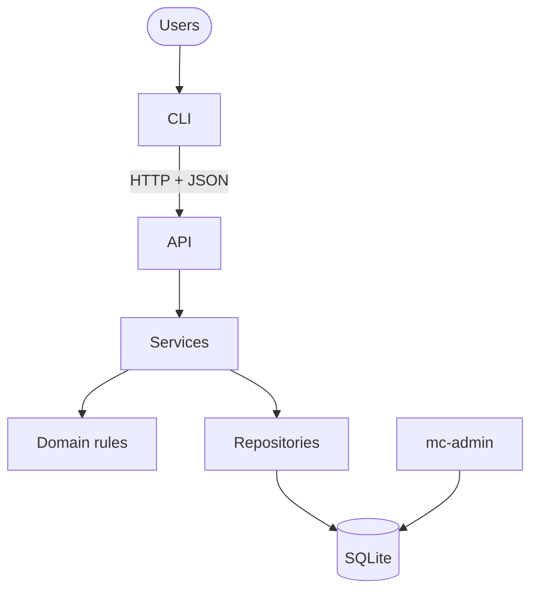

# Subagent (02): Phase 4 read-only review

Source: `agent-ac52171fe8ea9c922.jsonl` · 2026-10-12 04:24:01 UTC → 2026-10-12 04:33:44 UTC

Rendered from the raw JSONL without editing message content. Tool results and thinking are collapsed; expand them to read.


---

### 👤 User · 2026-10-12 04:24:01 UTC

You are doing a **read-only phase-end review of Phase 4 (interfaces: M15 HTTP API, M16 `mc` CLI, M17 `mc-admin` + README)** of the Mission Control project. **Do not edit, create, stage, commit or delete any file, and don't run git commands that change state.** You may read files, run `git diff`/`git show`, `uv run pytest`, `uv run ruff check`, and run the app for real (e.g. seed a temp database with `MC_DATABASE_PATH=/tmp/<dir>/x.db uv run mc-admin seed --reset`, start `uvicorn mission_control.api.app:create_app --factory --port <free port>` with that env, and drive `mc` with `HOME=/tmp/<dir>/home MC_API_URL=http://127.0.0.1:<port>`), as long as everything you create lives under /tmp and you stop any server you start.

Where: `/Users/pritanbarai/Desktop/JOBS/mutinex_mission_control/.worktrees/phase4`. The Phase 4 change is everything staged there relative to `main`: `git -C /Users/pritanbarai/Desktop/JOBS/mutinex_mission_control/.worktrees/phase4 diff --cached main --stat` (it also contains M14-apply and the inbox service, which belong to Phase 3 — focus on `src/mission_control/api/`, `src/mission_control/cli/`, `src/mission_control/admin_cli.py`, `src/mission_control/infra/settings.py`, `services/auth.py` whoami, `README.md`, `pyproject.toml`, `tests/api/`, `tests/cli/`).

Sources of truth: `docs/prd.md`, `docs/technical-design.md` (§2 layering: cli → api → services; §4 auth; §7 API, error body, status codes, problem codes, inbox; §8 CLI; §10 guidelines; §11 setup), `docs/cli-ux.md`, the project skill `.claude/skills/cli-ux/` (SKILL.md, references/checklist.md), `CLAUDE.md`. Security constraints: httpx is banned (httpx2 only); passwords never as flags; credentials file 0600; tokens hashed server-side; the organisation always comes from the token.

Review for, in priority order:
1. **Correctness and security** — wrong status codes or error bodies vs §7 (every error body has a non-empty `problems` list; 409 rule refusals use `rule_violation`); auth holes (anything reachable without a valid token, org taken from the request, caching of the actor); tenant isolation (any route where a foreign id behaves differently from a missing one — check the isolation sweep really covers every route); CLI exit codes, stdout/stderr split, secrets leaking (tokens/passwords in output, logs or argv); README commands that don't work as written.
2. **Contract drift** — places where the CLI assumes a request/response field the API doesn't provide (or vice versa) that tests wouldn't catch because they use the fake API; layering violations (CLI importing services/domain/infra; API containing business rules).
3. **CLI UX** — walk the cli-ux checklist; report Blocker/Major/Minor with the exact text the user sees and a concrete rewrite.
4. **Simplicity / refactor candidates and test gaps.**

Verify each finding (read the code, and run it where cheap) before reporting; drop anything you can't confirm. Final message: findings ranked High / Medium / Low, each with file:line, what's wrong, a concrete failure scenario and a one- or two-line fix; then a short list of what's notably good. Keep it concise enough to paste into a phase-review document.

<details>
<summary>⚙️ System/meta message · 2026-10-12 04:24:01 UTC</summary>

```
<system-reminder>
Your final report is delivered through SubagentHandback: when your work is complete, call SubagentHandback({message: <your full report>}). The call ends your run, so make it your last step. Only a SubagentHandback call reaches your caller as your result; plain text you write at the end is not delivered.
</system-reminder>
```

</details>

**🔧 Bash**

*Show staged diff stats*

```bash
git diff --cached main --stat | tail -80 && git status --short | head -20
```

<details>
<summary>↳ Result</summary>

```
 README.md                                          | 186 +++++
 pyproject.toml                                     |   2 +
 src/mission_control/admin_cli.py                   | 395 +++++++++++
 src/mission_control/api/app.py                     |  37 +-
 src/mission_control/api/deps.py                    |  57 ++
 src/mission_control/api/errors.py                  | 161 +++++
 src/mission_control/api/routers/__init__.py        |   2 +
 src/mission_control/api/routers/admin.py           |  91 +++
 src/mission_control/api/routers/assignments.py     |  44 ++
 src/mission_control/api/routers/auth.py            |  43 ++
 src/mission_control/api/routers/crew.py            |  68 ++
 src/mission_control/api/routers/missions.py        | 125 ++++
 src/mission_control/api/schemas/__init__.py        |   3 +
 src/mission_control/api/schemas/admin.py           |  98 +++
 src/mission_control/api/schemas/assignments.py     |  34 +
 src/mission_control/api/schemas/auth.py            |  51 ++
 src/mission_control/api/schemas/common.py          |  17 +
 src/mission_control/api/schemas/crew.py            | 109 +++
 src/mission_control/api/schemas/inbox.py           |  75 ++
 src/mission_control/api/schemas/matching.py        |  71 ++
 src/mission_control/api/schemas/missions.py        | 246 +++++++
 src/mission_control/cli/__init__.py                |   2 +
 src/mission_control/cli/client.py                  | 158 +++++
 src/mission_control/cli/commands/__init__.py       |   1 +
 src/mission_control/cli/commands/account.py        | 212 ++++++
 src/mission_control/cli/commands/admin.py          | 228 +++++++
 src/mission_control/cli/commands/assignments.py    | 127 ++++
 src/mission_control/cli/commands/common.py         | 101 +++
 src/mission_control/cli/commands/crew.py           | 107 +++
 src/mission_control/cli/commands/me.py             | 145 ++++
 src/mission_control/cli/commands/missions.py       | 757 +++++++++++++++++++++
 src/mission_control/cli/config.py                  |  73 ++
 src/mission_control/cli/env.py                     |  61 ++
 src/mission_control/cli/errors.py                  |  47 ++
 src/mission_control/cli/main.py                    |  70 ++
 src/mission_control/cli/prompts.py                 |  80 +++
 src/mission_control/cli/refusals.py                | 102 +++
 src/mission_control/cli/render.py                  | 227 ++++++
 src/mission_control/cli/resolve.py                 | 123 ++++
 src/mission_control/cli/views.py                   |  93 +++
 src/mission_control/domain/lifecycle.py            |  13 +-
 src/mission_control/domain/permissions.py          |   6 +-
 src/mission_control/infra/repositories/missions.py |   8 +
 src/mission_control/infra/settings.py              |  39 ++
 src/mission_control/services/assignments.py        |  35 +-
 src/mission_control/services/auth.py               |  21 +-
 src/mission_control/services/inbox.py              | 113 +++
 src/mission_control/services/matching.py           |  84 ++-
 tests/api/conftest.py                              |  84 +++
 tests/api/test_api_auth.py                         | 115 ++++
 tests/api/test_api_errors.py                       | 355 ++++++++++
 tests/api/test_api_isolation.py                    | 285 ++++++++
 tests/api/test_api_lifecycle.py                    | 170 +++++
 tests/api/test_api_permissions.py                  | 187 +++++
 tests/api/test_api_resources.py                    | 701 +++++++++++++++++++
 tests/api/test_api_scenarios.py                    |  92 +++
 tests/cli/cli_fakes.py                             | 340 +++++++++
 tests/cli/conftest.py                              |  19 +
 tests/cli/test_admin_cli.py                        | 498 ++++++++++++++
 tests/cli/test_cli_auth.py                         | 240 +++++++
 tests/cli/test_cli_config.py                       |  71 ++
 tests/cli/test_cli_errors.py                       | 204 ++++++
 tests/cli/test_cli_match.py                        | 211 ++++++
 tests/cli/test_cli_missions.py                     | 594 ++++++++++++++++
 tests/cli/test_cli_parsing.py                      |  64 ++
 tests/cli/test_cli_people.py                       | 554 +++++++++++++++
 tests/cli/test_cli_real_api.py                     | 132 ++++
 tests/cli/test_cli_render.py                       | 135 ++++
 tests/cli/test_cli_scenarios.py                    | 333 +++++++++
 tests/cli/test_readme_smoke.py                     | 267 ++++++++
 tests/integration/test_auth.py                     |  19 +
 tests/integration/test_inbox_service.py            | 180 +++++
 tests/integration/test_matching_service.py         | 119 +++-
 tests/unit/domain/test_lifecycle.py                |   7 +
 tests/unit/domain/test_permissions.py              |  19 +
 75 files changed, 10897 insertions(+), 46 deletions(-)
A  README.md
M  pyproject.toml
A  src/mission_control/admin_cli.py
M  src/mission_control/api/app.py
A  src/mission_control/api/deps.py
A  src/mission_control/api/errors.py
A  src/mission_control/api/routers/__init__.py
A  src/mission_control/api/routers/admin.py
A  src/mission_control/api/routers/assignments.py
A  src/mission_control/api/routers/auth.py
A  src/mission_control/api/routers/crew.py
A  src/mission_control/api/routers/missions.py
A  src/mission_control/api/schemas/__init__.py
A  src/mission_control/api/schemas/admin.py
A  src/mission_control/api/schemas/assignments.py
A  src/mission_control/api/schemas/auth.py
A  src/mission_control/api/schemas/common.py
A  src/mission_control/api/schemas/crew.py
A  src/mission_control/api/schemas/inbox.py
A  src/mission_control/api/schemas/matching.py
```

</details>

**🔧 Bash**

*List doc sections*

```bash
wc -l docs/*.md && grep -n "^## \|^### " docs/technical-design.md
```

**🔧 Bash**

*Run test suite and lint*

```bash
uv run pytest -q -x 2>&1 | tail -5; uv run ruff check 2>&1 | tail -3
```

```json
{
  "timeout": 600000
}
```

<details>
<summary>↳ Result</summary>

```
       9 docs/backlog.md
      76 docs/brief.md
     193 docs/cli-ux.md
     169 docs/phase-reviews.md
     338 docs/prd.md
     873 docs/technical-design.md
    1658 total
24:## 1. Summary
43:## 2. Architecture
95:## 3. Data model
130:## 4. Security and tenancy
132:### Authentication
141:### Permissions
169:### Tenant isolation
181:## 5. Lifecycle
183:### Mission
205:### Assignment
228:### Cross-cutting rules
240:## 6. Matching
308:## 7. API
431:## 8. CLI
465:## 9. Delivery plan
529:## 10. Guidelines for implementing agents
531:### Source of truth
536:### The loop for each module
545:### Working in waves (worktrees)
554:### Architecture rules (never break these)
562:### Coding conventions
568:### Testing conventions
573:### Stop and ask before
581:## 11. Setup and testing
606:## Appendix A: Schema SQL
617:### Organisations, users and sessions
655:### Crew, skills and availability
709:### Missions, slots and requirements
763:### Assignments, approvals and audit
836:## Appendix B: Trade-offs and considerations
840:### B.1 Key decisions
858:### B.2 Risks
868:### B.3 Scaling path (not in v1)
```

</details>

<details>
<summary>↳ Result</summary>

```
........................................................................ [ 83%]
........................................................................ [ 88%]
........................................................................ [ 92%]
........................................................................ [ 97%]
..............................................                           [100%]
All checks passed!
```

</details>

**🔧 Bash**

*Read design sections 2,4,7,8,10,11*

```bash
sed -n 43,95p docs/technical-design.md && sed -n 130,180p docs/technical-design.md && sed -n 308,465p docs/technical-design.md && sed -n 529,606p docs/technical-design.md
```

<details>
<summary>↳ Result</summary>

````
## 2. Architecture

**Stack:** Python 3.12 · FastAPI + Pydantic v2 · SQLite through stdlib `sqlite3` · argon2-cffi · Typer + httpx2 · uv, pytest, ruff

**Dependency policy:** don't use `httpx` anywhere, including tests. Use `httpx2`, which Starlette's `TestClient` now expects.

Why SQLite, hand-written SQL, and a CLI that goes through the API: [TR-1](#tr-1), [TR-2](#tr-2), [TR-4](#tr-4).



| Layer | Folder | Responsibility | May depend on |
|---|---|---|---|
| CLI | `cli/` | Commands, output, prompts | API over HTTP only |
| API | `api/` | Validate input, resolve `Actor`, call a service, map errors | services |
| Services | `services/` | One use case = one transaction + audit | domain, infra |
| Domain | `domain/` | Every business rule, pure (no I/O) | nothing |
| Infra | `infra/` | Connections, schema, scoped repositories, security | domain types |

**How a request flows** (example: `mc missions submit 12`)

1. The CLI sends `POST /api/v1/missions/12/submit` with the bearer token.
2. The API resolves the token to an `Actor` (user, organisation, role) and calls `services.missions.submit(actor, 12)`.
3. The service opens `BEGIN IMMEDIATE` and loads the mission through `Repos(conn, actor.org_id)`.
4. `domain.lifecycle.check_submit(...)` returns a list of problems. If the list is empty, the service writes the new status and an audit event, then commits.
5. The API returns `200` with the mission, or `409` with every problem. The CLI prints one bullet per problem and exits with code `1`.

<details><summary>Folder layout</summary>

```
src/mission_control/
  domain/    dates  enums  errors  eligibility  matching  lifecycle  approvals  permissions  passwords  records
  infra/     db  schema.sql  security  repositories/
  services/  auth  admin  crew  missions  assignments  approvals  matching  audit  inbox
  api/       app  deps  errors  schemas/  routers/
  cli/       main  client  config  render  resolve  commands/
  seed/      data  loader
  admin_cli.py        # mc-admin: init-db, seed, create-org
tests/  unit/  integration/  api/  cli/  builders.py  conftest.py
```
</details>

---

## 3. Data model
## 4. Security and tenancy

### Authentication

| | |
|---|---|
| Token | 32 random bytes. Only the SHA-256 hash is stored. 12-hour expiry. |
| Every request | Token → valid? → user active? → `Actor(user_id, org_id, role, crew_profile_id)`. Nothing is cached, so role changes apply immediately. |
| Revocation | Logout revokes that token. Deactivation or a password change revokes every token. Opaque tokens make this immediate ([TR-5](#tr-5)). |
| Passwords | Argon2id. At least 15 characters. No character-type rules. |

### Permissions

Each **role** sets the baseline:

| Role | Can | Can't |
|---|---|---|
| **Director** | Run the organisation: users, roles, skills, approval setting. See everything. Approve, transfer, complete and cancel missions. | Edit mission details, since that's the owner's job |
| **Lead** | Create and run their own missions. Rate other people's skills. See all crew and missions. | Approve anything. Touch missions they don't own. |
| **Crew** | Manage their own profile and availability. Respond to their own assignments. | See other crew, or missions they aren't on |

On top of the role, **relationship rules** make the decisions that matter:

| Rule | Effect | PRD |
|---|---|---|
| **Owner only** | Only the mission's owner edits it, proposes crew, applies the matcher or submits | M3 |
| **Not yourself** | Nobody sets their own skill levels | P3 |
| **Eligible approver** | A Director can't approve a mission they created or are on | A2 |
| **Self only** | Only you edit your details and availability. Only you, and Directors, see your unavailability reasons. | P4, §5.7 |
| **Visibility** | Crew only see missions they're on. Former assignees see a summary. | V2 |

**Enforcement.** `domain/permissions.authorize(actor, action, ctx)` is the single entry point. The complete action × role table is the parametrized test for this module, and that test is the source of truth.

| Status | When |
|---|---|
| **401** | Authentication failed |
| **404** | Missing, another organisation's, or not visible. All three look identical ([TR-10](#tr-10)). |
| **403** | Visible, but you're not allowed to do this |

### Tenant isolation

1. **Identity.** `org_id` comes only from the token, never from the request.
2. **Repositories.** `Repos(conn, org_id)` scopes every query. Another organisation's ID behaves as missing.
3. **Database.** Composite `(org_id, id)` foreign keys.
4. **Tests.**
   - An SQL lint checks every query mentions `org_id`.
   - A route inventory makes sure no endpoint is left out of the isolation tests.
   - A cross-organisation sweep compares database snapshots before and after.

---

## 7. API

**Conventions**
- REST and JSON, under `/api/v1`.
- Authentication with the header `Authorization: Bearer <token>`.
- Lifecycle changes are explicit `POST` commands, for example `/submit`. They are never `PATCH status`, because each one has its own guards and audit event ([TR-8](#tr-8)).
- List endpoints return only what the caller is allowed to see.

#### Auth and me
| Method | Path | Purpose |
|---|---|---|
| POST | `/auth/login` | Exchange email and password for a token |
| POST | `/auth/logout` | Revoke the current token |
| GET | `/me` | Current user, role and crew profile |
| POST | `/me/password` | Change password (revokes all sessions) |
| GET | `/me/inbox` | Things waiting on me: a to-do list computed from current data (see below) |

#### Organisation, users and skills (Directors)
| Method | Path | Purpose |
|---|---|---|
| GET · PATCH | `/org` | View settings, or set the required approvals |
| GET · POST | `/users` | List users, or create one with an initial password |
| PATCH | `/users/{id}` | Change role or deactivate |
| POST | `/users/{id}/crew-profile` | Give a user a crew profile |
| GET · POST | `/skills` | List skills (Leads too), or add one |
| PATCH · DELETE | `/skills/{id}` | Rename, or delete if unused |

#### Crew
| Method | Path | Purpose |
|---|---|---|
| GET | `/crew` · `/crew/{id}` | List or view profiles |
| PATCH | `/crew/{id}` | Edit own display name and bio |
| PUT · DELETE | `/crew/{id}/skills/{skill_id}` | Set or remove a skill level |
| GET · POST | `/crew/{id}/unavailability` | List or add own unavailability |
| DELETE | `/crew/{id}/unavailability/{uid}` | Remove own unavailability |
| GET | `/crew/{id}/assignments` | Assignment history (summaries) |

#### Missions
| Method | Path | Purpose |
|---|---|---|
| GET · POST | `/missions` | List visible missions, or create one with slots |
| GET · PATCH | `/missions/{id}` | View, or edit name and dates |
| POST | `/missions/{id}/slots` | Add a slot |
| PATCH · DELETE | `/missions/{id}/slots/{sid}` | Edit or remove a slot |
| GET | `/missions/{id}/history` | Audit trail |
| POST | `/missions/{id}/submit` · `approve` · `reject` · `complete` · `cancel` | Lifecycle commands |
| POST | `/missions/{id}/owner` | Transfer ownership |
| GET | `/missions/{id}/match` | Preview suggested roster |
| POST | `/missions/{id}/match/apply` | Create proposals from the suggestion |

#### Assignments
| Method | Path | Purpose |
|---|---|---|
| POST | `/missions/{id}/assignments` | Propose a crew member for a slot |
| GET | `/assignments` | My assignments |
| POST | `/assignments/{id}/accept` · `decline` · `withdraw` · `remove` | Respond or remove |

#### Inbox

`GET /me/inbox` (`mc inbox`) lists only what is waiting on the caller to act. It's computed from current data on each request, so nothing is stored, nothing is marked as read, and an item disappears once it's dealt with. Every role has one inbox, showing whichever sections apply:

| Section | Shown to | Item | Action |
|---|---|---|---|
| Proposals | Anyone with a crew profile | Their own Proposed assignments on Draft missions | accept or decline |
| Approvals | Directors | Pending missions they're an eligible approver for and haven't approved this round | approve or reject |
| Missions | The owning Lead | Their Draft missions, each with what's waiting: places to fill (open places, including after a decline, withdrawal or rejection), proposals awaiting replies, or "ready to submit" | staff or submit |

Not shown: pending missions waiting on others, Active missions, and anything informational. Each section is a few indexed lookups of the caller's own rows (`assignments_profile`, `missions_org_status`, `missions_owner`); the missions section shows counts only and leaves the full eligibility check to submit.

#### Errors

Every error has the same shape, for every status code (401, 403, 404, 409, 422, 503). `problems` is always present and always has at least one entry, so clients only ever handle one format. A rule or state conflict (409) lists **every** problem at once. A rule refusal's code is always `rule_violation`, with a summary message ("Ben can't be proposed as Flight Engineer on Lunar Gateway Resupply"); each reason is a problem with its own code. Only a state conflict has a code of its own (one of the **State** codes below), repeated as its single problem. A permission refusal (403) lists its single reason, because only one applies and the actor can't fix it themselves. Each problem names the record involved:

```json
{
  "error": {
    "code": "rule_violation",
    "message": "Mission can't be submitted",
    "problems": [
      { "code": "slot_unfilled", "message": "Commander: 1 of 1 place unfilled", "refs": { "slot_id": 12 } }
    ]
  }
}
```

| HTTP | Meaning | Codes |
|---|---|---|
| 401 | Not authenticated | `invalid_credentials` `unauthenticated` |
| 403 | Not allowed | `role_forbidden` `not_owner` `approver_is_creator` `approver_is_rostered` `self_skill_edit` `wrong_current_password` |
| 404 | Not found or not visible | `not_found` |
| 409 | Conflicts with state or a rule | **State:** `mission_frozen` `mission_final` `invalid_transition` `already_decided`<br>**Rules:** `rule_violation`, with the reasons as problem codes (below) |
| 422 | Invalid input | `validation_error` `password_too_short` |
| 503 | Database busy, retry | `busy` |

Malformed mission and slot values are 422 `validation_error`, and every mistake is listed at once: a blank mission or slot name, a headcount below 1, a slot with no required skill, a minimum level outside 1–5, an end date before the start date, or a Director creating a mission without naming its owner.

**Problem codes.** These appear inside `problems` and explain each refusal. Adding one means updating this table in the same change.

| Code | Raised when | Typical `refs` |
|---|---|---|
| `inactive` | The person is deactivated | `crew_profile_id`, `slot_id` |
| `skill_below_minimum` | A required skill is missing or below the minimum | `crew_profile_id`, `slot_id`, `skill_id` |
| `unavailable` | Unavailability overlaps the mission's dates | `crew_profile_id`, `slot_id` |
| `overlap` | An accepted assignment on another mission overlaps (the message names that mission) | `crew_profile_id`, `mission_id`, `mission_name` |
| `slot_has_open_assignments` | Removing a slot that still has crew | `assignment_id`, `crew_profile_id`, `slot_id` |
| `headcount_below_open_assignments` | Lowering headcount below the assigned crew (the message names them) | `slot_id`, `crew_profile_ids` |
| `invalidates_active_assignment` | A skill change would break an assignment on an Active mission | `mission_id`, `skill_id` |
| `slot_unfilled` | Submitting with empty places | `slot_id` |
| `proposal_unanswered` | Submitting while a proposal is still waiting for a reply (the message names the person and slot) | `assignment_id`, `slot_id`, `crew_profile_id` |
| `already_exists` | Inside a 409 `rule_violation`: the email address is already in use (anywhere on the platform, since login is by email alone; see [TR-13](#tr-13)), a skill name is already in the catalogue (ignoring case), the user already has a crew profile, or a mission already has a live slot with that name (ignoring case; a new mission's slots are also checked against each other, and have no `slot_id` yet) | `email`; `skill_id`; `user_id`, `crew_profile_id`; `slot_id` |
| `owner_not_active_lead` | The owner named for a new mission, or for a transfer, isn't a Mission Lead or is deactivated (inside a 409 `rule_violation`) | `user_id` |
| `insufficient_approvers` | Submitting when fewer eligible approvers exist than the approvals required | — |
| `has_open_assignments` | Deactivating someone who still holds proposed or accepted assignments | `user_id`, `mission_ids` |
| `owns_open_missions` | Deactivating, or changing the role of, a Lead who owns unfinished missions | `user_id`, `mission_ids` |
| `last_director` | Deactivating or demoting the organisation's only active Director | `user_id` |
| `skill_in_use` | Deleting a skill that crew hold or slots require (the message names them) | `skill_id`, `crew_profile_ids`, `mission_ids` |
| `mission_needs_a_slot` | Removing a mission's only slot | `slot_id` |
| `already_owner` | Transferring a mission to the Lead who already owns it | `user_id` |
| `slot_full` | Proposing someone for a slot with no open places (the message names the slot and mission) | `slot_id` |
| `already_assigned` | Proposing someone who already holds an open assignment on this mission (the message names their slot) | `assignment_id`, `crew_profile_id`, `mission_id` |

---

## 8. CLI

| Concern | Behaviour |
|---|---|
| Client | An `httpx2` wrapper passed into commands, so tests use `TestClient` and need no server |
| Auth | Token stored in `~/.config/mission-control/credentials.json` (mode 0600). Cleared on logout, password change or 401. |
| References | Missions and assignments by ID. People by email. Skills by name. Slots by name or position. |
| Passwords | Hidden prompt only, never a flag. Asked twice when setting one. |
| Output | Plain tables. No meaning carried by colour alone. `--json` for scripts. |
| Errors | The message, then one bullet per problem, then a hint for known codes |
| Exit codes | `0` OK · `1` refused · `2` usage · `3` authentication · `4` unreachable or busy |
| Confirmations | Changing a Pending mission, or cancelling, asks first. `--yes` skips the prompt. |

```bash
# Everyone
mc login | logout | whoami | password | inbox
mc me show | update | unavailable add|list|remove
mc assignments list [--pending] | accept ID | decline ID | withdraw ID --reason R

# Leads
mc missions create --name N --start D --end D --slot "Commander:1:Piloting>=4,Leadership>=3"
mc missions edit | slot add|edit|remove | match ID [--apply]
mc missions propose ID --slot S --crew EMAIL | remove-crew ID ASSIGNMENT | submit ID
mc crew list | show | history | set-skill EMAIL SKILL LEVEL | unset-skill EMAIL SKILL

# Directors
mc missions approve ID | reject ID --reason R | transfer ID --owner EMAIL
mc missions complete ID | cancel ID --reason R | list | show | history
mc users list | add | set-role | deactivate | enable-crew
mc skills list | add | rename | remove          mc org show | set-approvals N
```

---

## 9. Delivery plan
## 10. Guidelines for implementing agents

### Source of truth
1. The **PRD** decides behaviour. **This document** decides structure. Code follows both.
2. **Don't invent behaviour.** If the PRD is silent or contradicts this document, stop and ask. Don't guess, and don't "improve" the rule.
3. Work on **one module at a time**, in the order in [§9](#9-delivery-plan). Start a module only when the user has approved it, and never before its dependencies are done.

### The loop for each module
1. Read the module's row in §9 and every PRD ID it references.
2. Write failing tests. Name them after the rule, for example `test_ac15_accept_overlap_names_conflicting_mission`.
3. Write the smallest implementation that makes them pass.
4. Refactor, then run the **full** suite and `ruff`.
5. Verify the behaviour by running it for real (a REPL call, a request, or a CLI command), and show the output.
6. Do a read-only review of the diff, and report findings without editing anything.
7. Propose a commit message, such as `feat(m12): assignment propose/accept/withdraw`. **Don't commit, and don't start the next module, until the user approves.**

### Working in waves (worktrees)
- **Approval:** a wave starts only when the user approves every module in it. The modules must not depend on each other.
- **Isolation:** each module gets its own worktree and branch, `.worktrees/<module>` on branch `<module>` (e.g. `m9-admin`), created from the current `main`. The agent works only inside it and runs `uv sync` and the tests there.
- **Agents don't commit.** Each leaves its changes uncommitted and reports the usual package: tests first, real run, read-only review.
- **Review is one branch at a time.** The user reviews only that module's diff against `main`.
- **Merge:** after approval, the lead commits on the branch, rebases it onto `main` if `main` has moved (re-running its tests), fast-forwards `main`, and runs the full suite on `main` before the next review.
- **Ports:** a real run that starts a server uses port `8000 + module number` (e.g. M11 uses 8011).
- **Clean-up:** remove the worktree and branch once merged.

### Architecture rules (never break these)
- `domain/` imports nothing from `infra/`, `services/`, `api/` or `sqlite3`.
- All SQL lives in `infra/repositories/`, and every query filters on `org_id`.
- `org_id` comes only from the `Actor`. Never read it from request input.
- Every mutating service calls `touch_for_change()` first, and writes an audit event in the same transaction.
- Writes open `BEGIN IMMEDIATE` **before** running checks.
- Errors use the codes in [§7](#7-api). Adding a code means updating that table in the same change.

### Coding conventions
- Type hints everywhere. Frozen dataclasses for domain records. No module-level mutable state.
- `date` objects in the domain, ISO strings only at the database and API edges. Timestamps are UTC.
- Use PRD vocabulary in names: `open_places`, `eligible_approver`, `workload`.
- Keep routers thin: validate, call one service, return.

### Testing conventions
- Use the `seeded_db` fixture for PRD scenarios, and `tests/builders.py` for edge cases.
- Every test gets its own database. No network calls. No reliance on the current date: pass dates in.
- Never weaken or delete a test to make it pass. If a test looks wrong, raise it.

### Stop and ask before
- adding a dependency;
- changing the schema (and if you do, update [Appendix A](#appendix-a-schema-sql) as well);
- adding an endpoint, error code or CLI command that isn't in this document;
- any case where the PRD looks ambiguous or a PRD scenario's expected outcome seems wrong.

---

## 11. Setup and testing

```bash
uv sync
uv run mc-admin seed --reset      # load PRD §9 data
uv run mc-server                  # API on 127.0.0.1:8000
uv run mc login --email lee@aurora.example
uv run pytest
```

Settings: `MC_DATABASE_PATH` · `MC_TOKEN_TTL_HOURS=12` · `MC_DB_BUSY_TIMEOUT_MS=5000`

| Level | Database | Covers |
|---|---|---|
| Unit | none | Domain rules, matcher, lifecycle, permission table |
| Integration | temporary file | Services, rollback, constraints, audit, SQL lint |
| API | temporary file | Error codes, auth, permissions, isolation sweep, scenarios S1 and S3b–S9 |
| CLI | temporary file | S1 and S4 end to end, `--json`, errors, exit codes, prompts |

- **Shared seed.** `seed/data.py` drives both the demo and the tests, so they can't drift apart.
- **Isolated databases.** Every test gets a fresh SQLite file under `tmp_path`.
- **Fixtures.** `seeded_db` for scenarios; `tests/builders.py` for focused edge cases.

---

## Appendix A: Schema SQL
````

</details>

<details>
<summary>📎 File attached: CLAUDE.md</summary>

```
{
  "path": "/Users/pritanbarai/Desktop/JOBS/mutinex_mission_control/.worktrees/phase4/CLAUDE.md",
  "type": "Project",
  "content": "# Mission Control\n\nMulti-tenant mission planning API and CLI. Read these before doing any work. They are the source of truth, so don't copy their content here.\n\n- [`docs/brief.md`](docs/brief.md): the assessment brief\n- [`docs/prd.md`](docs/prd.md): **behaviour**. What the system does, its rules, acceptance criteria and seed scenarios.\n- [`docs/technical-design.md`](docs/technical-design.md): **structure**. Architecture, schema, API, CLI, the delivery plan (§9) and the implementation guidelines (§10).\n\nIf the PRD and the design conflict, or are silent on something, stop and ask. Never invent behaviour.\n\n## Workflow (every module)\n\n1. **One approved module at a time.** Work only on the module from design §9 that I have approved. Don't start anything else.\n2. **Tests first.** Write failing tests that reference the PRD IDs, then implement. Run the full suite and lint: `uv run pytest` and `uv run ruff check`.\n3. **Real verification.** Exercise the behaviour for real, for example with a REPL call, an HTTP request or a CLI command. Show the actual output. A passing test run alone isn't verification.\n4. **Read-only review.** Review the full diff against the PRD and design §10 without editing. Report findings, and fix them only once I agree.\n5. **Stop for approval.** Summarise what changed, the test and verification results, and the review findings, and propose a commit message. **Don't commit, and don't start the next module, until I approve.**\n\n## Waves (parallel modules in worktrees)\n\nWhen I approve a wave of independent modules (design §9), build them in parallel and keep reviews small:\n\n1. **One worktree per module.** Run `git worktree add .worktrees/<module> -b <module> main`, then `uv sync` inside it. Each agent edits only its own worktree and doesn't commit.\n2. **Same workflow per module.** Steps 2 to 4 above still apply, inside the worktree.\n3. **Review one branch at a time.** Show me only that module's diff against `main` (`git -C .worktrees/<module> diff main`, including new files), with its results.\n4. **After I approve that module:**\n   - commit on its branch;\n   - rebase onto `main` if `main` has moved, and re-run its tests;\n   - fast-forward `main`;\n   - run the full suite on `main`;\n   - remove the worktree and branch.\n\n   Only then present the next branch.\n\nNever push, add dependencies, change the schema, or add endpoints, error codes or CLI commands outside the design without asking first.\n",
  "contentDiffersFromDisk": false
}
```

</details>

**🔧 Bash**

*Read API core files*

```bash
cd /Users/pritanbarai/Desktop/JOBS/mutinex_mission_control/.worktrees/phase4/src/mission_control && cat -n api/app.py api/deps.py api/errors.py infra/settings.py
```

<details>
<summary>↳ Result</summary>

```
     1	"""The HTTP API: JSON under /api/v1, authenticated with `Authorization: Bearer <token>`."""
     2	
     3	import os
     4	from collections.abc import AsyncGenerator
     5	from contextlib import asynccontextmanager
     6	
     7	from fastapi import FastAPI
     8	
     9	from mission_control.api import errors
    10	from mission_control.api.routers import admin, assignments, auth, crew, missions
    11	from mission_control.infra import security
    12	from mission_control.infra.db import connect, init_db
    13	from mission_control.infra.settings import Settings
    14	
    15	API_PREFIX = "/api/v1"
    16	
    17	
    18	def create_app(settings: Settings | None = None) -> FastAPI:
    19	    """Settings come from the environment unless given."""
    20	    config = settings if settings is not None else Settings.from_env(os.environ)
    21	
    22	    @asynccontextmanager
    23	    async def lifespan(_: FastAPI) -> AsyncGenerator[None]:
    24	        conn = connect(config.database_path, busy_timeout_ms=config.busy_timeout_ms)
    25	        try:
    26	            init_db(conn)  # refuses an unsupported SQLite or schema; creates an empty schema
    27	        finally:
    28	            conn.close()
    29	        # Login checks unknown emails against this hash, so it costs the same as a real check.
    30	        # Making it now keeps the first such login as slow as every other.
    31	        security.dummy_hash()
    32	        yield
    33	
    34	    app = FastAPI(title="Mission Control", lifespan=lifespan)
    35	    app.state.settings = config
    36	    errors.install(app)
    37	
    38	    @app.get("/health")
    39	    def health() -> dict[str, str]:
    40	        return {"status": "ok"}
    41	
    42	    for router in (auth.router, admin.router, crew.router, missions.router, assignments.router):
    43	        app.include_router(router, prefix=API_PREFIX)
    44	    return app
    45	
    46	
    47	def main() -> None:
    48	    import uvicorn
    49	
    50	    uvicorn.run(create_app(), host="127.0.0.1", port=8000)
     1	"""What each request runs with: one database connection, the caller resolved from their bearer
     2	token, and the service context built from both.
     3	
     4	The organisation always comes from the token, never from the request. Nothing about the caller
     5	is cached, so a role change or deactivation applies to their very next request.
     6	"""
     7	
     8	import sqlite3
     9	from collections.abc import Generator
    10	from typing import Annotated
    11	
    12	from fastapi import Depends, Request
    13	from fastapi.security import HTTPAuthorizationCredentials, HTTPBearer
    14	
    15	from mission_control.domain.permissions import Actor
    16	from mission_control.infra.db import connect
    17	from mission_control.infra.settings import Settings
    18	from mission_control.services import auth
    19	from mission_control.services.context import ServiceContext
    20	
    21	_bearer = HTTPBearer(auto_error=False)
    22	
    23	
    24	def settings(request: Request) -> Settings:
    25	    return request.app.state.settings
    26	
    27	
    28	def db(config: Annotated[Settings, Depends(settings)]) -> Generator[sqlite3.Connection]:
    29	    """One connection per request, closed when the response is done."""
    30	    conn = connect(config.database_path, busy_timeout_ms=config.busy_timeout_ms)
    31	    try:
    32	        yield conn
    33	    finally:
    34	        conn.close()
    35	
    36	
    37	Conn = Annotated[sqlite3.Connection, Depends(db)]
    38	
    39	
    40	def bearer_token(
    41	    credentials: Annotated[HTTPAuthorizationCredentials | None, Depends(_bearer)],
    42	) -> str | None:
    43	    return credentials.credentials if credentials is not None else None
    44	
    45	
    46	Token = Annotated[str | None, Depends(bearer_token)]
    47	
    48	
    49	def current_actor(conn: Conn, token: Token) -> Actor:
    50	    return auth.authenticate(conn, token)
    51	
    52	
    53	def service_context(conn: Conn, actor: Annotated[Actor, Depends(current_actor)]) -> ServiceContext:
    54	    return ServiceContext(conn, actor)
    55	
    56	
    57	Ctx = Annotated[ServiceContext, Depends(service_context)]
     1	"""Turning refusals into HTTP responses. Every error, whatever its status, has one shape:
     2	
     3	    {"error": {"code": ..., "message": ..., "problems": [{"code", "message", "refs"}, ...]}}
     4	
     5	`problems` always has at least one entry. A refusal with a single reason repeats its message
     6	there, so clients only ever read one format.
     7	"""
     8	
     9	from collections.abc import Sequence
    10	from http import HTTPStatus
    11	from typing import Any
    12	
    13	from fastapi import FastAPI, Request
    14	from fastapi.exceptions import RequestValidationError
    15	from fastapi.responses import JSONResponse
    16	from starlette.exceptions import HTTPException as StarletteHTTPException
    17	
    18	from mission_control.domain.dates import InvalidDateRange
    19	from mission_control.domain.errors import (
    20	    Forbidden,
    21	    InvalidInput,
    22	    NotFound,
    23	    Problem,
    24	    RuleViolation,
    25	    Unauthenticated,
    26	)
    27	from mission_control.domain.passwords import MIN_PASSWORD_LENGTH, PasswordTooShort
    28	from mission_control.infra.db import DatabaseBusy
    29	
    30	VALIDATION_ERROR = "validation_error"
    31	_SEVERAL_MISTAKES = "Some values aren't valid"
    32	
    33	
    34	def error_response(
    35	    status: int,
    36	    code: str,
    37	    message: str,
    38	    problems: Sequence[Problem] = (),
    39	    headers: dict[str, str] | None = None,
    40	) -> JSONResponse:
    41	    listed = problems or (Problem(code, message),)
    42	    body = {
    43	        "error": {
    44	            "code": code,
    45	            "message": message,
    46	            "problems": [
    47	                {"code": p.code, "message": p.message, "refs": dict(p.refs)} for p in listed
    48	            ],
    49	        }
    50	    }
    51	    return JSONResponse(body, status_code=status, headers=headers)
    52	
    53	
    54	def install(app: FastAPI) -> None:
    55	    """Register a handler for every refusal the services raise, and for malformed requests."""
    56	
    57	    @app.exception_handler(Unauthenticated)
    58	    def _unauthenticated(_: Request, e: Unauthenticated) -> JSONResponse:
    59	        return error_response(401, e.code, e.message, headers={"WWW-Authenticate": "Bearer"})
    60	
    61	    @app.exception_handler(Forbidden)
    62	    def _forbidden(_: Request, e: Forbidden) -> JSONResponse:
    63	        return error_response(403, e.code, e.message)
    64	
    65	    @app.exception_handler(NotFound)
    66	    def _not_found(_: Request, e: NotFound) -> JSONResponse:
    67	        return error_response(404, e.code, e.message)
    68	
    69	    @app.exception_handler(RuleViolation)  # StateConflict included
    70	    def _rule_violation(_: Request, e: RuleViolation) -> JSONResponse:
    71	        return error_response(409, e.code, e.message, e.problems)
    72	
    73	    @app.exception_handler(InvalidInput)
    74	    def _invalid_input(_: Request, e: InvalidInput) -> JSONResponse:
    75	        return error_response(422, VALIDATION_ERROR, e.message, e.problems)
    76	
    77	    @app.exception_handler(PasswordTooShort)
    78	    def _password_too_short(_: Request, e: PasswordTooShort) -> JSONResponse:
    79	        message = f"Passwords must be at least {MIN_PASSWORD_LENGTH} characters"
    80	        return error_response(422, "password_too_short", message)
    81	
    82	    @app.exception_handler(InvalidDateRange)
    83	    def _invalid_date_range(_: Request, e: InvalidDateRange) -> JSONResponse:
    84	        text = str(e)
    85	        return error_response(422, VALIDATION_ERROR, text[:1].upper() + text[1:])
    86	
    87	    @app.exception_handler(DatabaseBusy)
    88	    def _busy(_: Request, e: DatabaseBusy) -> JSONResponse:
    89	        return error_response(503, "busy", "The database is busy; try again")
    90	
    91	    @app.exception_handler(RequestValidationError)
    92	    def _malformed(_: Request, e: RequestValidationError) -> JSONResponse:
    93	        problems = [_validation_problem(err) for err in e.errors()]
    94	        message = problems[0].message if len(problems) == 1 else _SEVERAL_MISTAKES
    95	        return error_response(422, VALIDATION_ERROR, message, problems)
    96	
    97	    @app.exception_handler(StarletteHTTPException)
    98	    def _http(_: Request, e: StarletteHTTPException) -> JSONResponse:
    99	        if e.status_code == 404:
   100	            return error_response(404, NotFound.code, "Not found")
   101	        phrase = HTTPStatus(e.status_code).phrase
   102	        return error_response(e.status_code, phrase.lower().replace(" ", "_"), phrase)
   103	
   104	
   105	# Malformed requests. Pydantic's own wording is replaced for the common cases, so a refusal
   106	# reads as a sentence about the field, e.g. "start_date must be a date (YYYY-MM-DD)".
   107	
   108	_PHRASES = {
   109	    "missing": "{field} is required",
   110	    "int_parsing": "{field} must be a whole number",
   111	    "int_type": "{field} must be a whole number",
   112	    "int_from_float": "{field} must be a whole number",
   113	    "string_type": "{field} must be text",
   114	    "bool_parsing": "{field} must be true or false",
   115	    "bool_type": "{field} must be true or false",
   116	    "date_parsing": "{field} must be a date (YYYY-MM-DD)",
   117	    "date_from_datetime_parsing": "{field} must be a date (YYYY-MM-DD)",
   118	    "date_from_datetime_inexact": "{field} must be a date (YYYY-MM-DD)",
   119	    "date_type": "{field} must be a date (YYYY-MM-DD)",
   120	    "list_type": "{field} must be a list",
   121	    "model_type": "{field} must be an object",
   122	    "model_attributes_type": "{field} must be an object",
   123	    "dict_type": "{field} must be an object",
   124	    "greater_than_equal": "{field} must be at least {ge}",
   125	    "less_than_equal": "{field} must be at most {le}",
   126	    "extra_forbidden": "{field} isn't a known field",
   127	}
   128	
   129	
   130	def _validation_problem(err: dict[str, Any]) -> Problem:
   131	    kind = err.get("type", "")
   132	    if kind == "json_invalid":
   133	        return Problem(VALIDATION_ERROR, "The request body isn't valid JSON")
   134	    field = _field(err.get("loc", ()))
   135	    ctx = err.get("ctx") or {}
   136	    if field == "":  # about the request body as a whole
   137	        if kind == "value_error" and "error" in ctx:
   138	            return Problem(VALIDATION_ERROR, str(ctx["error"]))
   139	        if kind == "missing":
   140	            return Problem(VALIDATION_ERROR, "The request body is required")
   141	        return Problem(VALIDATION_ERROR, "The request body must be a JSON object")
   142	    if kind == "enum" and "expected" in ctx:
   143	        choices = ctx["expected"].replace("'", "").replace(" or ", ", ")
   144	        message = f"{field} must be one of: {choices}"
   145	    elif kind == "value_error" and "error" in ctx:
   146	        message = f"{field} {ctx['error']}"
   147	    elif kind in _PHRASES:
   148	        message = _PHRASES[kind].format(field=field, **ctx)
   149	    else:
   150	        message = f"{field}: {err.get('msg', 'is not valid')}"
   151	    return Problem(VALIDATION_ERROR, message, {"field": field})
   152	
   153	
   154	def _field(loc: Sequence[int | str]) -> str:
   155	    """('body', 'slots', 0, 'headcount') -> 'slots[0].headcount'. The request part (body,
   156	    path, query) is left out."""
   157	    parts = list(loc[1:]) if loc and loc[0] in ("body", "path", "query", "header") else list(loc)
   158	    text = ""
   159	    for part in parts:
   160	        text += f"[{part}]" if isinstance(part, int) else (f".{part}" if text else str(part))
   161	    return text
     1	"""Runtime settings, read from the environment once at startup.
     2	
     3	- `MC_DATABASE_PATH`: the SQLite file (default `mission_control.db` in the working directory)
     4	- `MC_DB_BUSY_TIMEOUT_MS`: how long a request waits for the write lock (default 5000)
     5	- `MC_TOKEN_TTL_HOURS`: how long a session lasts (default 12)
     6	"""
     7	
     8	from collections.abc import Mapping
     9	from dataclasses import dataclass
    10	from pathlib import Path
    11	
    12	
    13	@dataclass(frozen=True)
    14	class Settings:
    15	    database_path: Path = Path("mission_control.db")
    16	    busy_timeout_ms: int = 5000
    17	    token_ttl_hours: int = 12
    18	
    19	    @classmethod
    20	    def from_env(cls, env: Mapping[str, str]) -> "Settings":
    21	        defaults = cls()
    22	        return cls(
    23	            database_path=Path(env.get("MC_DATABASE_PATH") or defaults.database_path),
    24	            busy_timeout_ms=_whole(env, "MC_DB_BUSY_TIMEOUT_MS", defaults.busy_timeout_ms, 0),
    25	            token_ttl_hours=_whole(env, "MC_TOKEN_TTL_HOURS", defaults.token_ttl_hours, 1),
    26	        )
    27	
    28	
    29	def _whole(env: Mapping[str, str], name: str, default: int, minimum: int) -> int:
    30	    raw = env.get(name)
    31	    if raw is None or raw.strip() == "":
    32	        return default
    33	    try:
    34	        value = int(raw)
    35	    except ValueError:
    36	        raise ValueError(f"{name} must be a whole number, not {raw!r}") from None
    37	    if value < minimum:
    38	        raise ValueError(f"{name} must be at least {minimum}, not {value}")
    39	    return value
```

</details>

**🔧 Bash**

*Read auth/admin routers and auth service diff*

```bash
cd /Users/pritanbarai/Desktop/JOBS/mutinex_mission_control/.worktrees/phase4/src/mission_control && cat -n api/routers/auth.py api/routers/admin.py && git diff --cached main -- services/auth.py && grep -rn "token_ttl\|TTL" --include=*.py . | grep -v "^./cli"
```

<details>
<summary>↳ Result</summary>

```
     1	from datetime import timedelta
     2	from typing import Annotated
     3	
     4	from fastapi import APIRouter, Depends, status
     5	
     6	from mission_control.api.deps import Conn, Ctx, Token, current_actor, settings
     7	from mission_control.api.schemas.auth import Login, MeOut, PasswordChange, SessionOut
     8	from mission_control.api.schemas.inbox import InboxOut
     9	from mission_control.domain.permissions import Actor
    10	from mission_control.infra.settings import Settings
    11	from mission_control.services import auth, inbox
    12	
    13	router = APIRouter(tags=["auth"])
    14	
    15	Me = Annotated[Actor, Depends(current_actor)]
    16	
    17	
    18	@router.post("/auth/login")
    19	def login(body: Login, conn: Conn, config: Annotated[Settings, Depends(settings)]) -> SessionOut:
    20	    lifetime = timedelta(hours=config.token_ttl_hours)
    21	    return SessionOut.of(auth.login(conn, body.email, body.password, lifetime=lifetime))
    22	
    23	
    24	@router.post("/auth/logout", status_code=status.HTTP_204_NO_CONTENT)
    25	def logout(conn: Conn, token: Token, _: Me) -> None:
    26	    assert token is not None  # a valid session was required to get here
    27	    auth.logout(conn, token)
    28	
    29	
    30	@router.get("/me")
    31	def me(conn: Conn, actor: Me) -> MeOut:
    32	    return MeOut.of_me(auth.whoami(conn, actor))
    33	
    34	
    35	@router.get("/me/inbox")
    36	def my_inbox(ctx: Ctx) -> InboxOut:
    37	    """What is waiting on you to act."""
    38	    return InboxOut.of(inbox.inbox(ctx))
    39	
    40	
    41	@router.post("/me/password", status_code=status.HTTP_204_NO_CONTENT)
    42	def change_password(body: PasswordChange, conn: Conn, actor: Me) -> None:
    43	    auth.change_password(conn, actor, body.current_password, body.new_password)
     1	from fastapi import APIRouter, status
     2	
     3	from mission_control.api.deps import Ctx
     4	from mission_control.api.schemas.admin import (
     5	    CrewProfileCreate,
     6	    OrgOut,
     7	    OrgUpdate,
     8	    SkillCreate,
     9	    SkillOut,
    10	    SkillUpdate,
    11	    UserCreate,
    12	    UserOut,
    13	    UserUpdate,
    14	)
    15	from mission_control.api.schemas.common import PathId
    16	from mission_control.api.schemas.crew import CrewProfileOut
    17	from mission_control.services import admin
    18	
    19	router = APIRouter(tags=["admin"])
    20	
    21	
    22	# Organisation
    23	
    24	
    25	@router.get("/org")
    26	def view_org(ctx: Ctx) -> OrgOut:
    27	    return OrgOut.of(admin.view_organisation(ctx))
    28	
    29	
    30	@router.patch("/org")
    31	def update_org(body: OrgUpdate, ctx: Ctx) -> OrgOut:
    32	    return OrgOut.of(admin.set_required_approvals(ctx, body.required_approvals))
    33	
    34	
    35	# Users
    36	
    37	
    38	@router.get("/users")
    39	def list_users(ctx: Ctx) -> list[UserOut]:
    40	    return [UserOut.of(u) for u in admin.list_users(ctx)]
    41	
    42	
    43	@router.post("/users", status_code=status.HTTP_201_CREATED)
    44	def create_user(body: UserCreate, ctx: Ctx) -> UserOut:
    45	    return UserOut.of(admin.create_user(ctx, body.email, body.name, body.role, body.password))
    46	
    47	
    48	@router.patch("/users/{user_id}")
    49	def update_user(user_id: PathId, body: UserUpdate, ctx: Ctx) -> UserOut:
    50	    """Change the role, or deactivate with `active: false`. With neither, the user is returned
    51	    unchanged."""
    52	    if body.role is not None:
    53	        return UserOut.of(admin.change_role(ctx, user_id, body.role))
    54	    if body.active is False:
    55	        return UserOut.of(admin.deactivate_user(ctx, user_id))
    56	    return UserOut.of(admin.view_user(ctx, user_id))
    57	
    58	
    59	@router.post("/users/{user_id}/crew-profile", status_code=status.HTTP_201_CREATED)
    60	def create_crew_profile(
    61	    user_id: PathId, ctx: Ctx, body: CrewProfileCreate | None = None
    62	) -> CrewProfileOut:
    63	    display_name = body.display_name if body is not None else None
    64	    return CrewProfileOut.of(admin.create_crew_profile(ctx, user_id, display_name))
    65	
    66	
    67	# Skills
    68	
    69	
    70	@router.get("/skills")
    71	def list_skills(ctx: Ctx) -> list[SkillOut]:
    72	    return [SkillOut.of(s) for s in admin.list_skills(ctx)]
    73	
    74	
    75	@router.post("/skills", status_code=status.HTTP_201_CREATED)
    76	def add_skill(body: SkillCreate, ctx: Ctx) -> SkillOut:
    77	    return SkillOut.of(admin.add_skill(ctx, body.name, body.category))
    78	
    79	
    80	@router.patch("/skills/{skill_id}")
    81	def update_skill(skill_id: PathId, body: SkillUpdate, ctx: Ctx) -> SkillOut:
    82	    if "category" in body.model_fields_set:
    83	        skill = admin.update_skill(ctx, skill_id, name=body.name, category=body.category)
    84	    else:
    85	        skill = admin.update_skill(ctx, skill_id, name=body.name)
    86	    return SkillOut.of(skill)
    87	
    88	
    89	@router.delete("/skills/{skill_id}", status_code=status.HTTP_204_NO_CONTENT)
    90	def delete_skill(skill_id: PathId, ctx: Ctx) -> None:
    91	    admin.delete_skill(ctx, skill_id)
diff --git a/src/mission_control/services/auth.py b/src/mission_control/services/auth.py
index 97a4520..496a10e 100644
--- a/src/mission_control/services/auth.py
+++ b/src/mission_control/services/auth.py
@@ -12,7 +12,7 @@ from mission_control.domain.permissions import Actor
 from mission_control.infra import security
 from mission_control.infra.db import read_tx, write_tx
 from mission_control.infra.repositories import Repos
-from mission_control.infra.repositories.models import User
+from mission_control.infra.repositories.models import Organisation, User
 
 SESSION_LIFETIME = timedelta(hours=12)
 
@@ -26,6 +26,15 @@ class Session:
     user: User
 
 
+@dataclass(frozen=True)
+class Me:
+    """The caller's own account, as they see it when they ask who they're logged in as."""
+
+    user: User
+    organisation: Organisation
+    crew_profile_id: int | None
+
+
 def _now(now: datetime | None) -> datetime:
     return now or datetime.now(UTC)
 
@@ -90,6 +99,16 @@ def authenticate(
     )
 
 
+def whoami(conn: sqlite3.Connection, actor: Actor) -> Me:
+    """The caller's own account and organisation. Anyone may see their own."""
+    with read_tx(conn):
+        repos = Repos(conn, actor.org_id)
+        user = repos.users.get(actor.user_id)
+        if user is None:  # authenticate() has just found them
+            raise _session_error()
+        return Me(user, repos.organisation.get(), actor.crew_profile_id)
+
+
 def logout(conn: sqlite3.Connection, token: str, *, now: datetime | None = None) -> None:
     with write_tx(conn):
         security.revoke_token(conn, security.hash_token(token), _now(now))
(eval):1: no matches found: --include=*.py
```

</details>

**🔧 Bash**

*Read admin/auth schemas*

```bash
cd /Users/pritanbarai/Desktop/JOBS/mutinex_mission_control/.worktrees/phase4/src/mission_control && cat -n api/schemas/common.py api/schemas/admin.py api/schemas/auth.py
```

<details>
<summary>↳ Result</summary>

```
     1	from typing import Annotated
     2	
     3	from fastapi import Path
     4	from pydantic import BaseModel, ConfigDict, Field
     5	
     6	# SQLite stores 64-bit integers. Anything larger is malformed input, refused as 422 rather than
     7	# failing in the database.
     8	_MIN_INT, _MAX_INT = -(2**63), 2**63 - 1
     9	
    10	Int = Annotated[int, Field(ge=_MIN_INT, le=_MAX_INT)]
    11	PathId = Annotated[int, Path(ge=_MIN_INT, le=_MAX_INT)]
    12	
    13	
    14	class RequestBody(BaseModel):
    15	    """A request body. Unknown fields are refused, so a misspelt field isn't silently ignored."""
    16	
    17	    model_config = ConfigDict(extra="forbid")
     1	from pydantic import BaseModel, field_validator, model_validator
     2	
     3	from mission_control.api.schemas.common import Int, RequestBody
     4	from mission_control.domain.enums import Role
     5	from mission_control.infra.repositories.models import Organisation, Skill, User
     6	
     7	# Organisation
     8	
     9	
    10	class OrgOut(BaseModel):
    11	    id: int
    12	    name: str
    13	    slug: str
    14	    required_approvals: int
    15	
    16	    @classmethod
    17	    def of(cls, org: Organisation) -> "OrgOut":
    18	        return cls(
    19	            id=org.id, name=org.name, slug=org.slug, required_approvals=org.required_approvals
    20	        )
    21	
    22	
    23	class OrgUpdate(RequestBody):
    24	    required_approvals: Int
    25	
    26	
    27	# Users
    28	
    29	
    30	class UserOut(BaseModel):
    31	    id: int
    32	    email: str
    33	    name: str
    34	    role: Role
    35	    active: bool
    36	
    37	    @classmethod
    38	    def of(cls, user: User) -> "UserOut":
    39	        return cls(
    40	            id=user.id, email=user.email, name=user.name, role=user.role, active=user.is_active
    41	        )
    42	
    43	
    44	class UserCreate(RequestBody):
    45	    email: str
    46	    name: str
    47	    role: Role
    48	    password: str
    49	
    50	
    51	class UserUpdate(RequestBody):
    52	    """A new role, or `active: false` to deactivate. Both are separate use cases, each in its
    53	    own transaction, so one request makes only one of them."""
    54	
    55	    role: Role | None = None
    56	    active: bool | None = None
    57	
    58	    @field_validator("active")
    59	    @classmethod
    60	    def _only_deactivate(cls, active: bool | None) -> bool | None:
    61	        if active is True:
    62	            raise ValueError("can only be false: deactivated users can't be reactivated")
    63	        return active
    64	
    65	    @model_validator(mode="after")
    66	    def _one_change(self) -> "UserUpdate":
    67	        if self.role is not None and self.active is not None:
    68	            raise ValueError("Change a user's role and deactivate them in separate requests")
    69	        return self
    70	
    71	
    72	class CrewProfileCreate(RequestBody):
    73	    display_name: str | None = None
    74	
    75	
    76	# Skills
    77	
    78	
    79	class SkillOut(BaseModel):
    80	    id: int
    81	    name: str
    82	    category: str | None
    83	
    84	    @classmethod
    85	    def of(cls, skill: Skill) -> "SkillOut":
    86	        return cls(id=skill.id, name=skill.name, category=skill.category)
    87	
    88	
    89	class SkillCreate(RequestBody):
    90	    name: str
    91	    category: str | None = None
    92	
    93	
    94	class SkillUpdate(RequestBody):
    95	    """A field left out stays as it is; `category: null` clears the category."""
    96	
    97	    name: str | None = None
    98	    category: str | None = None
     1	from datetime import datetime
     2	
     3	from pydantic import BaseModel
     4	
     5	from mission_control.api.schemas.admin import UserOut
     6	from mission_control.api.schemas.common import RequestBody
     7	from mission_control.services.auth import Me, Session
     8	
     9	
    10	class Login(RequestBody):
    11	    email: str
    12	    password: str
    13	
    14	
    15	class SessionOut(BaseModel):
    16	    token: str  # shown once; send it as `Authorization: Bearer <token>`
    17	    expires_at: datetime
    18	    user: UserOut
    19	
    20	    @classmethod
    21	    def of(cls, session: Session) -> "SessionOut":
    22	        return cls(
    23	            token=session.token, expires_at=session.expires_at, user=UserOut.of(session.user)
    24	        )
    25	
    26	
    27	class OrganisationRef(BaseModel):
    28	    id: int
    29	    name: str
    30	    slug: str
    31	
    32	
    33	class MeOut(UserOut):
    34	    """The caller's own account, organisation and crew profile."""
    35	
    36	    crew_profile_id: int | None
    37	    organisation: OrganisationRef
    38	
    39	    @classmethod
    40	    def of_me(cls, me: Me) -> "MeOut":
    41	        org = me.organisation
    42	        return cls(
    43	            **UserOut.of(me.user).model_dump(),
    44	            crew_profile_id=me.crew_profile_id,
    45	            organisation=OrganisationRef(id=org.id, name=org.name, slug=org.slug),
    46	        )
    47	
    48	
    49	class PasswordChange(RequestBody):
    50	    current_password: str
    51	    new_password: str
```

</details>

**🔧 Bash**

*Read crew/missions/assignments routers*

```bash
cd /Users/pritanbarai/Desktop/JOBS/mutinex_mission_control/.worktrees/phase4/src/mission_control && cat -n api/routers/crew.py api/routers/missions.py api/routers/assignments.py
```

<details>
<summary>↳ Result</summary>

```
     1	from fastapi import APIRouter, status
     2	
     3	from mission_control.api.deps import Ctx
     4	from mission_control.api.schemas.common import PathId
     5	from mission_control.api.schemas.crew import (
     6	    AssignmentSummaryOut,
     7	    CrewOut,
     8	    CrewProfileOut,
     9	    CrewUpdate,
    10	    SkillLevelOut,
    11	    SkillLevelSet,
    12	    UnavailabilityAdd,
    13	    UnavailabilityOut,
    14	)
    15	from mission_control.services import crew
    16	
    17	router = APIRouter(prefix="/crew", tags=["crew"])
    18	
    19	
    20	@router.get("")
    21	def list_crew(ctx: Ctx) -> list[CrewOut]:
    22	    return [CrewOut.of(v) for v in crew.list_crew(ctx)]
    23	
    24	
    25	@router.get("/{crew_id}")
    26	def view_crew(crew_id: PathId, ctx: Ctx) -> CrewOut:
    27	    return CrewOut.of(crew.view_crew(ctx, crew_id))
    28	
    29	
    30	@router.patch("/{crew_id}")
    31	def update_details(crew_id: PathId, body: CrewUpdate, ctx: Ctx) -> CrewProfileOut:
    32	    profile = crew.update_details(ctx, crew_id, display_name=body.display_name, bio=body.bio)
    33	    return CrewProfileOut.of(profile)
    34	
    35	
    36	@router.put("/{crew_id}/skills/{skill_id}")
    37	def set_skill_level(
    38	    crew_id: PathId, skill_id: PathId, body: SkillLevelSet, ctx: Ctx
    39	) -> SkillLevelOut:
    40	    return SkillLevelOut.of(crew.set_skill_level(ctx, crew_id, skill_id, body.level))
    41	
    42	
    43	@router.delete("/{crew_id}/skills/{skill_id}", status_code=status.HTTP_204_NO_CONTENT)
    44	def remove_skill_level(crew_id: PathId, skill_id: PathId, ctx: Ctx) -> None:
    45	    crew.remove_skill_level(ctx, crew_id, skill_id)
    46	
    47	
    48	@router.get("/{crew_id}/unavailability")
    49	def list_unavailability(crew_id: PathId, ctx: Ctx) -> list[UnavailabilityOut]:
    50	    return [UnavailabilityOut.of(u) for u in crew.list_unavailability(ctx, crew_id)]
    51	
    52	
    53	@router.post("/{crew_id}/unavailability", status_code=status.HTTP_201_CREATED)
    54	def add_unavailability(crew_id: PathId, body: UnavailabilityAdd, ctx: Ctx) -> UnavailabilityOut:
    55	    added = crew.add_unavailability(ctx, crew_id, body.start_date, body.end_date, body.reason)
    56	    return UnavailabilityOut.of(added)
    57	
    58	
    59	@router.delete(
    60	    "/{crew_id}/unavailability/{unavailability_id}", status_code=status.HTTP_204_NO_CONTENT
    61	)
    62	def remove_unavailability(crew_id: PathId, unavailability_id: PathId, ctx: Ctx) -> None:
    63	    crew.remove_unavailability(ctx, crew_id, unavailability_id)
    64	
    65	
    66	@router.get("/{crew_id}/assignments")
    67	def assignment_history(crew_id: PathId, ctx: Ctx) -> list[AssignmentSummaryOut]:
    68	    return [AssignmentSummaryOut.of(a) for a in crew.assignment_history(ctx, crew_id)]
     1	from fastapi import APIRouter, status
     2	
     3	from mission_control.api.deps import Ctx
     4	from mission_control.api.schemas.assignments import AssignmentOut
     5	from mission_control.api.schemas.common import PathId
     6	from mission_control.api.schemas.matching import MatchPreviewOut
     7	from mission_control.api.schemas.missions import (
     8	    HistoryEntryOut,
     9	    MissionCreate,
    10	    MissionOut,
    11	    MissionSummaryOut,
    12	    MissionUpdate,
    13	    OwnerChange,
    14	    ReasonIn,
    15	    SlotIn,
    16	    SlotUpdate,
    17	)
    18	from mission_control.services import approvals, audit, matching, missions
    19	
    20	router = APIRouter(prefix="/missions", tags=["missions"])
    21	
    22	
    23	@router.get("")
    24	def list_missions(ctx: Ctx) -> list[MissionSummaryOut]:
    25	    return [MissionSummaryOut.of(m) for m in missions.list_missions(ctx)]
    26	
    27	
    28	@router.post("", status_code=status.HTTP_201_CREATED)
    29	def create_mission(body: MissionCreate, ctx: Ctx) -> MissionOut:
    30	    view = missions.create_mission(
    31	        ctx,
    32	        name=body.name,
    33	        start=body.start_date,
    34	        end=body.end_date,
    35	        slots=[s.to_input() for s in body.slots],
    36	        owner_id=body.owner_id,
    37	    )
    38	    return MissionOut.of_view(view)
    39	
    40	
    41	@router.get("/{mission_id}")
    42	def view_mission(mission_id: PathId, ctx: Ctx) -> MissionOut:
    43	    return MissionOut.of_view(missions.get_mission(ctx, mission_id))
    44	
    45	
    46	@router.patch("/{mission_id}")
    47	def update_mission(mission_id: PathId, body: MissionUpdate, ctx: Ctx) -> MissionOut:
    48	    view = missions.update_mission(
    49	        ctx, mission_id, name=body.name, start=body.start_date, end=body.end_date
    50	    )
    51	    return MissionOut.of_view(view)
    52	
    53	
    54	@router.post("/{mission_id}/slots", status_code=status.HTTP_201_CREATED)
    55	def add_slot(mission_id: PathId, body: SlotIn, ctx: Ctx) -> MissionOut:
    56	    return MissionOut.of_view(missions.add_slot(ctx, mission_id, body.to_input()))
    57	
    58	
    59	@router.patch("/{mission_id}/slots/{slot_id}")
    60	def update_slot(mission_id: PathId, slot_id: PathId, body: SlotUpdate, ctx: Ctx) -> MissionOut:
    61	    """Rename or change the headcount, or replace the required skills."""
    62	    levels = body.levels()
    63	    if levels is not None:
    64	        view = missions.replace_requirements(ctx, mission_id, slot_id, levels)
    65	    else:
    66	        view = missions.update_slot(
    67	            ctx, mission_id, slot_id, name=body.name, headcount=body.headcount
    68	        )
    69	    return MissionOut.of_view(view)
    70	
    71	
    72	@router.delete("/{mission_id}/slots/{slot_id}")
    73	def remove_slot(mission_id: PathId, slot_id: PathId, ctx: Ctx) -> MissionOut:
    74	    return MissionOut.of_view(missions.remove_slot(ctx, mission_id, slot_id))
    75	
    76	
    77	@router.post("/{mission_id}/owner")
    78	def transfer_ownership(mission_id: PathId, body: OwnerChange, ctx: Ctx) -> MissionOut:
    79	    return MissionOut.of_view(missions.transfer_ownership(ctx, mission_id, body.owner_id))
    80	
    81	
    82	@router.get("/{mission_id}/match")
    83	def preview_match(mission_id: PathId, ctx: Ctx) -> MatchPreviewOut:
    84	    return MatchPreviewOut.of(matching.preview(ctx, mission_id))
    85	
    86	
    87	@router.post("/{mission_id}/match/apply", status_code=status.HTTP_201_CREATED)
    88	def apply_match(mission_id: PathId, ctx: Ctx) -> list[AssignmentOut]:
    89	    """Propose the suggested crew; they still have to accept."""
    90	    return [AssignmentOut.of(a) for a in matching.apply(ctx, mission_id)]
    91	
    92	
    93	# Lifecycle
    94	
    95	
    96	@router.post("/{mission_id}/submit")
    97	def submit(mission_id: PathId, ctx: Ctx) -> MissionOut:
    98	    return MissionOut.of_view(approvals.submit(ctx, mission_id))
    99	
   100	
   101	@router.post("/{mission_id}/approve")
   102	def approve(mission_id: PathId, ctx: Ctx) -> MissionOut:
   103	    return MissionOut.of_view(approvals.approve(ctx, mission_id))
   104	
   105	
   106	@router.post("/{mission_id}/reject")
   107	def reject(mission_id: PathId, ctx: Ctx, body: ReasonIn | None = None) -> MissionOut:
   108	    reason = body.reason if body is not None else None
   109	    return MissionOut.of_view(approvals.reject(ctx, mission_id, reason))
   110	
   111	
   112	@router.post("/{mission_id}/complete")
   113	def complete(mission_id: PathId, ctx: Ctx) -> MissionOut:
   114	    return MissionOut.of_view(missions.complete_mission(ctx, mission_id))
   115	
   116	
   117	@router.post("/{mission_id}/cancel")
   118	def cancel(mission_id: PathId, ctx: Ctx, body: ReasonIn | None = None) -> MissionOut:
   119	    reason = body.reason if body is not None else None
   120	    return MissionOut.of_view(missions.cancel_mission(ctx, mission_id, reason))
   121	
   122	
   123	@router.get("/{mission_id}/history")
   124	def history(mission_id: PathId, ctx: Ctx) -> list[HistoryEntryOut]:
   125	    return [HistoryEntryOut.of(e) for e in audit.mission_history(ctx, mission_id)]
     1	from fastapi import APIRouter, status
     2	
     3	from mission_control.api.deps import Ctx
     4	from mission_control.api.schemas.assignments import AssignmentOut, Proposal, Reason
     5	from mission_control.api.schemas.common import PathId
     6	from mission_control.api.schemas.crew import AssignmentSummaryOut
     7	from mission_control.services import assignments
     8	
     9	router = APIRouter(tags=["assignments"])
    10	
    11	
    12	@router.post("/missions/{mission_id}/assignments", status_code=status.HTTP_201_CREATED)
    13	def propose(mission_id: PathId, body: Proposal, ctx: Ctx) -> AssignmentOut:
    14	    made = assignments.propose(ctx, mission_id, body.slot_id, body.crew_profile_id)
    15	    return AssignmentOut.of(made)
    16	
    17	
    18	@router.get("/assignments")
    19	def my_assignments(ctx: Ctx, pending: bool = False) -> list[AssignmentSummaryOut]:
    20	    """Your own assignments, newest first; `pending=true` for proposals awaiting your reply."""
    21	    return [AssignmentSummaryOut.of(a) for a in assignments.my_assignments(ctx, pending)]
    22	
    23	
    24	@router.post("/assignments/{assignment_id}/accept")
    25	def accept(assignment_id: PathId, ctx: Ctx) -> AssignmentOut:
    26	    return AssignmentOut.of(assignments.accept(ctx, assignment_id))
    27	
    28	
    29	@router.post("/assignments/{assignment_id}/decline")
    30	def decline(assignment_id: PathId, ctx: Ctx, body: Reason | None = None) -> AssignmentOut:
    31	    reason = body.reason if body is not None else None
    32	    return AssignmentOut.of(assignments.decline(ctx, assignment_id, reason))
    33	
    34	
    35	@router.post("/assignments/{assignment_id}/withdraw")
    36	def withdraw(assignment_id: PathId, ctx: Ctx, body: Reason | None = None) -> AssignmentOut:
    37	    """A reason is required; leaving it out is refused with the service's own message."""
    38	    reason = body.reason if body is not None else None
    39	    return AssignmentOut.of(assignments.withdraw(ctx, assignment_id, reason))
    40	
    41	
    42	@router.post("/assignments/{assignment_id}/remove")
    43	def remove(assignment_id: PathId, ctx: Ctx) -> AssignmentOut:
    44	    return AssignmentOut.of(assignments.remove(ctx, assignment_id))
```

</details>

**🔧 Bash**

*Read isolation tests*

```bash
cat -n tests/api/test_api_isolation.py tests/api/conftest.py
```

<details>
<summary>↳ Result</summary>

```
     1	"""M15: tenant isolation sweep over HTTP (S9; PRD T1, T2, AC-27 to AC-29, AC-31; design §4
     2	Tenant isolation, TR-10).
     3	
     4	Each role in each organisation calls every endpoint with the other organisation's ids:
     5	- the response is identical to the one for an id that doesn't exist;
     6	- it is 404, except where the caller's role is refused before anything is looked up, in which
     7	  case the foreign and missing ids both get the same 403;
     8	- nothing in either organisation changes.
     9	Every list holds only the caller's organisation's records.
    10	
    11	A route inventory makes any new endpoint fail here until it's added to the sweep.
    12	
    13	Seed ids. Aurora (org 1): users 1–13, skills 1–6, missions 1–7, Gateway 1 (Lee) with slots 1–3,
    14	Hana 13, Fay's unavailability 1, Gus's Reboost assignment 1. Helix (org 2): users 14–19, skills
    15	7–10, Payload Demo 8 (Priya) with slots 12–13, Priya 15 (no crew profile), Kai 16, Tess 19,
    16	Lena's Payload assignment 9. Kai gets an unavailability (id 2) in the fixture below.
    17	"""
    18	
    19	import re
    20	
    21	import pytest
    22	
    23	API = "/api/v1"
    24	MISSING = 999_999
    25	
    26	
    27	class Ids:
    28	    """One organisation's records the sweep points at."""
    29	
    30	    def __init__(self, **ids):
    31	        self.__dict__.update(ids)
    32	
    33	
    34	AURORA = Ids(
    35	    org=1,
    36	    user=7,  # Ben
    37	    no_profile_user=4,  # Lee
    38	    crew=7,  # Ben
    39	    other_crew=13,  # Hana: someone a Director or Lead may rate
    40	    skill=1,
    41	    mission=1,  # Gateway, owned by the Lead below
    42	    slot=1,
    43	    lead=4,  # Lee
    44	    assignment=1,
    45	    unavailability=1,
    46	    users=set(range(1, 14)),
    47	    skills=set(range(1, 7)),
    48	    missions=set(range(1, 8)),
    49	)
    50	HELIX = Ids(
    51	    org=2,
    52	    user=16,  # Kai
    53	    no_profile_user=15,  # Priya
    54	    crew=16,  # Kai
    55	    other_crew=19,  # Tess
    56	    skill=7,
    57	    mission=8,  # Payload Demo, owned by Priya
    58	    slot=12,
    59	    lead=15,  # Priya
    60	    assignment=9,
    61	    unavailability=2,
    62	    users=set(range(14, 20)),
    63	    skills=set(range(7, 11)),
    64	    missions={8},
    65	)
    66	
    67	# (first name, org, role letter, own crew profile id or None)
    68	CALLERS = [
    69	    ("ruth", "aurora", "D", None),
    70	    ("lee", "aurora", "L", None),
    71	    ("ben", "aurora", "C", 7),
    72	    ("sam", "helix", "D", None),
    73	    ("priya", "helix", "L", None),
    74	    ("kai", "helix", "C", 16),
    75	]
    76	
    77	
    78	def _slot(skill):
    79	    return {"name": "Probe", "headcount": 1, "requirements": [{"skill_id": skill, "min_level": 1}]}
    80	
    81	
    82	def _mission(skill, owner=None):
    83	    body = {
    84	        "name": "Probe",
    85	        "start_date": "2027-09-01",
    86	        "end_date": "2027-09-02",
    87	        "slots": [_slot(skill)],
    88	    }
    89	    if owner is not None:
    90	        body["owner_id"] = owner
    91	    return body
    92	
    93	
    94	# Each variant: (method, path, body, roles answered 403 before any lookup). `o` is the other
    95	# organisation's ids, `me` the caller's, and `x(...)` swaps in the other organisation's id or a
    96	# missing one. Every other role must get 404.
    97	def variants(me, o, own_crew, x):
    98	    v = [
    99	        ("PATCH", f"/users/{x(o.user)}", {"role": "lead"}, "LC"),
   100	        ("POST", f"/users/{x(o.no_profile_user)}/crew-profile", {}, "LC"),
   101	        ("PATCH", f"/skills/{x(o.skill)}", {"name": "Renamed"}, "LC"),
   102	        ("DELETE", f"/skills/{x(o.skill)}", None, "LC"),
   103	        ("GET", f"/crew/{x(o.crew)}", None, ""),
   104	        ("PATCH", f"/crew/{x(o.crew)}", {"bio": "Hi"}, ""),
   105	        ("PUT", f"/crew/{x(o.crew)}/skills/{me.skill}", {"level": 3}, ""),
   106	        ("PUT", f"/crew/{me.other_crew}/skills/{x(o.skill)}", {"level": 3}, ""),
   107	        ("DELETE", f"/crew/{x(o.crew)}/skills/{me.skill}", None, ""),
   108	        ("DELETE", f"/crew/{me.other_crew}/skills/{x(o.skill)}", None, ""),
   109	        ("GET", f"/crew/{x(o.crew)}/unavailability", None, ""),
   110	        (
   111	            "POST",
   112	            f"/crew/{x(o.crew)}/unavailability",
   113	            {"start_date": "2027-09-01", "end_date": "2027-09-02", "reason": "x"},
   114	            "",
   115	        ),
   116	        ("DELETE", f"/crew/{x(o.crew)}/unavailability/{x(o.unavailability)}", None, ""),
   117	        ("GET", f"/crew/{x(o.crew)}/assignments", None, ""),
   118	        ("POST", "/missions", _mission(x(o.skill), me.lead), "C"),
   119	        ("POST", "/missions", _mission(x(o.skill)), "C"),
   120	        ("POST", "/missions", _mission(me.skill, x(o.lead)), "LC"),  # a Lead names only themselves
   121	        ("GET", f"/missions/{x(o.mission)}", None, ""),
   122	        ("PATCH", f"/missions/{x(o.mission)}", {"name": "Renamed"}, ""),
   123	        ("POST", f"/missions/{x(o.mission)}/slots", _slot(me.skill), ""),
   124	        ("POST", f"/missions/{me.mission}/slots", _slot(x(o.skill)), "D"),
   125	        ("PATCH", f"/missions/{x(o.mission)}/slots/{x(o.slot)}", {"headcount": 2}, ""),
   126	        ("PATCH", f"/missions/{me.mission}/slots/{x(o.slot)}", {"headcount": 2}, ""),
   127	        ("DELETE", f"/missions/{x(o.mission)}/slots/{x(o.slot)}", None, ""),
   128	        ("DELETE", f"/missions/{me.mission}/slots/{x(o.slot)}", None, ""),
   129	        ("POST", f"/missions/{x(o.mission)}/owner", {"owner_id": me.lead}, ""),
   130	        ("POST", f"/missions/{me.mission}/owner", {"owner_id": x(o.lead)}, "L"),
   131	        ("GET", f"/missions/{x(o.mission)}/match", None, ""),
   132	        (
   133	            "POST",
   134	            f"/missions/{x(o.mission)}/assignments",
   135	            {"slot_id": x(o.slot), "crew_profile_id": x(o.crew)},
   136	            "",
   137	        ),
   138	        (
   139	            "POST",
   140	            f"/missions/{me.mission}/assignments",
   141	            {"slot_id": me.slot, "crew_profile_id": x(o.crew)},
   142	            "D",
   143	        ),
   144	        (
   145	            "POST",
   146	            f"/missions/{me.mission}/assignments",
   147	            {"slot_id": x(o.slot), "crew_profile_id": me.other_crew},
   148	            "",
   149	        ),
   150	        ("POST", f"/assignments/{x(o.assignment)}/accept", None, ""),
   151	        ("POST", f"/assignments/{x(o.assignment)}/decline", {"reason": "x"}, ""),
   152	        ("POST", f"/assignments/{x(o.assignment)}/withdraw", {"reason": "x"}, ""),
   153	        ("POST", f"/assignments/{x(o.assignment)}/remove", None, ""),
   154	        ("POST", f"/missions/{x(o.mission)}/match/apply", None, ""),
   155	        ("POST", f"/missions/{x(o.mission)}/submit", None, ""),
   156	        ("POST", f"/missions/{x(o.mission)}/approve", None, ""),
   157	        ("POST", f"/missions/{x(o.mission)}/reject", {"reason": "x"}, ""),
   158	        ("POST", f"/missions/{x(o.mission)}/complete", None, ""),
   159	        ("POST", f"/missions/{x(o.mission)}/cancel", {"reason": "x"}, ""),
   160	        ("GET", f"/missions/{x(o.mission)}/history", None, ""),
   161	    ]
   162	    if own_crew is not None:
   163	        v.append(("DELETE", f"/crew/{own_crew}/unavailability/{x(o.unavailability)}", None, ""))
   164	    return v
   165	
   166	
   167	# Endpoints that take no id at all, so there is nothing foreign to name. Lists are checked below.
   168	NO_ID = {
   169	    ("GET", "/health"),
   170	    ("POST", f"{API}/auth/login"),
   171	    ("POST", f"{API}/auth/logout"),
   172	    ("GET", f"{API}/me"),
   173	    ("GET", f"{API}/me/inbox"),  # only ever the caller's own items
   174	    ("POST", f"{API}/me/password"),
   175	    ("PATCH", f"{API}/org"),  # changes only the caller's own organisation
   176	    ("POST", f"{API}/users"),  # creates in the caller's own organisation
   177	    ("POST", f"{API}/skills"),  # likewise
   178	}
   179	LISTS = {
   180	    ("GET", f"{API}/org"),
   181	    ("GET", f"{API}/users"),
   182	    ("GET", f"{API}/skills"),
   183	    ("GET", f"{API}/crew"),
   184	    ("GET", f"{API}/missions"),
   185	    ("GET", f"{API}/assignments"),
   186	}
   187	
   188	
   189	def _template(path: str) -> str:
   190	    """'/missions/8/slots/12' -> '/missions/{}/slots/{}', to match against the app's routes."""
   191	    return "/".join("{}" if part.isdigit() else part for part in path.split("/"))
   192	
   193	
   194	def _route_templates(app) -> set[tuple[str, str]]:
   195	    """Every endpoint the app serves, from its OpenAPI schema (which lists included routers'
   196	    routes; none of ours are hidden from it)."""
   197	    return {
   198	        (method.upper(), re.sub(r"\{[^}]+\}", "{}", path))
   199	        for path, operations in app.openapi()["paths"].items()
   200	        for method in operations
   201	    }
   202	
   203	
   204	@pytest.fixture
   205	def kai_unavailable(db):
   206	    """A Helix unavailability for Aurora callers to point at."""
   207	    db.execute(
   208	        "INSERT INTO unavailability(id, org_id, crew_profile_id, start_date, end_date, reason)"
   209	        " VALUES (2, 2, 16, '2027-05-01', '2027-05-02', 'Training')"
   210	    )
   211	
   212	
   213	def test_s9_route_inventory_every_endpoint_is_in_the_sweep(client):
   214	    swept = {
   215	        (method, _template(f"{API}{path}"))
   216	        for method, path, _, _ in variants(AURORA, HELIX, 7, lambda i: i)
   217	    }
   218	    covered = swept | {(m, _template(p)) for m, p in NO_ID | LISTS}
   219	    assert _route_templates(client.app) == covered
   220	
   221	
   222	@pytest.mark.parametrize(("who", "org", "role", "own_crew"), CALLERS, ids=[c[0] for c in CALLERS])
   223	def test_s9_ac27_ac29_foreign_ids_look_missing_and_change_nothing(
   224	    client, login, snap, kai_unavailable, who, org, role, own_crew
   225	):
   226	    me, other = (AURORA, HELIX) if org == "aurora" else (HELIX, AURORA)
   227	    headers = login(who)
   228	    foreign = variants(me, other, own_crew, lambda i: i)
   229	    missing = variants(me, other, own_crew, lambda i: MISSING)
   230	    before = snap()
   231	    for (method, path, body, gated), (_, missing_path, missing_body, _) in zip(
   232	        foreign, missing, strict=True
   233	    ):
   234	        response = client.request(method, f"{API}{path}", headers=headers, json=body)
   235	        expected = client.request(
   236	            method, f"{API}{missing_path}", headers=headers, json=missing_body
   237	        )
   238	        label = f"{who} {method} {path}"
   239	        assert response.status_code == (403 if role in gated else 404), f"{label}: {response.text}"
   240	        assert response.json() == expected.json(), label
   241	        assert response.status_code == expected.status_code, label
   242	        assert snap() == before, f"{label} changed the database"
   243	
   244	
   245	@pytest.mark.parametrize(("who", "org", "role", "own_crew"), CALLERS, ids=[c[0] for c in CALLERS])
   246	def test_s9_ac28_every_list_holds_only_the_callers_organisation(
   247	    client, login, who, org, role, own_crew
   248	):
   249	    me = AURORA if org == "aurora" else HELIX
   250	    headers = login(who)
   251	
   252	    def get(path):
   253	        return client.get(f"{API}{path}", headers=headers)
   254	
   255	    org_view = get("/org")
   256	    users = get("/users")
   257	    skills = get("/skills")
   258	    if role == "D":
   259	        assert org_view.json()["id"] == me.org
   260	        assert {u["id"] for u in users.json()} == me.users
   261	    else:
   262	        assert org_view.status_code == users.status_code == 403
   263	    if role == "C":
   264	        assert skills.status_code == 403
   265	    else:
   266	        assert {s["id"] for s in skills.json()} == me.skills
   267	
   268	    crew = {c["crew_profile_id"] for c in get("/crew").json()}
   269	    missions = {m["id"] for m in get("/missions").json()}
   270	    assignments = {a["mission_id"] for a in get("/assignments").json()}
   271	    assert crew and crew <= me.users
   272	    assert missions <= me.missions
   273	    assert assignments <= me.missions
   274	    if role != "C":
   275	        assert missions == me.missions
   276	
   277	
   278	def test_ac31_s9_helix_kai_is_never_suggested_for_an_aurora_piloting_slot(client, login):
   279	    """Kai has Piloting 5 (Helix's own skill) and no commitments."""
   280	    for mission in (1, 2):  # Gateway's Commander and Asteroid's Pilot need Aurora Piloting
   281	        body = client.get(f"{API}/missions/{mission}/match", headers=login("ruth")).json()
   282	        names = [p["name"] for s in body["slots"] for p in s["suggested"]]
   283	        ids = [p["crew_profile_id"] for s in body["slots"] for p in s["suggested"]]
   284	        assert "Kai" not in names and 16 not in ids
   285	        assert set(ids) <= AURORA.users
     1	"""API test setup: a freshly seeded database file per test, an in-process client against it,
     2	and a helper that logs in as a seeded user.
     3	
     4	Seed ids (PRD §9): a crew profile's id equals its user's id. Emails are
     5	`<first name>@<org slug>.example`, e.g. lee@aurora.example, kai@helix.example.
     6	"""
     7	
     8	import pytest
     9	from fastapi.testclient import TestClient
    10	
    11	from mission_control.api.app import create_app
    12	from mission_control.infra import security
    13	from mission_control.infra.db import connect, init_db
    14	from mission_control.infra.settings import Settings
    15	from mission_control.seed.data import DEMO_PASSWORD
    16	from mission_control.seed.loader import load_seed
    17	
    18	
    19	@pytest.fixture
    20	def db_path(tmp_path):
    21	    """The PRD seed, with a real (cheap in tests) Argon2 hash of the demo passphrase."""
    22	    path = tmp_path / "mission_control.db"
    23	    conn = connect(path)
    24	    init_db(conn)
    25	    load_seed(conn, password_hash=security.hash_password(DEMO_PASSWORD))
    26	    conn.close()
    27	    return path
    28	
    29	
    30	@pytest.fixture
    31	def settings(db_path):
    32	    return Settings(database_path=db_path)
    33	
    34	
    35	@pytest.fixture
    36	def client(settings):
    37	    with TestClient(create_app(settings)) as c:
    38	        yield c
    39	
    40	
    41	@pytest.fixture
    42	def db(db_path):
    43	    """A separate connection to the same file, for checking what the API wrote."""
    44	    conn = connect(db_path)
    45	    yield conn
    46	    conn.close()
    47	
    48	
    49	@pytest.fixture
    50	def login(client):
    51	    """`login("lee")` logs in as a seeded user and returns the request headers to use."""
    52	
    53	    def _login(who: str, org: str | None = None, password: str = DEMO_PASSWORD) -> dict:
    54	        email = who if "@" in who else f"{who}@{org or _org_of(who)}.example"
    55	        response = client.post("/api/v1/auth/login", json={"email": email, "password": password})
    56	        assert response.status_code == 200, response.text
    57	        return {"Authorization": f"Bearer {response.json()['token']}"}
    58	
    59	    return _login
    60	
    61	
    62	_HELIX = {"sam", "priya", "kai", "lena", "omar", "tess"}
    63	
    64	
    65	def _org_of(first_name: str) -> str:
    66	    return "helix" if first_name in _HELIX else "aurora"
    67	
    68	
    69	def snapshot(conn) -> dict[str, list[tuple]]:
    70	    """Every table's rows, to prove a request changed nothing."""
    71	    tables = [
    72	        r[0]
    73	        for r in conn.execute(
    74	            "SELECT name FROM sqlite_master WHERE type = 'table' AND name NOT LIKE 'sqlite_%'"
    75	        )
    76	    ]
    77	    return {
    78	        t: [tuple(r) for r in conn.execute(f"SELECT * FROM {t} ORDER BY rowid")] for t in tables
    79	    }
    80	
    81	
    82	@pytest.fixture
    83	def snap(db):
    84	    return lambda: snapshot(db)
```

</details>

**🔧 Bash**

*Read CLI core files*

```bash
cd /Users/pritanbarai/Desktop/JOBS/mutinex_mission_control/.worktrees/phase4/src/mission_control/cli && cat -n main.py client.py config.py env.py errors.py
```

<details>
<summary>↳ Result</summary>

```
     1	"""The `mc` entry point: every command group, the global options, and a quiet exit when the
     2	reader of a pipe goes away."""
     3	
     4	import os
     5	import sys
     6	from importlib.metadata import PackageNotFoundError, version
     7	from typing import Annotated
     8	
     9	import typer
    10	
    11	from mission_control.cli.commands import account, admin, assignments, crew, me, missions
    12	from mission_control.cli.commands.common import group
    13	from mission_control.cli.env import Env
    14	
    15	app = group(name="mc")
    16	account.register(app)
    17	app.add_typer(me.app, name="me")
    18	app.add_typer(assignments.app, name="assignments")
    19	app.add_typer(missions.app, name="missions")
    20	app.add_typer(crew.app, name="crew")
    21	app.add_typer(admin.users_app, name="users")
    22	app.add_typer(admin.skills_app, name="skills")
    23	app.add_typer(admin.org_app, name="org")
    24	
    25	
    26	def _show_version(value: bool) -> None:
    27	    if value:
    28	        try:
    29	            number = version("mission-control")
    30	        except PackageNotFoundError:
    31	            number = "unknown"
    32	        typer.echo(f"mc {number}")
    33	        raise typer.Exit()
    34	
    35	
    36	@app.callback()
    37	def root(
    38	    ctx: typer.Context,
    39	    show_version: Annotated[
    40	        bool,
    41	        typer.Option(
    42	            "--version", help="Show the version and exit", callback=_show_version, is_eager=True
    43	        ),
    44	    ] = False,
    45	) -> None:
    46	    """Mission Control: plan missions, crew them and get them approved.
    47	
    48	    Start with mc login, then mc inbox. Every command has --help.
    49	
    50	    Exit codes: 0 OK, 1 refused, 2 usage, 3 not logged in, 4 server unreachable or busy,
    51	    130 interrupted.
    52	    """
    53	    if ctx.obj is None:
    54	        ctx.obj = Env()
    55	
    56	
    57	def main() -> None:
    58	    try:
    59	        app(prog_name="mc")
    60	    finally:
    61	        _flush_quietly()
    62	
    63	
    64	def _flush_quietly() -> None:
    65	    """`mc ... | head` closes the pipe early; don't end with a broken-pipe traceback."""
    66	    try:
    67	        sys.stdout.flush()
    68	    except BrokenPipeError:
    69	        devnull = os.open(os.devnull, os.O_WRONLY)
    70	        os.dup2(devnull, sys.stdout.fileno())
     1	"""The CLI's only way into Mission Control: JSON requests to the HTTP API through an `httpx2`
     2	client. Tests pass in a client with a mock transport, or the API's own test client, so no server
     3	is needed."""
     4	
     5	from collections.abc import Callable, Mapping
     6	from dataclasses import dataclass, field
     7	from typing import Any
     8	
     9	import httpx2
    10	
    11	from mission_control.cli.errors import AUTHENTICATION, REFUSED, UNAVAILABLE
    12	
    13	API_PREFIX = "/api/v1"
    14	TIMEOUT = httpx2.Timeout(15.0, connect=5.0)  # the server may wait up to 5 s for a busy database
    15	
    16	
    17	@dataclass(frozen=True)
    18	class Problem:
    19	    code: str
    20	    message: str
    21	    refs: Mapping[str, Any] = field(default_factory=dict)
    22	
    23	
    24	class ApiError(Exception):
    25	    """The server refused the request. Carries its error body: a code, a message and every
    26	    problem. Commands may attach a `subject` (e.g. "Mission 5"), whether a state refusal should
    27	    name it, and hints for known codes, which are used when the refusal is shown."""
    28	
    29	    def __init__(
    30	        self,
    31	        status: int,
    32	        code: str,
    33	        message: str,
    34	        problems: tuple[Problem, ...] = (),
    35	        body: Mapping[str, Any] | None = None,
    36	    ) -> None:
    37	        super().__init__(message)
    38	        self.status = status
    39	        self.code = code
    40	        self.message = message
    41	        self.problems = problems
    42	        self.body: Mapping[str, Any] = body or {}
    43	        self.subject: str | None = None
    44	        self.name_state = False
    45	        self.hints: dict[str, str] = {}
    46	
    47	    @property
    48	    def exit_code(self) -> int:
    49	        if self.status == 401:
    50	            return AUTHENTICATION
    51	        if self.status == 503:
    52	            return UNAVAILABLE
    53	        return REFUSED
    54	
    55	    @property
    56	    def has_error_body(self) -> bool:
    57	        return isinstance(self.body.get("error"), Mapping)
    58	
    59	
    60	class Unreachable(Exception):
    61	    def __init__(self, url: str) -> None:
    62	        super().__init__(url)
    63	        self.url = url
    64	
    65	
    66	class Api:
    67	    """Sends requests with the session token and turns error responses into `ApiError`.
    68	
    69	    A 401 on a request that carried a token means the session is over, so
    70	    `on_session_ended` runs (the CLI clears the saved token) before the error is raised."""
    71	
    72	    def __init__(
    73	        self,
    74	        http: httpx2.Client,
    75	        token: str | None = None,
    76	        on_session_ended: Callable[[], None] | None = None,
    77	    ) -> None:
    78	        self._http = http
    79	        self._token = token
    80	        self._on_session_ended = on_session_ended
    81	
    82	    def get(self, path: str, params: Mapping[str, str] | None = None) -> Any:
    83	        return self._send("GET", path, params=params)
    84	
    85	    def post(self, path: str, body: Any = None) -> Any:
    86	        return self._send("POST", path, body=body)
    87	
    88	    def put(self, path: str, body: Any = None) -> Any:
    89	        return self._send("PUT", path, body=body)
    90	
    91	    def patch(self, path: str, body: Any = None) -> Any:
    92	        return self._send("PATCH", path, body=body)
    93	
    94	    def delete(self, path: str) -> Any:
    95	        return self._send("DELETE", path)
    96	
    97	    def _send(
    98	        self,
    99	        method: str,
   100	        path: str,
   101	        *,
   102	        body: Any = None,
   103	        params: Mapping[str, str] | None = None,
   104	    ) -> Any:
   105	        headers = {"Accept": "application/json"}
   106	        if self._token:
   107	            headers["Authorization"] = f"Bearer {self._token}"
   108	        try:
   109	            response = self._http.request(
   110	                method,
   111	                API_PREFIX + path,
   112	                json=body,
   113	                params=dict(params) if params else None,
   114	                headers=headers,
   115	            )
   116	        except httpx2.TransportError as exc:
   117	            raise Unreachable(str(self._http.base_url).rstrip("/")) from exc
   118	
   119	        if response.is_success:
   120	            if response.status_code == 204 or not response.content:
   121	                return None
   122	            try:
   123	                return response.json()
   124	            except ValueError:
   125	                raise _unexpected(response) from None
   126	
   127	        failure = _error(response)
   128	        if response.status_code == 401 and self._token and self._on_session_ended:
   129	            self._on_session_ended()
   130	        raise failure
   131	
   132	
   133	def _error(response: httpx2.Response) -> ApiError:
   134	    try:
   135	        body = response.json()
   136	    except ValueError:
   137	        return _unexpected(response)
   138	    error = body.get("error") if isinstance(body, dict) else None
   139	    if not (
   140	        isinstance(error, dict)
   141	        and isinstance(error.get("code"), str)
   142	        and isinstance(error.get("message"), str)
   143	    ):
   144	        return _unexpected(response)
   145	    problems = tuple(
   146	        Problem(str(p.get("code", "")), str(p.get("message", "")), p.get("refs") or {})
   147	        for p in error.get("problems") or ()
   148	        if isinstance(p, dict)
   149	    )
   150	    return ApiError(response.status_code, error["code"], error["message"], problems, body)
   151	
   152	
   153	def _unexpected(response: httpx2.Response) -> ApiError:
   154	    return ApiError(
   155	        response.status_code,
   156	        "unexpected_response",
   157	        f"The server sent an unexpected response (HTTP {response.status_code})",
   158	    )
     1	"""Where the CLI finds the server, and where it keeps the session from `mc login`: a small JSON
     2	file that only the user can read."""
     3	
     4	import json
     5	import os
     6	from dataclasses import asdict, dataclass
     7	from pathlib import Path
     8	
     9	DEFAULT_API_URL = "http://127.0.0.1:8000"
    10	_CREDENTIALS_FILE = "credentials.json"
    11	
    12	
    13	def default_config_dir() -> Path:
    14	    return Path.home() / ".config" / "mission-control"
    15	
    16	
    17	def api_url() -> str:
    18	    """The server's base URL. `MC_API_URL` overrides the local default."""
    19	    return (os.environ.get("MC_API_URL") or "").strip().rstrip("/") or DEFAULT_API_URL
    20	
    21	
    22	@dataclass(frozen=True)
    23	class Credentials:
    24	    token: str
    25	    email: str
    26	    expires_at: str | None = None
    27	
    28	
    29	class CredentialStore:
    30	    """The session token on disk. The file is written with mode 0600 inside a 0700 directory,
    31	    and replaced atomically so a crash never leaves half a file."""
    32	
    33	    def __init__(self, directory: Path) -> None:
    34	        self.directory = directory
    35	
    36	    @property
    37	    def path(self) -> Path:
    38	        return self.directory / _CREDENTIALS_FILE
    39	
    40	    def load(self) -> Credentials | None:
    41	        """The saved session, or None when there isn't a usable one."""
    42	        try:
    43	            data = json.loads(self.path.read_text(encoding="utf-8"))
    44	        except (OSError, ValueError):
    45	            return None
    46	        if not isinstance(data, dict):
    47	            return None
    48	        token = data.get("token")
    49	        if not isinstance(token, str) or not token:
    50	            return None
    51	        expires_at = data.get("expires_at")
    52	        return Credentials(
    53	            token=token,
    54	            email=str(data.get("email") or ""),
    55	            expires_at=expires_at if isinstance(expires_at, str) else None,
    56	        )
    57	
    58	    def save(self, credentials: Credentials) -> None:
    59	        self.directory.mkdir(mode=0o700, parents=True, exist_ok=True)
    60	        os.chmod(self.directory, 0o700)
    61	        temporary = self.path.with_name(self.path.name + ".tmp")
    62	        fd = os.open(temporary, os.O_WRONLY | os.O_CREAT | os.O_TRUNC, 0o600)
    63	        try:
    64	            os.fchmod(fd, 0o600)  # the mode given to open() is ignored if the file existed
    65	            with os.fdopen(fd, "w", encoding="utf-8") as file:
    66	                json.dump(asdict(credentials), file)
    67	        except BaseException:
    68	            temporary.unlink(missing_ok=True)
    69	            raise
    70	        os.replace(temporary, self.path)
    71	
    72	    def clear(self) -> None:
    73	        self.path.unlink(missing_ok=True)
     1	"""What every command runs with: the HTTP client, the saved session, the terminal and whether
     2	there's anyone at the keyboard. Tests build one with a mock client and a temporary config
     3	directory; a real run builds the defaults."""
     4	
     5	import sys
     6	from dataclasses import dataclass, field
     7	from pathlib import Path
     8	
     9	import httpx2
    10	
    11	from mission_control.cli.client import TIMEOUT, Api
    12	from mission_control.cli.config import CredentialStore, api_url, default_config_dir
    13	from mission_control.cli.errors import NotLoggedIn
    14	from mission_control.cli.prompts import Prompter, TerminalPrompter
    15	from mission_control.cli.render import Terminal
    16	
    17	
    18	@dataclass
    19	class Env:
    20	    http: httpx2.Client | None = None
    21	    config_dir: Path | None = None
    22	    interactive: bool | None = None  # None: ask whether stdin is a terminal
    23	    color: bool | None = None  # None: decide from the terminal and NO_COLOR
    24	    prompter: Prompter = field(default_factory=TerminalPrompter)
    25	    json_output: bool = False  # set by a command run with --json
    26	    _terminal: Terminal | None = field(default=None, init=False, repr=False)
    27	
    28	    @property
    29	    def store(self) -> CredentialStore:
    30	        return CredentialStore(self.config_dir or default_config_dir())
    31	
    32	    @property
    33	    def term(self) -> Terminal:
    34	        # Built on first use, so it writes to the streams in place when the command runs.
    35	        if self._terminal is None:
    36	            self._terminal = Terminal.for_streams(sys.stdout, sys.stderr, self.color)
    37	        return self._terminal
    38	
    39	    @property
    40	    def is_interactive(self) -> bool:
    41	        if self.interactive is not None:
    42	            return self.interactive
    43	        try:
    44	            return sys.stdin.isatty()
    45	        except (AttributeError, ValueError):
    46	            return False
    47	
    48	    def client(self) -> httpx2.Client:
    49	        if self.http is None:
    50	            self.http = httpx2.Client(base_url=api_url(), timeout=TIMEOUT)
    51	        return self.http
    52	
    53	    def anonymous_api(self) -> Api:
    54	        return Api(self.client())
    55	
    56	    def api(self) -> Api:
    57	        """An API client for the logged-in user. A 401 clears the saved session."""
    58	        credentials = self.store.load()
    59	        if credentials is None:
    60	            raise NotLoggedIn()
    61	        return Api(self.client(), credentials.token, on_session_ended=self.store.clear)
     1	"""Failures the CLI reports itself, before or instead of asking the server, and the exit codes
     2	every command uses."""
     3	
     4	from collections.abc import Sequence
     5	
     6	OK = 0
     7	REFUSED = 1
     8	USAGE = 2
     9	AUTHENTICATION = 3
    10	UNAVAILABLE = 4
    11	INTERRUPTED = 130
    12	
    13	
    14	class CliError(Exception):
    15	    """Something to tell the user, with an optional next step, and the exit code to use."""
    16	
    17	    exit_code = REFUSED
    18	
    19	    def __init__(self, message: str, *, hint: str | None = None, bullets: Sequence[str] = ()):
    20	        super().__init__(message)
    21	        self.message = message
    22	        self.hint = hint
    23	        self.bullets = tuple(bullets)
    24	
    25	
    26	class Refused(CliError):
    27	    """A reference that doesn't match anything, e.g. an email nobody has."""
    28	
    29	
    30	class Declined(CliError):
    31	    """The user answered no to a confirmation."""
    32	
    33	    def __init__(self) -> None:
    34	        super().__init__("Nothing was changed.")
    35	
    36	
    37	class UsageProblem(CliError):
    38	    """Input the CLI can't use, found before anything was sent."""
    39	
    40	    exit_code = USAGE
    41	
    42	
    43	class NotLoggedIn(CliError):
    44	    exit_code = AUTHENTICATION
    45	
    46	    def __init__(self) -> None:
    47	        super().__init__("You're not logged in.", hint="Log in: mc login")
```

</details>

**🔧 Bash**

*Read common, account, prompts*

```bash
cd /Users/pritanbarai/Desktop/JOBS/mutinex_mission_control/.worktrees/phase4/src/mission_control/cli && cat -n commands/common.py commands/account.py prompts.py
```

<details>
<summary>↳ Result</summary>

```
     1	"""Plumbing every command shares: the group and command classes (help layout, error handling),
     2	the current `Env`, and common options."""
     3	
     4	from datetime import date
     5	from typing import Annotated, Any
     6	
     7	import typer
     8	from typer.core import TyperCommand, TyperGroup
     9	
    10	from mission_control.cli.client import ApiError, Unreachable
    11	from mission_control.cli.env import Env
    12	from mission_control.cli.errors import CliError
    13	from mission_control.cli.refusals import report
    14	
    15	
    16	class Command(TyperCommand):
    17	    """Usage lines that spell out the options (`mc missions match MISSION_ID [--apply]`), and
    18	    the epilog shown as an example block."""
    19	
    20	    def collect_usage_pieces(self, ctx: typer.Context) -> list[str]:
    21	        pieces: list[str] = []
    22	        options: list[str] = []
    23	        for param in self.get_params(ctx):
    24	            if param.param_type_name == "argument":
    25	                pieces.append(param.make_metavar(ctx))
    26	            elif param.param_type_name == "option" and param.name != "help" and not param.hidden:
    27	                flag = max(param.opts, key=len)
    28	                text = flag if param.is_flag else f"{flag} {param.make_metavar(ctx)}"
    29	                options.append(text if param.required else f"[{text}]")
    30	        return pieces + options
    31	
    32	    def format_epilog(self, ctx: typer.Context, formatter: Any) -> None:
    33	        if not self.epilog:
    34	            return
    35	        examples = [line.strip() for line in self.epilog.strip().splitlines() if line.strip()]
    36	        formatter.write_paragraph()
    37	        formatter.write_text("Example:" if len(examples) == 1 else "Examples:")
    38	        with formatter.indentation():
    39	            for line in examples:
    40	                formatter.write(f"{' ' * formatter.current_indent}{line}\n")
    41	
    42	
    43	class Group(TyperGroup):
    44	    """A bare group prints its help and exits 0. Failures raised by commands are reported here
    45	    with their exit code, so tests and real runs behave the same."""
    46	
    47	    def parse_args(self, ctx: typer.Context, args: list[str]) -> list[str]:
    48	        if not args and not ctx.resilient_parsing:
    49	            typer.echo(ctx.get_help())
    50	            ctx.exit(0)
    51	        return super().parse_args(ctx, args)
    52	
    53	    def invoke(self, ctx: typer.Context) -> Any:
    54	        try:
    55	            return super().invoke(ctx)
    56	        except (CliError, ApiError, Unreachable, KeyboardInterrupt) as failure:
    57	            env = ctx.find_object(Env) or Env()
    58	            raise typer.Exit(report(env, failure)) from None
    59	
    60	
    61	def group(help: str | None = None, name: str | None = None) -> typer.Typer:
    62	    """A command group. Without `help`, its callback's docstring is the help."""
    63	    named: dict[str, str] = {"help": help} if help else {}
    64	    if name:
    65	        named["name"] = name
    66	    return typer.Typer(
    67	        cls=Group,
    68	        rich_markup_mode=None,
    69	        add_completion=False,
    70	        pretty_exceptions_enable=False,
    71	        **named,
    72	    )
    73	
    74	
    75	def start(ctx: typer.Context, json_output: bool = False) -> Env:
    76	    """The command's Env, remembering whether output is JSON so refusals print as JSON too."""
    77	    env = ctx.ensure_object(Env)
    78	    env.json_output = json_output
    79	    return env
    80	
    81	
    82	def iso_date(value: str | None) -> str | None:
    83	    if value is None:
    84	        return None
    85	    try:
    86	        return date.fromisoformat(value).isoformat()
    87	    except ValueError:
    88	        raise typer.BadParameter(
    89	            f"'{value}' isn't a date. Use YYYY-MM-DD, e.g. 2027-03-01."
    90	        ) from None
    91	
    92	
    93	Json = Annotated[bool, typer.Option("--json", help="Print the result as JSON")]
    94	Yes = Annotated[bool, typer.Option("--yes", "-y", help="Don't ask for confirmation")]
    95	MissionId = Annotated[int, typer.Argument(metavar="MISSION_ID", help="The mission's ID")]
    96	Email = Annotated[str, typer.Argument(metavar="EMAIL", help="The person's email address")]
    97	
    98	
    99	def command(app: typer.Typer, name: str, example: str | None = None, **settings: Any) -> Any:
   100	    """Register a command with the shared help layout. `example` lines appear under Example."""
   101	    return app.command(name, cls=Command, epilog=example, **settings)
     1	"""Signing in and out, who am I, changing my password, and what's waiting on me."""
     2	
     3	from datetime import UTC, datetime
     4	from typing import Annotated
     5	
     6	import typer
     7	
     8	from mission_control.cli.client import ApiError
     9	from mission_control.cli.commands.common import Json, command, start
    10	from mission_control.cli.config import Credentials
    11	from mission_control.cli.prompts import ask, ask_new_secret, ask_secret
    12	from mission_control.cli.refusals import refusals
    13	from mission_control.cli.render import ROLE, Terminal, plural
    14	from mission_control.cli.views import identity, org_name
    15	
    16	
    17	def register(app: typer.Typer) -> None:
    18	    command(app, "login", example="mc login --email lee@aurora.example")(login)
    19	    command(app, "logout", example="mc logout")(logout)
    20	    command(app, "whoami", example="mc whoami")(whoami)
    21	    command(app, "password", example="mc password")(password)
    22	    command(app, "inbox", example="mc inbox")(inbox)
    23	
    24	
    25	def login(
    26	    ctx: typer.Context,
    27	    email: Annotated[
    28	        str | None,
    29	        typer.Option(
    30	            "--email", "-e", metavar="EMAIL", help="Your email address (asked if left out)"
    31	        ),
    32	    ] = None,
    33	) -> None:
    34	    """Log in. Your password is asked for with the input hidden.
    35	
    36	    Without a terminal, pass --email and pipe the password on stdin.
    37	    """
    38	    env = start(ctx)
    39	    if email is None:
    40	        email = ask(
    41	            env,
    42	            "Email",
    43	            missing="No email given, and there's no terminal to ask on. Pass --email, and pipe "
    44	            "the password on stdin.",
    45	        )
    46	    secret = ask_secret(env, "Password")
    47	    with refusals():
    48	        session = env.anonymous_api().post("/auth/login", {"email": email, "password": secret})
    49	    env.store.save(Credentials(session["token"], email, session.get("expires_at")))
    50	    me = env.api().get("/me")
    51	
    52	    about = ROLE.get(me["role"], me["role"])
    53	    if org := org_name(me):
    54	        about = f"{about}, {org}"
    55	    lasts = _session_length(session.get("expires_at"))
    56	    env.term.ok(f"Logged in as {me['name']} ({about}).{lasts}")
    57	    env.term.next_steps(["mc inbox"])
    58	
    59	
    60	def logout(ctx: typer.Context) -> None:
    61	    """Log out and end this session on the server."""
    62	    env = start(ctx)
    63	    if env.store.load() is None:
    64	        env.term.ok("You're not logged in.")
    65	        return
    66	    try:
    67	        env.api().post("/auth/logout")
    68	    except ApiError as error:
    69	        if error.status != 401:  # a session that already ended is as good as logged out
    70	            raise
    71	    env.store.clear()
    72	    env.term.ok("Logged out.")
    73	
    74	
    75	def whoami(ctx: typer.Context, json_output: Json = False) -> None:
    76	    """Show who you're logged in as."""
    77	    env = start(ctx, json_output)
    78	    me = env.api().get("/me")
    79	    if json_output:
    80	        env.term.json(me)
    81	        return
    82	    env.term.fields(
    83	        identity(me) + [("Crew profile", "yes" if me.get("crew_profile_id") else "none")]
    84	    )
    85	
    86	
    87	def password(ctx: typer.Context) -> None:
    88	    """Change your password. Asks for your current one, then the new one twice.
    89	
    90	    Every session ends afterwards, including this one, so log in again.
    91	    """
    92	    env = start(ctx)
    93	    api = env.api()
    94	    current = ask_secret(env, "Current password")
    95	    new = ask_new_secret(
    96	        env,
    97	        "New password",
    98	        "Repeat new password",
    99	        mismatch="The new passwords don't match. Nothing was changed.",
   100	    )
   101	    api.post("/me/password", {"current_password": current, "new_password": new})
   102	    env.store.clear()
   103	    env.term.ok("Password changed. All your sessions have ended, including this one.")
   104	    env.term.next_steps(["mc login"])
   105	
   106	
   107	def inbox(ctx: typer.Context, json_output: Json = False) -> None:
   108	    """Show what's waiting on you.
   109	
   110	    Proposals to answer, missions waiting for your approval, and your missions.
   111	    """
   112	    env = start(ctx, json_output)
   113	    data = env.api().get("/me/inbox")
   114	    if json_output:
   115	        env.term.json(data)
   116	        return
   117	    term = env.term
   118	    proposals = data.get("proposals") or []
   119	    approvals = data.get("approvals") or []
   120	    missions = data.get("missions") or []
   121	    if not (proposals or approvals or missions):
   122	        term.ok("Nothing needs your attention.")
   123	        return
   124	
   125	    sections = 0
   126	    if proposals:
   127	        sections = _section(term, sections, "Proposals waiting for your answer")
   128	        term.table(
   129	            ["Assignment", "Mission", "Slot", "Dates"],
   130	            [
   131	                [
   132	                    str(a["assignment_id"]),
   133	                    a["mission_name"],
   134	                    a["slot_name"],
   135	                    term.dates(a["start_date"], a["end_date"]),
   136	                ]
   137	                for a in proposals
   138	            ],
   139	        )
   140	    if approvals:
   141	        sections = _section(term, sections, "Missions waiting for your approval")
   142	        term.table(
   143	            ["ID", "Mission", "Dates", "Approvals"],
   144	            [
   145	                [
   146	                    str(m["mission_id"]),
   147	                    m["mission_name"],
   148	                    term.dates(m["start_date"], m["end_date"]),
   149	                    f"{m['approvals']} of {m['required']}",
   150	                ]
   151	                for m in approvals
   152	            ],
   153	        )
   154	    if missions:
   155	        sections = _section(term, sections, "Your draft missions")
   156	        term.table(
   157	            ["ID", "Mission", "Dates", "Waiting on"],
   158	            [
   159	                [
   160	                    str(m["mission_id"]),
   161	                    m["mission_name"],
   162	                    term.dates(m["start_date"], m["end_date"]),
   163	                    _waiting_on(m),
   164	                ]
   165	                for m in missions
   166	            ],
   167	        )
   168	
   169	    steps = []
   170	    if proposals:
   171	        first = proposals[0]["assignment_id"]
   172	        steps += [f"mc assignments accept {first}", f"mc assignments decline {first}"]
   173	    if approvals:
   174	        steps.append(f"mc missions approve {approvals[0]['mission_id']}")
   175	    ready = [m for m in missions if m["ready"]]
   176	    unfilled = [m for m in missions if m["unfilled"]]
   177	    if ready:
   178	        steps.append(f"mc missions submit {ready[0]['mission_id']}")
   179	    elif unfilled:
   180	        steps.append(f"mc missions match {unfilled[0]['mission_id']}")
   181	    term.next_steps(steps)
   182	
   183	
   184	def _waiting_on(mission: dict) -> str:
   185	    """What one of your draft missions needs before it can be submitted."""
   186	    if mission["ready"]:
   187	        return "Ready to submit"
   188	    parts = [
   189	        f"{s['slot_name']}: {plural(s['open_places'], 'place')} unfilled"
   190	        for s in mission["unfilled"]
   191	    ]
   192	    if mission["unanswered"]:
   193	        parts.append(f"{plural(mission['unanswered'], 'reply', 'replies')} awaited")
   194	    return "; ".join(parts)
   195	
   196	
   197	def _section(term: Terminal, shown: int, title: str) -> int:
   198	    if shown:
   199	        term.line()
   200	    term.line(title)
   201	    return shown + 1
   202	
   203	
   204	def _session_length(expires_at: str | None) -> str:
   205	    if not expires_at:
   206	        return ""
   207	    try:
   208	        expires = datetime.fromisoformat(expires_at.replace("Z", "+00:00"))
   209	    except ValueError:
   210	        return ""
   211	    hours = round((expires - datetime.now(UTC)).total_seconds() / 3600)
   212	    return f" Session lasts {plural(hours, 'hour')}." if hours >= 1 else ""
     1	"""Asking the user things. Prompts go to the terminal (stderr, or the tty for passwords), never to
     2	stdout. Passwords are read with the input hidden, or from stdin, one line per prompt, when
     3	there's no terminal."""
     4	
     5	import getpass
     6	import sys
     7	from typing import TYPE_CHECKING, Protocol
     8	
     9	from mission_control.cli.errors import Declined, UsageProblem
    10	
    11	if TYPE_CHECKING:
    12	    from mission_control.cli.env import Env
    13	
    14	
    15	class Prompter(Protocol):
    16	    def ask(self, label: str) -> str: ...
    17	
    18	    def ask_hidden(self, label: str) -> str: ...
    19	
    20	
    21	class TerminalPrompter:
    22	    """Reads answers from the keyboard. Ctrl+C raises KeyboardInterrupt; Ctrl+D is treated the
    23	    same, as a way out."""
    24	
    25	    def ask(self, label: str) -> str:
    26	        sys.stderr.write(f"{label}: ")
    27	        sys.stderr.flush()
    28	        line = sys.stdin.readline()
    29	        if not line:
    30	            raise KeyboardInterrupt
    31	        return line.rstrip("\r\n")
    32	
    33	    def ask_hidden(self, label: str) -> str:
    34	        try:
    35	            return getpass.getpass(f"{label}: ")
    36	        except EOFError:
    37	            raise KeyboardInterrupt from None
    38	
    39	
    40	def ask(env: "Env", label: str, *, missing: str) -> str:
    41	    """A visible answer. Without a terminal, fail with `missing` instead of waiting."""
    42	    if not env.is_interactive:
    43	        raise UsageProblem(missing)
    44	    while not (answer := env.prompter.ask(label).strip()):
    45	        pass
    46	    return answer
    47	
    48	
    49	def ask_secret(env: "Env", label: str) -> str:
    50	    if env.is_interactive:
    51	        return env.prompter.ask_hidden(label)
    52	    line = sys.stdin.readline()
    53	    if not line:
    54	        raise UsageProblem(
    55	            "No password given, and there's no terminal to ask on.",
    56	            hint="Run this in a terminal, or pipe it on stdin.",
    57	        )
    58	    return line.rstrip("\r\n")
    59	
    60	
    61	def ask_new_secret(env: "Env", label: str, repeat: str, *, mismatch: str) -> str:
    62	    """A password being set: asked twice, and both answers must match."""
    63	    first = ask_secret(env, label)
    64	    if first != ask_secret(env, repeat):
    65	        raise UsageProblem(mismatch)
    66	    return first
    67	
    68	
    69	def confirm(env: "Env", warning: str, *, yes: bool, question: str = "Continue?") -> None:
    70	    """Show `warning` and ask before going ahead. `--yes` skips the question. Without a terminal
    71	    the change needs `--yes`, so a script never waits on a prompt."""
    72	    if yes:
    73	        return
    74	    env.term.warn(warning)
    75	    if not env.is_interactive:
    76	        raise UsageProblem(
    77	            "There's no terminal to confirm on.", hint="Re-run with --yes to go ahead."
    78	        )
    79	    if env.prompter.ask(f"{question} [y/N]").strip().lower() not in ("y", "yes"):
    80	        raise Declined()
```

</details>

**🔧 Bash**

*Read refusals, render, resolve, views*

```bash
cd /Users/pritanbarai/Desktop/JOBS/mutinex_mission_control/.worktrees/phase4/src/mission_control/cli && cat -n refusals.py render.py resolve.py views.py
```

<details>
<summary>↳ Result</summary>

```
     1	"""Turning a refusal into what the user reads: the message, one bullet per problem that adds
     2	something, and a next step for the codes we know."""
     3	
     4	from collections.abc import Generator, Mapping
     5	from contextlib import contextmanager
     6	from dataclasses import dataclass
     7	
     8	from mission_control.cli.client import ApiError, Unreachable
     9	from mission_control.cli.env import Env
    10	from mission_control.cli.errors import INTERRUPTED, UNAVAILABLE, CliError
    11	from mission_control.cli.render import sentence
    12	
    13	# A mission's state stopped the action. The message says "a mission", so the CLI adds which one.
    14	STATE_CODES = frozenset({"mission_frozen", "mission_final", "invalid_transition"})
    15	
    16	GENERIC_HINTS = {
    17	    "unauthenticated": "Log in again: mc login",
    18	    "busy": "Try again in a moment.",
    19	    "unexpected_response": "Try again. If it keeps happening, check the server's log.",
    20	}
    21	
    22	
    23	@dataclass(frozen=True)
    24	class Shown:
    25	    message: str
    26	    bullets: tuple[str, ...]
    27	    hints: tuple[str, ...]
    28	
    29	
    30	@contextmanager
    31	def refusals(
    32	    subject: str | None = None, *, name_state: bool = False, **hints: str
    33	) -> Generator[None]:
    34	    """Give refusals raised inside the block the context only the command knows: the `subject`
    35	    (e.g. "Mission 5") for a not-found message, whether a state refusal should name it, and a
    36	    hint per code. A hint may use `{name}` placeholders filled from the problem's refs."""
    37	    try:
    38	        yield
    39	    except ApiError as error:
    40	        if error.subject is None:
    41	            error.subject = subject
    42	            error.name_state = name_state
    43	        error.hints = hints | error.hints
    44	        raise
    45	
    46	
    47	def present(error: ApiError) -> Shown:
    48	    message = error.message
    49	    subject = error.subject
    50	    if subject:
    51	        kind = subject.split()[0]
    52	        if error.code == "not_found" and message.lower() == f"{kind} not found".lower():
    53	            message = f"{subject} not found"
    54	        elif error.code in STATE_CODES and error.name_state:
    55	            message = f"{subject}: {message}"
    56	
    57	    bullets = tuple(p.message for p in error.problems if p.message and p.message != error.message)
    58	
    59	    hints: list[str] = []
    60	    for code, refs in ((error.code, {}), *((p.code, p.refs) for p in error.problems)):
    61	        hint = _fill(error.hints.get(code) or GENERIC_HINTS.get(code), refs)
    62	        if hint and hint not in hints:
    63	            hints.append(hint)
    64	    return Shown(sentence(message), bullets, tuple(hints))
    65	
    66	
    67	def _fill(template: str | None, refs: Mapping[str, object]) -> str | None:
    68	    """A hint may name a record from the problem's refs, e.g. `{assignment_id}`. Without that
    69	    ref the hint is skipped rather than shown half-filled."""
    70	    if template is None:
    71	        return None
    72	    try:
    73	        return template.format_map(dict(refs))
    74	    except (KeyError, IndexError, ValueError):
    75	        return None
    76	
    77	
    78	def report(env: Env, failure: BaseException) -> int:
    79	    """Show a failure on stderr (or a refusal's error body on stdout, with `--json`) and return
    80	    the exit code to use."""
    81	    term = env.term
    82	    if isinstance(failure, KeyboardInterrupt):
    83	        term.say()
    84	        term.say("Cancelled.")
    85	        return INTERRUPTED
    86	    if isinstance(failure, Unreachable):
    87	        term.error(
    88	            f"Can't reach the Mission Control server at {failure.url}.",
    89	            hint="Is it running? Start it with: uv run mc-server",
    90	        )
    91	        return UNAVAILABLE
    92	    if isinstance(failure, ApiError):
    93	        if env.json_output and failure.has_error_body:
    94	            term.json(failure.body)
    95	        else:
    96	            shown = present(failure)
    97	            term.error(shown.message, shown.bullets, shown.hints)
    98	        return failure.exit_code
    99	    if isinstance(failure, CliError):
   100	        term.error(sentence(failure.message), failure.bullets, failure.hint)
   101	        return failure.exit_code
   102	    raise failure
     1	"""Everything the CLI prints. Data goes to stdout, messages and next steps to stderr. Colour only
     2	marks a symbol, never carries meaning alone, and appears only on a terminal. With `NO_COLOR`,
     3	`TERM=dumb` or a non-UTF-8 terminal the symbols become plain words."""
     4	
     5	import json
     6	import os
     7	from collections.abc import Iterable, Mapping, Sequence
     8	from dataclasses import dataclass
     9	from datetime import UTC, date, datetime
    10	from typing import Any, TextIO
    11	
    12	from rich.cells import cell_len
    13	
    14	_GAP = "   "
    15	_INDENT = "  "
    16	
    17	_GREEN, _YELLOW, _RED, _RESET = "\x1b[32m", "\x1b[33m", "\x1b[31m", "\x1b[0m"
    18	
    19	MISSION_STATUS = {
    20	    "draft": "Draft",
    21	    "pending_approval": "Pending approval",
    22	    "active": "Active",
    23	    "completed": "Completed",
    24	    "cancelled": "Cancelled",
    25	}
    26	ROLE = {"director": "Director", "lead": "Mission Lead", "crew": "Crew Member"}
    27	
    28	
    29	@dataclass(frozen=True)
    30	class Style:
    31	    color: bool
    32	    unicode: bool
    33	
    34	
    35	def detect_style(stream: TextIO, environ: Mapping[str, str]) -> Style:
    36	    """Colour needs a terminal, no `NO_COLOR` and a `TERM` that isn't dumb. Symbols need UTF-8
    37	    and the same opt-outs."""
    38	    term = environ.get("TERM", "")
    39	    opted_out = "NO_COLOR" in environ or term == "dumb"
    40	    is_tty = _isatty(stream)
    41	    encoding = (getattr(stream, "encoding", None) or "").lower().replace("-", "")
    42	    return Style(
    43	        color=is_tty and not opted_out and bool(term),
    44	        unicode=encoding == "utf8" and not opted_out,
    45	    )
    46	
    47	
    48	def _isatty(stream: TextIO) -> bool:
    49	    try:
    50	        return stream.isatty()
    51	    except (AttributeError, ValueError):
    52	        return False
    53	
    54	
    55	# Dates
    56	
    57	
    58	def parse_date(value: str) -> date:
    59	    return date.fromisoformat(value)
    60	
    61	
    62	def format_range(start: date, end: date, *, plain: bool = False) -> str:
    63	    """`1–10 Mar 2027`, `25 Feb – 2 Mar 2027`, `30 Dec 2026 – 2 Jan 2027`, or one day."""
    64	    dash = "-" if plain else "–"
    65	    if start == end:
    66	        return _day(end, year=True)
    67	    if (start.year, start.month) == (end.year, end.month):
    68	        return f"{start.day}{dash}{_day(end, year=True)}"
    69	    left = _day(start, year=start.year != end.year)
    70	    return f"{left} {dash} {_day(end, year=True)}"
    71	
    72	
    73	def _day(d: date, *, year: bool) -> str:
    74	    text = f"{d.day} {d.strftime('%b')}"
    75	    return f"{text} {d.year}" if year else text
    76	
    77	
    78	def format_timestamp(value: str) -> str:
    79	    """A UTC timestamp from the server as `5 Jan 2027 09:03`."""
    80	    moment = datetime.fromisoformat(value.replace("Z", "+00:00")).astimezone(UTC)
    81	    return f"{moment.day} {moment.strftime('%b %Y %H:%M')}"
    82	
    83	
    84	# Tables
    85	
    86	
    87	@dataclass(frozen=True)
    88	class Span:
    89	    """A row whose first cell lines up with the column and whose text runs across the rest."""
    90	
    91	    first: str
    92	    rest: str
    93	
    94	
    95	def table_lines(
    96	    headers: Sequence[str], rows: Iterable[Sequence[str] | Span], indent: str = _INDENT
    97	) -> list[str]:
    98	    """Columns padded by display width, three spaces apart, with no trailing spaces."""
    99	    rows = list(rows)
   100	    widths = [cell_len(h) for h in headers]
   101	    for row in rows:
   102	        cells = [row.first] if isinstance(row, Span) else row
   103	        for i, cell in enumerate(cells):
   104	            widths[i] = max(widths[i], cell_len(cell))
   105	
   106	    def line(cells: Sequence[str]) -> str:
   107	        padded = [c + " " * (widths[i] - cell_len(c)) for i, c in enumerate(cells)]
   108	        return (indent + _GAP.join(padded)).rstrip()
   109	
   110	    lines = [line(headers)]
   111	    for row in rows:
   112	        if isinstance(row, Span):
   113	            pad = " " * (widths[0] - cell_len(row.first))
   114	            lines.append((indent + row.first + pad + _GAP + row.rest).rstrip())
   115	        else:
   116	            lines.append(line(row))
   117	    return lines
   118	
   119	
   120	def field_lines(pairs: Sequence[tuple[str, str]]) -> list[str]:
   121	    width = max(cell_len(k) for k, _ in pairs)
   122	    return [f"{k}{' ' * (width - cell_len(k))}{_GAP}{v}".rstrip() for k, v in pairs]
   123	
   124	
   125	# Words
   126	
   127	
   128	def join_names(names: Sequence[str]) -> str:
   129	    """`Ana`, `Ana and Chen`, `Ana, Chen and Dana`."""
   130	    if len(names) <= 1:
   131	        return "".join(names)
   132	    return f"{', '.join(names[:-1])} and {names[-1]}"
   133	
   134	
   135	def plural(count: int, word: str, many: str | None = None) -> str:
   136	    return f"{count} {word if count == 1 else many or word + 's'}"
   137	
   138	
   139	def sentence(text: str) -> str:
   140	    """End a server message with a full stop unless it already has one."""
   141	    text = text.strip()
   142	    return text if not text or text[-1] in ".!?" else text + "."
   143	
   144	
   145	class Terminal:
   146	    """Writes data to stdout and messages to stderr, each styled for its own stream."""
   147	
   148	    def __init__(self, out: TextIO, err: TextIO, out_style: Style, err_style: Style) -> None:
   149	        self.out = out
   150	        self.err = err
   151	        self.out_style = out_style
   152	        self.err_style = err_style
   153	
   154	    @classmethod
   155	    def for_streams(cls, out: TextIO, err: TextIO, color: bool | None = None) -> "Terminal":
   156	        out_style, err_style = detect_style(out, os.environ), detect_style(err, os.environ)
   157	        if color is not None:
   158	            out_style = Style(color, out_style.unicode)
   159	            err_style = Style(color, err_style.unicode)
   160	        return cls(out, err, out_style, err_style)
   161	
   162	    # Plain-text forms of the separators
   163	
   164	    @property
   165	    def sep(self) -> str:
   166	        return " · " if self.out_style.unicode else " - "
   167	
   168	    def dates(self, start: str, end: str) -> str:
   169	        return format_range(parse_date(start), parse_date(end), plain=not self.out_style.unicode)
   170	
   171	    def heading(self, *parts: str) -> str:
   172	        return self.sep.join(p for p in parts if p)
   173	
   174	    # stdout
   175	
   176	    def line(self, text: str = "") -> None:
   177	        self.out.write(text + "\n")
   178	
   179	    def lines(self, lines: Iterable[str]) -> None:
   180	        for text in lines:
   181	            self.line(text)
   182	
   183	    def table(self, headers: Sequence[str], rows: Iterable[Sequence[str] | Span]) -> None:
   184	        self.lines(table_lines(headers, rows))
   185	
   186	    def fields(self, pairs: Sequence[tuple[str, str]]) -> None:
   187	        self.lines(field_lines(pairs))
   188	
   189	    def json(self, data: Any) -> None:
   190	        self.line(json.dumps(data, indent=2, ensure_ascii=False))
   191	
   192	    def ok(self, message: str) -> None:
   193	        self.line(self._marker("✓", "OK:", _GREEN, self.out_style) + " " + message)
   194	
   195	    def note(self, message: str) -> None:
   196	        self.line(self._marker("!", "Note:", _YELLOW, self.out_style) + " " + message)
   197	
   198	    # stderr
   199	
   200	    def say(self, text: str = "") -> None:
   201	        self.out.flush()  # keep data and messages in order when stdout is a pipe
   202	        self.err.write(text + "\n")
   203	        self.err.flush()
   204	
   205	    def warn(self, message: str) -> None:
   206	        self.say(self._marker("!", "Note:", _YELLOW, self.err_style) + " " + message)
   207	
   208	    def error(
   209	        self, message: str, bullets: Sequence[str] = (), hint: str | Sequence[str] | None = None
   210	    ) -> None:
   211	        self.say(self._marker("✗", "Error:", _RED, self.err_style) + " " + message)
   212	        bullet = "•" if self.err_style.unicode else "-"
   213	        for text in bullets:
   214	            self.say(f"{_INDENT}{bullet} {text}")
   215	        hints = [hint] if isinstance(hint, str) else list(hint or ())
   216	        for text in hints:
   217	            self.say(_INDENT + text)
   218	
   219	    def next_steps(self, steps: Sequence[str]) -> None:
   220	        for i, step in enumerate(steps):
   221	            self.say(("Next: " if i == 0 else "      ") + step)
   222	
   223	    @staticmethod
   224	    def _marker(symbol: str, word: str, colour: str, style: Style) -> str:
   225	        if not style.unicode:
   226	            return word
   227	        return f"{colour}{symbol}{_RESET}" if style.color else symbol
     1	"""Turning what the user types into what the API expects. Missions and assignments are IDs;
     2	people are found by email, skills by name and slots by name or position. Also parses the
     3	`--slot` spec, e.g. `Commander:1:Piloting>=4,Leadership>=3`.
     4	
     5	Only syntax is checked here. Whether a headcount or level is allowed is the server's call."""
     6	
     7	from collections.abc import Mapping, Sequence
     8	from dataclasses import dataclass
     9	from typing import Any
    10	
    11	from mission_control.cli.client import Api
    12	from mission_control.cli.errors import Refused, UsageProblem
    13	
    14	SLOT_FORMAT = "NAME:HEADCOUNT:SKILL>=LEVEL[,SKILL>=LEVEL...]"
    15	SLOT_EXAMPLE = "Commander:1:Piloting>=4,Leadership>=3"
    16	REQUIREMENTS_FORMAT = "SKILL>=LEVEL[,SKILL>=LEVEL...]"
    17	
    18	
    19	class SpecError(UsageProblem):
    20	    pass
    21	
    22	
    23	@dataclass(frozen=True)
    24	class SlotSpec:
    25	    name: str
    26	    headcount: int
    27	    requirements: tuple[tuple[str, int], ...]  # (skill name, minimum level), as typed
    28	
    29	
    30	def parse_slot_spec(text: str) -> SlotSpec:
    31	    parts = text.rsplit(":", 2)
    32	    if len(parts) != 3 or not parts[0].strip():
    33	        raise _slot_error(text)
    34	    name, headcount, requirements = (p.strip() for p in parts)
    35	    try:
    36	        count = int(headcount)
    37	    except ValueError:
    38	        raise _slot_error(text) from None
    39	    try:
    40	        parsed = parse_requirements(requirements) if requirements else ()
    41	    except SpecError:
    42	        raise _slot_error(text) from None
    43	    return SlotSpec(name, count, parsed)
    44	
    45	
    46	def parse_requirements(text: str) -> tuple[tuple[str, int], ...]:
    47	    requirements = []
    48	    for entry in text.split(","):
    49	        skill, sep, level = entry.partition(">=")
    50	        skill, level = skill.strip(), level.strip()
    51	        if not sep or not skill or not level.lstrip("-").isdigit():
    52	            raise SpecError(
    53	                f"'{entry.strip()}' isn't a requirement. Use {REQUIREMENTS_FORMAT}, "
    54	                "e.g. Piloting>=4,Leadership>=3."
    55	            )
    56	        requirements.append((skill, int(level)))
    57	    return tuple(requirements)
    58	
    59	
    60	def _slot_error(text: str) -> SpecError:
    61	    return SpecError(f"'{text}' isn't a slot. Use {SLOT_FORMAT}, e.g. {SLOT_EXAMPLE}.")
    62	
    63	
    64	# References
    65	
    66	
    67	def skill_ids(api: Api, names: Sequence[str]) -> dict[str, int]:
    68	    """Skill names (any case) to IDs, from the organisation's catalogue."""
    69	    catalogue = {s["name"].casefold(): s for s in api.get("/skills")}
    70	    found: dict[str, int] = {}
    71	    for name in names:
    72	        skill = catalogue.get(name.casefold())
    73	        if skill is None:
    74	            raise Refused(
    75	                f"There's no skill called '{name}'", hint="See the skills: mc skills list"
    76	            )
    77	        found[name] = skill["id"]
    78	    return found
    79	
    80	
    81	def skill_named(api: Api, name: str) -> dict[str, Any]:
    82	    for skill in api.get("/skills"):
    83	        if skill["name"].casefold() == name.casefold():
    84	            return skill
    85	    raise Refused(f"There's no skill called '{name}'", hint="See the skills: mc skills list")
    86	
    87	
    88	def requirement_body(
    89	    requirements: Sequence[tuple[str, int]], ids: Mapping[str, int]
    90	) -> list[dict[str, int]]:
    91	    return [{"skill_id": ids[name], "min_level": level} for name, level in requirements]
    92	
    93	
    94	def crew_by_email(api: Api, email: str) -> dict[str, Any]:
    95	    for person in api.get("/crew"):
    96	        if person["email"].casefold() == email.strip().casefold():
    97	            return person
    98	    raise Refused(
    99	        f"There's no crew member with the email {email}", hint="See the crew: mc crew list"
   100	    )
   101	
   102	
   103	def user_by_email(api: Api, email: str) -> dict[str, Any]:
   104	    for user in api.get("/users"):
   105	        if user["email"].casefold() == email.strip().casefold():
   106	            return user
   107	    raise Refused(f"There's no user with the email {email}", hint="See the users: mc users list")
   108	
   109	
   110	def slot_in(mission: Mapping[str, Any], ref: str) -> dict[str, Any]:
   111	    """A live slot by position (`2`) or by name, ignoring case (`Flight Engineer`)."""
   112	    slots = mission["slots"]
   113	    ref = ref.strip()
   114	    if ref.isdigit():
   115	        match = [s for s in slots if s["position"] == int(ref)]
   116	        missing = f"{mission['name']} has no slot {ref}"
   117	    else:
   118	        match = [s for s in slots if s["name"].casefold() == ref.casefold()]
   119	        missing = f"{mission['name']} has no slot called '{ref}'"
   120	    if not match:
   121	        listed = ", ".join(f"{s['position']} {s['name']}" for s in slots)
   122	        raise Refused(missing, hint=f"Its slots: {listed}")
   123	    return match[0]
     1	"""How API records read on screen, shared by the command groups."""
     2	
     3	from collections.abc import Mapping, Sequence
     4	from typing import Any
     5	
     6	from mission_control.cli.render import MISSION_STATUS, ROLE, Terminal
     7	
     8	
     9	def mission_status(mission: Mapping[str, Any]) -> str:
    10	    return MISSION_STATUS.get(mission["status"], mission["status"])
    11	
    12	
    13	def mission_heading(term: Terminal, mission: Mapping[str, Any]) -> str:
    14	    """`Lunar Gateway Resupply · 1–10 Mar 2027 · Draft`."""
    15	    dates = term.dates(mission["start_date"], mission["end_date"])
    16	    return term.heading(mission["name"], dates, mission_status(mission))
    17	
    18	
    19	def mission_row(term: Terminal, mission: Mapping[str, Any]) -> list[str]:
    20	    return [
    21	        str(mission["id"]),
    22	        mission["name"],
    23	        term.dates(mission["start_date"], mission["end_date"]),
    24	        mission_status(mission),
    25	    ]
    26	
    27	
    28	def org_name(me: Mapping[str, Any]) -> str | None:
    29	    org = me.get("organisation")
    30	    return org.get("name") if isinstance(org, Mapping) else None
    31	
    32	
    33	def identity(me: Mapping[str, Any], name: str | None = None) -> list[tuple[str, str]]:
    34	    pairs = [
    35	        ("Name", name or me["name"]),
    36	        ("Email", me["email"]),
    37	        ("Role", ROLE.get(me["role"], me["role"])),
    38	    ]
    39	    if org := org_name(me):
    40	        pairs.append(("Organisation", org))
    41	    return pairs
    42	
    43	
    44	def requirements_text(requirements: Sequence[Mapping[str, Any]]) -> str:
    45	    """`Piloting>=4, Leadership>=3`, the same form `--slot` takes."""
    46	    return ", ".join(f"{r['skill_name']}>={r['min_level']}" for r in requirements)
    47	
    48	
    49	def skills_text(skills: Sequence[Mapping[str, Any]]) -> str:
    50	    return ", ".join(f"{s['skill_name']} {s['level']}" for s in skills)
    51	
    52	
    53	def assignment_summary_rows(term: Terminal, rows: Sequence[Mapping[str, Any]]) -> list[list[str]]:
    54	    return [
    55	        [
    56	            str(a["assignment_id"]),
    57	            a["mission_name"],
    58	            a["slot_name"],
    59	            term.dates(a["start_date"], a["end_date"]),
    60	            a["status"],
    61	        ]
    62	        for a in rows
    63	    ]
    64	
    65	
    66	def show_profile(
    67	    term: Terminal,
    68	    pairs: list[tuple[str, str]],
    69	    profile: Mapping[str, Any],
    70	    *,
    71	    own: bool,
    72	) -> None:
    73	    """A crew profile: details, skills, and unavailability. Reasons appear only when the
    74	    server sent them; IDs only on your own, since you need them to remove an entry."""
    75	    term.fields(pairs + [("Bio", profile.get("bio") or "none")])
    76	    term.line()
    77	    skills = profile.get("skills") or []
    78	    if skills:
    79	        term.table(["Skill", "Level"], [[s["skill_name"], str(s["level"])] for s in skills])
    80	    else:
    81	        term.line("No skills recorded yet.")
    82	    term.line()
    83	    unavailable = profile.get("unavailability") or []
    84	    if not unavailable:
    85	        term.line("No unavailability recorded.")
    86	        return
    87	    with_reasons = any(u.get("reason") for u in unavailable)
    88	    headers = (["ID"] if own else []) + ["Unavailable"] + (["Reason"] if with_reasons else [])
    89	    rows = []
    90	    for u in unavailable:
    91	        row = ([str(u["id"])] if own else []) + [term.dates(u["start_date"], u["end_date"])]
    92	        rows.append(row + ([u.get("reason") or ""] if with_reasons else []))
    93	    term.table(headers, rows)
```

</details>

**🔧 Bash**

*Read CLI UX docs and checklist*

```bash
cat docs/cli-ux.md && ls .claude/skills/cli-ux/ .claude/skills/cli-ux/references && cat .claude/skills/cli-ux/references/checklist.md
```

<details>
<summary>↳ Result</summary>

````
# CLI UX: `mc missions match`

Mock sessions for the matcher preview, written with the `cli-ux` skill (design mode). The service
(`services/matching.preview`, M14) returns the data. The CLI (M16) renders it as shown here.
Seed data is PRD §9. Names are the seeded display names.

**Conventions used below**
- `stdout` gets the data: the heading, the table and the summary line. `stderr` gets refusals and the `Next:` hints.
- On a TTY, `✓` is green, `!` is yellow and `✗` is red. The symbol always carries the meaning, so colour is never the only signal. Piped output or `NO_COLOR` gives the same text with no escape codes.
- **Plain-text markers.** The CLI uses plain words instead of symbols when stdout's encoding isn't UTF-8, or when `NO_COLOR` is set or `TERM=dumb`. Everything else stays the same. The mapping is:

  | Symbol | Plain text |
  |---|---|
  | `✓` | `OK:` |
  | `!` | `Note:` |
  | `✗` | `Error:` |
  | `·` (heading separator) | `-` |
  | `–` (date range) | `-` |

- Dates use the friendlier M16 format (`1–10 Mar 2027`). `--json` uses ISO dates.
- **The `--apply` hint** is printed only when the preview's `can_apply` is true, which means the caller owns the mission. A Director's preview never shows it. The hint is marked *available after M12*. Until then the CLI doesn't offer the flag, and the hint isn't printed.
- **Candidates.** Crew who hold a proposed or accepted assignment on the mission are never suggested for it, and neither is anyone who declined, withdrew or was removed from it.

## Help

```
$ mc missions match --help
Usage: mc missions match MISSION_ID [--apply] [--json]

  Suggest crew for a draft mission's open places. Nothing is changed.
  Owner or Director.

Options:
  --apply   Propose the suggested crew (owner only; available after M12)
  --json    Print the suggestion as JSON

Example:
  mc missions match 1
```

## S2: a full suggestion (Lee, on a TTY)

```
$ mc missions match 1
Lunar Gateway Resupply · 1–10 Mar 2027 · Draft
✓ Crew suggested for all 3 open places. Nothing has been proposed yet.

  Slot                 Suggested   Workload   Proficiency   Pick
  Flight Engineer      Chen        5 days     3             2
  Mission Specialist   Dana        5 days     4             3
  Commander            Ana         0 days     9             1

  Slots with the fewest eligible crew are filled first. Within a slot, lowest workload
  wins, then highest proficiency (sum of the required skill levels).

Next: mc missions match 1 --apply    proposes Ana, Chen and Dana (available after M12)
```
Exit `0`.

**Ruth (Director)** sees the same heading, summary line and table. There is no `Next:` line, because `can_apply` is false for her.

## S3: an unfilled place (Nora)

```
$ mc missions match 2
Asteroid Survey · 5–12 Mar 2027 · Draft
! Crew suggested for 1 of 2 open places. Geologist has no eligible crew left.

  Slot        Suggested   Workload   Proficiency   Pick
  Pilot       Ana         0 days     5             1
  Geologist   unfilled (1 place)

  The mission can't be submitted until every place is filled.

Next: mc missions match 2 --apply    proposes Ana for Pilot (available after M12)
      mc missions propose 2 --slot Geologist --crew EMAIL    fill Geologist by hand
```
Exit `0`: the preview worked. The unfilled place is reported, but it isn't an error.

## Refused: the mission isn't a draft (Lee)

The message is the lifecycle's own refusal (`state_problem(status, PREVIEW_MATCH)`). The CLI adds the mission ID, which it already knows, and a hint for each code.

```
$ mc missions match 5
✗ Mission 5: Can't suggest crew for an active mission.
  Only draft missions can be matched. See its crew: mc missions show 5
```
Exit `1`, on stderr. The other states:

| Code | Message | Hint |
|---|---|---|
| `invalid_transition` | `Can't suggest crew for a mission pending approval` | `Only draft missions can be matched. Its places are already filled: mc missions show 6` |
| `mission_final` | `Can't suggest crew for a mission that's completed` (or `cancelled`) | `Only draft missions can be matched. See it: mc missions show 7` |

## Refused: not allowed

```
$ mc missions match 1          # Ben (Crew), who isn't on Gateway
✗ Mission 1 not found.
  See your missions: mc missions list

$ mc missions match 1          # Nora (Lead), who doesn't own Gateway
✗ Only the owner or a Director can see suggested crew for this mission.
  See who owns it: mc missions show 1
```
Exit `1`, on stderr. Ben's refusal looks exactly like an unknown ID (TR-10).

## Piped

```
$ mc missions match 1 | cat
Lunar Gateway Resupply · 1–10 Mar 2027 · Draft
✓ Crew suggested for all 3 open places. Nothing has been proposed yet.

  Slot                 Suggested   Workload   Proficiency   Pick
  Flight Engineer      Chen        5 days     3             2
  Mission Specialist   Dana        5 days     4             3
  Commander            Ana         0 days     9             1

  Slots with the fewest eligible crew are filled first. Within a slot, lowest workload
  wins, then highest proficiency (sum of the required skill levels).
```
There are no escape codes. The `Next:` hint went to stderr, so it shows on the terminal but not in `> file`.

With `NO_COLOR`, `TERM=dumb` or a non-UTF-8 terminal, the markers become plain words:

```
$ NO_COLOR=1 mc missions match 2
Asteroid Survey - 5-12 Mar 2027 - Draft
Note: Crew suggested for 1 of 2 open places. Geologist has no eligible crew left.
...
$ NO_COLOR=1 mc missions match 5
Error: Mission 5: Can't suggest crew for an active mission.
```

## `--json`

```
$ mc missions match 2 --json
{
  "mission": {"id": 2, "name": "Asteroid Survey", "start_date": "2027-03-05", "end_date": "2027-03-12"},
  "can_apply": true,
  "open_places": 2,
  "unfilled_places": 1,
  "slots": [
    {"slot_id": 4, "name": "Pilot", "open_places": 1, "unfilled": 0,
     "suggested": [{"crew_profile_id": 6, "name": "Ana", "workload": 0, "proficiency": 5, "pick": 1}]},
    {"slot_id": 5, "name": "Geologist", "open_places": 1, "unfilled": 1, "suggested": []}
  ]
}
```
The JSON mirrors `MatchPreview`:
- `slots` covers every slot, in listed order. A slot that's already full has `open_places: 0`.
- `suggested` is in pick order.
- `workload` is in mission-days.
- `can_apply` is true only for the mission's owner.

A refusal prints the design §7 error body instead, with the same exit code.

## Exit codes

| Code | When |
|---|---|
| `0` | Preview shown, including when some places are unfilled |
| `1` | Refused: not found, not allowed, or the mission isn't a draft |
| `2` | Usage, e.g. `mc missions match abc` |
| `3` | Not logged in, or the session expired |
| `4` | Server unreachable or busy |
| `130` | Interrupted |

## Checklist (design review)

✓ means the design covers it, ✗ means there's a gap for M16, and n/a means it doesn't apply.

| Item | | Note |
|---|---|---|
| Help with an example | ✓ | Shown above |
| Flags over positionals | ✓ | Only one positional, the mission ID |
| A reaction for every action | ✓ | The summary line, including "Nothing has been proposed yet" |
| Next step suggested | ✓ | The `--apply` hint follows `can_apply`, so it's shown to the owner only. ✗ `--apply` itself waits for M12. |
| Skimmable, aligned table | ✓ | One row per place. A slot with several places gets one row per person. |
| Colour never the only signal | ✓ | `✓ ! ✗` plus words, with plain-text markers (`OK:` / `Note:` / `Error:`) when the output isn't UTF-8 or `NO_COLOR` / `TERM=dumb` is set |
| Errors name the object and the fix | ✓ | The CLI prefixes the mission ID, and each code has a hint. ✗ The domain wording doesn't name the mission. ✗ The 403 message doesn't name the owner. |
| Several problems listed together | n/a | Preview refusals carry one problem. For a single-problem refusal, the CLI must print the message once, not repeat it as a bullet. |
| stdout data, stderr messages | ✓ | |
| No escape codes when piped; `NO_COLOR` | ✓ | |
| Stable `--json` | ✓ | ✗ Still to decide for all commands in M16: does a refusal's JSON body go to stdout or stderr? |
| Documented exit codes | ✓ | |
| `\| head` without a broken-pipe traceback | ✗ | Applies to every command. Handle it in M16. |
| Progress | n/a | A single fast request |
| Prompts and confirmations | n/a | A preview writes nothing. `--apply` doesn't need a prompt, since crew still have to accept. |
| Ctrl+C exits 130 | ✓ | Listed in the exit codes |
.claude/skills/cli-ux/:
SKILL.md
evals
references

.claude/skills/cli-ux/references:
checklist.md
examples.md
principles.md
terminal-mechanics.md
# Review checklist

Run each item for real where you can: in a terminal, piped (`| cat`), with no TTY on stdin (`< /dev/null`), with `NO_COLOR=1`, with bad input, and with Ctrl+C. Mark each item ✓, ✗ (with a finding) or n/a.

## Discoverability
- [ ] `tool`, `tool --help` and `tool <cmd> --help` all work; each command has a one-line description and at least one example.
- [ ] `--version` works.
- [ ] Command and flag names are consistent: same verbs, same `noun verb` order, no near-synonyms.
- [ ] Unknown commands and flags give a suggestion, not just "invalid".

## Input
- [ ] More than one value means named flags, not positional order. Frequent flags have short forms.
- [ ] A missing required input prompts when interactive, and gives a clear error when not. It never hangs.
- [ ] Sensible defaults cover the common case.
- [ ] Secrets are never accepted as flags; they're prompted for with input hidden.
- [ ] Destructive actions ask for confirmation, and `--yes` skips it.
- [ ] Invalid input is rejected before any side effect, and the message says what's valid.

## Feedback and output
- [ ] Every command reports its result in words ("Mission 12 created"), and `--quiet` suppresses it.
- [ ] Anything over about 1 second shows a spinner, a bar or named steps, on stderr, and only on a TTY.
- [ ] The next likely command is suggested at the end of common flows.
- [ ] Text is skimmable: short paragraphs, aligned tables, values truncated by display width.
- [ ] Icons and colours are few, consistent, and never the only signal.

## Errors
- [ ] No raw stack traces or back-end errors without `--verbose` / `--debug`.
- [ ] Each error says what went wrong, names the objects involved, and says how to fix it (ideally the exact next command).
- [ ] Several problems are listed together, one per line.
- [ ] Errors go to stderr, with a documented non-zero exit code.

## Scripting
- [ ] stdout holds only data; messages and progress go to stderr.
- [ ] When piped, there are no colours, spinners or escape codes. `NO_COLOR` and `TERM=dumb` are honoured.
- [ ] `--json` output is stable, documented and complete.
- [ ] Exit codes are documented: 0 ok, 1 failed or refused, 2 usage, 130 interrupted.
- [ ] `tool list | head` exits quietly (no broken-pipe traceback).

## Exit and interruption
- [ ] Ctrl+C stops promptly, cleans up, restores the terminal and exits 130. A second Ctrl+C forces exit.
- [ ] Interactive and full-screen modes show how to quit.
- [ ] After any exit (normal, error, signal), the cursor is visible, echo works and the prompt isn't coloured.

## TUI-specific (if full-screen or raw mode)
- [ ] Uses the alternate screen and always leaves it. The final result is printed after leaving.
- [ ] Raw mode is restored on every exit path, including exceptions.
- [ ] Resizing (SIGWINCH) redraws correctly. Very small sizes degrade gracefully.
- [ ] Rendering doesn't flicker (only changed cells are drawn).
- [ ] Focus is visible and keyboard-movable. Mouse support, if any, is opt-in and copy/paste is still possible.
- [ ] Works with 16 colours. Truecolor only when detected.
````

</details>

**🔧 Bash**

*Read missions commands part 1*

```bash
cd /Users/pritanbarai/Desktop/JOBS/mutinex_mission_control/.worktrees/phase4/src/mission_control/cli && cat -n commands/missions.py | sed -n 1,400p
```

<details>
<summary>↳ Result</summary>

```
     1	"""Missions: create and edit them, crew them (by hand or with the matcher), and take them
     2	through submission, approval, completion or cancellation."""
     3	
     4	import shlex
     5	from collections.abc import Sequence
     6	from contextlib import AbstractContextManager
     7	from typing import Annotated, Any
     8	
     9	import typer
    10	
    11	from mission_control.cli.client import Api
    12	from mission_control.cli.commands.common import (
    13	    Json,
    14	    MissionId,
    15	    Yes,
    16	    command,
    17	    group,
    18	    iso_date,
    19	    start,
    20	)
    21	from mission_control.cli.env import Env
    22	from mission_control.cli.errors import Refused, UsageProblem
    23	from mission_control.cli.prompts import confirm
    24	from mission_control.cli.refusals import refusals
    25	from mission_control.cli.render import Span, Terminal, format_timestamp, join_names, plural
    26	from mission_control.cli.resolve import (
    27	    SLOT_EXAMPLE,
    28	    crew_by_email,
    29	    parse_requirements,
    30	    parse_slot_spec,
    31	    requirement_body,
    32	    skill_ids,
    33	    slot_in,
    34	    user_by_email,
    35	)
    36	from mission_control.cli.views import mission_heading, mission_row, requirements_text
    37	
    38	app = group("Create, crew and run missions.")
    39	slot_app = group("Add, change or remove a mission's slots.")
    40	app.add_typer(slot_app, name="slot")
    41	
    42	SlotRef = Annotated[
    43	    str, typer.Argument(metavar="SLOT", help="The slot's name, or its position (1 for the first)")
    44	]
    45	Reason = Annotated[
    46	    str, typer.Option("--reason", metavar="TEXT", help="Why (recorded in the history)")
    47	]
    48	StartDate = Annotated[
    49	    str, typer.Option("--start", metavar="YYYY-MM-DD", callback=iso_date, help="First day")
    50	]
    51	EndDate = Annotated[
    52	    str, typer.Option("--end", metavar="YYYY-MM-DD", callback=iso_date, help="Last day")
    53	]
    54	NewName = Annotated[str | None, typer.Option("--name", metavar="NAME", help="A new name")]
    55	NewStart = Annotated[
    56	    str | None,
    57	    typer.Option("--start", metavar="YYYY-MM-DD", callback=iso_date, help="A new first day"),
    58	]
    59	NewEnd = Annotated[
    60	    str | None,
    61	    typer.Option("--end", metavar="YYYY-MM-DD", callback=iso_date, help="A new last day"),
    62	]
    63	Headcount = Annotated[
    64	    int | None, typer.Option("--headcount", metavar="N", help="How many people it needs")
    65	]
    66	Requires = Annotated[
    67	    str | None,
    68	    typer.Option("--requires", metavar="SKILL>=LEVEL,...", help="Replace its required skills"),
    69	]
    70	SlotSpec = Annotated[
    71	    str,
    72	    typer.Option(
    73	        "--slot", metavar="SPEC", help=f"NAME:HEADCOUNT:SKILL>=LEVEL,... e.g. {SLOT_EXAMPLE}"
    74	    ),
    75	]
    76	SlotSpecs = Annotated[
    77	    list[str],
    78	    typer.Option(
    79	        "--slot", metavar="SPEC", help=f"NAME:HEADCOUNT:SKILL>=LEVEL,... e.g. {SLOT_EXAMPLE}"
    80	    ),
    81	]
    82	
    83	
    84	def _refusals(mission_id: int, **hints: str) -> AbstractContextManager[None]:
    85	    return refusals(
    86	        f"Mission {mission_id}",
    87	        name_state=True,
    88	        not_found="See your missions: mc missions list",
    89	        not_owner=f"See who owns it: mc missions show {mission_id}",
    90	        **hints,
    91	    )
    92	
    93	
    94	def _invalidated_hints(mission_id: int) -> dict[str, str]:
    95	    """Hints for an edit refused because it would invalidate crew's assignments."""
    96	    return {
    97	        "slot_has_open_assignments": (
    98	            f"Remove crew first: mc missions remove-crew {mission_id} {{assignment_id}}"
    99	        ),
   100	        "headcount_below_open_assignments": f"See who is assigned: mc missions show {mission_id}",
   101	        "skill_below_minimum": f"See who is assigned: mc missions show {mission_id}",
   102	        "unavailable": f"See who is assigned: mc missions show {mission_id}",
   103	        "overlap": f"See who is assigned: mc missions show {mission_id}",
   104	    }
   105	
   106	
   107	def _confirm_if_pending(env: Env, mission: dict[str, Any], doing: str, yes: bool) -> bool:
   108	    """Ask before a change that sends a pending mission back to Draft. True if it was pending."""
   109	    if mission["status"] != "pending_approval":
   110	        return False
   111	    confirm(
   112	        env,
   113	        f"{mission['name']} is pending approval. {doing} sends it back to Draft and clears its "
   114	        "approvals.",
   115	        yes=yes,
   116	    )
   117	    return True
   118	
   119	
   120	def _back(was_pending: bool) -> str:
   121	    return " It's back in Draft." if was_pending else ""
   122	
   123	
   124	def _done(env: Env, json_output: bool, body: Any, message: str) -> None:
   125	    if json_output:
   126	        env.term.json(body)
   127	    else:
   128	        env.term.ok(message)
   129	
   130	
   131	def _slot_body(api: Api, specs: Sequence[str]) -> list[dict[str, Any]]:
   132	    parsed = [parse_slot_spec(s) for s in specs]
   133	    ids = skill_ids(api, [name for spec in parsed for name, _ in spec.requirements])
   134	    return [
   135	        {
   136	            "name": s.name,
   137	            "headcount": s.headcount,
   138	            "requirements": requirement_body(s.requirements, ids),
   139	        }
   140	        for s in parsed
   141	    ]
   142	
   143	
   144	# Create, list, show, history
   145	
   146	
   147	@command(
   148	    app,
   149	    "create",
   150	    example=(
   151	        'mc missions create --name "Europa Flyby" --start 2027-09-01 --end 2027-09-20 '
   152	        f'--slot "{SLOT_EXAMPLE}"'
   153	    ),
   154	)
   155	def create(
   156	    ctx: typer.Context,
   157	    name: Annotated[str, typer.Option("--name", metavar="NAME", help="The mission's name")],
   158	    start_date: StartDate,
   159	    end_date: EndDate,
   160	    slots: SlotSpecs,
   161	    owner: Annotated[
   162	        str | None,
   163	        typer.Option(
   164	            "--owner", metavar="EMAIL", help="The owning Lead (Directors create for a Lead)"
   165	        ),
   166	    ] = None,
   167	    json_output: Json = False,
   168	) -> None:
   169	    """Create a draft mission with one or more slots. Repeat --slot for each."""
   170	    for spec in slots:
   171	        parse_slot_spec(spec)  # report a malformed spec before anything is sent
   172	    env = start(ctx, json_output)
   173	    api = env.api()
   174	    body: dict[str, Any] = {
   175	        "name": name,
   176	        "start_date": start_date,
   177	        "end_date": end_date,
   178	        "slots": _slot_body(api, slots),
   179	    }
   180	    if owner is not None:
   181	        body["owner_id"] = user_by_email(api, owner)["id"]
   182	    with refusals():
   183	        mission = api.post("/missions", body)
   184	    if json_output:
   185	        env.term.json(mission)
   186	        return
   187	    env.term.ok(f"Created mission {mission['id']}: {mission_heading(env.term, mission)}")
   188	    env.term.next_steps([f"mc missions match {mission['id']}"])
   189	
   190	
   191	@command(app, "list", example="mc missions list")
   192	def list_missions(ctx: typer.Context, json_output: Json = False) -> None:
   193	    """List the missions you can see."""
   194	    env = start(ctx, json_output)
   195	    missions = env.api().get("/missions")
   196	    if json_output:
   197	        env.term.json(missions)
   198	        return
   199	    if not missions:
   200	        env.term.line("No missions to show.")
   201	        return
   202	    with_owner = any(m.get("owner_name") for m in missions)
   203	    headers = ["ID", "Mission", "Dates", "Status"] + (["Owner"] if with_owner else [])
   204	    env.term.table(
   205	        headers,
   206	        [
   207	            mission_row(env.term, m) + ([m.get("owner_name") or ""] if with_owner else [])
   208	            for m in missions
   209	        ],
   210	    )
   211	
   212	
   213	@command(app, "show", example="mc missions show 1")
   214	def show(ctx: typer.Context, mission_id: MissionId, json_output: Json = False) -> None:
   215	    """Show a mission: its slots, crew and approvals."""
   216	    env = start(ctx, json_output)
   217	    with _refusals(mission_id):
   218	        mission = env.api().get(f"/missions/{mission_id}")
   219	    if json_output:
   220	        env.term.json(mission)
   221	        return
   222	    _show_mission(env.term, mission)
   223	
   224	
   225	def _show_mission(term: Terminal, mission: dict[str, Any]) -> None:
   226	    term.line(mission_heading(term, mission))
   227	    owner = f"Owner {mission.get('owner_name') or mission['owner_id']}"
   228	    if mission.get("created_by_name") and mission.get("created_by_id") != mission.get("owner_id"):
   229	        owner = term.heading(owner, f"created by {mission['created_by_name']}")
   230	    term.line(owner)
   231	    term.line()
   232	    term.table(
   233	        ["#", "Slot", "Requires", "Places"],
   234	        [
   235	            [
   236	                str(s["position"]),
   237	                s["name"],
   238	                requirements_text(s["requirements"]),
   239	                "full" if s["open_places"] <= 0 else f"{s['open_places']} of {s['headcount']} open",
   240	            ]
   241	            for s in mission["slots"]
   242	        ],
   243	    )
   244	    term.line()
   245	    crew = mission.get("assignments") or []
   246	    if crew:
   247	        term.table(
   248	            ["Assignment", "Crew", "Slot", "Status"],
   249	            [[str(a["id"]), a["crew_name"], a["slot_name"], a["status"]] for a in crew],
   250	        )
   251	    else:
   252	        term.line("No crew proposed yet.")
   253	    required = mission.get("approvals_required")
   254	    if mission["status"] in ("pending_approval", "active", "completed") and required:
   255	        approvers = [
   256	            a["director_name"] for a in mission.get("approvals") or [] if a["decision"] == "approve"
   257	        ]
   258	        names = f" ({join_names(approvers)})" if approvers else ""
   259	        term.line()
   260	        term.line(f"Approvals: {len(approvers)} of {required}{names}")
   261	
   262	
   263	_EVENTS: dict[str, tuple[str, str]] = {
   264	    # event: (with the names from its data, without them)
   265	    "mission.created": ("Created the mission", "Created the mission"),
   266	    "mission.updated": ("Edited the mission", "Edited the mission"),
   267	    "mission.submitted": ("Submitted for approval", "Submitted for approval"),
   268	    "mission.approved": ("Approved", "Approved"),
   269	    "mission.rejected": ("Rejected", "Rejected"),
   270	    "mission.activated": ("Mission became active", "Mission became active"),
   271	    "mission.completed": ("Completed", "Completed"),
   272	    "mission.cancelled": ("Cancelled", "Cancelled"),
   273	    "mission.transferred": ("Handed the mission to {to_owner_name}", "Changed the owner"),
   274	    "mission.returned_to_draft": ("Mission went back to Draft", "Mission went back to Draft"),
   275	    "slot.added": ("Added slot {slot_name}", "Added a slot"),
   276	    "slot.updated": ("Changed slot {slot_name}", "Changed a slot"),
   277	    "slot.requirements_changed": ("Changed the skills for {slot_name}", "Changed a slot's skills"),
   278	    "slot.removed": ("Removed slot {slot_name}", "Removed a slot"),
   279	    "assignment.proposed": ("Proposed {crew_name} for {slot_name}", "Proposed crew"),
   280	    "assignment.accepted": ("Accepted {slot_name}", "Accepted a proposal"),
   281	    "assignment.declined": ("Declined {slot_name}", "Declined a proposal"),
   282	    "assignment.withdrawn": ("Withdrew from {slot_name}", "Withdrew"),
   283	    "assignment.removed": ("Removed {crew_name} from {slot_name}", "Removed crew"),
   284	    "assignment.completed": ("{crew_name}'s assignment completed", "Assignment completed"),
   285	    "assignment.cancelled": ("{crew_name}'s assignment cancelled", "Assignment cancelled"),
   286	}
   287	
   288	
   289	def _event_text(entry: dict[str, Any]) -> str:
   290	    named, plain = _EVENTS.get(entry["event"], (entry["event"], entry["event"]))
   291	    try:
   292	        return named.format_map(entry.get("data") or {})
   293	    except (KeyError, IndexError, ValueError):
   294	        return plain
   295	
   296	
   297	@command(app, "history", example="mc missions history 1")
   298	def history(ctx: typer.Context, mission_id: MissionId, json_output: Json = False) -> None:
   299	    """Show who changed a mission, what they did and when."""
   300	    env = start(ctx, json_output)
   301	    with _refusals(mission_id):
   302	        entries = env.api().get(f"/missions/{mission_id}/history")
   303	    if json_output:
   304	        env.term.json(entries)
   305	        return
   306	    if not entries:
   307	        env.term.line("Nothing has happened to this mission yet.")
   308	        return
   309	    with_reasons = any(e.get("reason") for e in entries)
   310	    env.term.table(
   311	        ["When (UTC)", "Who", "What"] + (["Reason"] if with_reasons else []),
   312	        [
   313	            [
   314	                format_timestamp(e["created_at"]),
   315	                e.get("actor_name") or str(e.get("actor_id")),
   316	                _event_text(e),
   317	            ]
   318	            + ([e.get("reason") or ""] if with_reasons else [])
   319	            for e in entries
   320	        ],
   321	    )
   322	
   323	
   324	# Edit and slots
   325	
   326	
   327	@command(app, "edit", example="mc missions edit 1 --end 2027-03-12")
   328	def edit(
   329	    ctx: typer.Context,
   330	    mission_id: MissionId,
   331	    name: NewName = None,
   332	    start_date: NewStart = None,
   333	    end_date: NewEnd = None,
   334	    yes: Yes = False,
   335	    json_output: Json = False,
   336	) -> None:
   337	    """Change a mission's name or dates. Owner only.
   338	
   339	    A mission pending approval goes back to Draft, so you're asked first.
   340	    """
   341	    body = {"name": name, "start_date": start_date, "end_date": end_date}
   342	    body = {k: v for k, v in body.items() if v is not None}
   343	    if not body:
   344	        raise UsageProblem("Nothing to change. Pass --name, --start or --end.")
   345	    env = start(ctx, json_output)
   346	    api = env.api()
   347	    with _refusals(mission_id, **_invalidated_hints(mission_id)):
   348	        mission = api.get(f"/missions/{mission_id}")
   349	        was_pending = _confirm_if_pending(env, mission, "Editing it", yes)
   350	        updated = api.patch(f"/missions/{mission_id}", body)
   351	    _done(env, json_output, updated, f"Updated {updated['name']}.{_back(was_pending)}")
   352	
   353	
   354	@command(slot_app, "add", example='mc missions slot add 1 --slot "Geologist:1:Geology>=4"')
   355	def add_slot(
   356	    ctx: typer.Context,
   357	    mission_id: MissionId,
   358	    spec: SlotSpec,
   359	    yes: Yes = False,
   360	    json_output: Json = False,
   361	) -> None:
   362	    """Add a slot to a mission. Owner only."""
   363	    parse_slot_spec(spec)
   364	    env = start(ctx, json_output)
   365	    api = env.api()
   366	    with _refusals(mission_id):
   367	        mission = api.get(f"/missions/{mission_id}")
   368	        body = _slot_body(api, [spec])[0]
   369	        was_pending = _confirm_if_pending(env, mission, "Adding a slot", yes)
   370	        updated = api.post(f"/missions/{mission_id}/slots", body)
   371	    _done(
   372	        env, json_output, updated, f"Added {body['name']} to {mission['name']}.{_back(was_pending)}"
   373	    )
   374	
   375	
   376	@command(
   377	    slot_app,
   378	    "edit",
   379	    example='mc missions slot edit 1 Commander --headcount 2 --requires "Piloting>=5"',
   380	)
   381	def edit_slot(
   382	    ctx: typer.Context,
   383	    mission_id: MissionId,
   384	    slot: SlotRef,
   385	    name: NewName = None,
   386	    headcount: Headcount = None,
   387	    requires: Requires = None,
   388	    yes: Yes = False,
   389	    json_output: Json = False,
   390	) -> None:
   391	    """Rename a slot, change its headcount or replace its required skills. Owner only."""
   392	    requirements = parse_requirements(requires) if requires is not None else None
   393	    if name is None and headcount is None and requirements is None:
   394	        raise UsageProblem("Nothing to change. Pass --name, --headcount or --requires.")
   395	    env = start(ctx, json_output)
   396	    api = env.api()
   397	    with _refusals(mission_id, **_invalidated_hints(mission_id)):
   398	        mission = api.get(f"/missions/{mission_id}")
   399	        target = slot_in(mission, slot)
   400	        body: dict[str, Any] = {}
```

</details>

**🔧 Bash**

*Read missions commands part 2*

```bash
cd /Users/pritanbarai/Desktop/JOBS/mutinex_mission_control/.worktrees/phase4/src/mission_control/cli && cat -n commands/missions.py | sed -n 400,760p
```

<details>
<summary>↳ Result</summary>

```
   400	        body: dict[str, Any] = {}
   401	        if name is not None:
   402	            body["name"] = name
   403	        if headcount is not None:
   404	            body["headcount"] = headcount
   405	        if requirements is not None:
   406	            ids = skill_ids(api, [n for n, _ in requirements])
   407	            body["requirements"] = requirement_body(requirements, ids)
   408	        was_pending = _confirm_if_pending(env, mission, "Changing a slot", yes)
   409	        updated = api.patch(f"/missions/{mission_id}/slots/{target['id']}", body)
   410	    _done(
   411	        env,
   412	        json_output,
   413	        updated,
   414	        f"Updated {target['name']} on {mission['name']}.{_back(was_pending)}",
   415	    )
   416	
   417	
   418	@command(slot_app, "remove", example='mc missions slot remove 1 "Mission Specialist"')
   419	def remove_slot(
   420	    ctx: typer.Context,
   421	    mission_id: MissionId,
   422	    slot: SlotRef,
   423	    yes: Yes = False,
   424	    json_output: Json = False,
   425	) -> None:
   426	    """Remove a slot. Owner only. Refused while anyone is assigned to it."""
   427	    env = start(ctx, json_output)
   428	    api = env.api()
   429	    with _refusals(mission_id, **_invalidated_hints(mission_id)):
   430	        mission = api.get(f"/missions/{mission_id}")
   431	        target = slot_in(mission, slot)
   432	        was_pending = _confirm_if_pending(env, mission, "Removing a slot", yes)
   433	        updated = api.delete(f"/missions/{mission_id}/slots/{target['id']}")
   434	    _done(
   435	        env,
   436	        json_output,
   437	        updated,
   438	        f"Removed {target['name']} from {mission['name']}.{_back(was_pending)}",
   439	    )
   440	
   441	
   442	# Crew
   443	
   444	
   445	@command(app, "match", example="mc missions match 1")
   446	def match(
   447	    ctx: typer.Context,
   448	    mission_id: MissionId,
   449	    apply: Annotated[
   450	        bool, typer.Option("--apply", help="Propose the suggested crew (owner only)")
   451	    ] = False,
   452	    json_output: Annotated[
   453	        bool, typer.Option("--json", help="Print the suggestion as JSON")
   454	    ] = False,
   455	) -> None:
   456	    """Suggest crew for a draft mission's open places. Nothing is changed.
   457	
   458	    Owner or Director.
   459	    """
   460	    env = start(ctx, json_output)
   461	    api = env.api()
   462	    hints = {
   463	        "mission_frozen": (
   464	            f"Only draft missions can be matched. See its crew: mc missions show {mission_id}"
   465	        ),
   466	        "invalid_transition": (
   467	            "Only draft missions can be matched. Its places are already filled: "
   468	            f"mc missions show {mission_id}"
   469	        ),
   470	        "mission_final": (
   471	            f"Only draft missions can be matched. See it: mc missions show {mission_id}"
   472	        ),
   473	    }
   474	    with _refusals(mission_id, **hints):
   475	        if apply:
   476	            _apply(env, api, mission_id, json_output)
   477	            return
   478	        preview = api.get(f"/missions/{mission_id}/match")
   479	    if json_output:
   480	        env.term.json(preview)
   481	        return
   482	    _show_preview(env.term, mission_id, preview)
   483	
   484	
   485	def _show_preview(term: Terminal, mission_id: int, preview: dict[str, Any]) -> None:
   486	    mission = preview["mission"]
   487	    term.line(
   488	        term.heading(
   489	            mission["name"], term.dates(mission["start_date"], mission["end_date"]), "Draft"
   490	        )
   491	    )
   492	    slots = [s for s in preview["slots"] if s["open_places"] > 0]
   493	    open_places = preview["open_places"]
   494	    unfilled = [s for s in slots if s["unfilled"] > 0]
   495	    suggested = sorted(
   496	        ((p, s) for s in slots for p in s["suggested"]), key=lambda pair: pair[0]["pick"]
   497	    )
   498	    if open_places == 0:
   499	        term.ok("Every place already has someone proposed or accepted. Nothing to suggest.")
   500	        return
   501	    if not unfilled:
   502	        places = "the 1 open place" if open_places == 1 else f"all {open_places} open places"
   503	        term.ok(f"Crew suggested for {places}. Nothing has been proposed yet.")
   504	    else:
   505	        names = join_names([s["name"] for s in unfilled])
   506	        verb = "has" if len(unfilled) == 1 else "have"
   507	        filled = open_places - preview["unfilled_places"]
   508	        term.note(
   509	            f"Crew suggested for {filled} of {plural(open_places, 'open place')}. "
   510	            f"{names} {verb} no eligible crew left."
   511	        )
   512	    term.line()
   513	    rows: list[list[str] | Span] = []
   514	    for slot in slots:
   515	        for person in slot["suggested"]:
   516	            rows.append(
   517	                [
   518	                    slot["name"],
   519	                    person["name"],
   520	                    plural(person["workload"], "day"),
   521	                    str(person["proficiency"]),
   522	                    str(person["pick"]),
   523	                ]
   524	            )
   525	        if slot["unfilled"]:
   526	            rows.append(Span(slot["name"], f"unfilled ({plural(slot['unfilled'], 'place')})"))
   527	    term.table(["Slot", "Suggested", "Workload", "Proficiency", "Pick"], rows)
   528	    term.line()
   529	    if unfilled:
   530	        term.line("  The mission can't be submitted until every place is filled.")
   531	    else:
   532	        term.line(
   533	            "  Slots with the fewest eligible crew are filled first. Within a slot, lowest workload"
   534	        )
   535	        term.line("  wins, then highest proficiency (sum of the required skill levels).")
   536	
   537	    if not preview.get("can_apply"):
   538	        return
   539	    steps = []
   540	    if suggested:
   541	        if len(suggested) == 1:
   542	            person, slot = suggested[0]
   543	            who = f"{person['name']} for {slot['name']}"
   544	        else:
   545	            who = join_names([p["name"] for p, _ in suggested])
   546	        steps.append(f"mc missions match {mission_id} --apply    proposes {who}")
   547	    for slot in unfilled:
   548	        steps.append(
   549	            f"mc missions propose {mission_id} --slot {shlex.quote(slot['name'])} --crew EMAIL    "
   550	            f"fill {slot['name']} by hand"
   551	        )
   552	    term.next_steps(steps)
   553	
   554	
   555	def _apply(env: Env, api: Api, mission_id: int, json_output: bool) -> None:
   556	    proposed = api.post(f"/missions/{mission_id}/match/apply")
   557	    if json_output:
   558	        env.term.json(proposed)
   559	        return
   560	    if not proposed:
   561	        env.term.note("No crew could be proposed: no eligible crew for the open places.")
   562	        return
   563	    mission = api.get(f"/missions/{mission_id}")
   564	    by_id = {a["id"]: a for a in mission.get("assignments") or []}
   565	    env.term.ok(
   566	        f"Proposed {len(proposed)} crew for {mission['name']}. "
   567	        f"{'They need' if len(proposed) == 1 else 'Each of them needs'} to accept."
   568	    )
   569	    env.term.line()
   570	    rows = []
   571	    for item in proposed:
   572	        known = by_id.get(item["id"], {})
   573	        rows.append([str(item["id"]), known.get("crew_name", ""), known.get("slot_name", "")])
   574	    env.term.table(["Assignment", "Crew", "Slot"], rows)
   575	    env.term.next_steps([f"mc missions show {mission_id}"])
   576	
   577	
   578	@command(
   579	    app,
   580	    "propose",
   581	    example='mc missions propose 1 --slot "Flight Engineer" --crew chen@aurora.example',
   582	)
   583	def propose(
   584	    ctx: typer.Context,
   585	    mission_id: MissionId,
   586	    slot: Annotated[
   587	        str, typer.Option("--slot", metavar="SLOT", help="The slot's name or position")
   588	    ],
   589	    crew: Annotated[str, typer.Option("--crew", metavar="EMAIL", help="The crew member's email")],
   590	    yes: Yes = False,
   591	    json_output: Json = False,
   592	) -> None:
   593	    """Propose a crew member for a slot. Owner only. They still need to accept."""
   594	    env = start(ctx, json_output)
   595	    api = env.api()
   596	    free = f"See who is free: mc missions match {mission_id}"
   597	    hints = {
   598	        "overlap": free,
   599	        "unavailable": free,
   600	        "skill_below_minimum": free,
   601	        "inactive": free,
   602	        "slot_full": f"See the open places: mc missions show {mission_id}",
   603	    }
   604	    with _refusals(mission_id, **hints):
   605	        mission = api.get(f"/missions/{mission_id}")
   606	        target = slot_in(mission, slot)
   607	        person = crew_by_email(api, crew)
   608	        was_pending = _confirm_if_pending(env, mission, "Proposing crew", yes)
   609	        assignment = api.post(
   610	            f"/missions/{mission_id}/assignments",
   611	            {"slot_id": target["id"], "crew_profile_id": person["crew_profile_id"]},
   612	        )
   613	    _done(
   614	        env,
   615	        json_output,
   616	        assignment,
   617	        f"Proposed {person['name']} for {target['name']} on {mission['name']} "
   618	        f"(assignment {assignment['id']}). They need to accept.{_back(was_pending)}",
   619	    )
   620	
   621	
   622	@command(app, "remove-crew", example="mc missions remove-crew 1 21")
   623	def remove_crew(
   624	    ctx: typer.Context,
   625	    mission_id: MissionId,
   626	    assignment_id: Annotated[
   627	        int, typer.Argument(metavar="ASSIGNMENT_ID", help="From mc missions show")
   628	    ],
   629	    yes: Yes = False,
   630	    json_output: Json = False,
   631	) -> None:
   632	    """Remove someone from a mission, or take back a proposal. Owner only."""
   633	    env = start(ctx, json_output)
   634	    api = env.api()
   635	    with _refusals(mission_id):
   636	        mission = api.get(f"/missions/{mission_id}")
   637	        held = next((a for a in mission.get("assignments") or [] if a["id"] == assignment_id), None)
   638	        if held is None:
   639	            raise Refused(
   640	                f"Assignment {assignment_id} isn't on {mission['name']}",
   641	                hint=f"See its crew: mc missions show {mission_id}",
   642	            )
   643	        was_pending = _confirm_if_pending(env, mission, "Removing crew", yes)
   644	        result = api.post(f"/assignments/{assignment_id}/remove")
   645	    _done(
   646	        env,
   647	        json_output,
   648	        result,
   649	        f"Removed {held['crew_name']} from {held['slot_name']} on {mission['name']}."
   650	        f"{_back(was_pending)}",
   651	    )
   652	
   653	
   654	# Lifecycle
   655	
   656	
   657	@command(app, "submit", example="mc missions submit 1")
   658	def submit(ctx: typer.Context, mission_id: MissionId, json_output: Json = False) -> None:
   659	    """Submit a fully crewed draft for approval. Owner only."""
   660	    env = start(ctx, json_output)
   661	    hints = {
   662	        "slot_unfilled": f"Fill the open places: mc missions match {mission_id}",
   663	        "proposal_unanswered": f"See who hasn't answered: mc missions show {mission_id}",
   664	    }
   665	    with _refusals(mission_id, **hints):
   666	        mission = env.api().post(f"/missions/{mission_id}/submit")
   667	    needs = mission.get("approvals_required")
   668	    after = f" It needs {plural(needs, 'approval')}." if needs else ""
   669	    _done(env, json_output, mission, f"Submitted {mission['name']} for approval.{after}")
   670	
   671	
   672	@command(app, "approve", example="mc missions approve 1")
   673	def approve(ctx: typer.Context, mission_id: MissionId, json_output: Json = False) -> None:
   674	    """Approve a mission pending approval. Directors who didn't create it and aren't on it."""
   675	    env = start(ctx, json_output)
   676	    with _refusals(mission_id):
   677	        mission = env.api().post(f"/missions/{mission_id}/approve")
   678	    if mission["status"] == "active":
   679	        state = "It's now active."
   680	    else:
   681	        given = sum(1 for a in mission.get("approvals") or [] if a["decision"] == "approve")
   682	        needed = plural(mission["approvals_required"], "approval")
   683	        state = f"It's pending approval ({given} of {needed})."
   684	    _done(env, json_output, mission, f"Approved {mission['name']}. {state}")
   685	
   686	
   687	@command(app, "reject", example='mc missions reject 6 --reason "Roster too thin"')
   688	def reject(
   689	    ctx: typer.Context, mission_id: MissionId, reason: Reason, json_output: Json = False
   690	) -> None:
   691	    """Reject a mission pending approval. It goes back to Draft. Directors only."""
   692	    env = start(ctx, json_output)
   693	    with _refusals(mission_id):
   694	        mission = env.api().post(f"/missions/{mission_id}/reject", {"reason": reason})
   695	    _done(env, json_output, mission, f"Rejected {mission['name']}. It's back in Draft.")
   696	
   697	
   698	@command(app, "transfer", example="mc missions transfer 1 --owner nora@aurora.example")
   699	def transfer(
   700	    ctx: typer.Context,
   701	    mission_id: MissionId,
   702	    owner: Annotated[str, typer.Option("--owner", metavar="EMAIL", help="The new owning Lead")],
   703	    yes: Yes = False,
   704	    json_output: Json = False,
   705	) -> None:
   706	    """Hand a mission to another Lead. Directors only."""
   707	    env = start(ctx, json_output)
   708	    api = env.api()
   709	    with _refusals(mission_id):
   710	        new_owner = user_by_email(api, owner)
   711	        mission = api.get(f"/missions/{mission_id}")
   712	        was_pending = _confirm_if_pending(env, mission, "Changing the owner", yes)
   713	        updated = api.post(f"/missions/{mission_id}/owner", {"owner_id": new_owner["id"]})
   714	    _done(
   715	        env,
   716	        json_output,
   717	        updated,
   718	        f"{updated['name']} now belongs to {new_owner['name']}.{_back(was_pending)}",
   719	    )
   720	
   721	
   722	@command(app, "complete", example="mc missions complete 5")
   723	def complete(ctx: typer.Context, mission_id: MissionId, json_output: Json = False) -> None:
   724	    """Mark an active mission completed. Owner or Director."""
   725	    env = start(ctx, json_output)
   726	    with _refusals(mission_id):
   727	        mission = env.api().post(f"/missions/{mission_id}/complete")
   728	    _done(
   729	        env,
   730	        json_output,
   731	        mission,
   732	        f"Completed {mission['name']}. Its accepted assignments are completed too.",
   733	    )
   734	
   735	
   736	@command(app, "cancel", example='mc missions cancel 1 --reason "Budget cut"')
   737	def cancel(
   738	    ctx: typer.Context,
   739	    mission_id: MissionId,
   740	    reason: Reason,
   741	    yes: Yes = False,
   742	    json_output: Json = False,
   743	) -> None:
   744	    """Cancel a mission that isn't finished. Owner or Director. Asks first."""
   745	    env = start(ctx, json_output)
   746	    api = env.api()
   747	    with _refusals(mission_id):
   748	        mission = api.get(f"/missions/{mission_id}")
   749	        confirm(
   750	            env,
   751	            f"Cancelling {mission['name']} can't be undone. Its open assignments will be "
   752	            "cancelled too.",
   753	            yes=yes,
   754	            question=f"Cancel {mission['name']}?",
   755	        )
   756	        cancelled = api.post(f"/missions/{mission_id}/cancel", {"reason": reason})
   757	    _done(env, json_output, cancelled, f"Cancelled {cancelled['name']}.")
```

</details>

**🔧 Bash**

*Read missions/assignments schemas*

```bash
cd /Users/pritanbarai/Desktop/JOBS/mutinex_mission_control/.worktrees/phase4/src/mission_control && cat -n api/schemas/missions.py api/schemas/assignments.py
```

<details>
<summary>↳ Result</summary>

```
     1	from collections.abc import Mapping
     2	from datetime import date, datetime
     3	
     4	from pydantic import BaseModel, field_validator, model_validator
     5	
     6	from mission_control.api.schemas.common import Int, RequestBody
     7	from mission_control.domain.enums import AssignmentStatus, MissionStatus
     8	from mission_control.domain.records import Requirement
     9	from mission_control.infra.repositories.models import AuditEntry, Mission
    10	from mission_control.services.missions import (
    11	    ApprovalView,
    12	    AssignmentView,
    13	    MissionView,
    14	    SlotInput,
    15	    SlotView,
    16	)
    17	
    18	# Requests
    19	
    20	
    21	class RequirementIn(RequestBody):
    22	    skill_id: Int
    23	    min_level: Int
    24	
    25	
    26	def _levels(requirements: list[RequirementIn]) -> dict[int, int]:
    27	    return {r.skill_id: r.min_level for r in requirements}
    28	
    29	
    30	def _no_repeats(requirements: list[RequirementIn] | None) -> list[RequirementIn] | None:
    31	    seen: set[int] = set()
    32	    for r in requirements or ():
    33	        if r.skill_id in seen:
    34	            raise ValueError(f"lists skill {r.skill_id} more than once")
    35	        seen.add(r.skill_id)
    36	    return requirements
    37	
    38	
    39	class SlotIn(RequestBody):
    40	    name: str
    41	    headcount: Int
    42	    requirements: list[RequirementIn]
    43	
    44	    _unique = field_validator("requirements")(_no_repeats)
    45	
    46	    def to_input(self) -> SlotInput:
    47	        return SlotInput(self.name, self.headcount, _levels(self.requirements))
    48	
    49	
    50	class MissionCreate(RequestBody):
    51	    name: str
    52	    start_date: date
    53	    end_date: date
    54	    slots: list[SlotIn]
    55	    owner_id: Int | None = None  # Directors name the Lead; Leads own what they create
    56	
    57	
    58	class MissionUpdate(RequestBody):
    59	    name: str | None = None
    60	    start_date: date | None = None
    61	    end_date: date | None = None
    62	
    63	
    64	class SlotUpdate(RequestBody):
    65	    """Rename or change headcount, or replace the required skills. Each is its own use case and
    66	    transaction, so one request makes only one kind of change."""
    67	
    68	    name: str | None = None
    69	    headcount: Int | None = None
    70	    requirements: list[RequirementIn] | None = None
    71	
    72	    _unique = field_validator("requirements")(_no_repeats)
    73	
    74	    @model_validator(mode="after")
    75	    def _one_kind(self) -> "SlotUpdate":
    76	        if self.requirements is not None and (self.name is not None or self.headcount is not None):
    77	            raise ValueError(
    78	                "Change a slot's required skills separately from its name and headcount"
    79	            )
    80	        return self
    81	
    82	    def levels(self) -> dict[int, int] | None:
    83	        return None if self.requirements is None else _levels(self.requirements)
    84	
    85	
    86	class OwnerChange(RequestBody):
    87	    owner_id: Int
    88	
    89	
    90	class ReasonIn(RequestBody):
    91	    reason: str | None = None  # required to reject or cancel; the service says so if it's missing
    92	
    93	
    94	# Responses
    95	
    96	
    97	class RequirementOut(BaseModel):
    98	    skill_id: int
    99	    skill_name: str
   100	    min_level: int
   101	
   102	    @classmethod
   103	    def of(cls, r: Requirement) -> "RequirementOut":
   104	        return cls(skill_id=r.skill_id, skill_name=r.skill_name, min_level=r.min_level)
   105	
   106	
   107	class SlotOut(BaseModel):
   108	    id: int
   109	    position: int
   110	    name: str
   111	    headcount: int
   112	    open_places: int
   113	    requirements: list[RequirementOut]
   114	
   115	    @classmethod
   116	    def of(cls, s: SlotView) -> "SlotOut":
   117	        return cls(
   118	            id=s.id,
   119	            position=s.position,
   120	            name=s.name,
   121	            headcount=s.headcount,
   122	            open_places=s.open_places,
   123	            requirements=[RequirementOut.of(r) for r in s.requirements],
   124	        )
   125	
   126	
   127	class RosterAssignmentOut(BaseModel):
   128	    id: int
   129	    slot_id: int
   130	    slot_name: str
   131	    crew_profile_id: int
   132	    crew_name: str
   133	    status: AssignmentStatus
   134	    reason: str | None
   135	
   136	    @classmethod
   137	    def of(cls, a: AssignmentView) -> "RosterAssignmentOut":
   138	        return cls(
   139	            id=a.id,
   140	            slot_id=a.slot_id,
   141	            slot_name=a.slot_name,
   142	            crew_profile_id=a.crew_profile_id,
   143	            crew_name=a.crew_name,
   144	            status=a.status,
   145	            reason=a.reason,
   146	        )
   147	
   148	
   149	class ApprovalOut(BaseModel):
   150	    director_id: int
   151	    director_name: str
   152	    decision: str
   153	    reason: str | None
   154	
   155	    @classmethod
   156	    def of(cls, a: ApprovalView) -> "ApprovalOut":
   157	        return cls(
   158	            director_id=a.director_id,
   159	            director_name=a.director_name,
   160	            decision=a.decision,
   161	            reason=a.reason,
   162	        )
   163	
   164	
   165	class MissionSummaryOut(BaseModel):
   166	    id: int
   167	    name: str
   168	    start_date: date
   169	    end_date: date
   170	    status: MissionStatus
   171	    owner_id: int
   172	    created_by_id: int
   173	    approval_round: int
   174	    approvals_required: int | None  # fixed when the mission is submitted
   175	
   176	    @classmethod
   177	    def of(cls, m: Mission) -> "MissionSummaryOut":
   178	        return cls(**_summary(m))
   179	
   180	
   181	class MissionOut(MissionSummaryOut):
   182	    """A mission with its live slots in listed order, every assignment it has had, and the
   183	    approvals of its current round."""
   184	
   185	    owner_name: str
   186	    created_by_name: str
   187	    slots: list[SlotOut]
   188	    assignments: list[RosterAssignmentOut]
   189	    approvals: list[ApprovalOut]
   190	
   191	    @classmethod
   192	    def of_view(cls, v: MissionView) -> "MissionOut":
   193	        return cls(
   194	            **_summary(v.mission),
   195	            owner_name=v.owner_name,
   196	            created_by_name=v.created_by_name,
   197	            slots=[SlotOut.of(s) for s in v.slots],
   198	            assignments=[RosterAssignmentOut.of(a) for a in v.assignments],
   199	            approvals=[ApprovalOut.of(a) for a in v.approvals],
   200	        )
   201	
   202	
   203	def _summary(m: Mission) -> dict[str, object]:
   204	    return {
   205	        "id": m.id,
   206	        "name": m.name,
   207	        "start_date": m.window.start,
   208	        "end_date": m.window.end,
   209	        "status": m.status,
   210	        "owner_id": m.owner_id,
   211	        "created_by_id": m.created_by_id,
   212	        "approval_round": m.approval_round,
   213	        "approvals_required": m.approvals_required,
   214	    }
   215	
   216	
   217	class HistoryEntryOut(BaseModel):
   218	    """One event in a mission's history: who did what, when, and the names at the time."""
   219	
   220	    id: int
   221	    created_at: datetime
   222	    actor_id: int
   223	    actor_name: str
   224	    event: str
   225	    assignment_id: int | None
   226	    crew_profile_id: int | None
   227	    from_status: str | None
   228	    to_status: str | None
   229	    reason: str | None
   230	    data: Mapping[str, object]
   231	
   232	    @classmethod
   233	    def of(cls, e: AuditEntry) -> "HistoryEntryOut":
   234	        return cls(
   235	            id=e.id,
   236	            created_at=e.at,
   237	            actor_id=e.actor_id,
   238	            actor_name=e.actor_name,
   239	            event=e.event,
   240	            assignment_id=e.assignment_id,
   241	            crew_profile_id=e.crew_profile_id,
   242	            from_status=e.from_status,
   243	            to_status=e.to_status,
   244	            reason=e.reason,
   245	            data=dict(e.data),
   246	        )
     1	from pydantic import BaseModel
     2	
     3	from mission_control.api.schemas.common import Int, RequestBody
     4	from mission_control.domain.enums import AssignmentStatus
     5	from mission_control.infra.repositories.models import Assignment
     6	
     7	
     8	class Proposal(RequestBody):
     9	    slot_id: Int
    10	    crew_profile_id: Int
    11	
    12	
    13	class Reason(RequestBody):
    14	    reason: str | None = None
    15	
    16	
    17	class AssignmentOut(BaseModel):
    18	    id: int
    19	    mission_id: int
    20	    slot_id: int
    21	    crew_profile_id: int
    22	    status: AssignmentStatus
    23	    reason: str | None
    24	
    25	    @classmethod
    26	    def of(cls, a: Assignment) -> "AssignmentOut":
    27	        return cls(
    28	            id=a.id,
    29	            mission_id=a.mission_id,
    30	            slot_id=a.slot_id,
    31	            crew_profile_id=a.crew_profile_id,
    32	            status=a.status,
    33	            reason=a.reason,
    34	        )
```

</details>

**🔧 Bash**

*Search owner_name usage*

```bash
grep -n "owner_name" -r src tests | head -30
```

<details>
<summary>↳ Result</summary>

```
src/mission_control/cli/commands/missions.py:202:    with_owner = any(m.get("owner_name") for m in missions)
src/mission_control/cli/commands/missions.py:207:            mission_row(env.term, m) + ([m.get("owner_name") or ""] if with_owner else [])
src/mission_control/cli/commands/missions.py:227:    owner = f"Owner {mission.get('owner_name') or mission['owner_id']}"
src/mission_control/cli/commands/missions.py:273:    "mission.transferred": ("Handed the mission to {to_owner_name}", "Changed the owner"),
src/mission_control/api/schemas/missions.py:185:    owner_name: str
src/mission_control/api/schemas/missions.py:195:            owner_name=v.owner_name,
src/mission_control/services/missions/changes.py:88:                "owner_name": owner.name,
src/mission_control/services/missions/changes.py:196:                "from_owner_name": old_owner.name,
src/mission_control/services/missions/changes.py:198:                "to_owner_name": new_owner.name,
src/mission_control/services/missions/views.py:54:    owner_name: str
src/mission_control/services/missions/views.py:77:        owner_name=user_name(repos, mission.owner_id),
tests/integration/test_missions_service.py:114:    assert (view.owner_name, view.created_by_name) == ("Nora Quinn", "Nora Quinn")
tests/integration/test_missions_service.py:133:    assert (view.owner_name, view.created_by_name) == ("Nora Quinn", "Nora Quinn")
tests/integration/test_missions_service.py:201:    assert data["owner_name"] == "Lee Park"
tests/integration/test_missions_service.py:215:    assert (view.owner_name, view.created_by_name) == ("Nora Quinn", "Ruth Adeyemi")
tests/integration/test_missions_service.py:1191:    assert (view.mission.owner_id, view.owner_name) == (NORA.user_id, "Nora Quinn")
tests/integration/test_missions_service.py:1199:        "from_owner_name": "Lee Park",
tests/integration/test_missions_service.py:1201:        "to_owner_name": "Nora Quinn",
tests/cli/cli_fakes.py:241:        "owner_name": "Lee Park",
tests/cli/test_cli_scenarios.py:260:        "owner_name": "Nora Quinn",
tests/cli/test_cli_missions.py:145:                                               "owner_name": "Nora Quinn"},
tests/cli/test_cli_missions.py:567:    api.on("POST", "/missions/1/owner", ok(gateway() | {"owner_id": 5, "owner_name": "Nora Quinn"}))
tests/api/test_api_resources.py:326:    assert (body["owner_id"], body["owner_name"]) == (4, "Lee Park")
tests/api/test_api_resources.py:512:    assert (response.json()["owner_id"], response.json()["owner_name"]) == (5, "Nora Quinn")
```

</details>

**🔧 Bash**

*Check mission list CLI test*

```bash
sed -n 120,175p tests/cli/test_cli_missions.py
```

<details>
<summary>↳ Result</summary>

```
        error(422, "validation_error", "The end date can't be before the start date"),
    )

    result = mc(
        "missions", "create", "--name", "X", "--start", "2027-09-05", "--end", "2027-09-01",
        "--slot", "Commander:1:Piloting>=4",
    )  # fmt: skip

    assert result.exit_code == 1
    assert "✗ The end date can't be before the start date." in result.stderr


# Lists and views


def test_m16_list_missions_as_a_table(mc, api):
    mc.login_as()
    api.on(
        "GET",
        "/missions",
        ok(
            [
                gateway(),
                gateway("pending_approval") | {"id": 6, "name": "Deep Space Comms Upgrade",
                                               "start_date": "2027-04-01", "end_date": "2027-04-20",
                                               "owner_name": "Nora Quinn"},
            ]
        ),
    )  # fmt: skip

    result = mc("missions", "list")

    assert result.exit_code == 0
    assert result.stdout == (
        "  ID   Mission                    Dates           Status             Owner\n"
        "  1    Lunar Gateway Resupply     1–10 Mar 2027   Draft              Lee Park\n"
        "  6    Deep Space Comms Upgrade   1–20 Apr 2027   Pending approval   Nora Quinn\n"
    )


def test_v2_empty_mission_list(mc, api):
    mc.login_as("tok-ben", "ben@aurora.example")
    api.on("GET", "/missions", ok([]))

    result = mc("missions", "list")

    assert result.exit_code == 0
    assert result.stdout == "No missions to show.\n"


def test_m16_show_mission_lists_slots_crew_and_approvals(mc, api):
    mc.login_as()
    crew_rows = [
        {"id": 21, "slot_id": 1, "slot_name": "Flight Engineer", "crew_profile_id": 8,
         "crew_name": "Chen Wu", "status": "accepted", "reason": None},
    ]  # fmt: skip
```

</details>

**🔧 Bash**

*Read crew/matching/inbox schemas*

```bash
cd /Users/pritanbarai/Desktop/JOBS/mutinex_mission_control/.worktrees/phase4/src/mission_control && cat -n api/schemas/crew.py api/schemas/matching.py api/schemas/inbox.py
```

<details>
<summary>↳ Result</summary>

```
     1	from datetime import date
     2	
     3	from pydantic import BaseModel
     4	
     5	from mission_control.api.schemas.common import Int, RequestBody
     6	from mission_control.domain.enums import AssignmentStatus, MissionStatus
     7	from mission_control.infra.repositories.models import AssignmentSummary, CrewProfile, Unavailability
     8	from mission_control.services.crew import CrewView, SkillLevel, UnavailabilityView
     9	
    10	
    11	class SkillLevelOut(BaseModel):
    12	    skill_id: int
    13	    skill_name: str
    14	    level: int
    15	
    16	    @classmethod
    17	    def of(cls, s: SkillLevel) -> "SkillLevelOut":
    18	        return cls(skill_id=s.skill_id, skill_name=s.skill_name, level=s.level)
    19	
    20	
    21	class UnavailabilityOut(BaseModel):
    22	    id: int
    23	    start_date: date
    24	    end_date: date
    25	    reason: str | None  # null when the caller may not see it
    26	
    27	    @classmethod
    28	    def of(cls, u: UnavailabilityView | Unavailability) -> "UnavailabilityOut":
    29	        return cls(id=u.id, start_date=u.window.start, end_date=u.window.end, reason=u.reason)
    30	
    31	
    32	class CrewOut(BaseModel):
    33	    crew_profile_id: int
    34	    user_id: int
    35	    name: str
    36	    email: str
    37	    active: bool
    38	    bio: str | None
    39	    skills: list[SkillLevelOut]
    40	    unavailability: list[UnavailabilityOut]
    41	
    42	    @classmethod
    43	    def of(cls, v: CrewView) -> "CrewOut":
    44	        return cls(
    45	            crew_profile_id=v.crew_profile_id,
    46	            user_id=v.user_id,
    47	            name=v.name,
    48	            email=v.email,
    49	            active=v.active,
    50	            bio=v.bio,
    51	            skills=[SkillLevelOut.of(s) for s in v.skills],
    52	            unavailability=[UnavailabilityOut.of(u) for u in v.unavailability],
    53	        )
    54	
    55	
    56	class CrewProfileOut(BaseModel):
    57	    crew_profile_id: int
    58	    user_id: int
    59	    name: str
    60	    bio: str | None
    61	
    62	    @classmethod
    63	    def of(cls, p: CrewProfile) -> "CrewProfileOut":
    64	        return cls(crew_profile_id=p.id, user_id=p.user_id, name=p.display_name, bio=p.bio)
    65	
    66	
    67	class CrewUpdate(RequestBody):
    68	    """A field left out (or null) stays as it is; a blank bio clears it."""
    69	
    70	    display_name: str | None = None
    71	    bio: str | None = None
    72	
    73	
    74	class SkillLevelSet(RequestBody):
    75	    level: Int
    76	
    77	
    78	class UnavailabilityAdd(RequestBody):
    79	    start_date: date
    80	    end_date: date
    81	    reason: str
    82	
    83	
    84	class AssignmentSummaryOut(BaseModel):
    85	    """One line of someone's assignment history. It doesn't give access to the mission."""
    86	
    87	    assignment_id: int
    88	    mission_id: int
    89	    mission_name: str
    90	    start_date: date
    91	    end_date: date
    92	    mission_status: MissionStatus
    93	    slot_name: str
    94	    status: AssignmentStatus
    95	    reason: str | None
    96	
    97	    @classmethod
    98	    def of(cls, a: AssignmentSummary) -> "AssignmentSummaryOut":
    99	        return cls(
   100	            assignment_id=a.assignment_id,
   101	            mission_id=a.mission_id,
   102	            mission_name=a.mission_name,
   103	            start_date=a.window.start,
   104	            end_date=a.window.end,
   105	            mission_status=a.mission_status,
   106	            slot_name=a.slot_name,
   107	            status=a.status,
   108	            reason=a.reason,
   109	        )
     1	from datetime import date
     2	
     3	from pydantic import BaseModel
     4	
     5	from mission_control.services.matching import MatchPreview, SlotSuggestion, SuggestedCrew
     6	
     7	
     8	class MatchMissionOut(BaseModel):
     9	    id: int
    10	    name: str
    11	    start_date: date
    12	    end_date: date
    13	
    14	
    15	class SuggestedCrewOut(BaseModel):
    16	    crew_profile_id: int
    17	    name: str
    18	    workload: int  # mission-days
    19	    proficiency: int
    20	    pick: int
    21	
    22	    @classmethod
    23	    def of(cls, s: SuggestedCrew) -> "SuggestedCrewOut":
    24	        return cls(
    25	            crew_profile_id=s.crew_profile_id,
    26	            name=s.name,
    27	            workload=s.workload,
    28	            proficiency=s.proficiency,
    29	            pick=s.pick,
    30	        )
    31	
    32	
    33	class SlotSuggestionOut(BaseModel):
    34	    slot_id: int
    35	    name: str
    36	    open_places: int
    37	    unfilled: int
    38	    suggested: list[SuggestedCrewOut]  # in pick order
    39	
    40	    @classmethod
    41	    def of(cls, s: SlotSuggestion) -> "SlotSuggestionOut":
    42	        return cls(
    43	            slot_id=s.slot_id,
    44	            name=s.name,
    45	            open_places=s.open_places,
    46	            unfilled=s.unfilled,
    47	            suggested=[SuggestedCrewOut.of(p) for p in s.suggested],
    48	        )
    49	
    50	
    51	class MatchPreviewOut(BaseModel):
    52	    mission: MatchMissionOut
    53	    can_apply: bool  # only the mission's owner may turn the suggestion into proposals
    54	    open_places: int
    55	    unfilled_places: int
    56	    slots: list[SlotSuggestionOut]  # every slot, in listed order
    57	
    58	    @classmethod
    59	    def of(cls, p: MatchPreview) -> "MatchPreviewOut":
    60	        return cls(
    61	            mission=MatchMissionOut(
    62	                id=p.mission_id,
    63	                name=p.mission_name,
    64	                start_date=p.window.start,
    65	                end_date=p.window.end,
    66	            ),
    67	            can_apply=p.can_apply,
    68	            open_places=p.open_places,
    69	            unfilled_places=p.unfilled_places,
    70	            slots=[SlotSuggestionOut.of(s) for s in p.slots],
    71	        )
     1	from datetime import date
     2	
     3	from pydantic import BaseModel
     4	
     5	from mission_control.api.schemas.crew import AssignmentSummaryOut
     6	from mission_control.services.inbox import ApprovalItem, Inbox, MissionItem, UnfilledSlot
     7	
     8	
     9	class ApprovalItemOut(BaseModel):
    10	    mission_id: int
    11	    mission_name: str
    12	    start_date: date
    13	    end_date: date
    14	    approvals: int
    15	    required: int
    16	
    17	    @classmethod
    18	    def of(cls, a: ApprovalItem) -> "ApprovalItemOut":
    19	        return cls(
    20	            mission_id=a.mission_id,
    21	            mission_name=a.mission_name,
    22	            start_date=a.window.start,
    23	            end_date=a.window.end,
    24	            approvals=a.approvals,
    25	            required=a.required,
    26	        )
    27	
    28	
    29	class UnfilledSlotOut(BaseModel):
    30	    slot_id: int
    31	    slot_name: str
    32	    open_places: int
    33	
    34	    @classmethod
    35	    def of(cls, u: UnfilledSlot) -> "UnfilledSlotOut":
    36	        return cls(slot_id=u.slot_id, slot_name=u.slot_name, open_places=u.open_places)
    37	
    38	
    39	class MissionItemOut(BaseModel):
    40	    mission_id: int
    41	    mission_name: str
    42	    start_date: date
    43	    end_date: date
    44	    unfilled: list[UnfilledSlotOut]
    45	    unanswered: int
    46	    ready: bool  # every place filled and every proposal accepted
    47	
    48	    @classmethod
    49	    def of(cls, m: MissionItem) -> "MissionItemOut":
    50	        return cls(
    51	            mission_id=m.mission_id,
    52	            mission_name=m.mission_name,
    53	            start_date=m.window.start,
    54	            end_date=m.window.end,
    55	            unfilled=[UnfilledSlotOut.of(u) for u in m.unfilled],
    56	            unanswered=m.unanswered,
    57	            ready=m.ready,
    58	        )
    59	
    60	
    61	class InboxOut(BaseModel):
    62	    """What is waiting on the caller: proposals to answer, missions to approve, and their own
    63	    draft missions to staff or submit."""
    64	
    65	    proposals: list[AssignmentSummaryOut]
    66	    approvals: list[ApprovalItemOut]
    67	    missions: list[MissionItemOut]
    68	
    69	    @classmethod
    70	    def of(cls, box: Inbox) -> "InboxOut":
    71	        return cls(
    72	            proposals=[AssignmentSummaryOut.of(p) for p in box.proposals],
    73	            approvals=[ApprovalItemOut.of(a) for a in box.approvals],
    74	            missions=[MissionItemOut.of(m) for m in box.missions],
    75	        )
```

</details>

**🔧 Bash**

*Read me/crew/assignments commands*

```bash
cd /Users/pritanbarai/Desktop/JOBS/mutinex_mission_control/.worktrees/phase4/src/mission_control/cli && cat -n commands/me.py commands/crew.py commands/assignments.py
```

<details>
<summary>↳ Result</summary>

```
     1	"""Your own crew profile: details, skills and unavailability."""
     2	
     3	from typing import Annotated, Any
     4	
     5	import typer
     6	
     7	from mission_control.cli.client import Api
     8	from mission_control.cli.commands.common import Json, command, group, iso_date, start
     9	from mission_control.cli.errors import Refused, UsageProblem
    10	from mission_control.cli.render import Terminal
    11	from mission_control.cli.views import identity, show_profile
    12	
    13	app = group("Your profile and availability.")
    14	unavailable_app = group("Dates you can't fly.")
    15	app.add_typer(unavailable_app, name="unavailable")
    16	
    17	AwayFrom = Annotated[
    18	    str,
    19	    typer.Option("--start", metavar="YYYY-MM-DD", callback=iso_date, help="First day you're away"),
    20	]
    21	AwayTo = Annotated[
    22	    str,
    23	    typer.Option("--end", metavar="YYYY-MM-DD", callback=iso_date, help="Last day you're away"),
    24	]
    25	AwayReason = Annotated[
    26	    str, typer.Option("--reason", metavar="TEXT", help="Why (only Directors and you see it)")
    27	]
    28	
    29	
    30	def _profile_id(api: Api) -> tuple[dict[str, Any], int]:
    31	    me = api.get("/me")
    32	    profile_id = me.get("crew_profile_id")
    33	    if not profile_id:
    34	        raise Refused(
    35	            "You don't have a crew profile",
    36	            hint="A Director can give you one: mc users enable-crew EMAIL",
    37	        )
    38	    return me, profile_id
    39	
    40	
    41	@command(app, "show", example="mc me show")
    42	def show(ctx: typer.Context, json_output: Json = False) -> None:
    43	    """Show your details, skills and unavailability."""
    44	    env = start(ctx, json_output)
    45	    api = env.api()
    46	    me = api.get("/me")
    47	    profile = api.get(f"/crew/{me['crew_profile_id']}") if me.get("crew_profile_id") else None
    48	    if json_output:
    49	        env.term.json({"user": me, "crew_profile": profile})
    50	        return
    51	    if profile is None:
    52	        env.term.fields(identity(me) + [("Crew profile", "none")])
    53	        return
    54	    show_profile(env.term, identity(me, profile["name"]), profile, own=True)
    55	
    56	
    57	@command(app, "update", example='mc me update --name "Ben Ito" --bio "EVA and systems"')
    58	def update(
    59	    ctx: typer.Context,
    60	    name: Annotated[
    61	        str | None, typer.Option("--name", metavar="NAME", help="Your display name")
    62	    ] = None,
    63	    bio: Annotated[str | None, typer.Option("--bio", metavar="TEXT", help="A short bio")] = None,
    64	    json_output: Json = False,
    65	) -> None:
    66	    """Change your display name or bio."""
    67	    if name is None and bio is None:
    68	        raise UsageProblem("Nothing to change. Pass --name or --bio.")
    69	    env = start(ctx, json_output)
    70	    api = env.api()
    71	    _, profile_id = _profile_id(api)
    72	    body = {"display_name": name, "bio": bio}
    73	    profile = api.patch(f"/crew/{profile_id}", {k: v for k, v in body.items() if v is not None})
    74	    if json_output:
    75	        env.term.json(profile)
    76	        return
    77	    env.term.ok("Updated your profile.")
    78	
    79	
    80	@command(
    81	    unavailable_app,
    82	    "add",
    83	    example="mc me unavailable add --start 2027-06-01 --end 2027-06-03 --reason Leave",
    84	)
    85	def add_unavailability(
    86	    ctx: typer.Context,
    87	    start_date: AwayFrom,
    88	    end_date: AwayTo,
    89	    reason: AwayReason,
    90	    json_output: Json = False,
    91	) -> None:
    92	    """Record dates you're unavailable. Both days count."""
    93	    env = start(ctx, json_output)
    94	    api = env.api()
    95	    _, profile_id = _profile_id(api)
    96	    added = api.post(
    97	        f"/crew/{profile_id}/unavailability",
    98	        {"start_date": start_date, "end_date": end_date, "reason": reason},
    99	    )
   100	    if json_output:
   101	        env.term.json(added)
   102	        return
   103	    dates = env.term.dates(added["start_date"], added["end_date"])
   104	    env.term.ok(f"Added unavailability {added['id']}: {dates} ({added['reason']}).")
   105	
   106	
   107	@command(unavailable_app, "list", example="mc me unavailable list")
   108	def list_unavailability(ctx: typer.Context, json_output: Json = False) -> None:
   109	    """List the dates you've said you're unavailable."""
   110	    env = start(ctx, json_output)
   111	    api = env.api()
   112	    _, profile_id = _profile_id(api)
   113	    entries = api.get(f"/crew/{profile_id}/unavailability")
   114	    if json_output:
   115	        env.term.json(entries)
   116	        return
   117	    _unavailability_table(env.term, entries)
   118	
   119	
   120	@command(unavailable_app, "remove", example="mc me unavailable remove 4")
   121	def remove_unavailability(
   122	    ctx: typer.Context,
   123	    unavailability_id: Annotated[
   124	        int, typer.Argument(metavar="ID", help="From mc me unavailable list")
   125	    ],
   126	) -> None:
   127	    """Remove one of your unavailability entries."""
   128	    env = start(ctx)
   129	    api = env.api()
   130	    _, profile_id = _profile_id(api)
   131	    api.delete(f"/crew/{profile_id}/unavailability/{unavailability_id}")
   132	    env.term.ok(f"Removed unavailability {unavailability_id}.")
   133	
   134	
   135	def _unavailability_table(term: Terminal, entries: list[dict[str, Any]]) -> None:
   136	    if not entries:
   137	        term.line("No unavailability recorded.")
   138	        return
   139	    term.table(
   140	        ["ID", "Unavailable", "Reason"],
   141	        [
   142	            [str(u["id"]), term.dates(u["start_date"], u["end_date"]), u.get("reason") or ""]
   143	            for u in entries
   144	        ],
   145	    )
     1	"""Crew profiles: list and view them, see someone's assignment history, and set skill levels."""
     2	
     3	from typing import Annotated
     4	
     5	import typer
     6	
     7	from mission_control.cli.commands.common import Email, Json, command, group, start
     8	from mission_control.cli.refusals import refusals
     9	from mission_control.cli.resolve import crew_by_email, skill_named
    10	from mission_control.cli.views import assignment_summary_rows, show_profile, skills_text
    11	
    12	app = group("Crew profiles, skill levels and assignment history.")
    13	
    14	Skill = Annotated[str, typer.Argument(metavar="SKILL", help="The skill's name")]
    15	
    16	
    17	@command(app, "list", example="mc crew list")
    18	def list_crew(ctx: typer.Context, json_output: Json = False) -> None:
    19	    """List the crew you can see."""
    20	    env = start(ctx, json_output)
    21	    crew = env.api().get("/crew")
    22	    if json_output:
    23	        env.term.json(crew)
    24	        return
    25	    if not crew:
    26	        env.term.line("No crew to show.")
    27	        return
    28	    env.term.table(
    29	        ["Name", "Email", "Skills"],
    30	        [
    31	            [
    32	                c["name"] + ("" if c.get("active", True) else " (deactivated)"),
    33	                c["email"],
    34	                skills_text(c.get("skills") or []),
    35	            ]
    36	            for c in crew
    37	        ],
    38	    )
    39	
    40	
    41	@command(app, "show", example="mc crew show fay@aurora.example")
    42	def show(ctx: typer.Context, email: Email, json_output: Json = False) -> None:
    43	    """Show someone's profile, skills and unavailable dates."""
    44	    env = start(ctx, json_output)
    45	    api = env.api()
    46	    person = crew_by_email(api, email)
    47	    profile = api.get(f"/crew/{person['crew_profile_id']}")
    48	    if json_output:
    49	        env.term.json(profile)
    50	        return
    51	    pairs = [("Name", profile["name"]), ("Email", profile["email"])]
    52	    if not profile.get("active", True):
    53	        pairs.append(("Status", "deactivated"))
    54	    show_profile(env.term, pairs, profile, own=False)
    55	
    56	
    57	@command(app, "history", example="mc crew history chen@aurora.example")
    58	def history(ctx: typer.Context, email: Email, json_output: Json = False) -> None:
    59	    """Show someone's assignment history, including missions they've left."""
    60	    env = start(ctx, json_output)
    61	    api = env.api()
    62	    person = crew_by_email(api, email)
    63	    rows = api.get(f"/crew/{person['crew_profile_id']}/assignments")
    64	    if json_output:
    65	        env.term.json(rows)
    66	        return
    67	    if not rows:
    68	        env.term.line(f"{person['name']} has no assignments yet.")
    69	        return
    70	    env.term.table(
    71	        ["Assignment", "Mission", "Slot", "Dates", "Status"],
    72	        assignment_summary_rows(env.term, rows),
    73	    )
    74	
    75	
    76	@command(app, "set-skill", example="mc crew set-skill ana@aurora.example Piloting 5")
    77	def set_skill(
    78	    ctx: typer.Context,
    79	    email: Email,
    80	    skill: Skill,
    81	    level: Annotated[int, typer.Argument(metavar="LEVEL", help="1 to 5")],
    82	    json_output: Json = False,
    83	) -> None:
    84	    """Set someone's level in a skill. Leads and Directors, never for themselves."""
    85	    env = start(ctx, json_output)
    86	    api = env.api()
    87	    person = crew_by_email(api, email)
    88	    found = skill_named(api, skill)
    89	    with refusals():
    90	        result = api.put(
    91	            f"/crew/{person['crew_profile_id']}/skills/{found['id']}", {"level": level}
    92	        )
    93	    if json_output:
    94	        env.term.json(result)
    95	        return
    96	    env.term.ok(f"Set {person['name']}'s {found['name']} to {level}.")
    97	
    98	
    99	@command(app, "unset-skill", example="mc crew unset-skill ana@aurora.example Leadership")
   100	def unset_skill(ctx: typer.Context, email: Email, skill: Skill) -> None:
   101	    """Remove a skill from someone's profile. Leads and Directors, never for themselves."""
   102	    env = start(ctx)
   103	    api = env.api()
   104	    person = crew_by_email(api, email)
   105	    found = skill_named(api, skill)
   106	    api.delete(f"/crew/{person['crew_profile_id']}/skills/{found['id']}")
   107	    env.term.ok(f"Removed {found['name']} from {person['name']}'s skills.")
     1	"""Your assignments: list them, and accept, decline or withdraw."""
     2	
     3	from contextlib import AbstractContextManager
     4	from typing import Annotated, Any
     5	
     6	import typer
     7	
     8	from mission_control.cli.client import Api
     9	from mission_control.cli.commands.common import Json, Yes, command, group, start
    10	from mission_control.cli.prompts import confirm
    11	from mission_control.cli.refusals import refusals
    12	from mission_control.cli.views import assignment_summary_rows
    13	
    14	app = group("Your assignments: accept, decline or withdraw.")
    15	
    16	AssignmentId = Annotated[
    17	    int, typer.Argument(metavar="ASSIGNMENT_ID", help="From mc assignments list or mc inbox")
    18	]
    19	
    20	
    21	def _refusals(assignment_id: int) -> AbstractContextManager[None]:
    22	    return refusals(
    23	        f"Assignment {assignment_id}", not_found="See your assignments: mc assignments list"
    24	    )
    25	
    26	
    27	def _mine(api: Api, assignment_id: int) -> dict[str, Any] | None:
    28	    """Your summary of the assignment (mission, slot, mission status), if it's yours."""
    29	    for row in api.get("/assignments"):
    30	        if row["assignment_id"] == assignment_id:
    31	            return row
    32	    return None
    33	
    34	
    35	def _what(summary: dict[str, Any] | None, assignment_id: int) -> str:
    36	    if summary is None:
    37	        return f"assignment {assignment_id}"
    38	    return f"{summary['slot_name']} on {summary['mission_name']}"
    39	
    40	
    41	@command(app, "list", example="mc assignments list --pending")
    42	def list_assignments(
    43	    ctx: typer.Context,
    44	    pending: Annotated[
    45	        bool, typer.Option("--pending", help="Only proposals waiting for your answer")
    46	    ] = False,
    47	    json_output: Json = False,
    48	) -> None:
    49	    """List your assignments."""
    50	    env = start(ctx, json_output)
    51	    rows = env.api().get("/assignments", {"pending": "true"} if pending else None)
    52	    if json_output:
    53	        env.term.json(rows)
    54	        return
    55	    if not rows:
    56	        env.term.line(
    57	            "No proposals are waiting for you." if pending else "You have no assignments."
    58	        )
    59	        return
    60	    env.term.table(
    61	        ["ID", "Mission", "Slot", "Dates", "Status"], assignment_summary_rows(env.term, rows)
    62	    )
    63	
    64	
    65	@command(app, "accept", example="mc assignments accept 21")
    66	def accept(ctx: typer.Context, assignment_id: AssignmentId, json_output: Json = False) -> None:
    67	    """Accept a proposal. Only while the mission is a draft."""
    68	    env = start(ctx, json_output)
    69	    api = env.api()
    70	    with _refusals(assignment_id):
    71	        summary = _mine(api, assignment_id)
    72	        result = api.post(f"/assignments/{assignment_id}/accept")
    73	    if json_output:
    74	        env.term.json(result)
    75	        return
    76	    env.term.ok(f"Accepted {_what(summary, assignment_id)}.")
    77	
    78	
    79	@command(app, "decline", example='mc assignments decline 21 --reason "On leave"')
    80	def decline(
    81	    ctx: typer.Context,
    82	    assignment_id: AssignmentId,
    83	    reason: Annotated[
    84	        str | None, typer.Option("--reason", metavar="TEXT", help="Why (optional)")
    85	    ] = None,
    86	    json_output: Json = False,
    87	) -> None:
    88	    """Decline a proposal."""
    89	    env = start(ctx, json_output)
    90	    api = env.api()
    91	    with _refusals(assignment_id):
    92	        summary = _mine(api, assignment_id)
    93	        body = {"reason": reason} if reason is not None else None
    94	        result = api.post(f"/assignments/{assignment_id}/decline", body)
    95	    if json_output:
    96	        env.term.json(result)
    97	        return
    98	    env.term.ok(f"Declined {_what(summary, assignment_id)}.")
    99	
   100	
   101	@command(app, "withdraw", example='mc assignments withdraw 31 --reason "Family matter"')
   102	def withdraw(
   103	    ctx: typer.Context,
   104	    assignment_id: AssignmentId,
   105	    reason: Annotated[str, typer.Option("--reason", metavar="TEXT", help="Why you're withdrawing")],
   106	    yes: Yes = False,
   107	    json_output: Json = False,
   108	) -> None:
   109	    """Withdraw from an accepted assignment. A mission pending approval goes back to Draft."""
   110	    env = start(ctx, json_output)
   111	    api = env.api()
   112	    with _refusals(assignment_id):
   113	        summary = _mine(api, assignment_id)
   114	        pending = summary is not None and summary["mission_status"] == "pending_approval"
   115	        if pending:
   116	            confirm(
   117	                env,
   118	                f"{summary['mission_name']} is pending approval. Withdrawing sends it back to "
   119	                "Draft and clears its approvals.",
   120	                yes=yes,
   121	            )
   122	        result = api.post(f"/assignments/{assignment_id}/withdraw", {"reason": reason})
   123	    if json_output:
   124	        env.term.json(result)
   125	        return
   126	    back = " It's back in Draft." if pending else ""
   127	    env.term.ok(f"Withdrew from {_what(summary, assignment_id)}.{back}")
```

</details>

**🔧 Bash**

*Read admin commands*

```bash
cd /Users/pritanbarai/Desktop/JOBS/mutinex_mission_control/.worktrees/phase4/src/mission_control && cat -n cli/commands/admin.py
```

<details>
<summary>↳ Result</summary>

```
     1	"""Running the organisation (Directors): users and roles, the skill catalogue, and how many
     2	approvals a mission needs."""
     3	
     4	from enum import StrEnum
     5	from typing import Annotated
     6	
     7	import typer
     8	
     9	from mission_control.cli.commands.common import Email, Json, command, group, start
    10	from mission_control.cli.prompts import ask_new_secret
    11	from mission_control.cli.render import ROLE, plural
    12	from mission_control.cli.resolve import skill_named, user_by_email
    13	
    14	users_app = group("Users and roles (Directors).")
    15	skills_app = group("The skill catalogue (Directors manage it; Leads can list it).")
    16	org_app = group("Organisation settings (Directors).")
    17	
    18	
    19	class RoleName(StrEnum):
    20	    director = "director"
    21	    lead = "lead"
    22	    crew = "crew"
    23	
    24	
    25	RoleArg = Annotated[RoleName, typer.Argument(metavar="ROLE", help="director, lead or crew")]
    26	SkillName = Annotated[str, typer.Argument(metavar="NAME", help="The skill's name")]
    27	
    28	
    29	def _a(role: str) -> str:
    30	    label = ROLE.get(role, role)
    31	    return f"an {label}" if label[0] in "AEIOU" else f"a {label}"
    32	
    33	
    34	# Users
    35	
    36	
    37	@command(users_app, "list", example="mc users list")
    38	def list_users(ctx: typer.Context, json_output: Json = False) -> None:
    39	    """List everyone in your organisation."""
    40	    env = start(ctx, json_output)
    41	    users = env.api().get("/users")
    42	    if json_output:
    43	        env.term.json(users)
    44	        return
    45	    env.term.table(
    46	        ["ID", "Name", "Email", "Role", "Status"],
    47	        [
    48	            [
    49	                str(u["id"]),
    50	                u["name"],
    51	                u["email"],
    52	                ROLE.get(u["role"], u["role"]),
    53	                "active" if u["active"] else "deactivated",
    54	            ]
    55	            for u in users
    56	        ],
    57	    )
    58	
    59	
    60	@command(
    61	    users_app,
    62	    "add",
    63	    example='mc users add --email zoe@aurora.example --name "Zoe Lin" --role crew',
    64	)
    65	def add_user(
    66	    ctx: typer.Context,
    67	    email: Annotated[
    68	        str, typer.Option("--email", metavar="EMAIL", help="Their email; they log in with it")
    69	    ],
    70	    name: Annotated[str, typer.Option("--name", metavar="NAME", help="Their full name")],
    71	    role: Annotated[
    72	        RoleName, typer.Option("--role", metavar="ROLE", help="director, lead or crew")
    73	    ],
    74	    json_output: Json = False,
    75	) -> None:
    76	    """Add a user. You set their initial password, asked for twice with the input hidden."""
    77	    env = start(ctx, json_output)
    78	    api = env.api()
    79	    secret = ask_new_secret(
    80	        env,
    81	        "Initial password",
    82	        "Repeat initial password",
    83	        mismatch="The passwords don't match. Nothing was changed.",
    84	    )
    85	    user = api.post(
    86	        "/users", {"email": email, "name": name, "role": role.value, "password": secret}
    87	    )
    88	    if json_output:
    89	        env.term.json(user)
    90	        return
    91	    env.term.ok(f"Added {user['name']} ({user['email']}) as {_a(user['role'])}.")
    92	    env.term.next_steps([f"They log in with: mc login --email {user['email']}"])
    93	
    94	
    95	@command(users_app, "set-role", example="mc users set-role nora@aurora.example director")
    96	def set_role(ctx: typer.Context, email: Email, role: RoleArg, json_output: Json = False) -> None:
    97	    """Change someone's role."""
    98	    env = start(ctx, json_output)
    99	    api = env.api()
   100	    user = user_by_email(api, email)
   101	    updated = api.patch(f"/users/{user['id']}", {"role": role.value})
   102	    if json_output:
   103	        env.term.json(updated)
   104	        return
   105	    env.term.ok(f"{user['name']} is now {_a(role.value)}.")
   106	
   107	
   108	@command(users_app, "deactivate", example="mc users deactivate chen@aurora.example")
   109	def deactivate(ctx: typer.Context, email: Email, json_output: Json = False) -> None:
   110	    """Deactivate someone. They can't log in, and their history stays."""
   111	    env = start(ctx, json_output)
   112	    api = env.api()
   113	    user = user_by_email(api, email)
   114	    updated = api.patch(f"/users/{user['id']}", {"active": False})
   115	    if json_output:
   116	        env.term.json(updated)
   117	        return
   118	    env.term.ok(f"Deactivated {user['name']}. They can no longer log in.")
   119	
   120	
   121	@command(users_app, "enable-crew", example="mc users enable-crew lee@aurora.example")
   122	def enable_crew(ctx: typer.Context, email: Email, json_output: Json = False) -> None:
   123	    """Give someone a crew profile, so they can be put on missions."""
   124	    env = start(ctx, json_output)
   125	    api = env.api()
   126	    user = user_by_email(api, email)
   127	    profile = api.post(f"/users/{user['id']}/crew-profile")
   128	    if json_output:
   129	        env.term.json(profile)
   130	        return
   131	    env.term.ok(f"{user['name']} now has a crew profile.")
   132	
   133	
   134	# Skills
   135	
   136	
   137	@command(skills_app, "list", example="mc skills list")
   138	def list_skills(ctx: typer.Context, json_output: Json = False) -> None:
   139	    """List the skill catalogue."""
   140	    env = start(ctx, json_output)
   141	    skills = env.api().get("/skills")
   142	    if json_output:
   143	        env.term.json(skills)
   144	        return
   145	    if not skills:
   146	        env.term.line("No skills yet.")
   147	        return
   148	    if any(s.get("category") for s in skills):
   149	        env.term.table(
   150	            ["Skill", "Category"], [[s["name"], s.get("category") or ""] for s in skills]
   151	        )
   152	    else:
   153	        env.term.lines(s["name"] for s in skills)
   154	
   155	
   156	@command(skills_app, "add", example='mc skills add "Robotics"')
   157	def add_skill(ctx: typer.Context, name: SkillName, json_output: Json = False) -> None:
   158	    """Add a skill to the catalogue."""
   159	    env = start(ctx, json_output)
   160	    skill = env.api().post("/skills", {"name": name})
   161	    if json_output:
   162	        env.term.json(skill)
   163	        return
   164	    env.term.ok(f"Added skill {skill['name']}.")
   165	
   166	
   167	@command(skills_app, "rename", example='mc skills rename Geology "Planetary Geology"')
   168	def rename_skill(
   169	    ctx: typer.Context,
   170	    name: SkillName,
   171	    new_name: Annotated[str, typer.Argument(metavar="NEW_NAME", help="What to call it")],
   172	    json_output: Json = False,
   173	) -> None:
   174	    """Rename a skill. Everyone who has it keeps it."""
   175	    env = start(ctx, json_output)
   176	    api = env.api()
   177	    skill = skill_named(api, name)
   178	    renamed = api.patch(f"/skills/{skill['id']}", {"name": new_name})
   179	    if json_output:
   180	        env.term.json(renamed)
   181	        return
   182	    env.term.ok(f"Renamed {skill['name']} to {renamed['name']}.")
   183	
   184	
   185	@command(skills_app, "remove", example="mc skills remove Robotics")
   186	def remove_skill(ctx: typer.Context, name: SkillName) -> None:
   187	    """Remove a skill nobody has and no slot requires."""
   188	    env = start(ctx)
   189	    api = env.api()
   190	    skill = skill_named(api, name)
   191	    api.delete(f"/skills/{skill['id']}")
   192	    env.term.ok(f"Removed skill {skill['name']}.")
   193	
   194	
   195	# Organisation
   196	
   197	
   198	@command(org_app, "show", example="mc org show")
   199	def show_org(ctx: typer.Context, json_output: Json = False) -> None:
   200	    """Show your organisation's settings."""
   201	    env = start(ctx, json_output)
   202	    org = env.api().get("/org")
   203	    if json_output:
   204	        env.term.json(org)
   205	        return
   206	    env.term.fields(
   207	        [("Organisation", org["name"]), ("Approvals required", str(org["required_approvals"]))]
   208	    )
   209	
   210	
   211	@command(org_app, "set-approvals", example="mc org set-approvals 2")
   212	def set_approvals(
   213	    ctx: typer.Context,
   214	    count: Annotated[
   215	        int, typer.Argument(metavar="N", help="Approvals a mission needs to go active")
   216	    ],
   217	    json_output: Json = False,
   218	) -> None:
   219	    """Set how many Directors must approve a mission."""
   220	    env = start(ctx, json_output)
   221	    org = env.api().patch("/org", {"required_approvals": count})
   222	    if json_output:
   223	        env.term.json(org)
   224	        return
   225	    env.term.ok(
   226	        f"Missions now need {plural(org['required_approvals'], 'approval')}. Missions already "
   227	        "pending keep the number they were submitted with."
   228	    )
```

</details>

**🔧 Bash**

*Read admin_cli and pyproject diff*

```bash
cd /Users/pritanbarai/Desktop/JOBS/mutinex_mission_control/.worktrees/phase4/src/mission_control && cat -n admin_cli.py && git -C .. diff --cached main -- ../pyproject.toml
```

<details>
<summary>↳ Result</summary>

```
     1	"""`mc-admin`: operator commands for the machine that runs the server. They work on the database
     2	file directly rather than through the API: set up the schema, load the demo data, and create an
     3	organisation with its first Director (there is no self-service signup)."""
     4	
     5	import getpass
     6	import os
     7	import re
     8	import sqlite3
     9	import sys
    10	import unicodedata
    11	from collections.abc import Generator
    12	from contextlib import contextmanager
    13	from importlib.metadata import PackageNotFoundError, version
    14	from pathlib import Path
    15	from typing import Annotated, Any
    16	
    17	import typer
    18	from typer.core import TyperGroup
    19	
    20	from mission_control.domain.enums import Role
    21	from mission_control.domain.passwords import (
    22	    MIN_PASSWORD_LENGTH,
    23	    PasswordTooShort,
    24	    validate_password,
    25	)
    26	from mission_control.infra import security
    27	from mission_control.infra.db import DatabaseBusy, UnsupportedSQLite, connect, init_db, write_tx
    28	from mission_control.infra.repositories import Repos
    29	from mission_control.infra.settings import Settings
    30	from mission_control.seed import data
    31	from mission_control.seed.loader import load_seed
    32	
    33	OK, FAILED, USAGE, INTERRUPTED = 0, 1, 2, 130
    34	_RESET = "mc-admin seed --reset (deletes everything in it)"
    35	
    36	
    37	class Failure(Exception):
    38	    """Something to tell the operator, with an optional next step, and the exit code to use."""
    39	
    40	    def __init__(self, message: str, *, hint: str | None = None, exit_code: int = FAILED):
    41	        super().__init__(message)
    42	        self.message = message
    43	        self.hint = hint
    44	        self.exit_code = exit_code
    45	
    46	
    47	class _Group(TyperGroup):
    48	    """A bare `mc-admin` prints its help and exits 0. Failures are reported in words with their
    49	    exit code, never as a traceback."""
    50	
    51	    def parse_args(self, ctx: typer.Context, args: list[str]) -> list[str]:
    52	        if not args and not ctx.resilient_parsing:
    53	            typer.echo(ctx.get_help())
    54	            ctx.exit(OK)
    55	        return super().parse_args(ctx, args)
    56	
    57	    def invoke(self, ctx: typer.Context) -> Any:
    58	        try:
    59	            return super().invoke(ctx)
    60	        except Failure as failure:
    61	            _error(failure.message, failure.hint)
    62	            raise typer.Exit(failure.exit_code) from None
    63	        except KeyboardInterrupt:
    64	            _error("Interrupted. Nothing was changed.")
    65	            raise typer.Exit(INTERRUPTED) from None
    66	
    67	
    68	app = typer.Typer(
    69	    cls=_Group,
    70	    name="mc-admin",
    71	    rich_markup_mode=None,
    72	    add_completion=False,
    73	    pretty_exceptions_enable=False,
    74	)
    75	
    76	
    77	def _example(*lines: str) -> str:
    78	    heading = "Example:" if len(lines) == 1 else "Examples:"
    79	    # \b stops the help formatter from re-wrapping the lines.
    80	    return "\b\n" + heading + "\n" + "\n".join(f"  {line}" for line in lines)
    81	
    82	
    83	def _show_version(value: bool) -> None:
    84	    if value:
    85	        try:
    86	            number = version("mission-control")
    87	        except PackageNotFoundError:
    88	            number = "unknown"
    89	        typer.echo(f"mc-admin {number}")
    90	        raise typer.Exit()
    91	
    92	
    93	@app.callback()
    94	def root(
    95	    show_version: Annotated[
    96	        bool,
    97	        typer.Option(
    98	            "--version", help="Show the version and exit", callback=_show_version, is_eager=True
    99	        ),
   100	    ] = False,
   101	) -> None:
   102	    """Operator commands for Mission Control.
   103	
   104	    They work on the database file directly, so run them on the machine that runs mc-server.
   105	    The file is MC_DATABASE_PATH, or mission_control.db in the current folder.
   106	
   107	    Exit codes: 0 OK, 1 refused or failed, 2 usage, 130 interrupted.
   108	    """
   109	
   110	
   111	# --- Commands -----------------------------------------------------------------------------
   112	
   113	
   114	@app.command("init-db", epilog=_example("mc-admin init-db"))
   115	def init_database() -> None:
   116	    """Create an empty database with the current schema. Safe to run again."""
   117	    settings = _settings()
   118	    path = _shown(settings.database_path)
   119	    with _database(settings) as conn:
   120	        created = _prepare(conn, path)
   121	    if created:
   122	        typer.echo(f"Created an empty database at {path}.")
   123	        _next_steps(["mc-admin seed", "mc-admin create-org --help"])
   124	    else:
   125	        typer.echo(f"The database at {path} is already set up.")
   126	
   127	
   128	@app.command("seed", epilog=_example("mc-admin seed", "mc-admin seed --reset"))
   129	def seed(
   130	    reset: Annotated[
   131	        bool,
   132	        typer.Option("--reset", help="Delete the database file first, and everything in it"),
   133	    ] = False,
   134	) -> None:
   135	    """Load the demo organisations, people and missions.
   136	
   137	    Every demo user's password is the demo passphrase. Without --reset, a database that already
   138	    has data is left as it is. Stop mc-server before using --reset.
   139	    """
   140	    settings = _settings()
   141	    path = _shown(settings.database_path)
   142	    password_hash = security.hash_password(data.DEMO_PASSWORD)  # slow, so before any lock
   143	    replaced = _delete_database(settings.database_path) if reset else False
   144	    with _database(settings) as conn:
   145	        _prepare(conn, path)
   146	        try:
   147	            load_seed(conn, password_hash)
   148	        except RuntimeError:  # the database already has organisations
   149	            raise Failure(
   150	                f"The database at {path} already has data. Nothing was changed.",
   151	                hint=f"Start over with only the demo data: {_RESET}",
   152	            ) from None
   153	
   154	    if replaced:
   155	        typer.echo(f"Replaced the database at {path} with the demo data.")
   156	    else:
   157	        typer.echo(f"Loaded the demo data into {path}.")
   158	    typer.echo(
   159	        f"  {len(data.ORGANISATIONS)} organisations, {len(data.USERS)} users and "
   160	        f'{len(data.MISSIONS)} missions. Every user\'s password is "{data.DEMO_PASSWORD}".'
   161	    )
   162	    _next_steps(["mc-server", "mc login --email lee@aurora.example"])
   163	
   164	
   165	@app.command(
   166	    "create-org",
   167	    epilog=_example(
   168	        'mc-admin create-org --name "Orion Labs" --director-email zoe@orion.example '
   169	        '--director-name "Zoe Lin"',
   170	    ),
   171	)
   172	def create_org(
   173	    name: Annotated[str, typer.Option("--name", metavar="NAME", help="The organisation's name")],
   174	    director_email: Annotated[
   175	        str,
   176	        typer.Option("--director-email", metavar="EMAIL", help="The first Director's email"),
   177	    ],
   178	    director_name: Annotated[
   179	        str,
   180	        typer.Option("--director-name", metavar="NAME", help="The first Director's full name"),
   181	    ],
   182	) -> None:
   183	    """Create an organisation and its first Director.
   184	
   185	    The Director's password is asked for twice with the input hidden. Without a terminal, pipe
   186	    it on stdin. It must be at least 15 characters; passphrases are welcome.
   187	    """
   188	    org_name = _required(name, "The organisation needs a name.")
   189	    slug = _slug(org_name)
   190	    if not slug:
   191	        raise Failure(
   192	            "The organisation's name needs at least one letter or number.", exit_code=USAGE
   193	        )
   194	    email = _required(director_email, "The Director needs an email address.")
   195	    person = _required(director_name, "The Director needs a name.")
   196	
   197	    settings = _settings()
   198	    path = _shown(settings.database_path)
   199	    with _database(settings) as conn:
   200	        _prepare(conn, path)
   201	        _refuse_if_taken(conn, slug, email)  # before asking, so no password is typed for nothing
   202	        password = _new_password(person)
   203	        try:
   204	            validate_password(password)
   205	        except PasswordTooShort:
   206	            raise Failure(
   207	                f"The password must be at least {MIN_PASSWORD_LENGTH} characters. "
   208	                "Nothing was changed.",
   209	                hint="A few words make a good passphrase. Run the command again.",
   210	                exit_code=USAGE,
   211	            ) from None
   212	        password_hash = security.hash_password(password)  # slow, so before the write lock
   213	        with write_tx(conn):
   214	            _refuse_if_taken(conn, slug, email)  # again, now that nothing else can write
   215	            org_id = _insert_organisation(conn, org_name, slug)
   216	            repos = Repos(conn, org_id)
   217	            repos.users.create(email, person, Role.DIRECTOR, password_hash)
   218	            approvals = repos.organisation.get().required_approvals
   219	
   220	    typer.echo(f"Created {org_name} with {person} ({email}) as its first Director.")
   221	    typer.echo(
   222	        f"  Missions need {approvals} approval{'' if approvals == 1 else 's'} to go active. "
   223	        f"{person.split()[0]} can change that with mc org set-approvals."
   224	    )
   225	    _next_steps(
   226	        [
   227	            f"mc login --email {email}",
   228	            "mc skills add NAME",
   229	            "mc users add --email EMAIL --name NAME --role lead",
   230	        ]
   231	    )
   232	
   233	
   234	# --- Database -----------------------------------------------------------------------------
   235	
   236	
   237	def _settings() -> Settings:
   238	    try:
   239	        return Settings.from_env(os.environ)
   240	    except ValueError as e:
   241	        raise Failure(f"{e}.", exit_code=USAGE) from None
   242	
   243	
   244	def _shown(path: Path) -> Path:
   245	    """The database path as the operator should see it: absolute, so there's no doubt which
   246	    file was used."""
   247	    return path.expanduser().resolve()
   248	
   249	
   250	@contextmanager
   251	def _database(settings: Settings) -> Generator[sqlite3.Connection]:
   252	    """A connection to the configured file, with database failures put into words."""
   253	    path = _shown(settings.database_path)
   254	    try:
   255	        conn = connect(settings.database_path, busy_timeout_ms=settings.busy_timeout_ms)
   256	    except sqlite3.OperationalError:
   257	        raise Failure(
   258	            f"Can't open the database at {path}.",
   259	            hint="Check that its folder exists, or set MC_DATABASE_PATH to another file.",
   260	        ) from None
   261	    try:
   262	        yield conn
   263	    except DatabaseBusy:
   264	        raise Failure(
   265	            f"The database at {path} is busy. Nothing was changed.",
   266	            hint="Try again in a moment.",
   267	        ) from None
   268	    except sqlite3.DatabaseError as e:
   269	        if type(e) is not sqlite3.DatabaseError:  # constraint failures etc. are real bugs
   270	            raise
   271	        raise Failure(
   272	            f"{path} isn't a Mission Control database. Nothing was changed.",
   273	            hint="Set MC_DATABASE_PATH to another file, or replace it: mc-admin seed --reset",
   274	        ) from None
   275	    finally:
   276	        conn.close()
   277	
   278	
   279	def _prepare(conn: sqlite3.Connection, path: Path) -> bool:
   280	    """Make sure the schema is there. True if it was created just now."""
   281	    try:
   282	        empty = conn.execute("PRAGMA user_version").fetchone()[0] == 0
   283	        init_db(conn)
   284	    except UnsupportedSQLite as e:
   285	        raise Failure(f"{e}.", hint="Use a Python built with a newer SQLite.") from None
   286	    except RuntimeError as e:  # a schema version this code doesn't know
   287	        raise Failure(
   288	            f"The database at {path} can't be used: {e}.",
   289	            hint=f"Set MC_DATABASE_PATH to another file, or start over: {_RESET}",
   290	        ) from None
   291	    return empty
   292	
   293	
   294	def _delete_database(path: Path) -> bool:
   295	    """Remove the database file and SQLite's side files, so a stale log can't be replayed into
   296	    the new one. True if there was a database to delete."""
   297	    existed = path.exists()
   298	    for victim in (path, *(path.with_name(path.name + s) for s in ("-wal", "-shm", "-journal"))):
   299	        try:
   300	            victim.unlink(missing_ok=True)
   301	        except OSError as e:
   302	            raise Failure(
   303	                f"Can't delete {_shown(victim)}: {e.strerror}.",
   304	                hint="Stop mc-server and check the file's permissions, then try again.",
   305	            ) from None
   306	    return existed
   307	
   308	
   309	def _refuse_if_taken(conn: sqlite3.Connection, slug: str, email: str) -> None:
   310	    existing = _organisation_with_slug(conn, slug)
   311	    if existing is not None:
   312	        raise Failure(
   313	            f"An organisation called {existing} already exists. Nothing was changed.",
   314	            hint="Give the new organisation a different name.",
   315	        )
   316	    # Emails are unique across every organisation, because login is by email alone.
   317	    if security.find_login(conn, email) is not None:
   318	        raise Failure(
   319	            f"The email address {email} is already in use. Nothing was changed.",
   320	            hint="Use another email address for this organisation's Director.",
   321	        )
   322	
   323	
   324	# Organisations are created only here and by the seed, before any tenant exists to scope by.
   325	
   326	
   327	def _organisation_with_slug(conn: sqlite3.Connection, slug: str) -> str | None:
   328	    row = conn.execute("SELECT name FROM organisations WHERE slug = ?", (slug,)).fetchone()
   329	    return row[0] if row else None
   330	
   331	
   332	def _insert_organisation(conn: sqlite3.Connection, name: str, slug: str) -> int:
   333	    cursor = conn.execute("INSERT INTO organisations(name, slug) VALUES (?, ?)", (name, slug))
   334	    assert cursor.lastrowid is not None
   335	    return cursor.lastrowid
   336	
   337	
   338	# --- Input and output ---------------------------------------------------------------------
   339	
   340	
   341	def _required(value: str, message: str) -> str:
   342	    value = value.strip()
   343	    if not value:
   344	        raise Failure(message, exit_code=USAGE)
   345	    return value
   346	
   347	
   348	def _slug(name: str) -> str:
   349	    """A name's short form, e.g. "Orion Labs" → "orion-labs". Names that differ only in case,
   350	    spacing or punctuation give the same slug, so they count as the same organisation."""
   351	    plain = unicodedata.normalize("NFKD", name).encode("ascii", "ignore").decode()
   352	    return re.sub(r"[^a-z0-9]+", "-", plain.lower()).strip("-")
   353	
   354	
   355	def _is_interactive() -> bool:
   356	    try:
   357	        return sys.stdin.isatty()
   358	    except (AttributeError, ValueError):
   359	        return False
   360	
   361	
   362	def _new_password(person: str) -> str:
   363	    """Asked twice with the input hidden at a terminal; otherwise one line from stdin."""
   364	    if _is_interactive():
   365	        try:
   366	            first = getpass.getpass(f"Password for {person}: ")
   367	            second = getpass.getpass("Repeat the password: ")
   368	        except EOFError:
   369	            raise KeyboardInterrupt from None
   370	        if first != second:
   371	            raise Failure("The passwords don't match. Nothing was changed.", exit_code=USAGE)
   372	        return first
   373	    line = sys.stdin.readline()
   374	    if not line:
   375	        raise Failure(
   376	            "No password given, and there's no terminal to ask on.",
   377	            hint="Run this in a terminal, or pipe the password on stdin.",
   378	            exit_code=USAGE,
   379	        )
   380	    return line.rstrip("\r\n")
   381	
   382	
   383	def _error(message: str, hint: str | None = None) -> None:
   384	    typer.echo(f"Error: {message}", err=True)
   385	    if hint:
   386	        typer.echo(f"  {hint}", err=True)
   387	
   388	
   389	def _next_steps(commands: list[str]) -> None:
   390	    for i, step in enumerate(commands):
   391	        typer.echo(f"{'Next:' if i == 0 else '     '} {step}", err=True)
   392	
   393	
   394	def main() -> None:
   395	    app(prog_name="mc-admin")
diff --git a/pyproject.toml b/pyproject.toml
index 5dcbb4a..12c9eb8 100644
--- a/pyproject.toml
+++ b/pyproject.toml
@@ -13,6 +13,8 @@ dependencies = [
 ]
 
 [project.scripts]
+mc = "mission_control.cli.main:main"
+mc-admin = "mission_control.admin_cli:main"
 mc-server = "mission_control.api.app:main"
 
 [dependency-groups]
```

</details>

**🔧 Bash**

*Read README*

```bash
cat -n README.md
```

<details>
<summary>↳ Result</summary>

````
     1	# Mission Control
     2	
     3	A multi-tenant API and CLI for planning space missions. Organisations manage crew and their skills, Mission Leads build missions and get crew suggestions from a deterministic matcher, and Directors approve missions before they go active.
     4	
     5	## Prerequisites
     6	
     7	- Python 3.12, with SQLite 3.37 or later (standard Python 3.12 builds have it)
     8	- [uv](https://docs.astral.sh/uv/). It can install Python too: `uv python install 3.12`
     9	
    10	## Quick start
    11	
    12	```bash
    13	uv sync
    14	uv run mc-admin seed --reset      # demo data in ./mission_control.db
    15	uv run mc-server                  # API on http://127.0.0.1:8000; leave it running
    16	```
    17	
    18	In a second terminal, from the same folder:
    19	
    20	```bash
    21	uv run mc login --email lee@aurora.example    # password: orbital launch window
    22	uv run mc missions list
    23	```
    24	
    25	Every demo account's password is `orbital launch window`. `mc login` asks for it with the input hidden.
    26	
    27	## Demo: the golden path
    28	
    29	Lunar Gateway Resupply (mission 1) is a draft with three empty slots. Take it all the way to Completed. Each `mc login` replaces the previous session, so one terminal is enough. Start from a fresh seed (`uv run mc-admin seed --reset`, with the server stopped).
    30	
    31	**1. Lee, the owning Lead, asks the matcher for crew and proposes its suggestion.**
    32	
    33	```bash
    34	uv run mc login --email lee@aurora.example
    35	uv run mc inbox
    36	uv run mc missions match 1                     # Commander → Ana, Flight Engineer → Chen, Mission Specialist → Dana
    37	uv run mc missions match 1 --apply             # proposes them as assignments 11, 12 and 13
    38	```
    39	
    40	**2. Each crew member accepts their proposal.**
    41	
    42	```bash
    43	uv run mc login --email ana@aurora.example
    44	uv run mc assignments list --pending
    45	uv run mc assignments accept 11
    46	uv run mc login --email chen@aurora.example
    47	uv run mc assignments accept 12
    48	uv run mc login --email dana@aurora.example
    49	uv run mc assignments accept 13
    50	```
    51	
    52	**3. Lee submits it. Aurora needs two approvals.**
    53	
    54	```bash
    55	uv run mc login --email lee@aurora.example
    56	uv run mc missions submit 1
    57	```
    58	
    59	**4. Directors approve. Ruth created the mission, so she can't approve it.**
    60	
    61	```bash
    62	uv run mc login --email ruth@aurora.example
    63	uv run mc missions approve 1                   # refused: Ruth created this mission
    64	uv run mc login --email marco@aurora.example
    65	uv run mc missions approve 1                   # pending approval, 1 of 2
    66	uv run mc login --email ingrid@aurora.example
    67	uv run mc missions approve 1                   # 2 of 2: the mission is active
    68	```
    69	
    70	**5. Lee completes it, and the history shows every step with who did it and when.**
    71	
    72	```bash
    73	uv run mc login --email lee@aurora.example
    74	uv run mc missions complete 1
    75	uv run mc missions history 1
    76	```
    77	
    78	**Tenant isolation.** Sam is a Director at Helix Orbital. Aurora's missions don't exist as far as he can tell.
    79	
    80	```bash
    81	uv run mc login --email sam@helix.example
    82	uv run mc missions list                        # only Helix's Payload Demo 1
    83	uv run mc missions show 1                      # refused: looks exactly like an unknown ID
    84	```
    85	
    86	Every command has `--help`, and most take `--json`. `mc` exits with `0` OK, `1` refused, `2` usage, `3` not logged in, `4` server unreachable or busy, `130` interrupted.
    87	
    88	## Demo accounts
    89	
    90	All passwords are `orbital launch window`. Mission and crew details are in [PRD §9](docs/prd.md#9-seed-data-and-scenarios).
    91	
    92	| Name | Email | Role | Organisation |
    93	|---|---|---|---|
    94	| Ruth Adeyemi | ruth@aurora.example | Director | Aurora Space Agency |
    95	| Marco Bianchi | marco@aurora.example | Director | Aurora Space Agency |
    96	| Ingrid Holm | ingrid@aurora.example | Director | Aurora Space Agency |
    97	| Lee Park | lee@aurora.example | Mission Lead | Aurora Space Agency |
    98	| Nora Quinn | nora@aurora.example | Mission Lead | Aurora Space Agency |
    99	| Ana Okafor | ana@aurora.example | Mission Lead | Aurora Space Agency |
   100	| Ben Ito | ben@aurora.example | Crew Member | Aurora Space Agency |
   101	| Chen Wu | chen@aurora.example | Crew Member | Aurora Space Agency |
   102	| Dana Reyes | dana@aurora.example | Crew Member | Aurora Space Agency |
   103	| Eli Novak | eli@aurora.example | Crew Member | Aurora Space Agency |
   104	| Fay Moreau | fay@aurora.example | Crew Member | Aurora Space Agency |
   105	| Gus Patel | gus@aurora.example | Crew Member | Aurora Space Agency |
   106	| Hana Sato | hana@aurora.example | Crew Member | Aurora Space Agency |
   107	| Sam Rivera | sam@helix.example | Director | Helix Orbital |
   108	| Priya Nair | priya@helix.example | Mission Lead | Helix Orbital |
   109	| Kai Tanaka | kai@helix.example | Crew Member | Helix Orbital |
   110	| Lena Fischer | lena@helix.example | Crew Member | Helix Orbital |
   111	| Omar Haddad | omar@helix.example | Crew Member | Helix Orbital |
   112	| Tess Moreno | tess@helix.example | Crew Member | Helix Orbital |
   113	
   114	Aurora needs 2 approvals per mission and Helix needs 1. Marco and Ana also have crew profiles, so they can be rostered.
   115	
   116	## Operators: `mc-admin`
   117	
   118	`mc-admin` works on the database file directly, so run it on the machine that runs `mc-server`. There's no self-service signup: organisations come from the seed or from `create-org`.
   119	
   120	```bash
   121	uv run mc-admin init-db                        # an empty database, if you don't want the demo data
   122	uv run mc-admin create-org --name "Orion Labs" --director-email zoe@orion.example --director-name "Zoe Lin"
   123	```
   124	
   125	`create-org` asks for the Director's password twice with the input hidden (at least 15 characters). Without a terminal, pipe it on stdin. The new organisation needs 1 approval per mission and starts with an empty skill catalogue. Its Director logs in with `mc` and sets up the rest (`mc skills add`, `mc users add`, `mc org set-approvals`).
   126	
   127	`mc-admin seed` refuses a database that already has data. `seed --reset` deletes the file and everything in it first. Stop the server before resetting.
   128	
   129	## Settings
   130	
   131	Environment variables, all optional:
   132	
   133	| Variable | Default | Used by |
   134	|---|---|---|
   135	| `MC_DATABASE_PATH` | `mission_control.db` in the current folder | `mc-server`, `mc-admin` |
   136	| `MC_TOKEN_TTL_HOURS` | `12` | `mc-server` |
   137	| `MC_DB_BUSY_TIMEOUT_MS` | `5000` | `mc-server`, `mc-admin` |
   138	| `MC_API_URL` | `http://127.0.0.1:8000` | `mc` |
   139	
   140	`mc-server` listens on `127.0.0.1:8000`. `mc` keeps its session token in `~/.config/mission-control/credentials.json`, readable only by you.
   141	
   142	## Tests and lint
   143	
   144	```bash
   145	uv run pytest
   146	uv run ruff check
   147	uv run ruff format --check
   148	```
   149	
   150	Every test gets its own temporary SQLite file. `tests/cli/test_readme_smoke.py` runs this README's `mc-admin`, `mc-server` and `mc` commands for real, in order.
   151	
   152	## Documents
   153	
   154	| Document | What's in it |
   155	|---|---|
   156	| [`docs/brief.md`](docs/brief.md) | The assessment brief |
   157	| [`docs/prd.md`](docs/prd.md) | Behaviour: roles, business rules, acceptance criteria, seed data and scenarios |
   158	| [`docs/technical-design.md`](docs/technical-design.md) | Structure: architecture, schema, API, CLI, delivery plan, guidelines for coding agents, trade-offs |
   159	| [`docs/phase-reviews.md`](docs/phase-reviews.md) | Where each phase diverged from the plan, and why |
   160	| [`docs/cli-ux.md`](docs/cli-ux.md) | Mock CLI sessions for the matcher |
   161	| [`docs/backlog.md`](docs/backlog.md) | Decisions deliberately left open for later |
   162	
   163	## Code layout
   164	
   165	```
   166	src/mission_control/
   167	  domain/       every business rule, as pure functions: dates, eligibility, matcher, lifecycle, permissions
   168	  infra/        SQLite connections, schema, tenant-scoped repositories, password hashing and tokens
   169	  services/     one use case per function: one transaction, its checks and its audit event
   170	  api/          FastAPI app (mc-server): validates input, resolves the caller, maps errors
   171	  cli/          the mc command, a client of the HTTP API
   172	  seed/         the demo data, shared by mc-admin and the tests
   173	  admin_cli.py  mc-admin: init-db, seed, create-org
   174	tests/          unit/ (domain), integration/ (services, database), api/, cli/
   175	```
   176	
   177	`domain/` imports nothing from the other layers, and the CLI holds no business rules: it only calls the API. The [design](docs/technical-design.md#2-architecture) explains why.
   178	
   179	## How it was built
   180	
   181	The design documents were written first and then used to direct a coding agent (Claude Code):
   182	
   183	- [`CLAUDE.md`](CLAUDE.md) holds the agent's rules: one approved module at a time, tests first, a real run, a read-only review, and no commit without approval. Independent modules ran in parallel git worktrees.
   184	- [Design §9](docs/technical-design.md#9-delivery-plan) is the module-by-module plan, and [§10](docs/technical-design.md#10-guidelines-for-implementing-agents) the guidelines the agent followed.
   185	- [`docs/phase-reviews.md`](docs/phase-reviews.md) records each phase's divergences and its end-of-phase review.
   186	- The full, unedited AI transcripts are submitted with this repository.
````

</details>

**🔧 Bash**

*Seed temp database*

```bash
grep -n "Payload\|Gateway" src/mission_control/seed/data.py | head; mkdir -p /tmp/p4rev/home && export MC_DATABASE_PATH=/tmp/p4rev/x.db && uv run mc-admin seed --reset; echo "exit=$?"; lsof -iTCP:8417 -sTCP:LISTEN | head -2
```

<details>
<summary>↳ Result</summary>

```
99:    Skill(8, 2, "Payload Integration"),
131:        "Lunar Gateway Resupply",
230:        "Payload Demo 1",
238:            Slot("Payload Specialist", 1, _ro({8: 3}), ((17, "accepted"),)),
Loaded the demo data into /private/tmp/p4rev/x.db.
  2 organisations, 19 users and 8 missions. Every user's password is "orbital launch window".
Next: mc-server
      mc login --email lee@aurora.example
exit=0
```

</details>

**🔧 Bash**

*Start API server on port 8417*

```bash
MC_DATABASE_PATH=/tmp/p4rev/x.db uv run uvicorn mission_control.api.app:create_app --factory --port 8417 > /tmp/p4rev/server.log 2>&1
```

```json
{
  "run_in_background": true
}
```

**🔧 Bash**

*Login as Lee and list missions*

```bash
cat > /tmp/p4rev/mc.sh <<'EOF'
#!/bin/sh
cd /Users/pritanbarai/Desktop/JOBS/mutinex_mission_control/.worktrees/phase4
HOME=/tmp/p4rev/home MC_API_URL=http://127.0.0.1:8417 exec uv run mc "$@"
EOF
chmod +x /tmp/p4rev/mc.sh; for i in 1 2 3 4 5 6 7 8 9 10; do curl -s localhost:8417/health && break; sleep 0.5; done; echo
M=/tmp/p4rev/mc.sh
echo "orbital launch window" | $M login --email lee@aurora.example; echo "exit=$?"
ls -la /tmp/p4rev/home/.config/mission-control/
$M missions list; echo "exit=$?"
$M inbox; echo "exit=$?"
```

<details>
<summary>↳ Result</summary>

```
Command running in background with ID: behtwskjx. Output is being written to: /private/tmp/claude-501/-Users-pritanbarai-Desktop-JOBS-mutinex-mission-control/6c4baffc-0101-4fc8-a4a8-d54a1fd1d1c3/tasks/behtwskjx.output. You will be notified when it completes. To check interim output, use Read on that file path.
```

</details>

<details>
<summary>↳ Result</summary>

```
{"status":"ok"}
✓ Logged in as Lee Park (Mission Lead, Aurora Space Agency). Session lasts 12 hours.
Next: mc inbox
exit=0
total 8
drwx------@ 3 pritanbarai  wheel   96 Oct 12 15:26 .
drwxr-xr-x@ 3 pritanbarai  wheel   96 Oct 12 15:26 ..
-rw-------@ 1 pritanbarai  wheel  132 Oct 12 15:26 credentials.json
  ID   Mission                       Dates                 Status
  7    Mars Analog Habitat           1–30 May 2026         Completed
  5    Orbital Telescope Service     10–14 Jan 2027        Active
  3    Station Reboost               25 Feb – 2 Mar 2027   Draft
  1    Lunar Gateway Resupply        1–10 Mar 2027         Draft
  2    Asteroid Survey               5–12 Mar 2027         Draft
  4    Lunar Surface Medical Study   15–18 Mar 2027        Draft
  6    Deep Space Comms Upgrade      1–20 Apr 2027         Pending approval
exit=0
Your draft missions
  ID   Mission                  Dates           Waiting on
  1    Lunar Gateway Resupply   1–10 Mar 2027   Flight Engineer: 1 place unfilled; Mission Specialist: 1 place unfilled; Commander: 1 place unfilled
Next: mc missions match 1
exit=0
```

</details>

**🔧 Bash**

*Run README golden path*

```bash
M=/tmp/p4rev/mc.sh; L(){ echo "orbital launch window" | $M login --email $1@aurora.example >/dev/null 2>&1; }
$M missions match 1; echo "exit=$?"; $M missions match 1 --apply; echo "exit=$?"
L ana; $M assignments list --pending; $M assignments accept 11; echo "exit=$?"
L chen; $M assignments accept 12; L dana; $M assignments accept 13
L lee; $M missions submit 1; echo "exit=$?"
L ruth; $M missions approve 1; echo "exit=$?"
L marco; $M missions approve 1; echo "exit=$?"
L ingrid; $M missions approve 1; echo "exit=$?"
L lee; $M missions complete 1; echo "exit=$?"; $M missions history 1
```

<details>
<summary>↳ Result</summary>

```
Lunar Gateway Resupply · 1–10 Mar 2027 · Draft
✓ Crew suggested for all 3 open places. Nothing has been proposed yet.

  Slot                 Suggested   Workload   Proficiency   Pick
  Flight Engineer      Chen        5 days     3             2
  Mission Specialist   Dana        5 days     4             3
  Commander            Ana         0 days     9             1

  Slots with the fewest eligible crew are filled first. Within a slot, lowest workload
  wins, then highest proficiency (sum of the required skill levels).
Next: mc missions match 1 --apply    proposes Ana, Chen and Dana
exit=0
✓ Proposed 3 crew for Lunar Gateway Resupply. Each of them needs to accept.

  Assignment   Crew   Slot
  11           Ana    Commander
  12           Chen   Flight Engineer
  13           Dana   Mission Specialist
Next: mc missions show 1
exit=0
  ID   Mission                  Slot        Dates           Status
  11   Lunar Gateway Resupply   Commander   1–10 Mar 2027   proposed
✓ Accepted Commander on Lunar Gateway Resupply.
exit=0
✓ Accepted Flight Engineer on Lunar Gateway Resupply.
✓ Accepted Mission Specialist on Lunar Gateway Resupply.
✓ Submitted Lunar Gateway Resupply for approval. It needs 2 approvals.
exit=0
✗ You can't approve a mission you created.
exit=1
✓ Approved Lunar Gateway Resupply. It's pending approval (1 of 2 approvals).
exit=0
✓ Approved Lunar Gateway Resupply. It's now active.
exit=0
✓ Completed Lunar Gateway Resupply. Its accepted assignments are completed too.
exit=0
  When (UTC)          Who             What
  12 Oct 2026 04:26   Ruth Adeyemi    Created the mission
  12 Oct 2026 04:26   Lee Park        Proposed Ana for Commander
  12 Oct 2026 04:26   Lee Park        Proposed Chen for Flight Engineer
  12 Oct 2026 04:26   Lee Park        Proposed Dana for Mission Specialist
  12 Oct 2026 04:26   Ana Okafor      Accepted Commander
  12 Oct 2026 04:26   Chen Wu         Accepted Flight Engineer
  12 Oct 2026 04:26   Dana Reyes      Accepted Mission Specialist
  12 Oct 2026 04:26   Lee Park        Submitted for approval
  12 Oct 2026 04:26   Marco Bianchi   Approved
  12 Oct 2026 04:26   Ingrid Holm     Approved
  12 Oct 2026 04:26   Ingrid Holm     Mission became active
  12 Oct 2026 04:26   Lee Park        Completed
  12 Oct 2026 04:26   Lee Park        Ana's assignment completed
  12 Oct 2026 04:26   Lee Park        Chen's assignment completed
  12 Oct 2026 04:26   Lee Park        Dana's assignment completed
```

</details>

**🔧 Bash**

*Test isolation and usage errors*

```bash
M=/tmp/p4rev/mc.sh; echo "orbital launch window" | $M login --email sam@helix.example >/dev/null 2>&1
$M missions list; $M missions show 1; echo "exit=$?"; $M missions show 999; echo "exit=$?"
$M missions show 1 --json; echo "exit=$?"
$M missions show abc; echo "exit=$?"
$M missons; echo "exit=$?"
$M missions show 1 --jsn; echo "exit=$?"
```

<details>
<summary>↳ Result</summary>

```
  ID   Mission          Dates          Status
  8    Payload Demo 1   1–3 Feb 2027   Draft
✗ Mission 1 not found.
  See your missions: mc missions list
exit=1
✗ Mission 999 not found.
  See your missions: mc missions list
exit=1
{
  "error": {
    "code": "not_found",
    "message": "Mission not found",
    "problems": [
      {
        "code": "not_found",
        "message": "Mission not found",
        "refs": {}
      }
    ]
  }
}
exit=1
Usage: mc missions show MISSION_ID [--json]
Try 'mc missions show --help' for help.

Error: Invalid value for 'MISSION_ID': 'abc' is not a valid int.
exit=2
Usage: mc [OPTIONS] COMMAND [ARGS]...
Try 'mc --help' for help.

Error: No such command 'missons'. Did you mean 'missions'?
exit=2
Usage: mc missions show MISSION_ID [--json]
Try 'mc missions show --help' for help.

Error: No such option: --jsn (Possible options: --json)
exit=2
```

</details>

**🔧 Bash**

*Probe API error responses*

```bash
B=http://127.0.0.1:8417/api/v1
echo "--- no token, malformed JSON"; curl -s -X POST $B/missions -H 'content-type: application/json' -d '{bad' -w ' %{http_code}\n'
echo "--- no token, empty body"; curl -s -X POST $B/missions -w ' %{http_code}\n'
echo "--- no token GET"; curl -s $B/missions -w ' %{http_code}\n'
echo "--- bad token"; curl -s $B/missions -H 'Authorization: Bearer nope' -w ' %{http_code}\n'
echo "--- basic scheme"; curl -s $B/missions -H 'Authorization: Basic abc' -w ' %{http_code}\n'
echo "--- 405"; curl -s -X PUT $B/missions -w ' %{http_code}\n'
echo "--- unknown path"; curl -s $B/nothing -w ' %{http_code}\n'
echo "--- docs"; curl -s -o /dev/null http://127.0.0.1:8417/docs -w '%{http_code}\n'; curl -s -o /dev/null http://127.0.0.1:8417/openapi.json -w '%{http_code}\n'
```

<details>
<summary>↳ Result</summary>

```
--- no token, malformed JSON
{"error":{"code":"validation_error","message":"The request body isn't valid JSON","problems":[{"code":"validation_error","message":"The request body isn't valid JSON","refs":{}}]}} 422
--- no token, empty body
{"error":{"code":"unauthenticated","message":"Your session has expired or isn't valid; log in again","problems":[{"code":"unauthenticated","message":"Your session has expired or isn't valid; log in again","refs":{}}]}} 401
--- no token GET
{"error":{"code":"unauthenticated","message":"Your session has expired or isn't valid; log in again","problems":[{"code":"unauthenticated","message":"Your session has expired or isn't valid; log in again","refs":{}}]}} 401
--- bad token
{"error":{"code":"unauthenticated","message":"Your session has expired or isn't valid; log in again","problems":[{"code":"unauthenticated","message":"Your session has expired or isn't valid; log in again","refs":{}}]}} 401
--- basic scheme
{"error":{"code":"unauthenticated","message":"Your session has expired or isn't valid; log in again","problems":[{"code":"unauthenticated","message":"Your session has expired or isn't valid; log in again","refs":{}}]}} 401
--- 405
{"error":{"code":"method_not_allowed","message":"Method Not Allowed","problems":[{"code":"method_not_allowed","message":"Method Not Allowed","refs":{}}]}} 405
--- unknown path
{"error":{"code":"not_found","message":"Not found","problems":[{"code":"not_found","message":"Not found","refs":{}}]}} 404
--- docs
200
200
```

</details>

**🔧 Bash**

*Probe API input validation edge cases*

```bash
B=http://127.0.0.1:8417/api/v1
T=$(curl -s -X POST $B/auth/login -H 'content-type: application/json' -d '{"email":"ruth@aurora.example","password":"orbital launch window"}' | python3 -c 'import sys,json;print(json.load(sys.stdin)["token"])')
H="Authorization: Bearer $T"
echo "$T" > /tmp/p4rev/ruth.tok
echo "--- user blank"; curl -s -X POST $B/users -H "$H" -H 'content-type: application/json' -d '{"email":"","name":"","role":"crew","password":"orbital launch window"}' -w ' %{http_code}\n'
echo "--- user bad email"; curl -s -X POST $B/users -H "$H" -H 'content-type: application/json' -d '{"email":"notanemail","name":"X","role":"crew","password":"orbital launch window"}' -w ' %{http_code}\n'
echo "--- user upper email dup"; curl -s -X POST $B/users -H "$H" -H 'content-type: application/json' -d '{"email":"BEN@aurora.example","name":"X","role":"crew","password":"orbital launch window"}' -w ' %{http_code}\n'
echo "--- org approvals 0"; curl -s -X PATCH $B/org -H "$H" -H 'content-type: application/json' -d '{"required_approvals":0}' -w ' %{http_code}\n'
echo "--- skill blank"; curl -s -X POST $B/skills -H "$H" -H 'content-type: application/json' -d '{"name":"  "}' -w ' %{http_code}\n'
echo "--- body array"; curl -s -X POST $B/skills -H "$H" -H 'content-type: application/json' -d '[]' -w ' %{http_code}\n'
echo "--- null byte"; curl -s -X POST $B/skills -H "$H" -H 'content-type: application/json' -d '{"name":"a\u0000b"}' -w ' %{http_code}\n'
echo "--- assignments pending=abc"; curl -s "$B/assignments?pending=abc" -H "$H" -w ' %{http_code}\n'
echo "--- user patch empty"; curl -s -X PATCH $B/users/7 -H "$H" -H 'content-type: application/json' -d '{}' -w ' %{http_code}\n'
echo "--- deactivate self"; curl -s -X PATCH $B/users/1 -H "$H" -H 'content-type: application/json' -d '{"active":false}' -w ' %{http_code}\n'
```

<details>
<summary>↳ Result</summary>

```
--- user blank
{"error":{"code":"validation_error","message":"The email address can't be blank","problems":[{"code":"validation_error","message":"The email address can't be blank","refs":{}}]}} 422
--- user bad email
{"id":20,"email":"notanemail","name":"X","role":"crew","active":true} 201
--- user upper email dup
{"error":{"code":"rule_violation","message":"The email address BEN@aurora.example is already in use","problems":[{"code":"already_exists","message":"The email address BEN@aurora.example is already in use","refs":{"email":"BEN@aurora.example"}}]}} 409
--- org approvals 0
{"error":{"code":"validation_error","message":"At least one approval must be required","problems":[{"code":"validation_error","message":"At least one approval must be required","refs":{}}]}} 422
--- skill blank
{"error":{"code":"validation_error","message":"The skill name can't be blank","problems":[{"code":"validation_error","message":"The skill name can't be blank","refs":{}}]}} 422
--- body array
{"error":{"code":"validation_error","message":"The request body must be a JSON object","problems":[{"code":"validation_error","message":"The request body must be a JSON object","refs":{}}]}} 422
--- null byte
{"id":11,"name":"a\u0000b","category":null} 201
--- assignments pending=abc
{"error":{"code":"validation_error","message":"pending must be true or false","problems":[{"code":"validation_error","message":"pending must be true or false","refs":{"field":"pending"}}]}} 422
--- user patch empty
{"id":7,"email":"ben@aurora.example","name":"Ben Ito","role":"crew","active":true} 200
--- deactivate self
{"id":1,"email":"ruth@aurora.example","name":"Ruth Adeyemi","role":"director","active":false} 200
```

</details>

**🔧 Bash**

*Search PRD for deactivation/email rules*

```bash
grep -n -i "deactivat\|email" docs/prd.md | head -40
```

<details>
<summary>↳ Result</summary>

```
47:1. **Sign in** with email and password, and change your own password. See what needs attention: pending assignments, approvals waiting on me, my missions.
91:- **P7** Users are deactivated, never deleted. Deactivated users can't sign in, aren't eligible for matching, and keep their history. Deactivation is refused while the user:
96:- **P10** Directors set a new user's initial password. Users change their own password by entering their current one. There's no email or password-recovery flow.
137:  - An approval already given still counts if that Director is later deactivated or demoted.
247:- **AC-26** Deactivating someone with open assignments is refused. A deactivated user can't sign in. The last active Director can't be deactivated or demoted.
329:- Password recovery and email flows. Deleting crew profiles. Reactivating deactivated users.
```

</details>

**🔧 Bash**

*Test session expiry and login failures*

```bash
M=/tmp/p4rev/mc.sh; B=http://127.0.0.1:8417/api/v1
echo "orbital launch window" | $M login --email nora@aurora.example >/dev/null 2>&1
T=$(curl -s -X POST $B/auth/login -H 'content-type: application/json' -d '{"email":"nora@aurora.example","password":"orbital launch window"}' | python3 -c 'import sys,json;print(json.load(sys.stdin)["token"])')
curl -s -X POST $B/me/password -H "Authorization: Bearer $T" -H 'content-type: application/json' -d '{"current_password":"orbital launch window","new_password":"a brand new passphrase"}' -w '%{http_code}\n'
$M missions list; echo "exit=$?"; ls /tmp/p4rev/home/.config/mission-control/
$M missions list; echo "exit=$?"
$M logout; echo "exit=$?"
echo "--- wrong password"; echo "wrong" | $M login --email nora@aurora.example; echo "exit=$?"
echo "--- unknown email"; echo "wrong" | $M login --email nobody@x.example; echo "exit=$?"
echo "--- no stdin"; $M login --email nora@aurora.example < /dev/null; echo "exit=$?"
echo "--- no email no tty"; $M login < /dev/null; echo "exit=$?"
echo "--- password flag?"; $M login --email nora@aurora.example --password x; echo "exit=$?"
```

<details>
<summary>↳ Result</summary>

```
204
✗ Your session has expired or isn't valid; log in again.
  Log in again: mc login
exit=3
✗ You're not logged in.
  Log in: mc login
exit=3
✓ You're not logged in.
exit=0
--- wrong password
✗ Email or password is incorrect.
exit=3
--- unknown email
✗ Email or password is incorrect.
exit=3
--- no stdin
✗ No password given, and there's no terminal to ask on.
  Run this in a terminal, or pipe it on stdin.
exit=2
--- no email no tty
✗ No email given, and there's no terminal to ask on. Pass --email, and pipe the password on stdin.
exit=2
--- password flag?
Usage: mc login [--email EMAIL]
Try 'mc login --help' for help.

Error: No such option: --password
exit=2
```

</details>

**🔧 Bash**

*Test unreachable, pipe, NO_COLOR*

```bash
cd /Users/pritanbarai/Desktop/JOBS/mutinex_mission_control/.worktrees/phase4; echo "orbital launch window" | /tmp/p4rev/mc.sh login --email lee@aurora.example >/dev/null 2>&1
HOME=/tmp/p4rev/home MC_API_URL=http://127.0.0.1:8499 uv run mc missions list; echo "exit=$?"
HOME=/tmp/p4rev/home MC_API_URL=http://127.0.0.1:8499 uv run mc logout; echo "exit=$?"; ls /tmp/p4rev/home/.config/mission-control/
/tmp/p4rev/mc.sh missions list | head -2; echo "exit=${PIPESTATUS[0]} $?"
NO_COLOR=1 /tmp/p4rev/mc.sh missions show 999; echo "exit=$?"
/tmp/p4rev/mc.sh missions list --json | head -12
```

<details>
<summary>↳ Result</summary>

```
✗ Can't reach the Mission Control server at http://127.0.0.1:8499.
  Is it running? Start it with: uv run mc-server
exit=4
✗ Can't reach the Mission Control server at http://127.0.0.1:8499.
  Is it running? Start it with: uv run mc-server
exit=4
credentials.json
  ID   Mission                       Dates                 Status
  7    Mars Analog Habitat           1–30 May 2026         Completed
exit= 0
Error: Mission 999 not found.
  See your missions: mc missions list
exit=1
[
  {
    "id": 7,
    "name": "Mars Analog Habitat",
    "start_date": "2026-05-01",
    "end_date": "2026-05-30",
    "status": "completed",
    "owner_id": 4,
    "created_by_id": 4,
    "approval_round": 1,
    "approvals_required": 2
  },
```

</details>

**🔧 Bash**

*Test confirmations and create validation*

```bash
M=/tmp/p4rev/mc.sh
$M missions cancel 2 --reason test < /dev/null; echo "exit=$?"
$M missions edit 6 --name X < /dev/null; echo "exit=$?"
$M missions cancel 2 < /dev/null; echo "exit=$?"
$M missions create --name X --start 2027-01-01 --end 2027-01-02 --slot "Bad"; echo "exit=$?"
$M missions create --name X --start 2027-01-01 --end 2027-01-02 --slot "A:1:Nope>=3"; echo "exit=$?"
$M missions create --name "" --start 2027-01-05 --end 2027-01-02 --slot "A:0:Piloting>=9"; echo "exit=$?"
$M missions create --name X --start 2027-13-01 --end 2027-01-02 --slot "A:1:Piloting>=3"; echo "exit=$?"
$M missions create --name X --start 2027-01-01 --end 2027-01-02 --slot "A:1:"; echo "exit=$?"
```

<details>
<summary>↳ Result</summary>

```
! Cancelling Asteroid Survey can't be undone. Its open assignments will be cancelled too.
✗ There's no terminal to confirm on.
  Re-run with --yes to go ahead.
exit=2
! Deep Space Comms Upgrade is pending approval. Editing it sends it back to Draft and clears its approvals.
✗ There's no terminal to confirm on.
  Re-run with --yes to go ahead.
exit=2
Usage: mc missions cancel MISSION_ID --reason TEXT [--yes] [--json]
Try 'mc missions cancel --help' for help.

Error: Missing option '--reason'.
exit=2
✗ 'Bad' isn't a slot. Use NAME:HEADCOUNT:SKILL>=LEVEL[,SKILL>=LEVEL...], e.g. Commander:1:Piloting>=4,Leadership>=3.
exit=2
✗ There's no skill called 'Nope'.
  See the skills: mc skills list
exit=1
✗ Some values aren't valid.
  • The mission needs a name
  • The end date 2027-01-02 is before the start date 2027-01-05
  • A needs a headcount of at least 1
  • A: a minimum skill level must be from 1 to 5, not 9
exit=1
Usage: mc missions create --name NAME --start YYYY-MM-DD --end YYYY-MM-DD
                          --slot SPEC [--owner EMAIL] [--json]
Try 'mc missions create --help' for help.

Error: Invalid value for '--start': '2027-13-01' isn't a date. Use YYYY-MM-DD, e.g. 2027-03-01.
exit=2
✗ A needs at least one required skill.
exit=1
```

</details>

**🔧 Bash**

*Test users add password piping*

```bash
M=/tmp/p4rev/mc.sh; echo "orbital launch window" | $M login --email marco@aurora.example >/dev/null 2>&1
echo "a long initial passphrase" | $M users add --email zed@aurora.example --name "Zed" --role crew; echo "exit=$?"
printf 'a long initial passphrase\na long initial passphrase\n' | $M users add --email zed@aurora.example --name "Zed" --role crew; echo "exit=$?"
$M users add --help
```

<details>
<summary>↳ Result</summary>

```
✗ No password given, and there's no terminal to ask on.
  Run this in a terminal, or pipe it on stdin.
exit=2
✓ Added Zed (zed@aurora.example) as a Crew Member.
Next: They log in with: mc login --email zed@aurora.example
exit=0
Usage: mc users add --email EMAIL --name NAME --role ROLE [--json]

  Add a user. You set their initial password, asked for twice with the input
  hidden.

Options:
  --email EMAIL  Their email; they log in with it  [required]
  --name NAME    Their full name  [required]
  --role ROLE    director, lead or crew  [required]
  --json         Print the result as JSON
  --help         Show this message and exit.

Example:
  mc users add --email zoe@aurora.example --name "Zoe Lin" --role crew
```

</details>

**🔧 Bash**

*Inspect real-API CLI tests*

```bash
sed -n 1,60p tests/cli/test_cli_real_api.py; grep -n "def test_\|mc(" tests/cli/test_cli_real_api.py tests/cli/test_cli_scenarios.py | head -60
```

<details>
<summary>↳ Result</summary>

```
"""The CLI against the real API in-process (no stand-in): every read command renders the real
responses, and S4 runs end to end (PRD S4, AC-14, AC-15, AC-24, AC-27; design §11 CLI tests).
S1 runs through the installed binaries in test_readme_smoke.py.
"""

import json

import pytest
from cli_fakes import FakeApi, Mc
from fastapi.testclient import TestClient

from mission_control.api.app import create_app
from mission_control.infra import security
from mission_control.infra.db import connect, init_db
from mission_control.infra.settings import Settings
from mission_control.seed.data import DEMO_PASSWORD
from mission_control.seed.loader import load_seed


@pytest.fixture
def server(tmp_path):
    path = tmp_path / "mission_control.db"
    conn = connect(path)
    init_db(conn)
    load_seed(conn, password_hash=security.hash_password(DEMO_PASSWORD))
    conn.close()
    with TestClient(create_app(Settings(database_path=path))) as client:
        yield client


@pytest.fixture
def as_(server, tmp_path):
    """`as_("lee")` is an `mc` logged in as that seeded user, with its own config directory."""
    people: dict[str, Mc] = {}

    def _as(who: str):
        if who not in people:
            org = "helix" if who in {"sam", "priya", "kai"} else "aurora"
            mc = Mc(api=FakeApi(), config_dir=tmp_path / who)
            logged_in = mc(
                "login", "--email", f"{who}@{org}.example", input=f"{DEMO_PASSWORD}\n", http=server
            )
            assert logged_in.exit_code == 0, logged_in.stderr
            people[who] = mc

        def run(*args: str, input: str | None = None):
            return people[who](*args, input=input, http=server)

        return run

    return _as


@pytest.mark.parametrize(
    ("who", "command"),
    [
        ("lee", "whoami"),
        ("lee", "inbox"),
        ("nora", "inbox"),
        ("ingrid", "inbox"),
tests/cli/test_cli_real_api.py:40:            logged_in = mc(
tests/cli/test_cli_real_api.py:77:def test_every_read_command_renders_the_real_response(as_, who, command):
tests/cli/test_cli_real_api.py:80:        result = mc(*args)
tests/cli/test_cli_real_api.py:86:def test_ac24_a_lead_sees_fay_busy_but_not_why(as_):
tests/cli/test_cli_real_api.py:92:def test_s4_through_the_cli_against_the_real_api(as_):
tests/cli/test_cli_real_api.py:121:def test_ac27_another_organisations_mission_is_not_found_through_the_cli(as_):
tests/cli/test_cli_real_api.py:127:def test_ac26_deactivating_shows_in_the_user_list(as_):
tests/cli/test_cli_scenarios.py:179:    result = mc("login", "--email", email, input="orbital launch window\n")
tests/cli/test_cli_scenarios.py:184:def test_s1_golden_path_through_the_cli(mc, api):
tests/cli/test_cli_scenarios.py:188:    preview = mc("missions", "match", "1")
tests/cli/test_cli_scenarios.py:191:    applied = mc("missions", "match", "1", "--apply")
tests/cli/test_cli_scenarios.py:195:    early = mc("missions", "submit", "1")
tests/cli/test_cli_scenarios.py:201:        pending = mc("assignments", "list", "--pending", "--json")
tests/cli/test_cli_scenarios.py:203:        accepted = mc("assignments", "accept", str(aid))
tests/cli/test_cli_scenarios.py:208:    submitted = mc("missions", "submit", "1")
tests/cli/test_cli_scenarios.py:214:    ruth = mc("missions", "approve", "1")
tests/cli/test_cli_scenarios.py:219:    marco = mc("missions", "approve", "1")
tests/cli/test_cli_scenarios.py:225:    ingrid = mc("missions", "approve", "1")
tests/cli/test_cli_scenarios.py:229:    completed = mc("missions", "complete", "1")
tests/cli/test_cli_scenarios.py:232:    shown = json.loads(mc("missions", "show", "1", "--json").stdout)
tests/cli/test_cli_scenarios.py:236:    history = mc("missions", "history", "1").stdout.splitlines()  # AC-1: who did what, when
tests/cli/test_cli_scenarios.py:247:def test_s4_overlaps_and_unavailability_through_the_cli(mc, api):
tests/cli/test_cli_scenarios.py:301:    gus = mc(
tests/cli/test_cli_scenarios.py:304:    fay = mc("missions", "propose", "1", "--slot", "Commander", "--crew", "fay@aurora.example")
tests/cli/test_cli_scenarios.py:315:    assert mc("missions", "propose", "3", "--slot", "Engineer", "--crew",
tests/cli/test_cli_scenarios.py:318:    assert mc("missions", "propose", "1", "--slot", "1", "--crew",
tests/cli/test_cli_scenarios.py:326:    first = mc("assignments", "accept", "24")
tests/cli/test_cli_scenarios.py:327:    second = mc("assignments", "accept", "25")
```

</details>

**🔧 Bash**

*Read rest of real-API CLI test*

```bash
sed -n 56,135p tests/cli/test_cli_real_api.py
```

<details>
<summary>↳ Result</summary>

```
    [
        ("lee", "whoami"),
        ("lee", "inbox"),
        ("nora", "inbox"),
        ("ingrid", "inbox"),
        ("lee", "missions list"),
        ("lee", "missions show 1"),
        ("lee", "missions show 6"),
        ("lee", "missions match 1"),
        ("lee", "missions history 6"),
        ("lee", "crew list"),
        ("lee", "crew show fay@aurora.example"),
        ("lee", "crew history chen@aurora.example"),
        ("ben", "me show"),
        ("ben", "me unavailable list"),
        ("ben", "assignments list"),
        ("ruth", "users list"),
        ("ruth", "skills list"),
        ("ruth", "org show"),
    ],
)
def test_every_read_command_renders_the_real_response(as_, who, command):
    mc = as_(who)
    for args in (command.split(), [*command.split(), "--json"]):
        result = mc(*args)
        assert result.exit_code == 0, (args, result.stderr, result.exception)
        assert result.exception is None
        assert result.stdout.strip()


def test_ac24_a_lead_sees_fay_busy_but_not_why(as_):
    shown = as_("lee")("crew", "show", "fay@aurora.example")
    assert "5–8 Mar 2027" in shown.stdout
    assert "Medical" not in shown.stdout


def test_s4_through_the_cli_against_the_real_api(as_):
    lee, nora, chen = as_("lee"), as_("nora"), as_("chen")

    gus = lee(
        "missions", "propose", "1", "--slot", "Flight Engineer", "--crew", "gus@aurora.example"
    )
    assert gus.exit_code == 1
    assert "Station Reboost" in gus.stderr

    fay = lee("missions", "propose", "1", "--slot", "Commander", "--crew", "fay@aurora.example")
    assert fay.exit_code == 1
    assert "unavailable" in fay.stderr

    on_reboost = nora(
        "missions", "propose", "3", "--slot", "Engineer", "--crew", "chen@aurora.example"
    )
    on_gateway = lee(
        "missions", "propose", "1", "--slot", "Flight Engineer", "--crew", "chen@aurora.example"
    )
    assert on_reboost.exit_code == on_gateway.exit_code == 0

    pending = chen("assignments", "list", "--pending", "--json")
    ids = {a["mission_name"]: a["assignment_id"] for a in json.loads(pending.stdout)}
    assert chen("assignments", "accept", str(ids["Station Reboost"])).exit_code == 0
    second = chen("assignments", "accept", str(ids["Lunar Gateway Resupply"]))
    assert second.exit_code == 1
    assert "Station Reboost" in second.stderr


def test_ac27_another_organisations_mission_is_not_found_through_the_cli(as_):
    result = as_("sam")("missions", "show", "1")
    assert result.exit_code == 1
    assert "Mission 1 not found" in result.stderr


def test_ac26_deactivating_shows_in_the_user_list(as_):
    ruth = as_("ruth")
    assert ruth("users", "deactivate", "hana@aurora.example").exit_code == 1  # still on Telescope
    assert ruth("users", "deactivate", "fay@aurora.example").exit_code == 0
    listed = [line for line in ruth("users", "list").stdout.splitlines() if "Fay" in line]
    assert listed and listed[0].rstrip().endswith("deactivated")
```

</details>

**🔧 Bash**

*List optional fields read by the CLI*

```bash
cd /Users/pritanbarai/Desktop/JOBS/mutinex_mission_control/.worktrees/phase4/src/mission_control/cli && grep -on '\.get("[a-z_]*"' -r . | sort -t: -k3 -u | awk -F: '{print $3}' | sort | uniq -c
```

<details>
<summary>↳ Result</summary>

```
   1 .get("active"
   1 .get("actor_id"
   1 .get("actor_name"
   1 .get("approvals"
   1 .get("approvals_required"
   1 .get("assignments"
   1 .get("bio"
   1 .get("can_apply"
   1 .get("category"
   1 .get("code"
   1 .get("created_by_id"
   1 .get("created_by_name"
   1 .get("crew_name"
   1 .get("crew_profile_id"
   1 .get("data"
   1 .get("email"
   1 .get("error"
   1 .get("expires_at"
   1 .get("message"
   1 .get("missions"
   1 .get("name"
   1 .get("organisation"
   1 .get("owner_id"
   1 .get("owner_name"
   1 .get("problems"
   1 .get("proposals"
   1 .get("reason"
   1 .get("refs"
   1 .get("skills"
   1 .get("slot_name"
   1 .get("token"
   1 .get("unavailability"
```

</details>

**🔧 Bash**

*Find audit event names and data keys*

```bash
cd /Users/pritanbarai/Desktop/JOBS/mutinex_mission_control/.worktrees/phase4/src/mission_control/services && grep -rn '"[a-z_]*\.[a-z_]*"' --include=*.py . | grep -E '"(mission|slot|assignment)\.[a-z_]+"' | head -40; grep -rn '"crew_name"\|"slot_name"' --include=*.py . | head
```

<details>
<summary>↳ Result</summary>

```
(eval):1: no matches found: --include=*.py
(eval):1: no matches found: --include=*.py
```

</details>

**🔧 Bash**

*Find audit event names and data keys*

```bash
cd /Users/pritanbarai/Desktop/JOBS/mutinex_mission_control/.worktrees/phase4/src/mission_control && grep -rnoE '"(mission|slot|assignment)\.[a-z_]+"' services domain infra | awk -F: '{print $3}' | sort | uniq -c; grep -rn 'crew_name\|slot_name' services | grep -v "^services/inbox" | head -20
```

<details>
<summary>↳ Result</summary>

```
   1 "assignment.accepted"
   1 "assignment.cancelled"
   1 "assignment.completed"
   1 "assignment.declined"
   1 "assignment.proposed"
   1 "assignment.removed"
   1 "assignment.withdrawn"
   1 "mission.activated"
   1 "mission.approved"
   1 "mission.cancelled"
   1 "mission.completed"
   1 "mission.created"
   1 "mission.rejected"
   1 "mission.returned_to_draft"
   1 "mission.submitted"
   1 "mission.transferred"
   1 "mission.updated"
   1 "slot.added"
   1 "slot.removed"
   1 "slot.requirements_changed"
   1 "slot.updated"
services/crew.py:126:            data={"crew_name": name, "previous_name": profile.display_name},
services/crew.py:198:                "crew_name": profile.display_name,
services/crew.py:217:                "crew_name": profile.display_name,
services/crew.py:284:        "crew_name": profile.display_name,
services/assignments.py:361:            "slot_name": slot.name,
services/assignments.py:362:            "crew_name": profile.display_name,
services/admin.py:315:                uses = _join(f"{s.mission_name} ({s.slot_name})" for s in slots)
services/missions/slots.py:57:                "slot_name": added.name,
services/missions/slots.py:111:                "slot_name": new_name,
services/missions/slots.py:153:                "slot_name": slot.name,
services/missions/slots.py:192:            {"mission_name": mission.name, "slot_id": slot.id, "slot_name": slot.name},
services/missions/changes.py:93:                        "slot_name": s.name.strip(),
services/missions/views.py:33:    slot_name: str
services/missions/views.py:35:    crew_name: str
services/missions/views.py:63:    crew_names = repos.missions.assignee_names(mission.id)
services/missions/views.py:64:    slot_names = repos.missions.slot_names(mission.id)
services/missions/views.py:94:                slot_names[a.slot_id],
services/missions/views.py:96:                crew_names[a.crew_profile_id],
```

</details>

**🔧 Bash**

*Check layering imports and httpx use*

```bash
cd /Users/pritanbarai/Desktop/JOBS/mutinex_mission_control/.worktrees/phase4/src/mission_control && grep -rn "^from mission_control\|^import mission_control" cli | grep -v "mission_control.cli" ; echo ---; grep -rn "^from mission_control" api | grep -v "mission_control.api\|mission_control.services" ; echo ---; grep -rn "httpx\b\|import httpx$" -r . ../../tests | grep -v httpx2 | head
```

<details>
<summary>↳ Result</summary>

```
---
api/deps.py:15:from mission_control.domain.permissions import Actor
api/deps.py:16:from mission_control.infra.db import connect
api/deps.py:17:from mission_control.infra.settings import Settings
api/app.py:11:from mission_control.infra import security
api/app.py:12:from mission_control.infra.db import connect, init_db
api/app.py:13:from mission_control.infra.settings import Settings
api/errors.py:18:from mission_control.domain.dates import InvalidDateRange
api/errors.py:19:from mission_control.domain.errors import (
api/errors.py:27:from mission_control.domain.passwords import MIN_PASSWORD_LENGTH, PasswordTooShort
api/errors.py:28:from mission_control.infra.db import DatabaseBusy
api/routers/auth.py:9:from mission_control.domain.permissions import Actor
api/routers/auth.py:10:from mission_control.infra.settings import Settings
api/schemas/crew.py:6:from mission_control.domain.enums import AssignmentStatus, MissionStatus
api/schemas/crew.py:7:from mission_control.infra.repositories.models import AssignmentSummary, CrewProfile, Unavailability
api/schemas/missions.py:7:from mission_control.domain.enums import AssignmentStatus, MissionStatus
api/schemas/missions.py:8:from mission_control.domain.records import Requirement
api/schemas/missions.py:9:from mission_control.infra.repositories.models import AuditEntry, Mission
api/schemas/assignments.py:4:from mission_control.domain.enums import AssignmentStatus
api/schemas/assignments.py:5:from mission_control.infra.repositories.models import Assignment
api/schemas/admin.py:4:from mission_control.domain.enums import Role
api/schemas/admin.py:5:from mission_control.infra.repositories.models import Organisation, Skill, User
---
```

</details>

**🔧 Bash**

*Inspect error classes and raises*

```bash
cd /Users/pritanbarai/Desktop/JOBS/mutinex_mission_control/.worktrees/phase4/src/mission_control && sed -n 1,200p domain/errors.py | grep -n "class\|code\|def " | head -40; grep -rn "StateConflict(\|RuleViolation(" services domain | head -30
```

<details>
<summary>↳ Result</summary>

```
2:from dataclasses import dataclass, field
6:@dataclass(frozen=True)
7:class Problem:
11:    code: str
15:    def __post_init__(self) -> None:
19:class Forbidden(Exception):
22:    def __init__(self, code: str, message: str) -> None:
24:        self.code = code
28:class Unauthenticated(Exception):
31:    def __init__(self, code: str, message: str) -> None:
33:        self.code = code
37:class NotFound(Exception):
41:    code = "not_found"
43:    def __init__(self, what: str) -> None:
48:class RuleViolation(Exception):
51:    A rule refusal's code is always `rule_violation`, with a summary message; each reason is a
52:    problem with its own code. Only state conflicts (`StateConflict`) set a code of their own."""
54:    def __init__(self, message: str, problems: Sequence[Problem], code: str = "rule_violation"):
58:        self.code = code
62:    @classmethod
63:    def of(cls, problem: Problem) -> "RuleViolation":
64:        """A refusal with a single reason, which also serves as its message. The code stays
65:        `rule_violation`; the reason's own code is in `problems`."""
69:class InvalidInput(ValueError):
75:    code = "validation_error"
77:    def __init__(self, message: str, problems: Sequence[Problem] = ()) -> None:
80:        self.problems = tuple(problems) or (Problem(self.code, message),)
services/approvals.py:169:        raise StateConflict(problems[0])
services/approvals.py:175:        raise StateConflict(problem)
services/context.py:105:        raise RuleViolation(message, problems)
services/admin.py:86:            raise RuleViolation(message, [Problem("already_exists", message, {"email": email})])
services/admin.py:110:            raise RuleViolation(
services/admin.py:334:    return RuleViolation(message, [Problem("already_exists", message, {"skill_id": existing.id})])
services/assignments.py:268:        raise StateConflict(problem)
services/matching.py:145:        raise StateConflict(problem)
services/missions/changes.py:172:            raise StateConflict(problem)
services/missions/rules.py:33:    raise RuleViolation(message, [Problem("owner_not_active_lead", message, {"user_id": user.id})])
services/missions/rules.py:46:        raise RuleViolation(message, [Problem("already_exists", message, {"slot_id": taken.id})])
services/missions/rules.py:64:        raise RuleViolation(message, problems)
services/missions/rules.py:101:    raise RuleViolation(message([names[i] for i in affected]), problems)
services/missions/lifecycle.py:38:        raise StateConflict(problem)
domain/lifecycle.py:70:class StateConflict(RuleViolation):
domain/lifecycle.py:89:        raise StateConflict(_wrong_state(status, _MISSION_VERB[Action.EDIT_MISSION]))
domain/errors.py:48:class RuleViolation(Exception):
```

</details>

**🔧 Bash**

*Probe edge dates and headcount for 500s*

```bash
B=http://127.0.0.1:8417/api/v1
T=$(curl -s -X POST $B/auth/login -H 'content-type: application/json' -d '{"email":"lee@aurora.example","password":"orbital launch window"}' | python3 -c 'import sys,json;print(json.load(sys.stdin)["token"])')
H="Authorization: Bearer $T"
curl -s -X POST $B/missions -H "$H" -H 'content-type: application/json' -d '{"name":"Far","start_date":"9999-12-30","end_date":"9999-12-31","slots":[{"name":"A","headcount":1,"requirements":[{"skill_id":1,"min_level":1}]}]}' -w ' %{http_code}\n'
curl -s $B/missions/9/match -H "$H" -w ' %{http_code}\n' | tail -c 300
curl -s -X POST $B/missions -H "$H" -H 'content-type: application/json' -d '{"name":"Big","start_date":"2027-01-01","end_date":"2027-01-02","slots":[{"name":"A","headcount":9223372036854775807,"requirements":[{"skill_id":1,"min_level":1}]}]}' -w ' %{http_code}\n' | tail -c 200
curl -s $B/me/inbox -H "$H" -w ' %{http_code}\n' | tail -c 300
tail -5 /tmp/p4rev/server.log
```

<details>
<summary>↳ Result</summary>

```
{"id":9,"name":"Far","start_date":"9999-12-30","end_date":"9999-12-31","status":"draft","owner_id":4,"created_by_id":4,"approval_round":0,"approvals_required":null,"owner_name":"Lee Park","created_by_name":"Lee Park","slots":[{"id":14,"position":1,"name":"A","headcount":1,"open_places":1,"requirements":[{"skill_id":1,"skill_name":"Piloting","min_level":1}]}],"assignments":[],"approvals":[]} 201
{"mission":{"id":9,"name":"Far","start_date":"9999-12-30","end_date":"9999-12-31"},"can_apply":true,"open_places":1,"unfilled_places":0,"slots":[{"slot_id":14,"name":"A","open_places":1,"unfilled":0,"suggested":[{"crew_profile_id":6,"name":"Ana","workload":0,"proficiency":5,"pick":1}]}]} 200
,"position":1,"name":"A","headcount":9223372036854775807,"open_places":9223372036854775807,"requirements":[{"skill_id":1,"skill_name":"Piloting","min_level":1}]}],"assignments":[],"approvals":[]} 201
7-01-02","unfilled":[{"slot_id":15,"slot_name":"A","open_places":9223372036854775807}],"unanswered":0,"ready":false},{"mission_id":9,"mission_name":"Far","start_date":"9999-12-30","end_date":"9999-12-31","unfilled":[{"slot_id":14,"slot_name":"A","open_places":1}],"unanswered":0,"ready":false}]} 200
INFO:     127.0.0.1:50736 - "POST /api/v1/auth/login HTTP/1.1" 200 OK
INFO:     127.0.0.1:50737 - "POST /api/v1/missions HTTP/1.1" 201 Created
INFO:     127.0.0.1:50738 - "GET /api/v1/missions/9/match HTTP/1.1" 200 OK
INFO:     127.0.0.1:50739 - "POST /api/v1/missions HTTP/1.1" 201 Created
INFO:     127.0.0.1:50740 - "GET /api/v1/me/inbox HTTP/1.1" 200 OK
```

</details>

**🔧 Bash**

*Test match on huge headcount mission*

```bash
B=http://127.0.0.1:8417/api/v1
T=$(curl -s -X POST $B/auth/login -H 'content-type: application/json' -d '{"email":"lee@aurora.example","password":"orbital launch window"}' | python3 -c 'import sys,json;print(json.load(sys.stdin)["token"])')
curl -s -m 10 $B/missions/10/match -H "Authorization: Bearer $T" -w ' %{http_code} %{time_total}\n' | tail -c 300
```

<details>
<summary>↳ Result</summary>

```
23372036854775807,"unfilled":9223372036854775804,"suggested":[{"crew_profile_id":6,"name":"Ana","workload":0,"proficiency":5,"pick":1},{"crew_profile_id":11,"name":"Fay","workload":0,"proficiency":4,"pick":2},{"crew_profile_id":10,"name":"Eli","workload":5,"proficiency":4,"pick":3}]}]} 200 0.005316
```

</details>

**🔧 Bash**

*Inspect stored token and session hash*

```bash
cat /tmp/p4rev/home/.config/mission-control/credentials.json; echo; sqlite3 /tmp/p4rev/x.db "select * from sessions limit 2" 2>/dev/null || python3 -c "
import sqlite3;c=sqlite3.connect('/tmp/p4rev/x.db');print(c.execute('select * from sessions limit 2').fetchall())"
```

<details>
<summary>↳ Result (error)</summary>

```
Exit code 1
{"token": "lpSwVDvu5n_Um2EdJ4wDl3_eeLi2a46YKvovt0tZRhY", "email": "marco@aurora.example", "expires_at": "2026-10-12T16:28:04.781968Z"}
Traceback (most recent call last):
  File "<string>", line 2, in <module>
    import sqlite3;c=sqlite3.connect('/tmp/p4rev/x.db');print(c.execute('select * from sessions limit 2').fetchall())
                                                              ~~~~~~~~~^^^^^^^^^^^^^^^^^^^^^^^^^^^^^^^^^^
sqlite3.OperationalError: no such table: sessions
```

</details>

**🔧 Bash**

*Check token storage table*

```bash
python3 -c "
import sqlite3;c=sqlite3.connect('/tmp/p4rev/x.db');print([r[0] for r in c.execute(\"select name from sqlite_master where type='table'\")]);print(c.execute('select * from auth_tokens order by rowid desc limit 1').fetchall() if 0 else '')"; grep -n "CREATE TABLE.*token\|token_hash" /Users/pritanbarai/Desktop/JOBS/mutinex_mission_control/.worktrees/phase4/src/mission_control/infra/schema.sql | head -3
```

<details>
<summary>↳ Result</summary>

```
['organisations', 'users', 'auth_tokens', 'crew_profiles', 'skills', 'crew_skills', 'unavailability', 'missions', 'slots', 'slot_requirements', 'assignments', 'approvals', 'audit_events']

28:CREATE TABLE auth_tokens (   -- not tenant-owned; reached only via token hash
31:  token_hash TEXT    NOT NULL UNIQUE,   -- SHA-256 hex; raw token never stored
```

</details>

**🔧 Bash**

*Check help and version output*

```bash
M=/tmp/p4rev/mc.sh; $M --version; $M; echo "exit=$?"; $M missions --help | head -40
```

<details>
<summary>↳ Result</summary>

```
mc 0.1.0
Usage: mc [OPTIONS] COMMAND [ARGS]...

  Mission Control: plan missions, crew them and get them approved.

  Start with mc login, then mc inbox. Every command has --help.

  Exit codes: 0 OK, 1 refused, 2 usage, 3 not logged in, 4 server unreachable
  or busy, 130 interrupted.

Options:
  --version  Show the version and exit
  --help     Show this message and exit.

Commands:
  login        Log in.
  logout       Log out and end this session on the server.
  whoami       Show who you're logged in as.
  password     Change your password.
  inbox        Show what's waiting on you.
  me           Your profile and availability.
  assignments  Your assignments: accept, decline or withdraw.
  missions     Create, crew and run missions.
  crew         Crew profiles, skill levels and assignment history.
  users        Users and roles (Directors).
  skills       The skill catalogue (Directors manage it; Leads can list it).
  org          Organisation settings (Directors).
exit=0
Usage: mc missions [OPTIONS] COMMAND [ARGS]...

  Create, crew and run missions.

Options:
  --help  Show this message and exit.

Commands:
  create       Create a draft mission with one or more slots.
  list         List the missions you can see.
  show         Show a mission: its slots, crew and approvals.
  history      Show who changed a mission, what they did and when.
  edit         Change a mission's name or dates.
  match        Suggest crew for a draft mission's open places.
  propose      Propose a crew member for a slot.
  remove-crew  Remove someone from a mission, or take back a proposal.
  submit       Submit a fully crewed draft for approval.
  approve      Approve a mission pending approval.
  reject       Reject a mission pending approval.
  transfer     Hand a mission to another Lead.
  complete     Mark an active mission completed.
  cancel       Cancel a mission that isn't finished.
  slot         Add, change or remove a mission's slots.
```

</details>

**🔧 Bash**

*Check who may complete missions*

```bash
grep -n -i "complet" docs/prd.md | head -15; grep -n "COMPLETE\|CANCEL" src/mission_control/domain/permissions.py | head
```

<details>
<summary>↳ Result</summary>

```
56:10. **Owning Lead or Director:** complete or cancel a mission.
110:         submit                N-th approval                complete
111: Draft ─────────▶ Pending ───────────────────▶ Active ─────────────▶ Completed
122:| Active → Completed | Owning Lead or Director | Accepted assignments become Completed. |
126:- **M5** Once a mission is Active, its dates, requirements and roster are frozen. Only completion or cancellation are allowed.
147:Accepted ──mission completed──▶ Completed;  open ──mission cancelled──▶ Cancelled
175:**Workload.** The total mission-days of a crew member's accepted assignments on missions that are not Completed, leaving out the mission being matched.
195:**Known limitation:** this is a greedy heuristic. It can occasionally leave a place unfilled when a complete roster exists. That's acceptable for an advisory tool, and the Lead can still propose by hand.
210:- **AC-1** The golden path (S1) ends Completed, and every transition appears in the history with who did it and when.
214:- **AC-5** On an Active mission, edits, proposals, removals and withdrawals are refused. Completion and cancellation succeed.
238:- **AC-20** Workload counts only accepted assignments on missions that aren't Completed. Chen's workload is 5, not 35.
272:| Chen Wu | Crew | Systems Eng 3 | Telescope (5). Mars Analog Completed, so it doesn't count |
287:| Mars Analog Habitat | Lee | 1–30 May 2026 | Completed | Engineer ×1 — Chen |
301:| **S1** | Lee matches and applies *Lunar Gateway Resupply* → Ana, Chen and Dana accept → Lee submits → Ruth approves → Marco approves → Ingrid approves → Lee completes | Proposed crew are Ana, Chen and Dana. Ruth is refused as creator. After Marco the mission is Pending (1/2). After Ingrid it's **Active**. Completing makes the assignments Completed. |
61:        Action.COMPLETE: frozenset({D, L}),
62:        Action.CANCEL: frozenset({D, L}),
81:_OWNER_OR_DIRECTOR = frozenset({Action.PREVIEW_MATCH, Action.COMPLETE, Action.CANCEL})
98:        Action.COMPLETE: _OWNER,
99:        Action.CANCEL: _OWNER,
140:        Action.COMPLETE: "complete missions",
141:        Action.CANCEL: "cancel missions",
160:        Action.COMPLETE: "complete this mission",
161:        Action.CANCEL: "cancel this mission",
```

</details>

**🔧 Bash**

*Test password change failure paths*

```bash
M=/tmp/p4rev/mc.sh; printf 'wrong\nshort\nshort\n' | $M password; echo "exit=$?"; printf 'orbital launch window\nshort\nshort\n' | $M password; echo "exit=$?"; printf 'orbital launch window\nshort\n' | $M password; echo "exit=$?"; $M whoami; echo "exit=$?"
```

<details>
<summary>↳ Result</summary>

```
✗ Passwords must be at least 15 characters.
exit=1
✗ Passwords must be at least 15 characters.
exit=1
✗ No password given, and there's no terminal to ask on.
  Run this in a terminal, or pipe it on stdin.
exit=2
Name           Marco Bianchi
Email          marco@aurora.example
Role           Director
Organisation   Aurora Space Agency
Crew profile   yes
exit=0
```

</details>

**🔧 Bash**

*Test wrong current password and mismatch*

```bash
M=/tmp/p4rev/mc.sh; printf 'wrong\na long new passphrase\na long new passphrase\n' | $M password; echo "exit=$?"; printf 'orbital launch window\na long new passphrase\nanother long passphrase\n' | $M password; echo "exit=$?"
```

<details>
<summary>↳ Result</summary>

```
✗ Your current password is incorrect.
exit=1
✗ The new passwords don't match. Nothing was changed.
exit=2
```

</details>

**🔧 Bash**

*Read README smoke test*

```bash
sed -n 1,80p tests/cli/test_readme_smoke.py
```

<details>
<summary>↳ Result</summary>

````
"""M17 (design §9): smoke-test the README. Its `mc-admin`, `mc-server` and `mc` commands are read
from the README itself and run for real, in order, as separate processes.

- The commands are every `uv run mc…` line inside a ```bash block. A line whose comment starts
  with "refused" must exit 1; every other line must exit 0.
- `mc-admin` and `mc` run as the installed console scripts (what `uv run` starts), in a temporary
  working folder with a temporary HOME, so the default `mission_control.db` and the saved session
  never touch the developer's own.
- `mc-server` is started in-process on a free port instead of 8000, and `mc` is pointed at it with
  `MC_API_URL`.
- Passwords are piped on stdin, which the README says works without a terminal.
"""

import importlib.util
import os
import shlex
import sqlite3
import subprocess
import sys
import threading
import time
from collections.abc import Generator
from contextlib import contextmanager
from dataclasses import dataclass
from pathlib import Path

import pytest

from mission_control.infra import security
from mission_control.seed.data import DEMO_PASSWORD

README = Path(__file__).resolve().parents[2] / "README.md"
PROGRAMS = ("mc", "mc-admin", "mc-server")
NEW_DIRECTOR_PASSWORD = "a passphrase for the new director"


@dataclass(frozen=True)
class Step:
    line: int  # in the README, for failure messages
    args: tuple[str, ...]  # without `uv run`, e.g. ("mc", "login", "--email", "lee@...")
    refused: bool

    @property
    def program(self) -> str:
        return self.args[0]

    def __str__(self) -> str:
        return f"README.md:{self.line}: {shlex.join(self.args)}"


def readme_steps() -> list[Step]:
    steps = []
    in_bash = False
    for number, text in enumerate(README.read_text(encoding="utf-8").splitlines(), start=1):
        if text.startswith("```"):
            in_bash = not in_bash and text.strip() == "```bash"
            continue
        if not in_bash:
            continue
        command, _, comment = text.partition(" #")
        words = shlex.split(command)
        if words[:2] == ["uv", "run"] and len(words) > 2 and words[2] in PROGRAMS:
            refused = comment.strip().lower().startswith("refused")
            steps.append(Step(number, tuple(words[2:]), refused))
    return steps


def _has(module: str) -> bool:
    try:
        return importlib.util.find_spec(module) is not None
    except ModuleNotFoundError:
        return False


PHASE_4_READY = _has("mission_control.cli.main") and _has("mission_control.api.routers")


# --- The command list ---------------------------------------------------------------------
````

</details>

**🔧 Bash**

*Check ruff format and skip guards*

```bash
uv run ruff format --check 2>&1 | tail -3; grep -n "PHASE_4_READY\|skipif" tests/cli/test_readme_smoke.py | head
```

<details>
<summary>↳ Result</summary>

```
148 files already formatted
75:PHASE_4_READY = _has("mission_control.cli.main") and _has("mission_control.api.routers")
240:@pytest.mark.skipif(
241:    not PHASE_4_READY,
```

</details>

**🔧 Bash**

*Run API and CLI tests with skip report*

```bash
uv run pytest -q -rs tests/cli tests/api 2>&1 | tail -4
```

```json
{
  "timeout": 600000
}
```

<details>
<summary>↳ Result</summary>

```
........................................................................ [ 54%]
........................................................................ [ 73%]
........................................................................ [ 91%]
.................................                                        [100%]
```

</details>

**🔧 Bash**

*List API error/auth test names*

```bash
grep -n "^def test_" tests/api/test_api_errors.py tests/api/test_api_auth.py tests/api/test_api_permissions.py | head -60
```

<details>
<summary>↳ Result</summary>

```
tests/api/test_api_permissions.py:141:def test_role_action_table(client, login, who, method, path, body, status, code):
tests/api/test_api_permissions.py:148:def test_ac7_after_transfer_the_new_owner_can_edit_and_the_old_cannot(client, login):
tests/api/test_api_permissions.py:159:def test_ac24_unavailability_reason_is_hidden_from_leads_and_shown_to_directors(client, login):
tests/api/test_api_permissions.py:169:def test_ac24_ben_sees_only_his_own_profile_and_missions_he_is_on(client, login):
tests/api/test_api_permissions.py:175:def test_ac23_ben_edits_his_details_and_unavailability_but_not_skills(client, login):
tests/api/test_api_errors.py:40:def test_401_missing_token_is_unauthenticated_with_problems(client):
tests/api/test_api_errors.py:48:def test_401_carries_a_bearer_challenge(client):
tests/api/test_api_errors.py:55:def test_401_bad_or_malformed_token(client, header):
tests/api/test_api_errors.py:59:def test_401_wrong_password_is_invalid_credentials(client):
tests/api/test_api_errors.py:67:def test_401_comes_before_input_validation(client):
tests/api/test_api_errors.py:75:def test_403_lists_its_single_reason_in_problems(client, login):
tests/api/test_api_errors.py:83:def test_403_wrong_current_password(client, login):
tests/api/test_api_errors.py:96:def test_404_missing_record_is_not_found_with_problems(client, login):
tests/api/test_api_errors.py:102:def test_404_unknown_route_uses_the_same_shape(client, login):
tests/api/test_api_errors.py:110:def test_409_state_conflict_carries_its_own_code(client, login):
tests/api/test_api_errors.py:120:def test_409_lists_every_problem_with_refs(client, login):
tests/api/test_api_errors.py:144:def test_422_request_shape_lists_every_mistake(client, login):
tests/api/test_api_errors.py:161:def test_422_single_shape_mistake_is_the_message(client, login):
tests/api/test_api_errors.py:168:def test_422_invalid_json_body(client, login):
tests/api/test_api_errors.py:178:def test_422_nested_field_names_the_path(client, login):
tests/api/test_api_errors.py:194:def test_422_service_invalid_input_lists_every_mistake(client, login):
tests/api/test_api_errors.py:215:def test_422_single_service_mistake_repeats_its_message(client, login):
tests/api/test_api_errors.py:224:def test_422_password_too_short(client, login):
tests/api/test_api_errors.py:237:def test_422_invalid_date_range_is_not_a_500(client, login):
tests/api/test_api_errors.py:248:def test_422_out_of_range_integer_is_refused_not_a_500(client, login):
tests/api/test_api_errors.py:261:def test_503_busy_when_the_write_lock_is_held(db_path, login):
tests/api/test_api_errors.py:285:def test_settings_defaults():
tests/api/test_api_errors.py:292:def test_settings_read_from_the_environment(tmp_path):
tests/api/test_api_errors.py:304:def test_settings_refuse_bad_values(env):
tests/api/test_api_errors.py:309:def test_busy_timeout_setting_reaches_each_connection(settings, client, login, monkeypatch):
tests/api/test_api_errors.py:324:def test_token_lifetime_setting_is_used(db_path):
tests/api/test_api_errors.py:339:def test_dummy_hash_is_built_at_startup(db_path, monkeypatch):
tests/api/test_api_errors.py:349:def test_startup_creates_the_schema_on_an_empty_database(tmp_path):
tests/api/test_api_auth.py:13:def test_login_returns_a_token_and_the_user(client):
tests/api/test_api_auth.py:32:def test_login_unknown_email_and_wrong_password_look_the_same(client):
tests/api/test_api_auth.py:43:def test_me_returns_the_current_user_role_and_crew_profile(client, login):
tests/api/test_api_auth.py:54:def test_logout_revokes_the_token(client, login):
tests/api/test_api_auth.py:60:def test_logout_ends_only_that_session(client, login):
tests/api/test_api_auth.py:66:def test_p10_change_password_ends_every_session_and_the_new_one_works(client, login):
tests/api/test_api_auth.py:83:def test_p10_new_password_must_be_15_characters(client, login):
tests/api/test_api_auth.py:93:def test_role_is_read_fresh_on_every_request(client, login):
tests/api/test_api_auth.py:103:def test_ac26_deactivated_user_loses_sessions_and_cannot_sign_in(client, login):
```

</details>

**🔧 Bash**

*Read 401-before-validation test*

```bash
sed -n 60,75p tests/api/test_api_errors.py
```

<details>
<summary>↳ Result</summary>

```
    response = client.post(
        f"{API}/auth/login", json={"email": "lee@aurora.example", "password": "x" * 20}
    )
    error = assert_error(response, 401, "invalid_credentials")
    assert error["message"] == "Email or password is incorrect"


def test_401_comes_before_input_validation(client):
    """An unauthenticated caller learns nothing about the endpoint's input."""
    assert_error(client.post(f"{API}/missions", json={"name": 7}), 401, "unauthenticated")


# --- 403 ----------------------------------------------------------------------------------


def test_403_lists_its_single_reason_in_problems(client, login):
```

</details>

**🔧 Bash**

*Check path validation vs auth order*

```bash
B=http://127.0.0.1:8417/api/v1; curl -s $B/missions/abc -w ' %{http_code}\n'; curl -s -X POST $B/auth/logout -w ' %{http_code}\n' | tail -c 80
```

<details>
<summary>↳ Result</summary>

```
{"error":{"code":"unauthenticated","message":"Your session has expired or isn't valid; log in again","problems":[{"code":"unauthenticated","message":"Your session has expired or isn't valid; log in again","refs":{}}]}} 401
sage":"Your session has expired or isn't valid; log in again","refs":{}}]}} 401
```

</details>

**🔧 Bash**

*Exercise crew-member CLI paths*

```bash
M=/tmp/p4rev/mc.sh; echo "orbital launch window" | $M login --email ben@aurora.example >/dev/null 2>&1
$M crew list; echo "exit=$?"; $M crew show chen@aurora.example; echo "exit=$?"; $M skills list; echo "exit=$?"; $M users list; echo "exit=$?"
$M missions match 1; echo "exit=$?"
$M me show; $M me unavailable add --start 2027-06-01 --end 2027-06-03 --reason Leave; echo "exit=$?"
$M me unavailable remove 999; echo "exit=$?"
$M assignments accept 999; echo "exit=$?"
$M crew set-skill ben@aurora.example Piloting 5; echo "exit=$?"
```

<details>
<summary>↳ Result</summary>

```
  Name   Email                Skills
  Ben    ben@aurora.example   EVA 3, Systems Engineering 4
exit=0
✗ There's no crew member with the email chen@aurora.example.
  See the crew: mc crew list
exit=1
✗ Crew can't view the skill catalogue.
exit=1
✗ Crew can't manage the organisation.
exit=1
✗ Mission 1 not found.
  See your missions: mc missions list
exit=1
Name           Ben
Email          ben@aurora.example
Role           Crew Member
Organisation   Aurora Space Agency
Bio            none

  Skill                 Level
  EVA                   3
  Systems Engineering   4

No unavailability recorded.
✓ Added unavailability 2: 1–3 Jun 2027 (Leave).
exit=0
✗ Unavailability not found.
exit=1
✗ Assignment 999 not found.
  See your assignments: mc assignments list
exit=1
✗ Crew can't view the skill catalogue.
exit=1
```

</details>

**🔧 Bash**

*Show missions as a Director*

```bash
M=/tmp/p4rev/mc.sh; echo "orbital launch window" | $M login --email ingrid@aurora.example >/dev/null 2>&1
$M missions show 6; echo; $M missions show 2; $M inbox
```

<details>
<summary>↳ Result</summary>

```
Deep Space Comms Upgrade · 1–20 Apr 2027 · Pending approval
Owner Nora Quinn

  #   Slot       Requires                 Places
  1   Engineer   Systems Engineering>=3   full

  Assignment   Crew   Slot       Status
  7            Ben    Engineer   accepted

Approvals: 1 of 2 (Marco Bianchi)

Asteroid Survey · 5–12 Mar 2027 · Draft
Owner Nora Quinn

  #   Slot        Requires      Places
  1   Pilot       Piloting>=4   1 of 1 open
  2   Geologist   Geology>=4    1 of 1 open

No crew proposed yet.
Missions waiting for your approval
  ID   Mission                    Dates           Approvals
  6    Deep Space Comms Upgrade   1–20 Apr 2027   1 of 2
Next: mc missions approve 6
```

</details>

**🔧 Bash**

*Test empty PATCH on pending mission*

```bash
B=http://127.0.0.1:8417/api/v1
T=$(curl -s -X POST $B/auth/login -H 'content-type: application/json' -d '{"email":"nora@aurora.example","password":"a brand new passphrase"}' | python3 -c 'import sys,json;print(json.load(sys.stdin)["token"])')
curl -s -X PATCH $B/missions/6 -H "Authorization: Bearer $T" -H 'content-type: application/json' -d '{}' -w ' %{http_code}\n' | python3 -c 'import sys;d=sys.stdin.read();print(d[:120], d[-6:])'
curl -s $B/missions/6/history -H "Authorization: Bearer $T" | python3 -c 'import sys,json;[print(e["event"]) for e in json.load(sys.stdin)[-3:]]'
curl -s -X PATCH $B/missions/6/slots/9 -H "Authorization: Bearer $T" -H 'content-type: application/json' -d '{}' -w ' %{http_code}\n' | tail -c 120
```

<details>
<summary>↳ Result</summary>

```
{"id":6,"name":"Deep Space Comms Upgrade","start_date":"2027-04-01","end_date":"2027-04-20","status":"pending_approval", } 200

mission.created
mission.submitted
mission.approved
de":"not_found","message":"Slot not found","problems":[{"code":"not_found","message":"Slot not found","refs":{}}]}} 404
```

</details>

**🔧 Bash**

*Find SQL lint test scope*

```bash
grep -rln "org_id" tests/integration | xargs grep -ln "lint\|sql" | head; grep -rn "admin_cli\|repositories" tests/integration/test_sql_lint*.py 2>/dev/null | head
```

<details>
<summary>↳ Result</summary>

```
tests/integration/test_schema_constraints.py
tests/integration/test_repository_sql.py
tests/integration/test_matching_service.py
tests/integration/test_repository_writes.py
tests/integration/test_assignment_writes.py
tests/integration/test_seed.py
(eval):1: no matches found: tests/integration/test_sql_lint*.py
```

</details>

**🔧 Bash**

*Check SQL lint coverage and org SQL locations*

```bash
grep -n "glob\|Path\|def test_" tests/integration/test_repository_sql.py | head -20; grep -rn "INSERT INTO organisations\|FROM organisations" src | head
```

<details>
<summary>↳ Result</summary>

```
6:from pathlib import Path
10:REPOS = Path(__file__).resolve().parents[2] / "src/mission_control/infra/repositories"
36:    for path in sorted(REPOS.glob("*.py")):
59:def test_repositories_contain_sql():
66:def test_every_repository_query_filters_on_the_named_org():
96:def test_the_guard_flags_unsafe_statements(sql, reason):
110:def test_the_guard_accepts_scoped_named_statements(sql):
src/mission_control/infra/repositories/organisations.py:11:        r = self._one("SELECT * FROM organisations WHERE id = :org")
src/mission_control/admin_cli.py:328:    row = conn.execute("SELECT name FROM organisations WHERE slug = ?", (slug,)).fetchone()
src/mission_control/admin_cli.py:333:    cursor = conn.execute("INSERT INTO organisations(name, slug) VALUES (?, ?)", (name, slug))
src/mission_control/seed/loader.py:18:        if conn.execute("SELECT count(*) FROM organisations").fetchone()[0]:
src/mission_control/seed/loader.py:27:        "INSERT INTO organisations(id, name, slug, required_approvals) VALUES (?, ?, ?, ?)",
```

</details>

**🔧 Bash**

*Probe unswept foreign-id code paths*

```bash
B=http://127.0.0.1:8417/api/v1
T=$(curl -s -X POST $B/auth/login -H 'content-type: application/json' -d '{"email":"lee@aurora.example","password":"orbital launch window"}' | python3 -c 'import sys,json;print(json.load(sys.stdin)["token"])')
for s in 7 999999; do curl -s -X PATCH $B/missions/9/slots/14 -H "Authorization: Bearer $T" -H 'content-type: application/json' -d "{\"requirements\":[{\"skill_id\":$s,\"min_level\":1}]}" -w ' %{http_code}\n'; done
T2=$(curl -s -X POST $B/auth/login -H 'content-type: application/json' -d '{"email":"ingrid@aurora.example","password":"orbital launch window"}' | python3 -c 'import sys,json;print(json.load(sys.stdin)["token"])')
for u in 16 999999; do curl -s -X PATCH $B/users/$u -H "Authorization: Bearer $T2" -H 'content-type: application/json' -d '{"active":false}' -w ' %{http_code}\n'; done
for s in 7 999999; do curl -s -X PATCH $B/skills/$s -H "Authorization: Bearer $T2" -H 'content-type: application/json' -d '{"category":"x"}' -w ' %{http_code}\n'; done
```

<details>
<summary>↳ Result</summary>

```
{"error":{"code":"not_found","message":"Skill not found","problems":[{"code":"not_found","message":"Skill not found","refs":{}}]}} 404
{"error":{"code":"not_found","message":"Skill not found","problems":[{"code":"not_found","message":"Skill not found","refs":{}}]}} 404
{"error":{"code":"not_found","message":"User not found","problems":[{"code":"not_found","message":"User not found","refs":{}}]}} 404
{"error":{"code":"not_found","message":"User not found","problems":[{"code":"not_found","message":"User not found","refs":{}}]}} 404
{"error":{"code":"not_found","message":"Skill not found","problems":[{"code":"not_found","message":"Skill not found","refs":{}}]}} 404
{"error":{"code":"not_found","message":"Skill not found","problems":[{"code":"not_found","message":"Skill not found","refs":{}}]}} 404
```

</details>

**🔧 Bash**

*Check whether health endpoint predates phase 4*

```bash
grep -n -i "health\|owner_name\|method_not_allowed\|deactivat" docs/phase-reviews.md docs/backlog.md | head; git -C . log --oneline main -3 -- src/mission_control/api/app.py; git show main:src/mission_control/api/app.py | grep -n health
```

<details>
<summary>↳ Result</summary>

```
docs/phase-reviews.md:101:  - deactivation calls `security.revoke_user_tokens` inside its own transaction.
docs/phase-reviews.md:153:| M9 admin | ✓ `b6bad6d` | Last Director, owned missions and open assignments block demotion and deactivation; sessions revoked |
docs/backlog.md:7:| A Director demoting or deactivating themselves | Allowed, unless they're the last active Director. Deactivating ends their own session. | Should self-demotion or self-deactivation need another Director? | M9 |
docs/backlog.md:8:| Role changes and new crew profiles for deactivated users | Allowed | Should changes to deactivated users be blocked until reactivation, which is out of scope? | M9 |
a70f07d feat(m0): project skeleton with /health endpoint
7:    @app.get("/health")
8:    def health() -> dict[str, str]:
```

</details>

**🔧 Bash**

*Read authenticate function*

```bash
cd /Users/pritanbarai/Desktop/JOBS/mutinex_mission_control/.worktrees/phase4/src/mission_control && sed -n 40,100p services/auth.py
```

<details>
<summary>↳ Result</summary>

```
def login(
    conn: sqlite3.Connection,
    email: str,
    password: str,
    *,
    now: datetime | None = None,
    lifetime: timedelta = SESSION_LIFETIME,
) -> Session:
    """Unknown email, wrong password and deactivated user all get the same refusal, so the
    response never reveals which accounts exist."""
    now = _now(now)
    # Argon2 is slow, so it runs before the write lock is taken; the transaction then checks
    # that nothing changed since the verify.
    found = security.find_login(conn, email)
    if found is None:
        security.verify_password(security.dummy_hash(), password)  # same cost as a real check
        raise _BAD_LOGIN
    verified_hash = found["password_hash"]
    if not security.verify_password(verified_hash, password):
        raise _BAD_LOGIN
    if not found["is_active"]:
        raise _BAD_LOGIN
    upgraded_hash = (
        security.hash_password(password) if security.needs_rehash(verified_hash) else None
    )
    token = security.new_token()
    expires = now + lifetime
    with write_tx(conn):
        current = security.login_state(conn, found["id"])
        if current is None or current["password_hash"] != verified_hash:
            raise _BAD_LOGIN
        if not current["is_active"]:
            raise _BAD_LOGIN
        if upgraded_hash is not None:
            security.set_password_hash(conn, found["id"], upgraded_hash)
        security.store_token(conn, found["id"], security.hash_token(token), now, expires)
        user = Repos(conn, found["org_id"]).users.get(found["id"])
    assert user is not None
    return Session(token=token, expires_at=expires, user=user)


def authenticate(
    conn: sqlite3.Connection, token: str | None, *, now: datetime | None = None
) -> Actor:
    """Resolve a bearer token to the current Actor. Nothing is cached: role and active status
    are read on every call, so changes apply to the very next request."""
    if not token:
        raise _session_error()
    with read_tx(conn):
        row = security.find_session(conn, security.hash_token(token), _now(now))
    if row is None:
        raise _session_error()
    return Actor(
        user_id=row["id"],
        org_id=row["org_id"],
        role=Role(row["role"]),
        crew_profile_id=row["crew_profile_id"],
    )
```

</details>

**🔧 Bash**

*Check reused exception traceback growth*

```bash
cd /Users/pritanbarai/Desktop/JOBS/mutinex_mission_control/.worktrees/phase4/src/mission_control && grep -n "_BAD_LOGIN =\|def _session_error" -A3 services/auth.py; cd .. && uv run python -c "
from mission_control.services import auth
import traceback
def f():
    try:
        raise auth._BAD_LOGIN
    except Exception as e:
        return e
for i in range(5): e=f()
print(len(traceback.extract_tb(e.__traceback__)))
"
```

<details>
<summary>↳ Result</summary>

```
19:_BAD_LOGIN = Unauthenticated("invalid_credentials", "Email or password is incorrect")
20-
21-
22-@dataclass(frozen=True)
--
157:def _session_error() -> Unauthenticated:
158-    return Unauthenticated(
159-        "unauthenticated", "Your session has expired or isn't valid; log in again"
160-    )
5
```

</details>

**🔧 Bash**

*Verify retained passwords in traceback frames*

```bash
uv run python -c "
import sqlite3
from mission_control.infra.db import connect, init_db
from mission_control.services import auth
conn = connect('/tmp/p4rev/leak.db'); init_db(conn)
for pw in ['secret-one','secret-two','secret-three']:
    try: auth.login(conn, 'nobody@x.example', pw)
    except Exception: pass
tb = auth._BAD_LOGIN.__traceback__; seen=[]
while tb:
    seen.append(tb.tb_frame.f_locals.get('password')); tb = tb.tb_next
print(seen)
"
```

<details>
<summary>↳ Result</summary>

```
[None, 'secret-three', None, 'secret-two', None, 'secret-one']
```

</details>

**🔧 Bash**

*Find other module-level exception instances*

```bash
cd /Users/pritanbarai/Desktop/JOBS/mutinex_mission_control/.worktrees/phase4/src/mission_control && grep -rnE "^_?[A-Z_]+ = [A-Za-z]+(Error|Forbidden|NotFound|Unauthenticated|Violation|Conflict|Input|Problem)\(" . | head
```

<details>
<summary>↳ Result</summary>

```
(Bash completed with no output)
```

</details>

**🔧 Bash**

*Search for reused exception raises*

```bash
cd /Users/pritanbarai/Desktop/JOBS/mutinex_mission_control/.worktrees/phase4/src/mission_control && grep -rnE "^\s*_?[A-Z][A-Z_]+ = (Unauthenticated|Forbidden|NotFound|RuleViolation|StateConflict|InvalidInput|DatabaseBusy)" . ; grep -rn "raise _[A-Z]" . | head
```

<details>
<summary>↳ Result</summary>

```
services/auth.py:19:_BAD_LOGIN = Unauthenticated("invalid_credentials", "Email or password is incorrect")
services/auth.py:58:        raise _BAD_LOGIN
services/auth.py:61:        raise _BAD_LOGIN
services/auth.py:63:        raise _BAD_LOGIN
services/auth.py:72:            raise _BAD_LOGIN
services/auth.py:74:            raise _BAD_LOGIN
```

</details>

**🔧 Bash**

*Confirm leak through the HTTP login route*

```bash
uv run python -c "
from fastapi.testclient import TestClient
from mission_control.api.app import create_app
from mission_control.infra.settings import Settings
from mission_control.services import auth
from pathlib import Path
with TestClient(create_app(Settings(database_path=Path('/tmp/p4rev/x.db')))) as c:
    for pw in ['guess-number-1','guess-number-2']:
        print(c.post('/api/v1/auth/login', json={'email':'lee@aurora.example','password':pw}).status_code)
tb = auth._BAD_LOGIN.__traceback__; n=0; pws=[]
while tb:
    n+=1; l=tb.tb_frame.f_locals
    if 'password' in l: pws.append(l['password'])
    tb=tb.tb_next
print(n, pws)
"
```

<details>
<summary>↳ Result</summary>

```
401
401
22 ['guess-number-2', 'guess-number-1']
```

</details>

**🔧 Bash**

*Read CLI fake data builders*

```bash
sed -n 200,340p tests/cli/cli_fakes.py
```

<details>
<summary>↳ Result</summary>

```
    crew(
        11,
        "Fay Moreau",
        "fay@aurora.example",
        {"Piloting": 4, "Leadership": 4},
        unavailability=[
            {"id": 1, "start_date": "2027-03-05", "end_date": "2027-03-08", "reason": None}
        ],
    ),
    crew(12, "Gus Patel", "gus@aurora.example", {"Systems Engineering": 5}),
]

USERS = [
    {"id": 1, "email": "ruth@aurora.example", "name": "Ruth Adeyemi", "role": "director"},
    {"id": 4, "email": "lee@aurora.example", "name": "Lee Park", "role": "lead"},
    {"id": 5, "email": "nora@aurora.example", "name": "Nora Quinn", "role": "lead"},
    {"id": 8, "email": "chen@aurora.example", "name": "Chen Wu", "role": "crew"},
]
for _u in USERS:
    _u["active"] = True


def requirement(name: str, level: int) -> dict:
    ids = {s["name"]: s["id"] for s in SKILLS}
    return {"skill_id": ids[name], "skill_name": name, "min_level": level}


def gateway(
    status: str = "draft",
    assignments: Sequence[Mapping[str, Any]] = (),
    approvals: Sequence[Mapping[str, Any]] = (),
    open_places: Mapping[int, int] | None = None,
) -> dict:
    places = {1: 1, 2: 1, 3: 1} | dict(open_places or {})
    return {
        "id": 1,
        "name": "Lunar Gateway Resupply",
        "start_date": "2027-03-01",
        "end_date": "2027-03-10",
        "status": status,
        "owner_id": 4,
        "owner_name": "Lee Park",
        "created_by_id": 1,
        "created_by_name": "Ruth Adeyemi",
        "approval_round": 0,
        "approvals_required": None if status == "draft" else 2,
        "slots": [
            {
                "id": 1,
                "position": 1,
                "name": "Flight Engineer",
                "headcount": 1,
                "open_places": places[1],
                "requirements": [requirement("Systems Engineering", 3)],
            },
            {
                "id": 2,
                "position": 2,
                "name": "Mission Specialist",
                "headcount": 1,
                "open_places": places[2],
                "requirements": [requirement("EVA", 3)],
            },
            {
                "id": 3,
                "position": 3,
                "name": "Commander",
                "headcount": 1,
                "open_places": places[3],
                "requirements": [requirement("Piloting", 4), requirement("Leadership", 3)],
            },
        ],
        "assignments": list(assignments),
        "approvals": list(approvals),
    }


S2_PREVIEW = {
    "mission": {
        "id": 1,
        "name": "Lunar Gateway Resupply",
        "start_date": "2027-03-01",
        "end_date": "2027-03-10",
    },
    "can_apply": True,
    "open_places": 3,
    "unfilled_places": 0,
    "slots": [
        {
            "slot_id": 1,
            "name": "Flight Engineer",
            "open_places": 1,
            "unfilled": 0,
            "suggested": [
                {"crew_profile_id": 8, "name": "Chen", "workload": 5, "proficiency": 3, "pick": 2}
            ],
        },
        {
            "slot_id": 2,
            "name": "Mission Specialist",
            "open_places": 1,
            "unfilled": 0,
            "suggested": [
                {"crew_profile_id": 9, "name": "Dana", "workload": 5, "proficiency": 4, "pick": 3}
            ],
        },
        {
            "slot_id": 3,
            "name": "Commander",
            "open_places": 1,
            "unfilled": 0,
            "suggested": [
                {"crew_profile_id": 6, "name": "Ana", "workload": 0, "proficiency": 9, "pick": 1}
            ],
        },
    ],
}

S3_PREVIEW = {
    "mission": {
        "id": 2,
        "name": "Asteroid Survey",
        "start_date": "2027-03-05",
        "end_date": "2027-03-12",
    },
    "can_apply": True,
    "open_places": 2,
    "unfilled_places": 1,
    "slots": [
        {
            "slot_id": 4,
            "name": "Pilot",
            "open_places": 1,
            "unfilled": 0,
            "suggested": [
                {"crew_profile_id": 6, "name": "Ana", "workload": 0, "proficiency": 5, "pick": 1}
            ],
        },
        {"slot_id": 5, "name": "Geologist", "open_places": 1, "unfilled": 1, "suggested": []},
    ],
}
```

</details>

**🔧 Bash**

*Stop the test API server*

```bash
pkill -f "uvicorn mission_control.api.app:create_app --factory --port 8417"; sleep 1; lsof -iTCP:8417 -sTCP:LISTEN | head -2; echo done
```

<details>
<summary>↳ Result</summary>

```
done
```

</details>

**👤 User (sent while Claude was working):**

<task-notification>
<task-id>behtwskjx</task-id>
<tool-use-id>toolu_01VAP2sqeSZrUwx2KiKosugz</tool-use-id>
<output-file>/private/tmp/claude-501/-Users-pritanbarai-Desktop-JOBS-mutinex-mission-control/6c4baffc-0101-4fc8-a4a8-d54a1fd1d1c3/tasks/behtwskjx.output</output-file>
<status>failed</status>
<summary>Background command "Start API server on port 8417" failed with exit code 144</summary>
</task-notification>

**🔧 Bash**

*Confirm worktree is unchanged*

```bash
git status --short | grep -v "^[AM] " | head; ls mission_control.db 2>/dev/null; echo ok
```

<details>
<summary>↳ Result</summary>

```
ok
```

</details>

**🔧 SubagentHandback**

```json
{
  "message": "## Phase 4 read-only review (M15 API, M16 `mc`, M17 `mc-admin` + README)\n\nI edited nothing. The worktree is unchanged apart from what was already staged. `uv run pytest` passes with no skips, and `ruff check` and `ruff format --check` are clean. For the real run I seeded `/tmp/p4rev/x.db`, ran uvicorn on port 8417 and drove `mc` with `HOME=/tmp/p4rev/home`, then stopped the server. In that run the README golden path, the isolation demo, session expiry, unreachable server, piping, `NO_COLOR`, confirmations and the usage errors all behaved as documented.\n\n### High\n\n**H1. Failed logins keep plaintext passwords in server memory, and memory grows with every failure.** `services/auth.py:19` and the raises at 58–74.\n- **What's wrong:** `_BAD_LOGIN` is a single exception instance created once at import, and every failed login raises that same object. Python adds the frames to the existing `__traceback__` each time it's raised, so the list never shrinks.\n- **Verified:** after two bad HTTP logins through TestClient, `_BAD_LOGIN.__traceback__` held 22 frames. The `password` locals still in them were `['guess-number-2', 'guess-number-1']`.\n- **Scenario:** a password-guessing run leaves every attempted password (including users' near-miss real passwords) readable in the process heap, and memory keeps growing.\n- **Where it comes from:** the code predates Phase 4, but M15's `/auth/login` is what puts it on the network.\n- **Fix:** replace it with `def _bad_login() -> Unauthenticated: ...` and `raise _bad_login()`, as `_session_error()` already does. Add a test that two failed logins don't share a traceback.\n\n### Medium\n\n**M1. `mc missions list` never shows the Owner column against the real API.** `cli/commands/missions.py:202-210` against `api/schemas/missions.py:165-178`.\n- **What's wrong:** `MissionSummaryOut` has no `owner_name`, but the fake in `tests/cli/cli_fakes.py:241` and `test_cli_missions.py:145` provides one. Because the CLI reads it with `.get`, the column silently disappears.\n- **Verified:** the real run printed `ID Mission Dates Status` with no Owner column.\n- **Fix:** either add `owner_name` to `MissionSummaryOut` (a response-shape change, so your decision), or drop the column from the CLI and the fake.\n\n**M2. The CLI tests can't catch contract drift like M1.**\n- **What's wrong:** `test_cli_real_api.py:77-83` only checks for exit 0 and non-empty stdout. The hand-written fakes are never checked against the real response models.\n- **Fix:** validate each fake payload against its API response model (`MissionSummaryOut`, `MissionOut`, `InboxOut` and so on) with `extra=\"forbid\"`. Alternatively, have the real-API test compare the column headers.\n\n**M3. `mc crew set-skill` and `unset-skill` show the wrong refusal to Crew Members.** `cli/commands/crew.py:88` and `:105`.\n- **What's wrong:** the skill name is looked up through `GET /skills`, which Crew can't call.\n- **Verified:** Ben running `mc crew set-skill ben@aurora.example Piloting 5` gets `✗ Crew can't view the skill catalogue.` instead of the real refusal (not allowed to set skills, or `self_skill_edit`).\n- **Fix:** look up skill IDs from the target's `/crew/{id}` skills where possible, or catch `role_forbidden` on the lookup and say \"Only Leads and Directors set skill levels.\"\n\n**M4. Setting a password without a terminal behaves differently in `mc` and `mc-admin`, and the error is misleading.** `cli/prompts.py:49-66` against `admin_cli.py:362-380`.\n- **What's wrong:** `mc users add` and `mc password` expect the new password twice on stdin (three lines in total for `password`). `mc-admin create-org` takes one line.\n- **Verified:** `echo pw | mc users add ...` fails with `✗ No password given, and there's no terminal to ask on.`, although a password was given.\n- **Fix:** read the repeat only when interactive, as `mc-admin` does. Failing that, say `No repeat of the new password on stdin. Pipe it twice, one per line.`\n\n**M5. `mc-admin` writes organisations with raw SQL outside `infra/repositories/`.** `admin_cli.py:327-335`.\n- **What's wrong:** design §10 says \"All SQL lives in infra/repositories/\". This SQL also escapes the repository SQL lint, which only scans that folder (`tests/integration/test_repository_sql.py:10`).\n- **Fix:** move it into an `infra` module for platform-level queries (next to `security.find_login`), with an explicit lint exemption. Or keep it as is and record the exception in phase-reviews. Your call.\n\n### Low\n\n- **L1. Malformed JSON gets 422 before 401.** With no token, `POST /missions` and body `{bad` returns 422 \"The request body isn't valid JSON\". That breaks the invariant `test_api_errors.py:67` claims (\"401 comes before input validation\"), because FastAPI parses the body before running dependencies. Fix: auth middleware, or a router-level dependency plus a 401 check in the `RequestValidationError` handler.\n- **L2. Two error responses fall outside §7.**\n  - Verified: 405 returns code `method_not_allowed`, which isn't in the §7 table (`api/errors.py:97-102`).\n  - From reading the code, not triggered: there's no handler for `Exception`, so an unexpected error would be Starlette's plain-text 500 rather than the error body. The CLI would degrade to \"unexpected response (HTTP 500)\".\n  - Fix: add a catch-all handler (`internal_error`) and either list both codes in §7 or map 405 to `not_found`.\n- **L3. The isolation sweep covers routes, not code paths.** The route inventory is complete, but `PATCH /users/{id}` with `active:false`, `PATCH /slots/{sid}` with `requirements` (a foreign `skill_id`) and `PATCH /skills/{id}` with `category` each reach a different service and aren't swept. They behave correctly (I verified 404 for both foreign and missing), so this is a test gap only. `/me/inbox` also isn't checked in the \"every list holds only the caller's organisation\" test. Fix: add those variants to `variants()`.\n- **L4. Re-login and offline logout leave old sessions valid.**\n  - `mc login` overwrites `credentials.json` without revoking the previous token (`account.py:49`), so the old session stays valid on the server for 12 hours. The README's \"Each `mc login` replaces the previous session\" is only true on the client.\n  - `mc logout` with the server unreachable exits 4 and keeps the token on disk.\n  - Fix: on login, POST `/auth/logout` with the old token on a best-effort basis. On an unreachable logout, clear the file anyway and warn.\n- **L5. `test_readme_smoke.py:75,240`:** the `PHASE_4_READY` skipif is leftover scaffolding. If a module is renamed, the README smoke test silently skips instead of failing. Remove it.\n- **L6. API schemas import repository models.** `api/schemas/*.py` import `infra.repositories.models` directly (design §2: API depends on services). Fix: re-export the types from services, or accept it and note it in phase-reviews.\n\n### CLI UX (cli-ux checklist)\n\n- **Major (needs your decision): `mc users deactivate EMAIL` has no confirmation**, although deactivation is irreversible (`cli/commands/admin.py:108-118`). Design §8 only lists Pending and cancel confirmations. Suggested: `! Deactivating Chen Wu can't be undone: they can't log in again. Deactivate Chen Wu? [y/N]`, with `--yes`.\n- **Minor: the confirmation comes before the permission check** (`missions.py:107-117`, `749`). Lee running `mc missions cancel 2` (Nora's mission) is shown \"Cancelling Asteroid Survey can't be undone…\" and told to \"Re-run with --yes\". Re-running then gets a 403. Fix: skip the prompt when the mission's `owner_id` isn't the caller and the caller isn't a Director.\n- **Minor: \"log in again\" appears twice** in `✗ Your session has expired or isn't valid; log in again.` followed by `  Log in again: mc login`. Fix: make the `unauthenticated` hint `Log in: mc login`, or trim the server's message.\n- **Minor: awkward next step** in `Next: They log in with: mc login --email zed@…` (`admin.py:92`). Rewrite as `Next: mc login --email zed@aurora.example    (for Zed)`.\n- **Minor: inconsistent server start command.** `mc-admin seed` prints `Next: mc-server` (`admin_cli.py:162`), while the README and the unreachable hint use `uv run mc-server`. Pick one.\n- **Minor: assignment statuses are lowercase** (`proposed`, `accepted`) in tables, while mission statuses are title-case (`views.py:60`, `missions.py:249`). Map them as `MISSION_STATUS` does.\n- **Minor: inbox rows are long.** \"Waiting on\" in `mc inbox` runs to about 130 characters for Gateway, and nothing is truncated. Consider \"3 places unfilled\" with the per-slot detail left to `mc missions show`.\n- **Minor: `--json` gaps.**\n  - Five commands have no `--json`: `logout`, `password`, `me unavailable remove`, `crew unset-skill` and `skills remove`.\n  - CLI-side refusals (\"no skill called X\", \"not logged in\") print text only, even with `--json`.\n\n### Simplicity and refactor candidates\n\n- `cli/commands/missions.py` is 757 lines. It could be split into lifecycle, crew and slot modules.\n- `_show_version` and the bare-group `parse_args` are duplicated in `cli/main.py` and `admin_cli.py`.\n- In `resolve.py`, `skill_ids` and `skill_named` each fetch `/skills` and repeat the same name lookup.\n\n### Notably good\n\n- Every error body I checked (401, 403, 404, 405, 409, 422) has the §7 shape with a non-empty `problems` list, and rule refusals use `rule_violation` with reason codes.\n- The organisation always comes from the token, and the actor is re-read on every request. Foreign IDs looked exactly like missing ones on every route I probed.\n- The route inventory makes any new endpoint fail until it's added to the isolation sweep.\n- Tokens are stored as SHA-256 hashes. `credentials.json` is written atomically with mode 0600 in a 0700 folder, and a 401 clears it (exit 3).\n- No `--password` flag exists anywhere. Passwords are hidden-prompted, or piped when there's no terminal.\n- Exit codes 0, 1, 2, 3, 4 and 130 match the design. Data goes to stdout and refusals to stderr, `| head` exits cleanly, and `NO_COLOR` gives plain-word markers. Mistyped commands get suggestions (\"Did you mean 'missions'?\").\n- The CLI imports nothing from services, domain or infra, and only `httpx2` is used.\n- The README smoke test reads its commands from the README itself and runs the installed binaries, so the documented commands are known to work.\n- Large values (year 9999, a headcount of 2^63−1) are handled without a 500."
}
```

<details>
<summary>↳ Result</summary>

```
{"success":true,"message":"Report delivered to your caller."}
```

</details>
