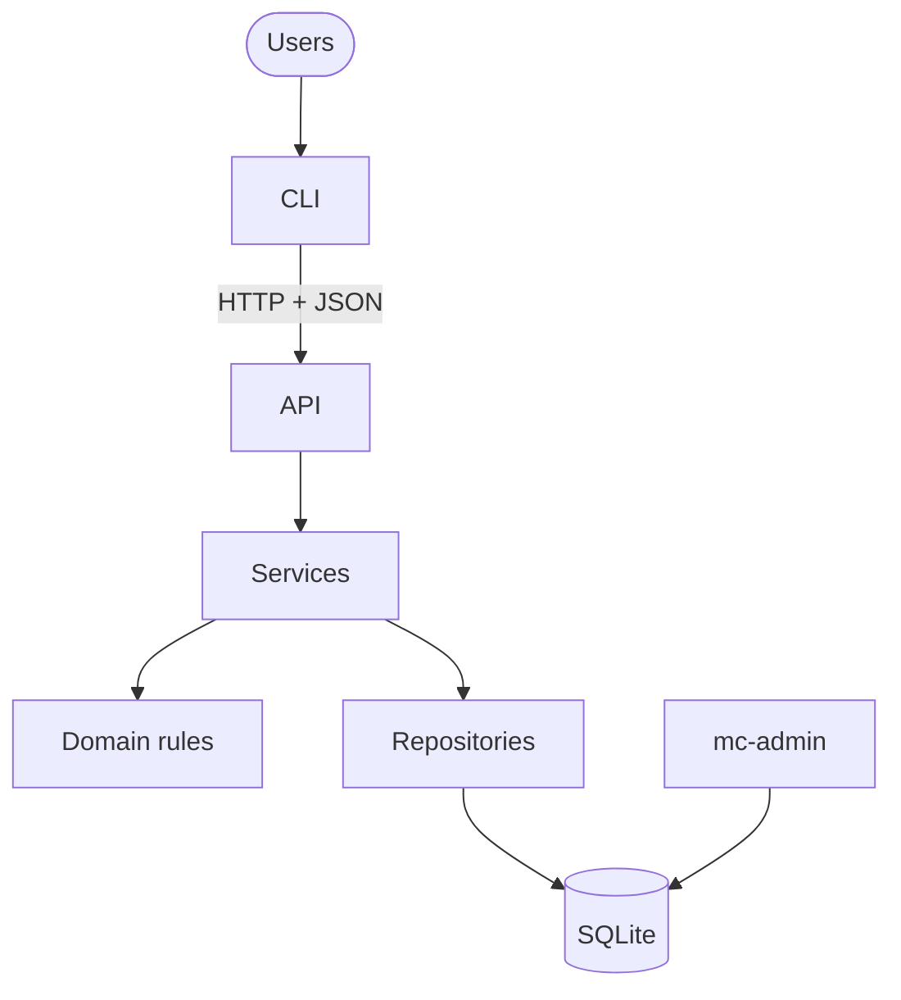

# Subagent (02): Fix mc-admin SQL and docs

Source: `agent-afa14bac270eb2176.jsonl` · 2026-10-12 05:02:33 UTC → 2026-10-12 05:09:13 UTC

Rendered from the raw JSONL without editing message content. Tool results and thinking are collapsed; expand them to read.


---

### 👤 User · 2026-10-12 05:02:33 UTC

You are fixing review findings in the Mission Control project: `mc-admin`, the README, and the design/PRD documents. Work ONLY in `/Users/pritanbarai/Desktop/JOBS/mutinex_mission_control/.worktrees/fix-admin-docs` (branch `fix-admin-docs`, from snapshot 5526869). Other agents are fixing other findings in sibling worktrees at the same time (services, inbox, API, CLI), so stay strictly inside your scope and files. **Don't commit, push or run bare `git stash`. Don't add dependencies (httpx banned; httpx2 only).** Read `CLAUDE.md`, `docs/prd.md`, `docs/technical-design.md`, `README.md`. Keep the docs' existing concise style (short sentences, tables, no filler); no PRD/AC/§ refs in `src/`.

## Your fixes
1. **`mc-admin`'s organisation SQL lives outside the repositories** (`src/mission_control/admin_cli.py` ~327–335: an unscoped slug lookup and an insert into `organisations`), escaping the SQL lint (`tests/integration/test_repository_sql.py` only scans `infra/repositories/`). Move platform-level (cross-organisation) statements into a small infra module (e.g. `src/mission_control/infra/platform.py`, alongside the existing unscoped `security.find_login`), call it from `admin_cli.py`, and extend the SQL lint so that module is scanned too with an explicit, documented exemption only for its unscoped organisation statements (everything else must still follow the named-binding rules). Tests first; `tests/cli/test_admin_cli.py` must still pass.
2. **Consistent server command:** `admin_cli.py` (~162) prints `Next: mc-server`; the README and the CLI's unreachable hint use `uv run mc-server`. Make `mc-admin`'s next steps use the `uv run …` form consistently (check every `Next:` line), and update tests.
3. **README smoke test leftover:** `tests/cli/test_readme_smoke.py` (~75, ~240) still has a `PHASE_4_READY` skipif; remove it so a renamed module fails instead of silently skipping.
4. **README:** change the transcripts line (`README.md` ~186, "The full, unedited AI transcripts are submitted with this repository.") to say they are provided separately with the submission. Document `MC_API_URL` alongside the other settings if not already. Keep every command the smoke test runs working.
5. **PRD (user approved option A):** in `docs/prd.md` §6 and AC-21, the matcher also leaves out anyone the owner **removed** from this mission (alongside open assignments, declines and withdrawals).
6. **Design (`docs/technical-design.md`) — record the user's decisions:**
   - §7 errors: add `method_not_allowed` (405, an unsupported HTTP method on a known path) and `internal_error` (500, an unexpected server error; the body never includes details) to the status table, keeping the "every error has a non-empty `problems` list" rule. Note that a role refused before any lookup gets the same 403 for a foreign id as for a missing one (e.g. Leads on admin routes), which satisfies the "same response as a missing id" rule. Note the two accepted deviations: malformed JSON is answered 422 before authentication is checked (FastAPI parses bodies first), and API response schemas reuse the repositories' record types.
   - §7 Inbox: "ready to submit" now means every place is filled, every proposal accepted, **and** enough eligible approvers exist (the missions section counts eligible approvers once per request; crew eligibility is still re-checked at submit). The inbox shows summary counts ("3 places unfilled"), leaving per-slot detail to the mission view.
   - §8 CLI: add `MC_API_URL` (default `http://127.0.0.1:8000`); passwords are a hidden prompt at a terminal and read from stdin otherwise, never a flag (the new password asked twice only at a terminal); with `--json`, a refusal prints the error body to stdout with the same exit code; extra flags `create --owner EMAIL` (Directors), `decline --reason`, `slot add --slot SPEC`, `slot edit --name/--headcount/--requires`, `me update --name/--bio`, `-y` for `--yes`; confirmations: changes to a pending mission, cancel, and deactivating a user; `mc login` ends the previous session.
   - §11: `mc-admin init-db | seed [--reset] | create-org --name --director-email --director-name`; settings list includes `MC_API_URL`; `seed --reset` deletes the database without asking (the flag is the consent).
   - §5 cross-cutting and §10: the "every mutating service calls `touch_for_change()` first" wording no longer matches; say instead that every change decides the mission's next status through the lifecycle module (`touch_for_change` for edits, `mission_status_after` / `mission_status_after_assignment_action` for transfers and roster changes), so a Pending mission returns to Draft in one place.
   - §2 folder layout: mention `infra/settings.py` and the new platform module.

## Verify, then hand off
- `uv run pytest -W error -q -o addopts=''` (the README smoke test must run, not skip), `uv run ruff check`, `uv run ruff format --check` — all pass.
- **Real run proving the code fixes:** with `MC_DATABASE_PATH=/tmp/fixadmin/x.db`, run `uv run mc-admin seed --reset`, `uv run mc-admin create-org …` (password piped), and show the `Next:` lines; grep showing no SQL left in `admin_cli.py`; the lint test failing if you temporarily add an unscoped statement to the platform module outside the exemption (describe, then revert). Keep everything under /tmp.
- Final message: per fix — files changed, tests added, evidence, "resolved: yes/no"; test count; a short list of every doc section changed. Don't commit.

<details>
<summary>⚙️ System/meta message · 2026-10-12 05:02:33 UTC</summary>

```
<system-reminder>
Your final report is delivered through SubagentHandback: when your work is complete, call SubagentHandback({message: <your full report>}). The call ends your run, so make it your last step. Only a SubagentHandback call reaches your caller as your result; plain text you write at the end is not delivered.
</system-reminder>
```

</details>

**🔧 Bash**

*Inspect worktree state and files*

```bash
cd /Users/pritanbarai/Desktop/JOBS/mutinex_mission_control/.worktrees/fix-admin-docs && git status && git log --oneline -3 && ls src/mission_control src/mission_control/infra && wc -l README.md docs/*.md src/mission_control/admin_cli.py tests/integration/test_repository_sql.py tests/cli/test_admin_cli.py tests/cli/test_readme_smoke.py
```

<details>
<summary>↳ Result</summary>

```
On branch fix-admin-docs
nothing to commit, working tree clean
5526869 wip: phase 4 reconciliation snapshot (local only; split into reviewed commits before main)
2b279fa docs: 409 convention and the inbox in design §7
5392748 refactor: rule refusals always use rule_violation, with the reasons as problems
src/mission_control:
__init__.py
admin_cli.py
api
cli
domain
infra
seed
services

src/mission_control/infra:
__init__.py
db.py
repositories
schema.sql
security.py
settings.py
     186 README.md
       9 docs/backlog.md
      76 docs/brief.md
     193 docs/cli-ux.md
     169 docs/phase-reviews.md
     338 docs/prd.md
     873 docs/technical-design.md
     395 src/mission_control/admin_cli.py
     111 tests/integration/test_repository_sql.py
     498 tests/cli/test_admin_cli.py
     267 tests/cli/test_readme_smoke.py
    3115 total
```

</details>

**🔧 Bash**

*Read admin CLI, SQL lint, security*

```bash
cd /Users/pritanbarai/Desktop/JOBS/mutinex_mission_control/.worktrees/fix-admin-docs && cat src/mission_control/admin_cli.py && cat tests/integration/test_repository_sql.py && cat src/mission_control/infra/security.py | head -80 && ls .venv 2>/dev/null | head -2
```

**🔧 Bash**

*Check organisations repository*

```bash
cd /Users/pritanbarai/Desktop/JOBS/mutinex_mission_control/.worktrees/fix-admin-docs && cat src/mission_control/infra/repositories/organisations.py 2>/dev/null | head -60; ls src/mission_control/infra/repositories
```

<details>
<summary>↳ Result</summary>

```
"""The caller's own organisation and its settings."""

from __future__ import annotations

from mission_control.infra.repositories.base import Scoped
from mission_control.infra.repositories.models import Organisation


class OrganisationRepo(Scoped):
    def get(self) -> Organisation:
        r = self._one("SELECT * FROM organisations WHERE id = :org")
        assert r is not None, "repositories are only built for an existing organisation"
        return Organisation(r["id"], r["name"], r["slug"], r["required_approvals"])

    def set_required_approvals(self, n: int) -> None:
        self._exec("UPDATE organisations SET required_approvals = :n WHERE id = :org", n=n)
__init__.py
approvals.py
assignments.py
audit.py
base.py
crew.py
facts.py
mission_crew.py
mission_slots.py
missions.py
models.py
organisations.py
skills.py
users.py
```

</details>

<details>
<summary>↳ Result</summary>

```
"""`mc-admin`: operator commands for the machine that runs the server. They work on the database
file directly rather than through the API: set up the schema, load the demo data, and create an
organisation with its first Director (there is no self-service signup)."""

import getpass
import os
import re
import sqlite3
import sys
import unicodedata
from collections.abc import Generator
from contextlib import contextmanager
from importlib.metadata import PackageNotFoundError, version
from pathlib import Path
from typing import Annotated, Any

import typer
from typer.core import TyperGroup

from mission_control.domain.enums import Role
from mission_control.domain.passwords import (
    MIN_PASSWORD_LENGTH,
    PasswordTooShort,
    validate_password,
)
from mission_control.infra import security
from mission_control.infra.db import DatabaseBusy, UnsupportedSQLite, connect, init_db, write_tx
from mission_control.infra.repositories import Repos
from mission_control.infra.settings import Settings
from mission_control.seed import data
from mission_control.seed.loader import load_seed

OK, FAILED, USAGE, INTERRUPTED = 0, 1, 2, 130
_RESET = "mc-admin seed --reset (deletes everything in it)"


class Failure(Exception):
    """Something to tell the operator, with an optional next step, and the exit code to use."""

    def __init__(self, message: str, *, hint: str | None = None, exit_code: int = FAILED):
        super().__init__(message)
        self.message = message
        self.hint = hint
        self.exit_code = exit_code


class _Group(TyperGroup):
    """A bare `mc-admin` prints its help and exits 0. Failures are reported in words with their
    exit code, never as a traceback."""

    def parse_args(self, ctx: typer.Context, args: list[str]) -> list[str]:
        if not args and not ctx.resilient_parsing:
            typer.echo(ctx.get_help())
            ctx.exit(OK)
        return super().parse_args(ctx, args)

    def invoke(self, ctx: typer.Context) -> Any:
        try:
            return super().invoke(ctx)
        except Failure as failure:
            _error(failure.message, failure.hint)
            raise typer.Exit(failure.exit_code) from None
        except KeyboardInterrupt:
            _error("Interrupted. Nothing was changed.")
            raise typer.Exit(INTERRUPTED) from None


app = typer.Typer(
    cls=_Group,
    name="mc-admin",
    rich_markup_mode=None,
    add_completion=False,
    pretty_exceptions_enable=False,
)


def _example(*lines: str) -> str:
    heading = "Example:" if len(lines) == 1 else "Examples:"
    # \b stops the help formatter from re-wrapping the lines.
    return "\b\n" + heading + "\n" + "\n".join(f"  {line}" for line in lines)


def _show_version(value: bool) -> None:
    if value:
        try:
            number = version("mission-control")
        except PackageNotFoundError:
            number = "unknown"
        typer.echo(f"mc-admin {number}")
        raise typer.Exit()


@app.callback()
def root(
    show_version: Annotated[
        bool,
        typer.Option(
            "--version", help="Show the version and exit", callback=_show_version, is_eager=True
        ),
    ] = False,
) -> None:
    """Operator commands for Mission Control.

    They work on the database file directly, so run them on the machine that runs mc-server.
    The file is MC_DATABASE_PATH, or mission_control.db in the current folder.

    Exit codes: 0 OK, 1 refused or failed, 2 usage, 130 interrupted.
    """


# --- Commands -----------------------------------------------------------------------------


@app.command("init-db", epilog=_example("mc-admin init-db"))
def init_database() -> None:
    """Create an empty database with the current schema. Safe to run again."""
    settings = _settings()
    path = _shown(settings.database_path)
    with _database(settings) as conn:
        created = _prepare(conn, path)
    if created:
        typer.echo(f"Created an empty database at {path}.")
        _next_steps(["mc-admin seed", "mc-admin create-org --help"])
    else:
        typer.echo(f"The database at {path} is already set up.")


@app.command("seed", epilog=_example("mc-admin seed", "mc-admin seed --reset"))
def seed(
    reset: Annotated[
        bool,
        typer.Option("--reset", help="Delete the database file first, and everything in it"),
    ] = False,
) -> None:
    """Load the demo organisations, people and missions.

    Every demo user's password is the demo passphrase. Without --reset, a database that already
    has data is left as it is. Stop mc-server before using --reset.
    """
    settings = _settings()
    path = _shown(settings.database_path)
    password_hash = security.hash_password(data.DEMO_PASSWORD)  # slow, so before any lock
    replaced = _delete_database(settings.database_path) if reset else False
    with _database(settings) as conn:
        _prepare(conn, path)
        try:
            load_seed(conn, password_hash)
        except RuntimeError:  # the database already has organisations
            raise Failure(
                f"The database at {path} already has data. Nothing was changed.",
                hint=f"Start over with only the demo data: {_RESET}",
            ) from None

    if replaced:
        typer.echo(f"Replaced the database at {path} with the demo data.")
    else:
        typer.echo(f"Loaded the demo data into {path}.")
    typer.echo(
        f"  {len(data.ORGANISATIONS)} organisations, {len(data.USERS)} users and "
        f'{len(data.MISSIONS)} missions. Every user\'s password is "{data.DEMO_PASSWORD}".'
    )
    _next_steps(["mc-server", "mc login --email lee@aurora.example"])


@app.command(
    "create-org",
    epilog=_example(
        'mc-admin create-org --name "Orion Labs" --director-email zoe@orion.example '
        '--director-name "Zoe Lin"',
    ),
)
def create_org(
    name: Annotated[str, typer.Option("--name", metavar="NAME", help="The organisation's name")],
    director_email: Annotated[
        str,
        typer.Option("--director-email", metavar="EMAIL", help="The first Director's email"),
    ],
    director_name: Annotated[
        str,
        typer.Option("--director-name", metavar="NAME", help="The first Director's full name"),
    ],
) -> None:
    """Create an organisation and its first Director.

    The Director's password is asked for twice with the input hidden. Without a terminal, pipe
    it on stdin. It must be at least 15 characters; passphrases are welcome.
    """
    org_name = _required(name, "The organisation needs a name.")
    slug = _slug(org_name)
    if not slug:
        raise Failure(
            "The organisation's name needs at least one letter or number.", exit_code=USAGE
        )
    email = _required(director_email, "The Director needs an email address.")
    person = _required(director_name, "The Director needs a name.")

    settings = _settings()
    path = _shown(settings.database_path)
    with _database(settings) as conn:
        _prepare(conn, path)
        _refuse_if_taken(conn, slug, email)  # before asking, so no password is typed for nothing
        password = _new_password(person)
        try:
            validate_password(password)
        except PasswordTooShort:
            raise Failure(
                f"The password must be at least {MIN_PASSWORD_LENGTH} characters. "
                "Nothing was changed.",
                hint="A few words make a good passphrase. Run the command again.",
                exit_code=USAGE,
            ) from None
        password_hash = security.hash_password(password)  # slow, so before the write lock
        with write_tx(conn):
            _refuse_if_taken(conn, slug, email)  # again, now that nothing else can write
            org_id = _insert_organisation(conn, org_name, slug)
            repos = Repos(conn, org_id)
            repos.users.create(email, person, Role.DIRECTOR, password_hash)
            approvals = repos.organisation.get().required_approvals

    typer.echo(f"Created {org_name} with {person} ({email}) as its first Director.")
    typer.echo(
        f"  Missions need {approvals} approval{'' if approvals == 1 else 's'} to go active. "
        f"{person.split()[0]} can change that with mc org set-approvals."
    )
    _next_steps(
        [
            f"mc login --email {email}",
            "mc skills add NAME",
            "mc users add --email EMAIL --name NAME --role lead",
        ]
    )


# --- Database -----------------------------------------------------------------------------


def _settings() -> Settings:
    try:
        return Settings.from_env(os.environ)
    except ValueError as e:
        raise Failure(f"{e}.", exit_code=USAGE) from None


def _shown(path: Path) -> Path:
    """The database path as the operator should see it: absolute, so there's no doubt which
    file was used."""
    return path.expanduser().resolve()


@contextmanager
def _database(settings: Settings) -> Generator[sqlite3.Connection]:
    """A connection to the configured file, with database failures put into words."""
    path = _shown(settings.database_path)
    try:
        conn = connect(settings.database_path, busy_timeout_ms=settings.busy_timeout_ms)
    except sqlite3.OperationalError:
        raise Failure(
            f"Can't open the database at {path}.",
            hint="Check that its folder exists, or set MC_DATABASE_PATH to another file.",
        ) from None
    try:
        yield conn
    except DatabaseBusy:
        raise Failure(
            f"The database at {path} is busy. Nothing was changed.",
            hint="Try again in a moment.",
        ) from None
    except sqlite3.DatabaseError as e:
        if type(e) is not sqlite3.DatabaseError:  # constraint failures etc. are real bugs
            raise
        raise Failure(
            f"{path} isn't a Mission Control database. Nothing was changed.",
            hint="Set MC_DATABASE_PATH to another file, or replace it: mc-admin seed --reset",
        ) from None
    finally:
        conn.close()


def _prepare(conn: sqlite3.Connection, path: Path) -> bool:
    """Make sure the schema is there. True if it was created just now."""
    try:
        empty = conn.execute("PRAGMA user_version").fetchone()[0] == 0
        init_db(conn)
    except UnsupportedSQLite as e:
        raise Failure(f"{e}.", hint="Use a Python built with a newer SQLite.") from None
    except RuntimeError as e:  # a schema version this code doesn't know
        raise Failure(
            f"The database at {path} can't be used: {e}.",
            hint=f"Set MC_DATABASE_PATH to another file, or start over: {_RESET}",
        ) from None
    return empty


def _delete_database(path: Path) -> bool:
    """Remove the database file and SQLite's side files, so a stale log can't be replayed into
    the new one. True if there was a database to delete."""
    existed = path.exists()
    for victim in (path, *(path.with_name(path.name + s) for s in ("-wal", "-shm", "-journal"))):
        try:
            victim.unlink(missing_ok=True)
        except OSError as e:
            raise Failure(
                f"Can't delete {_shown(victim)}: {e.strerror}.",
                hint="Stop mc-server and check the file's permissions, then try again.",
            ) from None
    return existed


def _refuse_if_taken(conn: sqlite3.Connection, slug: str, email: str) -> None:
    existing = _organisation_with_slug(conn, slug)
    if existing is not None:
        raise Failure(
            f"An organisation called {existing} already exists. Nothing was changed.",
            hint="Give the new organisation a different name.",
        )
    # Emails are unique across every organisation, because login is by email alone.
    if security.find_login(conn, email) is not None:
        raise Failure(
            f"The email address {email} is already in use. Nothing was changed.",
            hint="Use another email address for this organisation's Director.",
        )


# Organisations are created only here and by the seed, before any tenant exists to scope by.


def _organisation_with_slug(conn: sqlite3.Connection, slug: str) -> str | None:
    row = conn.execute("SELECT name FROM organisations WHERE slug = ?", (slug,)).fetchone()
    return row[0] if row else None


def _insert_organisation(conn: sqlite3.Connection, name: str, slug: str) -> int:
    cursor = conn.execute("INSERT INTO organisations(name, slug) VALUES (?, ?)", (name, slug))
    assert cursor.lastrowid is not None
    return cursor.lastrowid


# --- Input and output ---------------------------------------------------------------------


def _required(value: str, message: str) -> str:
    value = value.strip()
    if not value:
        raise Failure(message, exit_code=USAGE)
    return value


def _slug(name: str) -> str:
    """A name's short form, e.g. "Orion Labs" → "orion-labs". Names that differ only in case,
    spacing or punctuation give the same slug, so they count as the same organisation."""
    plain = unicodedata.normalize("NFKD", name).encode("ascii", "ignore").decode()
    return re.sub(r"[^a-z0-9]+", "-", plain.lower()).strip("-")


def _is_interactive() -> bool:
    try:
        return sys.stdin.isatty()
    except (AttributeError, ValueError):
        return False


def _new_password(person: str) -> str:
    """Asked twice with the input hidden at a terminal; otherwise one line from stdin."""
    if _is_interactive():
        try:
            first = getpass.getpass(f"Password for {person}: ")
            second = getpass.getpass("Repeat the password: ")
        except EOFError:
            raise KeyboardInterrupt from None
        if first != second:
            raise Failure("The passwords don't match. Nothing was changed.", exit_code=USAGE)
        return first
    line = sys.stdin.readline()
    if not line:
        raise Failure(
            "No password given, and there's no terminal to ask on.",
            hint="Run this in a terminal, or pipe the password on stdin.",
            exit_code=USAGE,
        )
    return line.rstrip("\r\n")


def _error(message: str, hint: str | None = None) -> None:
    typer.echo(f"Error: {message}", err=True)
    if hint:
        typer.echo(f"  {hint}", err=True)


def _next_steps(commands: list[str]) -> None:
    for i, step in enumerate(commands):
        typer.echo(f"{'Next:' if i == 0 else '     '} {step}", err=True)


def main() -> None:
    app(prog_name="mc-admin")
"""Guard test (design §4): every SQL statement in infra/repositories filters on the caller's org,
bound by name as `org_id = :org`, and no statement uses positional `?` placeholders."""

import ast
import re
from pathlib import Path

import pytest

REPOS = Path(__file__).resolve().parents[2] / "src/mission_control/infra/repositories"
SQL = re.compile(r"^\s*(SELECT|INSERT|UPDATE|DELETE|WITH)\b", re.I)

# The org filter, written exactly as `org_id = :org`, optionally alias-qualified (`m.org_id`).
ORG_FILTER = re.compile(r"(?<![\w.])(?:\w+\.)?org_id = :org\b")
# The organisations table is the tenant itself: its own id is the caller's org, so a statement
# on it must be scoped by `WHERE id = :org` (reads and the settings update alike).
TENANT_LOOKUP = re.compile(r"\borganisations\b[^;]*\bWHERE id = :org\b")
# An INSERT has no WHERE: it must write the org as its first column, from the named :org value.
ORG_INSERT = re.compile(r"^\s*INSERT INTO \w+\s*\(\s*org_id\s*,[^)]*\)\s*VALUES\s*\(\s*:org\s*,")
POSITIONAL = re.compile(r"\?")


def problems(sql: str) -> list[str]:
    """Why a repository statement is unsafe; empty when it is scoped and bound by name."""
    found = []
    if POSITIONAL.search(sql):
        found.append("positional ? placeholder")
    if not (ORG_FILTER.search(sql) or TENANT_LOOKUP.search(sql) or ORG_INSERT.search(sql)):
        found.append("no `org_id = :org` filter")
    return found


def sql_strings():
    """Every SQL literal in the package. An f-string is read as one statement: its literal
    parts are joined and each interpolation is shown as {...}."""
    for path in sorted(REPOS.glob("*.py")):
        tree = ast.parse(path.read_text())
        inside_fstrings = set()
        for node in ast.walk(tree):
            if isinstance(node, ast.JoinedStr):
                parts = []
                for value in node.values:
                    inside_fstrings.add(id(value))
                    is_text = isinstance(value, ast.Constant)
                    parts.append(value.value if is_text else "{...}")
                text = "".join(parts)
                if SQL.match(text):
                    yield path.name, node.lineno, text
        for node in ast.walk(tree):
            if (
                isinstance(node, ast.Constant)
                and isinstance(node.value, str)
                and id(node) not in inside_fstrings
                and SQL.match(node.value)
            ):
                yield path.name, node.lineno, node.value


def test_repositories_contain_sql():
    found = list(sql_strings())
    assert found, "no SQL found: has the repositories package moved?"
    # f-string queries are read whole, so their org_id filter is seen
    assert any("{...}" in sql for _, _, sql in found)


def test_every_repository_query_filters_on_the_named_org():
    bad = {f"{name}:{line}": problems(sql) for name, line, sql in sql_strings() if problems(sql)}
    assert bad == {}, f"unsafe repository SQL: {bad}"


@pytest.mark.parametrize(
    "sql, reason",
    [
        ("SELECT * FROM missions WHERE id = ? AND org_id = ?", "positional ? placeholder"),
        ("SELECT * FROM missions WHERE id = :id", "no `org_id = :org` filter"),
        ("SELECT * FROM missions WHERE org_id = :id", "no `org_id = :org` filter"),
        ("SELECT * FROM missions WHERE org_id = :organisation", "no `org_id = :org` filter"),
        ("SELECT * FROM missions WHERE parent_org_id = :org", "no `org_id = :org` filter"),
        ("SELECT * FROM organisations WHERE id = ?", "positional ? placeholder"),
        ("SELECT * FROM organisations WHERE id = :id", "no `org_id = :org` filter"),
        (
            "UPDATE organisations SET required_approvals = :n WHERE id = :id",
            "no `org_id = :org` filter",
        ),
        ("UPDATE organisations SET required_approvals = :n", "no `org_id = :org` filter"),
        (
            "INSERT INTO audit_events(org_id, event) VALUES (:other, :org)",
            "no `org_id = :org` filter",
        ),
        (
            "INSERT INTO audit_events(event, org_id) VALUES (:org, :event)",
            "no `org_id = :org` filter",
        ),
    ],
)
def test_the_guard_flags_unsafe_statements(sql, reason):
    assert reason in problems(sql)


@pytest.mark.parametrize(
    "sql",
    [
        "SELECT * FROM missions WHERE org_id = :org AND id = :id",
        "SELECT * FROM missions m WHERE m.org_id = :org AND m.id = :id",
        "SELECT * FROM organisations WHERE id = :org",
        "UPDATE organisations SET required_approvals = :n WHERE id = :org",
        "INSERT INTO audit_events(org_id, event) VALUES (:org, :event)",
    ],
)
def test_the_guard_accepts_scoped_named_statements(sql):
    assert problems(sql) == []
"""Password hashing, session tokens, and the only lookups not scoped to an organisation.

Login and token resolution happen before the caller's organisation is known, so these queries
look users up by email or token hash. Everything else goes through tenant-scoped repositories.
"""

import hashlib
import secrets
import sqlite3
from datetime import datetime

from argon2 import PasswordHasher
from argon2.exceptions import InvalidHashError, VerificationError, VerifyMismatchError

from mission_control.infra.db import utc_timestamp

_hasher = PasswordHasher()  # Argon2id with the library's recommended parameters


def hash_password(password: str) -> str:
    return _hasher.hash(password)


def verify_password(password_hash: str, password: str) -> bool:
    try:
        return _hasher.verify(password_hash, password)
    except (VerifyMismatchError, VerificationError, InvalidHashError):
        return False


_dummy_hashes: dict[int, str] = {}


def dummy_hash() -> str:
    """A real Argon2 hash of a random secret, made with the current hasher. Verifying against
    it when an email doesn't exist makes that path cost the same as a real check, so response
    time doesn't reveal which accounts exist."""
    key = id(_hasher)
    if key not in _dummy_hashes:
        _dummy_hashes[key] = _hasher.hash(secrets.token_urlsafe(32))
    return _dummy_hashes[key]


def needs_rehash(password_hash: str) -> bool:
    return _hasher.check_needs_rehash(password_hash)


def new_token() -> str:
    """32 random bytes, URL-safe. Returned to the client once and never stored."""
    return secrets.token_urlsafe(32)


def hash_token(token: str) -> str:
    return hashlib.sha256(token.encode()).hexdigest()


def find_login(conn: sqlite3.Connection, email: str) -> sqlite3.Row | None:
    return conn.execute(
        "SELECT id, org_id, password_hash, is_active FROM users WHERE email = ?", (email,)
    ).fetchone()


def login_state(conn: sqlite3.Connection, user_id: int) -> sqlite3.Row | None:
    return conn.execute(
        "SELECT password_hash, is_active FROM users WHERE id = ?", (user_id,)
    ).fetchone()


def password_hash_of(conn: sqlite3.Connection, user_id: int) -> str:
    return conn.execute("SELECT password_hash FROM users WHERE id = ?", (user_id,)).fetchone()[0]


def set_password_hash(conn: sqlite3.Connection, user_id: int, password_hash: str) -> None:
    conn.execute("UPDATE users SET password_hash = ? WHERE id = ?", (password_hash, user_id))


def store_token(
    conn: sqlite3.Connection, user_id: int, token_hash: str, created: datetime, expires: datetime
) -> None:
    conn.execute(
CACHEDIR.TAG
bin
```

</details>

**🔧 Bash**

*Search for related references*

```bash
cd /Users/pritanbarai/Desktop/JOBS/mutinex_mission_control/.worktrees/fix-admin-docs && grep -n "organisations\|execute" src/mission_control/seed/loader.py | head; grep -rn "Next:\|mc-server" tests/cli/test_admin_cli.py src/mission_control/cli | head -30; grep -n "PHASE_4\|skipif" -n tests/cli/test_readme_smoke.py
```

<details>
<summary>↳ Result</summary>

```
18:        if conn.execute("SELECT count(*) FROM organisations").fetchone()[0]:
25:    q = conn.execute
27:        "INSERT INTO organisations(id, name, slug, required_approvals) VALUES (?, ?, ?, ?)",
78:    q = conn.execute
src/mission_control/cli/render.py:221:            self.say(("Next: " if i == 0 else "      ") + step)
src/mission_control/cli/refusals.py:89:            hint="Is it running? Start it with: uv run mc-server",
75:PHASE_4_READY = _has("mission_control.cli.main") and _has("mission_control.api.routers")
240:@pytest.mark.skipif(
241:    not PHASE_4_READY,
```

</details>

**🔧 Bash**

*Inspect tests*

```bash
cd /Users/pritanbarai/Desktop/JOBS/mutinex_mission_control/.worktrees/fix-admin-docs && grep -n "Next\|mc login\|mc-admin seed\|create-org --help\|_insert\|_organisation_with\|admin_cli\.\|monkeypatch" tests/cli/test_admin_cli.py | head -50; sed -n 1,90p tests/cli/test_readme_smoke.py; sed -n 230,267p tests/cli/test_readme_smoke.py
```

<details>
<summary>↳ Result</summary>

````
22:def _no_ambient_settings(monkeypatch):
25:        monkeypatch.delenv(name, raising=False)
40:        return runner.invoke(admin_cli.app, list(args), input=input, env=environment)
102:    assert "mc-admin seed" in result.stderr  # next steps go to stderr
114:    tmp_path, monkeypatch
116:    monkeypatch.chdir(tmp_path)
117:    result = CliRunner().invoke(admin_cli.app, ["init-db"])
151:        assert "mc-admin seed --reset" in result.stderr
173:    assert "mc login --email lee@aurora.example" in result.stderr
219:    assert "mc-admin seed --reset" in result.stderr
296:    assert "mc login --email zoe@orion.example" in result.stderr
331:def test_t3_create_org_asks_for_the_password_twice_with_input_hidden(admin, monkeypatch):
338:    monkeypatch.setattr(admin_cli, "_is_interactive", lambda: True)
339:    monkeypatch.setattr(admin_cli.getpass, "getpass", getpass)
347:def test_t3_passwords_that_dont_match_change_nothing(admin, db_path, monkeypatch):
349:    monkeypatch.setattr(admin_cli, "_is_interactive", lambda: True)
350:    monkeypatch.setattr(admin_cli.getpass, "getpass", lambda prompt: next(answers))
359:def test_t3_ctrl_c_at_the_password_prompt_changes_nothing(admin, db_path, monkeypatch):
363:    monkeypatch.setattr(admin_cli, "_is_interactive", lambda: True)
364:    monkeypatch.setattr(admin_cli.getpass, "getpass", interrupted)
408:    admin, db_path, monkeypatch
411:    monkeypatch.setattr(admin_cli, "_is_interactive", lambda: True)
412:    monkeypatch.setattr(admin_cli.getpass, "getpass", lambda prompt: pytest.fail("asked"))
431:def test_t3_an_organisation_with_the_same_name_is_refused(admin, db_path):
"""M17 (design §9): smoke-test the README. Its `mc-admin`, `mc-server` and `mc` commands are read
from the README itself and run for real, in order, as separate processes.

- The commands are every `uv run mc…` line inside a ```bash block. A line whose comment starts
  with "refused" must exit 1; every other line must exit 0.
- `mc-admin` and `mc` run as the installed console scripts (what `uv run` starts), in a temporary
  working folder with a temporary HOME, so the default `mission_control.db` and the saved session
  never touch the developer's own.
- `mc-server` is started in-process on a free port instead of 8000, and `mc` is pointed at it with
  `MC_API_URL`.
- Passwords are piped on stdin, which the README says works without a terminal.
"""

import importlib.util
import os
import shlex
import sqlite3
import subprocess
import sys
import threading
import time
from collections.abc import Generator
from contextlib import contextmanager
from dataclasses import dataclass
from pathlib import Path

import pytest

from mission_control.infra import security
from mission_control.seed.data import DEMO_PASSWORD

README = Path(__file__).resolve().parents[2] / "README.md"
PROGRAMS = ("mc", "mc-admin", "mc-server")
NEW_DIRECTOR_PASSWORD = "a passphrase for the new director"


@dataclass(frozen=True)
class Step:
    line: int  # in the README, for failure messages
    args: tuple[str, ...]  # without `uv run`, e.g. ("mc", "login", "--email", "lee@...")
    refused: bool

    @property
    def program(self) -> str:
        return self.args[0]

    def __str__(self) -> str:
        return f"README.md:{self.line}: {shlex.join(self.args)}"


def readme_steps() -> list[Step]:
    steps = []
    in_bash = False
    for number, text in enumerate(README.read_text(encoding="utf-8").splitlines(), start=1):
        if text.startswith("```"):
            in_bash = not in_bash and text.strip() == "```bash"
            continue
        if not in_bash:
            continue
        command, _, comment = text.partition(" #")
        words = shlex.split(command)
        if words[:2] == ["uv", "run"] and len(words) > 2 and words[2] in PROGRAMS:
            refused = comment.strip().lower().startswith("refused")
            steps.append(Step(number, tuple(words[2:]), refused))
    return steps


def _has(module: str) -> bool:
    try:
        return importlib.util.find_spec(module) is not None
    except ModuleNotFoundError:
        return False


PHASE_4_READY = _has("mission_control.cli.main") and _has("mission_control.api.routers")


# --- The command list ---------------------------------------------------------------------


def test_m17_readme_quick_start_seeds_starts_the_server_then_logs_in():
    first = [s.args for s in readme_steps()[:3]]
    assert first == [
        ("mc-admin", "seed", "--reset"),
        ("mc-server",),
        ("mc", "login", "--email", "lee@aurora.example"),
    ]


def as_user(steps: list[Step]) -> list[tuple[str | None, Step]]:
        ("Helix Orbital",),
        ("Orion Labs",),
    ]
    lee = _rows(database, "SELECT password_hash FROM users WHERE email = 'lee@aurora.example'")
    assert security.verify_password(lee[0][0], DEMO_PASSWORD)
    zoe = _rows(database, "SELECT password_hash, role FROM users WHERE email = 'zoe@orion.example'")
    assert zoe[0][1] == "director"
    assert security.verify_password(zoe[0][0], NEW_DIRECTOR_PASSWORD)


@pytest.mark.skipif(
    not PHASE_4_READY,
    reason="mc (M16) and the API routers (M15) aren't on this branch yet; "
    "this runs once Phase 4 is reconciled",
)
def test_ac1_readme_quick_start_and_demo_run_end_to_end(workdir):
    database = workdir / "mission_control.db"
    steps = readme_steps()
    server_at = next(i for i, s in enumerate(steps) if s.program == "mc-server")

    env = _environment(workdir, api_url=None)
    for step in steps[:server_at]:
        _run(step, workdir, env)

    with _server(database) as url:
        env = _environment(workdir, api_url=url)
        for step in steps[server_at + 1 :]:
            assert step.program != "mc-server", f"{step}: the server is already running"
            _run(step, workdir, env)

    assert _rows(database, "SELECT status FROM missions WHERE id = 1") == [("completed",)]
    assert _rows(
        database, "SELECT crew_profile_id, status FROM assignments WHERE mission_id = 1 ORDER BY id"
    ) == [(6, "completed"), (8, "completed"), (9, "completed")]
    events = [e for (e,) in _rows(database, "SELECT event FROM audit_events WHERE mission_id = 1")]
    assert events.count("mission.approved") == 2  # Marco and Ingrid; Ruth's refusal wrote nothing
    # Completing records the mission first, then each accepted assignment it completes.
    assert events[-4:] == ["mission.completed"] + ["assignment.completed"] * 3
````

</details>

### 🤖 Claude · 2026-10-12 05:02:58 UTC

Let me read the README and the relevant parts of the test_admin_cli.

**🔧 Bash**

*Read README and admin tests*

```bash
cd /Users/pritanbarai/Desktop/JOBS/mutinex_mission_control/.worktrees/fix-admin-docs && cat -n README.md; sed -n 90,180p tests/cli/test_admin_cli.py; sed -n 280,300p tests/cli/test_admin_cli.py
```

<details>
<summary>↳ Result</summary>

````
     1	# Mission Control
     2	
     3	A multi-tenant API and CLI for planning space missions. Organisations manage crew and their skills, Mission Leads build missions and get crew suggestions from a deterministic matcher, and Directors approve missions before they go active.
     4	
     5	## Prerequisites
     6	
     7	- Python 3.12, with SQLite 3.37 or later (standard Python 3.12 builds have it)
     8	- [uv](https://docs.astral.sh/uv/). It can install Python too: `uv python install 3.12`
     9	
    10	## Quick start
    11	
    12	```bash
    13	uv sync
    14	uv run mc-admin seed --reset      # demo data in ./mission_control.db
    15	uv run mc-server                  # API on http://127.0.0.1:8000; leave it running
    16	```
    17	
    18	In a second terminal, from the same folder:
    19	
    20	```bash
    21	uv run mc login --email lee@aurora.example    # password: orbital launch window
    22	uv run mc missions list
    23	```
    24	
    25	Every demo account's password is `orbital launch window`. `mc login` asks for it with the input hidden.
    26	
    27	## Demo: the golden path
    28	
    29	Lunar Gateway Resupply (mission 1) is a draft with three empty slots. Take it all the way to Completed. Each `mc login` replaces the previous session, so one terminal is enough. Start from a fresh seed (`uv run mc-admin seed --reset`, with the server stopped).
    30	
    31	**1. Lee, the owning Lead, asks the matcher for crew and proposes its suggestion.**
    32	
    33	```bash
    34	uv run mc login --email lee@aurora.example
    35	uv run mc inbox
    36	uv run mc missions match 1                     # Commander → Ana, Flight Engineer → Chen, Mission Specialist → Dana
    37	uv run mc missions match 1 --apply             # proposes them as assignments 11, 12 and 13
    38	```
    39	
    40	**2. Each crew member accepts their proposal.**
    41	
    42	```bash
    43	uv run mc login --email ana@aurora.example
    44	uv run mc assignments list --pending
    45	uv run mc assignments accept 11
    46	uv run mc login --email chen@aurora.example
    47	uv run mc assignments accept 12
    48	uv run mc login --email dana@aurora.example
    49	uv run mc assignments accept 13
    50	```
    51	
    52	**3. Lee submits it. Aurora needs two approvals.**
    53	
    54	```bash
    55	uv run mc login --email lee@aurora.example
    56	uv run mc missions submit 1
    57	```
    58	
    59	**4. Directors approve. Ruth created the mission, so she can't approve it.**
    60	
    61	```bash
    62	uv run mc login --email ruth@aurora.example
    63	uv run mc missions approve 1                   # refused: Ruth created this mission
    64	uv run mc login --email marco@aurora.example
    65	uv run mc missions approve 1                   # pending approval, 1 of 2
    66	uv run mc login --email ingrid@aurora.example
    67	uv run mc missions approve 1                   # 2 of 2: the mission is active
    68	```
    69	
    70	**5. Lee completes it, and the history shows every step with who did it and when.**
    71	
    72	```bash
    73	uv run mc login --email lee@aurora.example
    74	uv run mc missions complete 1
    75	uv run mc missions history 1
    76	```
    77	
    78	**Tenant isolation.** Sam is a Director at Helix Orbital. Aurora's missions don't exist as far as he can tell.
    79	
    80	```bash
    81	uv run mc login --email sam@helix.example
    82	uv run mc missions list                        # only Helix's Payload Demo 1
    83	uv run mc missions show 1                      # refused: looks exactly like an unknown ID
    84	```
    85	
    86	Every command has `--help`, and most take `--json`. `mc` exits with `0` OK, `1` refused, `2` usage, `3` not logged in, `4` server unreachable or busy, `130` interrupted.
    87	
    88	## Demo accounts
    89	
    90	All passwords are `orbital launch window`. Mission and crew details are in [PRD §9](docs/prd.md#9-seed-data-and-scenarios).
    91	
    92	| Name | Email | Role | Organisation |
    93	|---|---|---|---|
    94	| Ruth Adeyemi | ruth@aurora.example | Director | Aurora Space Agency |
    95	| Marco Bianchi | marco@aurora.example | Director | Aurora Space Agency |
    96	| Ingrid Holm | ingrid@aurora.example | Director | Aurora Space Agency |
    97	| Lee Park | lee@aurora.example | Mission Lead | Aurora Space Agency |
    98	| Nora Quinn | nora@aurora.example | Mission Lead | Aurora Space Agency |
    99	| Ana Okafor | ana@aurora.example | Mission Lead | Aurora Space Agency |
   100	| Ben Ito | ben@aurora.example | Crew Member | Aurora Space Agency |
   101	| Chen Wu | chen@aurora.example | Crew Member | Aurora Space Agency |
   102	| Dana Reyes | dana@aurora.example | Crew Member | Aurora Space Agency |
   103	| Eli Novak | eli@aurora.example | Crew Member | Aurora Space Agency |
   104	| Fay Moreau | fay@aurora.example | Crew Member | Aurora Space Agency |
   105	| Gus Patel | gus@aurora.example | Crew Member | Aurora Space Agency |
   106	| Hana Sato | hana@aurora.example | Crew Member | Aurora Space Agency |
   107	| Sam Rivera | sam@helix.example | Director | Helix Orbital |
   108	| Priya Nair | priya@helix.example | Mission Lead | Helix Orbital |
   109	| Kai Tanaka | kai@helix.example | Crew Member | Helix Orbital |
   110	| Lena Fischer | lena@helix.example | Crew Member | Helix Orbital |
   111	| Omar Haddad | omar@helix.example | Crew Member | Helix Orbital |
   112	| Tess Moreno | tess@helix.example | Crew Member | Helix Orbital |
   113	
   114	Aurora needs 2 approvals per mission and Helix needs 1. Marco and Ana also have crew profiles, so they can be rostered.
   115	
   116	## Operators: `mc-admin`
   117	
   118	`mc-admin` works on the database file directly, so run it on the machine that runs `mc-server`. There's no self-service signup: organisations come from the seed or from `create-org`.
   119	
   120	```bash
   121	uv run mc-admin init-db                        # an empty database, if you don't want the demo data
   122	uv run mc-admin create-org --name "Orion Labs" --director-email zoe@orion.example --director-name "Zoe Lin"
   123	```
   124	
   125	`create-org` asks for the Director's password twice with the input hidden (at least 15 characters). Without a terminal, pipe it on stdin. The new organisation needs 1 approval per mission and starts with an empty skill catalogue. Its Director logs in with `mc` and sets up the rest (`mc skills add`, `mc users add`, `mc org set-approvals`).
   126	
   127	`mc-admin seed` refuses a database that already has data. `seed --reset` deletes the file and everything in it first. Stop the server before resetting.
   128	
   129	## Settings
   130	
   131	Environment variables, all optional:
   132	
   133	| Variable | Default | Used by |
   134	|---|---|---|
   135	| `MC_DATABASE_PATH` | `mission_control.db` in the current folder | `mc-server`, `mc-admin` |
   136	| `MC_TOKEN_TTL_HOURS` | `12` | `mc-server` |
   137	| `MC_DB_BUSY_TIMEOUT_MS` | `5000` | `mc-server`, `mc-admin` |
   138	| `MC_API_URL` | `http://127.0.0.1:8000` | `mc` |
   139	
   140	`mc-server` listens on `127.0.0.1:8000`. `mc` keeps its session token in `~/.config/mission-control/credentials.json`, readable only by you.
   141	
   142	## Tests and lint
   143	
   144	```bash
   145	uv run pytest
   146	uv run ruff check
   147	uv run ruff format --check
   148	```
   149	
   150	Every test gets its own temporary SQLite file. `tests/cli/test_readme_smoke.py` runs this README's `mc-admin`, `mc-server` and `mc` commands for real, in order.
   151	
   152	## Documents
   153	
   154	| Document | What's in it |
   155	|---|---|
   156	| [`docs/brief.md`](docs/brief.md) | The assessment brief |
   157	| [`docs/prd.md`](docs/prd.md) | Behaviour: roles, business rules, acceptance criteria, seed data and scenarios |
   158	| [`docs/technical-design.md`](docs/technical-design.md) | Structure: architecture, schema, API, CLI, delivery plan, guidelines for coding agents, trade-offs |
   159	| [`docs/phase-reviews.md`](docs/phase-reviews.md) | Where each phase diverged from the plan, and why |
   160	| [`docs/cli-ux.md`](docs/cli-ux.md) | Mock CLI sessions for the matcher |
   161	| [`docs/backlog.md`](docs/backlog.md) | Decisions deliberately left open for later |
   162	
   163	## Code layout
   164	
   165	```
   166	src/mission_control/
   167	  domain/       every business rule, as pure functions: dates, eligibility, matcher, lifecycle, permissions
   168	  infra/        SQLite connections, schema, tenant-scoped repositories, password hashing and tokens
   169	  services/     one use case per function: one transaction, its checks and its audit event
   170	  api/          FastAPI app (mc-server): validates input, resolves the caller, maps errors
   171	  cli/          the mc command, a client of the HTTP API
   172	  seed/         the demo data, shared by mc-admin and the tests
   173	  admin_cli.py  mc-admin: init-db, seed, create-org
   174	tests/          unit/ (domain), integration/ (services, database), api/, cli/
   175	```
   176	
   177	`domain/` imports nothing from the other layers, and the CLI holds no business rules: it only calls the API. The [design](docs/technical-design.md#2-architecture) explains why.
   178	
   179	## How it was built
   180	
   181	The design documents were written first and then used to direct a coding agent (Claude Code):
   182	
   183	- [`CLAUDE.md`](CLAUDE.md) holds the agent's rules: one approved module at a time, tests first, a real run, a read-only review, and no commit without approval. Independent modules ran in parallel git worktrees.
   184	- [Design §9](docs/technical-design.md#9-delivery-plan) is the module-by-module plan, and [§10](docs/technical-design.md#10-guidelines-for-implementing-agents) the guidelines the agent followed.
   185	- [`docs/phase-reviews.md`](docs/phase-reviews.md) records each phase's divergences and its end-of-phase review.
   186	- The full, unedited AI transcripts are submitted with this repository.


# --- Database location --------------------------------------------------------------------


def test_m17_init_db_creates_the_schema_at_mc_database_path(admin, db_path):
    result = admin("init-db")

    assert result.exit_code == 0, result.stderr
    assert result.stdout == f"Created an empty database at {db_path.resolve()}.\n"
    assert query(db_path, "PRAGMA user_version") == [(1,)]
    assert count(db_path, "organisations") == 0
    assert "mc-admin seed" in result.stderr  # next steps go to stderr


def test_m17_init_db_twice_changes_nothing(admin, db_path):
    admin("init-db")
    result = admin("init-db")

    assert result.exit_code == 0
    assert result.stdout == f"The database at {db_path.resolve()} is already set up.\n"


def test_m17_database_defaults_to_mission_control_db_in_the_working_directory(
    tmp_path, monkeypatch
):
    monkeypatch.chdir(tmp_path)
    result = CliRunner().invoke(admin_cli.app, ["init-db"])

    assert result.exit_code == 0, result.stderr
    assert (tmp_path / "mission_control.db").exists()


def test_m17_a_folder_that_doesnt_exist_is_reported_with_a_fix(admin, tmp_path):
    missing = tmp_path / "nowhere" / "mc.db"
    result = admin("init-db", env={"MC_DATABASE_PATH": str(missing)})

    assert result.exit_code == 1
    assert f"Can't open the database at {missing.resolve()}" in result.stderr
    assert "MC_DATABASE_PATH" in result.stderr
    assert_no_traceback(result)


def test_m17_a_file_that_isnt_a_database_is_reported(admin, db_path):
    db_path.write_text("not a database, just some text " * 100)
    result = admin("init-db")

    assert result.exit_code == 1
    assert f"{db_path.resolve()} isn't a Mission Control database" in result.stderr
    assert_no_traceback(result)


def test_m17_an_unsupported_schema_version_is_reported(admin, db_path):
    conn = sqlite3.connect(db_path)
    conn.execute("PRAGMA user_version = 7")
    conn.close()

    for args in (("init-db",), ("seed",)):
        result = admin(*args)
        assert result.exit_code == 1
        assert "schema version 7" in result.stderr
        assert "mc-admin seed --reset" in result.stderr
        assert_no_traceback(result)


def test_m17_a_bad_busy_timeout_setting_is_a_usage_error(admin):
    result = admin("init-db", env={"MC_DB_BUSY_TIMEOUT_MS": "soon"})

    assert result.exit_code == 2
    assert "MC_DB_BUSY_TIMEOUT_MS must be a whole number" in result.stderr
    assert_no_traceback(result)


# --- seed ---------------------------------------------------------------------------------


def test_r10_seed_loads_the_prd_demo_data(admin, db_path):
    result = admin("seed")

    assert result.exit_code == 0, result.stderr
    assert f"Loaded the demo data into {db_path.resolve()}." in result.stdout
    assert "2 organisations, 19 users and 8 missions" in result.stdout
    assert 'password is "orbital launch window"' in result.stdout
    assert "mc login --email lee@aurora.example" in result.stderr
    assert count(db_path, "organisations") == 2
    assert count(db_path, "users") == 19
    assert count(db_path, "missions") == 8
    assert count(db_path, "assignments") == 10


def test_r10_every_demo_user_has_the_hashed_demo_passphrase(admin, db_path):
        "zoe@orion.example",
        "--director-name",
        "Zoe Lin",
        *extra,
        input=input,
    )


def test_t3_create_org_makes_an_organisation_and_its_first_director(admin, db_path):
    result = create_orion(admin)

    assert result.exit_code == 0, result.stderr
    assert result.stdout.startswith(
        "Created Orion Labs with Zoe Lin (zoe@orion.example) as its first Director.\n"
    )
    assert "Missions need 1 approval" in result.stdout
    assert "mc login --email zoe@orion.example" in result.stderr
    assert query(db_path, "SELECT name, slug, required_approvals FROM organisations") == [
        ("Orion Labs", "orion-labs", 1)
    ]
    assert query(db_path, "SELECT email, name, role, is_active FROM users") == [
````

</details>

**🔧 Bash**

*Check CLI hint command forms*

```bash
cd /Users/pritanbarai/Desktop/JOBS/mutinex_mission_control/.worktrees/fix-admin-docs && grep -rn "uv run\|hint=\"[^\"]*mc \|Run: mc\|: mc " src/mission_control/cli | head -20; grep -rn "uv run" docs/technical-design.md docs/prd.md | head
```

<details>
<summary>↳ Result</summary>

```
src/mission_control/cli/resolve.py:75:                f"There's no skill called '{name}'", hint="See the skills: mc skills list"
src/mission_control/cli/resolve.py:85:    raise Refused(f"There's no skill called '{name}'", hint="See the skills: mc skills list")
src/mission_control/cli/resolve.py:99:        f"There's no crew member with the email {email}", hint="See the crew: mc crew list"
src/mission_control/cli/resolve.py:107:    raise Refused(f"There's no user with the email {email}", hint="See the users: mc users list")
src/mission_control/cli/refusals.py:17:    "unauthenticated": "Log in again: mc login",
src/mission_control/cli/refusals.py:89:            hint="Is it running? Start it with: uv run mc-server",
src/mission_control/cli/errors.py:47:        super().__init__("You're not logged in.", hint="Log in: mc login")
src/mission_control/cli/commands/assignments.py:23:        f"Assignment {assignment_id}", not_found="See your assignments: mc assignments list"
src/mission_control/cli/commands/me.py:36:            hint="A Director can give you one: mc users enable-crew EMAIL",
src/mission_control/cli/commands/missions.py:88:        not_found="See your missions: mc missions list",
src/mission_control/cli/commands/missions.py:89:        not_owner=f"See who owns it: mc missions show {mission_id}",
src/mission_control/cli/commands/missions.py:98:            f"Remove crew first: mc missions remove-crew {mission_id} {{assignment_id}}"
src/mission_control/cli/commands/missions.py:100:        "headcount_below_open_assignments": f"See who is assigned: mc missions show {mission_id}",
src/mission_control/cli/commands/missions.py:101:        "skill_below_minimum": f"See who is assigned: mc missions show {mission_id}",
src/mission_control/cli/commands/missions.py:102:        "unavailable": f"See who is assigned: mc missions show {mission_id}",
src/mission_control/cli/commands/missions.py:103:        "overlap": f"See who is assigned: mc missions show {mission_id}",
src/mission_control/cli/commands/missions.py:464:            f"Only draft missions can be matched. See its crew: mc missions show {mission_id}"
src/mission_control/cli/commands/missions.py:471:            f"Only draft missions can be matched. See it: mc missions show {mission_id}"
src/mission_control/cli/commands/missions.py:596:    free = f"See who is free: mc missions match {mission_id}"
src/mission_control/cli/commands/missions.py:602:        "slot_full": f"See the open places: mc missions show {mission_id}",
docs/technical-design.md:520:- [ ] `uv run pytest` and `uv run ruff check` both pass on the whole repo.
docs/technical-design.md:585:uv run mc-admin seed --reset      # load PRD §9 data
docs/technical-design.md:586:uv run mc-server                  # API on 127.0.0.1:8000
docs/technical-design.md:587:uv run mc login --email lee@aurora.example
docs/technical-design.md:588:uv run pytest
```

</details>

**🔧 Bash**

*Inspect test fixtures*

```bash
cd /Users/pritanbarai/Desktop/JOBS/mutinex_mission_control/.worktrees/fix-admin-docs && ls tests tests/integration; grep -n "def \|fixture" tests/conftest.py tests/integration/conftest.py 2>/dev/null | head -30; sed -n 1,60p tests/cli/test_admin_cli.py
```

<details>
<summary>↳ Result</summary>

```
tests:
api
builders.py
cli
conftest.py
integration
unit

tests/integration:
conftest.py
test_admin_service.py
test_approvals_service.py
test_assignment_writes.py
test_assignments_service.py
test_auth.py
test_crew_service.py
test_db.py
test_facts.py
test_inbox_service.py
test_matching_service.py
test_mission_end_service.py
test_mission_history.py
test_missions_service.py
test_repositories.py
test_repository_sql.py
test_repository_writes.py
test_schema_constraints.py
test_seed.py
test_service_context.py
tests/conftest.py:21:def pytest_configure(config):
tests/conftest.py:25:@pytest.fixture(autouse=True)
tests/conftest.py:26:def _cheap_argon2(request, monkeypatch):
tests/integration/conftest.py:6:@pytest.fixture
tests/integration/conftest.py:7:def db_path(tmp_path):
tests/integration/conftest.py:11:@pytest.fixture
tests/integration/conftest.py:12:def conn(db_path):
tests/integration/conftest.py:20:@pytest.fixture
tests/integration/conftest.py:21:def seeded_db(conn):
"""M17: `mc-admin`, the operator commands that work on the database file directly (design §2,
§11). Covers init-db, seed (PRD §9 data, R10) and create-org (PRD T3, P10).

Every test uses a database under `tmp_path`, never the repo's or the user's own.
"""

import sqlite3

import pytest
from typer.testing import CliRunner

from mission_control import admin_cli
from mission_control.infra import security
from mission_control.infra.db import connect
from mission_control.seed import data
from mission_control.services import auth

PASSPHRASE = "a long enough director passphrase"


@pytest.fixture(autouse=True)
def _no_ambient_settings(monkeypatch):
    """The developer's own settings must not point a test at a real database."""
    for name in ("MC_DATABASE_PATH", "MC_DB_BUSY_TIMEOUT_MS", "MC_TOKEN_TTL_HOURS"):
        monkeypatch.delenv(name, raising=False)


@pytest.fixture
def db_path(tmp_path):
    return tmp_path / "admin.db"


@pytest.fixture
def admin(db_path):
    """Run `mc-admin ARGS` in-process against `db_path`."""
    runner = CliRunner()

    def run(*args, input=None, env=None):
        environment = {"MC_DATABASE_PATH": str(db_path), **(env or {})}
        return runner.invoke(admin_cli.app, list(args), input=input, env=environment)

    return run


def query(path, sql, *args):
    conn = sqlite3.connect(path)
    try:
        return conn.execute(sql, args).fetchall()
    finally:
        conn.close()


def count(path, table):
    return query(path, f"SELECT count(*) FROM {table}")[0][0]


def assert_no_traceback(result):
    assert "Traceback" not in result.stdout + result.stderr
    assert result.exception is None or isinstance(result.exception, SystemExit)
```

</details>

**🔧 Bash**

*View integration conftest*

```bash
cd /Users/pritanbarai/Desktop/JOBS/mutinex_mission_control/.worktrees/fix-admin-docs && cat tests/integration/conftest.py; grep -n "def test" tests/integration/test_db.py | head; grep -n "find_login" -r tests | head -3
```

<details>
<summary>↳ Result</summary>

```
import pytest

from mission_control.infra.db import connect, init_db


@pytest.fixture
def db_path(tmp_path):
    return tmp_path / "mission_control.db"


@pytest.fixture
def conn(db_path):
    """A fresh, initialised database file per test."""
    c = connect(db_path)
    init_db(c)
    yield c
    c.close()


@pytest.fixture
def seeded_db(conn):
    """A fresh database loaded with the PRD §9 seed."""
    from mission_control.seed.loader import load_seed

    load_seed(conn, password_hash="test-hash")
    return conn
46:def test_every_connection_enables_foreign_keys_and_busy_timeout(db_path):
58:def test_rows_can_be_read_by_column_name(conn):
63:def test_python_never_opens_transactions_implicitly(conn):
71:def test_init_creates_all_tables_as_strict(conn):
78:def test_init_sets_schema_version_and_wal(conn):
83:def test_init_is_idempotent(db_path, conn):
93:def test_init_refuses_an_unknown_newer_schema_version(db_path, conn):
99:def test_sqlite_older_than_3_37_is_refused():
108:def test_write_tx_commits_on_success(conn):
115:def test_write_tx_rolls_back_everything_on_error(conn):
```

</details>

### 🤖 Claude · 2026-10-12 05:03:27 UTC

Now write tests first. Platform tests:

**🔧 Write**

```json
{
  "file_path": "/Users/pritanbarai/Desktop/JOBS/mutinex_mission_control/.worktrees/fix-admin-docs/tests/integration/test_platform.py",
  "content": "\"\"\"Platform statements (design §2, §11): the organisation lookups and writes `mc-admin create-org`\nmakes before any tenant exists to scope by.\"\"\"\n\nfrom mission_control.infra import platform\nfrom mission_control.infra.db import write_tx\nfrom mission_control.infra.repositories import Repos\n\n\ndef test_t3_create_organisation_adds_a_tenant_with_the_default_approvals(conn):\n    with write_tx(conn):\n        org_id = platform.create_organisation(conn, \"Orion Labs\", \"orion-labs\")\n\n    org = Repos(conn, org_id).organisation.get()\n    assert (org.name, org.slug, org.required_approvals) == (\"Orion Labs\", \"orion-labs\", 1)\n\n\ndef test_t3_organisation_with_slug_finds_the_name_across_every_tenant(seeded_db):\n    with write_tx(seeded_db):\n        platform.create_organisation(seeded_db, \"Orion Labs\", \"orion-labs\")\n\n    assert platform.organisation_with_slug(seeded_db, \"orion-labs\") == \"Orion Labs\"\n    assert platform.organisation_with_slug(seeded_db, \"helix-orbital\") == \"Helix Orbital\"\n    assert platform.organisation_with_slug(seeded_db, \"nobody\") is None\n"
}
```

<details>
<summary>↳ Result</summary>

```
File created successfully at: /Users/pritanbarai/Desktop/JOBS/mutinex_mission_control/.worktrees/fix-admin-docs/tests/integration/test_platform.py (file state is current in your context — no need to Read it back)
```

</details>

<details>
<summary>📎 File attached: .worktrees/fix-admin-docs/CLAUDE.md</summary>

```
{
  "path": "/Users/pritanbarai/Desktop/JOBS/mutinex_mission_control/.worktrees/fix-admin-docs/CLAUDE.md",
  "type": "Project",
  "content": "# Mission Control\n\nMulti-tenant mission planning API and CLI. Read these before doing any work. They are the source of truth, so don't copy their content here.\n\n- [`docs/brief.md`](docs/brief.md): the assessment brief\n- [`docs/prd.md`](docs/prd.md): **behaviour**. What the system does, its rules, acceptance criteria and seed scenarios.\n- [`docs/technical-design.md`](docs/technical-design.md): **structure**. Architecture, schema, API, CLI, the delivery plan (§9) and the implementation guidelines (§10).\n\nIf the PRD and the design conflict, or are silent on something, stop and ask. Never invent behaviour.\n\n## Workflow (every module)\n\n1. **One approved module at a time.** Work only on the module from design §9 that I have approved. Don't start anything else.\n2. **Tests first.** Write failing tests that reference the PRD IDs, then implement. Run the full suite and lint: `uv run pytest` and `uv run ruff check`.\n3. **Real verification.** Exercise the behaviour for real, for example with a REPL call, an HTTP request or a CLI command. Show the actual output. A passing test run alone isn't verification.\n4. **Read-only review.** Review the full diff against the PRD and design §10 without editing. Report findings, and fix them only once I agree.\n5. **Stop for approval.** Summarise what changed, the test and verification results, and the review findings, and propose a commit message. **Don't commit, and don't start the next module, until I approve.**\n\n## Waves (parallel modules in worktrees)\n\nWhen I approve a wave of independent modules (design §9), build them in parallel and keep reviews small:\n\n1. **One worktree per module.** Run `git worktree add .worktrees/<module> -b <module> main`, then `uv sync` inside it. Each agent edits only its own worktree and doesn't commit.\n2. **Same workflow per module.** Steps 2 to 4 above still apply, inside the worktree.\n3. **Review one branch at a time.** Show me only that module's diff against `main` (`git -C .worktrees/<module> diff main`, including new files), with its results.\n4. **After I approve that module:**\n   - commit on its branch;\n   - rebase onto `main` if `main` has moved, and re-run its tests;\n   - fast-forward `main`;\n   - run the full suite on `main`;\n   - remove the worktree and branch.\n\n   Only then present the next branch.\n\nNever push, add dependencies, change the schema, or add endpoints, error codes or CLI commands outside the design without asking first.\n",
  "contentDiffersFromDisk": false
}
```

</details>

### 🤖 Claude · 2026-10-12 05:03:33 UTC

Now the SQL lint changes.

**🔧 Bash**

*Extend SQL lint test for platform module*

```bash
cd /Users/pritanbarai/Desktop/JOBS/mutinex_mission_control/.worktrees/fix-admin-docs && python3 - <<'EOF'
p='tests/integration/test_repository_sql.py'
s=open(p).read()
s=s.replace('''"""Guard test (design §4): every SQL statement in infra/repositories filters on the caller's org,
bound by name as `org_id = :org`, and no statement uses positional `?` placeholders."""''','''"""Guard test (design §4): every SQL statement in infra/repositories filters on the caller's org,
bound by name as `org_id = :org`, and no statement uses positional `?` placeholders.

infra/platform.py is scanned by the same rules. Its only exemption is the organisation statements
listed in PLATFORM_EXEMPT, which run before any tenant exists to scope by (mc-admin create-org);
they must still bind by name. admin_cli.py holds no SQL at all."""''')
s=s.replace('''REPOS = Path(__file__).resolve().parents[2] / "src/mission_control/infra/repositories"
''','''PACKAGE = Path(__file__).resolve().parents[2] / "src/mission_control"
REPOS = PACKAGE / "infra/repositories"
PLATFORM = PACKAGE / "infra/platform.py"
ADMIN_CLI = PACKAGE / "admin_cli.py"
''')
s=s.replace('''POSITIONAL = re.compile(r"\\?")


def problems(sql: str) -> list[str]:
    """Why a repository statement is unsafe; empty when it is scoped and bound by name."""
    found = []
    if POSITIONAL.search(sql):
        found.append("positional ? placeholder")
    if not (ORG_FILTER.search(sql) or TENANT_LOOKUP.search(sql) or ORG_INSERT.search(sql)):
        found.append("no `org_id = :org` filter")
    return found


def sql_strings():
    """Every SQL literal in the package. An f-string is read as one statement: its literal
    parts are joined and each interpolation is shown as {...}."""
    for path in sorted(REPOS.glob("*.py")):
''','''POSITIONAL = re.compile(r"\\?")

# The platform statements that may skip the org filter, written out in full: finding an
# organisation by slug across every tenant, and creating one. Nothing else is exempt.
PLATFORM_EXEMPT = frozenset(
    {
        "SELECT name FROM organisations WHERE slug = :slug",
        "INSERT INTO organisations(name, slug) VALUES (:name, :slug)",
    }
)


def _normal(sql: str) -> str:
    return " ".join(sql.split())


def problems(sql: str, exempt: frozenset[str] = frozenset()) -> list[str]:
    """Why a statement is unsafe; empty when it is scoped and bound by name. A statement in
    `exempt` needs no org filter, but must still bind by name."""
    found = []
    if POSITIONAL.search(sql):
        found.append("positional ? placeholder")
    scoped = ORG_FILTER.search(sql) or TENANT_LOOKUP.search(sql) or ORG_INSERT.search(sql)
    if not (scoped or _normal(sql) in exempt):
        found.append("no `org_id = :org` filter")
    return found


def exemptions_for(name: str) -> frozenset[str]:
    return PLATFORM_EXEMPT if name == PLATFORM.name else frozenset()


def sql_strings(paths=None):
    """Every SQL literal in the repositories and the platform module. An f-string is read as
    one statement: its literal parts are joined and each interpolation is shown as {...}."""
    for path in paths or [*sorted(REPOS.glob("*.py")), PLATFORM]:
''')
s=s.replace('''def test_every_repository_query_filters_on_the_named_org():
    bad = {f"{name}:{line}": problems(sql) for name, line, sql in sql_strings() if problems(sql)}
    assert bad == {}, f"unsafe repository SQL: {bad}"
''','''def test_every_repository_query_filters_on_the_named_org():
    bad = {
        f"{name}:{line}": found
        for name, line, sql in sql_strings()
        if (found := problems(sql, exemptions_for(name)))
    }
    assert bad == {}, f"unsafe repository SQL: {bad}"


def test_the_platform_module_is_scanned_and_every_exemption_is_in_use():
    platform_sql = {_normal(sql) for name, _, sql in sql_strings() if name == PLATFORM.name}
    assert PLATFORM_EXEMPT <= platform_sql, "an exemption no longer matches platform.py"


def test_admin_cli_has_no_sql():
    assert list(sql_strings([ADMIN_CLI])) == [], "mc-admin's SQL belongs in infra/"


@pytest.mark.parametrize(
    "sql, reason",
    [
        ("SELECT name FROM organisations WHERE slug = ?", "positional ? placeholder"),
        ("SELECT name FROM organisations", "no `org_id = :org` filter"),
        ("SELECT id FROM users WHERE email = :email", "no `org_id = :org` filter"),
        ("DELETE FROM organisations WHERE slug = :slug", "no `org_id = :org` filter"),
    ],
)
def test_the_platform_exemption_covers_only_its_listed_statements(sql, reason):
    assert reason in problems(sql, PLATFORM_EXEMPT)
''')
open(p,'w').write(s)
EOF
grep -n "PLATFORM\|exempt" tests/integration/test_repository_sql.py | head -30
```

<details>
<summary>↳ Result</summary>

```
4:infra/platform.py is scanned by the same rules. Its only exemption is the organisation statements
5:listed in PLATFORM_EXEMPT, which run before any tenant exists to scope by (mc-admin create-org);
16:PLATFORM = PACKAGE / "infra/platform.py"
30:# organisation by slug across every tenant, and creating one. Nothing else is exempt.
31:PLATFORM_EXEMPT = frozenset(
43:def problems(sql: str, exempt: frozenset[str] = frozenset()) -> list[str]:
45:    `exempt` needs no org filter, but must still bind by name."""
50:    if not (scoped or _normal(sql) in exempt):
55:def exemptions_for(name: str) -> frozenset[str]:
56:    return PLATFORM_EXEMPT if name == PLATFORM.name else frozenset()
62:    for path in paths or [*sorted(REPOS.glob("*.py")), PLATFORM]:
96:        if (found := problems(sql, exemptions_for(name)))
101:def test_the_platform_module_is_scanned_and_every_exemption_is_in_use():
102:    platform_sql = {_normal(sql) for name, _, sql in sql_strings() if name == PLATFORM.name}
103:    assert PLATFORM_EXEMPT <= platform_sql, "an exemption no longer matches platform.py"
119:def test_the_platform_exemption_covers_only_its_listed_statements(sql, reason):
120:    assert reason in problems(sql, PLATFORM_EXEMPT)
```

</details>

### 🤖 Claude · 2026-10-12 05:03:51 UTC

Now the admin CLI test for the `Next:` lines.

**🔧 Bash**

*Find sections in admin test*

```bash
cd /Users/pritanbarai/Desktop/JOBS/mutinex_mission_control/.worktrees/fix-admin-docs && grep -n "^# ---\|^def create_orion" tests/cli/test_admin_cli.py; tail -30 tests/cli/test_admin_cli.py
```

<details>
<summary>↳ Result</summary>

```
62:# --- Help ---------------------------------------------------------------------------------
92:# --- Database location --------------------------------------------------------------------
163:# --- seed ---------------------------------------------------------------------------------
271:# --- create-org ---------------------------------------------------------------------------
274:def create_orion(admin, *extra, input=PASSPHRASE + "\n"):

    result = admin("create-org", *args, input=PASSPHRASE + "\n")

    assert result.exit_code == 2
    assert result.stderr == f"Error: {message}\n"
    assert not db_path.exists() or count(db_path, "organisations") == 0


def test_t3_missing_flags_are_usage_errors(admin):
    result = admin("create-org", "--name", "Orion Labs", input=PASSPHRASE + "\n")

    assert result.exit_code == 2
    assert "--director-email" in result.stderr


def test_t3_names_and_emails_are_trimmed(admin, db_path):
    result = admin(
        "create-org",
        "--name",
        "  Orion Labs ",
        "--director-email",
        " zoe@orion.example ",
        "--director-name",
        " Zoe Lin ",
        input=PASSPHRASE + "\n",
    )

    assert result.exit_code == 0, result.stderr
    assert query(db_path, "SELECT name FROM organisations") == [("Orion Labs",)]
    assert query(db_path, "SELECT email, name FROM users") == [("zoe@orion.example", "Zoe Lin")]
```

</details>

**🔧 Bash**

*Add Next-step test; remove smoke skipif*

```bash
cd /Users/pritanbarai/Desktop/JOBS/mutinex_mission_control/.worktrees/fix-admin-docs && cat >> tests/cli/test_admin_cli.py <<'EOF'


# --- Next steps ---------------------------------------------------------------------------


def next_steps(result):
    """The commands after "Next:" on stderr, one per line."""
    lines = result.stderr.splitlines()
    start = next(i for i, line in enumerate(lines) if line.startswith("Next:"))
    return [line.removeprefix("Next:").strip() for line in lines[start:]]


def test_m17_next_steps_are_commands_to_run_with_uv_run(admin):
    assert next_steps(admin("init-db")) == [
        "uv run mc-admin seed",
        "uv run mc-admin create-org --help",
    ]
    assert next_steps(admin("seed", "--reset")) == [
        "uv run mc-server",
        "uv run mc login --email lee@aurora.example",
    ]
    assert next_steps(create_orion(admin)) == [
        "uv run mc login --email zoe@orion.example",
        "uv run mc skills add NAME",
        "uv run mc users add --email EMAIL --name NAME --role lead",
    ]
EOF
sed -i '' '/^@pytest.mark.skipif($/,/^)$/d' tests/cli/test_readme_smoke.py
python3 - <<'EOF'
p='tests/cli/test_readme_smoke.py'
s=open(p).read()
s=s.replace('''def _has(module: str) -> bool:
    try:
        return importlib.util.find_spec(module) is not None
    except ModuleNotFoundError:
        return False


PHASE_4_READY = _has("mission_control.cli.main") and _has("mission_control.api.routers")


''','')
s=s.replace("import importlib.util\n","")
open(p,'w').write(s)
EOF
grep -n "PHASE_4\|skipif\|importlib\|_has" tests/cli/test_readme_smoke.py; git diff --stat
```

<details>
<summary>↳ Result</summary>

```
222:    lee = _rows(database, "SELECT password_hash FROM users WHERE email = 'lee@aurora.example'")
224:    zoe = _rows(database, "SELECT password_hash, role FROM users WHERE email = 'zoe@orion.example'")
 tests/cli/test_admin_cli.py              | 26 ++++++++++++
 tests/cli/test_readme_smoke.py           | 16 -------
 tests/integration/test_repository_sql.py | 72 +++++++++++++++++++++++++++-----
 3 files changed, 88 insertions(+), 26 deletions(-)
```

</details>

**🔧 Bash**

*Check smoke diff; run new tests (expect fail)*

```bash
cd /Users/pritanbarai/Desktop/JOBS/mutinex_mission_control/.worktrees/fix-admin-docs && git diff tests/cli/test_readme_smoke.py; uv run pytest -q -o addopts='' tests/integration/test_platform.py tests/integration/test_repository_sql.py tests/cli/test_admin_cli.py 2>&1 | tail -15
```

<details>
<summary>↳ Result</summary>

```
diff --git a/tests/cli/test_readme_smoke.py b/tests/cli/test_readme_smoke.py
index ea8421e..ebfdfeb 100644
--- a/tests/cli/test_readme_smoke.py
+++ b/tests/cli/test_readme_smoke.py
@@ -11,7 +11,6 @@ from the README itself and run for real, in order, as separate processes.
 - Passwords are piped on stdin, which the README says works without a terminal.
 """
 
-import importlib.util
 import os
 import shlex
 import sqlite3
@@ -65,16 +64,6 @@ def readme_steps() -> list[Step]:
     return steps
 
 
-def _has(module: str) -> bool:
-    try:
-        return importlib.util.find_spec(module) is not None
-    except ModuleNotFoundError:
-        return False
-
-
-PHASE_4_READY = _has("mission_control.cli.main") and _has("mission_control.api.routers")
-
-
 # --- The command list ---------------------------------------------------------------------
 
 
@@ -237,11 +226,6 @@ def test_r10_readme_mc_admin_commands_run(workdir):
     assert security.verify_password(zoe[0][0], NEW_DIRECTOR_PASSWORD)
 
 
-@pytest.mark.skipif(
-    not PHASE_4_READY,
-    reason="mc (M16) and the API routers (M15) aren't on this branch yet; "
-    "this runs once Phase 4 is reconciled",
-)
 def test_ac1_readme_quick_start_and_demo_run_end_to_end(workdir):
     database = workdir / "mission_control.db"
     steps = readme_steps()
==================================== ERRORS ====================================
_____________ ERROR collecting tests/integration/test_platform.py ______________
ImportError while importing test module '/Users/pritanbarai/Desktop/JOBS/mutinex_mission_control/.worktrees/fix-admin-docs/tests/integration/test_platform.py'.
Hint: make sure your test modules/packages have valid Python names.
Traceback:
../../../../../.local/share/uv/python/cpython-3.12.15-macos-aarch64-none/lib/python3.12/importlib/__init__.py:90: in import_module
    return _bootstrap._gcd_import(name[level:], package, level)
           ^^^^^^^^^^^^^^^^^^^^^^^^^^^^^^^^^^^^^^^^^^^^^^^^^^^^
tests/integration/test_platform.py:4: in <module>
    from mission_control.infra import platform
E   ImportError: cannot import name 'platform' from 'mission_control.infra' (/Users/pritanbarai/Desktop/JOBS/mutinex_mission_control/.worktrees/fix-admin-docs/src/mission_control/infra/__init__.py)
=========================== short test summary info ============================
ERROR tests/integration/test_platform.py
!!!!!!!!!!!!!!!!!!!! Interrupted: 1 error during collection !!!!!!!!!!!!!!!!!!!!
1 error in 0.17s
```

</details>

**🔧 Bash**

*Run lint and admin tests (expect failures)*

```bash
cd /Users/pritanbarai/Desktop/JOBS/mutinex_mission_control/.worktrees/fix-admin-docs && uv run pytest -q -o addopts='' tests/integration/test_repository_sql.py tests/cli/test_admin_cli.py 2>&1 | grep -E "FAILED|ERROR|passed|failed"
```

<details>
<summary>↳ Result</summary>

```
FAILED tests/integration/test_repository_sql.py::test_repositories_contain_sql
FAILED tests/integration/test_repository_sql.py::test_every_repository_query_filters_on_the_named_org
FAILED tests/integration/test_repository_sql.py::test_the_platform_module_is_scanned_and_every_exemption_is_in_use
FAILED tests/integration/test_repository_sql.py::test_admin_cli_has_no_sql - ...
FAILED tests/cli/test_admin_cli.py::test_m17_next_steps_are_commands_to_run_with_uv_run
5 failed, 57 passed in 0.56s
```

</details>

### 🤖 Claude · 2026-10-12 05:04:13 UTC

Failing as expected. Now the implementation.

**🔧 Write**

```json
{
  "file_path": "/Users/pritanbarai/Desktop/JOBS/mutinex_mission_control/.worktrees/fix-admin-docs/src/mission_control/infra/platform.py",
  "content": "\"\"\"Platform statements: the organisation lookups and writes that come before any tenant exists to\nscope by. Only `mc-admin create-org` uses them; everything inside an organisation goes through the\ntenant-scoped repositories.\"\"\"\n\nimport sqlite3\n\n\ndef organisation_with_slug(conn: sqlite3.Connection, slug: str) -> str | None:\n    \"\"\"The name of the organisation with this slug, in any tenant, or None.\"\"\"\n    row = conn.execute(\n        \"SELECT name FROM organisations WHERE slug = :slug\", {\"slug\": slug}\n    ).fetchone()\n    return row[0] if row else None\n\n\ndef create_organisation(conn: sqlite3.Connection, name: str, slug: str) -> int:\n    \"\"\"A new organisation with the default settings. Returns its id.\"\"\"\n    cursor = conn.execute(\n        \"INSERT INTO organisations(name, slug) VALUES (:name, :slug)\",\n        {\"name\": name, \"slug\": slug},\n    )\n    assert cursor.lastrowid is not None\n    return cursor.lastrowid\n"
}
```

**🔧 Bash**

*Rewire admin_cli to platform module*

```bash
cd /Users/pritanbarai/Desktop/JOBS/mutinex_mission_control/.worktrees/fix-admin-docs && python3 - <<'EOF'
p='src/mission_control/admin_cli.py'
s=open(p).read()
s=s.replace('''# Organisations are created only here and by the seed, before any tenant exists to scope by.


def _organisation_with_slug(conn: sqlite3.Connection, slug: str) -> str | None:
    row = conn.execute("SELECT name FROM organisations WHERE slug = ?", (slug,)).fetchone()
    return row[0] if row else None


def _insert_organisation(conn: sqlite3.Connection, name: str, slug: str) -> int:
    cursor = conn.execute("INSERT INTO organisations(name, slug) VALUES (?, ?)", (name, slug))
    assert cursor.lastrowid is not None
    return cursor.lastrowid


''','')
s=s.replace("existing = _organisation_with_slug(conn, slug)","existing = platform.organisation_with_slug(conn, slug)")
s=s.replace("org_id = _insert_organisation(conn, org_name, slug)","org_id = platform.create_organisation(conn, org_name, slug)")
s=s.replace("from mission_control.infra import security\n","from mission_control.infra import platform, security\n")
s=s.replace('_RESET = "mc-admin seed --reset (deletes everything in it)"','_RESET = "uv run mc-admin seed --reset (deletes everything in it)"')
s=s.replace('hint="Set MC_DATABASE_PATH to another file, or replace it: mc-admin seed --reset"','hint="Set MC_DATABASE_PATH to another file, or replace it: uv run mc-admin seed --reset"')
s=s.replace('_next_steps(["mc-admin seed", "mc-admin create-org --help"])','_next_steps(["uv run mc-admin seed", "uv run mc-admin create-org --help"])')
s=s.replace('_next_steps(["mc-server", "mc login --email lee@aurora.example"])','_next_steps(["uv run mc-server", "uv run mc login --email lee@aurora.example"])')
s=s.replace('''            f"mc login --email {email}",
            "mc skills add NAME",
            "mc users add --email EMAIL --name NAME --role lead",''','''            f"uv run mc login --email {email}",
            "uv run mc skills add NAME",
            "uv run mc users add --email EMAIL --name NAME --role lead",''')
open(p,'w').write(s)
EOF
uv run ruff format src/mission_control/infra/platform.py src/mission_control/admin_cli.py tests/integration/test_repository_sql.py tests/integration/test_platform.py tests/cli/test_admin_cli.py tests/cli/test_readme_smoke.py; grep -n "execute\|SELECT\|INSERT\|uv run\|platform" src/mission_control/admin_cli.py
```

<details>
<summary>↳ Result</summary>

```
File created successfully at: /Users/pritanbarai/Desktop/JOBS/mutinex_mission_control/.worktrees/fix-admin-docs/src/mission_control/infra/platform.py (file state is current in your context — no need to Read it back)
```

</details>

<details>
<summary>↳ Result</summary>

```
6 files left unchanged
26:from mission_control.infra import platform, security
34:_RESET = "uv run mc-admin seed --reset (deletes everything in it)"
123:        _next_steps(["uv run mc-admin seed", "uv run mc-admin create-org --help"])
162:    _next_steps(["uv run mc-server", "uv run mc login --email lee@aurora.example"])
215:            org_id = platform.create_organisation(conn, org_name, slug)
227:            f"uv run mc login --email {email}",
228:            "uv run mc skills add NAME",
229:            "uv run mc users add --email EMAIL --name NAME --role lead",
273:            hint="Set MC_DATABASE_PATH to another file, or replace it: uv run mc-admin seed --reset",
282:        empty = conn.execute("PRAGMA user_version").fetchone()[0] == 0
310:    existing = platform.organisation_with_slug(conn, slug)
```

</details>

**🔧 Bash**

*Check db helpers and lint*

```bash
cd /Users/pritanbarai/Desktop/JOBS/mutinex_mission_control/.worktrees/fix-admin-docs && grep -n "user_version\|^def " src/mission_control/infra/db.py; uv run ruff check 2>&1 | tail -5
```

<details>
<summary>↳ Result</summary>

```
27:def check_sqlite_version(version: tuple[int, int, int] = sqlite3.sqlite_version_info) -> None:
34:def connect(path: str | Path, *, busy_timeout_ms: int = 5000) -> sqlite3.Connection:
45:def init_db(conn: sqlite3.Connection) -> None:
48:    version = conn.execute("PRAGMA user_version").fetchone()[0]
59:def utc_timestamp(moment: datetime) -> str:
69:def _is_locked(error: sqlite3.OperationalError) -> bool:
74:def write_tx(conn: sqlite3.Connection) -> Generator[sqlite3.Connection]:
101:def read_tx(conn: sqlite3.Connection) -> Generator[sqlite3.Connection]:
274 |         ) from None
275 |     finally:
    |

Found 1 error.
```

</details>

**🔧 Bash**

*View init_db and admin_cli prepare*

```bash
cd /Users/pritanbarai/Desktop/JOBS/mutinex_mission_control/.worktrees/fix-admin-docs && sed -n 40,58p src/mission_control/infra/db.py; sed -n 265,295p src/mission_control/admin_cli.py; grep -rn "init_db(" tests | head -5
```

<details>
<summary>↳ Result</summary>

```
    conn.execute("PRAGMA foreign_keys = ON")
    conn.execute(f"PRAGMA busy_timeout = {int(busy_timeout_ms)}")
    return conn


def init_db(conn: sqlite3.Connection) -> None:
    """Create the schema on an empty database; do nothing if it's already current."""
    check_sqlite_version()
    version = conn.execute("PRAGMA user_version").fetchone()[0]
    if version == SCHEMA_VERSION:
        return
    if version != 0:
        raise RuntimeError(
            f"database schema version {version} is not supported (expected {SCHEMA_VERSION})"
        )
    conn.executescript(f"BEGIN;\n{SCHEMA_SQL}\nCOMMIT;")
    conn.execute("PRAGMA journal_mode = WAL")


            f"The database at {path} is busy. Nothing was changed.",
            hint="Try again in a moment.",
        ) from None
    except sqlite3.DatabaseError as e:
        if type(e) is not sqlite3.DatabaseError:  # constraint failures etc. are real bugs
            raise
        raise Failure(
            f"{path} isn't a Mission Control database. Nothing was changed.",
            hint="Set MC_DATABASE_PATH to another file, or replace it: uv run mc-admin seed --reset",
        ) from None
    finally:
        conn.close()


def _prepare(conn: sqlite3.Connection, path: Path) -> bool:
    """Make sure the schema is there. True if it was created just now."""
    try:
        empty = conn.execute("PRAGMA user_version").fetchone()[0] == 0
        init_db(conn)
    except UnsupportedSQLite as e:
        raise Failure(f"{e}.", hint="Use a Python built with a newer SQLite.") from None
    except RuntimeError as e:  # a schema version this code doesn't know
        raise Failure(
            f"The database at {path} can't be used: {e}.",
            hint=f"Set MC_DATABASE_PATH to another file, or start over: {_RESET}",
        ) from None
    return empty


def _delete_database(path: Path) -> bool:
    """Remove the database file and SQLite's side files, so a stale log can't be replayed into
tests/integration/conftest.py:15:    init_db(c)
tests/integration/test_db.py:87:        init_db(again)
tests/integration/test_db.py:96:        init_db(conn)
tests/cli/test_cli_real_api.py:24:    init_db(conn)
tests/api/conftest.py:24:    init_db(conn)
```

</details>

### 🤖 Claude · 2026-10-12 05:04:39 UTC

I'll have `init_db` report whether it created the schema, so `admin_cli.py` needs no PRAGMA either (test first).

**🔧 Bash**

*View init idempotence test*

```bash
cd /Users/pritanbarai/Desktop/JOBS/mutinex_mission_control/.worktrees/fix-admin-docs && sed -n 80,98p tests/integration/test_db.py
```

<details>
<summary>↳ Result</summary>

```
    assert scalar(conn, "PRAGMA journal_mode") == "wal"


def test_init_is_idempotent(db_path, conn):
    conn.execute("INSERT INTO organisations(name, slug) VALUES ('A', 'a')")
    again = connect(db_path)
    try:
        init_db(again)
        assert scalar(again, "SELECT count(*) FROM organisations") == 1
    finally:
        again.close()


def test_init_refuses_an_unknown_newer_schema_version(db_path, conn):
    conn.execute("PRAGMA user_version = 99")
    with pytest.raises(RuntimeError, match="99"):
        init_db(conn)
```

</details>

**🔧 Bash**

*Add init_db return test (expect fail)*

```bash
cd /Users/pritanbarai/Desktop/JOBS/mutinex_mission_control/.worktrees/fix-admin-docs && python3 - <<'EOF'
p='tests/integration/test_db.py'
s=open(p).read()
s=s.replace('''def test_init_refuses_an_unknown_newer_schema_version(db_path, conn):''','''def test_init_says_whether_it_created_the_schema(db_path):
    fresh = connect(db_path)
    try:
        assert init_db(fresh) is True
        assert init_db(fresh) is False
    finally:
        fresh.close()


def test_init_refuses_an_unknown_newer_schema_version(db_path, conn):''')
open(p,'w').write(s)
EOF
uv run pytest -q -o addopts='' tests/integration/test_db.py 2>&1 | tail -2
```

<details>
<summary>↳ Result</summary>

```
FAILED tests/integration/test_db.py::test_init_says_whether_it_created_the_schema
1 failed, 22 passed in 0.66s
```

</details>

**🔧 Bash**

*Implement init_db return; run tests*

```bash
cd /Users/pritanbarai/Desktop/JOBS/mutinex_mission_control/.worktrees/fix-admin-docs && python3 - <<'EOF'
p='src/mission_control/infra/db.py'
s=open(p).read()
s=s.replace('''def init_db(conn: sqlite3.Connection) -> None:
    """Create the schema on an empty database; do nothing if it's already current."""
    check_sqlite_version()
    version = conn.execute("PRAGMA user_version").fetchone()[0]
    if version == SCHEMA_VERSION:
        return
''','''def init_db(conn: sqlite3.Connection) -> bool:
    """Create the schema on an empty database; do nothing if it's already current. True if it
    was created just now."""
    check_sqlite_version()
    version = conn.execute("PRAGMA user_version").fetchone()[0]
    if version == SCHEMA_VERSION:
        return False
''')
s=s.replace('''    conn.executescript(f"BEGIN;\\n{SCHEMA_SQL}\\nCOMMIT;")
    conn.execute("PRAGMA journal_mode = WAL")
''','''    conn.executescript(f"BEGIN;\\n{SCHEMA_SQL}\\nCOMMIT;")
    conn.execute("PRAGMA journal_mode = WAL")
    return True
''')
open(p,'w').write(s)
p='src/mission_control/admin_cli.py'
s=open(p).read()
s=s.replace('''    try:
        empty = conn.execute("PRAGMA user_version").fetchone()[0] == 0
        init_db(conn)
    except UnsupportedSQLite''','''    try:
        return init_db(conn)
    except UnsupportedSQLite''')
s=s.replace('''            hint=f"Set MC_DATABASE_PATH to another file, or start over: {_RESET}",
        ) from None
    return empty
''','''            hint=f"Set MC_DATABASE_PATH to another file, or start over: {_RESET}",
        ) from None
''')
s=s.replace('''            hint="Set MC_DATABASE_PATH to another file, or replace it: uv run mc-admin seed --reset",''','''            hint=f"Set MC_DATABASE_PATH to another file, or start over: {_RESET}",''')
open(p,'w').write(s)
EOF
git diff src/mission_control/infra/db.py | head -30; uv run ruff check && uv run ruff format --check && uv run pytest -q -o addopts='' tests/integration tests/cli/test_admin_cli.py 2>&1 | tail -3
```

<details>
<summary>↳ Result</summary>

```
diff --git a/src/mission_control/infra/db.py b/src/mission_control/infra/db.py
index bd7440c..71b147e 100644
--- a/src/mission_control/infra/db.py
+++ b/src/mission_control/infra/db.py
@@ -42,18 +42,20 @@ def connect(path: str | Path, *, busy_timeout_ms: int = 5000) -> sqlite3.Connect
     return conn
 
 
-def init_db(conn: sqlite3.Connection) -> None:
-    """Create the schema on an empty database; do nothing if it's already current."""
+def init_db(conn: sqlite3.Connection) -> bool:
+    """Create the schema on an empty database; do nothing if it's already current. True if it
+    was created just now."""
     check_sqlite_version()
     version = conn.execute("PRAGMA user_version").fetchone()[0]
     if version == SCHEMA_VERSION:
-        return
+        return False
     if version != 0:
         raise RuntimeError(
             f"database schema version {version} is not supported (expected {SCHEMA_VERSION})"
         )
     conn.executescript(f"BEGIN;\n{SCHEMA_SQL}\nCOMMIT;")
     conn.execute("PRAGMA journal_mode = WAL")
+    return True
 
 
 def utc_timestamp(moment: datetime) -> str:
All checks passed!
150 files already formatted
FAILED tests/integration/test_platform.py::test_t3_organisation_with_slug_finds_the_name_across_every_tenant
FAILED tests/integration/test_repository_sql.py::test_admin_cli_has_no_sql - ...
2 failed, 793 passed in 7.06s
```

</details>

**🔧 Bash**

*Show failure details*

```bash
cd /Users/pritanbarai/Desktop/JOBS/mutinex_mission_control/.worktrees/fix-admin-docs && uv run pytest -q -o addopts='' tests/integration/test_platform.py tests/integration/test_repository_sql.py 2>&1 | grep -E "^E " | head
```

<details>
<summary>↳ Result</summary>

```
E       AssertionError: assert None == 'Helix Orbital'
E        +  where None = <function organisation_with_slug at 0x10b254a40>(<sqlite3.Connection object at 0x10b320040>, 'helix-orbital')
E        +    where <function organisation_with_slug at 0x10b254a40> = platform.organisation_with_slug
E       AssertionError: mc-admin's SQL belongs in infra/
E       assert [('admin_cli....thing in it')] == []
E         
E         Left contains one more item: ('admin_cli.py', 132, 'Delete the database file first, and everything in it')
E         Use -v to get more diff
```

</details>

**🔧 Bash**

*Check seed slugs*

```bash
cd /Users/pritanbarai/Desktop/JOBS/mutinex_mission_control/.worktrees/fix-admin-docs && grep -n "slug\|helix" -i src/mission_control/seed/data.py | head -5
```

<details>
<summary>↳ Result</summary>

```
17:    slug: str
64:    Organisation(2, "Helix Orbital", "helix", 1),
```

</details>

**🔧 Bash**

*Fix tests and rerun*

```bash
cd /Users/pritanbarai/Desktop/JOBS/mutinex_mission_control/.worktrees/fix-admin-docs && sed -i '' 's/organisation_with_slug(seeded_db, "helix-orbital")/organisation_with_slug(seeded_db, "helix")/' tests/integration/test_platform.py && python3 - <<'EOF'
p='tests/integration/test_repository_sql.py'
s=open(p).read()
s=s.replace('''def test_admin_cli_has_no_sql():
    assert list(sql_strings([ADMIN_CLI])) == [], "mc-admin's SQL belongs in infra/"
''','''def test_admin_cli_has_no_sql():
    # Upper case only, so help text such as "Delete the database file" isn't taken for SQL.
    statement = re.compile(r"^\\s*(SELECT|INSERT|UPDATE|DELETE|WITH|PRAGMA)\\b")
    found = [sql for _, _, sql in sql_strings([ADMIN_CLI]) if statement.match(sql)]
    assert found == [], "mc-admin's SQL belongs in infra/"
''')
open(p,'w').write(s)
EOF
uv run ruff check && uv run ruff format --check && uv run pytest -q -o addopts='' tests/integration tests/cli/test_admin_cli.py 2>&1 | tail -2
```

<details>
<summary>↳ Result</summary>

```
All checks passed!
150 files already formatted
...                                                                      [100%]
795 passed in 6.59s
[This command modified 1 file you've previously read: .worktrees/fix-admin-docs/tests/integration/test_platform.py. Call Read before editing.]
```

</details>

<details>
<summary>✏️ User edited None</summary>

```
14	    assert (org.name, org.slug, org.required_approvals) == ("Orion Labs", "orion-labs", 1)
15	
16	
17	def test_t3_organisation_with_slug_finds_the_name_across_every_tenant(seeded_db):
18	    with write_tx(seeded_db):
19	        platform.create_organisation(seeded_db, "Orion Labs", "orion-labs")
20	
21	    assert platform.organisation_with_slug(seeded_db, "orion-labs") == "Orion Labs"
22	    assert platform.organisation_with_slug(seeded_db, "helix") == "Helix Orbital"
23	    assert platform.organisation_with_slug(seeded_db, "nobody") is None
```

</details>

### 🤖 Claude · 2026-10-12 05:05:30 UTC

Code done. Now the docs. PRD first.

**🔧 Bash**

*Locate PRD sections*

```bash
cd /Users/pritanbarai/Desktop/JOBS/mutinex_mission_control/.worktrees/fix-admin-docs && grep -n "^#\|AC-21\|declin\|withdr" docs/prd.md | head -80
```

<details>
<summary>↳ Result</summary>

```
1:# Mission Control — Product Requirements (v1)
7:## 1. Problem and goals
20:## 2. Requirements from the brief
33:## 3. Users and roles
39:| **Crew Member** | Manages own personal details and unavailability. Accepts, declines or withdraws from assignments. Sees only their own data and the missions they're on. |
45:## 4. Main workflows (all available through the CLI)
53:7. **Crew:** accept or decline proposals, and withdraw if needed.
60:## 5. Business rules
62:### 5.1 Definitions
73:### 5.2 Tenancy and identity
79:### 5.3 People and skills
100:### 5.4 Missions and lifecycle
121:| Pending → Draft | Eligible Director (reject) or system | A rejection needs a reason. Any change to dates, slots, roster or owner, including a crew withdrawal, also sends the mission back to Draft. Approvals are cleared, and remaining accepted assignments stay accepted. |
133:### 5.5 Approval
141:### 5.6 Assignments
144:Proposed ──accept──▶ Accepted ──withdraw (reason)──▶ Withdrawn
145:   ├──decline──▶ Declined   └──removed by Lead──▶ Removed
155:### 5.7 Visibility and audit
167:- **V2** Former assignees see a summary of the mission in their own assignment history. They don't get full access to the mission unless their role allows it. Former assignees are people whose assignment was declined, withdrawn, removed or cancelled.
169:## 6. Auto-matching
173:**Candidates.** Active crew profiles in the mission's organisation only. Crew who already have an open assignment on this mission, or who declined or withdrew from it, are left out.
197:## 7. CLI requirements
204:## 8. Acceptance criteria
213:- **AC-4** Changing the dates, slots or roster of a Pending mission sends it back to Draft and clears its approvals. So does a crew withdrawal (S5).
214:- **AC-5** On an Active mission, edits, proposals, removals and withdrawals are refused. Completion and cancellation succeed.
239:- **AC-21** The suggestion never puts one person in two slots. It never includes anyone who is ineligible, from another organisation, or already excluded from this mission.
257:## 9. Seed data and scenarios
261:### 9.1 Aurora Space Agency (N = 2)
289:### 9.2 Helix Orbital (N = 1)
297:### 9.3 Scenarios
306:| **S5** | Ben withdraws from *Deep Space Comms* without a reason, then with one. Hana withdraws from *Telescope*. | Ben's first attempt is refused. The second succeeds: the mission returns to Draft and Marco's approval is cleared. Hana is refused because *Telescope* is Active. |
312:## 10. Test plan
325:## 11. Out of scope
```

</details>

**🔧 Bash**

*Read PRD §6 and AC-21*

```bash
cd /Users/pritanbarai/Desktop/JOBS/mutinex_mission_control/.worktrees/fix-admin-docs && sed -n 169,196p docs/prd.md; sed -n 236,242p docs/prd.md
```

<details>
<summary>↳ Result</summary>

```
## 6. Auto-matching

The matcher only advises. It suggests crew for a Draft mission's open places and changes nothing. The owner or a Director can preview a suggestion. When the owning Lead applies it, it creates Proposed assignments, which crew still have to accept.

**Candidates.** Active crew profiles in the mission's organisation only. Crew who already have an open assignment on this mission, or who declined or withdrew from it, are left out.

**Workload.** The total mission-days of a crew member's accepted assignments on missions that are not Completed, leaving out the mission being matched.

**Algorithm**

1. **Filter.** For each slot with open places, keep the candidates who are eligible (§5.1).
2. **Pick the most constrained slot.** Choose the slot with the fewest remaining eligible candidates. Ties go to the slot listed first.
3. **Fill one place in that slot.** Rank candidates by:
   1. lowest workload;
   2. then highest proficiency, meaning the sum of their levels across the slot's required skills;
   3. then stable identifier, ascending.
4. **Remove the chosen person** from every other slot's candidates.
5. **Repeat** from step 2 until every place is filled or has no candidates left.

**Output.** A suggested roster with no one in two slots. Places without a candidate are marked **unfilled**. The same inputs always give the same output.

**Why:**
- Filling the most constrained slot first stops a versatile person from being spent on a slot that's easy to fill.
- Ranking by lowest workload spreads missions across crew.
- Proficiency only breaks ties, because everyone left already meets the requirement.

**Known limitation:** this is a greedy heuristic. It can occasionally leave a place unfilled when a complete roster exists. That's acceptable for an advisory tool, and the Lead can still propose by hand.

- **AC-18** S2 gives exactly the expected roster on every run.
- **AC-19** S3 marks Geologist as unfilled. S3b shows a new accepted assignment changing the suggestion.
- **AC-20** Workload counts only accepted assignments on missions that aren't Completed. Chen's workload is 5, not 35.
- **AC-21** The suggestion never puts one person in two slots. It never includes anyone who is ineligible, from another organisation, or already excluded from this mission.
- **AC-22** Running the matcher changes nothing. Applying it creates Proposed assignments.

**Roles and visibility**
```

</details>

**🔧 Bash**

*Update PRD §6 and AC-21*

```bash
cd /Users/pritanbarai/Desktop/JOBS/mutinex_mission_control/.worktrees/fix-admin-docs && python3 - <<'EOF'
p='docs/prd.md'
s=open(p).read()
a='Crew who already have an open assignment on this mission, or who declined or withdrew from it, are left out.'
assert a in s
s=s.replace(a,'Crew who already have an open assignment on this mission, who declined or withdrew from it, or whom the owner removed from it, are left out.')
b='or already excluded from this mission.'
assert b in s
s=s.replace(b,'or already excluded from this mission: an open assignment, a decline, a withdrawal or a removal by the owner.')
open(p,'w').write(s)
EOF
git diff docs/prd.md | grep "^[-+]"
```

<details>
<summary>↳ Result</summary>

```
--- a/docs/prd.md
+++ b/docs/prd.md
-**Candidates.** Active crew profiles in the mission's organisation only. Crew who already have an open assignment on this mission, or who declined or withdrew from it, are left out.
+**Candidates.** Active crew profiles in the mission's organisation only. Crew who already have an open assignment on this mission, who declined or withdrew from it, or whom the owner removed from it, are left out.
-- **AC-21** The suggestion never puts one person in two slots. It never includes anyone who is ineligible, from another organisation, or already excluded from this mission.
+- **AC-21** The suggestion never puts one person in two slots. It never includes anyone who is ineligible, from another organisation, or already excluded from this mission: an open assignment, a decline, a withdrawal or a removal by the owner.
```

</details>

**🔧 Bash**

*Refine AC-21; list design headings*

```bash
cd /Users/pritanbarai/Desktop/JOBS/mutinex_mission_control/.worktrees/fix-admin-docs && sed -i '' 's/or already excluded from this mission: an open assignment, a decline, a withdrawal or a removal by the owner\./or already excluded from this mission: anyone with an open assignment on it, or who declined, withdrew or was removed by the owner./' docs/prd.md && grep -n "AC-21" docs/prd.md; grep -n "^#" docs/technical-design.md
```

<details>
<summary>↳ Result</summary>

```
239:- **AC-21** The suggestion never puts one person in two slots. It never includes anyone who is ineligible, from another organisation, or already excluded from this mission: anyone with an open assignment on it, or who declined, withdrew or was removed by the owner.
1:# Mission Control — Technical Design (v1)
24:## 1. Summary
43:## 2. Architecture
95:## 3. Data model
130:## 4. Security and tenancy
132:### Authentication
141:### Permissions
169:### Tenant isolation
181:## 5. Lifecycle
183:### Mission
205:### Assignment
228:### Cross-cutting rules
240:## 6. Matching
308:## 7. API
316:#### Auth and me
325:#### Organisation, users and skills (Directors)
335:#### Crew
345:#### Missions
358:#### Assignments
365:#### Inbox
377:#### Errors
431:## 8. CLI
445:# Everyone
450:# Leads
456:# Directors
465:## 9. Delivery plan
529:## 10. Guidelines for implementing agents
531:### Source of truth
536:### The loop for each module
545:### Working in waves (worktrees)
554:### Architecture rules (never break these)
562:### Coding conventions
568:### Testing conventions
573:### Stop and ask before
581:## 11. Setup and testing
606:## Appendix A: Schema SQL
617:### Organisations, users and sessions
655:### Crew, skills and availability
709:### Missions, slots and requirements
763:### Assignments, approvals and audit
836:## Appendix B: Trade-offs and considerations
840:### B.1 Key decisions
858:### B.2 Risks
868:### B.3 Scaling path (not in v1)
```

</details>

**🔧 Bash**

*Read design §2, tenancy, cross-cutting*

```bash
cd /Users/pritanbarai/Desktop/JOBS/mutinex_mission_control/.worktrees/fix-admin-docs && sed -n 43,94p docs/technical-design.md; sed -n 169,180p docs/technical-design.md; sed -n 228,239p docs/technical-design.md
```

<details>
<summary>↳ Result</summary>

````
## 2. Architecture

**Stack:** Python 3.12 · FastAPI + Pydantic v2 · SQLite through stdlib `sqlite3` · argon2-cffi · Typer + httpx2 · uv, pytest, ruff

**Dependency policy:** don't use `httpx` anywhere, including tests. Use `httpx2`, which Starlette's `TestClient` now expects.

Why SQLite, hand-written SQL, and a CLI that goes through the API: [TR-1](#tr-1), [TR-2](#tr-2), [TR-4](#tr-4).



| Layer | Folder | Responsibility | May depend on |
|---|---|---|---|
| CLI | `cli/` | Commands, output, prompts | API over HTTP only |
| API | `api/` | Validate input, resolve `Actor`, call a service, map errors | services |
| Services | `services/` | One use case = one transaction + audit | domain, infra |
| Domain | `domain/` | Every business rule, pure (no I/O) | nothing |
| Infra | `infra/` | Connections, schema, scoped repositories, security | domain types |

**How a request flows** (example: `mc missions submit 12`)

1. The CLI sends `POST /api/v1/missions/12/submit` with the bearer token.
2. The API resolves the token to an `Actor` (user, organisation, role) and calls `services.missions.submit(actor, 12)`.
3. The service opens `BEGIN IMMEDIATE` and loads the mission through `Repos(conn, actor.org_id)`.
4. `domain.lifecycle.check_submit(...)` returns a list of problems. If the list is empty, the service writes the new status and an audit event, then commits.
5. The API returns `200` with the mission, or `409` with every problem. The CLI prints one bullet per problem and exits with code `1`.

<details><summary>Folder layout</summary>

```
src/mission_control/
  domain/    dates  enums  errors  eligibility  matching  lifecycle  approvals  permissions  passwords  records
  infra/     db  schema.sql  security  repositories/
  services/  auth  admin  crew  missions  assignments  approvals  matching  audit  inbox
  api/       app  deps  errors  schemas/  routers/
  cli/       main  client  config  render  resolve  commands/
  seed/      data  loader
  admin_cli.py        # mc-admin: init-db, seed, create-org
tests/  unit/  integration/  api/  cli/  builders.py  conftest.py
```
</details>

---

### Tenant isolation

1. **Identity.** `org_id` comes only from the token, never from the request.
2. **Repositories.** `Repos(conn, org_id)` scopes every query. Another organisation's ID behaves as missing.
3. **Database.** Composite `(org_id, id)` foreign keys.
4. **Tests.**
   - An SQL lint checks every query mentions `org_id`.
   - A route inventory makes sure no endpoint is left out of the isolation tests.
   - A cross-organisation sweep compares database snapshots before and after.

---

### Cross-cutting rules

| Rule | How it's implemented |
|---|---|
| **Back to Draft** | Every mutating service calls `touch_for_change()` first. Draft → no change. Pending → Draft. Active → `mission_frozen`. Final → `mission_final`. |
| **Edits can't break assignments (M7)** | `invalidated_by()` checks slot removal, headcount, requirements and dates → a `rule_violation` naming everyone affected |
| **Skill changes (P3)** | Allowed. Refused only if they'd break an **Active** assignment → `invalidates_active_assignment` |
| **Audit** | Written in the same transaction as the change. Refused actions write nothing. |
| **Transactions** | One connection per request. `foreign_keys=ON`. `busy_timeout=5000`. `BEGIN IMMEDIATE` *before* checks. Roll back on error. Lock timeout → 503 `busy`. ([TR-11](#tr-11)) |

---
````

</details>

**🔧 Bash**

*Verify lifecycle function names*

```bash
cd /Users/pritanbarai/Desktop/JOBS/mutinex_mission_control/.worktrees/fix-admin-docs && grep -n "^def " src/mission_control/domain/lifecycle.py; grep -rn "touch_for_change\|mission_status_after" src/mission_control/services | head -20; ls src/mission_control/services src/mission_control/infra; grep -n "touch_for_change" docs/technical-design.md
```

<details>
<summary>↳ Result</summary>

```
62:def _wrong_state(status: MissionStatus, doing: str) -> Problem:
79:def _after_change(status: MissionStatus) -> MissionStatus:
84:def touch_for_change(status: MissionStatus) -> MissionStatus:
93:def _require_mission_action(action: Action) -> None:
98:def state_problem(status: MissionStatus, action: Action) -> Problem | None:
107:def mission_status_after(
190:def _require_assignment_action(action: Action) -> None:
195:def assignment_problem(
212:def assignment_status_after(action: Action) -> AssignmentStatus:
217:def mission_status_after_assignment_action(mission: MissionStatus, action: Action) -> MissionStatus:
222:def cascade(mission_final_status: MissionStatus, assignment: AssignmentStatus) -> AssignmentStatus:
234:def roster_problems(roster: Sequence[RosterEntry], window: DateRange) -> list[Problem]:
245:def check_submit(
src/mission_control/services/approvals.py:25:    mission_status_after,
src/mission_control/services/approvals.py:117:        after = mission_status_after(
src/mission_control/services/approvals.py:144:        after = mission_status_after(mission.status, Action.REJECT)
src/mission_control/services/assignments.py:31:    mission_status_after_assignment_action,
src/mission_control/services/assignments.py:336:    if mission_status_after_assignment_action(mission.status, action) != mission.status:
src/mission_control/services/missions/changes.py:11:from mission_control.domain.lifecycle import StateConflict, mission_status_after, state_problem
src/mission_control/services/missions/changes.py:183:        status = mission_status_after(mission.status, Action.TRANSFER)
src/mission_control/services/missions/loading.py:7:from mission_control.domain.lifecycle import touch_for_change
src/mission_control/services/missions/loading.py:38:    return EditTarget(mission, touch_for_change(mission.status))
src/mission_control/services/missions/loading.py:49:    return SlotEditTarget(mission, touch_for_change(mission.status), slot)
src/mission_control/services/missions/rules.py:133:    """Apply the status `touch_for_change` (or the transfer rule) gave, then audit the change
src/mission_control/services/missions/lifecycle.py:8:from mission_control.domain.lifecycle import StateConflict, mission_status_after, state_problem
src/mission_control/services/missions/lifecycle.py:51:    after = mission_status_after(mission.status, action)
src/mission_control/services/missions/__init__.py:7:3. check the mission's state with `touch_for_change` (StateConflict);
src/mission_control/services/missions/__init__.py:20:`views` and `loading` behind them. Completing and cancelling don't go through `touch_for_change`:
src/mission_control/infra:
__init__.py
__pycache__
db.py
platform.py
repositories
schema.sql
security.py
settings.py

src/mission_control/services:
__init__.py
__pycache__
admin.py
approvals.py
assignments.py
audit.py
auth.py
context.py
crew.py
inbox.py
matching.py
missions
232:| **Back to Draft** | Every mutating service calls `touch_for_change()` first. Draft → no change. Pending → Draft. Active → `mission_frozen`. Final → `mission_final`. |
558:- Every mutating service calls `touch_for_change()` first, and writes an audit event in the same transaction.
```

</details>

**🔧 Bash**

*Edit design §2, §4, §5, §10*

````bash
cd /Users/pritanbarai/Desktop/JOBS/mutinex_mission_control/.worktrees/fix-admin-docs && python3 - <<'EOF'
p='docs/technical-design.md'
s=open(p).read()
def rep(a,b):
    global s
    assert s.count(a)==1, a
    s=s.replace(a,b)
rep("| Infra | `infra/` | Connections, schema, scoped repositories, security | domain types |",
    "| Infra | `infra/` | Connections, schema, settings, scoped repositories, security, platform statements | domain types |")
rep("  infra/     db  schema.sql  security  repositories/\n",
    "  infra/     db  schema.sql  settings  security  platform  repositories/\n")
rep("""  admin_cli.py        # mc-admin: init-db, seed, create-org
tests/""","""  admin_cli.py        # mc-admin: init-db, seed, create-org
tests/""")
rep("""tests/  unit/  integration/  api/  cli/  builders.py  conftest.py
```
</details>""","""tests/  unit/  integration/  api/  cli/  builders.py  conftest.py
```

`settings` reads the `MC_*` environment variables. `security` holds the unscoped login and token lookups, and `platform` the unscoped organisation statements `mc-admin create-org` needs before any tenant exists. Everything else goes through `Repos`.
</details>""")
rep("   - An SQL lint checks every query mentions `org_id`.\n",
    "   - An SQL lint checks every query in `repositories/` and `platform` filters on `org_id = :org` and binds by name. Its only exemption is `platform`'s organisation lookup by slug and its insert. `admin_cli.py` holds no SQL.\n")
rep("| **Back to Draft** | Every mutating service calls `touch_for_change()` first. Draft → no change. Pending → Draft. Active → `mission_frozen`. Final → `mission_final`. |",
    "| **Back to Draft** | Every change decides the mission's next status through `domain.lifecycle`: `touch_for_change()` for edits, `mission_status_after()` / `mission_status_after_assignment_action()` for transfers and roster changes. So a Pending mission returns to Draft in one place. Draft → no change. Pending → Draft. Active → `mission_frozen`. Final → `mission_final`. |")
rep("- Every mutating service calls `touch_for_change()` first, and writes an audit event in the same transaction.",
    "- Every change decides the mission's next status through `domain.lifecycle` (`touch_for_change()` for edits, `mission_status_after()` / `mission_status_after_assignment_action()` for transfers and roster changes), so a Pending mission returns to Draft in one place. It writes an audit event in the same transaction.")
open(p,'w').write(s)
EOF
sed -n 552,562p docs/technical-design.md
````

<details>
<summary>↳ Result</summary>

```
- **Merge:** after approval, the lead commits on the branch, rebases it onto `main` if `main` has moved (re-running its tests), fast-forwards `main`, and runs the full suite on `main` before the next review.
- **Ports:** a real run that starts a server uses port `8000 + module number` (e.g. M11 uses 8011).
- **Clean-up:** remove the worktree and branch once merged.

### Architecture rules (never break these)
- `domain/` imports nothing from `infra/`, `services/`, `api/` or `sqlite3`.
- All SQL lives in `infra/repositories/`, and every query filters on `org_id`.
- `org_id` comes only from the `Actor`. Never read it from request input.
- Every change decides the mission's next status through `domain.lifecycle` (`touch_for_change()` for edits, `mission_status_after()` / `mission_status_after_assignment_action()` for transfers and roster changes), so a Pending mission returns to Draft in one place. It writes an audit event in the same transaction.
- Writes open `BEGIN IMMEDIATE` **before** running checks.
- Errors use the codes in [§7](#7-api). Adding a code means updating that table in the same change.
```

</details>

**🔧 Bash**

*Fix SQL rule; read design §7-8*

```bash
cd /Users/pritanbarai/Desktop/JOBS/mutinex_mission_control/.worktrees/fix-admin-docs && python3 - <<'EOF'
p='docs/technical-design.md'
s=open(p).read()
a="- All SQL lives in `infra/repositories/`, and every query filters on `org_id`.\n"
assert s.count(a)==1
s=s.replace(a,"- All SQL lives in `infra/` (and the seed loader). Repository queries filter on `org_id`. Only `security` (login and tokens) and `platform` (organisations, for `mc-admin`) are unscoped.\n")
open(p,'w').write(s)
EOF
sed -n 308,464p docs/technical-design.md
```

<details>
<summary>↳ Result</summary>

````
---

## 7. API

**Conventions**
- REST and JSON, under `/api/v1`.
- Authentication with the header `Authorization: Bearer <token>`.
- Lifecycle changes are explicit `POST` commands, for example `/submit`. They are never `PATCH status`, because each one has its own guards and audit event ([TR-8](#tr-8)).
- List endpoints return only what the caller is allowed to see.

#### Auth and me
| Method | Path | Purpose |
|---|---|---|
| POST | `/auth/login` | Exchange email and password for a token |
| POST | `/auth/logout` | Revoke the current token |
| GET | `/me` | Current user, role and crew profile |
| POST | `/me/password` | Change password (revokes all sessions) |
| GET | `/me/inbox` | Things waiting on me: a to-do list computed from current data (see below) |

#### Organisation, users and skills (Directors)
| Method | Path | Purpose |
|---|---|---|
| GET · PATCH | `/org` | View settings, or set the required approvals |
| GET · POST | `/users` | List users, or create one with an initial password |
| PATCH | `/users/{id}` | Change role or deactivate |
| POST | `/users/{id}/crew-profile` | Give a user a crew profile |
| GET · POST | `/skills` | List skills (Leads too), or add one |
| PATCH · DELETE | `/skills/{id}` | Rename, or delete if unused |

#### Crew
| Method | Path | Purpose |
|---|---|---|
| GET | `/crew` · `/crew/{id}` | List or view profiles |
| PATCH | `/crew/{id}` | Edit own display name and bio |
| PUT · DELETE | `/crew/{id}/skills/{skill_id}` | Set or remove a skill level |
| GET · POST | `/crew/{id}/unavailability` | List or add own unavailability |
| DELETE | `/crew/{id}/unavailability/{uid}` | Remove own unavailability |
| GET | `/crew/{id}/assignments` | Assignment history (summaries) |

#### Missions
| Method | Path | Purpose |
|---|---|---|
| GET · POST | `/missions` | List visible missions, or create one with slots |
| GET · PATCH | `/missions/{id}` | View, or edit name and dates |
| POST | `/missions/{id}/slots` | Add a slot |
| PATCH · DELETE | `/missions/{id}/slots/{sid}` | Edit or remove a slot |
| GET | `/missions/{id}/history` | Audit trail |
| POST | `/missions/{id}/submit` · `approve` · `reject` · `complete` · `cancel` | Lifecycle commands |
| POST | `/missions/{id}/owner` | Transfer ownership |
| GET | `/missions/{id}/match` | Preview suggested roster |
| POST | `/missions/{id}/match/apply` | Create proposals from the suggestion |

#### Assignments
| Method | Path | Purpose |
|---|---|---|
| POST | `/missions/{id}/assignments` | Propose a crew member for a slot |
| GET | `/assignments` | My assignments |
| POST | `/assignments/{id}/accept` · `decline` · `withdraw` · `remove` | Respond or remove |

#### Inbox

`GET /me/inbox` (`mc inbox`) lists only what is waiting on the caller to act. It's computed from current data on each request, so nothing is stored, nothing is marked as read, and an item disappears once it's dealt with. Every role has one inbox, showing whichever sections apply:

| Section | Shown to | Item | Action |
|---|---|---|---|
| Proposals | Anyone with a crew profile | Their own Proposed assignments on Draft missions | accept or decline |
| Approvals | Directors | Pending missions they're an eligible approver for and haven't approved this round | approve or reject |
| Missions | The owning Lead | Their Draft missions, each with what's waiting: places to fill (open places, including after a decline, withdrawal or rejection), proposals awaiting replies, or "ready to submit" | staff or submit |

Not shown: pending missions waiting on others, Active missions, and anything informational. Each section is a few indexed lookups of the caller's own rows (`assignments_profile`, `missions_org_status`, `missions_owner`); the missions section shows counts only and leaves the full eligibility check to submit.

#### Errors

Every error has the same shape, for every status code (401, 403, 404, 409, 422, 503). `problems` is always present and always has at least one entry, so clients only ever handle one format. A rule or state conflict (409) lists **every** problem at once. A rule refusal's code is always `rule_violation`, with a summary message ("Ben can't be proposed as Flight Engineer on Lunar Gateway Resupply"); each reason is a problem with its own code. Only a state conflict has a code of its own (one of the **State** codes below), repeated as its single problem. A permission refusal (403) lists its single reason, because only one applies and the actor can't fix it themselves. Each problem names the record involved:

```json
{
  "error": {
    "code": "rule_violation",
    "message": "Mission can't be submitted",
    "problems": [
      { "code": "slot_unfilled", "message": "Commander: 1 of 1 place unfilled", "refs": { "slot_id": 12 } }
    ]
  }
}
```

| HTTP | Meaning | Codes |
|---|---|---|
| 401 | Not authenticated | `invalid_credentials` `unauthenticated` |
| 403 | Not allowed | `role_forbidden` `not_owner` `approver_is_creator` `approver_is_rostered` `self_skill_edit` `wrong_current_password` |
| 404 | Not found or not visible | `not_found` |
| 409 | Conflicts with state or a rule | **State:** `mission_frozen` `mission_final` `invalid_transition` `already_decided`<br>**Rules:** `rule_violation`, with the reasons as problem codes (below) |
| 422 | Invalid input | `validation_error` `password_too_short` |
| 503 | Database busy, retry | `busy` |

Malformed mission and slot values are 422 `validation_error`, and every mistake is listed at once: a blank mission or slot name, a headcount below 1, a slot with no required skill, a minimum level outside 1–5, an end date before the start date, or a Director creating a mission without naming its owner.

**Problem codes.** These appear inside `problems` and explain each refusal. Adding one means updating this table in the same change.

| Code | Raised when | Typical `refs` |
|---|---|---|
| `inactive` | The person is deactivated | `crew_profile_id`, `slot_id` |
| `skill_below_minimum` | A required skill is missing or below the minimum | `crew_profile_id`, `slot_id`, `skill_id` |
| `unavailable` | Unavailability overlaps the mission's dates | `crew_profile_id`, `slot_id` |
| `overlap` | An accepted assignment on another mission overlaps (the message names that mission) | `crew_profile_id`, `mission_id`, `mission_name` |
| `slot_has_open_assignments` | Removing a slot that still has crew | `assignment_id`, `crew_profile_id`, `slot_id` |
| `headcount_below_open_assignments` | Lowering headcount below the assigned crew (the message names them) | `slot_id`, `crew_profile_ids` |
| `invalidates_active_assignment` | A skill change would break an assignment on an Active mission | `mission_id`, `skill_id` |
| `slot_unfilled` | Submitting with empty places | `slot_id` |
| `proposal_unanswered` | Submitting while a proposal is still waiting for a reply (the message names the person and slot) | `assignment_id`, `slot_id`, `crew_profile_id` |
| `already_exists` | Inside a 409 `rule_violation`: the email address is already in use (anywhere on the platform, since login is by email alone; see [TR-13](#tr-13)), a skill name is already in the catalogue (ignoring case), the user already has a crew profile, or a mission already has a live slot with that name (ignoring case; a new mission's slots are also checked against each other, and have no `slot_id` yet) | `email`; `skill_id`; `user_id`, `crew_profile_id`; `slot_id` |
| `owner_not_active_lead` | The owner named for a new mission, or for a transfer, isn't a Mission Lead or is deactivated (inside a 409 `rule_violation`) | `user_id` |
| `insufficient_approvers` | Submitting when fewer eligible approvers exist than the approvals required | — |
| `has_open_assignments` | Deactivating someone who still holds proposed or accepted assignments | `user_id`, `mission_ids` |
| `owns_open_missions` | Deactivating, or changing the role of, a Lead who owns unfinished missions | `user_id`, `mission_ids` |
| `last_director` | Deactivating or demoting the organisation's only active Director | `user_id` |
| `skill_in_use` | Deleting a skill that crew hold or slots require (the message names them) | `skill_id`, `crew_profile_ids`, `mission_ids` |
| `mission_needs_a_slot` | Removing a mission's only slot | `slot_id` |
| `already_owner` | Transferring a mission to the Lead who already owns it | `user_id` |
| `slot_full` | Proposing someone for a slot with no open places (the message names the slot and mission) | `slot_id` |
| `already_assigned` | Proposing someone who already holds an open assignment on this mission (the message names their slot) | `assignment_id`, `crew_profile_id`, `mission_id` |

---

## 8. CLI

| Concern | Behaviour |
|---|---|
| Client | An `httpx2` wrapper passed into commands, so tests use `TestClient` and need no server |
| Auth | Token stored in `~/.config/mission-control/credentials.json` (mode 0600). Cleared on logout, password change or 401. |
| References | Missions and assignments by ID. People by email. Skills by name. Slots by name or position. |
| Passwords | Hidden prompt only, never a flag. Asked twice when setting one. |
| Output | Plain tables. No meaning carried by colour alone. `--json` for scripts. |
| Errors | The message, then one bullet per problem, then a hint for known codes |
| Exit codes | `0` OK · `1` refused · `2` usage · `3` authentication · `4` unreachable or busy |
| Confirmations | Changing a Pending mission, or cancelling, asks first. `--yes` skips the prompt. |

```bash
# Everyone
mc login | logout | whoami | password | inbox
mc me show | update | unavailable add|list|remove
mc assignments list [--pending] | accept ID | decline ID | withdraw ID --reason R

# Leads
mc missions create --name N --start D --end D --slot "Commander:1:Piloting>=4,Leadership>=3"
mc missions edit | slot add|edit|remove | match ID [--apply]
mc missions propose ID --slot S --crew EMAIL | remove-crew ID ASSIGNMENT | submit ID
mc crew list | show | history | set-skill EMAIL SKILL LEVEL | unset-skill EMAIL SKILL

# Directors
mc missions approve ID | reject ID --reason R | transfer ID --owner EMAIL
mc missions complete ID | cancel ID --reason R | list | show | history
mc users list | add | set-role | deactivate | enable-crew
mc skills list | add | rename | remove          mc org show | set-approvals N
```
````

</details>

**🔧 Bash**

*Verify CLI flags in code*

```bash
cd /Users/pritanbarai/Desktop/JOBS/mutinex_mission_control/.worktrees/fix-admin-docs && grep -rn '"--owner"\|"--reason"\|"--slot"\|"--headcount"\|"--requires"\|"--bio"\|"-y"\|MC_API_URL\|"--name"' src/mission_control/cli | head -30; grep -rn "confirm(" src/mission_control/cli | head
```

<details>
<summary>↳ Result</summary>

```
src/mission_control/cli/config.py:18:    """The server's base URL. `MC_API_URL` overrides the local default."""
src/mission_control/cli/config.py:19:    return (os.environ.get("MC_API_URL") or "").strip().rstrip("/") or DEFAULT_API_URL
src/mission_control/cli/commands/me.py:26:    str, typer.Option("--reason", metavar="TEXT", help="Why (only Directors and you see it)")
src/mission_control/cli/commands/me.py:61:        str | None, typer.Option("--name", metavar="NAME", help="Your display name")
src/mission_control/cli/commands/me.py:63:    bio: Annotated[str | None, typer.Option("--bio", metavar="TEXT", help="A short bio")] = None,
src/mission_control/cli/commands/common.py:94:Yes = Annotated[bool, typer.Option("--yes", "-y", help="Don't ask for confirmation")]
src/mission_control/cli/commands/assignments.py:84:        str | None, typer.Option("--reason", metavar="TEXT", help="Why (optional)")
src/mission_control/cli/commands/assignments.py:105:    reason: Annotated[str, typer.Option("--reason", metavar="TEXT", help="Why you're withdrawing")],
src/mission_control/cli/commands/missions.py:46:    str, typer.Option("--reason", metavar="TEXT", help="Why (recorded in the history)")
src/mission_control/cli/commands/missions.py:54:NewName = Annotated[str | None, typer.Option("--name", metavar="NAME", help="A new name")]
src/mission_control/cli/commands/missions.py:64:    int | None, typer.Option("--headcount", metavar="N", help="How many people it needs")
src/mission_control/cli/commands/missions.py:68:    typer.Option("--requires", metavar="SKILL>=LEVEL,...", help="Replace its required skills"),
src/mission_control/cli/commands/missions.py:73:        "--slot", metavar="SPEC", help=f"NAME:HEADCOUNT:SKILL>=LEVEL,... e.g. {SLOT_EXAMPLE}"
src/mission_control/cli/commands/missions.py:79:        "--slot", metavar="SPEC", help=f"NAME:HEADCOUNT:SKILL>=LEVEL,... e.g. {SLOT_EXAMPLE}"
src/mission_control/cli/commands/missions.py:157:    name: Annotated[str, typer.Option("--name", metavar="NAME", help="The mission's name")],
src/mission_control/cli/commands/missions.py:164:            "--owner", metavar="EMAIL", help="The owning Lead (Directors create for a Lead)"
src/mission_control/cli/commands/missions.py:587:        str, typer.Option("--slot", metavar="SLOT", help="The slot's name or position")
src/mission_control/cli/commands/missions.py:702:    owner: Annotated[str, typer.Option("--owner", metavar="EMAIL", help="The new owning Lead")],
src/mission_control/cli/commands/admin.py:70:    name: Annotated[str, typer.Option("--name", metavar="NAME", help="Their full name")],
src/mission_control/cli/prompts.py:69:def confirm(env: "Env", warning: str, *, yes: bool, question: str = "Continue?") -> None:
src/mission_control/cli/commands/missions.py:111:    confirm(
src/mission_control/cli/commands/missions.py:749:        confirm(
src/mission_control/cli/commands/assignments.py:116:            confirm(
```

</details>

**🔧 Bash**

*Check exit 130, §11, missing-id rule*

```bash
cd /Users/pritanbarai/Desktop/JOBS/mutinex_mission_control/.worktrees/fix-admin-docs && grep -rn "130" src/mission_control/cli/*.py | head -3; sed -n 581,605p docs/technical-design.md; grep -n "same response as a missing\|missing id\|missing ID" docs/technical-design.md docs/prd.md
```

<details>
<summary>↳ Result</summary>

````
src/mission_control/cli/errors.py:11:INTERRUPTED = 130
src/mission_control/cli/main.py:51:    130 interrupted.
---

## 11. Setup and testing

```bash
uv sync
uv run mc-admin seed --reset      # load PRD §9 data
uv run mc-server                  # API on 127.0.0.1:8000
uv run mc login --email lee@aurora.example
uv run pytest
```

Settings: `MC_DATABASE_PATH` · `MC_TOKEN_TTL_HOURS=12` · `MC_DB_BUSY_TIMEOUT_MS=5000`

| Level | Database | Covers |
|---|---|---|
| Unit | none | Domain rules, matcher, lifecycle, permission table |
| Integration | temporary file | Services, rollback, constraints, audit, SQL lint |
| API | temporary file | Error codes, auth, permissions, isolation sweep, scenarios S1 and S3b–S9 |
| CLI | temporary file | S1 and S4 end to end, `--json`, errors, exit codes, prompts |

- **Shared seed.** `seed/data.py` drives both the demo and the tests, so they can't drift apart.
- **Isolated databases.** Every test gets a fresh SQLite file under `tmp_path`.
- **Fixtures.** `seeded_db` for scenarios; `tests/builders.py` for focused edge cases.
````

</details>

**🔧 Bash**

*Find the missing-id rule wording*

```bash
cd /Users/pritanbarai/Desktop/JOBS/mutinex_mission_control/.worktrees/fix-admin-docs && grep -n -i "missing\|as missing\|behaves as\|indistinguishable\|same 404\|exist" docs/technical-design.md | head -20; grep -n -i "same response\|missing" docs/prd.md | head
```

<details>
<summary>↳ Result</summary>

```
92:`settings` reads the `MC_*` environment variables. `security` holds the unscoped login and token lookups, and `platform` the unscoped organisation statements `mc-admin create-org` needs before any tenant exists. Everything else goes through `Repos`.
168:| **404** | Missing, another organisation's, or not visible. All three look identical ([TR-10](#tr-10)). |
174:2. **Repositories.** `Repos(conn, org_id)` scopes every query. Another organisation's ID behaves as missing.
411:| `skill_below_minimum` | A required skill is missing or below the minimum | `crew_profile_id`, `slot_id`, `skill_id` |
419:| `already_exists` | Inside a 409 `rule_violation`: the email address is already in use (anywhere on the platform, since login is by email alone; see [TR-13](#tr-13)), a skill name is already in the catalogue (ignoring case), the user already has a crew profile, or a mission already has a live slot with that name (ignoring case; a new mission's slots are also checked against each other, and have no `slot_id` yet) | `email`; `skill_id`; `user_id`, `crew_profile_id`; `slot_id` |
421:| `insufficient_approvers` | Submitting when fewer eligible approvers exist than the approvals required | — |
851:| <a id="tr-6"></a>TR-6 | **Greedy, deterministic matcher** | Optimal assignment (bipartite matching, ILP) | Explainable ("lowest workload won"), predictable, easy to test | Can occasionally leave a place unfilled when a full roster exists. The matcher only advises, so the Lead can fill it manually. |
855:| <a id="tr-10"></a>TR-10 | **404 for anything not visible** | 403 | Never reveals that another tenant's data exists | Slightly harder to debug. Logs record the real reason. |
865:| Rules drift between layers | Rules exist only in `domain/`. The CLI has none. Services call domain functions. |
76:- **T2** Naming a resource from another organisation gives the same response as naming one that doesn't exist ("not found").
251:- **AC-27** Requesting another organisation's mission, crew member, user, skill or assignment by ID gives the same response as an ID that doesn't exist.
```

</details>

**🔧 Bash**

*Read permissions section*

```bash
cd /Users/pritanbarai/Desktop/JOBS/mutinex_mission_control/.worktrees/fix-admin-docs && sed -n 141,168p docs/technical-design.md
```

<details>
<summary>↳ Result</summary>

```
| Passwords | Argon2id. At least 15 characters. No character-type rules. |

### Permissions

Each **role** sets the baseline:

| Role | Can | Can't |
|---|---|---|
| **Director** | Run the organisation: users, roles, skills, approval setting. See everything. Approve, transfer, complete and cancel missions. | Edit mission details, since that's the owner's job |
| **Lead** | Create and run their own missions. Rate other people's skills. See all crew and missions. | Approve anything. Touch missions they don't own. |
| **Crew** | Manage their own profile and availability. Respond to their own assignments. | See other crew, or missions they aren't on |

On top of the role, **relationship rules** make the decisions that matter:

| Rule | Effect | PRD |
|---|---|---|
| **Owner only** | Only the mission's owner edits it, proposes crew, applies the matcher or submits | M3 |
| **Not yourself** | Nobody sets their own skill levels | P3 |
| **Eligible approver** | A Director can't approve a mission they created or are on | A2 |
| **Self only** | Only you edit your details and availability. Only you, and Directors, see your unavailability reasons. | P4, §5.7 |
| **Visibility** | Crew only see missions they're on. Former assignees see a summary. | V2 |

**Enforcement.** `domain/permissions.authorize(actor, action, ctx)` is the single entry point. The complete action × role table is the parametrized test for this module, and that test is the source of truth.

| Status | When |
|---|---|
| **401** | Authentication failed |
| **404** | Missing, another organisation's, or not visible. All three look identical ([TR-10](#tr-10)). |
```

</details>

### 🤖 Claude · 2026-10-12 05:06:36 UTC

Now §7 (errors and inbox).

**🔧 Bash**

*Edit design §7 errors and inbox*

```bash
cd /Users/pritanbarai/Desktop/JOBS/mutinex_mission_control/.worktrees/fix-admin-docs && python3 - <<'EOF'
p='docs/technical-design.md'
s=open(p).read()
def rep(a,b):
    global s
    assert s.count(a)==1, a
    s=s.replace(a,b)
rep("""| Missions | The owning Lead | Their Draft missions, each with what's waiting: places to fill (open places, including after a decline, withdrawal or rejection), proposals awaiting replies, or "ready to submit" | staff or submit |

Not shown: pending missions waiting on others, Active missions, and anything informational. Each section is a few indexed lookups of the caller's own rows (`assignments_profile`, `missions_org_status`, `missions_owner`); the missions section shows counts only and leaves the full eligibility check to submit.""",
"""| Missions | The owning Lead | Their Draft missions, each with what's waiting: places to fill (open places, including after a decline, withdrawal or rejection), proposals awaiting replies, or "ready to submit" | staff or submit |

"Ready to submit" means every place is filled, every proposal is accepted, **and** the organisation has enough eligible approvers for that mission. The missions section counts eligible approvers once per request; submit still re-checks crew eligibility.

Items show summary counts ("3 places unfilled"), not per-slot detail; `mc missions show` has that. Not shown: pending missions waiting on others, Active missions, and anything informational. Each section is a few indexed lookups of the caller's own rows (`assignments_profile`, `missions_org_status`, `missions_owner`).""")
rep("Every error has the same shape, for every status code (401, 403, 404, 409, 422, 503).",
    "Every error has the same shape, for every status code (401, 403, 404, 405, 409, 422, 500, 503).")
rep("""| 404 | Not found or not visible | `not_found` |
""","""| 404 | Not found or not visible | `not_found` |
| 405 | An unsupported HTTP method on a known path | `method_not_allowed` |
""")
rep("""| 503 | Database busy, retry | `busy` |
""","""| 500 | An unexpected server error. The body never includes details. | `internal_error` |
| 503 | Database busy, retry | `busy` |
""")
rep("""Malformed mission and slot values are 422 `validation_error`,""","""**404 or 403.** A role refused before any lookup (e.g. a Lead on a Directors-only route) gets the same 403 for another organisation's ID as for a missing one. That still meets "same response as a missing ID": nothing about the other organisation is revealed.

**Accepted deviations.**
- Malformed JSON is answered 422 before authentication is checked, because FastAPI parses the body first. Well-formed requests are authenticated first.
- API response schemas reuse the repositories' record types rather than separate API models.

Malformed mission and slot values are 422 `validation_error`,""")
open(p,'w').write(s)
EOF
echo ok
```

<details>
<summary>↳ Result</summary>

```
ok
```

</details>

**🔧 Bash**

*Trim unverified sentence*

```bash
cd /Users/pritanbarai/Desktop/JOBS/mutinex_mission_control/.worktrees/fix-admin-docs && sed -i '' 's/, because FastAPI parses the body first\. Well-formed requests are authenticated first\./, because FastAPI parses the body first./' docs/technical-design.md && grep -n "FastAPI parses" docs/technical-design.md
```

<details>
<summary>↳ Result</summary>

```
411:- Malformed JSON is answered 422 before authentication is checked, because FastAPI parses the body first.
```

</details>

**🔧 Bash**

*Check slot command usage*

```bash
cd /Users/pritanbarai/Desktop/JOBS/mutinex_mission_control/.worktrees/fix-admin-docs && uv run mc missions slot edit --help 2>&1 | head -20; uv run mc missions slot add --help 2>&1 | sed -n 1,6p; uv run mc missions edit --help | sed -n 1,5p
```

<details>
<summary>↳ Result</summary>

```
Usage: mc missions slot edit MISSION_ID SLOT [--name NAME] [--headcount N]
                             [--requires SKILL>=LEVEL,...] [--yes] [--json]

  Rename a slot, change its headcount or replace its required skills. Owner
  only.

Arguments:
  MISSION_ID  The mission's ID  [required]
  SLOT        The slot's name, or its position (1 for the first)  [required]

Options:
  --name NAME                  A new name
  --headcount N                How many people it needs
  --requires SKILL>=LEVEL,...  Replace its required skills
  -y, --yes                    Don't ask for confirmation
  --json                       Print the result as JSON
  --help                       Show this message and exit.

Example:
  mc missions slot edit 1 Commander --headcount 2 --requires "Piloting>=5"
Usage: mc missions slot add MISSION_ID --slot SPEC [--yes] [--json]

  Add a slot to a mission. Owner only.

Arguments:
  MISSION_ID  The mission's ID  [required]
Usage: mc missions edit MISSION_ID [--name NAME] [--start YYYY-MM-DD] [--end
                        YYYY-MM-DD] [--yes] [--json]

  Change a mission's name or dates. Owner only.
```

</details>

**🔧 Bash**

*Edit design §8 CLI*

```bash
cd /Users/pritanbarai/Desktop/JOBS/mutinex_mission_control/.worktrees/fix-admin-docs && python3 - <<'EOF'
p='docs/technical-design.md'
s=open(p).read()
def rep(a,b):
    global s
    assert s.count(a)==1, a
    s=s.replace(a,b)
rep("""| Client | An `httpx2` wrapper passed into commands, so tests use `TestClient` and need no server |
| Auth | Token stored in `~/.config/mission-control/credentials.json` (mode 0600). Cleared on logout, password change or 401. |""",
"""| Client | An `httpx2` wrapper passed into commands, so tests use `TestClient` and need no server |
| Server | `MC_API_URL`, default `http://127.0.0.1:8000` |
| Auth | Token stored in `~/.config/mission-control/credentials.json` (mode 0600). Cleared on logout, password change or 401. `mc login` ends the previous session. |""")
rep("| Passwords | Hidden prompt only, never a flag. Asked twice when setting one. |",
    "| Passwords | A hidden prompt at a terminal, read from stdin otherwise. Never a flag. A new password is asked twice, only at a terminal. |")
rep("| Output | Plain tables. No meaning carried by colour alone. `--json` for scripts. |",
    "| Output | Plain tables. No meaning carried by colour alone. `--json` for scripts: a refusal then prints the error body to stdout, with the same exit code. |")
rep("| Exit codes | `0` OK · `1` refused · `2` usage · `3` authentication · `4` unreachable or busy |",
    "| Exit codes | `0` OK · `1` refused · `2` usage · `3` authentication · `4` unreachable or busy · `130` interrupted |")
rep("| Confirmations | Changing a Pending mission, or cancelling, asks first. `--yes` skips the prompt. |",
    "| Confirmations | Changing a Pending mission, cancelling, and deactivating a user ask first. `--yes` (`-y`) skips the prompt. |")
rep("""mc me show | update | unavailable add|list|remove
mc assignments list [--pending] | accept ID | decline ID | withdraw ID --reason R""",
"""mc me show | update [--name N] [--bio B] | unavailable add|list|remove
mc assignments list [--pending] | accept ID | decline ID [--reason R] | withdraw ID --reason R""")
rep("""mc missions create --name N --start D --end D --slot "Commander:1:Piloting>=4,Leadership>=3"
mc missions edit | slot add|edit|remove | match ID [--apply]""",
"""mc missions create --name N --start D --end D --slot "Commander:1:Piloting>=4,Leadership>=3"
mc missions edit | match ID [--apply]
mc missions slot add ID --slot SPEC | slot edit ID SLOT [--name N] [--headcount H] [--requires R] | slot remove""")
rep("""# Directors
mc missions approve ID""","""# Directors
mc missions create ... --owner EMAIL        # Directors create a mission for a Lead
mc missions approve ID""")
open(p,'w').write(s)
EOF
sed -n 439,480p docs/technical-design.md
```

<details>
<summary>↳ Result</summary>

````
| `already_assigned` | Proposing someone who already holds an open assignment on this mission (the message names their slot) | `assignment_id`, `crew_profile_id`, `mission_id` |

---

## 8. CLI

| Concern | Behaviour |
|---|---|
| Client | An `httpx2` wrapper passed into commands, so tests use `TestClient` and need no server |
| Server | `MC_API_URL`, default `http://127.0.0.1:8000` |
| Auth | Token stored in `~/.config/mission-control/credentials.json` (mode 0600). Cleared on logout, password change or 401. `mc login` ends the previous session. |
| References | Missions and assignments by ID. People by email. Skills by name. Slots by name or position. |
| Passwords | A hidden prompt at a terminal, read from stdin otherwise. Never a flag. A new password is asked twice, only at a terminal. |
| Output | Plain tables. No meaning carried by colour alone. `--json` for scripts: a refusal then prints the error body to stdout, with the same exit code. |
| Errors | The message, then one bullet per problem, then a hint for known codes |
| Exit codes | `0` OK · `1` refused · `2` usage · `3` authentication · `4` unreachable or busy · `130` interrupted |
| Confirmations | Changing a Pending mission, cancelling, and deactivating a user ask first. `--yes` (`-y`) skips the prompt. |

```bash
# Everyone
mc login | logout | whoami | password | inbox
mc me show | update [--name N] [--bio B] | unavailable add|list|remove
mc assignments list [--pending] | accept ID | decline ID [--reason R] | withdraw ID --reason R

# Leads
mc missions create --name N --start D --end D --slot "Commander:1:Piloting>=4,Leadership>=3"
mc missions edit | match ID [--apply]
mc missions slot add ID --slot SPEC | slot edit ID SLOT [--name N] [--headcount H] [--requires R] | slot remove
mc missions propose ID --slot S --crew EMAIL | remove-crew ID ASSIGNMENT | submit ID
mc crew list | show | history | set-skill EMAIL SKILL LEVEL | unset-skill EMAIL SKILL

# Directors
mc missions create ... --owner EMAIL        # Directors create a mission for a Lead
mc missions approve ID | reject ID --reason R | transfer ID --owner EMAIL
mc missions complete ID | cancel ID --reason R | list | show | history
mc users list | add | set-role | deactivate | enable-crew
mc skills list | add | rename | remove          mc org show | set-approvals N
```

---

## 9. Delivery plan
````

</details>

### 🤖 Claude · 2026-10-12 05:07:12 UTC

Now §11.

**🔧 Bash**

*Edit design §11*

```bash
cd /Users/pritanbarai/Desktop/JOBS/mutinex_mission_control/.worktrees/fix-admin-docs && python3 - <<'EOF'
p='docs/technical-design.md'
s=open(p).read()
def rep(a,b):
    global s
    assert s.count(a)==1, a
    s=s.replace(a,b)
rep("""Settings: `MC_DATABASE_PATH` · `MC_TOKEN_TTL_HOURS=12` · `MC_DB_BUSY_TIMEOUT_MS=5000`
""","""Operators: `mc-admin init-db | seed [--reset] | create-org --name N --director-email E --director-name N`. `seed --reset` deletes the database without asking: the flag is the consent.

Settings: `MC_DATABASE_PATH` · `MC_TOKEN_TTL_HOURS=12` · `MC_DB_BUSY_TIMEOUT_MS=5000` · `MC_API_URL=http://127.0.0.1:8000` (`mc` only)
""")
open(p,'w').write(s)
EOF
git diff --stat
```

<details>
<summary>↳ Result</summary>

```
 docs/prd.md                              |  4 +-
 docs/technical-design.md                 | 51 ++++++++++++++--------
 src/mission_control/admin_cli.py         | 38 +++++-----------
 src/mission_control/infra/db.py          |  8 ++--
 tests/cli/test_admin_cli.py              | 26 +++++++++++
 tests/cli/test_readme_smoke.py           | 16 -------
 tests/integration/test_db.py             |  9 ++++
 tests/integration/test_repository_sql.py | 75 +++++++++++++++++++++++++++-----
 8 files changed, 152 insertions(+), 75 deletions(-)
```

</details>

### 🤖 Claude · 2026-10-12 05:07:19 UTC

README edits.

**🔧 Bash**

*Edit README*

```bash
cd /Users/pritanbarai/Desktop/JOBS/mutinex_mission_control/.worktrees/fix-admin-docs && python3 - <<'EOF'
p='README.md'
s=open(p).read()
def rep(a,b):
    global s
    assert s.count(a)==1, a
    s=s.replace(a,b)
rep("- The full, unedited AI transcripts are submitted with this repository.",
    "- The full, unedited AI transcripts are provided separately with the submission.")
rep("  infra/        SQLite connections, schema, tenant-scoped repositories, password hashing and tokens",
    "  infra/        SQLite connections, schema, settings, tenant-scoped repositories, password hashing\n                and tokens, and the organisation statements mc-admin needs")
open(p,'w').write(s)
EOF
git diff README.md | grep "^[-+]"
```

<details>
<summary>↳ Result</summary>

```
--- a/README.md
+++ b/README.md
-  infra/        SQLite connections, schema, tenant-scoped repositories, password hashing and tokens
+  infra/        SQLite connections, schema, settings, tenant-scoped repositories, password hashing
+                and tokens, and the organisation statements mc-admin needs
-- The full, unedited AI transcripts are submitted with this repository.
+- The full, unedited AI transcripts are provided separately with the submission.
```

</details>

### 🤖 Claude · 2026-10-12 05:07:24 UTC

Full verification.

**🔧 Bash**

*Run full suite, smoke test, lint, format*

```bash
cd /Users/pritanbarai/Desktop/JOBS/mutinex_mission_control/.worktrees/fix-admin-docs && uv run pytest -W error -q -o addopts='' -rs 2>&1 | tail -5; uv run pytest -W error -q -o addopts='' tests/cli/test_readme_smoke.py -v 2>&1 | grep -E "PASS|SKIP|FAIL"; uv run ruff check; uv run ruff format --check
```

```json
{
  "timeout": 600000
}
```

<details>
<summary>↳ Result</summary>

```
........................................................................ [ 87%]
........................................................................ [ 92%]
........................................................................ [ 96%]
........................................................                 [100%]
1640 passed in 32.08s
All checks passed!
150 files already formatted
```

</details>

**🔧 Bash**

*Show README smoke test results verbosely*

```bash
cd /Users/pritanbarai/Desktop/JOBS/mutinex_mission_control/.worktrees/fix-admin-docs && uv run pytest -W error -o addopts='' tests/cli/test_readme_smoke.py -v 2>&1 | grep -E "::"
```

```json
{
  "timeout": 300000
}
```

<details>
<summary>↳ Result</summary>

```
tests/cli/test_readme_smoke.py::test_m17_readme_quick_start_seeds_starts_the_server_then_logs_in PASSED [ 20%]
tests/cli/test_readme_smoke.py::test_s1_readme_demo_follows_the_golden_path_in_order PASSED [ 40%]
tests/cli/test_readme_smoke.py::test_ac8_ac27_only_ruths_approval_and_the_cross_tenant_read_are_expected_to_fail PASSED [ 60%]
tests/cli/test_readme_smoke.py::test_r10_readme_mc_admin_commands_run PASSED [ 80%]
tests/cli/test_readme_smoke.py::test_ac1_readme_quick_start_and_demo_run_end_to_end PASSED [100%]
```

</details>

### 🤖 Claude · 2026-10-12 05:08:21 UTC

Now the real run.

**🔧 Bash**

*Real run of mc-admin commands under /tmp*

```bash
cd /Users/pritanbarai/Desktop/JOBS/mutinex_mission_control/.worktrees/fix-admin-docs && rm -rf /tmp/fixadmin && mkdir -p /tmp/fixadmin && export MC_DATABASE_PATH=/tmp/fixadmin/x.db && echo '$ mc-admin init-db' && uv run mc-admin init-db; echo "exit $?"; echo '$ mc-admin seed --reset' && uv run mc-admin seed --reset; echo "exit $?"; echo '$ create-org (password piped)' && echo "a passphrase for the new director" | uv run mc-admin create-org --name "Orion Labs" --director-email zoe@orion.example --director-name "Zoe Lin"; echo "exit $?"; echo '$ create-org again' && echo "a passphrase for the new director" | uv run mc-admin create-org --name "orion labs!" --director-email zed@orion.example --director-name "Zed"; echo "exit $?"; sqlite3 /tmp/fixadmin/x.db "SELECT id,name,slug,required_approvals FROM organisations; SELECT email,role FROM users WHERE email LIKE '%orion%';"
```

<details>
<summary>↳ Result</summary>

```
$ mc-admin init-db
Created an empty database at /private/tmp/fixadmin/x.db.
Next: uv run mc-admin seed
      uv run mc-admin create-org --help
exit 0
$ mc-admin seed --reset
Replaced the database at /private/tmp/fixadmin/x.db with the demo data.
  2 organisations, 19 users and 8 missions. Every user's password is "orbital launch window".
Next: uv run mc-server
      uv run mc login --email lee@aurora.example
exit 0
$ create-org (password piped)
Created Orion Labs with Zoe Lin (zoe@orion.example) as its first Director.
  Missions need 1 approval to go active. Zoe can change that with mc org set-approvals.
Next: uv run mc login --email zoe@orion.example
      uv run mc skills add NAME
      uv run mc users add --email EMAIL --name NAME --role lead
exit 0
$ create-org again
Error: An organisation called Orion Labs already exists. Nothing was changed.
  Give the new organisation a different name.
exit 1
1|Aurora Space Agency|aurora|2
2|Helix Orbital|helix|1
3|Orion Labs|orion-labs|1
zoe@orion.example|director
```

</details>

**🔧 Bash**

*Show bad-db hint; grep admin_cli for SQL*

```bash
cd /Users/pritanbarai/Desktop/JOBS/mutinex_mission_control/.worktrees/fix-admin-docs && echo "not a db" > /tmp/fixadmin/bad.db && MC_DATABASE_PATH=/tmp/fixadmin/bad.db uv run mc-admin init-db; echo "exit $?"; echo '--- SQL in admin_cli.py:'; grep -nE "execute|SELECT|INSERT|UPDATE|DELETE FROM|PRAGMA|organisations\(" src/mission_control/admin_cli.py || echo "(none)"
```

<details>
<summary>↳ Result</summary>

```
Error: /private/tmp/fixadmin/bad.db isn't a Mission Control database. Nothing was changed.
  Set MC_DATABASE_PATH to another file, or start over: uv run mc-admin seed --reset (deletes everything in it)
exit 1
--- SQL in admin_cli.py:
(none)
```

</details>

### 🤖 Claude · 2026-10-12 05:08:32 UTC

Now the temporary lint-failure demonstration (backup under /tmp, then restore).

**🔧 Bash**

*Prove lint catches unscoped platform SQL, then revert*

```bash
cd /Users/pritanbarai/Desktop/JOBS/mutinex_mission_control/.worktrees/fix-admin-docs && cp src/mission_control/infra/platform.py /tmp/fixadmin/platform.py.bak && cat >> src/mission_control/infra/platform.py <<'EOF'


def every_user_email(conn: sqlite3.Connection) -> list[str]:
    return [r[0] for r in conn.execute("SELECT email FROM users WHERE is_active = :yes", {"yes": 1})]
EOF
uv run pytest -q -o addopts='' tests/integration/test_repository_sql.py 2>&1 | grep -E "FAILED|unsafe|passed|failed" | head -5; cp /tmp/fixadmin/platform.py.bak src/mission_control/infra/platform.py && git status --short src/mission_control/infra/platform.py && uv run pytest -q -o addopts='' tests/integration/test_repository_sql.py 2>&1 | tail -1
```

<details>
<summary>↳ Result</summary>

```
>       assert bad == {}, f"unsafe repository SQL: {bad}"
E       AssertionError: unsafe repository SQL: {'platform.py:27': ['no `org_id = :org` filter']}
FAILED tests/integration/test_repository_sql.py::test_every_repository_query_filters_on_the_named_org
1 failed, 23 passed in 0.11s
?? src/mission_control/infra/platform.py
24 passed in 0.06s
```

</details>

**🔧 Bash**

*Review design diff and status*

```bash
cd /Users/pritanbarai/Desktop/JOBS/mutinex_mission_control/.worktrees/fix-admin-docs && git diff docs/technical-design.md | grep "^[-+]" | cut -c1-220; grep -rnE "AC-|§|PRD" src/mission_control/infra/platform.py src/mission_control/admin_cli.py src/mission_control/infra/db.py || echo "no refs"; git status --short
```

<details>
<summary>↳ Result</summary>

```
--- a/docs/technical-design.md
+++ b/docs/technical-design.md
-| Infra | `infra/` | Connections, schema, scoped repositories, security | domain types |
+| Infra | `infra/` | Connections, schema, settings, scoped repositories, security, platform statements | domain types |
-  infra/     db  schema.sql  security  repositories/
+  infra/     db  schema.sql  settings  security  platform  repositories/
+
+`settings` reads the `MC_*` environment variables. `security` holds the unscoped login and token lookups, and `platform` the unscoped organisation statements `mc-admin create-org` needs before any tenant exists. Everyth
-   - An SQL lint checks every query mentions `org_id`.
+   - An SQL lint checks every query in `repositories/` and `platform` filters on `org_id = :org` and binds by name. Its only exemption is `platform`'s organisation lookup by slug and its insert. `admin_cli.py` holds no 
-| **Back to Draft** | Every mutating service calls `touch_for_change()` first. Draft → no change. Pending → Draft. Active → `mission_frozen`. Final → `mission_final`. |
+| **Back to Draft** | Every change decides the mission's next status through `domain.lifecycle`: `touch_for_change()` for edits, `mission_status_after()` / `mission_status_after_assignment_action()` for transfers and ro
-Not shown: pending missions waiting on others, Active missions, and anything informational. Each section is a few indexed lookups of the caller's own rows (`assignments_profile`, `missions_org_status`, `missions_owner`)
+"Ready to submit" means every place is filled, every proposal is accepted, **and** the organisation has enough eligible approvers for that mission. The missions section counts eligible approvers once per request; submit
+
+Items show summary counts ("3 places unfilled"), not per-slot detail; `mc missions show` has that. Not shown: pending missions waiting on others, Active missions, and anything informational. Each section is a few indexe
-Every error has the same shape, for every status code (401, 403, 404, 409, 422, 503). `problems` is always present and always has at least one entry, so clients only ever handle one format. A rule or state conflict (409
+Every error has the same shape, for every status code (401, 403, 404, 405, 409, 422, 500, 503). `problems` is always present and always has at least one entry, so clients only ever handle one format. A rule or state con
+| 405 | An unsupported HTTP method on a known path | `method_not_allowed` |
+| 500 | An unexpected server error. The body never includes details. | `internal_error` |
+**404 or 403.** A role refused before any lookup (e.g. a Lead on a Directors-only route) gets the same 403 for another organisation's ID as for a missing one. That still meets "same response as a missing ID": nothing ab
+
+**Accepted deviations.**
+- Malformed JSON is answered 422 before authentication is checked, because FastAPI parses the body first.
+- API response schemas reuse the repositories' record types rather than separate API models.
+
-| Auth | Token stored in `~/.config/mission-control/credentials.json` (mode 0600). Cleared on logout, password change or 401. |
+| Server | `MC_API_URL`, default `http://127.0.0.1:8000` |
+| Auth | Token stored in `~/.config/mission-control/credentials.json` (mode 0600). Cleared on logout, password change or 401. `mc login` ends the previous session. |
-| Passwords | Hidden prompt only, never a flag. Asked twice when setting one. |
-| Output | Plain tables. No meaning carried by colour alone. `--json` for scripts. |
+| Passwords | A hidden prompt at a terminal, read from stdin otherwise. Never a flag. A new password is asked twice, only at a terminal. |
+| Output | Plain tables. No meaning carried by colour alone. `--json` for scripts: a refusal then prints the error body to stdout, with the same exit code. |
-| Exit codes | `0` OK · `1` refused · `2` usage · `3` authentication · `4` unreachable or busy |
-| Confirmations | Changing a Pending mission, or cancelling, asks first. `--yes` skips the prompt. |
+| Exit codes | `0` OK · `1` refused · `2` usage · `3` authentication · `4` unreachable or busy · `130` interrupted |
+| Confirmations | Changing a Pending mission, cancelling, and deactivating a user ask first. `--yes` (`-y`) skips the prompt. |
-mc me show | update | unavailable add|list|remove
-mc assignments list [--pending] | accept ID | decline ID | withdraw ID --reason R
+mc me show | update [--name N] [--bio B] | unavailable add|list|remove
+mc assignments list [--pending] | accept ID | decline ID [--reason R] | withdraw ID --reason R
-mc missions edit | slot add|edit|remove | match ID [--apply]
+mc missions edit | match ID [--apply]
+mc missions slot add ID --slot SPEC | slot edit ID SLOT [--name N] [--headcount H] [--requires R] | slot remove
+mc missions create ... --owner EMAIL        # Directors create a mission for a Lead
-- All SQL lives in `infra/repositories/`, and every query filters on `org_id`.
+- All SQL lives in `infra/` (and the seed loader). Repository queries filter on `org_id`. Only `security` (login and tokens) and `platform` (organisations, for `mc-admin`) are unscoped.
-- Every mutating service calls `touch_for_change()` first, and writes an audit event in the same transaction.
+- Every change decides the mission's next status through `domain.lifecycle` (`touch_for_change()` for edits, `mission_status_after()` / `mission_status_after_assignment_action()` for transfers and roster changes), so a 
-Settings: `MC_DATABASE_PATH` · `MC_TOKEN_TTL_HOURS=12` · `MC_DB_BUSY_TIMEOUT_MS=5000`
+Operators: `mc-admin init-db | seed [--reset] | create-org --name N --director-email E --director-name N`. `seed --reset` deletes the database without asking: the flag is the consent.
+
+Settings: `MC_DATABASE_PATH` · `MC_TOKEN_TTL_HOURS=12` · `MC_DB_BUSY_TIMEOUT_MS=5000` · `MC_API_URL=http://127.0.0.1:8000` (`mc` only)
no refs
 M README.md
 M docs/prd.md
 M docs/technical-design.md
 M src/mission_control/admin_cli.py
 M src/mission_control/infra/db.py
 M tests/cli/test_admin_cli.py
 M tests/cli/test_readme_smoke.py
 M tests/integration/test_db.py
 M tests/integration/test_repository_sql.py
?? src/mission_control/infra/platform.py
?? tests/integration/test_platform.py
```

</details>

**🔧 SubagentHandback**

````json
{
  "message": "All six fixes are done in `/Users/pritanbarai/Desktop/JOBS/mutinex_mission_control/.worktrees/fix-admin-docs`. Nothing is committed, pushed or stashed, and no dependencies were added. The full suite passes: `uv run pytest -W error -q -o addopts=''` gives **1640 passed, 0 skipped**, including all 5 README smoke tests. `ruff check` and `ruff format --check` are clean.\n\n**1. Organisation SQL moved out of `mc-admin`. Resolved: yes.**\n- **New module** `src/mission_control/infra/platform.py` has two functions:\n  - `organisation_with_slug(conn, slug)`, which runs `SELECT name FROM organisations WHERE slug = :slug`.\n  - `create_organisation(conn, name, slug)`, which runs `INSERT INTO organisations(name, slug) VALUES (:name, :slug)`.\n  - Both bind by name.\n- **`admin_cli.py`** now calls those two functions. Its private `_organisation_with_slug` and `_insert_organisation` are gone.\n- **One extra change, so no SQL is left in the file:** `admin_cli.py` also ran `PRAGMA user_version` itself. I made `infra/db.py`'s `init_db()` return True when it creates the schema, and `_prepare` now returns that. Callers that ignore the return value are unaffected.\n- **SQL lint** (`tests/integration/test_repository_sql.py`) now scans `infra/repositories/*.py` plus `infra/platform.py`.\n  - The only exemption is `PLATFORM_EXEMPT`: the two statements above, written out in full and documented in the module docstring and a comment.\n  - Exempt statements still fail on a positional `?`.\n- **Tests added:**\n  - `tests/integration/test_platform.py` (2 tests).\n  - `test_the_platform_module_is_scanned_and_every_exemption_is_in_use`, which catches a stale exemption.\n  - `test_admin_cli_has_no_sql`, which only matches upper-case keywords, PRAGMA included, so help text like \"Delete the database file\" isn't flagged.\n  - `test_the_platform_exemption_covers_only_its_listed_statements` (4 cases).\n  - `test_init_says_whether_it_created_the_schema` in `test_db.py`.\n- **Evidence:**\n  - A grep of `admin_cli.py` for execute/SELECT/INSERT/UPDATE/DELETE FROM/PRAGMA finds nothing.\n  - I temporarily added `SELECT email FROM users WHERE is_active = :yes` to `platform.py`. The lint failed with `unsafe repository SQL: {'platform.py:27': ['no `org_id = :org` filter']}`. I restored the file from a backup in /tmp and the lint passed again (24 tests).\n  - `tests/cli/test_admin_cli.py` still passes.\n\n**2. Server command is consistent. Resolved: yes.**\n- Every `Next:` line now uses the `uv run …` form: `uv run mc-admin seed`, `uv run mc-admin create-org --help`, `uv run mc-server`, `uv run mc login --email …`, `uv run mc skills add NAME` and `uv run mc users add …`.\n- **Beyond the brief:** I also changed `mc-admin`'s error hints to `uv run mc-admin seed --reset …`. The \"isn't a Mission Control database\" hint now reuses the shared `_RESET` text, so it reads \"or start over: uv run mc-admin seed --reset (deletes everything in it)\" instead of \"or replace it: mc-admin seed --reset\".\n- **Test added:** `test_m17_next_steps_are_commands_to_run_with_uv_run` checks the exact `Next:` lines for init-db, seed and create-org.\n- **Real run** with `MC_DATABASE_PATH=/tmp/fixadmin/x.db`:\n```\n$ mc-admin seed --reset\nReplaced the database at /private/tmp/fixadmin/x.db with the demo data.\nNext: uv run mc-server\n      uv run mc login --email lee@aurora.example\n$ echo \"a passphrase for the new director\" | mc-admin create-org --name \"Orion Labs\" --director-email zoe@orion.example --director-name \"Zoe Lin\"\nCreated Orion Labs with Zoe Lin (zoe@orion.example) as its first Director.\nNext: uv run mc login --email zoe@orion.example\n      uv run mc skills add NAME\n      uv run mc users add --email EMAIL --name NAME --role lead\n```\n  - init-db printed `Next: uv run mc-admin seed` and `uv run mc-admin create-org --help`.\n  - A second create-org named \"orion labs!\" was refused with exit 1 (\"An organisation called Orion Labs already exists\").\n  - The database shows `3|Orion Labs|orion-labs|1` and `zoe@orion.example|director`.\n\n**3. README smoke test leftover. Resolved: yes.**\n- In `tests/cli/test_readme_smoke.py` I removed the `PHASE_4_READY` skipif, the `_has` helper and the `importlib.util` import.\n- `test_ac1_readme_quick_start_and_demo_run_end_to_end` now runs and passes, so a renamed module will fail it instead of skipping it.\n\n**4. README. Resolved: yes.**\n- The transcripts line now reads \"The full, unedited AI transcripts are provided separately with the submission.\"\n- `MC_API_URL` was already in the Settings table, so no change was needed there.\n- The code-layout `infra/` line now mentions settings and the organisation statements `mc-admin` needs.\n- Every command the smoke test runs still works.\n\n**5. PRD. Resolved: yes.** In `docs/prd.md`:\n- **§6 Candidates** now also leaves out anyone \"whom the owner removed from it\".\n- **AC-21** now spells out \"already excluded\": anyone with an open assignment on it, or who declined, withdrew or was removed by the owner.\n\n**6. Design. Resolved: yes.** Sections changed in `docs/technical-design.md`:\n- **§2 Architecture:**\n  - The Infra row now lists settings and platform statements.\n  - The folder layout adds `settings` and `platform`.\n  - A new note under the layout explains `settings`, `security` and `platform`.\n- **§4 Tenant isolation:** the SQL lint bullet now covers `repositories/` and `platform`, the narrow exemption, and \"no SQL in `admin_cli.py`\".\n- **§5 Cross-cutting rules:** the Back to Draft row is reworded to say every change decides the next status through the lifecycle module (`touch_for_change` / `mission_status_after` / `mission_status_after_assignment_action`).\n- **§7 Inbox:**\n  - \"Ready to submit\" now includes enough eligible approvers, counted once per request, with crew eligibility still re-checked at submit.\n  - Items show summary counts and leave per-slot detail to the mission view.\n- **§7 Errors:**\n  - Added 405 `method_not_allowed` and 500 `internal_error` (the body never includes details), and added both codes to the shape sentence.\n  - Added a \"404 or 403\" note (the same 403 for a foreign ID as for a missing one).\n  - Added the two accepted deviations: malformed JSON gets 422 before authentication, and API schemas reuse the repositories' record types.\n- **§8 CLI:**\n  - New Server row for `MC_API_URL`.\n  - `mc login` ends the previous session.\n  - The Passwords and `--json` refusal rules.\n  - Confirmations now include deactivating a user, and `-y` is listed.\n  - The command block adds `me update --name/--bio`, `decline --reason`, `slot add --slot SPEC`, `slot edit --name/--headcount/--requires` and Directors' `create … --owner EMAIL`.\n  - **Beyond the brief:** I added `130` interrupted to the exit codes, because the CLI and README already use it.\n- **§10 Architecture rules:**\n  - The \"All SQL lives in…\" rule is updated: SQL is in `infra/` (and the seed loader), and only `security` and `platform` are unscoped.\n  - The `touch_for_change` rule is reworded the same way as §5.\n- **§11 Setup and testing:** added the `mc-admin init-db | seed [--reset] | create-org …` line, the note that `seed --reset` deletes without asking because the flag is the consent, and `MC_API_URL` in the settings list.\n\n**Files changed:** `README.md`, `docs/prd.md`, `docs/technical-design.md`, `src/mission_control/admin_cli.py`, `src/mission_control/infra/db.py`, `tests/cli/test_admin_cli.py`, `tests/cli/test_readme_smoke.py`, `tests/integration/test_db.py` and `tests/integration/test_repository_sql.py`. Two files are new: `src/mission_control/infra/platform.py` and `tests/integration/test_platform.py`.\n\n**Not fixed, outside this scope:**\n- `seed/loader.py` still runs its own unscoped SQL with positional `?` (for example `INSERT INTO organisations(id, …) VALUES (?, ?, ?, ?)`).\n- `infra/security.py` also uses positional `?`.\n- The lint scans neither file."
}
````

<details>
<summary>↳ Result</summary>

```
{"success":true,"message":"Report delivered to your caller."}
```

</details>
